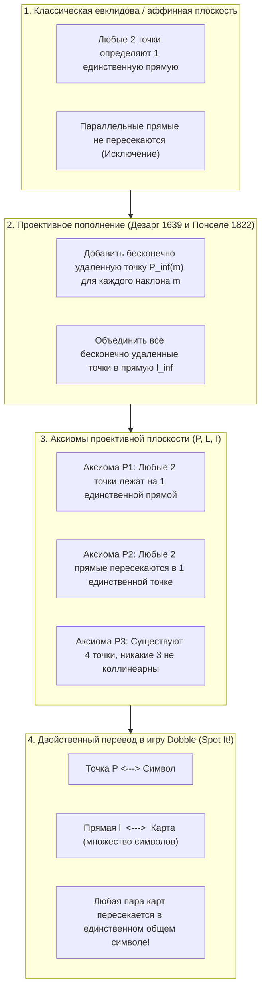
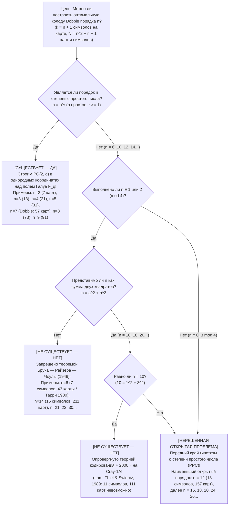

Если вы когда-нибудь открывали круглую жестяную коробочку всемирно известной настольной игры <strong>«Доббль» (Dobble / Spot It!)</strong>, то знаете ее предельно простое правило: на каждой круглой карточке изображено <strong>восемь различных символов</strong>. Когда на стол выкладываются любые две карты, игроки соревнуются, кто быстрее найдет и назовет совпадающий рисунок.

Каждого, кто играет в «Доббль», поражает почти магическое математическое свойство: <strong>какие бы две карты из всей колоды вы ни взяли, у них всегда есть общий символ — и притом ровно один!</strong>

Внутри этой маленькой коробки скрыта одна из жемчужин современной чистой математики: пересечение <strong>конечной проективной геометрии</strong>, <strong>конечных полей Галуа ($\mathbb{F}_q$)</strong> и <strong>теории комбинаторных блок-схем</strong>. Более того, стоит задать естественный вопрос: «А что если разместить на каждой карте $k$ символов вместо $8$?» — как мы мгновенно оказываемся перед <strong>задачей Леонарда Эйлера о 36 офицерах (1782)</strong>, <strong>теоремой Брука — Райзера — Чоулы (1949)</strong>, грандиозным <strong>2000-часовым расчетом на суперкомпьютере Cray-1 (1989)</strong> для $k = 11$ символов и одной из главных нерешенных проблем дискретной математики XXI века: <strong>существует ли конечная проективная плоскость порядка $12$ ($13$ символов на карте, $157$ карт)?</strong>

---

## Глава 1: Три математические загадки внутри коробки Dobble

В стандартной коммерческой коробке Dobble лежат <strong>55 карт</strong> по <strong>8 символов</strong> на каждой (всего используется $57$ различных символов). Попытка составить такую колоду вручную методом проб и ошибок немедленно разбивается о комбинаторный взрыв числа возможных карт:

$$\binom{57}{8} = \frac{57 \times 56 \times 55 \times 54 \times 53 \times 52 \times 51 \times 50}{8!} = 1\,652\,411\,475$$

Перебрать вручную <strong>1,65 миллиарда вариантов</strong> невозможно. Это ставит перед нами три загадки:
1. <strong>Максимальный размер колоды и 2 пропавшие карты</strong>: При $k = 8$ символах на карте теоретический максимум составляет ровно <strong>57 карт</strong> (и 57 символов). Почему же в магазинной коробке только <strong>55 карт</strong>?
2. <strong>Алгебраический чертеж</strong>: Как выписать все 57 карт без единого подбора с помощью алгебры?
3. <strong>Запрещенные колоды</strong>: Почему можно создать идеальный аналог Dobble с $k = 3$ (7 карт), $k = 4$ (13 карт), $k = 5$ (21 карта), $k = 6$ (31 карта) или $k = 8$ (57 карт), но ни один гений или суперкомпьютер во Вселенной никогда не сможет построить полную колоду с <strong>$k = 7$ символами (43 карты)</strong> или <strong>$k = 11$ символами (111 карт)</strong>?

---

## Глава 2: От евклидовой геометрии к проективной — бесконечно удаленные точки и двойственность

На обычной евклидовой плоскости ($\mathbb{R}^2$) через две различные точки проходит единственная прямая, а две различные прямые пересекаются в единственной точке — <em>за исключением параллельных прямых</em>. В XVII и XIX веках <strong>Жерар Дезарг (1639)</strong> и <strong>Жан-Виктор Понселе (1822)</strong> устранили это исключение, математизировав точку схода ренессансной перспективы:
1. Каждому пучку параллельных прямых с наклоном $m$ добавляется <strong>бесконечно удаленная точка $P_\infty(m)$</strong>, через которую проходят все прямые с наклоном $m$.
2. Все бесконечно удаленные точки $\{P_\infty(m)\}$ объединяются на одной новой прямой — <strong>бесконечно удаленной прямой $\ell_\infty$</strong> (линии горизонта).

Так возникает <strong>проективная плоскость $(\mathcal{P}, \mathcal{L}, \mathcal{I})$</strong>, задаваемая тремя аксиомами:
- <strong>Аксиома P1</strong>: Через любые две различные точки $P \neq Q$ проходит <strong>единственная</strong> прямая $\ell$.
- <strong>Аксиома P2</strong>: Любые две различные прямые $\ell_1 \neq \ell_2$ пересекаются в <strong>единственной</strong> точке $P$.
- <strong>Аксиома P3 (Невырожденность)</strong>: Существуют по крайней мере <strong>четыре точки общего положения</strong> (никакие три из которых не лежат на одной прямой).

Замена слов «Точка» и «Прямая» оставляет систему аксиом неизменной (<strong>Принцип двойственности</strong>), что дает точный словарь перевода для игры Dobble:

| Понятие проективной геометрии | Интерпретация A (Стандартный словарь) | Интерпретация B (Двойственный словарь) |
| :--- | :--- | :--- |
| <strong>Точка $P \in \mathcal{P}$</strong> | <strong>Символ (картинка)</strong> | <strong>Карта</strong> |
| <strong>Прямая $\ell \in \mathcal{L}$</strong> | <strong>Карта (набор символов)</strong> | <strong>Символ (множество карт, где он изображен)</strong> |
| <strong>Инцидентность $(P, \ell) \in \mathcal{I}$</strong> | Символ $P$ напечатан на карте $\ell$ | На карте $P$ есть символ $\ell$ |
| <strong>Смысл аксиомы P2</strong> | <strong>Любые две карты имеют ровно один общий символ</strong> | Любые два символа встречаются вместе ровно на одной карте |

---

## Глава 3: Теорема о числе элементов порядка $n$ и плоскость Фано $PG(2, 2)$

> <strong>Теорема 3.1 (Число точек и прямых конечной проективной плоскости)</strong>:
> Для любой конечной проективной плоскости $(\mathcal{P}, \mathcal{L}, \mathcal{I})$ существует целое число $n \ge 2$ (<strong>порядок</strong> плоскости), такое что каждая прямая содержит ровно $k = n + 1$ точек, через каждую точку проходит ровно $r = n + 1$ прямых, а общее число точек и прямых равно:
> $$|\mathcal{P}| = |\mathcal{L}| = N = n^2 + n + 1$$

<strong>Доказательство</strong>: Выберем базовую точку $P_0$. Любая другая точка $Q \neq P_0$ по аксиомам P1 и P2 лежит ровно на одной из $n + 1$ прямых, проходящих через $P_0$. На каждой такой прямой кроме $P_0$ лежит еще $n$ точек, откуда $|\mathcal{P}| = 1 + (n + 1)n = n^2 + n + 1$. Для Dobble ($k = 8 \implies n = 7$) получаем $N = 7^2 + 7 + 1 = 57$ карт и 57 символов.

### Самая маленькая конечная геометрия: плоскость Фано $PG(2, 2)$ ($n = 2$)

При $n = 2$ ($k = 3$ символа на карте, $N = 7$ карт) итальянский геометр <strong>Джино Фано (1892)</strong> открыл <strong>плоскость Фано $PG(2, 2)$</strong>. Ее 7 точек соответствуют 7 ненулевым двоичным векторам из $\mathbb{F}_2^3 \setminus \{\mathbf{0}\}$ (три точки образуют прямую тогда и только тогда, когда их побитовая сумма XOR равна $u \oplus v \oplus w = \mathbf{0}$) или циклическим сдвигам <strong>совершенного разностного множества $\{1, 2, 4\} \pmod 7$</strong>:

| Карта | Циклический сдвиг $\ell_i = \{1+i, 2+i, 4+i\} \pmod 7$ | 3 символа на карте | Геометрическая роль на диаграмме Фано |
| :---: | :---: | :---: | :--- |
| <strong>Карта $\ell_0$</strong> | $+0$ | $\{1, 2, 4\}$ | Внешняя сторона 1 равностороннего треугольника |
| <strong>Карта $\ell_1$</strong> | $+1$ | $\{2, 3, 5\}$ | Внешняя сторона 2 равностороннего треугольника |
| <strong>Карта $\ell_2$</strong> | $+2$ | $\{3, 4, 6\}$ | Внешняя сторона 3 равностороннего треугольника |
| <strong>Карта $\ell_3$</strong> | $+3$ | $\{4, 5, 0\}$ | Медиана 1 (от вершины к середине стороны) |
| <strong>Карта $\ell_4$</strong> | $+4$ | $\{5, 6, 1\}$ | Медиана 2 (от вершины к середине стороны) |
| <strong>Карта $\ell_5$</strong> | $+5$ | $\{6, 0, 2\}$ | Медиана 3 (от вершины к середине стороны) |
| <strong>Карта $\ell_6$</strong> | $+6$ | $\{0, 1, 3\}$ | <strong>Вписанная окружность через 3 середины сторон!</strong> |

---

## Глава 4: Однородные координаты над полями Галуа $\mathbb{F}_q$ и устройство 57 карт Dobble ($n = 7$)

<strong>Конечное поле (поле Галуа) $\mathbb{F}_q$</strong> из $q$ элементов существует <strong>тогда и только тогда, когда $q = p^r$ является степенью простого числа $p$</strong>. В трехмерном пространстве $\mathbb{F}_q^3 \setminus \{\mathbf{0}\}$ классы пропорциональности $[x : y : z] \sim [\lambda x : \lambda y : \lambda z]$ ($\lambda \in \mathbb{F}_q^\times$) образуют $\frac{q^3-1}{q-1} = q^2 + q + 1$ проективных точек, а линейные уравнения $ax + by + cz = 0$ задают $q^2 + q + 1$ прямых <strong>дезарговой плоскости $PG(2, q)$</strong>.

Для Dobble ($q = 7$, вычеты по модулю $7$ в $\mathbb{F}_7 = \{0,\dots,6\}$) 57 символов делятся на <strong>49 аффинных точек решетки</strong> $P_{x,y} = [x : y : 1]$ и <strong>8 бесконечно удаленных точек</strong> $I_m = [1 : m : 0]$ и $I_\infty = [0 : 1 : 0]$. Все 57 карт распадаются на три семейства:
1. <strong>49 карт наклонных и горизонтальных прямых $L_{m,b}$</strong>: 7 точек $\{(x, mx+b \bmod 7)\}$ плюс точка $I_m$.
2. <strong>7 карт вертикальных прямых $V_c$</strong>: 7 точек $\{(c, y)\}$ плюс вертикальная точка $I_\infty$.
3. <strong>1 карта линии горизонта $L_\infty$</strong>: все 8 бесконечно удаленных точек $\{I_0, \dots, I_6, I_\infty\}$.

Либо по <strong>теореме Зингера (1938)</strong> все 57 карт получаются циклическим сдвигом $D + i \pmod{57}$ разностного множества $D = \{0, 1, 3, 13, 32, 36, 43, 52\} \pmod{57}$. В коммерческой коробке оставлено 55 карт вместо 57 ради удобства типографской вырубки ($55 = 5 \times 11$) и деления карт между игроками, при этом аксиома P2 для оставшихся карт сохраняется.

---

## Глава 5: 36 офицеров Эйлера, теорема Брука — Райзера — Чоулы и рубежи $n = 10$ и $n = 12$

Проективная плоскость порядка $n$ является симметричной $(n^2+n+1, n+1, 1)$-блок-схемой (BIBD с равенством $b = v$ в неравенстве Фишера) и, по <strong>теореме эквивалентности Р. Ч. Бозе (1938)</strong>, существует тогда и только тогда, когда существует <strong>$n - 1$ попарно ортогональных латинских квадратов (MOLS) порядка $n$</strong>.

- <strong>Порядок $n = 6$ ($7$ символов, $43$ карты)</strong>: Требует $5$ MOLS порядка $6$. Но еще в 1900 году французский математик <strong>Гастон Тарри</strong> полным перебором доказал, что <strong>задача Эйлера о 36 офицерах (1782)</strong> не имеет решения: не существует даже $2$ ортогональных латинских квадратов порядка $6$, поэтому $n = 6$ невозможен!
- <strong>Теорема Брука — Райзера — Чоулы (1949)</strong>: Если конечная проективная плоскость порядка $n$ существует и $n \equiv 1 \text{ или } 2 \pmod 4$, то $n$ обязано представляться в виде <strong>суммы двух квадратов целых чисел</strong>:
  $$n = a^2 + b^2 \quad (a, b \in \mathbb{Z})$$
  Эта теорема мгновенно запрещает $n = 6, 14, 21, 22, 30, \dots$!
- <strong>Порядок $n = 10$ ($11$ символов, $111$ карт) и суперкомпьютер Cray-1 (1989)</strong>: Так как $10 = 1^2 + 3^2$, теорема Брука — Райзера — Чоулы не исключает $n = 10$. Лишь в 1989 году <strong>Клемент Лам (Clement W. H. Lam), Ларри Тиль и Стэнли Свирч</strong> с помощью теории кодов, исправляющих ошибки, и <strong>2000 часов вычислений на суперкомпьютере Cray-1A</strong> доказали, что проективной плоскости порядка $10$ не существует.
- <strong>Порядок $n = 12$ ($13$ символов, $157$ карт)</strong>: Поскольку $12 \equiv 0 \pmod 4$, теорема Брука — Райзера — Чоулы неприменима, а пространство перебора недоступно даже современным суперкомпьютерам. Вопрос о существовании плоскости порядка $12$ (<strong>гипотеза о степени простого числа / PPC</strong>) остается одной из величайших открытых проблем математики!

| Порядок $n$ | Символов на карте $k = n+1$ | Карт и символов $N = n^2+n+1$ | Существует? | Математическая конструкция или доказательство несуществования |
| :---: | :---: | :---: | :---: | :--- |
| <strong>$n = 2$</strong> | $3$ | <strong>$7$</strong> | <strong>Да (единственна)</strong> | Простое $2$: минимальная проективная <strong>плоскость Фано $PG(2, 2)$</strong> |
| <strong>$n = 3, 4, 5$</strong> | $4, 5, 6$ | <strong>$13, 21, 31$</strong> | <strong>Да (единственны)</strong> | Степени простых $3, 2^2, 5$: $PG(2, q)$ над $\mathbb{F}_q$ |
| <strong>$n = 6$</strong> | $7$ | $43$ | <strong>Нет (невозможно)</strong> | $6 \equiv 2 \pmod 4$, $6 \neq a^2+b^2$. <strong>36 офицеров Эйлера / Тарри (1900) / Брук — Райзер (1949)</strong> |
| <strong>$n = 7$</strong> | <strong>$8$</strong> | <strong>$57$</strong> | <strong>Да (единственна)</strong> | Простое $7$: $PG(2, 7)$ над $\mathbb{F}_7$. <strong>Игра Dobble (в коробке 55 карт)</strong> |
| <strong>$n = 8, 9$</strong> | $9, 10$ | <strong>$73, 91$</strong> | <strong>Да ($1$ и $4$ типа)</strong> | Степени простых $2^3, 3^2$: при $n=9$ кроме $PG(2,9)$ есть 3 недезарговы плоскости |
| <strong>$n = 10$</strong> | $11$ | $111$ | <strong>Нет (невозможно)</strong> | $10 = 1^2+3^2$, но <strong>опровергнуто Ламом и др. (1989) за 2000 ч на Cray-1A</strong> |
| <strong>$n = 11, 13$</strong> | $12, 14$ | <strong>$133, 183$</strong> | <strong>Да</strong> | Простые $11, 13$: $PG(2, 11)$ и $PG(2, 13)$ |
| <strong>$n = 12$</strong> | $13$ | $157$ | <strong>[Открытая проблема]</strong> | $12 \equiv 0 \pmod 4$: теорема Брука — Райзера неприменима. <strong>Наименьший открытый порядок!</strong> |
| <strong>$n = 14$</strong> | $15$ | $211$ | <strong>Нет (невозможно)</strong> | $14 \equiv 2 \pmod 4$ и $14 \neq a^2+b^2$. <strong>Запрещено теоремой Брука — Райзера — Чоулы</strong> |
