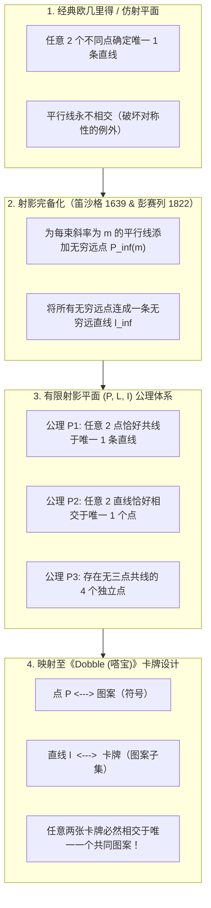
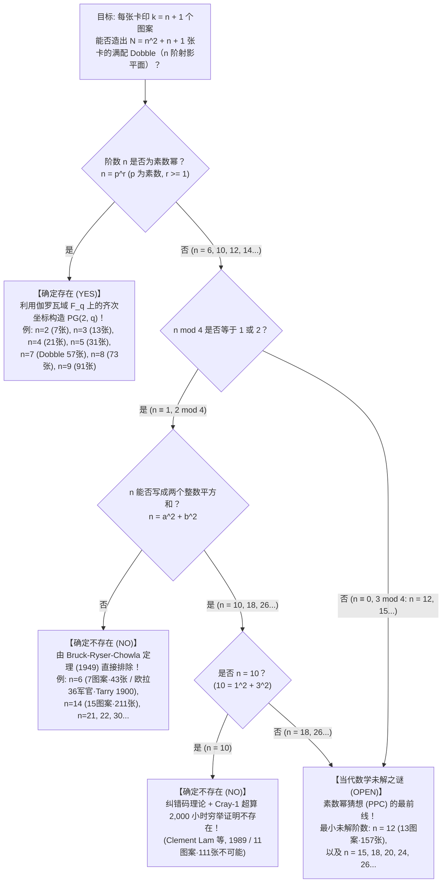

如果你玩过装在圆形铁盒里的全球畅销派对卡牌游戏<strong>《Dobble》（北美版名为《Spot It!》，中文常译作《嗒宝》）</strong>，你一定会对它简单却神奇的规则印象深刻。铁盒里装有一叠圆形卡牌，<strong>每张卡牌上印有 8 个不同的图案（符号）</strong>——雪人、钥匙、太阳镜、船锚、爱心、恐龙、闪电等，大小和旋转角度各不相同。当任意翻开两张卡牌时，玩家们要比拼眼力，率先找出两张卡牌上共同拥有的那个图案并喊出它的名字。

任何玩过几局的人都会产生一种强烈的数学震撼：<strong>无论你从整副牌中任意抽出哪两张卡牌，它们之间必定存在共同的图案，而且永远恰好只有 1 个共同图案！</strong>既不会出现毫无交集的情况，也绝不会出现两个以上图案重复的情况。整副牌中的每一对卡牌，都被唯一的一座桥梁精确地连接在一起。

在这个看似简单的玩具铁盒里，封印着 19 至 20 世纪纯粹数学的结晶——<strong>有限射影几何（Finite Projective Geometry）</strong>、<strong>伽罗瓦域（有限域 $\mathbb{F}_q$）</strong>以及<strong>组合设计理论（Combinatorial Design Theory）</strong>。更令人惊叹的是，一旦我们将这个问题稍微推广：“如果每张卡牌上印 $k$ 个图案，能否造出同样的卡牌组？”，我们就会立刻撞上<strong>莱昂哈德·欧拉（Leonhard Euler）在 1782 年提出的“三十六军官问题”</strong>、<strong>Bruck-Ryser-Chowla 定理</strong>、<strong>1989 年 Cray-1 超级计算机耗时 2,000 小时才攻克的“10 阶射影平面不存在性证明”</strong>，以及当代离散数学最著名的未解之谜之一：<strong>12 阶有限射影平面（每张卡 13 个图案、共 157 张卡）究竟是否存在？</strong>

---

## 第一章：藏在《Dobble》铁盒里的三大数学之谜

让我们先用数学家的眼光审视市售版《Dobble》的规格。打开铁盒，里面共有 <strong>55 张卡牌</strong>，每张卡牌印有 <strong>8 个不同的图案</strong>。

假设你是一名游戏设计师，试图凭直觉手工拼凑出这样一副卡牌：每张卡画 8 个图案，且任意两张卡恰好共享 1 个图案。当你尝试画到第 10 张左右时，就会立刻陷入严重的组合爆炸与逻辑死胡同。事实上，正如我们稍后将严格证明的那样，每张卡 8 个图案所对应的自然图案总数是 57 种。从 57 种图案中任选 8 个的组合数高达：

$$\binom{57}{8} = \frac{57 \times 56 \times 55 \times 54 \times 53 \times 52 \times 51 \times 50}{8!} = 1,652,411,475$$

在超过 <strong>16.5 亿种</strong>候选卡牌中，靠暴力搜索（Brute Force）找出满足两两唯一相交的最大卡组是完全不可能的。由此，我们面临<strong>三大核心数学之谜</strong>：

1. <strong>第一之谜（最大卡牌数与缺失的 2 张卡）</strong>：当每张卡包含 $k = 8$ 个图案时，数学上最多能造出多少张卡？理论极限其实是 <strong>57 张卡</strong>（共使用 <strong>57 种图案</strong>）。那么，为什么市售的《Dobble》铁盒里只有 <strong>55 张卡</strong>，少掉的 2 张卡去哪儿了？
2. <strong>第二之谜（代数构造蓝图）</strong>：如何不靠任何试错，利用纯粹的代数算法一次性写出全部 57 张卡牌的图案分配方案？
3. <strong>第三之谜（被数学法则禁止的图案数）</strong>：如果改变每张卡的图案数 $k$，我们可以完美造出 $k = 3$（7 张卡）、$k = 4$（13 张卡）、$k = 5$（21 张卡）、$k = 6$（31 张卡）以及 $k = 8$（57 张卡）的卡牌组。然而，夹在中间的 <strong>$k = 7$（每张卡 7 个图案、43 张卡）</strong>以及 <strong>$k = 11$（每张卡 11 个图案、111 张卡）</strong>，却是全宇宙任何天才或超级计算机都<strong>绝对无法造出来</strong>的！为什么大自然唯独禁止了这些数字？

解开这三大谜团的钥匙，源于文艺复兴时期的透视绘画与<strong>射影几何学（Projective Geometry）</strong>。

---

## 第二章：从欧几里得几何到射影几何 —— 无穷远点与对偶原理

### 2.1 消除“平行线不相交”的例外

在我们熟悉的欧几里得平面几何（$\mathbb{R}^2$）中，“点”与“直线”遵循两条基本性质：
- <strong>性质 A</strong>：任意两个不同的点，确定<strong>唯一一条</strong>直线。
- <strong>性质 B'</strong>：任意两条不同的直线，相交于<strong>唯一一个</strong>点——<em>除非这两条直线互相平行（此时它们永不相交）</em>。

对于追求完美对称的数学家而言，性质 B' 末尾的“除非平行”是一个破坏点线对称性的刺眼瑕疵。15 世纪意大利文艺复兴时期的画家（如布鲁内莱斯基、阿尔伯蒂、丢勒）在研究<strong>线性透视法</strong>时发现：地面上向远方无限延伸的两条平行铁轨，在画布的地平线上会汇聚并相交于同一个点——<strong>消失点（Vanishing Point）</strong>。

17 世纪法国数学家<strong>吉拉德·笛沙格（Girard Desargues, 1591–1661）</strong>与 19 世纪法国几何学家<strong>让-维克托·彭赛列（Jean-Victor Poncelet, 1788–1867）</strong>将这一艺术直觉严格化，通过对普通仿射平面 $\mathbb{A}^2$ 进行三步“射影完备化”手术，彻底消灭了平行线：

1. <strong>平行线束与无穷远点</strong>：将平面上所有具有相同斜率 $m$ 的平行线归为一族（称为平行线束，竖直线斜率记为 $m = \infty$）。为每一个斜率 $m$ 引入一个新的理想点 $P_\infty(m)$，称为<strong>无穷远点（Point at Infinity）</strong>，并规定所有斜率为 $m$ 的直线都穿过 $P_\infty(m)$。
2. <strong>不同斜率的交点</strong>：斜率不同（$m_1 \neq m_2$）的两条直线已经在普通平面内相交于唯一一点，它们不共享无穷远点。
3. <strong>无穷远直线</strong>：将所有方向的无穷远点 $\{P_\infty(m)\}$ 收集起来，规定它们共同位于一条全新的直线 $\ell_\infty$ 上，称为<strong>无穷远直线（Line at Infinity，即数学地平线）</strong>。

经过这番改造，原本平行的两条斜率为 $m$ 的直线在无穷远点 $P_\infty(m)$ 唯一相交；普通直线与无穷远直线 $\ell_\infty$ 也在 $P_\infty(m)$ 唯一相交。<strong>在射影平面中，“平行”的概念彻底消失，任何两条不同的直线都毫无例外地相交于唯一一点！</strong>

### 2.2 射影平面的三条公理与点线对偶原理

设 $\mathcal{P}$ 为点的集合，$\mathcal{L}$ 为直线的集合，$\mathcal{I} \subset \mathcal{P} \times \mathcal{L}$ 为关联关系（点 $P$ 在直线 $\ell$ 上）。若三元组 $(\mathcal{P}, \mathcal{L}, \mathcal{I})$ 满足以下三条公理，则称之为<strong>射影平面（Projective Plane）</strong>：

- <strong>公理 P1</strong>：任意两个不同的点 $P, Q \in \mathcal{P}$，恰好共同位于<strong>唯一一条</strong>直线 $\ell \in \mathcal{L}$ 上。
- <strong>公理 P2</strong>：任意两条不同的直线 $\ell_1, \ell_2 \in \mathcal{L}$，恰好相交于<strong>唯一一个</strong>点 $P \in \mathcal{P}$。
- <strong>公理 P3（非退化四点公理）</strong>：存在至少<strong>四个处于一般位置的点</strong>，使得其中任意三点都不共线。

观察公理 P1 和 P2：如果我们将公理中的“点”与“直线”互换，“位于……上”与“穿过……”互换，公理体系保持完全不变！这被称为射影几何的<strong>对偶原理（Principle of Duality）</strong>。当我们把射影几何的语言翻译成《Dobble》时，奇迹出现了：

| 射影几何概念 | 解释 A（标准字典） | 解释 B（对偶字典） |
| :--- | :--- | :--- |
| <strong>点 $P \in \mathcal{P}$</strong> | <strong>图案（符号）</strong> | <strong>卡牌</strong> |
| <strong>直线 $\ell \in \mathcal{L}$</strong> | <strong>卡牌（包含若干图案的集合）</strong> | <strong>图案（印有该图案的卡牌集合）</strong> |
| <strong>关联 $(P, \ell) \in \mathcal{I}$</strong> | 图案 $P$ 印在卡牌 $\ell$ 上 | 卡牌 $P$ 上印有图案 $\ell$ |
| <strong>公理 P2 的含义</strong> | <strong>任意两张不同的卡牌，恰好共享唯一 1 个图案</strong> | 任意两个不同的图案，恰好同时出现在唯一 1 张卡牌上 |
| <strong>公理 P1 的含义</strong> | 任意两个不同的图案，恰好同时出现在唯一 1 张卡牌上 | <strong>任意两张不同的卡牌，恰好共享唯一 1 个图案</strong> |

---

## 第三章：$n$ 阶有限射影平面的计数定理与“法诺平面 $PG(2,2)$”

### 3.1 总卡牌数公式 $N = n^2 + n + 1$ 的严格推导

当射影平面的点集 $\mathcal{P}$ 和线集 $\mathcal{L}$ 为有限集合时，公理 P1–P3 赋予了它极其严格的数量规律：

> <strong>定理 3.1（有限射影平面计数定理）</strong>：
> 对任意有限射影平面 $(\mathcal{P}, \mathcal{L}, \mathcal{I})$，存在正整数 $n \ge 2$（称为该射影平面的<strong>阶 / Order</strong>），使得：
> 1. 每条直线恰好包含 <strong>$k = n + 1$ 个点</strong>（每张卡牌印有 $n+1$ 个图案）。
> 2. 每个点恰好位于 <strong>$r = n + 1$ 条直线</strong>上（每个图案出现在 $n+1$ 张卡牌上）。
> 3. 点的总数与直线的总数完全相等，均为：
> $$|\mathcal{P}| = |\mathcal{L}| = N = n^2 + n + 1$$

<strong>【证明精要】</strong>：
首先，任取两条直线 $\ell_1, \ell_2$，由公理 P3 可在两直线外取一点 $O$。过 $O$ 作射线连接 $\ell_1$ 上的点 $X$ 与 $\ell_2$ 上的交点 $Y$，公理 P1 与 P2 保证映射 $X \mapsto Y$ 是双射（一一对应），故所有直线包含相同数量的点，记为 $k = n + 1$。由对偶原理，穿过每个点的直线数也等于 $r = n + 1$。
接着，固定平面上一个基准点 $P_0 \in \mathcal{P}$。平面上除 $P_0$ 以外的任何点 $Q$，都与 $P_0$ 确定唯一一条穿过 $P_0$ 的直线（公理 P1），且不同直线除 $P_0$ 外无其他交点（公理 P2）。穿过 $P_0$ 的直线共有 $n + 1$ 条，每条直线上除了 $P_0$ 自身外，还包含恰好 $n$ 个其他的点。因此，平面上点的总数为：

$$|\mathcal{P}| = \underbrace{1}_{\text{基准点 } P_0} + \underbrace{(n + 1)}_{\text{过 } P_0 \text{ 的直线数}} \times \underbrace{n}_{\text{每条线上除 } P_0 \text{ 外的点数}} = n^2 + n + 1$$

由对偶原理，直线的总数 $|\mathcal{L}|$ 同样为 $n^2 + n + 1$。$\blacksquare$

将《Dobble》的 $k = 8$（每张卡 8 个图案）代入公式，立刻得到阶数 $n = k - 1 = 7$，以及理论最大卡牌数（和图案总数）：

$$N = 7^2 + 7 + 1 = 49 + 7 + 1 = 57 \text{ 张卡（57 种图案）}$$

### 3.2 最小的有限几何：法诺平面 $PG(2, 2)$（$n = 2$，7 张迷你版 Dobble）

当 $n = 2$ 时，我们得到世界上最小的有限射影平面——1892 年由意大利数学家<strong>吉诺·法诺（Gino Fano, 1871–1952）</strong>发现的<strong>法诺平面（Fano Plane, $PG(2, 2)$）</strong>。其中每张卡有 $k = 2 + 1 = 3$ 个图案，共有 $N = 2^2 + 2 + 1 = 7$ 张卡和 7 个图案。

我们可以通过两种优美的方法构造这 7 张卡：
1. <strong>二进制非零向量法（$\mathbb{F}_2^3 \setminus \{\mathbf{0}\}$）</strong>：取二元域 $\mathbb{F}_2 = \{0, 1\}$ 上的 7 个非零三位二进制向量 $(0,0,1)$ 至 $(1,1,1)$ 作为 7 个点。规定三个点 $\{u, v, w\}$ 共线（构成一张卡）当且仅当它们的按位异或和为零：$u \oplus v \oplus w = (0,0,0)$。
2. <strong>循环差集法（Cyclic Difference Set）</strong>：将 7 个图案编号为 $\{0, 1, 2, 3, 4, 5, 6\} \pmod 7$。取第 0 张卡为 $\ell_0 = \{1, 2, 4\}$。由于 $\{1, 2, 4\}$ 中任意两数之差 $\pmod 7$ 恰好遍历 $\{1, 2, 3, 4, 5, 6\}$ 各一次（完美差集），只需将 $\ell_0$ 依次加 $+i \pmod 7$（$i = 0, \dots, 6$），即可生成全部 7 张卡：

| 卡牌编号 | 循环平移 $\ell_i = \{1+i, 2+i, 4+i\} \pmod 7$ | 卡牌上的 3 个图案 | 在经典法诺平面图中的几何形态 |
| :---: | :---: | :---: | :--- |
| <strong>卡牌 $\ell_0$</strong> | $+0$ | $\{1, 2, 4\}$ | 正三角形的外边 1 |
| <strong>卡牌 $\ell_1$</strong> | $+1$ | $\{2, 3, 5\}$ | 正三角形的外边 2 |
| <strong>卡牌 $\ell_2$</strong> | $+2$ | $\{3, 4, 6\}$ | 正三角形的外边 3 |
| <strong>卡牌 $\ell_3$</strong> | $+3$ | $\{4, 5, 0\}$ | 顶点连向对边中点的中线 1 |
| <strong>卡牌 $\ell_4$</strong> | $+4$ | $\{5, 6, 1\}$ | 顶点连向对边中点的中线 2 |
| <strong>卡牌 $\ell_5$</strong> | $+5$ | $\{6, 0, 2\}$ | 顶点连向对边中点的中线 3 |
| <strong>卡牌 $\ell_6$</strong> | $+6$ | $\{0, 1, 3\}$ | <strong>穿过三个边中点的内切圆（第 7 条直线！）</strong> |

---

## 第四章：伽罗瓦域 $\mathbb{F}_q$ 上的齐次坐标与 57 张《Dobble》的完整构造

### 4.1 伽罗瓦域 $\mathbb{F}_q$ 与素数幂定律

为了把坐标构造推广到任意阶 $n = q$，我们需要一个包含 $q$ 个元素且能自由进行加、减、乘、除（非零元求逆）四则运算的代数系统——即<strong>有限域（伽罗瓦域 $\mathbb{F}_q$ 或 $GF(q)$）</strong>。抽象代数的基本定理指出：

> <strong>定理 4.1（伽罗瓦域存在定理）</strong>：
> 含 $q$ 个元素的有限域 $\mathbb{F}_q$ 存在，<strong>当且仅当 $q$ 是素数的正整数次幂（Prime Power）</strong>：
> $$q = p^r \quad （p \text{ 为素数}, \; r \in \{1, 2, 3, \dots\}）$$
> 当 $q = p$ 为素数时，$\mathbb{F}_p = \mathbb{Z}/p\mathbb{Z}$（模 $p$ 剩余类域）；当 $q = p^r$（$r \ge 2$，如 $q = 4, 8, 9$）时，$\mathbb{F}_q$ <strong>不是</strong>模 $q$ 整数环 $\mathbb{Z}/q\mathbb{Z}$，而是通过 $r$ 次不可约多项式构造的商域 $\mathbb{F}_p[x]/(f(x))$。而当 $q = 6, 10, 12, 14, 15, \dots$ 不是素数幂时，有限域 $\mathbb{F}_q$ <strong>绝对不存在</strong>！

### 4.2 齐次坐标 $[x : y : z]$ 与《Dobble（$q = 7$）》的 57 张卡全解

给定有限域 $\mathbb{F}_q$，考虑三维向量空间 $\mathbb{F}_q^3$ 中去掉原点 $(0,0,0)$ 后的 $q^3 - 1$ 个非零向量。定义等价关系 $(x, y, z) \sim (\lambda x, \lambda y, \lambda z)$（$\lambda \in \mathbb{F}_q^\times$），每个等价类记为<strong>齐次坐标 $[x : y : z]$</strong>，代表射影平面 $PG(2, q)$ 中的一个<strong>点</strong>。因为每个等价类包含 $q - 1$ 个非零向量，点的总数恰好为：

$$|\mathcal{P}| = \frac{q^3 - 1}{q - 1} = q^2 + q + 1$$

同样，齐次线性方程 $ax + by + cz = 0$（$[a:b:c] \neq [0:0:0]$）的解集构成一条<strong>射影直线 $\ell_{[a:b:c]}$</strong>。由格拉斯曼维数公式 $\dim(W_1 \cap W_2) = 2 + 2 - 3 = 1$，任意两条不同直线（二维子空间）必相交于唯一一个点（一维子空间）。

对于《Dobble》（$q = 7$，$\mathbb{F}_7 = \{0, 1, 2, 3, 4, 5, 6\} \pmod 7$），57 个图案和 57 张卡牌可以精确地分为三组：
- <strong>57 个图案（点）</strong>：
  1. <strong>49 个普通网格点</strong>：$P_{x,y} = [x : y : 1]$，其中 $x, y \in \{0, \dots, 6\}$。
  2. <strong>8 个无穷远点</strong>：代表 7 种斜率的 $I_m = [1 : m : 0]$（$m \in \{0, \dots, 6\}$），以及代表竖直方向的 $I_\infty = [0 : 1 : 0]$。
- <strong>57 张卡牌（直线）</strong>：
  1. <strong>49 张斜线与水平线卡 $L_{m,b}$</strong>：对应方程 $y \equiv mx + b \pmod 7$ 上的 7 个网格点，外加第 8 个图案——无穷远点 $I_m$。
  2. <strong>7 张竖直线卡 $V_c$</strong>：对应方程 $x \equiv c \pmod 7$ 上的 7 个网格点，外加第 8 个图案——无穷远点 $I_\infty$。
  3. <strong>1 张无穷远直线卡 $L_\infty$</strong>：由全部 8 个无穷远点 $\{I_0, I_1, \dots, I_6, I_\infty\}$ 组成的“地平线卡”。

（或者根据 <strong>Singer 定理 (1938)</strong>，取模 57 的循环差集 $D = \{0, 1, 3, 13, 32, 36, 43, 52\} \pmod{57}$，依次加 $+1 \pmod{57}$ 即可一行代码生成全部 57 张 Dobble 卡牌！）

<strong>为什么市售版《Dobble》只有 55 张卡而不是 57 张？</strong>
从 57 张完整射影平面卡牌中任意抽走 2 张卡后，剩下的 55 张卡依然完美满足公理 P2（任意两张卡仍恰好共享 1 个图案）。厂商之所以减去 2 张卡，是因为 $57 = 3 \times 19$ 在印刷厂大型模切纸版（Die-cut sheet）上难以排版，而 $55 = 5 \times 11$（或两副牌 $110 = 10 \times 11$）能完美契合矩形印刷网格，同时也更方便在多人迷你游戏中均分卡牌。

---

## 第五章：组合设计、欧拉三十六军官问题、Bruck-Ryser-Chowla 定理与 10 阶、12 阶前沿

### 5.1 均衡不完全区组设计（BIBD）、正交拉丁方（MOLS）与 $n = 6$ 的崩塌

在<strong>罗纳德·费希尔（Ronald Fisher）</strong>开创的组合设计理论中，有限射影平面等价于参数为 $\lambda = 1, k = n+1, v = b = n^2+n+1$ 的<strong>对称均衡不完全区组设计（Symmetric BIBD）</strong>，也即<strong>施泰纳系统 $S(2, n+1, n^2+n+1)$</strong>，它达到了<strong>费希尔不等式（$b \ge v$）</strong>的等号极限。

1938 年，数学家<strong>博斯（R. C. Bose）</strong>证明了一条连接射影几何与拉丁方的核心等价定理：

> <strong>定理 5.1（射影平面与正交拉丁方 MOLS 等价定理）</strong>：
> $n$ 阶有限射影平面存在，<strong>当且仅当存在 $n - 1$ 个 $n$ 阶两两正交拉丁方（Mutually Orthogonal Latin Squares, MOLS）</strong>。

现在考察第一个非素数幂阶数：<strong>$n = 6$（每张卡 $k = 7$ 个图案，共 $N = 6^2 + 6 + 1 = 43$ 张卡）</strong>。
如果 $6$ 阶射影平面存在，就必须存在 $6 - 1 = 5$ 个两两正交的 $6 \times 6$ 拉丁方。然而，早在 1782 年，<strong>莱昂哈德·欧拉</strong>就提出了著名的<strong>“三十六军官问题”</strong>：能否将来自 6 个军团、6 种军阶的 36 名军官排成 $6 \times 6$ 方阵，使每行每列都不重复？这等价于寻找<strong>仅仅 2 个</strong>正交的 6 阶拉丁方。1900 年，法国数学家<strong>加斯顿·塔里（Gaston Tarry）</strong>穷举了全部 9,408 种标准 6 阶拉丁方，严格证明了<strong>连 2 个正交的 6 阶拉丁方都不存在，更不用说 5 个了！</strong>因此，每张卡 7 个图案的 43 张《Dobble》在数学上<strong>绝对不可能存在</strong>。

### 5.2 Bruck-Ryser-Chowla 定理（1949）与 Cray-1 超算对 $n = 10$ 的终结（1989）

1949 年，Richard Bruck、Herbert Ryser 与 Sarvadaman Chowla 利用关联矩阵方程 $M M^\top = n I_N + J_N$ 上的有理二次型理论（Hasse-Minkowski 定理与拉格朗日四平方和定理），证明了震撼数学界的非存在性定理：

> <strong>定理 5.2（Bruck-Ryser-Chowla 定理, 1949）</strong>：
> 若 $n$ 阶有限射影平面存在，且 $n \equiv 1 \text{ 或 } 2 \pmod 4$，则 $n$ 必须能表示为<strong>两个整数的平方和</strong>：
> $$n = a^2 + b^2 \quad (a, b \in \mathbb{Z})$$

这一定理瞬间秒杀了无穷多个非素数幂阶数：
- <strong>$n = 6$</strong>：$6 \equiv 2 \pmod 4$，但 $6$ 不能写成两个平方数之和（$6 \neq a^2 + b^2$），故<strong>不存在</strong>！
- <strong>$n = 14$</strong>：$14 \equiv 2 \pmod 4$，且 $14 = 2 \times 7 \neq a^2 + b^2$，故<strong>不存在</strong>！
- <strong>$n = 21, 22, 30, 33, \dots$</strong>：全部同理直接排除！

然而，对于下一个非素数幂 <strong>$n = 10$（每张卡 11 个图案、共 111 张卡）</strong>，虽然 $10 \equiv 2 \pmod 4$，但恰好有：

$$10 = 1^2 + 3^2 = 1 + 9$$

它竟然通过了 Bruck-Ryser-Chowla 定理的检验！为了解决 $n = 10$ 是否存在的世纪难题，MacWilliams、Sloane 与 Thompson（1970）将 $111 \times 111$ 关联矩阵的行向量转化为二元线性纠错码 $\mathcal{C} \subset \mathbb{F}_2^{111}$。随后，加拿大康考迪亚大学的<strong>林永康（Clement W. H. Lam）</strong>、Larry Thiel 与 Stanley Swiercz 团队在<strong>Cray-1A 超级计算机上连续运行了约 2,000 小时</strong>，于 1989 年彻底证明了权重为 12、15、16 的码字均不存在，从而宣告：<strong>10 阶有限射影平面不存在！</strong>

而当我们来到 <strong>$n = 12$（每张卡 13 个图案、共 157 张卡）</strong>时，由于 $12 \equiv 0 \pmod 4$ 绕过了 Bruck-Ryser-Chowla 定理，且其搜索空间远超人类所有超级计算机的极限，<strong>“12 阶有限射影平面是否存在”至今仍是当代数学最重大的未解之谜（素数幂猜想 PPC 的最前线）！</strong>

### 5.3 $n = 2 \sim 14$ 阶有限射影平面（广义 Dobble 卡组）完整分类表

| 阶数 $n$ | 每卡图案数 $k = n+1$ | 最大卡牌与图案总数 $N = n^2+n+1$ | 是否存在？ | 数学结构与存在/不存在性证明依据 |
| :---: | :---: | :---: | :---: | :--- |
| <strong>$n = 2$</strong> | $3$ | <strong>$7$</strong> | <strong>存在（唯一）</strong> | 素数 $2$：最小射影平面<strong>“法诺平面 $PG(2, 2)$”</strong> |
| <strong>$n = 3$</strong> | $4$ | <strong>$13$</strong> | <strong>存在（唯一）</strong> | 素数 $3$：$\mathbb{F}_3$ 上的射影平面 $PG(2, 3)$ |
| <strong>$n = 4$</strong> | $5$ | <strong>$21$</strong> | <strong>存在（唯一）</strong> | 素数幂 $2^2$：扩域 $\mathbb{F}_4$ 上的 $PG(2, 4)$ |
| <strong>$n = 5$</strong> | $6$ | <strong>$31$</strong> | <strong>存在（唯一）</strong> | 素数 $5$：$\mathbb{F}_5$ 上的 $PG(2, 5)$ |
| <strong>$n = 6$</strong> | $7$ | $43$ | <strong>不存在（不可能）</strong> | $6 \equiv 2 \pmod 4$ 且 $6 \neq a^2+b^2$。<strong>欧拉 36 军官问题 / Tarry (1900) / Bruck-Ryser (1949)</strong> |
| <strong>$n = 7$</strong> | <strong>$8$</strong> | <strong>$57$</strong> | <strong>存在（唯一）</strong> | 素数 $7$：$\mathbb{F}_7$ 上的 $PG(2, 7)$。<strong>市售《Dobble / 嗒宝》（铁盒内含 55 张）</strong> |
| <strong>$n = 8$</strong> | $9$ | <strong>$73$</strong> | <strong>存在（唯一）</strong> | 素数幂 $2^3$：扩域 $\mathbb{F}_8$ 上的 $PG(2, 8)$ |
| <strong>$n = 9$</strong> | $10$ | <strong>$91$</strong> | <strong>存在（共 4 种）</strong> | 素数幂 $3^2$：$PG(2, 9)$ 及 3 种非笛沙格平面（Hall 平面、对偶 Hall、Hughes 平面） |
| <strong>$n = 10$</strong> | $11$ | $111$ | <strong>不存在（不可能）</strong> | 满足 $10 = 1^2+3^2$，但由 <strong>Lam 等人 (1989) 用 Cray-1 超算耗时 2,000 小时证明不存在</strong> |
| <strong>$n = 11$</strong> | $12$ | <strong>$133$</strong> | <strong>存在</strong> | 素数 $11$：$\mathbb{F}_{11}$ 上的 $PG(2, 11)$ |
| <strong>$n = 12$</strong> | $13$ | $157$ | <strong>【未解之谜】</strong> | $12 \equiv 0 \pmod 4$ 不适用定理 5.2。<strong>人类面临的最小未解阶数！</strong> |
| <strong>$n = 13$</strong> | $14$ | <strong>$183$</strong> | <strong>存在</strong> | 素数 $13$：$\mathbb{F}_{13}$ 上的 $PG(2, 13)$ |
| <strong>$n = 14$</strong> | $15$ | $211$ | <strong>不存在（不可能）</strong> | $14 \equiv 2 \pmod 4$ 且 $14 \neq a^2+b^2$。由 <strong>Bruck-Ryser-Chowla 定理排除</strong> |
