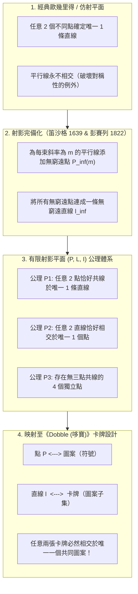
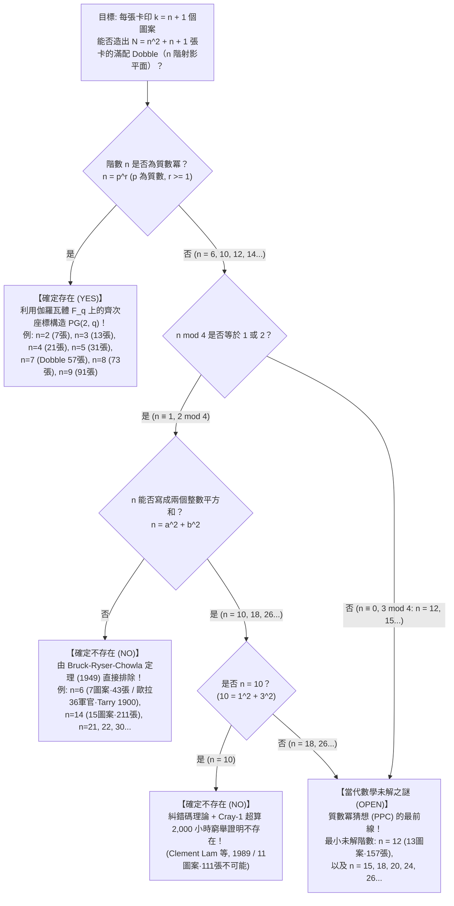

如果你玩過裝在圓形鐵盒裡的全球暢銷派對卡牌遊戲<strong>《Dobble》（北美版名為《Spot It!》，台灣與港澳常譯作《哆寶》）</strong>，你一定會對它簡單卻神奇的規則印象深刻。鐵盒裡裝有一疊圓形卡牌，<strong>每張卡牌上印有 8 個不同的圖案（符號）</strong>——雪人、鑰匙、太陽眼鏡、船錨、愛心、恐龍、閃電等，大小和旋轉角度各不相同。當任意翻開兩張卡牌時，玩家們要比拚眼力，率先找出兩張卡牌上共同擁有的那個圖案並喊出它的名字。

任何玩過幾局的人都會產生一種強烈的數學震撼：<strong>無論你從整副牌中任意抽出哪兩張卡牌，它們之間必定存在共同的圖案，而且永遠恰好只有 1 個共同圖案！</strong>既不會出現毫無交集的情況，也絕不會出現兩個以上圖案重複的情況。整副牌中的每一對卡牌，都被唯一的一座橋樑精確地連接在一起。

在這個看似簡單的玩具鐵盒裡，封印著 19 至 20 世紀純粹數學的結晶——<strong>有限射影幾何（Finite Projective Geometry）</strong>、<strong>伽羅瓦體（有限體 $\mathbb{F}_q$）</strong>以及<strong>組合設計理論（Combinatorial Design Theory）</strong>。更令人驚嘆的是，一旦我們將這個問題稍微推廣：「如果每張卡牌上印 $k$ 個圖案，能否造出同樣的卡牌組？」，我們就會立刻撞上<strong>萊昂哈德·歐拉（Leonhard Euler）在 1782 年提出的「三十六軍官問題」</strong>、<strong>Bruck-Ryser-Chowla 定理</strong>、<strong>1989 年 Cray-1 超級電腦耗時 2,000 小時才攻克的「10 階射影平面不存在性證明」</strong>，以及當代離散數學最著名的未解之謎之一：<strong>12 階有限射影平面（每張卡 13 個圖案、共 157 張卡）究竟是否存在？</strong>

---

## 第一章：藏在《Dobble》鐵盒裡的三大數學之謎

讓我們先用數學家的眼光審視市售版《Dobble》的規格。打開鐵盒，裡面共有 <strong>55 張卡牌</strong>，每張卡牌印有 <strong>8 個不同的圖案</strong>。

假設你是一名遊戲設計師，試圖憑直覺手工拼湊出這樣一副卡牌：每張卡畫 8 個圖案，且任意兩張卡恰好共享 1 個圖案。當你嘗試畫到第 10 張左右時，就會立刻陷入嚴重的組合爆炸與邏輯死胡同。事實上，正如我們稍後將嚴格證明的那樣，每張卡 8 個圖案所對應的自然圖案總數是 57 種。從 57 種圖案中任選 8 個的組合數高達：

$$\binom{57}{8} = \frac{57 \times 56 \times 55 \times 54 \times 53 \times 52 \times 51 \times 50}{8!} = 1,652,411,475$$

在超過 <strong>16.5 億種</strong>候選卡牌中，靠暴力搜尋（Brute Force）找出滿足兩兩唯一相交的最大卡組是完全不可能的。由此，我們面臨<strong>三大核心數學之謎</strong>：

1. <strong>第一之謎（最大卡牌數與缺失的 2 張卡）</strong>：當每張卡包含 $k = 8$ 個圖案時，數學上最多能造出多少張卡？理論極限其實是 <strong>57 張卡</strong>（共使用 <strong>57 種圖案</strong>）。那麼，為什麼市售的《Dobble》鐵盒裡只有 <strong>55 張卡</strong>，少掉的 2 張卡去哪兒了？
2. <strong>第二之謎（代數構造藍圖）</strong>：如何不靠任何試錯，利用純粹的代數演算法一次性寫出全部 57 張卡牌的圖案分配方案？
3. <strong>第三之謎（被數學法則禁止的圖案數）</strong>：如果改變每張卡的圖案數 $k$，我們可以完美造出 $k = 3$（7 張卡）、$k = 4$（13 張卡）、$k = 5$（21 張卡）、$k = 6$（31 張卡）以及 $k = 8$（57 張卡）的卡牌組。然而，夾在中間的 <strong>$k = 7$（每張卡 7 個圖案、43 張卡）</strong>以及 <strong>$k = 11$（每張卡 11 個圖案、111 張卡）</strong>，卻是全宇宙任何天才或超級電腦都<strong>絕對無法造出來</strong>的！為什麼大自然唯獨禁止了這些數字？

解開這三大謎團的鑰匙，源於文藝復興時期的透視繪畫與<strong>射影幾何學（Projective Geometry）</strong>。

---

## 第二章：從歐幾里得幾何到射影幾何 —— 無窮遠點與對偶原理

### 2.1 消除「平行線不相交」的例外

在我們熟悉的歐幾里得平面幾何（$\mathbb{R}^2$）中，「點」與「直線」遵循兩條基本性質：
- <strong>性質 A</strong>：任意兩個不同的點，確定<strong>唯一一條</strong>直線。
- <strong>性質 B'</strong>：任意兩條不同的直線，相交於<strong>唯一一個</strong>點——<em>除非這兩條直線互相平行（此時它們永不相交）</em>。

對於追求完美對稱的數學家而言，性質 B' 末尾的「除非平行」是一個破壞點線對稱性的刺眼瑕疵。15 世紀義大利文藝復興時期的畫家（如布魯內萊斯基、阿爾伯蒂、杜勒）在研究<strong>線性透視法</strong>時發現：地面上向遠方無限延伸的兩條平行鐵軌，在畫布的地平線上會匯聚並相交於同一個點——<strong>消失點（Vanishing Point）</strong>。

17 世紀法國數學家<strong>吉拉德·笛沙格（Girard Desargues, 1591–1661）</strong>與 19 世紀法國幾何學家<strong>讓-維克托·彭賽列（Jean-Victor Poncelet, 1788–1867）</strong>將這一藝術直覺嚴格化，透過對普通仿射平面 $\mathbb{A}^2$ 進行三步「射影完備化」手術，徹底消滅了平行線：

1. <strong>平行線束與無窮遠點</strong>：將平面上所有具有相同斜率 $m$ 的平行線歸為一族（稱為平行線束，鉛直線斜率記為 $m = \infty$）。為每一個斜率 $m$ 引入一個新的理想點 $P_\infty(m)$，稱為<strong>無窮遠點（Point at Infinity）</strong>，並規定所有斜率為 $m$ 的直線都穿過 $P_\infty(m)$。
2. <strong>不同斜率的交點</strong>：斜率不同（$m_1 \neq m_2$）的兩條直線已經在普通平面內相交於唯一一點，它們不共享無窮遠點。
3. <strong>無窮遠直線</strong>：將所有方向的無窮遠點 $\{P_\infty(m)\}$ 收集起來，規定它們共同位於一條全新的直線 $\ell_\infty$ 上，稱為<strong>無窮遠直線（Line at Infinity，即數學地平線）</strong>。

經過這番改造，原本平行的兩條斜率為 $m$ 的直線在無窮遠點 $P_\infty(m)$ 唯一相交；普通直線與無窮遠直線 $\ell_\infty$ 也在 $P_\infty(m)$ 唯一相交。<strong>在射影平面中，「平行」的概念徹底消失，任何兩條不同的直線都毫無例外地相交於唯一一點！</strong>

### 2.2 射影平面的三條公理與點線對偶原理

設 $\mathcal{P}$ 為點的集合，$\mathcal{L}$ 為直線的集合，$\mathcal{I} \subset \mathcal{P} \times \mathcal{L}$ 為關聯關係（點 $P$ 在直線 $\ell$ 上）。若三元組 $(\mathcal{P}, \mathcal{L}, \mathcal{I})$ 滿足以下三條公理，則稱之為<strong>射影平面（Projective Plane）</strong>：

- <strong>公理 P1</strong>：任意兩個不同的點 $P, Q \in \mathcal{P}$，恰好共同位於<strong>唯一一條</strong>直線 $\ell \in \mathcal{L}$ 上。
- <strong>公理 P2</strong>：任意兩條不同的直線 $\ell_1, \ell_2 \in \mathcal{L}$，恰好相交於<strong>唯一一個</strong>點 $P \in \mathcal{P}$。
- <strong>公理 P3（非退化四點公理）</strong>：存在至少<strong>四個處於一般位置的點</strong>，使得其中任意三點都不共線。

觀察公理 P1 和 P2：如果我們將公理中的「點」與「直線」互換，「位於……上」與「穿過……」互換，公理體系保持完全不變！這被稱為射影幾何的<strong>對偶原理（Principle of Duality）</strong>。當我們把射影幾何的語言翻譯成《Dobble》時，奇蹟出現了：

| 射影幾何概念 | 解釋 A（標準字典） | 解釋 B（對偶字典） |
| :--- | :--- | :--- |
| <strong>點 $P \in \mathcal{P}$</strong> | <strong>圖案（符號）</strong> | <strong>卡牌</strong> |
| <strong>直線 $\ell \in \mathcal{L}$</strong> | <strong>卡牌（包含若干圖案的集合）</strong> | <strong>圖案（印有該圖案的卡牌集合）</strong> |
| <strong>關聯 $(P, \ell) \in \mathcal{I}$</strong> | 圖案 $P$ 印在卡牌 $\ell$ 上 | 卡牌 $P$ 上印有圖案 $\ell$ |
| <strong>公理 P2 的含義</strong> | <strong>任意兩張不同的卡牌，恰好共享唯一 1 個圖案</strong> | 任意兩個不同的圖案，恰好同時出現在唯一 1 張卡牌上 |
| <strong>公理 P1 的含義</strong> | 任意兩個不同的圖案，恰好同時出現在唯一 1 張卡牌上 | <strong>任意兩張不同的卡牌，恰好共享唯一 1 個圖案</strong> |

---

## 第三章：$n$ 階有限射影平面的計數定理與「法諾平面 $PG(2,2)$」

### 3.1 總卡牌數公式 $N = n^2 + n + 1$ 的嚴格推導

當射影平面的點集 $\mathcal{P}$ 和線集 $\mathcal{L}$ 為有限集合時，公理 P1–P3 賦予了它極其嚴格的數量規律：

> <strong>定理 3.1（有限射影平面計數定理）</strong>：
> 對任意有限射影平面 $(\mathcal{P}, \mathcal{L}, \mathcal{I})$，存在正整數 $n \ge 2$（稱為該射影平面的<strong>階 / Order</strong>），使得：
> 1. 每條直線恰好包含 <strong>$k = n + 1$ 個點</strong>（每張卡牌印有 $n+1$ 個圖案）。
> 2. 每個點恰好位於 <strong>$r = n + 1$ 條直線</strong>上（每個圖案出現在 $n+1$ 張卡牌上）。
> 3. 點的總數與直線的總數完全相等，均為：
> $$|\mathcal{P}| = |\mathcal{L}| = N = n^2 + n + 1$$

<strong>【證明精要】</strong>：
首先，任取兩條直線 $\ell_1, \ell_2$，由公理 P3 可在兩直線外取一點 $O$。過 $O$ 作射線連接 $\ell_1$ 上的點 $X$ 與 $\ell_2$ 上的交點 $Y$，公理 P1 與 P2 保證映射 $X \mapsto Y$ 是雙射（一對一對應），故所有直線包含相同數量的點，記為 $k = n + 1$。由對偶原理，穿過每個點的直線數也等於 $r = n + 1$。
接著，固定平面上一個基準點 $P_0 \in \mathcal{P}$。平面上除 $P_0$ 以外的任何點 $Q$，都與 $P_0$ 確定唯一一條穿過 $P_0$ 的直線（公理 P1），且不同直線除 $P_0$ 外無其他交點（公理 P2）。穿過 $P_0$ 的直線共有 $n + 1$ 條，每條直線上除了 $P_0$ 自身外，還包含恰好 $n$ 個其他的點。因此，平面上點的總數為：

$$|\mathcal{P}| = \underbrace{1}_{\text{基準點 } P_0} + \underbrace{(n + 1)}_{\text{過 } P_0 \text{ 的直線數}} \times \underbrace{n}_{\text{每條線上除 } P_0 \text{ 外的點數}} = n^2 + n + 1$$

由對偶原理，直線的總數 $|\mathcal{L}|$ 同樣為 $n^2 + n + 1$。$\blacksquare$

將《Dobble》的 $k = 8$（每張卡 8 個圖案）代入公式，立刻得到階數 $n = k - 1 = 7$，以及理論最大卡牌數（和圖案總數）：

$$N = 7^2 + 7 + 1 = 49 + 7 + 1 = 57 \text{ 張卡（57 種圖案）}$$

### 3.2 最小的有限幾何：法諾平面 $PG(2, 2)$（$n = 2$，7 張迷你版 Dobble）

當 $n = 2$ 時，我們得到世界上最小的有限射影平面——1892 年由義大利數學家<strong>吉諾·法諾（Gino Fano, 1871–1952）</strong>發現的<strong>法諾平面（Fano Plane, $PG(2, 2)$）</strong>。其中每張卡有 $k = 2 + 1 = 3$ 個圖案，共有 $N = 2^2 + 2 + 1 = 7$ 張卡和 7 個圖案。

我們可以透過兩種優美的方法構造這 7 張卡：
1. <strong>二進位非零向量法（$\mathbb{F}_2^3 \setminus \{\mathbf{0}\}$）</strong>：取二元體 $\mathbb{F}_2 = \{0, 1\}$ 上的 7 個非零三位二進位向量 $(0,0,1)$ 至 $(1,1,1)$ 作為 7 個點。規定三個點 $\{u, v, w\}$ 共線（構成一張卡）若且唯若它們的按位互斥或（XOR）和為零：$u \oplus v \oplus w = (0,0,0)$。
2. <strong>循環差集法（Cyclic Difference Set）</strong>：將 7 個圖案編號為 $\{0, 1, 2, 3, 4, 5, 6\} \pmod 7$。取第 0 張卡為 $\ell_0 = \{1, 2, 4\}$。由於 $\{1, 2, 4\}$ 中任意兩數之差 $\pmod 7$ 恰好遍歷 $\{1, 2, 3, 4, 5, 6\}$ 各一次（完美差集），只需將 $\ell_0$ 依次加 $+i \pmod 7$（$i = 0, \dots, 6$），即可生成全部 7 張卡：

| 卡牌編號 | 循環平移 $\ell_i = \{1+i, 2+i, 4+i\} \pmod 7$ | 卡牌上的 3 個圖案 | 在經典法諾平面圖中的幾何形態 |
| :---: | :---: | :---: | :--- |
| <strong>卡牌 $\ell_0$</strong> | $+0$ | $\{1, 2, 4\}$ | 正三角形的外邊 1 |
| <strong>卡牌 $\ell_1$</strong> | $+1$ | $\{2, 3, 5\}$ | 正三角形的外邊 2 |
| <strong>卡牌 $\ell_2$</strong> | $+2$ | $\{3, 4, 6\}$ | 正三角形的外邊 3 |
| <strong>卡牌 $\ell_3$</strong> | $+3$ | $\{4, 5, 0\}$ | 頂點連向對邊中點的中線 1 |
| <strong>卡牌 $\ell_4$</strong> | $+4$ | $\{5, 6, 1\}$ | 頂點連向對邊中點的中線 2 |
| <strong>卡牌 $\ell_5$</strong> | $+5$ | $\{6, 0, 2\}$ | 頂點連向對邊中點的中線 3 |
| <strong>卡牌 $\ell_6$</strong> | $+6$ | $\{0, 1, 3\}$ | <strong>穿過三個邊中點的內切圓（第 7 條直線！）</strong> |

---

## 第四章：伽羅瓦體 $\mathbb{F}_q$ 上的齊次座標與 57 張《Dobble》的完整構造

### 4.1 伽羅瓦體 $\mathbb{F}_q$ 與質數冪定律

為了把座標構造推廣到任意階 $n = q$，我們需要一個包含 $q$ 個元素且能自由進行加、減、乘、除（非零元求逆）四則運算的代數系統——即<strong>有限體（伽羅瓦體 $\mathbb{F}_q$ 或 $GF(q)$）</strong>。抽象代數的基本定理指出：

> <strong>定理 4.1（伽羅瓦體存在定理）</strong>：
> 含 $q$ 個元素的有限體 $\mathbb{F}_q$ 存在，<strong>若且唯若 $q$ 是質數的正整數次冪（Prime Power）</strong>：
> $$q = p^r \quad （p \text{ 為質數}, \; r \in \{1, 2, 3, \dots\}）$$
> 當 $q = p$ 為質數時，$\mathbb{F}_p = \mathbb{Z}/p\mathbb{Z}$（模 $p$ 剩餘類體）；當 $q = p^r$（$r \ge 2$，如 $q = 4, 8, 9$）時，$\mathbb{F}_q$ <strong>不是</strong>模 $q$ 整數環 $\mathbb{Z}/q\mathbb{Z}$，而是透過 $r$ 次不可約多項式構造的商體 $\mathbb{F}_p[x]/(f(x))$。而當 $q = 6, 10, 12, 14, 15, \dots$ 不是質數冪時，有限體 $\mathbb{F}_q$ <strong>絕對不存在</strong>！

### 4.2 齊次座標 $[x : y : z]$ 與《Dobble（$q = 7$）》的 57 張卡全解

給定有限體 $\mathbb{F}_q$，考慮三維向量空間 $\mathbb{F}_q^3$ 中去掉原點 $(0,0,0)$ 後的 $q^3 - 1$ 個非零向量。定義等價關係 $(x, y, z) \sim (\lambda x, \lambda y, \lambda z)$（$\lambda \in \mathbb{F}_q^\times$），每個等價類記為<strong>齊次座標 $[x : y : z]$</strong>，代表射影平面 $PG(2, q)$ 中的一個<strong>點</strong>。因為每個等價類包含 $q - 1$ 個非零向量，點的總數恰好為：

$$|\mathcal{P}| = \frac{q^3 - 1}{q - 1} = q^2 + q + 1$$

同樣，齊次線性方程 $ax + by + cz = 0$（$[a:b:c] \neq [0:0:0]$）的解集構成一條<strong>射影直線 $\ell_{[a:b:c]}$</strong>。由格拉斯曼維數公式 $\dim(W_1 \cap W_2) = 2 + 2 - 3 = 1$，任意兩條不同直線（二維子空間）必相交於唯一一個點（一維子空間）。

對於《Dobble》（$q = 7$，$\mathbb{F}_7 = \{0, 1, 2, 3, 4, 5, 6\} \pmod 7$），57 個圖案和 57 張卡牌可以精確地分為三組：
- <strong>57 個圖案（點）</strong>：
  1. <strong>49 個普通網格點</strong>：$P_{x,y} = [x : y : 1]$，其中 $x, y \in \{0, \dots, 6\}$。
  2. <strong>8 個無窮遠點</strong>：代表 7 種斜率的 $I_m = [1 : m : 0]$（$m \in \{0, \dots, 6\}$），以及代表鉛直方向的 $I_\infty = [0 : 1 : 0]$。
- <strong>57 張卡牌（直線）</strong>：
  1. <strong>49 張斜線與水平線卡 $L_{m,b}$</strong>：對應方程 $y \equiv mx + b \pmod 7$ 上的 7 個網格點，外加第 8 個圖案——無窮遠點 $I_m$。
  2. <strong>7 張鉛直線卡 $V_c$</strong>：對應方程 $x \equiv c \pmod 7$ 上的 7 個網格點，外加第 8 個圖案——無窮遠點 $I_\infty$。
  3. <strong>1 張無窮遠直線卡 $L_\infty$</strong>：由全部 8 個無窮遠點 $\{I_0, I_1, \dots, I_6, I_\infty\}$ 組成的「地平線卡」。

（或者根據 <strong>Singer 定理 (1938)</strong>，取模 57 的循環差集 $D = \{0, 1, 3, 13, 32, 36, 43, 52\} \pmod{57}$，依次加 $+1 \pmod{57}$ 即可一行程式碼生成全部 57 張 Dobble 卡牌！）

<strong>為什麼市售版《Dobble》只有 55 張卡而不是 57 張？</strong>
從 57 張完整射影平面卡牌中任意抽走 2 張卡後，剩下的 55 張卡依然完美滿足公理 P2（任意兩張卡仍恰好共享 1 個圖案）。廠商之所以減去 2 張卡，是因為 $57 = 3 \times 19$ 在印刷廠大型模切紙版（Die-cut sheet）上難以排版，而 $55 = 5 \times 11$（或兩副牌 $110 = 10 \times 11$）能完美契合矩形印刷網格，同時也更方便在多人迷你遊戲中均分卡牌。

---

## 第五章：組合設計、歐拉三十六軍官問題、Bruck-Ryser-Chowla 定理與 10 階、12 階前沿

### 5.1 均衡不完全區組設計（BIBD）、正交拉丁方（MOLS）與 $n = 6$ 的崩塌

在<strong>羅納德·費雪（Ronald Fisher）</strong>開創的組合設計理論中，有限射影平面等價於參數為 $\lambda = 1, k = n+1, v = b = n^2+n+1$ 的<strong>對稱均衡不完全區組設計（Symmetric BIBD）</strong>，也即<strong>史坦納系統 $S(2, n+1, n^2+n+1)$</strong>，它達到了<strong>費雪不等式（$b \ge v$）</strong>的等號極限。

1938 年，數學家<strong>博斯（R. C. Bose）</strong>證明了一條連接射影幾何與拉丁方的核心等價定理：

> <strong>定理 5.1（射影平面與正交拉丁方 MOLS 等價定理）</strong>：
> $n$ 階有限射影平面存在，<strong>若且唯若存在 $n - 1$ 個 $n$ 階兩兩正交拉丁方（Mutually Orthogonal Latin Squares, MOLS）</strong>。

現在考察第一個非質數冪階數：<strong>$n = 6$（每張卡 $k = 7$ 個圖案，共 $N = 6^2 + 6 + 1 = 43$ 張卡）</strong>。
如果 $6$ 階射影平面存在，就必須存在 $6 - 1 = 5$ 個兩兩正交的 $6 \times 6$ 拉丁方。然而，早在 1782 年，<strong>萊昂哈德·歐拉</strong>就提出了著名的<strong>「三十六軍官問題」</strong>：能否將來自 6 個軍團、6 種軍階的 36 名軍官排成 $6 \times 6$ 方陣，使每行每列都不重複？這等價於尋找<strong>僅僅 2 個</strong>正交的 6 階拉丁方。1900 年，法國數學家<strong>加斯頓·塔里（Gaston Tarry）</strong>窮舉了全部 9,408 種標準 6 階拉丁方，嚴格證明了<strong>連 2 個正交的 6 階拉丁方都不存在，更不用說 5 個了！</strong>因此，每張卡 7 個圖案的 43 張《Dobble》在數學上<strong>絕對不可能存在</strong>。

### 5.2 Bruck-Ryser-Chowla 定理（1949）與 Cray-1 超算對 $n = 10$ 的終結（1989）

1949 年，Richard Bruck、Herbert Ryser 與 Sarvadaman Chowla 利用關聯矩陣方程 $M M^\top = n I_N + J_N$ 上的有理二次型理論（Hasse-Minkowski 定理與拉格朗日四平方和定理），證明了震撼數學界的非存在性定理：

> <strong>定理 5.2（Bruck-Ryser-Chowla 定理, 1949）</strong>：
> 若 $n$ 階有限射影平面存在，且 $n \equiv 1 \text{ 或 } 2 \pmod 4$，則 $n$ 必須能表示為<strong>兩個整數的平方和</strong>：
> $$n = a^2 + b^2 \quad (a, b \in \mathbb{Z})$$

這一定理瞬間秒殺了無窮多個非質數冪階數：
- <strong>$n = 6$</strong>：$6 \equiv 2 \pmod 4$，但 $6$ 不能寫成兩個平方數之和（$6 \neq a^2 + b^2$），故<strong>不存在</strong>！
- <strong>$n = 14$</strong>：$14 \equiv 2 \pmod 4$，且 $14 = 2 \times 7 \neq a^2 + b^2$，故<strong>不存在</strong>！
- <strong>$n = 21, 22, 30, 33, \dots$</strong>：全部同理直接排除！

然而，對於下一個非質數冪 <strong>$n = 10$（每張卡 11 個圖案、共 111 張卡）</strong>，雖然 $10 \equiv 2 \pmod 4$，但恰好有：

$$10 = 1^2 + 3^2 = 1 + 9$$

它竟然通過了 Bruck-Ryser-Chowla 定理的檢驗！為了解決 $n = 10$ 是否存在的世紀難題，MacWilliams、Sloane 與 Thompson（1970）將 $111 \times 111$ 關聯矩陣的列向量轉化為二元線性糾錯碼 $\mathcal{C} \subset \mathbb{F}_2^{111}$。隨後，加拿大康考迪亞大學的<strong>林永康（Clement W. H. Lam）</strong>、Larry Thiel 與 Stanley Swiercz 團隊在<strong>Cray-1A 超級電腦上連續運行了約 2,000 小時</strong>，於 1989 年徹底證明了權重為 12、15、16 的碼字均不存在，從而宣告：<strong>10 階有限射影平面不存在！</strong>

而當我們來到 <strong>$n = 12$（每張卡 13 個圖案、共 157 張卡）</strong>時，由於 $12 \equiv 0 \pmod 4$ 繞過了 Bruck-Ryser-Chowla 定理，且其搜尋空間遠超人類所有超級電腦的極限，<strong>「12 階有限射影平面是否存在」至今仍是當代數學最重大的未解之謎（質數冪猜想 PPC 的最前線）！</strong>

### 5.3 $n = 2 \sim 14$ 階有限射影平面（廣義 Dobble 卡組）完整分類表

| 階數 $n$ | 每卡圖案數 $k = n+1$ | 最大卡牌與圖案總數 $N = n^2+n+1$ | 是否存在？ | 數學結構與存在/不存在性證明依據 |
| :---: | :---: | :---: | :---: | :--- |
| <strong>$n = 2$</strong> | $3$ | <strong>$7$</strong> | <strong>存在（唯一）</strong> | 質數 $2$：最小射影平面<strong>「法諾平面 $PG(2, 2)$」</strong> |
| <strong>$n = 3$</strong> | $4$ | <strong>$13$</strong> | <strong>存在（唯一）</strong> | 質數 $3$：$\mathbb{F}_3$ 上的射影平面 $PG(2, 3)$ |
| <strong>$n = 4$</strong> | $5$ | <strong>$21$</strong> | <strong>存在（唯一）</strong> | 質數冪 $2^2$：擴體 $\mathbb{F}_4$ 上的 $PG(2, 4)$ |
| <strong>$n = 5$</strong> | $6$ | <strong>$31$</strong> | <strong>存在（唯一）</strong> | 質數 $5$：$\mathbb{F}_5$ 上的 $PG(2, 5)$ |
| <strong>$n = 6$</strong> | $7$ | $43$ | <strong>不存在（不可能）</strong> | $6 \equiv 2 \pmod 4$ 且 $6 \neq a^2+b^2$。<strong>歐拉 36 軍官問題 / Tarry (1900) / Bruck-Ryser (1949)</strong> |
| <strong>$n = 7$</strong> | <strong>$8$</strong> | <strong>$57$</strong> | <strong>存在（唯一）</strong> | 質數 $7$：$\mathbb{F}_7$ 上的 $PG(2, 7)$。<strong>市售《Dobble / 哆寶》（鐵盒內含 55 張）</strong> |
| <strong>$n = 8$</strong> | $9$ | <strong>$73$</strong> | <strong>存在（唯一）</strong> | 質數冪 $2^3$：擴體 $\mathbb{F}_8$ 上的 $PG(2, 8)$ |
| <strong>$n = 9$</strong> | $10$ | <strong>$91$</strong> | <strong>存在（共 4 種）</strong> | 質數冪 $3^2$：$PG(2, 9)$ 及 3 種非笛沙格平面（Hall 平面、對偶 Hall、Hughes 平面） |
| <strong>$n = 10$</strong> | $11$ | $111$ | <strong>不存在（不可能）</strong> | 滿足 $10 = 1^2+3^2$，但由 <strong>Lam 等人 (1989) 用 Cray-1 超算耗時 2,000 小時證明不存在</strong> |
| <strong>$n = 11$</strong> | $12$ | <strong>$133$</strong> | <strong>存在</strong> | 質數 $11$：$\mathbb{F}_{11}$ 上的 $PG(2, 11)$ |
| <strong>$n = 12$</strong> | $13$ | $157$ | <strong>【未解之謎】</strong> | $12 \equiv 0 \pmod 4$ 不適用定理 5.2。<strong>人類面臨的最小未解階數！</strong> |
| <strong>$n = 13$</strong> | $14$ | <strong>$183$</strong> | <strong>存在</strong> | 質數 $13$：$\mathbb{F}_{13}$ 上的 $PG(2, 13)$ |
| <strong>$n = 14$</strong> | $15$ | $211$ | <strong>不存在（不可能）</strong> | $14 \equiv 2 \pmod 4$ 且 $14 \neq a^2+b^2$。由 <strong>Bruck-Ryser-Chowla 定理排除</strong> |
