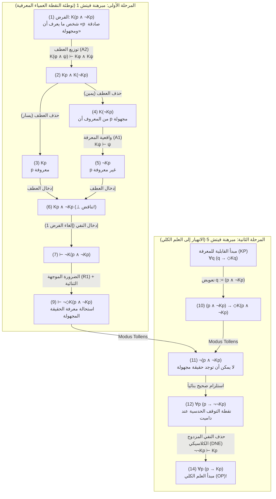
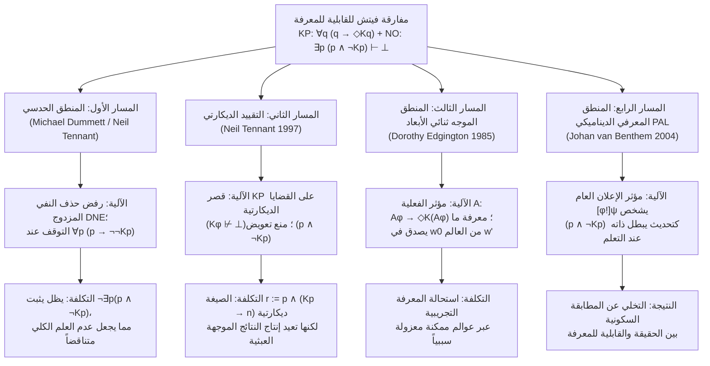

## 1. مقدمة: خط الصدع الإبستمولوجي بين الواقعية الميتافيزيقية واللاواقعية الدلالية

هل يمكن لقضية ما أن تكون صادقة على نحو متعيّن حتى لو لم يكن بمقدور أي عقل متناهٍ — ولا حتى من حيث المبدأ — التحقق منها أو اكتشافها أو معرفتها؟

يرسم هذا السؤال أعمق خط صدع في الميتافيزيقا ونظرية المعرفة وفلسفة اللغة وفلسفة الرياضيات المعاصرة: المواجهة بين <strong>الواقعية الميتافيزيقية (Metaphysical Realism)</strong> و<strong>اللاواقعية الدلالية (Semantic Anti-Realism / التحققية Verificationism)</strong>.

### 1.1 التزام الواقعية الميتافيزيقية
وفقاً <strong>للواقعية الميتافيزيقية</strong> — التي دافع عنها غوتلوب فريجه، وبرتراند راسل، وهيلاري بتنام المبكر، وتيموثي ويليامسون — فإن الحقيقة تتجاوز قدراتنا الإدراكية والمعرفية بشكل جذري (<strong>recognition-transcendent truth</strong>). بلغة المنطق ثنائي النمط (المعرفي-الأليثي)، إذا رمزنا بـ $p$ إلى «القضية $p$ صادقة»، وبـ $Kp$ إلى «شخص ما في وقت ما (في الماضي أو الحاضر أو المستقبل) يعرف $p$»، وبـ $\Diamond\phi$ إلى «من الممكن منطقياً أو ميتافيزيقياً أن $\phi$»، فإن الواقعية تقر بوجود <strong>حقائق غير قابلة للمعرفة</strong>:

$$\text{Realism (Unknowable Truths)}: \quad \exists p \, \big( p \land \neg \Diamond K p \big)$$

ومن أمثلتها الوقائع التاريخية الدقيقة التي تبددت آثارها إلى الأبد بفعل الإنتروبيا (مثل: «كان عدد شعيرات رأس يوليوس قيصر في اللحظة الدقيقة التي طعنه فيها بروتوس عام 44 ق.م عدداً فردياً»)، أو الأحداث الكمومية خلف أفق الحدث الكوني، أو القضايا الرياضية غير القابلة للحسم.

### 1.2 اللاواقعية الدلالية ومبدأ القابلية للمعرفة (KP)
في المقابل، يرفض تقليد <strong>التحققية والبراغماتية واللاواقعية الدلالية</strong> — من تشارلز ساندرز بيرس ودائرة فيينا إلى <strong>الواقعية الداخلية</strong> عند بتنام واللاواقعية الحدسية عند <strong>مايكل داميت (Michael Dummett)</strong> — فكرة الحقيقة المتعالية تماماً على كل تحقق ممكن. ومن خلال <strong>حجة الاكتساب (Acquisition Argument)</strong> و<strong>حجة التجلي (Manifestation Argument)</strong>، بيّن داميت أن المتكلمين المتناهين لا يمكنهم اكتساب فهم معنى الجملة وإظهاره سلوكياً إلا إذا كانت شروط صدقها مرتبطة بنيوياً بإمكانية معرفتها أو التحقق منها مبدئياً.

وهذا يقود إلى الموضوعة الأساسية للاواقعية الحديثة، وهي <strong>مبدأ القابلية للمعرفة (Knowability Principle, KP)</strong>:

$$\text{KP (Knowability Principle)}: \quad \forall p \, \big( p \to \Diamond K p \big)$$

(«لكل قضية $p$، إذا كانت $p$ صادقة، فمن الممكن أن يعرفها شخص ما في وقت ما.»)

### 1.3 مبدأ عدم العلم الكلي (NO) وقنبلة فيتش المنطقية
اللاواقعي ليس مثالياً ذاتياً يزعم أن كل حقيقة معروفة فعلياً ($\forall p (p \to K p)$). فإدراكاً لتناهي البشر، يقبل كل لاواقعي كحقيقة بديهية <strong>مبدأ عدم العلم الكلي (Non-Omniscience Principle, NO)</strong>:

$$\text{NO (Non-Omniscience Principle)}: \quad \exists p \, \big( p \land \neg K p \big)$$

إلا أن عالم المنطق في جامعة ييل <strong>فريدريك فيتش (Frederic B. Fitch, 1908–1987)</strong> نشر في عام 1963 ورقته الشهيرة *"A Logical Analysis of Some Value Concepts"* في مجلة *The Journal of Symbolic Logic*، حيث أثبت في المبرهنة الخامسة (Theorem 5) نتيجة مدوية:

> <strong>مفارقة فيتش للقابلية للمعرفة (1963)</strong>:
> باستخدام أضعف قواعد الاستدلال وأقلها إثارة للجدل في المنطق المعرفي الموجه — وهما <strong>واقعية المعرفة (Factivity)</strong> و<strong>توزيع المعرفة على العطف (Conjunction Distribution)</strong> — فإن <strong>مبدأ القابلية للمعرفة $\forall p \, (p \to \Diamond K p)$</strong> يستلزم مباشرة في المنطق الكلاسيكي <strong>مبدأ العلم الكلي العبثي $\forall p \, (p \to K p)$</strong>!
> وبأخذ عكس النقيض: إذا لم يكن البشر كليّي المعرفة ($\exists p \, (p \land \neg K p)$)، فإنه توجد بالضرورة حقيقة واحدة على الأقل يستحيل منطقياً على أي كان معرفتها ($\exists q \, (q \land \neg \Diamond K q)$).

---

## 2. الجذور التاريخية: تقرير التحكيم المجهول لألونزو تشيرش (1945) وورقة فيتش (1963)

في الحاشية 5 (ص 138) من ورقته الصادرة عام 1963، أشار فيتش إلى أن برهان المبرهنة 5 قد اقترحه عليه *«محكّم مجهول لورقة قُدمت عام 1945 ولكنها لم تُنشر قط»*.

وقد كشف الفيلسوف جو ساليرنو (Joe Salerno, 2009, *New Essays on the Knowability Paradox*) هذا اللغز التاريخي من خلال أرشيف جامعة برينستون: كان المحكّم المجهول لعام 1945 هو عالم المنطق العظيم <strong>ألونزو تشيرش (Alonzo Church, 1903–1995)</strong>، مبتكر حساب لامدا ($\lambda$-calculus)! ففي يوليو 1945، أثناء تحكيمه لمخطوطة قدمها فيتش توحد بين الحقيقة والقابلية للمعرفة، أوضح تشيرش أن تعويض القضية المركبة $q := (p \land \neg K p)$ في المبدأ $\forall q \, (q \to \Diamond K q)$ يؤدي فوراً إلى $\neg(p \land \neg K p)$، مما يدمج المعرفة الممكنة في العلم الكلي الفعلي ($\forall p (p \to K p)$).

---

## 3. التركيب الصوري والنظام البديهي الأدنى للمنطق ثنائي النمط

في اللغة الصورية $\mathcal{L}_{K,\Box}$، يعبر المؤثر المعرفي $K\phi$ عن المعرفة الجمعية العابرة للأزمنة:

$$K\phi \stackrel{\text{def}}{\Longleftrightarrow} \exists x \in \text{Agents}, \, \exists t \in \text{Times} \, \big( K_{x,t} \phi \big)$$

تكمن القوة التدميرية لبرهان فيتش في أنه <strong>لا يحتاج إلى أي بديهيات معرفية قوية</strong> مثل <strong>مبدأ KK (البديهية 4: $K\phi \to KK\phi$)</strong>، أو <strong>الاستبطان السلبي (البديهية 5: $\neg K\phi \to K\neg K\phi$)</strong>، أو <strong>الانغلاق الاستنباطي الكامل (البديهية K: $K(\phi \to \psi) \to (K\phi \to K\psi)$)</strong>. بل يكتفي بثلاثة مبادئ دنيا فقط:

1. <strong>(A1) واقعية المعرفة (Factivity of Knowledge / البديهية T)</strong>:
   $$K\phi \vdash \phi$$
   («ما يُعرف يجب أن يكون صادقاً؛ لا يمكن معرفة الكاذب.»)
2. <strong>(A2) توزيع المعرفة على العطف (Conjunction Distribution)</strong>:
   $$K(\phi \land \psi) \vdash K\phi \land K\psi$$
   («من يعرف العطف "$\phi$ و $\psi$" فهو يعرف $\phi$ ويعرف $\psi$.»)
3. <strong>(R1) قاعدة الضرورة الموجهة (Modal Necessitation Rule)</strong>:
   $$\text{If } \vdash \phi, \quad \text{then } \vdash \Box\phi$$
   («كل مبرهنة منطقية بحتة تكون صادقة بالضرورة في جميع العوالم الممكنة»، مع الثنائية $\Box\neg\phi \equiv \neg\Diamond\phi$).

| المبدأ / القاعدة | الصيغة الصورية | المعنى الفلسفي | هل يلزم لبرهان فيتش؟ |
| :--- | :--- | :--- | :--- |
| <strong>(A1) واقعية المعرفة (Axiom T)</strong> | $K\phi \vdash \phi$ | لا تُعرف إلا القضايا الصادقة | <strong>نعم (أساسي)</strong> |
| <strong>(A2) توزيع العطف</strong> | $K(\phi \land \psi) \vdash K\phi \land K\psi$ | معرفة «$A$ و$B$» تستلزم معرفة $A$ ومعرفة $B$ | <strong>نعم (أساسي)</strong> |
| <strong>(R1) الضرورة الموجهة</strong> | $\vdash \phi \implies \vdash \Box\phi$ | المبرهنات المنطقية ضرورية | <strong>نعم (أساسي)</strong> |
| <strong>الانغلاق الاستنباطي الكامل (K)</strong> | $K(\phi \to \psi) \to (K\phi \to K\psi)$ | العلم الكلي المنطقي تحت الاستلزام | <strong>لا</strong> |
| <strong>الاستبطان الإيجابي (KK / Axiom 4)</strong> | $K\phi \to KK\phi$ | المعرفة تستلزم معرفة المعرفة | <strong>لا</strong> |
| <strong>الاستبطان السلبي (Axiom 5)</strong> | $\neg K\phi \to K\neg K\phi$ | الجهل يستلزم معرفة الجهل | <strong>لا</strong> |

---

## 4. الاشتقاق الصوري خطوة بخطوة لمفارقة فيتش

### 4.1 المرحلة الأولى (مبرهنة فيتش 1): الاستحالة المنطقية لمعرفة حقيقة مجهولة
لتكن القضية العطفية $q \stackrel{\text{def}}{\equiv} (p \land \neg K p)$ («$p$ صادقة، ولكن لا أحد يعرف $p$ أبداً»). نثبت ببرهان الخلف ($\neg$-Introduction) استحالة معرفة $q$:

| السطر | الصيغة المنطقية | التبرير / قاعدة الاستدلال | الفروض المفتوحة |
| :---: | :--- | :--- | :---: |
| (1) | $K(p \land \neg K p)$ | <strong>فرض ببرهان الخلف (Assumption for Reductio)</strong> | $\{1\}$ |
| (2) | $K p \land K(\neg K p)$ | من (1) بتطبيق <strong>(A2) توزيع العطف</strong> $K(\phi \land \psi) \vdash K\phi \land K\psi$ | $\{1\}$ |
| (3) | $K p$ | من (2) بحذف العطف ($\land$-Elimination يسار) | $\{1\}$ |
| (4) | $K(\neg K p)$ | من (2) بحذف العطف ($\land$-Elimination يمين) | $\{1\}$ |
| (5) | $\neg K p$ | من (4) بتطبيق <strong>(A1) واقعية المعرفة</strong> $K\psi \vdash \psi$ ($\psi := \neg K p$) | $\{1\}$ |
| (6) | $K p \land \neg K p \quad (\bot)$ | من (3) و(5) بإدخال العطف (<strong>تناقض صريح!</strong>) | $\{1\}$ |
| (7) | $\vdash \neg K(p \land \neg K p)$ | من (1)–(6) بإدخال النفي (إلغاء الفرض $\{1\}$) | $\emptyset$ |
| (8) | $\vdash \Box \neg K(p \land \neg K p)$ | من المبرهنة (7) بتطبيق <strong>(R1) الضرورة الموجهة</strong> | $\emptyset$ |
| (9) | $\vdash \neg \Diamond K(p \land \neg K p)$ | من (8) بالثنائية الموجهة ($\Box\neg\phi \equiv \neg\Diamond\phi$) | $\emptyset$ |

يثبت السطر (9) $\vdash \neg \Diamond K(p \land \neg K p)$ أنه <strong>من المستحيل منطقياً معرفة حقيقة مجهولة على الإطلاق!</strong>

### 4.2 المرحلة الثانية (مبرهنة فيتش 5): انهيار القابلية للمعرفة (KP) إلى العلم الكلي (OP)
نعوض الآن $q := (p \land \neg K p)$ في <strong>مبدأ القابلية للمعرفة (KP)</strong> $\forall q \, (q \to \Diamond K q)$:

| السطر | الصيغة المنطقية | التبرير / قاعدة الاستدلال | الوضع المنطقي |
| :---: | :--- | :--- | :--- |
| (10) | $(p \land \neg K p) \to \Diamond K(p \land \neg K p)$ | تخصيص شامل لمبدأ <strong>KP</strong> بتعويض $q := (p \land \neg K p)$ | حالة من KP |
| (11) | $\neg (p \land \neg K p)$ | من (10) والمبرهنة (9) $\neg \Diamond K(p \land \neg K p)$ بقاعدة <strong>رفع التالي (Modus Tollens)</strong> | <strong>صحيح حدسياً!</strong> |
| (12) | $p \to \neg \neg K p$ | من (11) بالتكافؤ القضوي $\neg(A \land \neg B) \vdash (A \to \neg\neg B)$ | <strong>صحيح حدسياً!</strong> |
| (13) | $p \to K p$ | من (12) بقاعدة <strong>حذف النفي المزدوج الكلاسيكية (DNE)</strong> $\neg\neg K p \vdash K p$ | يستخدم DNE الكلاسيكية |
| (14) | $\forall p \, (p \to K p)$ | من (13) بالتعميم الشامل | <strong>مبدأ العلم الكلي (OP)!</strong> |

---

## 5. التشخيص البنيوي: مفارقة مور، والنقاط العمياء المعرفية، ومفارقة الامتحان المفاجئ

1. <strong>مفارقة جي. إي. مور (1942)</strong>: جملة مور *«إنها تمطر في الخارج، لكنني لا أعرف أنها تمطر»* ($p \land \neg K_a p$) متسقة أنطولوجياً ولكن يستحيل على المتكلم $a$ معرفتها. وعندما يعمم المؤثر $K$ على جميع العارفين في كل الأزمنة، تصبح $(p \land \neg K p)$ <strong>جملة مور كونية</strong> لا يوجد خارجها أي مراقب.
2. <strong>النقاط العمياء المعرفية (*Blindspots*) عند روي سورنسن (1988)</strong>: تمثل $(p \land \neg K p)$ نقطة عمياء معرفية ($\Diamond\phi \land \neg\Diamond K\phi$)؛ فمجرد فعل اكتساب المعرفة $K p$ يغير الحالة المعرفية للعالم ويكذّب الطرف الثاني $\neg K p$.
3. <strong>مفارقة الامتحان المفاجئ ومبرهنة عدم الاكتمال لغودل</strong>: في الامتحان المفاجئ، يخلط الطلاب بين صدق $(E_5 \land \neg K_{\text{Thu}} E_5)$ وإمكانية معرفته ليلة الخميس $K_{\text{Thu}}(E_5 \land \neg K_{\text{Thu}} E_5)$. وفي الحساب الصوري، تمنع مبرهنة لوب (Löb's Theorem) محمول القابلية للبرهنة $\text{Prov}_T(\ulcorner \phi \urcorner)$ من تحقيق الواقعية الشاملة ($\text{Prov}_T(\ulcorner \phi \urcorner) \to \phi$)، بينما المعرفة الحقيقية $K$ واقعية بلا شروط.

---

## 6. مسارات النجاة الفلسفية الأربعة الكبرى وتكاليفها

### 6.1 المسار الأول: مايكل داميت والمنطق الحدسي
أشار <strong>مايكل داميت (2001, *"Victor's Error"*)</strong> و<strong>نيل تينانت</strong> إلى أن الخطوات (1) إلى (12) صحيحة بالكامل في <strong>المنطق الحدسي</strong>، وأن المنطق الكلاسيكي لا يُستخدم إلا في الانتقال من (12) إلى (13) عبر <strong>حذف النفي المزدوج (DNE: $\neg\neg K p \vdash K p$)</strong>. وبدون DNE يتوقف البرهان عند:

$$\forall p \, \big( p \to \neg\neg K p \big) \quad \text{و} \quad \forall p \, \neg(p \land \neg K p)$$

<strong>نقد تيموثي ويليامسون (1982, 2000)</strong>:
1. حتى في المنطق الحدسي، يثبت السطر (11) المبرهنة $\vdash_{\text{Int}} \neg \exists p \, (p \land \neg K p)$، أي أن <strong>مبدأ عدم العلم الكلي (NO) يظل متناقضاً ذاتياً (كاذباً) حتى لدى الحدسي</strong>!
2. بالنسبة للقضايا القابلة للحسم ($K p \lor \neg K p$)، يظل $\neg\neg K p \vdash_{\text{Int}} K p$ صحيحاً حدسياً، فيعود الانهيار إلى $p \to K p$.

### 6.2 المسار الثاني: تقييد نيل تينانت بـ «القضايا الديكارتية»
يقصر <strong>نيل تينانت (1997, *The Taming of the Sleuth*)</strong> مبدأ KP على <strong>القضايا الديكارتية</strong> ($\text{Cartesian}(\phi) \iff K\phi \not\vdash \bot$):

$$\text{KP}_{\text{Cart}}: \quad \forall \phi \, \Big( \text{Cartesian}(\phi) \implies \big( \phi \to \Diamond K \phi \big) \Big)$$

<strong>المثال المضاد لدى دي فيدي وسولومون (2001) وويليامسون</strong>: القضية المركبة $r \stackrel{\text{def}}{\equiv} p \land (K p \to n)$ هي قضية <strong>ديكارتية</strong> ($K r \not\vdash \bot$)، لكن تعويضها في $\text{KP}_{\text{Cart}}$ مع فرض $p \land \neg K p$ ينتج $\Diamond(K p \land n)$، مما يعيد المفارقة!

### 6.3 المسار الثالث: المنطق الموجه ثنائي الأبعاد لدوروثي إدجينغتون ($\mathcal{A}$ / `@`)
تُدخل <strong>دوروثي إدجينغتون (1985, *"The Paradox of Knowability"*, *Mind*)</strong> <strong>مؤثر الفعلية $\mathcal{A}$ («Actually»)</strong> ($\mathcal{M}, w' \models \mathcal{A}\phi \iff \mathcal{M}, w_0 \models \phi$):

$$\text{KP}_{\text{Edg}}: \quad \forall \phi \, \Big( \mathcal{A}\phi \to \Diamond K(\mathcal{A}\phi) \Big)$$

في عالم ممكن مضاد للواقع $w'$، يمكن لفاعل معرفي أن يعرف دون تناقض أنه في العالم الفعلي $w_0$، القضية $p$ صادقة ولا أحد في $w_0$ يعرفها ($K_{w'}(\mathcal{A} p) \land \neg \mathcal{A} K p$). نقد ويليامسون: كيف يمكن لفاعل في عالم $w'$ معزول سببياً عن $w_0$ أن يمتلك معرفة تجريبية عن وقائع عرضية في $w_0$؟

### 6.4 المسار الرابع: المنطق المعرفي الديناميكي (DEL) ومنطق الإعلانات العامة (PAL)
بيّن <strong>يوهان فان بينثيم (2004)</strong> بواسطة المؤثر الديناميكي $[\phi!]\psi$ أن $(p \land \neg K p)$ هي <strong>«صيغة غير ناجحة» (Unsuccessful Formula)</strong> تبطل نفسها فور إعلانها أو تعلمها: $\mathcal{M}, w \models [p \land \neg K p !] \neg(p \land \neg K p)$.

---

## 7. مصفوفة المقارنة الشاملة والخاتمة الفلسفية

| الموقف الفلسفي | المبدأ الصوري / المنطق | آلية المنع | نقطة الضعف القاتلة / التكلفة |
| :--- | :--- | :--- | :--- |
| <strong>اللاواقعية الساذجة</strong> | $\forall p \, (p \to \Diamond K p)$ (كلاسيكي) | <strong>لا توجد</strong>: ينهار إلى $\forall p (p \to K p)$ | يستلزم <strong>العلم الكلي البشري (OP)</strong> |
| <strong>اللاواقعية الحدسية</strong> (Dummett 2001) | $\forall p \, (p \to \Diamond K p)$ (حدسي) | يرفض DNE ($\neg\neg K p \not\vdash K p$)؛ يقف عند $p \to \neg\neg K p$ | ينفي $\exists p (p \land \neg K p)$؛ وينهار إذا كانت $K p$ قابلة للحسم |
| <strong>التقييد الديكارتي</strong> (Tennant 1997) | $\text{Cartesian}(\phi) \to (\phi \to \Diamond K \phi)$ | يستبعد $(p \land \neg K p)$ لأن $K(p \land \neg K p) \vdash \bot$ | يخترقه المثال $r := p \land (K p \to n)$ |
| <strong>المنطق ثنائي الأبعاد</strong> (Edgington 1985) | $\forall \phi \, (\mathcal{A}\phi \to \Diamond K(\mathcal{A}\phi))$ | يفصل عالم الصدق ($w_0$) عن عالم المعرفة ($w'$) | لغز المعرفة التجريبية العابرة للعوالم |
| <strong>المنطق الديناميكي (PAL)</strong> (van Benthem 2004) | الإعلان العام $[\phi!]\psi$ | يحدد $(p \land \neg K p)$ كصيغة غير ناجحة | التخلي عن اللاواقعية الدلالية السكونية |

<strong>خاتمة</strong>: إذا قبلنا حقيقة التناهي المعرفي البشري ($\exists p \, (p \land \neg K p)$)، فإن مبرهنة فيتش الأولى ($\vdash \neg \Diamond K(p \land \neg K p)$) تلزمنا منطقياً بقبول <strong>الواقعية الميتافيزيقية</strong>:

$$\exists p \, (p \land \neg K p) \quad \vdash \quad \exists q \, \big( q \land \neg \Diamond K q \big)$$

---

## المراجع (References)

* Fitch, F. B. (1963). "A Logical Analysis of Some Value Concepts". *The Journal of Symbolic Logic*, 28(2), 135–142.
* Salerno, J. (Ed.). (2009). *New Essays on the Knowability Paradox*. Oxford University Press.
* Dummett, M. (2001). "Victor's Error". *Analysis*, 61(269), 1–2.
* Williamson, T. (2000). *Knowledge and Its Limits*. Oxford University Press.
* Edgington, D. (1985). "The Paradox of Knowability". *Mind*, 94(376), 557–568.
* Tennant, N. (1997). *The Taming of the Sleuth*. Oxford University Press.
* van Benthem, J. (2004). "What One May Come to Know". *Analysis*, 64(282), 95–105.
