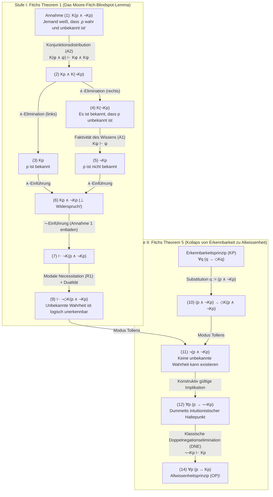
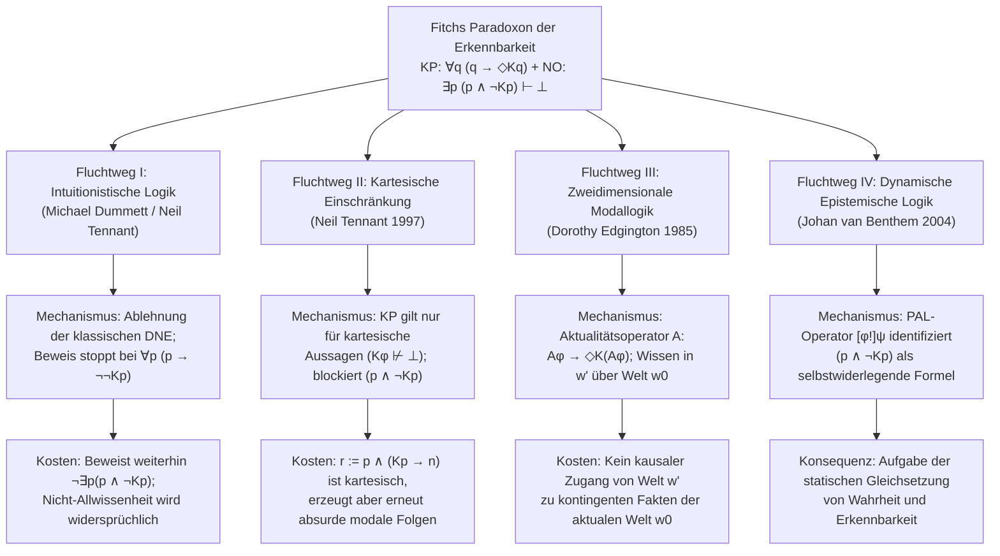

## 1. Einleitung: Die erkenntnistheoretische Bruchlinie zwischen metaphysischem Realismus und semantischem Antirealismus

Kann eine Proposition determiniert wahr sein, selbst wenn kein endlicher Geist jemals – nicht einmal im Prinzip – in der Lage wäre, ihre Wahrheit zu verifizieren, zu entdecken oder zu wissen?

Diese Frage markiert die tiefste Bruchlinie in der zeitgenössischen Metaphysik, Erkenntnistheorie, Sprachphilosophie und Philosophie der Mathematik: den Konflikt zwischen dem <strong>metaphysischen Realismus (Metaphysical Realism)</strong> und dem <strong>semantischen Antirealismus (Semantic Anti-Realism / Verifikationismus)</strong>.

### 1.1 Die Position des metaphysischen Realismus
Gemäß dem <strong>metaphysischen Realismus</strong> – vertreten durch Gottlob Frege, Bertrand Russell, den frühen Hilary Putnam und Timothy Williamson – ist Wahrheit radikal <strong>erkenntnistranszendent (recognition-transcendent / evidence-transcendent)</strong>. Ob eine Aussage $p$ wahr oder falsch ist, hängt allein von der objektiven, geistunabhängigen Beschaffenheit der Welt ab. In der formalen Sprache der bimodalen epistemisch-alethischen Logik (mit $p$ für „$p$ ist wahr“, $Kp$ für „jemand weiß zu irgendeinem Zeitpunkt $p$“ und $\Diamond\phi$ für „es ist logisch/metaphysisch möglich, dass $\phi$“) behauptet der Realismus die Existenz <strong>unerkennbarer Wahrheiten (Unknowable Truths)</strong>:

$$\text{Realismus (Unerkennbare Wahrheiten)}: \quad \exists p \, \big( p \land \neg \Diamond K p \big)$$

Beispiele hierfür sind unwiederbringlich verlorene historische Mikro-Tatsachen (etwa ob die Anzahl der Kopfhaare Julius Cäsars im exakten Moment seiner Ermordung im Jahr 44 v. Chr. ungerade war), Quantenereignisse jenseits des kosmologischen Ereignishorizonts oder unentscheidbare mathematische Aussagen.

### 1.2 Semantischer Antirealismus und das Erkennbarkeitsprinzip (KP)
Im Gegensatz dazu lehnt die Tradition des <strong>Verifikationismus, Pragmatismus und semantischen Antirealismus</strong> – von C.S. Peirce und dem Wiener Kreis (Rudolf Carnap) über Hilary Putnams <strong>internen Realismus</strong> bis zu <strong>Michael Dummetts</strong> intuitionistischem Antirealismus – den Begriff einer prinzipiell unzugänglichen Wahrheit als inhaltsleer ab. Durch sein <strong>Erwerbsargument (Acquisition Argument)</strong> und <strong>Manifestationsargument (Manifestation Argument)</strong> zeigte Dummett, dass endliche Sprecher die Bedeutung eines Satzes nur dann erlernen und im praktischen Sprachgebrauch manifestieren können, wenn Wahrheitsbedingungen konstitutiv an prinzipielle Verifizierbarkeit gekoppelt sind.

Daraus ergibt sich das Grundaxiom des modernen Antirealismus, das <strong>Erkennbarkeitsprinzip (Knowability Principle, KP)</strong>:

$$\text{KP (Knowability Principle)}: \quad \forall p \, \big( p \to \Diamond K p \big)$$

(„Für jede Proposition $p$ gilt: Wenn $p$ wahr ist, dann ist es prinzipiell möglich, dass irgendjemand zu irgendeinem Zeitpunkt $p$ weiß.“)

### 1.3 Das Prinzip der Nicht-Allwissenheit (NO) und Fitchs logische Bombe
Der Antirealist ist kein subjektiver Idealist; er behauptet keineswegs $\forall p \, (p \to K p)$ („Alle Wahrheiten sind tatsächlich bekannt“). Da Menschen endliche Wesen sind, bleiben unzählige triviale Tatsachen unentdeckt. Jeder Antirealist akzeptiert daher selbstverständlich das <strong>Prinzip der Nicht-Allwissenheit (Non-Omniscience Principle, NO)</strong>:

$$\text{NO (Non-Omniscience Principle)}: \quad \exists p \, \big( p \land \neg K p \big)$$

Doch im Jahr 1963 bewies der Yale-Logiker <strong>Frederic B. Fitch (1908–1987)</strong> in seiner Arbeit *"A Logical Analysis of Some Value Concepts"* (*The Journal of Symbolic Logic*, Theorem 5) ein erschütterndes Resultat:

> <strong>Fitchs Paradoxon der Erkennbarkeit (Fitch's Paradox of Knowability)</strong>:
> Setzt man lediglich die schwächsten, völlig unstrittigen Inferenzregeln der epistemischen Modallogik voraus – nämlich die <strong>Faktivität des Wissens</strong> und die <strong>Konjunktionsdistribution</strong> –, so folgt aus dem moderaten <strong>Erkennbarkeitsprinzip $\forall p \, (p \to \Diamond K p)$</strong> in der klassischen Logik unmittelbar das absurde <strong>Allwissenheitsprinzip $\forall p \, (p \to K p)$</strong>!
> Kontrapositiv formuliert: Wenn die Menschheit nicht allwissend ist ($\exists p \, (p \land \neg K p)$), dann existiert notwendigerweise mindestens eine Wahrheit, die prinzipiell niemals gewusst werden kann ($\exists q \, (q \land \neg \Diamond K q)$).

---

## 2. Historische Genese: Alonzo Churchs anonymes Gutachten von 1945 und Fitchs Aufsatz von 1963

Auf Seite 138 seines Aufsatzes von 1963 merkte Fitch in Fußnote 5 an: *"The proof of theorem 5 was suggested to the author by an anonymous referee of a paper submitted in 1945 but never published."*

Über sechzig Jahre lang blieb die Identität dieses anonymen Gutachters von 1945 ein Rätsel. Erst durch Archivforschungen von Joe Salerno (veröffentlicht 2009 in *New Essays on the Knowability Paradox*) im Nachlass von <strong>Alonzo Church (1903–1995)</strong> an der Princeton University wurde enthüllt, dass der anonyme Gutachter niemand geringerer als <strong>Alonzo Church</strong> selbst war – der Begründer des $\lambda$-Kalküls! Als Fitch 1945 ein Manuskript einreichte, das Wahrheit mit prinzipieller Erkennbarkeit gleichsetzte, zeigte Church in seinem Gutachten vom Juli 1945 durch die Substitution $q := (p \land \neg K p)$, dass dies unmittelbar in Allwissenheit ($\forall p (p \to K p)$) kollabiert.

---

## 3. Formale Syntax und minimales Axiomensystem der bimodalen epistemischen Logik

In der bimodalen Sprache $\mathcal{L}_{K,\Box}$ steht $K\phi$ für zeitübergreifendes kollektives Wissen:

$$K\phi \stackrel{\text{def}}{\Longleftrightarrow} \exists x \in \text{Agents}, \, \exists t \in \text{Times} \, \big( K_{x,t} \phi \big)$$

Die enorme Durchschlagskraft von Fitchs Beweis beruht darauf, dass er <strong>keinerlei starke, kontroverse Axiome</strong> wie das <strong>KK-Prinzip (Positive Introspektion, Axiom 4: $K\phi \to KK\phi$)</strong>, die <strong>Negative Introspektion (Axiom 5: $\neg K\phi \to K\neg K\phi$)</strong> oder die <strong>volle deduktive Abgeschlossenheit (Axiom K: $K(\phi \to \psi) \to (K\phi \to K\psi)$)</strong> benötigt. Er stützt sich ausschließlich auf drei minimale Prinzipien:

1. <strong>(A1) Faktivität des Wissens (Epistemisches Axiom T)</strong>:
   $$K\phi \vdash \phi$$
   („Was gewusst wird, muss wahr sein; Falsches kann man nicht wissen.“)
2. <strong>(A2) Distribution des Wissens über die Konjunktion</strong>:
   $$K(\phi \land \psi) \vdash K\phi \land K\psi$$
   („Wer die Konjunktion ‚$\phi$ und $\psi$‘ weiß, der weiß $\phi$ und weiß $\psi$.“)
3. <strong>(R1) Modale Necessitationsregel (Modal Necessitation Rule)</strong>:
   $$\text{Wenn } \vdash \phi, \quad \text{dann } \vdash \Box\phi$$
   („Logische Theoreme gelten notwendigerweise in allen möglichen Welten.“ Zudem gilt die modale Dualität $\Box\neg\phi \equiv \neg\Diamond\phi$.)

| Prinzip / Regel | Formales Schema | Philosophische Bedeutung | Für Fitchs Beweis nötig? |
| :--- | :--- | :--- | :--- |
| <strong>(A1) Faktivität des Wissens (Axiom T)</strong> | $K\phi \vdash \phi$ | Wissen impliziert Wahrheit | <strong>JA (Essentiell)</strong> |
| <strong>(A2) Konjunktionsdistribution</strong> | $K(\phi \land \psi) \vdash K\phi \land K\psi$ | Wissen von „$A$ und $B$“ impliziert Wissen von $A$ und $B$ | <strong>JA (Essentiell)</strong> |
| <strong>(R1) Modale Necessitation</strong> | $\vdash \phi \implies \vdash \Box\phi$ | Logische Theoreme sind notwendig wahr | <strong>JA (Essentiell)</strong> |
| <strong>Volle deduktive Abgeschlossenheit (K)</strong> | $K(\phi \to \psi) \to (K\phi \to K\psi)$ | Logische Allwissenheit unter Implikation | <strong>NEIN</strong> |
| <strong>Positive Introspektion (KK / Axiom 4)</strong> | $K\phi \to KK\phi$ | Wissen impliziert Wissen des Wissens | <strong>NEIN</strong> |
| <strong>Negative Introspektion (Axiom 5)</strong> | $\neg K\phi \to K\neg K\phi$ | Nichtwissen impliziert Wissen des Nichtwissens | <strong>NEIN</strong> |

---

## 4. Vollständiger formaler Beweis von Fitchs Paradoxon (Step-by-Step)

### 4.1 Stufe I (Fitchs Theorem 1): Die logische Unmöglichkeit, eine unbekannte Wahrheit zu wissen
Sei $q \stackrel{\text{def}}{\equiv} (p \land \neg K p)$ („$p$ ist wahr, aber niemand weiß jemals $p$“). Wir beweisen durch *Reductio ad absurdum* ($\neg$-Einführung), dass niemand jemals $q$ wissen kann:

| Zeile | Formel | Begründung / Inferenzregel | Offene Annahmen |
| :---: | :--- | :--- | :---: |
| (1) | $K(p \land \neg K p)$ | <strong>Annahme für Reductio</strong> | $\{1\}$ |
| (2) | $K p \land K(\neg K p)$ | Aus (1) durch <strong>(A2) Konjunktionsdistribution</strong> $K(\phi \land \psi) \vdash K\phi \land K\psi$ | $\{1\}$ |
| (3) | $K p$ | Aus (2) durch $\land$-Elimination (links) | $\{1\}$ |
| (4) | $K(\neg K p)$ | Aus (2) durch $\land$-Elimination (rechts) | $\{1\}$ |
| (5) | $\neg K p$ | Aus (4) durch <strong>(A1) Faktivität des Wissens</strong> $K\psi \vdash \psi$ ($\psi := \neg K p$) | $\{1\}$ |
| (6) | $K p \land \neg K p \quad (\bot)$ | Aus (3) und (5) durch $\land$-Einführung (<strong>Expliziter Widerspruch!</strong>) | $\{1\}$ |
| (7) | $\vdash \neg K(p \land \neg K p)$ | Aus (1)–(6) durch $\neg$-Einführung (Annahme $\{1\}$ entladen) | $\emptyset$ |
| (8) | $\vdash \Box \neg K(p \land \neg K p)$ | Aus Theorem (7) durch <strong>(R1) Modale Necessitation</strong> | $\emptyset$ |
| (9) | $\vdash \neg \Diamond K(p \land \neg K p)$ | Aus (8) durch modale Dualität ($\Box\neg\phi \equiv \neg\Diamond\phi$) | $\emptyset$ |

Zeile (9) $\vdash \neg \Diamond K(p \land \neg K p)$ beweist: <strong>Es ist logisch unmöglich, eine unbekannte Wahrheit zu wissen!</strong>

### 4.2 Stufe II (Fitchs Theorem 5): Der Kollaps von Erkennbarkeit (KP) in Allwissenheit (OP)
Nun setzen wir die Konjunktion $q := (p \land \neg K p)$ in das antirealistische <strong>Erkennbarkeitsprinzip (KP)</strong> $\forall q \, (q \to \Diamond K q)$ ein:

| Zeile | Formel | Begründung / Inferenzregel | Logischer Status |
| :---: | :--- | :--- | :--- |
| (10) | $(p \land \neg K p) \to \Diamond K(p \land \neg K p)$ | Universelle Instanziierung von <strong>KP</strong> mit $q := (p \land \neg K p)$ | Instanz von KP |
| (11) | $\neg (p \land \neg K p)$ | Aus (10) und Theorem (9) $\neg \Diamond K(p \land \neg K p)$ durch <strong>Modus Tollens</strong> | <strong>Intuitionistisch gültig!</strong> |
| (12) | $p \to \neg \neg K p$ | Aus (11) durch aussagenlogische Äquivalenz $\neg(A \land \neg B) \vdash (A \to \neg\neg B)$ | <strong>Intuitionistisch gültig!</strong> |
| (13) | $p \to K p$ | Aus (12) durch <strong>klassische Doppelnegationselimination (DNE)</strong> $\neg\neg K p \vdash K p$ | Nutzt klassische DNE |
| (14) | $\forall p \, (p \to K p)$ | Aus (13) durch Universelle Generalisierung | <strong>Allwissenheitsprinzip (OP)!</strong> |

---

## 5. Strukturelle Diagnose: Moores Paradoxon, epistemische blinde Flecken und das Paradoxon der unerwarteten Hinrichtung

1. <strong>G.E. Moores Paradoxon (1942)</strong>: Moores Satz *„Es regnet draußen, aber ich weiß nicht, dass es regnet“* ($p \land \neg K_a p$) beschreibt einen konsistenten Sachverhalt, kann aber von $a$ selbst niemals gewusst werden. Während eine dritte Person $b$ problemlos $K_b(p \land \neg K_a p)$ wissen kann, quantifiziert der Operator $K$ in Fitchs Paradoxon über <strong>alle</strong> Subjekte und Zeiten, sodass es keinen externen Beobachter mehr gibt.
2. <strong>Roy Sorensens *Blindspots* (1988)</strong>: Die Proposition $(p \land \neg K p)$ ist ein <strong>epistemischer blinder Fleck</strong> ($\Diamond\phi \land \neg\Diamond K\phi$). Der Akt des Wissenserwerbs verändert den epistemischen Zustand der Welt von $\neg K p$ zu $K p$ und falsifiziert damit die Konjunktion im selben Augenblick, in dem sie erkannt wird.
3. <strong>Parallelen zum Paradoxon der unerwarteten Prüfung und zu Gödels Unvollständigkeitssatz</strong>: Im Überraschungstest-Paradoxon scheitert die Rückwärtsinduktion der Schüler genau daran, dass sie die Wahrheit von $(E_5 \land \neg K_{\text{Do}} E_5)$ mit ihrer Erkennbarkeit am Donnerstagabend $K_{\text{Do}}(E_5 \land \neg K_{\text{Do}} E_5)$ verwechseln. In der formalen Arithmetik verhindert Löbs Theorem, dass das Beweisbarkeitsprädikat $\text{Prov}_T(\ulcorner \phi \urcorner)$ allgemein faktiv ist ($\text{Prov}_T(\ulcorner \phi \urcorner) \to \phi$ ist in $T$ nicht allgemein beweisbar), weshalb Gödels Satz keinen Kollaps in die Vollständigkeit auslöst; echtes Wissen $K$ hingegen ist konstitutiv faktiv ($K\phi \to \phi$).

---

## 6. Die vier großen philosophischen Fluchtwege und ihre Kosten

### 6.1 Fluchtweg I: Michael Dummett und die intuitionistische Logik
<strong>Michael Dummett (2001, *"Victor's Error"*)</strong> und <strong>Neil Tennant</strong> wiesen darauf hin, dass die Zeilen (1) bis (12) von Fitchs Beweis in der <strong>intuitionistischen Logik</strong> vollkommen gültig sind, da Zeile (7) lediglich eine konstruktiv zulässige $\neg$-Einführung ($A \vdash \bot \implies \vdash \neg A$) verwendet. Klassische Logik wird <strong>ausschließlich beim Übergang von Zeile (12) zu Zeile (13)</strong> benötigt, wo die <strong>Doppelnegationselimination (DNE: $\neg\neg K p \vdash K p$)</strong> angewandt wird! Für den intuitionistischen Antirealisten endet der Beweis daher bei:

$$\forall p \, \big( p \to \neg\neg K p \big) \quad \text{und} \quad \forall p \, \neg(p \land \neg K p)$$

<strong>Timothy Williamsons (1982, 2000) Gegenkritik</strong>:
1. Selbst ohne DNE ist Zeile (11) $\vdash_{\text{Int}} \neg \exists p \, (p \land \neg K p)$ ein intuitionistisches Theorem! Damit wird das <strong>Prinzip der Nicht-Allwissenheit (NO: $\exists p (p \land \neg K p)$) auch in der intuitionistischen Logik als widersprüchlich (falsch) widerlegt</strong>!
2. Für alle <strong>entscheidbaren Aussagen (Decidable Propositions)</strong>, für die $K p \lor \neg K p$ gilt (etwa wenn die Menschheit nur endlich lange existiert und nur endlich viele Erkenntnisakte vollzieht), gilt $\neg\neg K p \vdash_{\text{Int}} K p$ auch intuitionistisch, sodass $p \to \neg\neg K p$ wieder in $p \to K p$ kollabiert!

### 6.2 Fluchtweg II: Neil Tennants Beschränkung auf „kartesische Propositionen“
<strong>Neil Tennant (1997, *The Taming of the Sleuth*)</strong> definierte eine Proposition $\phi$ als <strong>kartesisch (Cartesian)</strong> genau dann, wenn die Annahme, dass $\phi$ gewusst wird, keinen logischen Widerspruch erzeugt:

$$\text{Cartesian}(\phi) \stackrel{\text{def}}{\Longleftrightarrow} K\phi \not\vdash \bot, \qquad \text{KP}_{\text{Cart}}: \quad \forall \phi \, \Big( \text{Cartesian}(\phi) \implies \big( \phi \to \Diamond K \phi \big) \Big)$$

Da $K(p \land \neg K p) \vdash \bot$, ist die Fitch-Konjunktion nicht-kartesisch und darf nicht eingesetzt werden.
<strong>Gegenbeispiel von DeVidi & Solomon (2001) und Williamson</strong>: Betrachte $r \stackrel{\text{def}}{\equiv} p \land (K p \to n)$, wobei $n$ eine kontingente Falschheit ist, die mit $p$ konsistent gewusst werden kann ($K p \land K n \not\vdash \bot$). Dann ist $r$ <strong>kartesisch</strong> ($K r \not\vdash \bot$), führt aber bei Einsetzung in $\text{KP}_{\text{Cart}}$ sofort zu $(p \land \neg K p) \to \Diamond(K p \land n)$, was das Paradoxon wiederbelebt!

### 6.3 Fluchtweg III: Dorothy Edgingtons zweidimensionale Modallogik ($\mathcal{A}$ / `@`)
<strong>Dorothy Edgington (1985, *"The Paradox of Knowability"*, *Mind*)</strong> führte den <strong>Aktualitätsoperator $\mathcal{A}$ („Actually“)</strong> ein ($\mathcal{M}, w' \models \mathcal{A}\phi \iff \mathcal{M}, w_0 \models \phi$) und formulierte:

$$\text{KP}_{\text{Edg}}: \quad \forall \phi \, \Big( \mathcal{A}\phi \to \Diamond K(\mathcal{A}\phi) \Big)$$

Ein Beobachter in einer kontrafaktischen möglichen Welt $w'$ kann widerspruchsfrei wissen, dass in der <strong>aktualen Welt $w_0$</strong> die Tatsache $p$ besteht und in $w_0$ niemand $p$ weiß ($K_{w'}(\mathcal{A} p) \land \neg \mathcal{A} K p$). Williamsons Kritik: Wie kann ein Subjekt in einer kausal isolierten Welt $w'$ empirisches Wissen über kontingente Tatsachen in einer anderen Welt $w_0$ erlangen?

### 6.4 Fluchtweg IV: Dynamische Epistemische Logik (DEL) und Public Announcement Logic (PAL)
<strong>Johan van Benthem (2004)</strong> zeigte mithilfe des dynamischen Ankündigungsoperators $[\phi!]\psi$, dass $(p \land \neg K p)$ eine <strong>„erfolglose Formel“ (Unsuccessful Formula / Self-Refuting Update)</strong> ist: Sobald die wahre Formel $(p \land \neg K p)$ bekannt gegeben oder gelernt wird, wird $K p$ im aktualisierten Modell wahr und $\neg K p$ dadurch falsch ($\mathcal{M}, w \models [p \land \neg K p !] \neg(p \land \neg K p)$).

---

## 7. Vergleichsmatrix und Fazit

| Philosophische Position | Formales Prinzip / Logik | Mechanismus zur Blockade | Kritische Schwachstelle / Kosten |
| :--- | :--- | :--- | :--- |
| <strong>Naiver Antirealismus</strong> | $\forall p \, (p \to \Diamond K p)$ (Klassisch) | <strong>Keiner</strong>: Kollabiert zu $\forall p (p \to K p)$ | Führt direkt zur absurden menschlichen <strong>Allwissenheit (OP)</strong> |
| <strong>Intuitionistischer Antirealismus</strong> (Dummett 2001) | $\forall p \, (p \to \Diamond K p)$ (Intuitionistisch) | Verwirft DNE ($\neg\neg K p \not\vdash K p$); stoppt bei $p \to \neg\neg K p$ | Widerlegt weiterhin $\exists p (p \land \neg K p)$; kollabiert bei entscheidbarem $K p$ |
| <strong>Kartesische Einschränkung</strong> (Tennant 1997) | $\text{Cartesian}(\phi) \to (\phi \to \Diamond K \phi)$ mit $K\phi \not\vdash \bot$ | Schließt $(p \land \neg K p)$ wegen $K(p \land \neg K p) \vdash \bot$ aus | Wird durch die kartesische Formel $r := p \land (K p \to n)$ ausgehebelt |
| <strong>Zweidimensionale Modallogik</strong> (Edgington 1985) | $\forall \phi \, (\mathcal{A}\phi \to \Diamond K(\mathcal{A}\phi))$ | Trennt Welt der Wahrheit ($w_0$) und Welt des Wissens ($w'$) | Unerklärbarkeit kausal isolierten weltübergreifenden Wissens |
| <strong>Dynamische Epistemische Logik</strong> (van Benthem 2004) | Öffentliche Ankündigung $[\phi!]\psi$ | Zeigt, dass $(p \land \neg K p)$ beim Lernen falsch wird | Verlangt die Aufgabe des rein statischen semantischen Antirealismus |

<strong>Fazit</strong>: Wenn wir die Endlichkeit menschlichen Wissens anerkennen ($\exists p \, (p \land \neg K p)$), zwingt uns Fitchs Theorem 1 ($\vdash \neg \Diamond K(p \land \neg K p)$) mit mathematischer Notwendigkeit zum <strong>metaphysischen Realismus</strong>:

$$\exists p \, (p \land \neg K p) \quad \vdash \quad \exists q \, \big( q \land \neg \Diamond K q \big)$$

Die objektive Realität übersteigt aus rein logischen Gründen die Grenzen dessen, was jemals gewusst werden kann.

---

## Literaturverzeichnis (References)

* Fitch, F. B. (1963). "A Logical Analysis of Some Value Concepts". *The Journal of Symbolic Logic*, 28(2), 135–142.
* Salerno, J. (Ed.). (2009). *New Essays on the Knowability Paradox*. Oxford University Press.
* Dummett, M. (2001). "Victor's Error". *Analysis*, 61(269), 1–2.
* Williamson, T. (2000). *Knowledge and Its Limits*. Oxford University Press.
* Edgington, D. (1985). "The Paradox of Knowability". *Mind*, 94(376), 557–568.
* Tennant, N. (1997). *The Taming of the Sleuth*. Oxford University Press.
* van Benthem, J. (2004). "What One May Come to Know". *Analysis*, 64(282), 95–105.
