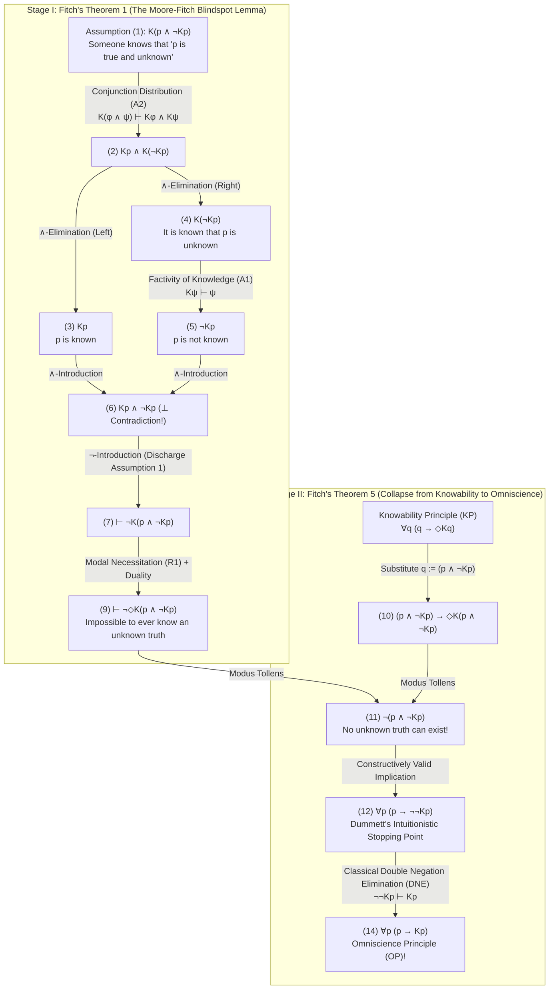
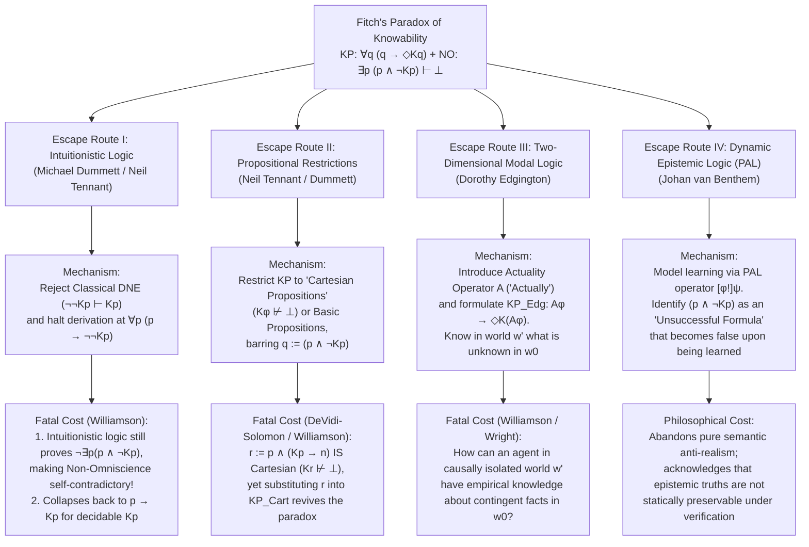

## 1. Introduction: The Epistemological Fault Line Between Metaphysical Realism and Semantic Anti-Realism

Can a proposition be determinately true even if no mind could ever, even in principle, verify, discover, or know that it is true?

This question defines the deepest fault line in contemporary metaphysics, epistemology, philosophy of language, and philosophy of mathematics: the clash between <strong>Metaphysical Realism</strong> and <strong>Semantic Anti-Realism (Verificationism)</strong>.

### 1.1 The Commitment of Metaphysical Realism
According to <strong>Metaphysical Realism</strong>—championed by thinkers such as Gottlob Frege, Bertrand Russell, early Hilary Putnam, W.D. Hart, and Timothy Williamson—truth is radically <strong>recognition-transcendent (evidence-transcendent)</strong>. Whether a declarative sentence or proposition $p$ is true depends exclusively on how the objective, mind-independent world is configured. Our epistemic capacities—what finite cognitive agents can observe, prove, verify, or come to know—have no constitutive bearing on what is true.

In the formal language of bimodal epistemic-alethic logic, let $p$ denote that proposition $p$ is true, let $K p$ denote that someone at some time (past, present, or future) knows $p$, and let $\Diamond \phi$ denote that $\phi$ is logically or metaphysically possible. Metaphysical Realism is characterized by its willingness to affirm the existence of <strong>unknowable truths</strong>:

$$\text{Realism (Unknowable Truths)}: \quad \exists p \, \big( p \land \neg \Diamond K p \big)$$

("There exists at least one proposition $p$ such that $p$ is true, yet it is logically or metaphysically impossible for anyone ever to know $p$.")

Realists point to several compelling classes of potentially unknowable truths:
1. <strong>Irretrievably Lost Historical Micro-Facts</strong>: Consider the proposition $p$: *"At the exact microsecond Julius Caesar was stabbed by Brutus on the Ides of March in 44 BCE, the total number of hairs on Caesar's head was odd."* Since the number of hairs on a human head is a finite non-negative integer, either $p$ or $\neg p$ was determinately true at that instant. Yet due to thermodynamic irreversibility and the cosmic dispersion of information, every physical trace capable of deciding between an odd and an even hair count has vanished forever.
2. <strong>Events Beyond Cosmological or Relativistic Horizons</strong>: Consider a specific quantum decay event occurring inside the event horizon of a black hole or beyond our cosmological event horizon, such that no causal signal from that event can ever reach any observer in spacetime.
3. <strong>Undecidable Mathematical Truths</strong>: Under mathematical Platonism, a statement in arithmetic or set theory may possess a determinate truth value in the intended structure even if it is formally independent of every axiom system human beings could ever justifiably recognize as self-evident.

### 1.2 Semantic Anti-Realism and the Knowability Principle (KP)
Against this picture of radically inaccessible reality stands the tradition of <strong>Verificationism, Pragmatism, and Semantic Anti-Realism</strong>—stretching from C.S. Peirce's pragmatist definition of truth (*"the opinion which is fated to be ultimately agreed to by all who investigate"*), through the Logical Positivism of the Vienna Circle (Rudolf Carnap, Moritz Schlick, A.J. Ayer) and Hilary Putnam's <strong>Internal Realism</strong> (*"truth is idealized rational acceptability"*), to <strong>Michael Dummett's Intuitionistic Anti-Realism</strong>.

Dummett anchored anti-realism not in dogmatic empiricism, but in the philosophy of language via two celebrated arguments:
* <strong>The Acquisition Argument</strong>: Human beings learn language through finite exposure to publicly observable circumstances and practices of assertion and justification. If the meaning of a sentence consisted in recognition-transcendent truth conditions—conditions that could obtain without leaving any trace accessible to human faculties—how could any finite speaker ever acquire a grasp of those truth conditions?
* <strong>The Manifestation Argument</strong>: To understand the meaning of a sentence $p$, a speaker must be able to <strong>manifest</strong> that understanding in practical linguistic behavior—specifically, in their ability to recognize what counts as verification, proof, or conclusive evidence for $p$. Claiming that speakers mentally grasp verification-transcendent truth conditions violates Wittgenstein's stricture against private, unmanifestable semantic states.

Consequently, the semantic anti-realist insists on a constitutive conceptual link between truth and epistemic accessibility. A proposition cannot be true unless it is, at least <strong>in principle</strong>, possible for some cognitive agent at some time to come to know it. This yields the foundational axiom of modern anti-realism, the <strong>Knowability Principle (KP)</strong>:

$$\text{KP (Knowability Principle)}: \quad \forall p \, \big( p \to \Diamond K p \big)$$

("For every proposition $p$, if $p$ is true, then it is possible that someone at some time knows $p$.")

### 1.3 Common-Sense Non-Omniscience (NO) and Fitch's Bombshell
Why does the anti-realist insert the modal possibility operator $\Diamond$ ("it is possible that...") in front of the epistemic operator $K$?

Because without the modal operator $\Diamond$, the principle would read $\forall p \, (p \to K p)$—asserting that every truth is <strong>actually known</strong> at some time in human history! No sane philosopher wants to assert $\forall p \, (p \to K p)$. Human beings are finite, fallible creatures with limited lifespans and perceptual organs. Millions of trivial truths—the exact number of grains of sand on a prehistoric beach, the precise weight in micrograms of the last leaf that fell in Sherwood Forest yesterday—go forever unmeasured and unknown.

Thus, every anti-realist wholeheartedly endorses the common-sense <strong>Non-Omniscience Principle (NO)</strong>:

$$\text{NO (Non-Omniscience Principle)}: \quad \exists p \, \big( p \land \neg K p \big)$$

("There exists at least one proposition $p$ that is true, yet is never actually known by anyone at any time in the past, present, or future.")

The anti-realist's entire philosophical program rests on the conviction that <strong>Knowability in Principle ($\text{KP}: \forall p (p \to \Diamond K p)$)</strong> and <strong>Actual Non-Omniscience ($\text{NO}: \exists p (p \land \neg K p)$)</strong> are perfectly compatible: *"Not all truths are actually known ($\exists p (p \land \neg K p)$), because we never happen to investigate all of them; nevertheless, every single truth is knowable in principle ($\forall p (p \to \Diamond K p)$)."*

In 1963, Yale logician <strong>Frederic B. Fitch (1908–1987)</strong> published a short paper in *The Journal of Symbolic Logic* titled *"A Logical Analysis of Some Value Concepts"*. In Theorem 5 of that paper, Fitch detonated a logical bombshell at the very heart of anti-realism:

> <strong>Fitch's Paradox of Knowability (Theorem 5, 1963)</strong>:
> Using only the weakest, most uncontroversial inference rules of epistemic and modal logic—specifically, that knowledge entails truth (Factivity) and that knowing a conjunction entails knowing each conjunct (Conjunction Distribution)—the modest <strong>Knowability Principle $\forall p \, (p \to \Diamond K p)$</strong> entails the absurd <strong>Omniscience Principle $\forall p \, (p \to K p)$</strong>!
> Contrapositively, if human beings are not omniscient ($\exists p \, (p \land \neg K p)$), then there necessarily exists a truth that is logically impossible for anyone ever to know ($\exists q \, (q \land \neg \Diamond K q)$).

The modal buffer $\Diamond$, which was supposed to separate moderate verificationism from crazy idealism, completely evaporates under elementary logical deduction. In this article, we reconstruct the historical discovery of the paradox, present its complete formal proof in bimodal epistemic logic, and analyze the four major philosophical escape routes—Intuitionistic Logic, Restriction Strategies, Two-Dimensional Modal Logic, and Dynamic Epistemic Logic—together with their far-reaching consequences for metaphysics and logic.

---

## 2. Historical Genesis: Alonzo Church's 1945 Anonymous Referee Report and Fitch's 1963 Theorem

Behind Fitch's 1963 paper lies one of the most fascinating detective stories in twentieth-century logic.

When Frederic Fitch published *"A Logical Analysis of Some Value Concepts"* in *The Journal of Symbolic Logic* (Vol. 28, No. 2, 1963, pp. 135–142), his primary goal was to axiomatize a general logic of "value concepts" and propositional attitudes—such as *knowing*, *believing*, *desiring*, and *striving*—treated as modal-like operators obeying certain distributive and closedness properties. On page 138, after proving Theorem 5 (that if all truths are knowable, all truths are known), Fitch appended a brief acknowledgment in Footnote 5:

> *"The proof of theorem 5 was suggested to the author by an anonymous referee of a paper submitted in 1945 but never published."*

For over six decades, the identity of this brilliant "anonymous referee" who discovered the knowability paradox in 1945—long before Georg Henrik von Wright (1951) and Jaakko Hintikka (1962) formally founded modern epistemic logic—remained unknown.

The mystery was finally solved through archival research by philosopher Joe Salerno (documented in his 2009 volume *New Essays on the Knowability Paradox*). Examining the personal papers of <strong>Alonzo Church (1903–1995)</strong>—the legendary Princeton logician who invented the $\lambda$-calculus and proved the undecidability of first-order logic—in the Princeton University Library archives, Salerno uncovered Church's original referee correspondence from the summer of 1945.

In early 1945, Fitch had submitted a manuscript titled *"A Minimum Calculus for Logic"* to *The Journal of Symbolic Logic*, in which he proposed an anti-realist axiom identifying truth with knowability in principle: $\forall p \, (p \leftrightarrow \Diamond K p)$. Alonzo Church served as the referee. In his July 1945 referee report, Church demonstrated with surgical precision that if one substitutes the compound conjunction $(p \land \neg K p)$ into the knowability schema, elementary properties of knowledge and modality immediately yield $\neg(p \land \neg K p)$, collapsing potential knowledge ($\Diamond K p$) into actual knowledge ($K p$).

Stunned by Church's refutation, Fitch withdrew his 1945 paper. Eighteen years later, in 1963, Fitch immortalized Church's referee proof as Theorem 1 and Theorem 5 of *"A Logical Analysis of Some Value Concepts"*. Even after 1963, the theorem remained a sleeper result known only to a handful of modal logicians until W.D. Hart and Colin McGinn (1976, 1979) and Timothy Williamson (1982, 1987, 2000) deployed it as a devastating weapon against Michael Dummett's semantic anti-realism.

---

## 3. Formal Syntax and Minimal Axiom System of Bimodal Epistemic-Alethic Logic

To appreciate why Fitch's Paradox is so resistant to evasion, we must examine the formal language in which it is stated and verify just how remarkably weak its underlying epistemic and modal assumptions are.

### 3.1 The Bimodal Formal Language $\mathcal{L}_{K,\Box}$
Let $\mathcal{L}_{K,\Box}$ be a bimodal propositional language built from a countable set of atomic propositional variables $\text{Prop} = \{p, q, r, \dots\}$ (with propositional quantification $\forall p, \exists p$ or schematic substitution over all well-formed formulas) via the following grammar:

$$\phi, \psi ::= p \mid \neg \phi \mid (\phi \land \psi) \mid (\phi \lor \psi) \mid (\phi \to \psi) \mid K\phi \mid \Box\phi \mid \Diamond\phi$$

The two modal operators have distinct philosophical interpretations:
1. <strong>The Omnitemporal, Collective Epistemic Operator $K\phi$</strong>:
   To give the anti-realist the most charitable reading possible, $K\phi$ is <strong>not</strong> restricted to what a single individual knows right now. Rather, $K\phi$ abbreviates:
   $$K\phi \stackrel{\text{def}}{\Longleftrightarrow} \exists x \in \text{Agents}, \, \exists t \in \text{Times} \, \big( K_{x,t} \phi \big)$$
   ("Someone—some finite cognitive agent in the universe—at some time in the past, present, or future knows that $\phi$.")
   Consequently, $\neg K\phi$ means: *"Nobody at any time in the entire history of the universe ever knows that $\phi$."*
2. <strong>The Alethic Modal Operators $\Box\phi$ and $\Diamond\phi$</strong>:
   $\Box\phi$ reads *"It is logically / metaphysically necessary that $\phi$,"* and $\Diamond\phi$ reads *"It is logically / metaphysically possible that $\phi$."* They are interdefined by standard modal duality:
   $$\Diamond\phi \stackrel{\text{def}}{\Longleftrightarrow} \neg \Box \neg \phi, \qquad \Box \neg \phi \Longleftrightarrow \neg \Diamond \phi$$

### 3.2 The Minimal Axioms Required for Fitch's Proof
Standard systems of epistemic logic (such as Hintikka's S4 or S5) impose strong, idealized principles that are frequently criticized by epistemologists:
* <strong>The KK-Principle / Positive Introspection (Axiom 4)</strong>: $K\phi \to KK\phi$ (*"If you know $\phi$, you know that you know $\phi$"*).
* <strong>Negative Introspection (Axiom 5)</strong>: $\neg K\phi \to K\neg K\phi$ (*"If you don't know $\phi$, you know that you don't know $\phi$"*).
* <strong>Deductive Closure / Logical Omniscience (Axiom K)</strong>: $K(\phi \to \psi) \to (K\phi \to K\psi)$ (*"Agents know all logical consequences of what they know"*).

<strong>Fitch's proof requires NONE of these controversial axioms!</strong> It does not assume the KK-principle, it does not assume negative introspection, it does not assume S4 or S5 modal logic, and it does not even require full deductive closure (Axiom K) for knowledge. It relies exclusively on two minimal epistemic principles and one basic modal rule:

1. <strong>(A1) Factivity of Knowledge (Epistemic Axiom T)</strong>:
   $$K\phi \vdash \phi \quad \big(\text{or } \vdash K\phi \to \phi\big)$$
   *"Whatever is known must be true."* This is the universally accepted demarcation criterion separating knowledge from mere belief or opinion: one cannot *know* a falsehood.
2. <strong>(A2) Distribution of Knowledge over Conjunction (Conjunction Elimination inside $K$)</strong>:
   $$K(\phi \land \psi) \vdash K\phi \land K\psi$$
   *"If someone knows the conjunction '$\phi$ and $\psi$', then someone knows $\phi$ and someone knows $\psi$."*
   (Note: Even when $K\phi$ is defined existentially as $\exists x \exists t K_{x,t}\phi$, if at least one agent $x$ at time $t$ knows the conjunction $\phi \land \psi$, that very agent $x$ at time $t$ knows $\phi$ and knows $\psi$, so $\exists x \exists t K_{x,t}\phi \land \exists x \exists t K_{x,t}\psi$—i.e., $K\phi \land K\psi$—follows immediately!)
3. <strong>(R1) Rule of Modal Necessitation</strong>:
   $$\text{If } \vdash \phi, \quad \text{then } \vdash \Box\phi$$
   *"If a formula $\phi$ is a theorem provable from pure logic and the meaning of the epistemic operator alone (discharging all contingent assumptions), then $\phi$ holds necessarily across all possible worlds."*

| Principle / Rule Name | Formal Schema | Philosophical Meaning | Needed for Fitch's Paradox? |
| :--- | :--- | :--- | :--- |
| <strong>(A1) Factivity of Knowledge (Axiom T)</strong> | $K\phi \vdash \phi$ | Only true propositions can be known | <strong>YES (Essential)</strong> |
| <strong>(A2) Conjunction Distribution</strong> | $K(\phi \land \psi) \vdash K\phi \land K\psi$ | Knowing "$A$ and $B$" entails knowing $A$ and knowing $B$ | <strong>YES (Essential)</strong> |
| <strong>(R1) Modal Necessitation</strong> | $\vdash \phi \implies \vdash \Box\phi$ | Logical theorems are necessarily true | <strong>YES (Essential)</strong> |
| <strong>Full Deductive Closure (Axiom K)</strong> | $K(\phi \to \psi) \to (K\phi \to K\psi)$ | Full logical omniscience under implication | <strong>NO</strong> (Only (A2) is needed) |
| <strong>Positive Introspection (KK / Axiom 4)</strong> | $K\phi \to KK\phi$ | Knowing $\phi$ entails knowing that one knows $\phi$ | <strong>NO</strong> |
| <strong>Negative Introspection (Axiom 5)</strong> | $\neg K\phi \to K\neg K\phi$ | Ignorance of $\phi$ entails knowing one is ignorant of $\phi$ | <strong>NO</strong> |
| <strong>Brouwer's Axiom (Axiom B)</strong> | $\phi \to \Box\Diamond\phi$ | Symmetry of modal accessibility relation | <strong>NO</strong> |

---

## 4. Step-by-Step Formal Derivation of Fitch's Paradox

We now present the complete formal proof in natural deduction, divided into two distinct stages corresponding to Fitch's Theorem 1 and Theorem 5.

### 4.1 Stage I (Fitch's Theorem 1): The Logical Impossibility of Knowing an Unknown Truth (The Moore-Fitch Blindspot Lemma)

Consider an arbitrary proposition $p$, and form the conjunction representing that <strong>$p$ is an unknown truth</strong>:

$$q \stackrel{\text{def}}{\equiv} p \land \neg K p$$

(*"$p$ is true, and nobody at any time ever knows $p$."*)

Can anyone ever know this conjunction $q$? Let us assume $K(p \land \neg K p)$ for *reductio ad absurdum* and derive an explicit contradiction $\bot$:

| Line | Formula | Justification / Inference Rule | Open Assumptions |
| :---: | :--- | :--- | :---: |
| (1) | $K(p \land \neg K p)$ | <strong>Assumption for Reductio</strong> | $\{1\}$ |
| (2) | $K p \land K(\neg K p)$ | From (1) by <strong>(A2) Conjunction Distribution</strong>: $K(\phi \land \psi) \vdash K\phi \land K\psi$ | $\{1\}$ |
| (3) | $K p$ | From (2) by $\land$-Elimination (Left) | $\{1\}$ |
| (4) | $K(\neg K p)$ | From (2) by $\land$-Elimination (Right) | $\{1\}$ |
| (5) | $\neg K p$ | From (4) by <strong>(A1) Factivity of Knowledge</strong>: $K\psi \vdash \psi$ (with $\psi := \neg K p$) | $\{1\}$ |
| (6) | $K p \land \neg K p \quad (\bot)$ | From (3) and (5) by $\land$-Introduction (<strong>Explicit Contradiction!</strong>) | $\{1\}$ |
| (7) | $\vdash \neg K(p \land \neg K p)$ | From (1)–(6) by $\neg$-Introduction, discharging Assumption $\{1\}$ | $\emptyset$ |
| (8) | $\vdash \Box \neg K(p \land \neg K p)$ | From theorem (7) by <strong>(R1) Modal Necessitation</strong> | $\emptyset$ |
| (9) | $\vdash \neg \Diamond K(p \land \neg K p)$ | From (8) by Modal Duality ($\Box \neg \phi \equiv \neg \Diamond \phi$) | $\emptyset$ |

Let us pause to marvel at the sheer simplicity and force of Stage I:
* Suppose someone knows $(p \land \neg K p)$ [Line 1].
* By Conjunction Distribution (A2), knowing both conjuncts together requires knowing the first conjunct ($K p$, Line 3) and knowing the second conjunct ($K(\neg K p)$, Line 4).
* By the Factivity of Knowledge (A1), if someone knows $\neg K p$, then $\neg K p$ must actually be true [Line 5].
* But Line 3 ($K p$: "$p$ is known") and Line 5 ($\neg K p$: "$p$ is not known") directly contradict each other [Line 6]!
* Discharging the single assumption (1) yields the unconditional theorem $\vdash \neg K(p \land \neg K p)$ [Line 7]: <strong>Nobody actually knows that $p$ is an unknown truth.</strong>
* Because Line 7 depends on zero contingent premises, Modal Necessitation (R1) elevates it to $\vdash \Box \neg K(p \land \neg K p)$ [Line 8], which by definition is equivalent to Fitch's Theorem 1 [Line 9]:

$$\vdash \neg \Diamond K(p \land \neg K p)$$

<strong>Philosophical Significance of Theorem 1</strong>: Even though $(p \land \neg K p)$ is a perfectly consistent contingent state of affairs that holds whenever a truth goes undiscovered, <strong>it is logically impossible in every possible world for anyone to know $(p \land \neg K p)$!</strong> As soon as any agent comes to know the first conjunct $p$, their very act of knowing $p$ falsifies the second conjunct $\neg K p$.

### 4.2 Stage II (Fitch's Theorem 5): The Collapse of Knowability (KP) into Omniscience (OP)

Now we introduce the semantic anti-realist's <strong>Knowability Principle (KP)</strong>:

$$\text{KP}: \quad \forall q \, \big( q \to \Diamond K q \big)$$

Since $\forall q$ quantifies over all propositions (all well-formed formulas of $\mathcal{L}_{K,\Box}$), we instantiate $q$ with the specific compound proposition $q := (p \land \neg K p)$:

| Line | Formula | Justification / Inference Rule | Logical Status |
| :---: | :--- | :--- | :--- |
| (10) | $(p \land \neg K p) \to \Diamond K(p \land \neg K p)$ | Universal Instantiation of <strong>KP</strong> ($\forall q (q \to \Diamond K q)$) with $q := (p \land \neg K p)$ | Instance of KP |
| (11) | $\neg (p \land \neg K p)$ | From (10) and Stage I Theorem (9) $\neg \Diamond K(p \land \neg K p)$ by <strong>Modus Tollens</strong> | <strong>Intuitionistically Valid!</strong> |
| (12) | $p \to \neg \neg K p$ | From (11) by Propositional Logic equivalence $\neg(A \land \neg B) \vdash (A \to \neg\neg B)$ | <strong>Intuitionistically Valid!</strong> |
| (13) | $p \to K p$ | From (12) by <strong>Classical Double Negation Elimination (DNE)</strong>: $\neg\neg K p \vdash K p$ | Uses Classical DNE |
| (14) | $\forall p \, (p \to K p)$ | From (13) by Universal Generalization | <strong>The Omniscience Principle (OP)!</strong> |

Look at what happens at Line 10 and Line 11:
* By KP [Line 10], if $(p \land \neg K p)$ is true, then it must be possible to know $(p \land \neg K p)$—that is, $\Diamond K(p \land \neg K p)$.
* By Stage I [Line 9], $\Diamond K(p \land \neg K p)$ is <strong>logically impossible</strong> ($\neg \Diamond K(p \land \neg K p)$).
* Therefore, by Modus Tollens ($\phi \to \psi, \neg \psi \vdash \neg \phi$), the antecedent $(p \land \neg K p)$ <strong>must be false</strong>: $\neg(p \land \neg K p)$ [Line 11]!
* Generalizing Line 11 over all $p$ gives $\forall p \, \neg(p \land \neg K p)$, which is equivalent to $\neg \exists p \, (p \land \neg K p)$—the direct negation of the <strong>Non-Omniscience Principle (NO)</strong>!
* In classical propositional logic, $\neg(p \land \neg K p)$ is truth-functionally equivalent to $p \to \neg\neg K p$ [Line 12], which by Double Negation Elimination simplifies to $p \to K p$ [Line 13]. Generalizing over all $p$ yields [Line 14]:

$$\forall p \, (p \to \Diamond K p) \quad \vdash \quad \forall p \, (p \to K p)$$

<strong>If every truth is knowable in principle, then every truth is already known in fact!</strong>

---

## 5. Deep Structural Diagnosis: Moore's Paradox, Epistemic Blindspots, and Self-Falsifying Knowledge Acquisition

Why does the substitution $q := (p \land \neg K p)$ wreak such havoc on the Knowability Principle? To understand the anatomy of the paradox, we must connect it to three foundational phenomena in epistemology and philosophical logic.

### 5.1 G.E. Moore's Paradox (1942) and Universalized Moorean Sentences
In 1942, G.E. Moore observed the bizarre pragmatic absurdity of uttering sentences of the form:

> <strong>Moore's Paradoxical Sentence</strong>:
> *"It is raining outside, but I do not believe that it is raining outside"* ($p \land \neg B_a p$), or in its epistemic variant:
> *"It is raining outside, but I do not know that it is raining outside"* ($p \land \neg K_a p$).

Why is Moore's sentence paradoxical?
1. <strong>Ontological Consistency</strong>: The state of affairs described by $p \land \neg K_a p$ is completely consistent and happens constantly. It often rains outside while agent $a$ sits in a windowless room unaware of the weather. Moreover, a third party $b$ can unproblematically know and assert: *"It is raining outside, and Alice does not know that it is raining outside"* ($K_b(p \land \neg K_a p)$).
2. <strong>First-Person Epistemic Unknowability</strong>: Despite being consistent, agent $a$ herself can never know $p \land \neg K_a p$. By the exact reasoning of Fitch's Stage I applied to $K_a$, $K_a(p \land \neg K_a p) \vdash K_a p \land K_a(\neg K_a p) \vdash K_a p \land \neg K_a p \vdash \bot$.

What Church and Fitch realized is that when the epistemic operator $K$ is defined omnitemporally and collectively over <strong>all cognitive agents at all times</strong> ($K\phi \equiv \exists x \exists t K_{x,t}\phi$), there is <strong>no longer any external third-person perspective $b$ outside the scope of $K$!</strong> The formula $(p \land \neg K p)$ becomes an <strong>omnitemporal, collective Moorean sentence</strong> for the entire universe of knowers. Anyone who steps forward at any point in history to know $(p \land \neg K p)$ automatically becomes one of the agents quantified over by $K$, thereby making $K p$ true and falsifying $\neg K p$.

### 5.2 Roy Sorensen's *Blindspots* (1988) and Non-Monotonic Epistemic Interference
In his landmark book *Blindspots* (1988), Roy Sorensen defined an <strong>epistemic blindspot</strong> for an agent (or community) as a consistent proposition $\phi$ ($\Diamond \phi$) that is logically impossible for that agent (or community) to know ($\neg \Diamond K\phi$).

Our naive pre-theoretical intuition treats knowledge acquisition as a <strong>passive, non-invasive camera</strong>: first, a fact $\phi$ obtains in the world; second, an observer arrives and acquires knowledge $K\phi$ without altering the truth value of $\phi$. This passive camera model works flawlessly whenever $\phi$ is a purely <strong>ontic (non-epistemic)</strong> proposition whose truth conditions are independent of whether anyone knows it.

However, the proposition $q \equiv (p \land \neg K p)$ is <strong>epistemically indexical / negatively self-referential</strong>: its truth depends essentially on the absence of knowledge ($\neg K p$). Consequently, trying to illuminate $(p \land \neg K p)$ with the flashlight of knowledge $K$ is like trying to see what a dark room looks like in total darkness by switching on a floodlight! The very act of turning on the floodlight ($K$) destroys the darkness ($\neg K p$) that one was trying to observe.

### 5.3 Structural Parallels: The Surprise Examination Paradox and Gödel's Incompleteness Theorem
This exact mechanism drives two other celebrated paradoxes:
* <strong>The Surprise Examination Paradox (Prediction Paradox)</strong>: A teacher announces that a surprise exam will be given on one of the five days next week, such that on the evening before the exam, the students will not know that the exam will take place the next day. Let $E_5$ be *"The exam occurs on Friday"* and let $K_{\text{Thu}}$ denote the students' knowledge on Thursday evening after Monday–Thursday have passed without an exam. For the Friday exam to be a surprise, the state of affairs $E_5 \land \neg K_{\text{Thu}} E_5$ must hold. The students reason: *"On Thursday night, having seen no exam Monday–Thursday, we can deduce $E_5$. Could we know on Thursday night that the surprise exam will be on Friday—i.e., $K_{\text{Thu}}(E_5 \land \neg K_{\text{Thu}} E_5)$? No! By Fitch's Theorem 1, $K_{\text{Thu}}(E_5 \land \neg K_{\text{Thu}} E_5) \vdash K_{\text{Thu}} E_5 \land \neg K_{\text{Thu}} E_5 \vdash \bot$. Therefore, the exam cannot be on Friday!"* The students' fallacy lies in assuming that a true implication ($E_5 \land \neg K_{\text{Thu}} E_5$) must remain knowable *by them on Thursday night* ($K_{\text{Thu}}$), failing to see that $E_5 \land \neg K_{\text{Thu}} E_5$ is an epistemic blindspot for Thursday night!
* <strong>Gödel's First Incompleteness Theorem and Löb's Theorem</strong>: If we replace the epistemic operator $K\phi$ with the formal provability predicate $\text{Prov}_T(\ulcorner \phi \urcorner)$ of a consistent recursively enumerable arithmetic theory $T$ (like Peano Arithmetic), why doesn't Fitch's Paradox prove that all arithmetic truths are provable? Because, by <strong>Gödel's Second Incompleteness Theorem and Löb's Theorem</strong>, a consistent theory $T$ <strong>cannot prove the Factivity Axiom $\text{Prov}_T(\ulcorner \phi \urcorner) \to \phi$ in general</strong> (it can only prove $\text{Prov}_T(\ulcorner \phi \urcorner) \to \phi$ for those specific $\phi$ that $T$ already proves!). In sharp contrast, genuine knowledge $K$ is constitutively <strong>factive</strong> ($K\phi \to \phi$ holds unconditionally for all $\phi$). It is precisely the unconditional factivity of knowledge that makes Fitch's deduction inescapable.

---

## 6. Escape Route I: Michael Dummett and Intuitionistic Logic (Rejecting Double Negation Elimination)

Confronted with Fitch's proof, how can a semantic anti-realist defend the Knowability Principle without embracing the absurdity of human omniscience? Over the past five decades, philosophers and logicians have explored four primary escape routes.

The first and most influential response was championed by <strong>Michael Dummett (2001, *"Victor's Error"*, *Analysis* 61)</strong> and <strong>Neil Tennant (1997)</strong>: <strong>replacing Classical Logic with Intuitionistic Logic</strong>.

### 6.1 Isolating the Exact Role of Classical Logic in Fitch's Proof
Let us audit every single step of Fitch's formal derivation in Section 4 (Lines 1–14) from the standpoint of <strong>Intuitionistic Logic</strong> (based on the Brouwer-Heyting-Kolmogorov constructive semantics, which rejects the Law of Excluded Middle $\phi \lor \neg \phi$ and Double Negation Elimination $\neg\neg \phi \vdash \phi$).

A crucial logical fact immediately emerges:
<strong>Every single step from Line (1) through Line (12) is 100% constructively and intuitionistically valid!</strong>

Let us verify why:
* <strong>Why Stage I (Lines 1–9) is intuitionistically valid</strong>: Students sometimes mistakenly believe that intuitionistic logic rejects all proofs by contradiction (*reductio ad absurdum*). That is false! Intuitionistic logic distinguishes sharply between:
  1. <strong>Intuitionistic Reductio ($\neg$-Introduction: $A \vdash \bot \implies \vdash \neg A$)</strong>: Assuming $A$ and deriving $\bot$ proves $\neg A$ (since in intuitionistic logic, $\neg A$ is defined as $A \to \bot$). This is a foundational constructive rule!
  2. <strong>Classical Reductio / Double Negation Elimination ($\neg A \vdash \bot \implies \vdash A$, i.e., $\neg\neg A \vdash A$)</strong>: Assuming $\neg A$ and deriving $\bot$ only proves $\neg\neg A$; stripping off the double negation to infer the positive statement $A$ is invalid intuitionistically.
  In Stage I (Lines 1–7), we assumed $K(p \land \neg K p)$, derived $\bot$, and concluded $\neg K(p \land \neg K p)$. That is pure $\neg$-Introduction! No double negation elimination is used anywhere in Stage I.
* <strong>Why Lines (10)–(12) are intuitionistically valid</strong>:
  - Modus Tollens ($\phi \to \psi, \neg \psi \vdash \neg \phi$) at Line 11 is intuitionistically valid (if $\phi \to \psi$ and $\psi \to \bot$, then by transitivity $\phi \to \bot$, i.e., $\neg \phi$). Thus $\vdash_{\text{Int}} \neg(p \land \neg K p)$.
  - Passing from $\neg(p \land \neg K p)$ [Line 11] to $p \to \neg\neg K p$ [Line 12] is also intuitionistically valid: assume $p$; then assume $\neg K p$; by $\land$-Introduction we get $p \land \neg K p$, which contradicts $\neg(p \land \neg K p)$, yielding $\bot$; discharging $\neg K p$ gives $\neg\neg K p$; discharging $p$ gives $p \to \neg\neg K p$.

<strong>Classical Logic is used ONLY at the very last step—Line (12) to Line (13)—where Double Negation Elimination ($\neg\neg K p \vdash K p$) converts $p \to \neg\neg K p$ into $p \to K p$!</strong>

### 6.2 Dummett's Intuitionistic Defense ("Victor's Error", 2001)
In *"Victor's Error"* (2001), Michael Dummett argued that because semantic anti-realism rejects verification-transcendent truth, the anti-realist is <strong>already</strong> committed to intuitionistic logic and rejects Classical Double Negation Elimination ($\neg\neg A \vdash A$). Therefore, says Dummett, the realist critic ("Victor") commits a methodological fallacy by using classical logic to derive $\forall p (p \to K p)$ from an anti-realist principle.

Within intuitionistic epistemic logic, the derivation halts at Line (11) and Line (12):

$$\text{Intuitionistic Consequence of KP}: \quad \forall p \, \big( p \to \neg\neg K p \big) \quad \text{and} \quad \forall p \, \neg(p \land \neg K p)$$

In intuitionistic logic, $\neg\neg K p$ is strictly weaker than $K p$. While $K p$ asserts that we possess an actual verification of $p$, $\neg\neg K p$ merely asserts that *"it is absurd (impossible) that $p$ could ever be proven to be forever unknowable"*—in other words, no truth can ever be ruled out from eventually being known. Thus, Dummett claimed, intuitionistic logic blocks the collapse into omniscience ($p \to K p$).

### 6.3 Williamson and Percival's Devastating Counter-Critique
Does intuitionistic logic really rescue the anti-realist? As <strong>Timothy Williamson (1982, 1988, 2000 *Knowledge and Its Limits*)</strong> and <strong>Philip Percival (1990)</strong> demonstrated, Dummett's intuitionistic defense fails for three devastating reasons:

1. <strong>The Intuitionistic Refutation of Non-Omniscience ($\neg \exists p (p \land \neg K p)$)</strong>:
   Even without Double Negation Elimination, Line (11) $\forall p \, \neg(p \land \neg K p)$ is an intuitionistically valid theorem, and $\forall p \, \neg(p \land \neg K p)$ is intuitionistically equivalent to:
   $$\vdash_{\text{Int}} \neg \exists p \, (p \land \neg K p)$$
   What is $\exists p \, (p \land \neg K p)$? It is the <strong>Non-Omniscience Principle (NO)</strong> (*"There exists at least one truth that is never actually known"*). Thus, even in pure intuitionistic logic, the Knowability Principle proves that <strong>Non-Omniscience is self-contradictory (absurd)!</strong>
   An intuitionistic anti-realist is forced to assert that it is logically impossible for there to be any unknown truths! Yet every human being knows beyond a shadow of a doubt that humanity is finite and that countless truths (such as whether the number of gnats born in 10,000 BCE was odd or even) will die with the universe without ever being known.
2. <strong>Collapse Back to $p \to K p$ for Decidable Epistemic States</strong>:
   In intuitionistic logic, whenever a proposition $A$ is <strong>decidable</strong> (i.e., $A \lor \neg A$ holds constructively), Double Negation Elimination $\neg\neg A \vdash A$ is intuitionistically valid!
   Now consider $A := K p$ (*"Proposition $p$ is known by some human being at some point in history"*). Assuming the physical human species exists for a finite duration of cosmic history, only finitely many acts of knowledge ever take place. Whether $p$ belongs to that finite historical record of human knowledge ($K p \lor \neg K p$) is a finite, decidable question! And as soon as $K p \lor \neg K p$ holds, $\neg\neg K p \vdash_{\text{Int}} K p$ goes through constructively, collapsing $p \to \neg\neg K p$ right back into full omniscience $p \to K p$!
3. <strong>Absurd Consequences for Decidable Past Empirical Statements</strong>:
   Even if $K p$ is not assumed decidable, take any simple decidable empirical statement $p$ about the past (e.g., *"The coin flipped in an empty room yesterday landed heads"*, where $p \lor \neg p$ holds). From $\neg(p \land \neg K p)$ and $\neg(\neg p \land \neg K \neg p)$, intuitionistic logic derives $\neg(\neg K p \land \neg K \neg p)$—claiming it is logically impossible that we fail to know whether the coin landed heads and fail to know whether it landed tails!

---

## 7. Escape Route II: Semantic and Syntactic Restriction Strategies (Neil Tennant and Joe Salerno)

If intuitionistic logic cannot prevent $\neg(p \land \neg K p)$ from being derived once $q := (p \land \neg K p)$ is substituted into KP, perhaps the culprit is <strong>unrestricted substitution</strong>. Why should the Knowability Principle $\forall q \, (q \to \Diamond K q)$ apply to pathological, Moore-type conjunctions like $(p \land \neg K p)$?

### 7.1 Dummett's Basic Propositions Strategy (2001) and the Revenge Problem
In the second half of *"Victor's Error"* (2001), Dummett proposed restricting the Knowability Principle to <strong>Basic (Atomic / Epistemically Free) Propositions</strong> $p_0$, while defining the truth of complex sentences inductively:
* For basic propositions $p_0$: $p_0 \to \Diamond K p_0$.
* $\phi \land \psi$ is true iff $\phi$ is true and $\psi$ is true.
* $\neg \phi$ is true iff $\phi$ is impossible to be true ($\neg \Diamond \phi$ or $\phi \to \bot$).

However, as Williamson (2000) pointed out, restricting KP to basic propositions triggers an immediate <strong>Revenge Problem</strong>. Suppose $p$ is a basic proposition that happens to be an unknown truth ($p \land \neg K p$). We can easily introduce a new physical indicator or basic proposition $q_0$ (for instance, *"This sealed LED light is glowing green"*, wired up or contingently correlated so that $q_0 \leftrightarrow (p \land \neg K p)$). Applying $\text{KP}_{\text{Basic}}$ to the basic proposition $q_0$ immediately resurrects the paradox!

### 7.2 Neil Tennant's Restriction to "Cartesian Propositions" (1997, 2002)
A far more systematic restriction strategy was developed by <strong>Neil Tennant</strong> in his 1997 book *The Taming of the Sleuth* (and refined in 2002, 2009).

Tennant compares Fitch's Paradox to the classical theological <strong>Paradox of the Stone</strong> (*"Can an omnipotent God create a stone so heavy that even God cannot lift it?"*). Following Thomas Aquinas, theologians reply that *"a stone created by an omnipotent being that its creator cannot lift"* is a masked logical contradiction, and omnipotence only requires the power to bring about states of affairs whose realization is <strong>logically consistent</strong>.

By exact analogy, Tennant argues, anti-realist knowability should only require that every truth $p$ be knowable <strong>provided that knowing $p$ ($K p$) is logically consistent</strong>!
In Stage I (Fitch's Theorem 1), we proved that $K(p \land \neg K p) \vdash \bot$: the hypothesis that someone knows $(p \land \neg K p)$ is logically self-contradictory. Blaming anti-realism for failing to make $(p \land \neg K p)$ knowable is blaming knowability for not doing the logically impossible!

Tennant formalizes this by defining a proposition $\phi$ to be <strong>Cartesian</strong> (named after Descartes' *Cogito*, where thinking/knowing "I exist" is self-verifying rather than self-defeating) if and only if $K\phi$ is logically consistent:

$$\text{Cartesian}(\phi) \stackrel{\text{def}}{\Longleftrightarrow} K\phi \not\vdash \bot$$

Tennant then replaces unrestricted KP with the <strong>Cartesian Knowability Principle ($\text{KP}_{\text{Cart}}$)</strong>:

$$\text{KP}_{\text{Cart}}: \quad \forall \phi \, \Big( \text{Cartesian}(\phi) \implies \big( \phi \to \Diamond K \phi \big) \Big)$$

("For every proposition $\phi$ such that knowing $\phi$ is not logically inconsistent, if $\phi$ is true, then it is possible that someone knows $\phi$.")

Since $K(p \land \neg K p) \vdash \bot$, the Fitch conjunction $(p \land \neg K p)$ is <strong>non-Cartesian</strong> ($\neg \text{Cartesian}(p \land \neg K p)$). Therefore, substituting $\phi := (p \land \neg K p)$ into $\text{KP}_{\text{Cart}}$ is legitimately blocked because the antecedent $\text{Cartesian}(\phi)$ fails!

### 7.3 The Collapse of Tennant's Restriction: DeVidi, Solomon, and Williamson's Counterexamples
For a brief moment, Tennant's Cartesian restriction appeared to tame the paradox. However, <strong>David DeVidi and Graham Solomon (2001)</strong> and <strong>Timothy Williamson (2000, 2009)</strong> quickly discovered how to construct compound propositions that <strong>are indisputably Cartesian ($K\phi \not\vdash \bot$)</strong>, yet still generate unacceptable consequences when fed into $\text{KP}_{\text{Cart}}$!

Let us construct Williamson and DeVidi–Solomon's decisive counterexample:
Let $p$ be an ordinary proposition, and let $n$ be any proposition that is <strong>consistent to know together with $p$</strong> ($K p \land K n \not\vdash \bot$), yet happens to be false (or necessarily false under epistemic constraints, or an independent contingent falsehood such as *"There are seven planets in the solar system"*). Now form the proposition $r$:

$$r \stackrel{\text{def}}{\equiv} p \land (K p \to n)$$

First, let us check whether $r$ is <strong>Cartesian</strong>:
Suppose someone knows $r$, i.e., $K\big(p \land (K p \to n)\big)$.
By Conjunction Distribution (A2) and Factivity (A1):
$$K\big(p \land (K p \to n)\big) \vdash K p \land K(K p \to n) \vdash K p \land (K p \to n) \vdash K p \land n$$
As long as $K p \land K n$ is logically consistent ($K p \land K n \not\vdash \bot$), assuming $K r$ does <strong>not</strong> yield a logical contradiction $\bot$!
Therefore, <strong>$r$ IS a Cartesian proposition ($\text{Cartesian}(r)$ holds)!</strong>

Because $r$ is Cartesian, Tennant's restricted principle $\text{KP}_{\text{Cart}}$ <strong>must</strong> apply to $r$:
$$r \to \Diamond K r$$
Now suppose that in the actual world, $p$ is an <strong>unknown truth</strong>: $p \land \neg K p$.
1. Since $\neg K p$ is true in the actual world, the material conditional $(K p \to n)$ is vacuously true in the actual world!
2. Since $p$ is also true in the actual world, the conjunction $r \equiv p \land (K p \to n)$ is <strong>true in the actual world</strong>!
3. Applying $\text{KP}_{\text{Cart}}$ to $r$ yields $\Diamond K r$, i.e., $\Diamond K\big(p \land (K p \to n)\big)$.
4. Inside the modal operator $\Diamond$, $K\big(p \land (K p \to n)\big) \vdash K p \land (K p \to n) \vdash K p \land n$.
5. Therefore, from the mere existence of an unknown truth $p \land \neg K p$, Tennant's $\text{KP}_{\text{Cart}}$ entails:
   $$(p \land \neg K p) \to \Diamond(K p \land n)$$
By choosing $n$ cleverly (for instance, letting $n$ be a metaphysically impossible proposition that is formally consistent in pure epistemic logic, or coupling two independent propositions as shown by Brogaard and Salerno 2002), Tennant's Cartesian principle forces the anti-realist into disastrous modal commitments!

---

## 8. Escape Route III: Dorothy Edgington's Trans-World Two-Dimensional Modal Logic (`@` / $\mathcal{A}$)

The third major strategy—proposed by <strong>Dorothy Edgington (1985, *"The Paradox of Knowability"*, *Mind* 94)</strong>—diagnoses Fitch's Paradox not as a flaw in classical logic or propositional substitution, but as a failure of standard one-dimensional modal logic to distinguish <strong>the possible world in which a fact obtains</strong> from <strong>the possible world in which that fact is known</strong>.

### 8.1 Edgington's Insight: Separating the World of Truth from the World of Knowledge
Consider first a temporal analogy. Suppose that at midnight ($t_1$), a meteorite lands in an uninhabited forest ($p$), and nobody at midnight knows that it landed ($\neg K_{t_1} p$).
* Can anyone know <strong>at midnight ($t_1$)</strong> the conjunction *"A meteorite just landed at $t_1$, and nobody knows at $t_1$ that it landed"* ($K_{t_1}(p \land \neg K_{t_1} p)$)? Obviously not—knowing it at $t_1$ would falsify $\neg K_{t_1} p$.
* However, the next morning at noon ($t_2$), a scientist discovers the crater and the lack of midnight witnesses. Can the scientist know <strong>at noon ($t_2$)</strong> that *"At midnight ($t_1$), the meteorite landed and nobody knew it at midnight ($t_1$)"* ($K_{t_2}(p_{t_1} \land \neg K_{t_1} p_{t_1})$)? <strong>Yes, effortlessly!</strong>

Now transfer this insight from <strong>times ($t_1$ vs. $t_2$)</strong> to <strong>possible worlds ($w_0$ vs. $w'$)</strong>!
Suppose that in the <strong>actual world $w_0$</strong>, a meteorite lands in the forest ($p$) and nobody in the actual world $w_0$ ever discovers it ($\neg K p$). Thus, in the actual world $w_0$, the conjunction $(p \land \neg K p)$ is true.
Why does standard modal formula $\Diamond K(p \land \neg K p)$ fail? Because in standard Kripke semantics, evaluating $\Diamond K \phi$ at $w_0$ asks whether there is some counterfactual possible world $w'$ where someone knows that $\phi$ <strong>is true in $w'$</strong>:
$$\mathcal{M}, w_0 \models \Diamond K(p \land \neg K p) \iff \exists w' \big( \mathcal{M}, w' \models K(p \land \neg K p) \big)$$
In $w'$, if an observer discovers the meteorite, then the meteorite is known *in $w'$*, so $(p \land \neg K p)$ is false *in $w'$*!

"Wait a minute!" says Edgington. What we actually mean when we say that the actual unknown truth $(p \land \neg K p)$ is knowable is that <strong>in a counterfactual possible world $w'$ (where a hiker happened to walk through the forest), someone knows that in the ACTUAL world $w_0$, the meteorite landed and went undiscovered in $w_0$!</strong>

### 8.2 Formalizing Edgington's Knowability via the Actuality Operator $\mathcal{A}$ (`@`)
To express cross-world reference formally, Edgington employs the <strong>Actuality Operator $\mathcal{A}$</strong> (often written `@` or *"Actually"*) from Two-Dimensional Modal Logic (Davies & Humberstone 1980). In any pointed Kripke model $\langle W, R, w_0, V \rangle$ with designated actual world $w_0$, $\mathcal{A}\phi$ always evaluates $\phi$ back at the actual world $w_0$, regardless of which counterfactual world $w'$ is the current point of evaluation:

$$\mathcal{M}, w' \models \mathcal{A}\phi \quad \stackrel{\text{def}}{\Longleftrightarrow} \quad \mathcal{M}, w_0 \models \phi$$

Using $\mathcal{A}$, Edgington reformulates the Knowability Principle as <strong>$\text{KP}_{\text{Edg}}$</strong>:

$$\text{KP}_{\text{Edg}}: \quad \forall \phi \, \Big( \mathcal{A}\phi \to \Diamond K(\mathcal{A}\phi) \Big)$$

("For every proposition $\phi$, if $\phi$ is actually true in $w_0$, then there exists a possible world $w'$ in which someone knows that $\phi$ is true in the actual world $w_0$.")

Let us test what happens when we substitute $\phi := (p \land \neg K p)$ into $\text{KP}_{\text{Edg}}$:

$$\mathcal{A}(p \land \neg K p) \to \Diamond K \big( \mathcal{A}(p \land \neg K p) \big)$$

Suppose the antecedent $\mathcal{A}(p \land \neg K p)$ holds: in the actual world $w_0$, $p$ is true and nobody in $w_0$ knows $p$ ($\mathcal{A} p \land \neg \mathcal{A} K p$).
Then $\text{KP}_{\text{Edg}}$ asserts that there is a counterfactual possible world $w'$ ($w' \neq w_0$) in which an agent knows $\mathcal{A}(p \land \neg K p)$:
* By Conjunction Distribution in $w'$, the agent in $w'$ knows $\mathcal{A} p$ ($K_{w'}(\mathcal{A} p)$) and knows $\mathcal{A}(\neg K p)$ ($K_{w'}(\neg \mathcal{A} K p)$).
* By Factivity in $w'$, $\mathcal{A} p$ and $\neg \mathcal{A} K p$ must be true in $w'$, which simply means $p$ is true in $w_0$ and nobody <strong>in $w_0$</strong> knows $p$!
* Does $K_{w'}(\mathcal{A} p)$ (someone in world $w'$ knows that $p$ holds in $w_0$) contradict $\neg \mathcal{A} K p$ (nobody in world $w_0$ knows $p$)?
<strong>No! Because $w' \neq w_0$, knowing in $w'$ what happens in $w_0$ does not make anyone in $w_0$ know $p$!</strong> Formally, $K(\mathcal{A} p) \land \neg \mathcal{A}(K p)$ is completely consistent!

### 8.3 Williamson and Wright's Critique of Edgington: The Trans-World Epistemology Dilemma
Despite its formal elegance, Edgington's two-dimensional solution faces two formidable objections raised by Timothy Williamson (1987, 2000) and Crispin Wright (1987):

1. <strong>The Problem of Causal Isolation Between Possible Worlds</strong>:
   In the temporal analogy, the observer at noon ($t_2$) can know what happened at midnight ($t_1$) because $t_1$ and $t_2$ belong to the <strong>same spacetime manifold</strong> connected by causal chains (light rays, craters, footprints).
   By contrast, a counterfactual possible world $w'$ is <strong>causally and spatiotemporally isolated</strong> from the actual world $w_0$! If a hiker walks through the forest in counterfactual world $w'$ and sees a meteorite, what the hiker in $w'$ perceives and knows is that *a meteorite landed in $w'$*—NOT that a meteorite landed in another possible world $w_0$ where no hiker ever walked! How could any finite empirical agent in world $w'$ acquire genuine perceptual or inductive knowledge $\mathcal{A} p$ specifically about a contingent state of affairs in an unactualized (from $w'$'s perspective) world $w_0$?
2. <strong>The Rigidification Triviality Dilemma</strong>:
   If $\mathcal{A}\phi$ is treated as a rigidified proposition whose truth value at every world $w'$ is fixed by $w_0$, then whenever $\phi$ is true at $w_0$, $\mathcal{A}\phi$ is a <strong>necessary truth</strong> ($\mathcal{A}\phi \to \Box \mathcal{A}\phi$). Knowing $\mathcal{A}\phi$ in $w'$ would then be knowing a necessary truth without having to conduct any empirical verification of $\phi$ in $w'$, stripping anti-realism of its verificationist teeth.

---

## 9. Escape Route IV: Dynamic Epistemic Logic (DEL) and Public Announcement Logic (PAL)

In the twenty-first century, the rise of <strong>Dynamic Epistemic Logic (DEL)</strong> and <strong>Public Announcement Logic (PAL)</strong>—pioneered by <strong>Johan van Benthem (2004, *"What One May Come to Know"*, *Analysis* 64)</strong>, Jan Plaza, Hans van Ditmarsch, Wiebe van der Hoek, and Barteld Kooi (*Dynamic Epistemic Logic*, 2007)—transformed our understanding of Fitch's Paradox by modeling knowledge acquisition as an explicit <strong>state-changing dynamical operation</strong>.

### 9.1 Truthful Public Announcements as Model Updates
In Public Announcement Logic (PAL), we enrich epistemic logic with dynamic modal operators $[\phi!]\psi$ and $\langle \phi! \rangle \psi$:
* $[\phi!]\psi$: *"After the truthful public announcement (or discovery/learning event) of $\phi$, formula $\psi$ holds in the updated epistemic model."*
* $\langle \phi! \rangle \psi \stackrel{\text{def}}{\Longleftrightarrow} \phi \land [\phi!]\psi$: *"$\phi$ is currently true, and after announcing/learning $\phi$, $\psi$ holds."*

Semantically, given a Kripke model $\mathcal{M} = \langle W, \sim, V \rangle$ and actual world $w \in W$, announcing a true formula $\phi$ updates the model $\mathcal{M}$ to the restricted submodel $\mathcal{M}|_\phi = \langle W|_\phi, \sim|_\phi, V|_\phi \rangle$, where all possible worlds in which $\phi$ was false are eliminated:

$$W|_\phi = \{ v \in W \mid (\mathcal{M}, v) \models \phi \}$$

$$(\mathcal{M}, w) \models [\phi!]\psi \quad \stackrel{\text{def}}{\Longleftrightarrow} \quad (\mathcal{M}, w) \models \phi \implies (\mathcal{M}|_\phi, w) \models \psi$$

### 9.2 Successful vs. Unsuccessful Formulas (Self-Refuting Updates)
Suppose $p$ is a purely ontic (atomic) proposition, such as *"There is gold buried under this oak tree."* Because the truth value of $p$ depends only on the valuation $V(p)$ at world $w$ and not on the epistemic indistinguishability relation $\sim$, eliminating $\neg p$-worlds leaves $p$ true at every surviving world in $W|_p$. Consequently, after $p$ is announced, the agent knows $p$:

$$\vdash [p!] p \quad \text{and} \quad \vdash [p!] K p$$

In PAL, a formula $\phi$ such that $\vdash [\phi!]\phi$ (and hence $\vdash [\phi!] K\phi$) is called a <strong>Successful Formula</strong>: announcing or learning $\phi$ succeeds in making $\phi$ known.

Now consider what happens in PAL when we announce the Moore–Fitch conjunction $\phi \equiv (p \land \neg K p)$ (*"There is gold under this tree, and you do not know it"*):
1. <strong>Pre-Announcement State $(\mathcal{M}, w)$</strong>: Suppose there are two worlds $W = \{w_1, w_2\}$ indistinguishable to the agent ($w_1 \sim w_2$), where $p$ is true at the actual world $w_1$ and false at $w_2$. Because $w_1 \sim w_2$, the agent does not know $p$ at $w_1$ ($\neg K p$). Thus, before the announcement:
   $$(\mathcal{M}, w_1) \models p \land \neg K p$$
2. <strong>The Announcement Update $(p \land \neg K p)!$</strong>: At $w_1$, $p \land \neg K p$ is true; at $w_2$, $p$ is false so $p \land \neg K p$ is false. Therefore, the announcement $(p \land \neg K p)!$ eliminates world $w_2$, leaving only $W|_{p \land \neg K p} = \{w_1\}$!
3. <strong>Post-Announcement State $(\mathcal{M}|_{p \land \neg K p}, w_1)$</strong>: In the updated model containing only $\{w_1\}$, $p$ holds at all accessible worlds, so <strong>the agent now knows $p$ ($K p$ is true)!</strong>
4. Because $K p$ is now true in the updated model, $\neg K p$ is now <strong>false</strong> in the updated model! Therefore, $(p \land \neg K p)$ becomes <strong>false immediately upon being announced</strong>:

$$(\mathcal{M}, w_1) \models (p \land \neg K p), \quad \text{yet} \quad (\mathcal{M}, w_1) \models [p \land \neg K p !] \Big( K p \land \neg(p \land \neg K p) \Big)$$

In PAL terminology, $(p \land \neg K p)$ is the canonical archetype of an <strong>Unsuccessful Formula (Self-Refuting Update)</strong>!
As Johan van Benthem (2004) emphasizes, Fitch's Paradox arises because static epistemic logic conflates the <strong>pre-learning truth value</strong> of an epistemic formula with its <strong>post-learning truth value</strong>. When an agent investigates the world and learns a hitherto unknown truth $(p \land \neg K p)$, the agent genuinely succeeds in learning $p$ ($[p \land \neg K p !] K p$), while the temporary ignorance $\neg K p$ properly vanishes into the past ("I *did* not know $p$, but now I know $p$").

---

## 10. Rejecting Epistemic Closure? Dretske, Nozick, and Conjunction Distribution

Could an anti-realist block Stage I of Fitch's proof by attacking the epistemic rules (A1) or (A2) directly?

Since (A1) Factivity ($K\phi \vdash \phi$) is universally regarded as constitutive of the concept of knowledge (as opposed to fallible belief), the only remaining target in Stage I is <strong>(A2) Conjunction Distribution ($K(\phi \land \psi) \vdash K\phi \land K\psi$)</strong>.

In mainstream epistemology, <strong>Fred Dretske (1970)</strong> and <strong>Robert Nozick (1981, *Philosophical Explanations*)</strong> famously rejected general <strong>Epistemic Closure under Known Implication ($K\phi \land K(\phi \to \psi) \not\vdash K\psi$)</strong> using the <strong>Sensitivity (Truth-Tracking) Account of Knowledge</strong>. Under Nozick's tracking conditions, an agent $S$ knows $\phi$ only if, in the nearest possible worlds where $\phi$ is false, $S$ does not believe $\phi$ ($\neg \phi \Box\!\!\to \neg B_S \phi$). Because the nearest world where $\neg(p \land \neg K p)$ is false might be a world where $p$ is still true and $S$ *does* know $p$, sensitivity fails to be closed under arbitrary logical implication.

However, notice how much more extreme it is to reject <strong>(A2) Conjunction Distribution ($K(\phi \land \psi) \vdash K\phi \land K\psi$)</strong> than to reject closure under implication!
In Stage I, to block the derivation of $\bot$ from $K(p \land \neg K p)$, one would have to maintain that:
> *"Someone genuinely knows the conjunction '$p$ is true and nobody knows $p$' ($K(p \land \neg K p)$), yet either they do NOT know that $p$ is true ($\neg K p$), or they do NOT know that nobody knows $p$ ($\neg K\neg K p$)!"*

How could any rational speaker understand and know the conjunction *"$\phi$ and $\psi$"* without knowing $\phi$ and knowing $\psi$? In standard semantic theories of conjunction, knowing $\phi \land \psi$ simply *consists* in knowing $\phi$ and knowing $\psi$. Thus, virtually all epistemologists and logicians agree that abandoning Conjunction Distribution (A2) is far too desperate a price to pay.

---

## 11. Comprehensive Comparison Matrix of All Formulations and Escape Routes

The following table synthesizes the logical structure, mechanisms, proponents, and critical vulnerabilities of every major position on Fitch's Paradox of Knowability:

| Philosophical Position / Proponent | Formal Principle & Underlying Logic | Mechanism for Blocking Collapse | Fatal Vulnerability / Philosophical Cost |
| :--- | :--- | :--- | :--- |
| <strong>Naive Anti-Realism</strong> (Early Verificationism) | $\forall p \, (p \to \Diamond K p)$ (Classical Bimodal Logic) | <strong>None</strong>: Substituting $q := p \land \neg K p$ yields $\neg(p \land \neg K p) \vdash \forall p (p \to K p)$ | Collapses directly into the absurd <strong>Omniscience Principle (OP)</strong> |
| <strong>Escape Route I: Intuitionism</strong> (Michael Dummett 2001, Neil Tennant) | $\forall p \, (p \to \Diamond K p)$ (Intuitionistic Logic: rejects $\neg\neg\phi \vdash \phi$) | Rejects Classical Double Negation Elimination; stops at $\forall p \, (p \to \neg\neg K p)$ | 1. Still proves $\vdash_{\text{Int}} \neg \exists p (p \land \neg K p)$, making Non-Omniscience self-contradictory! 2. Collapses to $p \to K p$ whenever $K p \lor \neg K p$ is decidable |
| <strong>Escape Route II-A: Basic Restriction</strong> (Michael Dummett 2001) | $p_0 \to \Diamond K p_0$ for atomic $p_0$; inductive clauses for connectives | Syntactically bars substituting epistemic formulas like $(p \land \neg K p)$ into KP | Vulnerable to Revenge: any basic indicator proposition $q_0 \leftrightarrow (p \land \neg K p)$ revives the collapse |
| <strong>Escape Route II-B: Cartesian Restriction</strong> (Neil Tennant 1997, 2002) | $\forall \phi \, (\text{Cartesian}(\phi) \to (\phi \to \Diamond K \phi))$ where $\text{Cartesian}(\phi) \iff K\phi \not\vdash \bot$ | Excludes $(p \land \neg K p)$ because $K(p \land \neg K p) \vdash \bot$ is non-Cartesian | Broken by $r := p \land (K p \to n)$, which IS Cartesian ($K r \not\vdash \bot$) yet derives $(p \land \neg K p) \to \Diamond(K p \land n)$ (DeVidi, Solomon, Williamson) |
| <strong>Escape Route III: Two-Dimensional Modal Logic</strong> (Dorothy Edgington 1985) | $\forall \phi \, (\mathcal{A}\phi \to \Diamond K(\mathcal{A}\phi))$ (Actuality Operator $\mathcal{A}$ / `@`) | Evaluates truth at actual world $w_0$ and knowledge at counterfactual world $w'$ ($K_{w'} \mathcal{A}\phi$) | Epistemologically mysterious how an agent in causally isolated world $w'$ can empirically know contingent facts about $w_0$ |
| <strong>Escape Route IV: Dynamic Epistemic Logic (PAL)</strong> (Johan van Benthem 2004) | $\forall p_{\text{ontic}} \, (p \to \Diamond \langle \psi! \rangle K p)$ (Public Announcement Operator $[\phi!]$) | Identifies $(p \land \neg K p)$ as an <strong>Unsuccessful Formula</strong> that falsifies itself upon announcement | Concedes that truth as a whole cannot be statically equated with knowability |
| <strong>Conjunction Distribution Denial</strong> (Nozick-Style Tracking) | Rejects (A2) $K(\phi \land \psi) \not\vdash K\phi \land K\psi$ | Blocks Step (2) of Stage I so $K(p \land \neg K p)$ does not entail $K p \land K(\neg K p)$ | Absurdly claims one can know "$A$ and $B$" without knowing $A$ and knowing $B$ |

---

## 12. Conclusion: What Fitch's Paradox Reveals About Truth, Finity, and Reality

When Alonzo Church penned his anonymous referee report in July 1945 and Frederic Fitch published Theorem 5 in 1963, they uncovered a profound structural asymmetry between <strong>ontological truth</strong> and <strong>epistemic accessibility</strong>.

For over a century, verificationists, pragmatists, and semantic anti-realists sought a middle ground between naive subjective idealism (*"To be true is to be actually known": $\forall p (p \to K p)$*) and full-blooded metaphysical realism (*"Truth can transcend all possible knowledge": $\exists p (p \land \neg \Diamond K p)$*). They believed that the modal concept of <strong>knowability in principle ($\forall p (p \to \Diamond K p)$)</strong> provided a stable, modest sanctuary where truth remains tied to human verification capacities while acknowledging human finitude ($\exists p (p \land \neg K p)$).

Fitch's Paradox proves with mathematical certainty that <strong>this sanctuary is logically unstable</strong>. Because any rich language capable of expressing knowledge $K$ and negation $\neg$ can express the contingent fact of our own finite ignorance—$(p \land \neg K p)$—and because coming to know a previously unknown truth necessarily alters the epistemic state of the world from $\neg K p$ to $K p$, the truth of $(p \land \neg K p)$ is forever shielded from the reach of $K$.

As W.D. Hart and Timothy Williamson concluded, if we accept the undeniable fact of human finitude—that there is at least one truth in the cosmos that human beings will never actually know ($\exists p (p \land \neg K p)$)—then Fitch's Theorem 1 ($\vdash \neg \Diamond K(p \land \neg K p)$) compels us by pure logic to accept <strong>Metaphysical Realism</strong>:

$$\exists p \, (p \land \neg K p) \quad \vdash \quad \exists q \, \big( q \land \neg \Diamond K q \big)$$

Even if every atomic physical fact $p$ were individually knowable in principle, the historical truth $q \equiv (p \land \neg K p)$—that $p$ obtains while remaining forever unknown—is a genuine, objective truth about our world that no mind in any possible world can ever know. Reality, by logical necessity, outstrips the boundaries of what can be known.

---

## References

* Fitch, F. B. (1963). "A Logical Analysis of Some Value Concepts". *The Journal of Symbolic Logic*, 28(2), 135–142.
* Salerno, J. (Ed.). (2009). *New Essays on the Knowability Paradox*. Oxford University Press. (Contains the archival discovery of Alonzo Church's 1945 referee report and seminal essays by Williamson, Tennant, Dummett, Edgington, and van Benthem).
* Dummett, M. (1976). "What is a Theory of Meaning? (II)". In G. Evans & J. McDowell (Eds.), *Truth and Meaning* (pp. 67–137). Oxford University Press.
* Dummett, M. (2001). "Victor's Error". *Analysis*, 61(269), 1–2.
* Williamson, T. (1982). "Intuitionism Disproved?". *Analysis*, 42(4), 203–207.
* Williamson, T. (1987). "On Knowledge of the Unknowable". *Analysis*, 47(3), 154–158.
* Williamson, T. (2000). *Knowledge and Its Limits*. Oxford University Press.
* Edgington, D. (1985). "The Paradox of Knowability". *Mind*, 94(376), 557–568.
* Tennant, N. (1997). *The Taming of the Sleuth*. Oxford University Press.
* DeVidi, D., & Solomon, G. (2001). "On Confusions About Knowability". *Philosophia*, 28(1–4), 319–334.
* Brogaard, B., & Salerno, J. (2002). "Clues to the Paradoxes of Knowability: Reply to Dummett and Tennant". *Analysis*, 62(274), 143–150.
* van Benthem, J. (2004). "What One May Come to Know". *Analysis*, 64(282), 95–105.
* van Ditmarsch, H., van der Hoek, W., & Kooi, B. (2007). *Dynamic Epistemic Logic*. Springer.
* Sorensen, R. A. (1988). *Blindspots*. Clarendon Press.
* Hart, W. D. (1979). "The Epistemology of Abstract Objects: Access and Inference". *Proceedings of the Aristotelian Society*, Supplementary Volumes, 53, 153–165.
* Percival, P. (1990). "Fitch's Paradox and Anti-Realist Modalities". *Philosophical Quarterly*, 40(160), 309–317.
