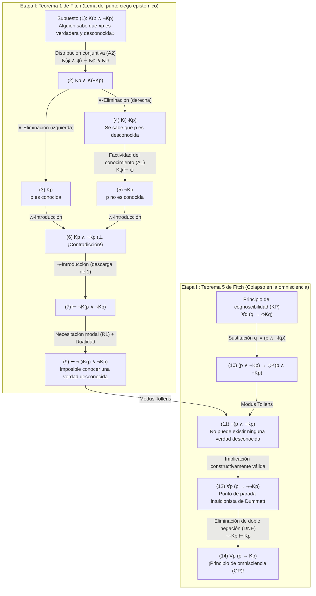
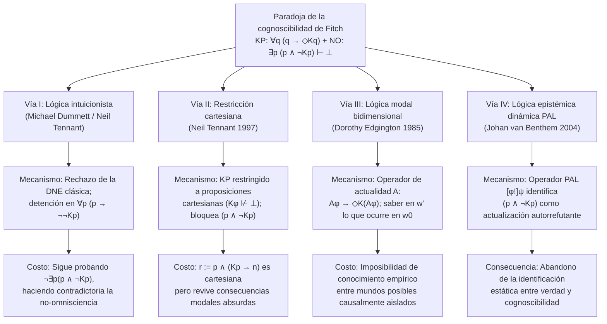

## 1. Introducción: La falla epistemológica entre el realismo metafísico y el antirrealismo semántico

¿Puede una proposición ser determinadamente verdadera incluso si ninguna mente finita pudiera jamás —ni siquiera en principio— verificarla, descubrirla o conocerla?

Esta pregunta define la línea de fractura más profunda de la metafísica, la epistemología, la filosofía del lenguaje y la filosofía de las matemáticas contemporáneas: el enfrentamiento entre el <strong>realismo metafísico (Metaphysical Realism)</strong> y el <strong>antirrealismo semántico (Semantic Anti-Realism / Verificacionismo)</strong>.

### 1.1 El compromiso del realismo metafísico
Según el <strong>realismo metafísico</strong> —defendido por Gottlob Frege, Bertrand Russell, el primer Hilary Putnam y Timothy Williamson—, la verdad trasciende radicalmente nuestras capacidades de reconocimiento (<strong>recognition-transcendent truth</strong>). En el lenguaje formal de la lógica bimodal epistémico-alética, denotando por $p$ que la proposición $p$ es verdadera, por $Kp$ que «alguien en algún momento (pasado, presente o futuro) conoce $p$», y por $\Diamond\phi$ que «es lógica o metafísicamente posible que $\phi$», el realismo afirma la existencia de <strong>verdades incognoscibles</strong>:

$$\text{Realismo (Verdades incognoscibles)}: \quad \exists p \, \big( p \land \neg \Diamond K p \big)$$

Ejemplos paradigmáticos son los micro-hechos históricos irremediablemente borrados por la entropía (como si el número de cabellos en la cabeza de Julio César en el instante exacto en que Bruto lo apuñaló en el 44 a. C. era impar), los sucesos cuánticos más allá del horizonte de sucesos cosmológico o las proposiciones matemáticas indecidibles.

### 1.2 El antirrealismo semántico y el principio de cognoscibilidad (KP)
Frente a ello, la tradición del <strong>verificacionismo, el pragmatismo y el antirrealismo semántico</strong> —desde C.S. Peirce y el Círculo de Viena hasta el <strong>realismo interno</strong> de Putnam y el antirrealismo intuicionista de <strong>Michael Dummett</strong>— rechaza la noción de una verdad inaccesible en principio. Mediante sus célebres <strong>argumentos de la adquisición (Acquisition Argument)</strong> y <strong>de la manifestación (Manifestation Argument)</strong>, Dummett sostuvo que los hablantes finitos solo pueden aprender y manifestar la comprensión del significado de una oración si sus condiciones de verdad están vinculadas constitutivamente a su verificabilidad o cognoscibilidad potencial.

Esto cristaliza en el axioma fundamental del antirrealismo moderno, el <strong>principio de cognoscibilidad (Knowability Principle, KP)</strong>:

$$\text{KP (Principio de cognoscibilidad)}: \quad \forall p \, \big( p \to \Diamond K p \big)$$

(«Para toda proposición $p$, si $p$ es verdadera, entonces es posible que alguien en algún momento conozca $p$.»)

### 1.3 El principio de no-omnisciencia (NO) y la bomba lógica de Fitch
El antirrealista no es un idealista subjetivo que afirme $\forall p \, (p \to K p)$ («toda verdad es conocida de hecho»). Todo antirrealista acepta como obvio el <strong>principio de no-omnisciencia (Non-Omniscience Principle, NO)</strong>:

$$\text{NO (Principio de no-omnisciencia)}: \quad \exists p \, \big( p \land \neg K p \big)$$

Sin embargo, en 1963, el lógico de Yale <strong>Frederic B. Fitch (1908–1987)</strong> publicó en *The Journal of Symbolic Logic* su artículo *"A Logical Analysis of Some Value Concepts"*, cuyo Teorema 5 demolió la compatibilidad entre KP y NO:

> <strong>Paradoja de la cognoscibilidad de Fitch (1963)</strong>:
> Utilizando únicamente las reglas de inferencia más débiles e indiscutibles de la lógica epistémica modal —la <strong>factividad del conocimiento</strong> y la <strong>distribución sobre la conjunción</strong>—, el modesto <strong>principio de cognoscibilidad $\forall p \, (p \to \Diamond K p)$</strong> implica directamente en lógica clásica el absurdo <strong>principio de omnisciencia $\forall p \, (p \to K p)$</strong>.
> Por contraposición, si los seres humanos no somos omniscientes ($\exists p \, (p \land \neg K p)$), entonces existe necesariamente al menos una verdad que es lógicamente imposible que alguien llegue a conocer jamás ($\exists q \, (q \land \neg \Diamond K q)$).

---

## 2. Génesis histórica: El informe anónimo de Alonzo Church (1945) y el artículo de Fitch (1963)

En la nota 5 (p. 138) de su artículo de 1963, Fitch agradeció la prueba del Teorema 5 a *«un árbitro anónimo de un artículo enviado en 1945 pero nunca publicado»*.

El misterio fue resuelto por Joe Salerno (2009, *New Essays on the Knowability Paradox*) en los archivos de la Universidad de Princeton: el árbitro anónimo de 1945 fue <strong>Alonzo Church (1903–1995)</strong>, el creador del cálculo $\lambda$. En julio de 1945, al revisar un manuscrito de Fitch que identificaba verdad y cognoscibilidad, Church demostró que al sustituir la conjunción $q := (p \land \neg K p)$ en $\forall q \, (q \to \Diamond K q)$, se deduce $\neg(p \land \neg K p)$, colapsando la cognoscibilidad potencial en omnisciencia actual ($\forall p (p \to K p)$).

---

## 3. Sintaxis formal y sistema axiomático mínimo de la lógica bimodal

En el lenguaje bimodal $\mathcal{L}_{K,\Box}$, el operador epistémico $K\phi$ expresa el conocimiento colectivo y omnitemporal:

$$K\phi \stackrel{\text{def}}{\Longleftrightarrow} \exists x \in \text{Agents}, \, \exists t \in \text{Times} \, \big( K_{x,t} \phi \big)$$

La prueba de Fitch <strong>no requiere ningún axioma epistémico fuerte</strong> como el <strong>principio KK (Axioma 4: $K\phi \to KK\phi$)</strong>, la <strong>introspección negativa (Axioma 5: $\neg K\phi \to K\neg K\phi$)</strong> ni la <strong>clausura deductiva completa (Axioma K: $K(\phi \to \psi) \to (K\phi \to K\psi)$)</strong>. Solo necesita tres principios mínimos:

1. <strong>(A1) Factividad del conocimiento (Axioma T)</strong>:
   $$K\phi \vdash \phi$$
   («Lo que se sabe debe ser verdadero; no se puede saber una falsedad.»)
2. <strong>(A2) Distribución del conocimiento sobre la conjunción</strong>:
   $$K(\phi \land \psi) \vdash K\phi \land K\psi$$
   («Quien sabe la conjunción "$\phi$ y $\psi$", sabe $\phi$ y sabe $\psi$.»)
3. <strong>(R1) Regla de necesitación modal (Modal Necessitation Rule)</strong>:
   $$\text{Si } \vdash \phi, \quad \text{entonces } \vdash \Box\phi$$
   («Todo teorema lógico es necesariamente verdadero en todos los mundos posibles», junto con la dualidad $\Box\neg\phi \equiv \neg\Diamond\phi$).

| Principio / Regla | Esquema formal | Significado filosófico | ¿Necesario para Fitch? |
| :--- | :--- | :--- | :--- |
| <strong>(A1) Factividad (Axioma T)</strong> | $K\phi \vdash \phi$ | Solo las proposiciones verdaderas pueden saberse | <strong>SÍ (Esencial)</strong> |
| <strong>(A2) Distribución conjuntiva</strong> | $K(\phi \land \psi) \vdash K\phi \land K\psi$ | Saber «$A$ y $B$» implica saber $A$ y saber $B$ | <strong>SÍ (Esencial)</strong> |
| <strong>(R1) Necesitación modal</strong> | $\vdash \phi \implies \vdash \Box\phi$ | Los teoremas lógicos son necesarios | <strong>SÍ (Esencial)</strong> |
| <strong>Clausura deductiva completa (Axioma K)</strong> | $K(\phi \to \psi) \to (K\phi \to K\psi)$ | Omnisciencia lógica bajo implicación | <strong>NO</strong> |
| <strong>Introspección positiva (KK / Axioma 4)</strong> | $K\phi \to KK\phi$ | Saber implica saber que se sabe | <strong>NO</strong> |
| <strong>Introspección negativa (Axioma 5)</strong> | $\neg K\phi \to K\neg K\phi$ | Ignorar implica saber que se ignora | <strong>NO</strong> |

---

## 4. Derivación formal paso a paso de la paradoja de Fitch

### 4.1 Etapa I (Teorema 1 de Fitch): La imposibilidad lógica de conocer una verdad desconocida
Sea $q \stackrel{\text{def}}{\equiv} (p \land \neg K p)$ («$p$ es verdadera, pero nadie conoce jamás $p$»). Demostramos por *reductio ad absurdum* ($\neg$-Introducción) que nadie puede conocer $q$:

| Línea | Fórmula | Justificación / Regla de inferencia | Supuestos abiertos |
| :---: | :--- | :--- | :---: |
| (1) | $K(p \land \neg K p)$ | <strong>Supuesto para Reductio</strong> | $\{1\}$ |
| (2) | $K p \land K(\neg K p)$ | De (1) por <strong>(A2) Distribución sobre la conjunción</strong> $K(\phi \land \psi) \vdash K\phi \land K\psi$ | $\{1\}$ |
| (3) | $K p$ | De (2) por $\land$-Eliminación (izquierda) | $\{1\}$ |
| (4) | $K(\neg K p)$ | De (2) por $\land$-Eliminación (derecha) | $\{1\}$ |
| (5) | $\neg K p$ | De (4) por <strong>(A1) Factividad del conocimiento</strong> $K\psi \vdash \psi$ ($\psi := \neg K p$) | $\{1\}$ |
| (6) | $K p \land \neg K p \quad (\bot)$ | De (3) y (5) por $\land$-Introducción (<strong>¡Contradicción explícita!</strong>) | $\{1\}$ |
| (7) | $\vdash \neg K(p \land \neg K p)$ | De (1)–(6) por $\neg$-Introducción (descargando el supuesto $\{1\}$) | $\emptyset$ |
| (8) | $\vdash \Box \neg K(p \land \neg K p)$ | Del teorema (7) por <strong>(R1) Necesitación modal</strong> | $\emptyset$ |
| (9) | $\vdash \neg \Diamond K(p \land \neg K p)$ | De (8) por dualidad modal ($\Box\neg\phi \equiv \neg\Diamond\phi$) | $\emptyset$ |

La línea (9) $\vdash \neg \Diamond K(p \land \neg K p)$ demuestra que <strong>es lógicamente imposible conocer jamás una verdad desconocida</strong>.

### 4.2 Etapa II (Teorema 5 de Fitch): El colapso de la cognoscibilidad (KP) en omnisciencia (OP)
Sustituimos ahora $q := (p \land \neg K p)$ en el <strong>principio de cognoscibilidad (KP)</strong> $\forall q \, (q \to \Diamond K q)$:

| Línea | Fórmula | Justificación / Regla de inferencia | Estatus lógico |
| :---: | :--- | :--- | :--- |
| (10) | $(p \land \neg K p) \to \Diamond K(p \land \neg K p)$ | Instanciación universal de <strong>KP</strong> con $q := (p \land \neg K p)$ | Instancia de KP |
| (11) | $\neg (p \land \neg K p)$ | De (10) y el teorema (9) $\neg \Diamond K(p \land \neg K p)$ por <strong>Modus Tollens</strong> | <strong>¡Intuicionistamente válido!</strong> |
| (12) | $p \to \neg \neg K p$ | De (11) por equivalencia proposicional $\neg(A \land \neg B) \vdash (A \to \neg\neg B)$ | <strong>¡Intuicionistamente válido!</strong> |
| (13) | $p \to K p$ | De (12) por <strong>eliminación clásica de la doble negación (DNE)</strong> $\neg\neg K p \vdash K p$ | Usa DNE clásica |
| (14) | $\forall p \, (p \to K p)$ | De (13) por Generalización universal | <strong>¡Principio de omnisciencia (OP)!</strong> |

---

## 5. Diagnóstico estructural: La paradoja de Moore, los puntos ciegos epistémicos y el examen sorpresa

1. <strong>La paradoja de G.E. Moore (1942)</strong>: La oración *«Está lloviendo afuera, pero yo no sé que está lloviendo»* ($p \land \neg K_a p$) es ontológicamente consistente pero epistémicamente incognoscible en primera persona. Al cuantificar $K$ sobre todos los agentes y todos los tiempos, $(p \land \neg K p)$ se convierte en una <strong>oración de Moore universalizada</strong> sin observador externo posible.
2. <strong>Los puntos ciegos epistémicos (*Blindspots*) de Roy Sorensen (1988)</strong>: $(p \land \neg K p)$ es un punto ciego epistémico ($\Diamond\phi \land \neg\Diamond K\phi$): el acto mismo de adquirir el conocimiento $K p$ altera el estado epistémico del mundo y refuta el segundo conyunto $\neg K p$.
3. <strong>Paradoja del examen sorpresa y teorema de incompletitud de Gödel</strong>: En el examen sorpresa, los alumnos confunden la verdad de $(E_5 \land \neg K_{\text{Jue}} E_5)$ con su cognoscibilidad el jueves por la noche $K_{\text{Jue}}(E_5 \land \neg K_{\text{Jue}} E_5)$. En la aritmética formal, el teorema de Löb impide que el predicado de demostrabilidad $\text{Prov}_T(\ulcorner \phi \urcorner)$ satisfaga universalmente la factividad ($\text{Prov}_T(\ulcorner \phi \urcorner) \to \phi$), mientras que el conocimiento genuino $K$ es incondicionalmente factivo.

---

## 6. Las cuatro grandes vías de escape filosóficas y sus costos

### 6.1 Vía I: Michael Dummett y la lógica intuicionista
<strong>Michael Dummett (2001, *"Victor's Error"*)</strong> y <strong>Neil Tennant</strong> observaron que las líneas (1) a (12) son plenamente válidas en la <strong>lógica intuicionista</strong>. La lógica clásica solo interviene en el paso de (12) a (13) mediante la <strong>eliminación de la doble negación (DNE: $\neg\neg K p \vdash K p$)</strong>. Sin DNE, la derivación se detiene en:

$$\forall p \, \big( p \to \neg\neg K p \big) \quad \text{y} \quad \forall p \, \neg(p \land \neg K p)$$

<strong>La contracrítica de Timothy Williamson (1982, 2000)</strong>:
1. Incluso en lógica intuicionista, la línea (11) demuestra $\vdash_{\text{Int}} \neg \exists p \, (p \land \neg K p)$, por lo que <strong>el principio de no-omnisciencia (NO) resulta contradictorio (falso) también para el intuicionista</strong>.
2. Para proposiciones decidibles ($K p \lor \neg K p$), $\neg\neg K p \vdash_{\text{Int}} K p$ es válido intuicionistamente, reapareciendo el colapso en $p \to K p$.

### 6.2 Vía II: La restricción de Neil Tennant a las «proposiciones cartesianas»
<strong>Neil Tennant (1997, *The Taming of the Sleuth*)</strong> restringe KP a las <strong>proposiciones cartesianas</strong> ($\text{Cartesian}(\phi) \iff K\phi \not\vdash \bot$):

$$\text{KP}_{\text{Cart}}: \quad \forall \phi \, \Big( \text{Cartesian}(\phi) \implies \big( \phi \to \Diamond K \phi \big) \Big)$$

<strong>Contraejemplo de DeVidi & Solomon (2001) y Williamson</strong>: La proposición compuesta $r \stackrel{\text{def}}{\equiv} p \land (K p \to n)$ es <strong>cartesiana</strong> ($K r \not\vdash \bot$), pero al sustituirse en $\text{KP}_{\text{Cart}}$ bajo el supuesto $p \land \neg K p$ implica $\Diamond(K p \land n)$, reactivando la paradoja.

### 6.3 Vía III: La lógica modal bidimensional de Dorothy Edgington ($\mathcal{A}$ / `@`)
<strong>Dorothy Edgington (1985, *"The Paradox of Knowability"*, *Mind*)</strong> introduce el <strong>operador de actualidad $\mathcal{A}$ («Actually»)</strong> ($\mathcal{M}, w' \models \mathcal{A}\phi \iff \mathcal{M}, w_0 \models \phi$):

$$\text{KP}_{\text{Edg}}: \quad \forall \phi \, \Big( \mathcal{A}\phi \to \Diamond K(\mathcal{A}\phi) \Big)$$

En un mundo posible contrafáctico $w'$, un agente puede saber sin contradicción que en el mundo actual $w_0$, $p$ es verdadera y nadie en $w_0$ la conoce ($K_{w'}(\mathcal{A} p) \land \neg \mathcal{A} K p$). Crítica de Williamson: ¿Cómo puede un agente en un mundo $w'$ causalmente aislado de $w_0$ tener conocimiento empírico sobre hechos contingentes de $w_0$?

### 6.4 Vía IV: Lógica epistémica dinámica (DEL) y lógica de anuncios públicos (PAL)
<strong>Johan van Benthem (2004)</strong> demuestra mediante el operador dinámico $[\phi!]\psi$ que $(p \land \neg K p)$ es una <strong>«fórmula infructuosa» (Unsuccessful Formula)</strong> que se falsifica a sí misma en el instante en que se anuncia o aprende: $\mathcal{M}, w \models [p \land \neg K p !] \neg(p \land \neg K p)$.

---

## 7. Matriz comparativa y conclusión filosófica

| Posición filosófica | Principio formal / Lógica | Mecanismo de bloqueo | Vulnerabilidad fatal / Costo |
| :--- | :--- | :--- | :--- |
| <strong>Antirrealismo ingenuo</strong> | $\forall p \, (p \to \Diamond K p)$ (Clásica) | <strong>Ninguno</strong>: Colapsa en $\forall p (p \to K p)$ | Implica la <strong>omnisciencia humana (OP)</strong> |
| <strong>Antirrealismo intuicionista</strong> (Dummett 2001) | $\forall p \, (p \to \Diamond K p)$ (Intuicionista) | Rechaza DNE ($\neg\neg K p \not\vdash K p$); para en $p \to \neg\neg K p$ | Refuta $\exists p (p \land \neg K p)$; colapsa si $K p$ es decidible |
| <strong>Restricción cartesiana</strong> (Tennant 1997) | $\text{Cartesian}(\phi) \to (\phi \to \Diamond K \phi)$ | Excluye $(p \land \neg K p)$ porque $K(p \land \neg K p) \vdash \bot$ | Superada por $r := p \land (K p \to n)$ |
| <strong>Lógica bidimensional</strong> (Edgington 1985) | $\forall \phi \, (\mathcal{A}\phi \to \Diamond K(\mathcal{A}\phi))$ | Separa el mundo de la verdad ($w_0$) y el del saber ($w'$) | Misterio del conocimiento empírico trans-mundano |
| <strong>Lógica dinámica (PAL)</strong> (van Benthem 2004) | Anuncio público $[\phi!]\psi$ | Identifica $(p \land \neg K p)$ como fórmula infructuosa | Renuncia al antirrealismo semántico estático |

<strong>Conclusión</strong>: Si aceptamos nuestra finitud cognitiva ($\exists p \, (p \land \neg K p)$), el Teorema 1 de Fitch ($\vdash \neg \Diamond K(p \land \neg K p)$) nos obliga por pura lógica a aceptar el <strong>realismo metafísico</strong>:

$$\exists p \, (p \land \neg K p) \quad \vdash \quad \exists q \, \big( q \land \neg \Diamond K q \big)$$

---

## Referencias

* Fitch, F. B. (1963). "A Logical Analysis of Some Value Concepts". *The Journal of Symbolic Logic*, 28(2), 135–142.
* Salerno, J. (Ed.). (2009). *New Essays on the Knowability Paradox*. Oxford University Press.
* Dummett, M. (2001). "Victor's Error". *Analysis*, 61(269), 1–2.
* Williamson, T. (2000). *Knowledge and Its Limits*. Oxford University Press.
* Edgington, D. (1985). "The Paradox of Knowability". *Mind*, 94(376), 557–568.
* Tennant, N. (1997). *The Taming of the Sleuth*. Oxford University Press.
* van Benthem, J. (2004). "What One May Come to Know". *Analysis*, 64(282), 95–105.
