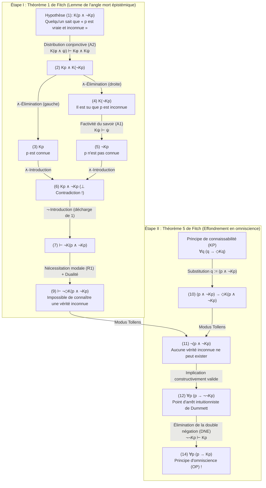
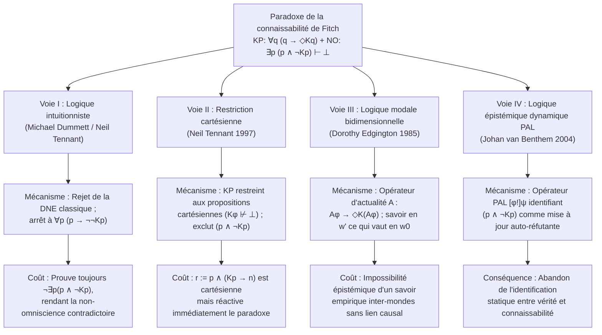

## 1. Introduction : La ligne de faille épistémologique entre réalisme métaphysique et anti-réalisme sémantique

Une proposition peut-elle être déterminément vraie même si aucun esprit fini ne pouvait jamais — pas même en principe — la vérifier, la découvrir ou la connaître ?

Cette question trace la ligne de faille fondamentale de la métaphysique, de l'épistémologie, de la philosophie du langage et de la philosophie des mathématiques contemporaines : l'affrontement entre le <strong>réalisme métaphysique (Metaphysical Realism)</strong> et l'<strong>anti-réalisme sémantique (Semantic Anti-Realism / Vérificationnisme)</strong>.

### 1.1 L'engagement du réalisme métaphysique
Selon le <strong>réalisme métaphysique</strong> — défendu par Gottlob Frege, Bertrand Russell, le premier Hilary Putnam et Timothy Williamson — la vérité transcende radicalement nos capacités de reconnaissance (<strong>recognition-transcendent truth</strong>). Dans le langage formel de la logique bimodale épistémique et aléthique, en notant $p$ le fait que la proposition $p$ est vraie, $Kp$ le fait que « quelqu'un connaît $p$ à un moment donné (passé, présent ou futur) » et $\Diamond\phi$ le fait qu'« il est logiquement ou métaphysiquement possible que $\phi$ », le réalisme affirme la possibilité de <strong>vérités inconnaissables</strong> :

$$\text{Réalisme (Vérités inconnaissables)} : \quad \exists p \, \big( p \land \neg \Diamond K p \big)$$

Des exemples classiques incluent les micro-faits historiques irrémédiablement détruits par l'entropie (par exemple : « Le nombre de cheveux sur la tête de Jules César à l'instant précis où Brutus l'a poignardé en 44 av. J.-C. était impair »), les événements physiques au-delà de l'horizon cosmologique des événements, ou les énoncés mathématiques indécidables.

### 1.2 L'anti-réalisme sémantique et le principe de connaissabilité (KP)
À l'opposé, la tradition du <strong>vérificationnisme, du pragmatisme et de l'anti-réalisme sémantique</strong> — de C.S. Peirce et du Cercle de Vienne jusqu'au <strong>réalisme interne</strong> de Putnam et à l'anti-réalisme intuitionniste de <strong>Michael Dummett</strong> — rejette l'idée d'une vérité totalement détachée de toute vérification possible. Par ses célèbres <strong>arguments de l'acquisition (Acquisition Argument)</strong> et <strong>de la manifestation (Manifestation Argument)</strong>, Dummett soutient que la compréhension du sens d'un énoncé par des locuteurs finis exige que ses conditions de vérité soient liées constitutivement à sa connaissabilité en principe.

Cela conduit à l'axiome central de l'anti-réalisme, le <strong>principe de connaissabilité (Knowability Principle, KP)</strong> :

$$\text{KP (Principe de connaissabilité)} : \quad \forall p \, \big( p \to \Diamond K p \big)$$

(« Pour toute proposition $p$, si $p$ est vraie, alors il est possible que quelqu'un connaisse $p$ à un moment donné. »)

### 1.3 Le principe de non-omniscience (NO) et la bombe logique de Fitch
L'anti-réaliste n'est nullement un idéaliste subjectif affirmant que toute vérité est *actuellement* connue ($\forall p (p \to K p)$). Conscient de la finitude humaine, tout anti-réaliste souscrit au <strong>principe de non-omniscience (Non-Omniscience Principle, NO)</strong> :

$$\text{NO (Principe de non-omniscience)} : \quad \exists p \, \big( p \land \neg K p \big)$$

Or, en 1963, le logicien de Yale <strong>Frederic B. Fitch (1908–1987)</strong> a publié dans *The Journal of Symbolic Logic* l'article *"A Logical Analysis of Some Value Concepts"*, dont le Théorème 5 fait voler en éclats la compatibilité entre KP et NO :

> <strong>Paradoxe de la connaissabilité de Fitch (1963)</strong> :
> En utilisant uniquement les règles d'inférence les plus faibles et les moins contestables de la logique épistémique modale — la <strong>factivité de la connaissance</strong> et la <strong>distributivité sur la conjonction</strong> — le modeste <strong>principe de connaissabilité $\forall p \, (p \to \Diamond K p)$</strong> implique directement en logique classique l'absurde <strong>principe d'omniscience $\forall p \, (p \to K p)$</strong> !
> Par contraposition, si l'humanité n'est pas omnisciente ($\exists p \, (p \land \neg K p)$), alors il existe nécessairement au moins une vérité qu'il est logiquement impossible de jamais connaître ($\exists q \, (q \land \neg \Diamond K q)$).

---

## 2. Genèse historique : Le rapport anonyme d'Alonzo Church (1945) et l'article de Fitch (1963)

Dans la note de bas de page 5 (p. 138) de son article de 1963, Fitch mentionnait que la preuve du théorème 5 lui avait été suggérée par *« un rapporteur anonyme d'un article soumis en 1945 mais jamais publié »*.

Ce mystère historique a été résolu par Joe Salerno (2009, *New Essays on the Knowability Paradox*) grâce aux archives de l'Université de Princeton : le rapporteur anonyme de 1945 n'était autre qu'<strong>Alonzo Church (1903–1995)</strong>, le père du $\lambda$-calcul ! En juillet 1945, évaluant un manuscrit de Fitch qui identifiait vérité et connaissabilité, Church démontra qu'en substituant la conjonction $q := (p \land \neg K p)$, le principe $\forall q \, (q \to \Diamond K q)$ s'effondre immédiatement en $\forall p \, (p \to K p)$.

---

## 3. Syntaxe formelle et système axiomatique minimal de la logique bimodale

Dans le langage bimodal $\mathcal{L}_{K,\Box}$, l'opérateur épistémique $K\phi$ représente la connaissance collective et omnitemporelle :

$$K\phi \stackrel{\text{def}}{\Longleftrightarrow} \exists x \in \text{Agents}, \, \exists t \in \text{Times} \, \big( K_{x,t} \phi \big)$$

La force redoutable de la preuve de Fitch réside dans le fait qu'elle <strong>n'utilise aucun axiome épistémique fort</strong> : ni le <strong>principe KK (introspection positive, Axiome 4 : $K\phi \to KK\phi$)</strong>, ni l'<strong>introspection négative (Axiome 5 : $\neg K\phi \to K\neg K\phi$)</strong>, ni même la <strong>clôture déductive complète (Axiome K : $K(\phi \to \psi) \to (K\phi \to K\psi)$)</strong>. Elle ne requiert que trois principes minimaux :

1. <strong>(A1) Factivité de la connaissance (Axiome T)</strong> :
   $$K\phi \vdash \phi$$
   (« Ce qui est su doit être vrai ; on ne peut pas savoir le faux. »)
2. <strong>(A2) Distribution de la connaissance sur la conjonction</strong> :
   $$K(\phi \land \psi) \vdash K\phi \land K\psi$$
   (« Savoir la conjonction "$\phi$ et $\psi$" implique savoir $\phi$ et savoir $\psi$. »)
3. <strong>(R1) Règle de nécessitation modale (Modal Necessitation Rule)</strong> :
   $$\text{Si } \vdash \phi, \quad \text{alors } \vdash \Box\phi$$
   (« Tout théorème de la logique pure est nécessairement vrai dans tous les mondes possibles », avec la dualité $\Box\neg\phi \equiv \neg\Diamond\phi$).

| Principe / Règle | Schéma formel | Signification philosophique | Requis pour Fitch ? |
| :--- | :--- | :--- | :--- |
| <strong>(A1) Factivité du savoir (Axiome T)</strong> | $K\phi \vdash \phi$ | Seules les propositions vraies peuvent être sues | <strong>OUI (Essentiel)</strong> |
| <strong>(A2) Distribution conjonctive</strong> | $K(\phi \land \psi) \vdash K\phi \land K\psi$ | Savoir « $A$ et $B$ » implique savoir $A$ et savoir $B$ | <strong>OUI (Essentiel)</strong> |
| <strong>(R1) Nécessitation modale</strong> | $\vdash \phi \implies \vdash \Box\phi$ | Les théorèmes logiques sont nécessaires | <strong>OUI (Essentiel)</strong> |
| <strong>Clôture déductive complète (Axiome K)</strong> | $K(\phi \to \psi) \to (K\phi \to K\psi)$ | Omniscience logique sous l'implication | <strong>NON</strong> |
| <strong>Introspection positive (KK / Axiome 4)</strong> | $K\phi \to KK\phi$ | Savoir implique savoir que l'on sait | <strong>NON</strong> |
| <strong>Introspection négative (Axiome 5)</strong> | $\neg K\phi \to K\neg K\phi$ | Ignorer implique savoir que l'on ignore | <strong>NON</strong> |

---

## 4. Démonstration formelle étape par étape du paradoxe de Fitch

### 4.1 Étape I (Théorème 1 de Fitch) : L'impossibilité logique de connaître une vérité inconnue
Considérons la proposition conjonctive $q \stackrel{\text{def}}{\equiv} (p \land \neg K p)$ (« $p$ est vraie, mais personne ne connaît jamais $p$ »). Prouvons par *reductio ad absurdum* ($\neg$-Introduction) que personne ne peut connaître $q$ :

| Ligne | Formule | Justification / Règle d'inférence | Hypothèses ouvertes |
| :---: | :--- | :--- | :---: |
| (1) | $K(p \land \neg K p)$ | <strong>Hypothèse pour Reductio</strong> | $\{1\}$ |
| (2) | $K p \land K(\neg K p)$ | De (1) par <strong>(A2) Distribution sur la conjonction</strong> $K(\phi \land \psi) \vdash K\phi \land K\psi$ | $\{1\}$ |
| (3) | $K p$ | De (2) par $\land$-Élimination (gauche) | $\{1\}$ |
| (4) | $K(\neg K p)$ | De (2) par $\land$-Élimination (droite) | $\{1\}$ |
| (5) | $\neg K p$ | De (4) par <strong>(A1) Factivité de la connaissance</strong> $K\psi \vdash \psi$ ($\psi := \neg K p$) | $\{1\}$ |
| (6) | $K p \land \neg K p \quad (\bot)$ | De (3) et (5) par $\land$-Introduction (<strong>Contradiction explicite !</strong>) | $\{1\}$ |
| (7) | $\vdash \neg K(p \land \neg K p)$ | De (1)–(6) par $\neg$-Introduction (décharge de l'hypothèse $\{1\}$) | $\emptyset$ |
| (8) | $\vdash \Box \neg K(p \land \neg K p)$ | Du théorème (7) par <strong>(R1) Nécessitation modale</strong> | $\emptyset$ |
| (9) | $\vdash \neg \Diamond K(p \land \neg K p)$ | De (8) par dualité modale ($\Box\neg\phi \equiv \neg\Diamond\phi$) | $\emptyset$ |

La ligne (9) $\vdash \neg \Diamond K(p \land \neg K p)$ établit qu'<strong>il est logiquement impossible de jamais connaître une vérité inconnue !</strong>

### 4.2 Étape II (Théorème 5 de Fitch) : L'effondrement de la connaissabilité (KP) en omniscience (OP)
Instancions maintenant le <strong>principe de connaissabilité (KP)</strong> $\forall q \, (q \to \Diamond K q)$ avec $q := (p \land \neg K p)$ :

| Ligne | Formule | Justification / Règle d'inférence | Statut logique |
| :---: | :--- | :--- | :--- |
| (10) | $(p \land \neg K p) \to \Diamond K(p \land \neg K p)$ | Instanciation universelle de <strong>KP</strong> avec $q := (p \land \neg K p)$ | Instance de KP |
| (11) | $\neg (p \land \neg K p)$ | De (10) et du théorème (9) $\neg \Diamond K(p \land \neg K p)$ par <strong>Modus Tollens</strong> | <strong>Valide intuitionnistement !</strong> |
| (12) | $p \to \neg \neg K p$ | De (11) par équivalence propositionnelle $\neg(A \land \neg B) \vdash (A \to \neg\neg B)$ | <strong>Valide intuitionnistement !</strong> |
| (13) | $p \to K p$ | De (12) par <strong>élimination classique de la double négation (DNE)</strong> $\neg\neg K p \vdash K p$ | Utilise la DNE classique |
| (14) | $\forall p \, (p \to K p)$ | De (13) par Généralisation universelle | <strong>Principe d'omniscience (OP) !</strong> |

---

## 5. Diagnostic structurel : Paradoxe de Moore, angles morts épistémiques et examen surprise

1. <strong>Le paradoxe de G.E. Moore (1942)</strong> : L'énoncé de Moore *« Il pleut dehors, mais je ne sais pas qu'il pleut »* ($p \land \neg K_a p$) est ontologiquement cohérent mais épistémiquement inconnaissable à la première personne. Lorsque $K$ englobe toute la communauté des sujets connaissants à travers tous les temps, $(p \land \neg K p)$ devient un <strong>énoncé de Moore universalisé</strong> privé de tout observateur extérieur.
2. <strong>Les angles morts épistémiques (*Blindspots*) de Roy Sorensen (1988)</strong> : La conjonction $(p \land \neg K p)$ constitue un angle mort épistémique ($\Diamond\phi \land \neg\Diamond K\phi$). L'acte même d'acquérir la connaissance $K p$ modifie l'état épistémique du monde et détruit la vérité du second conjoint $\neg K p$.
3. <strong>Paradoxe de l'examen surprise et théorème d'incomplétude de Gödel</strong> : Dans le paradoxe de l'examen surprise, l'élève confond la vérité de $(E_5 \land \neg K_{\text{Jeu}} E_5)$ avec sa connaissabilité le jeudi soir $K_{\text{Jeu}}(E_5 \land \neg K_{\text{Jeu}} E_5)$. En arithmétique formelle, le théorème de Löb interdit au prédicat de prouvabilité $\text{Prov}_T(\ulcorner \phi \urcorner)$ de vérifier universellement la factivité ($\text{Prov}_T(\ulcorner \phi \urcorner) \to \phi$), tandis que le savoir authentique $K$ est inconditionnellement factif.

---

## 6. Les quatre grandes voies de sortie philosophiques et leurs coûts

### 6.1 Voie I : Michael Dummett et la logique intuitionniste
<strong>Michael Dummett (2001, *"Victor's Error"*)</strong> et <strong>Neil Tennant</strong> soulignent que les lignes (1) à (12) de la preuve de Fitch sont intégralement valides en <strong>logique intuitionniste</strong>. La logique classique n'intervient qu'à la ligne (13) via l'<strong>élimination de la double négation (DNE : $\neg\neg K p \vdash K p$)</strong>. En rejetant la DNE, l'anti-réaliste intuitionniste s'arrête à :

$$\forall p \, \big( p \to \neg\neg K p \big) \quad \text{et} \quad \forall p \, \neg(p \land \neg K p)$$

<strong>La contre-attaque de Timothy Williamson (1982, 2000)</strong> :
1. Même en logique intuitionniste, la ligne (11) prouve $\vdash_{\text{Int}} \neg \exists p \, (p \land \neg K p)$ : le <strong>principe de non-omniscience (NO) est donc démontré contradictoire (faux) même intuitionnistement</strong> !
2. Dès que $K p \lor \neg K p$ est décidable (par exemple si l'histoire humaine ne comporte qu'un nombre fini d'actes de connaissance), $\neg\neg K p \vdash_{\text{Int}} K p$ redevient valide en logique intuitionniste, provoquant à nouveau l'effondrement en $p \to K p$.

### 6.2 Voie II : La restriction de Neil Tennant aux « propositions cartésiennes »
<strong>Neil Tennant (1997, *The Taming of the Sleuth*)</strong> restreint KP aux <strong>propositions cartésiennes</strong> dont la connaissance n'est pas logiquement contradictoire :

$$\text{Cartesian}(\phi) \stackrel{\text{def}}{\Longleftrightarrow} K\phi \not\vdash \bot, \qquad \text{KP}_{\text{Cart}} : \quad \forall \phi \, \Big( \text{Cartesian}(\phi) \implies \big( \phi \to \Diamond K \phi \big) \Big)$$

<strong>Contre-exemple de DeVidi & Solomon (2001) et Williamson</strong> : La proposition $r \stackrel{\text{def}}{\equiv} p \land (K p \to n)$ est <strong>cartésienne</strong> ($K r \vdash K p \land n \not\vdash \bot$), mais son instanciation dans $\text{KP}_{\text{Cart}}$ sous l'hypothèse $p \land \neg K p$ entraîne $\Diamond(K p \land n)$, réintroduisant le paradoxe !

### 6.3 Voie III : La logique modale bidimensionnelle de Dorothy Edgington ($\mathcal{A}$ / `@`)
<strong>Dorothy Edgington (1985, *"The Paradox of Knowability"*, *Mind*)</strong> introduit l'<strong>opérateur d'actualité $\mathcal{A}$ (« Actually »)</strong> ($\mathcal{M}, w' \models \mathcal{A}\phi \iff \mathcal{M}, w_0 \models \phi$) :

$$\text{KP}_{\text{Edg}} : \quad \forall \phi \, \Big( \mathcal{A}\phi \to \Diamond K(\mathcal{A}\phi) \Big)$$

Dans un monde possible contrefactuel $w'$, un agent peut savoir sans contradiction que dans le monde actuel $w_0$, $p$ est vraie et ignorée dans $w_0$ ($K_{w'}(\mathcal{A} p) \land \neg \mathcal{A} K p$). Objection de Williamson : Comment un sujet situé dans un monde $w'$ causalement isolé de $w_0$ pourrait-il acquérir un savoir empirique sur les faits contingents de $w_0$ ?

### 6.4 Voie IV : Logique épistémique dynamique (DEL) et logique des annonces publiques (PAL)
<strong>Johan van Benthem (2004)</strong> montre via l'opérateur d'annonce publique $[\phi!]\psi$ que $(p \land \neg K p)$ est une <strong>« formule infructueuse » (Unsuccessful Formula)</strong> qui se réfute elle-même dès qu'elle est apprise : $\mathcal{M}, w \models [p \land \neg K p !] \neg(p \land \neg K p)$.

---

## 7. Matrice comparée et conclusion philosophique

| Position philosophique | Formule / Logique | Mécanisme de blocage | Vulnérabilité fatale / Coût |
| :--- | :--- | :--- | :--- |
| <strong>Anti-réalisme naïf</strong> | $\forall p \, (p \to \Diamond K p)$ (Classique) | <strong>Aucun</strong> : S'effondre en $\forall p (p \to K p)$ | Implique l'<strong>omniscience humaine (OP)</strong> |
| <strong>Anti-réalisme intuitionniste</strong> (Dummett 2001) | $\forall p \, (p \to \Diamond K p)$ (Intuitionniste) | Rejette la DNE ($\neg\neg K p \not\vdash K p$) ; arrêt à $p \to \neg\neg K p$ | Réfute $\exists p (p \land \neg K p)$ ; s'effondre si $K p$ est décidable |
| <strong>Restriction cartésienne</strong> (Tennant 1997) | $\text{Cartesian}(\phi) \to (\phi \to \Diamond K \phi)$ | Exclut $(p \land \neg K p)$ car $K(p \land \neg K p) \vdash \bot$ | Mis en échec par $r := p \land (K p \to n)$ |
| <strong>Logique bidimensionnelle</strong> (Edgington 1985) | $\forall \phi \, (\mathcal{A}\phi \to \Diamond K(\mathcal{A}\phi))$ | Sépare le monde de la vérité ($w_0$) et celui du savoir ($w'$) | Mystère du savoir empirique à travers des mondes isolés |
| <strong>Logique dynamique (PAL)</strong> (van Benthem 2004) | Annonce publique $[\phi!]\psi$ | Identifie $(p \land \neg K p)$ comme formule infructueuse | Renonce à l'anti-réalisme sémantique statique |

<strong>Conclusion</strong> : Dès lors que nous reconnaissons notre finitude cognitive ($\exists p \, (p \land \neg K p)$), le Théorème 1 de Fitch ($\vdash \neg \Diamond K(p \land \neg K p)$) nous contraint logiquement à admettre le <strong>réalisme métaphysique</strong> :

$$\exists p \, (p \land \neg K p) \quad \vdash \quad \exists q \, \big( q \land \neg \Diamond K q \big)$$

---

## Références

* Fitch, F. B. (1963). "A Logical Analysis of Some Value Concepts". *The Journal of Symbolic Logic*, 28(2), 135–142.
* Salerno, J. (Ed.). (2009). *New Essays on the Knowability Paradox*. Oxford University Press.
* Dummett, M. (2001). "Victor's Error". *Analysis*, 61(269), 1–2.
* Williamson, T. (2000). *Knowledge and Its Limits*. Oxford University Press.
* Edgington, D. (1985). "The Paradox of Knowability". *Mind*, 94(376), 557–568.
* Tennant, N. (1997). *The Taming of the Sleuth*. Oxford University Press.
* van Benthem, J. (2004). "What One May Come to Know". *Analysis*, 64(282), 95–105.
