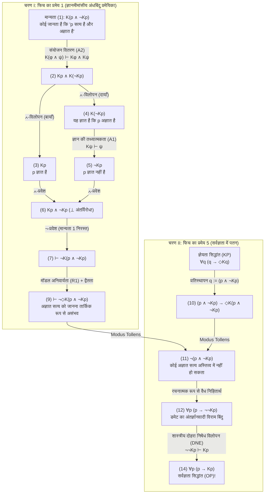
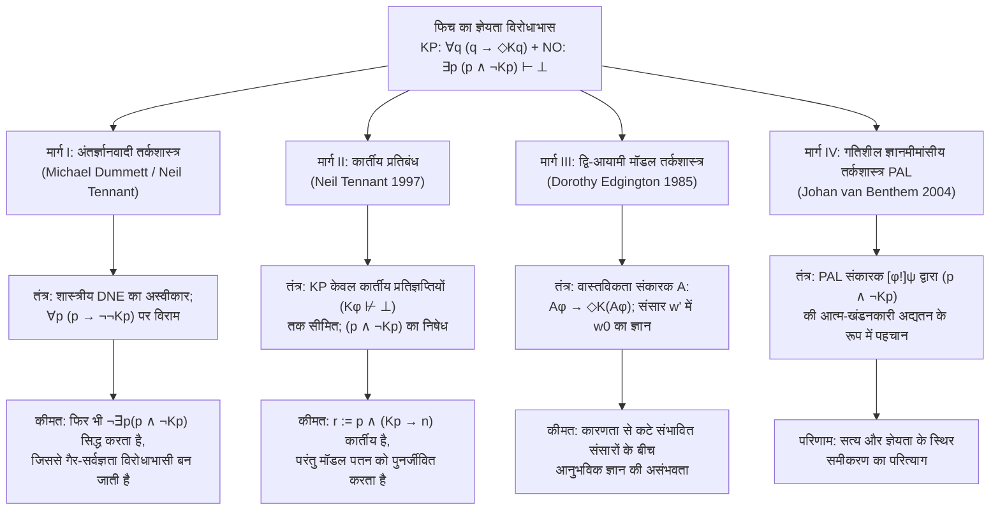

## 1. भूमिका: तत्वमीमांसीय यथार्थवाद और अर्थगत यथार्थवाद-विरोध के बीच की विभाजन रेखा

क्या कोई प्रतिज्ञप्ति (proposition) निश्चित रूप से सत्य हो सकती है, भले ही कोई भी सीमित मन कभी भी — यहाँ तक कि सिद्धांत रूप में भी — उसे सत्यापित करने, खोजने या जानने में सक्षम न हो?

यह प्रश्न समकालीन तत्वमीमांसा, ज्ञानमीमांसा, भाषा-दर्शन और गणित के दर्शन में सबसे गहरी विभाजन रेखा को परिभाषित करता है: <strong>तत्वमीमांसीय यथार्थवाद (Metaphysical Realism)</strong> और <strong>अर्थगत यथार्थवाद-विरोध (Semantic Anti-Realism / सत्यापनवाद Verificationism)</strong> के बीच का संघर्ष।

### 1.1 तत्वमीमांसीय यथार्थवाद की प्रतिबद्धता
गॉटलोब फ्रेगे (Gottlob Frege), बर्ट्रेंड रसेल (Bertrand Russell), प्रारंभिक हिलरी पटनम (Hilary Putnam) और टिमोथी विलियमसन (Timothy Williamson) द्वारा समर्थित <strong>तत्वमीमांसीय यथार्थवाद</strong> के अनुसार, सत्य हमारी पहचान और ज्ञान की क्षमताओं से पूरी तरह स्वतंत्र (<strong>recognition-transcendent</strong>) है। द्वि-मॉडल ज्ञानमीमांसीय तर्कशास्त्र (Bimodal Epistemic-Alethic Logic) की औपचारिक भाषा में, यदि $p$ का अर्थ है «प्रतिज्ञप्ति $p$ सत्य है», $Kp$ का अर्थ है «कोई व्यक्ति किसी समय (भूत, वर्तमान या भविष्य में) $p$ को जानता है», और $\Diamond\phi$ का अर्थ है «तार्किक या तत्वमीमांसीय रूप से यह संभव है कि $\phi$», तो यथार्थवाद <strong>अज्ञेय सत्यों (Unknowable Truths)</strong> के अस्तित्व को स्वीकार करता है:

$$\text{Realism (Unknowable Truths)}: \quad \exists p \, \big( p \land \neg \Diamond K p \big)$$

इसके उदाहरणों में एन्ट्रॉपी के कारण हमेशा के लिए नष्ट हो चुके सूक्ष्म-ऐतिहासिक तथ्य (जैसे: «44 ईसा पूर्व में जिस सटीक क्षण ब्रूटस ने जूलियस सीज़र पर वार किया, उस क्षण सीज़र के सिर पर बालों की संख्या विषम थी»), ब्रह्मांडीय घटना क्षितिज (Event Horizon) के पार की क्वांटम घटनाएँ, या अनिर्णीत गणितीय कथन शामिल हैं।

### 1.2 अर्थगत यथार्थवाद-विरोध और ज्ञेयता सिद्धांत (KP)
इसके विपरीत, सी.एस. पियर्स (C.S. Peirce) के व्यवहारवाद, वियना सर्कल के तार्किक प्रत्यक्षवाद, पटनम के <strong>आंतरिक यथार्थवाद (Internal Realism)</strong> से लेकर <strong>माइकल डमेट (Michael Dummett)</strong> के अंतर्ज्ञानवादी यथार्थवाद-विरोध तक की परंपरा सत्यापन-अतीत सत्य की अवधारणा को अस्वीकार करती है। डमेट ने अपने प्रसिद्ध <strong>अधिग्रहण तर्क (Acquisition Argument)</strong> और <strong>प्रकटीकरण तर्क (Manifestation Argument)</strong> के माध्यम से तर्क दिया कि सीमित भाषा-भाषी किसी वाक्य के अर्थ को तभी सीख और प्रकट कर सकते हैं जब उसकी सत्य-शर्तें सिद्धांततः उसकी ज्ञेयता (सत्यापन योग्यता) से जुड़ी हों।

इससे आधुनिक यथार्थवाद-विरोध का मूल स्वयंसिद्ध निकलता है, जिसे <strong>ज्ञेयता सिद्धांत (Knowability Principle, KP)</strong> कहा जाता है:

$$\text{KP (Knowability Principle)}: \quad \forall p \, \big( p \to \Diamond K p \big)$$

(«प्रत्येक प्रतिज्ञप्ति $p$ के लिए, यदि $p$ सत्य है, तो यह संभव है कि कोई व्यक्ति किसी समय $p$ को जाने।»)

### 1.3 गैर-सर्वज्ञता सिद्धांत (NO) और फिच का तार्किक विस्फोट
यथार्थवाद-विरोधी कोई आत्मगत आदर्शवादी नहीं है जो यह दावा करे कि $\forall p \, (p \to K p)$ («सभी सत्य वास्तव में ज्ञात हैं»)। मानव की सीमितता को स्वीकार करते हुए, प्रत्येक यथार्थवाद-विरोधी सहज ज्ञान युक्त <strong>गैर-सर्वज्ञता सिद्धांत (Non-Omniscience Principle, NO)</strong> को मानता है:

$$\text{NO (Non-Omniscience Principle)}: \quad \exists p \, \big( p \land \neg K p \big)$$

किंतु 1963 में, येल विश्वविद्यालय के तर्कशास्त्री <strong>फ्रेडरिक बी. फिच (Frederic B. Fitch, 1908–1987)</strong> ने *The Journal of Symbolic Logic* में प्रकाशित अपने शोधपत्र *"A Logical Analysis of Some Value Concepts"* के प्रमेय 5 (Theorem 5) में एक चौंकाने वाला परिणाम सिद्ध किया:

> <strong>फिच का ज्ञेयता विरोधाभास (1963)</strong>:
> मॉडल ज्ञानमीमांसीय तर्कशास्त्र के केवल सबसे कमजोर और निर्विवाद अनुमान नियमों — <strong>ज्ञान की तथ्यात्मकता (Factivity)</strong> और <strong>संयोजन पर वितरण (Conjunction Distribution)</strong> — का उपयोग करने पर, उदार दिखने वाला <strong>ज्ञेयता सिद्धांत $\forall p \, (p \to \Diamond K p)$</strong> शास्त्रीय तर्कशास्त्र में सीधे बेतुके <strong>सर्वज्ञता सिद्धांत $\forall p \, (p \to K p)$</strong> में ढह जाता है!
> प्रतिपरिवर्तित रूप में (Contrapositively), यदि मनुष्य सर्वज्ञ नहीं हैं ($\exists p \, (p \land \neg K p)$), तो अनिवार्य रूप से कम से कम एक ऐसा सत्य मौजूद है जिसे जानना तार्किक रूप से असंभव है ($\exists q \, (q \land \neg \Diamond K q)$)।

---

## 2. ऐतिहासिक उत्पत्ति: एलोन्ज़ो चर्च की 1945 की गुमनाम समीक्षा रिपोर्ट और फिच का 1963 का शोधपत्र

अपने 1963 के शोधपत्र के पृष्ठ 138 पर पादटिप्पणी 5 (Footnote 5) में फिच ने लिखा था कि प्रमेय 5 की उपपत्ति उन्हें *«1945 में प्रस्तुत किए गए लेकिन कभी प्रकाशित न हुए एक शोधपत्र के गुमनाम समीक्षक (anonymous referee) द्वारा सुझाई गई थी»*।

साठ वर्षों से अधिक समय तक रहस्य बने रहे इस गुमनाम समीक्षक की पहचान दार्शनिक जो सालेर्नो (Joe Salerno, 2009, *New Essays on the Knowability Paradox*) ने प्रिंसटन विश्वविद्यालय के अभिलेखागार में की: 1945 के वे गुमनाम समीक्षक स्वयं <strong>एलोन्ज़ो चर्च (Alonzo Church, 1903–1995)</strong> थे — जिन्होंने $\lambda$-कैलकुलस का आविष्कार किया था! जुलाई 1945 में अपनी समीक्षा रिपोर्ट में चर्च ने दिखाया कि यदि $\forall q \, (q \to \Diamond K q)$ में संयुक्त प्रतिज्ञप्ति $q := (p \land \neg K p)$ को प्रतिस्थापित किया जाए, तो तुरंत $\neg(p \land \neg K p)$ और उससे सर्वज्ञता ($\forall p (p \to K p)$) सिद्ध हो जाती है।

---

## 3. द्वि-मॉडल ज्ञानमीमांसीय तर्कशास्त्र का औपचारिक वाक्य-विन्यास और न्यूनतम स्वयंसिद्ध प्रणाली

द्वि-मॉडल भाषा $\mathcal{L}_{K,\Box}$ में ज्ञानमीमांसीय संकारक (operator) $K\phi$ सर्वकालिक सामूहिक ज्ञान को दर्शाता है:

$$K\phi \stackrel{\text{def}}{\Longleftrightarrow} \exists x \in \text{Agents}, \, \exists t \in \text{Times} \, \big( K_{x,t} \phi \big)$$

फिच की उपपत्ति की सबसे बड़ी शक्ति यह है कि इसे <strong>किसी भी मजबूत या विवादास्पद ज्ञानमीमांसीय स्वयंसिद्ध की आवश्यकता नहीं है</strong> — न तो <strong>KK-सिद्धांत (स्वयंसिद्ध 4: $K\phi \to KK\phi$)</strong>, न <strong>नकारात्मक अंतर्दर्शन (स्वयंसिद्ध 5: $\neg K\phi \to K\neg K\phi$)</strong>, और न ही <strong>पूर्ण निगमनात्मक संवरक (स्वयंसिद्ध K: $K(\phi \to \psi) \to (K\phi \to K\psi)$)</strong>। इसके लिए केवल तीन न्यूनतम सिद्धांत पर्याप्त हैं:

1. <strong>(A1) ज्ञान की तथ्यात्मकता (Factivity of Knowledge / स्वयंसिद्ध T)</strong>:
   $$K\phi \vdash \phi$$
   («जो जाना जाता है वह सत्य होना चाहिए; असत्य को जाना नहीं जा सकता।»)
2. <strong>(A2) संयोजन पर ज्ञान का वितरण (Conjunction Distribution)</strong>:
   $$K(\phi \land \psi) \vdash K\phi \land K\psi$$
   («यदि कोई '$\phi$ और $\psi$' जानता है, तो वह $\phi$ को जानता है और $\psi$ को जानता है।»)
3. <strong>(R1) मॉडल अनिवार्यता नियम (Modal Necessitation Rule)</strong>:
   $$\text{यदि } \vdash \phi, \quad \text{तो } \vdash \Box\phi$$
   («शुद्ध तर्कशास्त्र का प्रत्येक प्रमेय सभी संभावित संसारों में अनिवार्य रूप से सत्य होता है», तथा द्वैतता $\Box\neg\phi \equiv \neg\Diamond\phi$ लागू होती है)।

| सिद्धांत / नियम | औपचारिक रूप | दार्शनिक अर्थ | फिच की उपपत्ति के लिए आवश्यक? |
| :--- | :--- | :--- | :--- |
| <strong>(A1) ज्ञान की तथ्यात्मकता (Axiom T)</strong> | $K\phi \vdash \phi$ | केवल सत्य प्रतिज्ञप्तियाँ ही जानी जा सकती हैं | <strong>हाँ (अनिवार्य)</strong> |
| <strong>(A2) संयोजन वितरण</strong> | $K(\phi \land \psi) \vdash K\phi \land K\psi$ | «$A$ और $B$» जानने का अर्थ है $A$ जानना और $B$ जानना | <strong>हाँ (अनिवार्य)</strong> |
| <strong>(R1) मॉडल अनिवार्यता</strong> | $\vdash \phi \implies \vdash \Box\phi$ | तार्किक प्रमेय अनिवार्यतः सत्य हैं | <strong>हाँ (अनिवार्य)</strong> |
| <strong>पूर्ण निगमनात्मक संवरक (Axiom K)</strong> | $K(\phi \to \psi) \to (K\phi \to K\psi)$ | निहितार्थ के अंतर्गत तार्किक सर्वज्ञता | <strong>नहीं</strong> |
| <strong>सकारात्मक अंतर्दर्शन (KK / Axiom 4)</strong> | $K\phi \to KK\phi$ | जानने का अर्थ है यह जानना कि आप जानते हैं | <strong>नहीं</strong> |
| <strong>नकारात्मक अंतर्दर्शन (Axiom 5)</strong> | $\neg K\phi \to K\neg K\phi$ | न जानने का अर्थ है अपनी अज्ञानता को जानना | <strong>नहीं</strong> |

---

## 4. फिच के विरोधाभास की चरण-दर-चरण औपचारिक उपपत्ति (Step-by-Step Formal Proof)

### 4.1 चरण I (फिच का प्रमेय 1): अज्ञात सत्य को जानने की तार्किक असंभवता
मान लीजिए $q \stackrel{\text{def}}{\equiv} (p \land \neg K p)$ («$p$ सत्य है, किंतु कोई भी कभी $p$ को नहीं जानता»)। हम *reductio ad absurdum* ($\neg$-प्रवेश) द्वारा सिद्ध करते हैं कि कोई भी $q$ को नहीं जान सकता:

| पंक्ति | सूत्र | औचित्य / अनुमान नियम | खुली मान्यताएँ |
| :---: | :--- | :--- | :---: |
| (1) | $K(p \land \neg K p)$ | <strong>विरोधाभास हेतु मान्यता (Assumption for Reductio)</strong> | $\{1\}$ |
| (2) | $K p \land K(\neg K p)$ | (1) से <strong>(A2) संयोजन वितरण</strong> $K(\phi \land \psi) \vdash K\phi \land K\psi$ द्वारा | $\{1\}$ |
| (3) | $K p$ | (2) से $\land$-विलोपन (बायाँ) द्वारा | $\{1\}$ |
| (4) | $K(\neg K p)$ | (2) से $\land$-विलोपन (दायाँ) द्वारा | $\{1\}$ |
| (5) | $\neg K p$ | (4) से <strong>(A1) ज्ञान की तथ्यात्मकता</strong> $K\psi \vdash \psi$ ($\psi := \neg K p$) द्वारा | $\{1\}$ |
| (6) | $K p \land \neg K p \quad (\bot)$ | (3) और (5) से $\land$-प्रवेश द्वारा (<strong>स्पष्ट अंतर्विरोध!</strong>) | $\{1\}$ |
| (7) | $\vdash \neg K(p \land \neg K p)$ | (1)–(6) से $\neg$-प्रवेश द्वारा (मान्यता $\{1\}$ का निरसन) | $\emptyset$ |
| (8) | $\vdash \Box \neg K(p \land \neg K p)$ | प्रमेय (7) से <strong>(R1) मॉडल अनिवार्यता</strong> द्वारा | $\emptyset$ |
| (9) | $\vdash \neg \Diamond K(p \land \neg K p)$ | (8) से मॉडल द्वैतता ($\Box\neg\phi \equiv \neg\Diamond\phi$) द्वारा | $\emptyset$ |

पंक्ति (9) $\vdash \neg \Diamond K(p \land \neg K p)$ सिद्ध करती है कि <strong>किसी अज्ञात सत्य को जानना तार्किक रूप से असंभव है!</strong>

### 4.2 चरण II (फिच का प्रमेय 5): ज्ञेयता (KP) का सर्वज्ञता (OP) में पतन
अब हम <strong>ज्ञेयता सिद्धांत (KP)</strong> $\forall q \, (q \to \Diamond K q)$ में $q := (p \land \neg K p)$ प्रतिस्थापित करते हैं:

| पंक्ति | सूत्र | औचित्य / अनुमान नियम | तार्किक स्थिति |
| :---: | :--- | :--- | :--- |
| (10) | $(p \land \neg K p) \to \Diamond K(p \land \neg K p)$ | <strong>KP</strong> में $q := (p \land \neg K p)$ का सार्वभौमिक दृष्टांतीकरण | KP का दृष्टांत |
| (11) | $\neg (p \land \neg K p)$ | (10) और प्रमेय (9) $\neg \Diamond K(p \land \neg K p)$ से <strong>Modus Tollens</strong> द्वारा | <strong>अंतर्ज्ञानवादी रूप से वैध!</strong> |
| (12) | $p \to \neg \neg K p$ | (11) से प्रतिज्ञप्तिक तुल्यता $\neg(A \land \neg B) \vdash (A \to \neg\neg B)$ द्वारा | <strong>अंतर्ज्ञानवादी रूप से वैध!</strong> |
| (13) | $p \to K p$ | (12) से <strong>शास्त्रीय दोहरे निषेध विलोपन (DNE)</strong> $\neg\neg K p \vdash K p$ द्वारा | शास्त्रीय DNE का प्रयोग |
| (14) | $\forall p \, (p \to K p)$ | (13) से सार्वभौमिक सामान्यीकरण द्वारा | <strong>सर्वज्ञता सिद्धांत (OP)!</strong> |

---

## 5. संरचनात्मक निदान: मूर का विरोधाभास, ज्ञानमीमांसीय अंधबिंदु और आकस्मिक परीक्षा विरोधाभास

1. <strong>जी.ई. मूर का विरोधाभास (1942)</strong>: मूर का वाक्य *«बाहर बारिश हो रही है, लेकिन मैं नहीं जानता कि बारिश हो रही है»* ($p \land \neg K_a p$) सत्तामीमांसीय रूप से संगत है, किंतु प्रथम-पुरुष में अज्ञेय है। जब $K$ सभी कालों और सभी कर्ताओं पर लागू होता है, तो $(p \land \neg K p)$ एक <strong>सार्वभौमिक मूर वाक्य</strong> बन जाता है जिसके बाहर कोई प्रेक्षक नहीं हो सकता।
2. <strong>रॉय सोरेनसन के ज्ञानमीमांसीय अंधबिंदु (*Blindspots*, 1988)</strong>: $(p \land \neg K p)$ एक ज्ञानमीमांसीय अंधबिंदु ($\Diamond\phi \land \neg\Diamond K\phi$) है: ज्ञान $K p$ प्राप्त करने की क्रिया स्वयं संसार की ज्ञानमीमांसीय स्थिति को बदल देती है और दूसरे घटक $\neg K p$ को असत्य बना देती है।
3. <strong>आकस्मिक परीक्षा विरोधाभास और गोडेल का अपूर्णता प्रमेय</strong>: आकस्मिक परीक्षा विरोधाभास में छात्र $(E_5 \land \neg K_{\text{Thu}} E_5)$ की सत्यता को गुरुवार की रात उसकी ज्ञेयता $K_{\text{Thu}}(E_5 \land \neg K_{\text{Thu}} E_5)$ के साथ मिला देते हैं। औपचारिक अंकगणित में, लोब का प्रमेय (Löb's Theorem) प्रमाण्यता विधेय $\text{Prov}_T(\ulcorner \phi \urcorner)$ को सार्वभौमिक तथ्यात्मकता ($\text{Prov}_T(\ulcorner \phi \urcorner) \to \phi$) से रोकता है, जबकि वास्तविक ज्ञान $K$ बिना शर्त तथ्यात्मक है।

---

## 6. चार प्रमुख दार्शनिक बचाव मार्ग और उनकी कीमत

### 6.1 मार्ग I: माइकल डमेट और अंतर्ज्ञानवादी तर्कशास्त्र
<strong>माइकल डमेट (2001, *"Victor's Error"*)</strong> और <strong>नील टेनेंट</strong> ने दिखाया कि पंक्ति (1) से (12) तक के सभी चरण <strong>अंतर्ज्ञानवादी तर्कशास्त्र (Intuitionistic Logic)</strong> में पूरी तरह वैध हैं; शास्त्रीय तर्कशास्त्र केवल पंक्ति (12) से (13) में <strong>दोहरे निषेध विलोपन (DNE: $\neg\neg K p \vdash K p$)</strong> के समय प्रयुक्त होता है। DNE को अस्वीकार करने पर निष्कर्ष यहाँ रुक जाता है:

$$\forall p \, \big( p \to \neg\neg K p \big) \quad \text{और} \quad \forall p \, \neg(p \land \neg K p)$$

<strong>टिमोथी विलियमसन (1982, 2000) का प्रत्यालोचना</strong>:
1. अंतर्ज्ञानवादी तर्कशास्त्र में भी पंक्ति (11) से $\vdash_{\text{Int}} \neg \exists p \, (p \land \neg K p)$ सिद्ध होता है, जिसका अर्थ है कि <strong>गैर-सर्वज्ञता सिद्धांत (NO) अंतर्ज्ञानवादी के लिए भी आत्म-विरोधाभासी (असत्य) बन जाता है</strong>!
2. निर्णायक प्रतिज्ञप्तियों ($K p \lor \neg K p$) के लिए $\neg\neg K p \vdash_{\text{Int}} K p$ अंतर्ज्ञानवादी रूप से भी वैध है, जिससे यह पुनः $p \to K p$ में ढह जाता है।

### 6.2 मार्ग II: नील टेनेंट का «कार्तीय प्रतिज्ञप्तियों» पर प्रतिबंध
<strong>नील टेनेंट (1997, *The Taming of the Sleuth*)</strong> ने KP को केवल <strong>कार्तीय प्रतिज्ञप्तियों (Cartesian Propositions)</strong> ($\text{Cartesian}(\phi) \iff K\phi \not\vdash \bot$) तक सीमित किया:

$$\text{KP}_{\text{Cart}}: \quad \forall \phi \, \Big( \text{Cartesian}(\phi) \implies \big( \phi \to \Diamond K \phi \big) \Big)$$

<strong>डीविडी और सोलोमन (2001) तथा विलियमसन का प्रति-उदाहरण</strong>: संयुक्त प्रतिज्ञप्ति $r \stackrel{\text{def}}{\equiv} p \land (K p \to n)$ <strong>कार्तीय</strong> है ($K r \not\vdash \bot$), किंतु $p \land \neg K p$ के अंतर्गत इसे $\text{KP}_{\text{Cart}}$ में रखने पर $\Diamond(K p \land n)$ प्राप्त होता है, जो विरोधाभास को पुनर्जीवित कर देता है!

### 6.3 मार्ग III: डोरोथी एजिंगटन का द्वि-आयामी मॉडल तर्कशास्त्र ($\mathcal{A}$ / `@`)
<strong>डोरोथी एजिंगटन (1985, *"The Paradox of Knowability"*, *Mind*)</strong> ने <strong>वास्तविकता संकारक $\mathcal{A}$ («Actually»)</strong> ($\mathcal{M}, w' \models \mathcal{A}\phi \iff \mathcal{M}, w_0 \models \phi$) प्रस्तुत किया:

$$\text{KP}_{\text{Edg}}: \quad \forall \phi \, \Big( \mathcal{A}\phi \to \Diamond K(\mathcal{A}\phi) \Big)$$

एक प्रति-तथ्यात्मक संभावित संसार $w'$ में कोई कर्ता बिना किसी अंतर्विरोध के जान सकता है कि वास्तविक संसार $w_0$ में $p$ सत्य है और $w_0$ में कोई भी इसे नहीं जानता ($K_{w'}(\mathcal{A} p) \land \neg \mathcal{A} K p$)। विलियमसन की आलोचना: कारणता से कटे हुए संसार $w'$ का कोई कर्ता वास्तविक संसार $w_0$ के आकस्मिक तथ्यों के बारे में आनुभविक ज्ञान कैसे प्राप्त कर सकता है?

### 6.4 मार्ग IV: गतिशील ज्ञानमीमांसीय तर्कशास्त्र (DEL) और सार्वजनिक घोषणा तर्कशास्त्र (PAL)
<strong>जोहान वान बेंथम (2004)</strong> ने गतिशील संकारक $[\phi!]\psi$ के माध्यम से दिखाया कि $(p \land \neg K p)$ एक <strong>«असफल सूत्र» (Unsuccessful Formula)</strong> है जो घोषित या ज्ञात होते ही स्वयं को असत्य बना देता है: $\mathcal{M}, w \models [p \land \neg K p !] \neg(p \land \neg K p)$।

---

## 7. तुलनात्मक तालिका और दार्शनिक निष्कर्ष

| दार्शनिक दृष्टिकोण | औपचारिक सिद्धांत / तर्कशास्त्र | अवरोधन तंत्र | घातक कमजोरी / दार्शनिक कीमत |
| :--- | :--- | :--- | :--- |
| <strong>सरल यथार्थवाद-विरोध</strong> | $\forall p \, (p \to \Diamond K p)$ (शास्त्रीय) | <strong>कोई नहीं</strong>: $\forall p (p \to K p)$ में पतन | सीधे <strong>मानव सर्वज्ञता (OP)</strong> में परिणत होता है |
| <strong>अंतर्ज्ञानवादी यथार्थवाद-विरोध</strong> (Dummett 2001) | $\forall p \, (p \to \Diamond K p)$ (अंतर्ज्ञानवादी) | DNE ($\neg\neg K p \not\vdash K p$) का त्याग; $p \to \neg\neg K p$ पर विराम | $\exists p (p \land \neg K p)$ का खंडन करता है; निर्णायक $K p$ पर पुनः पतन |
| <strong>कार्तीय प्रतिबंध</strong> (Tennant 1997) | $\text{Cartesian}(\phi) \to (\phi \to \Diamond K \phi)$ | $(p \land \neg K p)$ को बाहर करता है क्योंकि $K(p \land \neg K p) \vdash \bot$ | $r := p \land (K p \to n)$ द्वारा विफल किया गया |
| <strong>द्वि-आयामी मॉडल तर्कशास्त्र</strong> (Edgington 1985) | $\forall \phi \, (\mathcal{A}\phi \to \Diamond K(\mathcal{A}\phi))$ | सत्य के संसार ($w_0$) और ज्ञान के संसार ($w'$) को अलग करता है | पार-संसार आनुभविक ज्ञान का रहस्य |
| <strong>गतिशील तर्कशास्त्र (PAL)</strong> (van Benthem 2004) | सार्वजनिक घोषणा $[\phi!]\psi$ | $(p \land \neg K p)$ को असफल सूत्र के रूप में पहचानता है | स्थिर अर्थगत यथार्थवाद-विरोध का त्याग |

<strong>निष्कर्ष</strong>: यदि हम मानवीय ज्ञान की सीमितता ($\exists p \, (p \land \neg K p)$) को स्वीकार करते हैं, तो फिच का प्रमेय 1 ($\vdash \neg \Diamond K(p \land \neg K p)$) हमें शुद्ध तार्किक अनिवार्यता से <strong>तत्वमीमांसीय यथार्थवाद</strong> को स्वीकार करने के लिए बाध्य करता है:

$$\exists p \, (p \land \neg K p) \quad \vdash \quad \exists q \, \big( q \land \neg \Diamond K q \big)$$

---

## संदर्भ (References)

* Fitch, F. B. (1963). "A Logical Analysis of Some Value Concepts". *The Journal of Symbolic Logic*, 28(2), 135–142.
* Salerno, J. (Ed.). (2009). *New Essays on the Knowability Paradox*. Oxford University Press.
* Dummett, M. (2001). "Victor's Error". *Analysis*, 61(269), 1–2.
* Williamson, T. (2000). *Knowledge and Its Limits*. Oxford University Press.
* Edgington, D. (1985). "The Paradox of Knowability". *Mind*, 94(376), 557–568.
* Tennant, N. (1997). *The Taming of the Sleuth*. Oxford University Press.
* van Benthem, J. (2004). "What One May Come to Know". *Analysis*, 64(282), 95–105.
