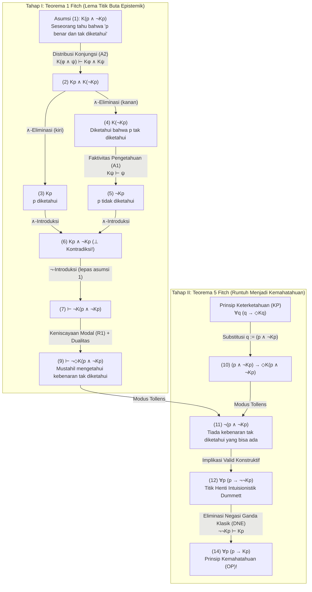
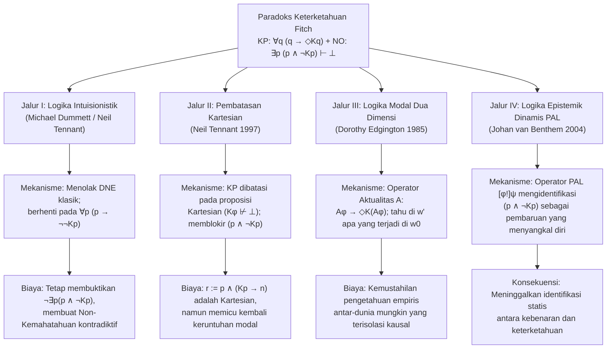

## 1. Pendahuluan: Garis Patahan Epistemologis Antara Realisme Metafisik dan Anti-Realisme Semantik

Dapatkah sebuah proposisi bernilai benar secara determinat meskipun tidak ada pikiran terbatas yang pernah — bahkan secara prinsip sekalipun — memverifikasi, menemukan, atau mengetahuinya?

Pertanyaan ini mendefinisikan garis patahan terdalam dalam metafisika, epistemologi, filsafat bahasa, dan filsafat matematika kontemporer: pertentangan antara <strong>Realisme Metafisik (Metaphysical Realism)</strong> dan <strong>Anti-Realisme Semantik (Semantic Anti-Realism / Verifikasionisme)</strong>.

### 1.1 Komitmen Realisme Metafisik
Menurut <strong>Realisme Metafisik</strong> — yang dibela oleh Gottlob Frege, Bertrand Russell, Hilary Putnam awal, dan Timothy Williamson — kebenaran bersifat radikal <strong>melampaui pengenalan (recognition-transcendent truth)</strong>. Dalam bahasa formal logika bimodal epistemik-aletik, dengan melambangkan $p$ sebagai «proposisi $p$ benar», $Kp$ sebagai «seseorang pada suatu waktu (masa lalu, kini, atau depan) mengetahui $p$», dan $\Diamond\phi$ sebagai «secara logis atau metafisik mungkin bahwa $\phi$», realisme menegaskan keberadaan <strong>kebenaran yang tak dapat diketahui (unknowable truths)</strong>:

$$\text{Realisme (Kebenaran Tak Terketahui)}: \quad \exists p \, \big( p \land \neg \Diamond K p \big)$$

Contoh klasiknya meliputi fakta mikro-historis yang hilang selamanya akibat entropi (misalnya, apakah jumlah helai rambut di kepala Julius Caesar tepat pada detik Brutus menikamnya pada tahun 44 SM adalah ganjil), peristiwa kuantum di luar cakrawala peristiwa kosmologis, atau proposisi matematika yang tak terputuskan.

### 1.2 Anti-Realisme Semantik dan Prinsip Keterketahuan (KP)
Sebaliknya, tradisi <strong>verifikasionisme, pragmatisme, dan anti-realisme semantik</strong> — mulai dari C.S. Peirce dan Lingkaran Wina hingga <strong>realisme internal</strong> Putnam dan anti-realisme intuisionistik <strong>Michael Dummett</strong> — menolak gagasan kebenaran yang sama sekali melampaui verifikasi. Melalui <strong>Argumen Pemerolehan (Acquisition Argument)</strong> dan <strong>Argumen Manifestasi (Manifestation Argument)</strong>, Dummett berargumen bahwa penutur terbatas hanya dapat mempelajari dan memanifestasikan pemahaman makna kalimat jika kondisi kebenarannya terikat secara konstitutif pada keterketahuan secara prinsip.

Hal ini melahirkan aksioma dasar anti-realisme modern, yaitu <strong>Prinsip Keterketahuan (Knowability Principle, KP)</strong>:

$$\text{KP (Prinsip Keterketahuan)}: \quad \forall p \, \big( p \to \Diamond K p \big)$$

(«Untuk setiap proposisi $p$, jika $p$ benar, maka mungkin bahwa seseorang pada suatu waktu mengetahui $p$.»)

### 1.3 Prinsip Non-Kemahatahuan (NO) dan Bom Logika Fitch
Seorang anti-realis bukanlah idealis subjektif yang mengklaim $\forall p \, (p \to K p)$ («semua kebenaran benar-benar diketahui»). Menyadari keterbatasan manusia, setiap anti-realis menerima <strong>Prinsip Non-Kemahatahuan (Non-Omniscience Principle, NO)</strong>:

$$\text{NO (Prinsip Non-Kemahatahuan)}: \quad \exists p \, \big( p \land \neg K p \big)$$

Namun, pada tahun 1963, ahli logika Yale <strong>Frederic B. Fitch (1908–1987)</strong> menerbitkan makalah *"A Logical Analysis of Some Value Concepts"* di *The Journal of Symbolic Logic*, di mana Teorema 5 menghancurkan kompatibilitas antara KP dan NO:

> <strong>Paradoks Keterketahuan Fitch (1963)</strong>:
> Hanya dengan menggunakan aturan inferensi paling lemah dan tak terbantahkan dalam logika epistemik modal — yaitu <strong>Faktivitas Pengetahuan</strong> dan <strong>Distribusi Konjungsi</strong> —, <strong>Prinsip Keterketahuan $\forall p \, (p \to \Diamond K p)$</strong> yang tampak moderat secara langsung menurunkan <strong>Prinsip Kemahatahuan $\forall p \, (p \to K p)$</strong> yang absurd dalam logika klasik!
> Secara kontrapositif, jika manusia tidak mahatahu ($\exists p \, (p \land \neg K p)$), maka niscaya terdapat setidaknya satu kebenaran yang secara logis mustahil untuk pernah diketahui oleh siapa pun ($\exists q \, (q \land \neg \Diamond K q)$).

---

## 2. Genesis Historis: Laporan Peninjau Anonim Alonzo Church (1945) dan Makalah Fitch (1963)

Dalam catatan kaki 5 (hlm. 138) makalahnya tahun 1963, Fitch menyebutkan bahwa bukti Teorema 5 disarankan kepadanya oleh *«seorang peninjau anonim dari makalah yang dikirimkan pada tahun 1945 tetapi tidak pernah diterbitkan»*.

Misteri ini dipecahkan oleh Joe Salerno (2009, *New Essays on the Knowability Paradox*) melalui penelitian arsip di Universitas Princeton: peninjau anonim tahun 1945 tersebut tidak lain adalah <strong>Alonzo Church (1903–1995)</strong>, pencipta kalkulus-$\lambda$! Pada Juli 1945, saat meninjau naskah Fitch yang menyamakan kebenaran dengan keterketahuan, Church menunjukkan bahwa dengan mensubstitusikan konjungsi $q := (p \land \neg K p)$ ke dalam $\forall q \, (q \to \Diamond K q)$, segera diperoleh $\neg(p \land \neg K p)$, yang meruntuhkan keterketahuan potensial menjadi kemahatahuan aktual ($\forall p (p \to K p)$).

---

## 3. Sintaks Formal dan Sistem Aksioma Minimal Logika Bimodal

Dalam bahasa bimodal $\mathcal{L}_{K,\Box}$, operator epistemik $K\phi$ menyatakan pengetahuan kolektif lintas waktu:

$$K\phi \stackrel{\text{def}}{\Longleftrightarrow} \exists x \in \text{Agents}, \, \exists t \in \text{Times} \, \big( K_{x,t} \phi \big)$$

Bukti Fitch <strong>sama sekali tidak memerlukan aksioma epistemik yang kuat</strong> seperti <strong>Prinsip KK (Aksioma 4: $K\phi \to KK\phi$)</strong>, <strong>Introspeksi Negatif (Aksioma 5: $\neg K\phi \to K\neg K\phi$)</strong>, ataupun <strong>Penutupan Deduktif Penuh (Aksioma K: $K(\phi \to \psi) \to (K\phi \to K\psi)$)</strong>. Ia hanya membutuhkan tiga prinsip minimal:

1. <strong>(A1) Faktivitas Pengetahuan (Aksioma T)</strong>:
   $$K\phi \vdash \phi$$
   («Apa yang diketahui haruslah benar; proposisi palsu tidak dapat diketahui.»)
2. <strong>(A2) Distribusi Pengetahuan atas Konjungsi</strong>:
   $$K(\phi \land \psi) \vdash K\phi \land K\psi$$
   («Mengetahui konjungsi "$\phi$ dan $\psi$" berarti mengetahui $\phi$ dan mengetahui $\psi$.»)
3. <strong>(R1) Aturan Keniscayaan Modal (Modal Necessitation Rule)</strong>:
   $$\text{Jika } \vdash \phi, \quad \text{maka } \vdash \Box\phi$$
   («Setiap teorema logika murni berlaku secara niscaya di semua dunia yang mungkin», dengan dualitas $\Box\neg\phi \equiv \neg\Diamond\phi$).

| Prinsip / Aturan | Skema Formal | Makna Filosofis | Diperlukan untuk Fitch? |
| :--- | :--- | :--- | :--- |
| <strong>(A1) Faktivitas (Aksioma T)</strong> | $K\phi \vdash \phi$ | Hanya proposisi benar yang dapat diketahui | <strong>YA (Esensial)</strong> |
| <strong>(A2) Distribusi Konjungsi</strong> | $K(\phi \land \psi) \vdash K\phi \land K\psi$ | Mengetahui «$A$ dan $B$» berarti mengetahui $A$ dan $B$ | <strong>YA (Esensial)</strong> |
| <strong>(R1) Keniscayaan Modal</strong> | $\vdash \phi \implies \vdash \Box\phi$ | Teorema logis bersifat niscaya | <strong>YA (Esensial)</strong> |
| <strong>Penutupan Deduktif Penuh (Aksioma K)</strong> | $K(\phi \to \psi) \to (K\phi \to K\psi)$ | Kemahatahuan logis di bawah implikasi | <strong>TIDAK</strong> |
| <strong>Introspeksi Positif (KK / Aksioma 4)</strong> | $K\phi \to KK\phi$ | Mengetahui berarti tahu bahwa dirinya tahu | <strong>TIDAK</strong> |
| <strong>Introspeksi Negatif (Aksioma 5)</strong> | $\neg K\phi \to K\neg K\phi$ | Tidak tahu berarti tahu bahwa dirinya tidak tahu | <strong>TIDAK</strong> |

---

## 4. Derivasi Formal Langkah demi Langkah Paradoks Fitch

### 4.1 Tahap I (Teorema 1 Fitch): Kemustahilan Logis Mengetahui Kebenaran yang Tak Diketahui
Misalkan $q \stackrel{\text{def}}{\equiv} (p \land \neg K p)$ («$p$ benar, tetapi tidak ada seorang pun yang pernah mengetahui $p$»). Kita buktikan melalui *reductio ad absurdum* ($\neg$-Introduksi) bahwa tidak seorang pun dapat mengetahui $q$:

| Baris | Formula | Justifikasi / Aturan Inferensi | Asumsi Terbuka |
| :---: | :--- | :--- | :---: |
| (1) | $K(p \land \neg K p)$ | <strong>Asumsi untuk Reductio</strong> | $\{1\}$ |
| (2) | $K p \land K(\neg K p)$ | Dari (1) melalui <strong>(A2) Distribusi Konjungsi</strong> $K(\phi \land \psi) \vdash K\phi \land K\psi$ | $\{1\}$ |
| (3) | $K p$ | Dari (2) melalui $\land$-Eliminasi (kiri) | $\{1\}$ |
| (4) | $K(\neg K p)$ | Dari (2) melalui $\land$-Eliminasi (kanan) | $\{1\}$ |
| (5) | $\neg K p$ | Dari (4) melalui <strong>(A1) Faktivitas Pengetahuan</strong> $K\psi \vdash \psi$ ($\psi := \neg K p$) | $\{1\}$ |
| (6) | $K p \land \neg K p \quad (\bot)$ | Dari (3) dan (5) melalui $\land$-Introduksi (<strong>Kontradiksi Eksplisit!</strong>) | $\{1\}$ |
| (7) | $\vdash \neg K(p \land \neg K p)$ | Dari (1)–(6) melalui $\neg$-Introduksi (melepaskan asumsi $\{1\}$) | $\emptyset$ |
| (8) | $\vdash \Box \neg K(p \land \neg K p)$ | Dari teorema (7) melalui <strong>(R1) Keniscayaan Modal</strong> | $\emptyset$ |
| (9) | $\vdash \neg \Diamond K(p \land \neg K p)$ | Dari (8) melalui dualitas modal ($\Box\neg\phi \equiv \neg\Diamond\phi$) | $\emptyset$ |

Baris (9) $\vdash \neg \Diamond K(p \land \neg K p)$ membuktikan bahwa <strong>secara logis mustahil untuk pernah mengetahui suatu kebenaran yang tak diketahui!</strong>

### 4.2 Tahap II (Teorema 5 Fitch): Runtuhnya Keterketahuan (KP) Menjadi Kemahatahuan (OP)
Sekarang kita substitusikan $q := (p \land \neg K p)$ ke dalam <strong>Prinsip Keterketahuan (KP)</strong> $\forall q \, (q \to \Diamond K q)$:

| Baris | Formula | Justifikasi / Aturan Inferensi | Status Logis |
| :---: | :--- | :--- | :--- |
| (10) | $(p \land \neg K p) \to \Diamond K(p \land \neg K p)$ | Instansiasi universal <strong>KP</strong> dengan $q := (p \land \neg K p)$ | Instansi KP |
| (11) | $\neg (p \land \neg K p)$ | Dari (10) dan teorema (9) $\neg \Diamond K(p \land \neg K p)$ melalui <strong>Modus Tollens</strong> | <strong>Valid secara Intuisionistik!</strong> |
| (12) | $p \to \neg \neg K p$ | Dari (11) melalui ekuivalensi proposisional $\neg(A \land \neg B) \vdash (A \to \neg\neg B)$ | <strong>Valid secara Intuisionistik!</strong> |
| (13) | $p \to K p$ | Dari (12) melalui <strong>Eliminasi Negasi Ganda Klasik (DNE)</strong> $\neg\neg K p \vdash K p$ | Menggunakan DNE Klasik |
| (14) | $\forall p \, (p \to K p)$ | Dari (13) melalui Generalisasi Universal | <strong>Prinsip Kemahatahuan (OP)!</strong> |

---

## 5. Diagnosis Struktural: Paradoks Moore, Titik Buta Epistemik, dan Ujian Mendadak

1. <strong>Paradoks G.E. Moore (1942)</strong>: Kalimat *«Di luar sedang hujan, tetapi saya tidak tahu bahwa sedang hujan»* ($p \land \neg K_a p$) konsisten secara ontologis namun mustahil diketahui oleh subjek $a$ sendiri. Ketika $K$ mencakup seluruh komunitas agen di segala waktu, $(p \land \neg K p)$ menjadi <strong>kalimat Moore universal</strong> tanpa pengamat eksternal.
2. <strong>Titik Buta Epistemik (*Blindspots*) Roy Sorensen (1988)</strong>: $(p \land \neg K p)$ adalah titik buta epistemik ($\Diamond\phi \land \neg\Diamond K\phi$): tindakan memperoleh pengetahuan $K p$ mengubah kondisi epistemik dunia dan memalsukan konjungsi kedua $\neg K p$.
3. <strong>Paradoks Ujian Mendadak dan Teorema Ketidaklengkapan Gödel</strong>: Dalam ujian mendadak, siswa mencampuradukkan kebenaran $(E_5 \land \neg K_{\text{Kam}} E_5)$ dengan keterketahuannya pada Kamis malam $K_{\text{Kam}}(E_5 \land \neg K_{\text{Kam}} E_5)$. Dalam aritmetika formal, Teorema Löb mencegah predikat keterbuktian $\text{Prov}_T(\ulcorner \phi \urcorner)$ memenuhi faktivitas secara umum ($\text{Prov}_T(\ulcorner \phi \urcorner) \to \phi$), sedangkan pengetahuan sejati $K$ bersifat faktif tanpa syarat.

---

## 6. Empat Jalur Penyelamatan Filosofis dan Biayanya

### 6.1 Jalur I: Michael Dummett dan Logika Intuisionistik
<strong>Michael Dummett (2001, *"Victor's Error"*)</strong> dan <strong>Neil Tennant</strong> menunjukkan bahwa baris (1) hingga (12) sepenuhnya valid dalam <strong>logika intuisionistik</strong>; logika klasik hanya dipakai pada langkah (12) ke (13) melalui <strong>Eliminasi Negasi Ganda (DNE: $\neg\neg K p \vdash K p$)</strong>. Tanpa DNE, derivasi berhenti pada:

$$\forall p \, \big( p \to \neg\neg K p \big) \quad \text{dan} \quad \forall p \, \neg(p \land \neg K p)$$

<strong>Kritik Balik Timothy Williamson (1982, 2000)</strong>:
1. Bahkan dalam logika intuisionistik, baris (11) membuktikan $\vdash_{\text{Int}} \neg \exists p \, (p \land \neg K p)$, sehingga <strong>Prinsip Non-Kemahatahuan (NO) tetap terbukti kontradiktif (salah)</strong>!
2. Untuk proposisi yang dapat diputuskan ($K p \lor \neg K p$), $\neg\neg K p \vdash_{\text{Int}} K p$ tetap berlaku secara intuisionistik, sehingga kembali runtuh menjadi $p \to K p$.

### 6.2 Jalur II: Pembatasan Neil Tennant pada «Proposisi Kartesian»
<strong>Neil Tennant (1997, *The Taming of the Sleuth*)</strong> membatasi KP pada <strong>proposisi Kartesian</strong> ($\text{Cartesian}(\phi) \iff K\phi \not\vdash \bot$):

$$\text{KP}_{\text{Cart}}: \quad \forall \phi \, \Big( \text{Cartesian}(\phi) \implies \big( \phi \to \Diamond K \phi \big) \Big)$$

<strong>Contoh Penyangkal DeVidi & Solomon (2001) dan Williamson</strong>: Proposisi majemuk $r \stackrel{\text{def}}{\equiv} p \land (K p \to n)$ bersifat <strong>Kartesian</strong> ($K r \not\vdash \bot$), tetapi ketika disubstitusikan ke $\text{KP}_{\text{Cart}}$ di bawah asumsi $p \land \neg K p$ menghasilkan $\Diamond(K p \land n)$, membangkitkan kembali paradoks tersebut!

### 6.3 Jalur III: Logika Modal Dua Dimensi Dorothy Edgington ($\mathcal{A}$ / `@`)
<strong>Dorothy Edgington (1985, *"The Paradox of Knowability"*, *Mind*)</strong> memperkenalkan <strong>Operator Aktualitas $\mathcal{A}$ («Actually»)</strong> ($\mathcal{M}, w' \models \mathcal{A}\phi \iff \mathcal{M}, w_0 \models \phi$):

$$\text{KP}_{\text{Edg}}: \quad \forall \phi \, \Big( \mathcal{A}\phi \to \Diamond K(\mathcal{A}\phi) \Big)$$

Di dunia mungkin kontrafaktual $w'$, seorang agen dapat mengetahui tanpa kontradiksi bahwa di dunia aktual $w_0$, $p$ benar dan tidak seorang pun di $w_0$ mengetahuinya ($K_{w'}(\mathcal{A} p) \land \neg \mathcal{A} K p$). Kritik Williamson: Bagaimana agen di dunia $w'$ yang terisolasi secara kausal dari $w_0$ dapat memiliki pengetahuan empiris tentang fakta kontingen di $w_0$?

### 6.4 Jalur IV: Logika Epistemik Dinamis (DEL) dan Logika Pengumuman Publik (PAL)
<strong>Johan van Benthem (2004)</strong> menunjukkan melalui operator dinamis $[\phi!]\psi$ bahwa $(p \land \neg K p)$ adalah <strong>«formula tak berhasil» (Unsuccessful Formula)</strong> yang memalsukan dirinya sendiri begitu diumumkan atau dipelajari: $\mathcal{M}, w \models [p \land \neg K p !] \neg(p \land \neg K p)$.

---

## 7. Matriks Perbandingan dan Kesimpulan Filosofis

| Posisi Filosofis | Prinsip Formal / Logika | Mekanisme Pemblokiran | Kerentanan Fatal / Biaya |
| :--- | :--- | :--- | :--- |
| <strong>Anti-Realisme Naif</strong> | $\forall p \, (p \to \Diamond K p)$ (Klasik) | <strong>Tidak ada</strong>: Runtuh ke $\forall p (p \to K p)$ | Berujung pada <strong>Kemahatahuan Manusia (OP)</strong> |
| <strong>Anti-Realisme Intuisionistik</strong> (Dummett 2001) | $\forall p \, (p \to \Diamond K p)$ (Intuisionistik) | Menolak DNE ($\neg\neg K p \not\vdash K p$); berhenti di $p \to \neg\neg K p$ | Menyangkal $\exists p (p \land \neg K p)$; runtuh jika $K p$ dapat diputuskan |
| <strong>Pembatasan Kartesian</strong> (Tennant 1997) | $\text{Cartesian}(\phi) \to (\phi \to \Diamond K \phi)$ | Mengecualikan $(p \land \neg K p)$ karena $K(p \land \neg K p) \vdash \bot$ | Ditembus oleh $r := p \land (K p \to n)$ |
| <strong>Logika Dua Dimensi</strong> (Edgington 1985) | $\forall \phi \, (\mathcal{A}\phi \to \Diamond K(\mathcal{A}\phi))$ | Memisahkan dunia kebenaran ($w_0$) dan dunia pengetahuan ($w'$) | Misteri pengetahuan empiris lintas-dunia |
| <strong>Logika Dinamis (PAL)</strong> (van Benthem 2004) | Pengumuman publik $[\phi!]\psi$ | Mengidentifikasi $(p \land \neg K p)$ sebagai formula tak berhasil | Melepaskan anti-realisme semantik statis |

<strong>Kesimpulan</strong>: Jika kita menerima keterbatasan kognitif manusia ($\exists p \, (p \land \neg K p)$), Teorema 1 Fitch ($\vdash \neg \Diamond K(p \land \neg K p)$) memaksa kita secara logis untuk menerima <strong>Realisme Metafisik</strong>:

$$\exists p \, (p \land \neg K p) \quad \vdash \quad \exists q \, \big( q \land \neg \Diamond K q \big)$$

---

## Referensi

* Fitch, F. B. (1963). "A Logical Analysis of Some Value Concepts". *The Journal of Symbolic Logic*, 28(2), 135–142.
* Salerno, J. (Ed.). (2009). *New Essays on the Knowability Paradox*. Oxford University Press.
* Dummett, M. (2001). "Victor's Error". *Analysis*, 61(269), 1–2.
* Williamson, T. (2000). *Knowledge and Its Limits*. Oxford University Press.
* Edgington, D. (1985). "The Paradox of Knowability". *Mind*, 94(376), 557–568.
* Tennant, N. (1997). *The Taming of the Sleuth*. Oxford University Press.
* van Benthem, J. (2004). "What One May Come to Know". *Analysis*, 64(282), 95–105.
