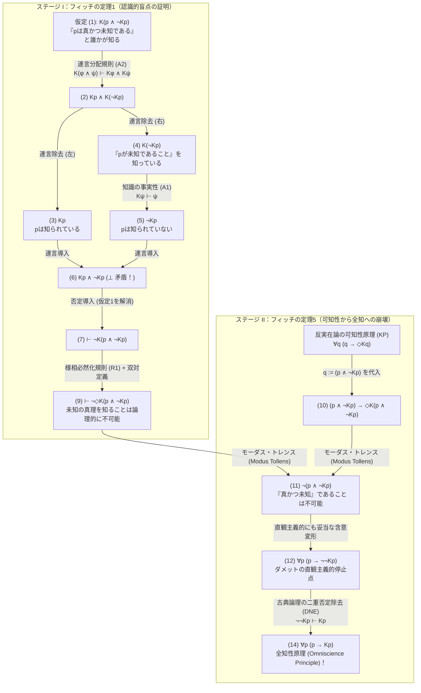
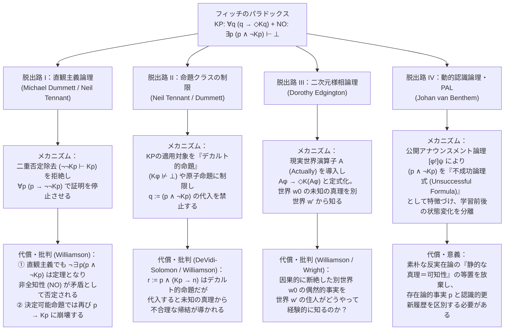

## 1. 導入：形而上学的実在論と意味論的反実在論の断層線 ——「誰にも知られえない真理」は存在するか？

「真理（Truth）」とは、我々人間の認識能力や検証手続きから完全に独立して世界に鎮座しているものなのだろうか。それとも、真理とは「有限な認識主体が原理的に知りうる（検証・証明しうる）もの」の内部にのみ成立する概念なのだろうか。

この問いは、近代以降の分析哲学・言語哲学・科学哲学・数学の哲学を二分してきた最大の断層線——すなわち<strong>形而上学的実在論（Metaphysical Realism）</strong>と<strong>意味論的反実在論（Semantic Anti-Realism / 検証主義 Verificationism）</strong>の対立軸そのものである。

### 1.1 形而上学的実在論（Metaphysical Realism）の立場
ゴットロープ・フレーゲ（Gottlob Frege）、バートランド・ラッセル（Bertrand Russell）、初期のヒラリー・パトナム（Hilary Putnam）、そしてティモシー・ウィリアムソン（Timothy Williamson）らが擁護する<strong>形而上学的実在論</strong>によれば、命題 $p$ が真であるか偽であるかは、世界の客観的・存在論的な事態（states of affairs）のみによって決定される。我々人間（あるいはいかなる有限な認識主体）が、その命題 $p$ を検証する手段を持っているか、証拠にアクセスできるか、いつの日かそれを知りうるかは、$p$ の真理値とは一切無関係である。

すなわち、実在論者は<strong>「認識超越的真理（Recognition-Transcendent Truth / 証拠超越的真理 Evidence-Transcendent Truth）」</strong>の存在を肯定する。形式的な様相認識論理（Bimodal Epistemic-Alethic Logic）の記号を用いれば、命題 $p$ が真であることを単に $p$ と書き、「いつの日か誰かが $p$ を知る」を $Kp$、「論理的・形而上学的に $\phi$ が可能である」を $\Diamond \phi$ と表記するとき、実在論の核心的コミットメントは次の存在命題として定式化される。

$$\text{Realism (Unknowable Truths)}: \quad \exists p \, \big( p \land \neg \Diamond K p \big)$$

「真でありながら、原理的に誰にも決して知られえない（知られることが不可能である）命題 $p$ が存在する。」

実在論者が挙げる具体例は枚挙にいとまがない。
1. <strong>永遠に失われた過去のミクロな歴史的事実</strong>：「紀元前44年3月15日、ブルータスに刺された瞬間のユリウス・カエサルの頭髪の本数は奇数であった」という命題 $p$。頭髪の本数は整数である以上、客観的には奇数であったか偶数であったかのどちらか一方が確定的に真である。しかし、その瞬間のすべての光子や遺灰の情報は熱力学的不可逆過程（エントロピー増大）によって宇宙から完全に散逸しており、いかなる未来の科学技術をもってしても、この命題を検証・認識することは原理的に不可能であるかもしれない。
2. <strong>事象の地平面や宇宙論的ホライズンの彼方の出来事</strong>：観測可能な宇宙の事象の地平面（Cosmological Event Horizon）の外側、あるいはブラックホールの特異点近傍で生じた特定の素粒子の崩壊現象。光速の限界と時空構造により、その因果的シグナルがいかなる観測者にも永遠に到達しない場合、その出来事に関する命題は真であっても $\neg \Diamond K p$ である。
3. <strong>公理系から独立した数学的命題</strong>：ゴールドバッハの予想（すべての $2$ より大きい偶数は二つの素数の和で表せる）や連続体仮説のように、もしある命題が我々の到達しうるいかなる正当な公理系からも証明も反証もできない（かつ有限の反例も持たない）としたら、実在論（プラトニズム）の下ではそれは確定的に真（または偽）でありながら、不可知な真理となる。

### 1.2 意味論的反実在論・検証主義（Semantic Anti-Realism）の挑戦
これに対し、チャールズ・サンダース・パース（C.S. Peirce）のプラグマティズム（「真理とは探究の極限において合意される意見である」）、ウィーン学団（論理実証主義）の検証理論、後期のヒラリー・パトナムの<strong>内在的実在論（Internal Realism）</strong>（「真理とは理想化された合理的受容可能性である」）、そしてマイケル・ダメット（Michael Dummett）の<strong>直観主義的・意味論的反実在論</strong>は、実在論の「絶対に検証不可能な真理」という概念を形而上学的な幻想として斥ける。

ダメットが展開した有名な<strong>「顕現論証（Manifestation Argument）」</strong>および<strong>「習得論証（Acquisition Argument）」</strong>は、言語理解の条件から実在論を突き崩そうとする。
* <strong>習得論証</strong>：我々人間は有限の経験と訓練を通じて言語を習得する。もし文の意味（真理条件）が、人間の検証能力を完全に超越した「神の視点（God's-Eye View）」における事態との対応にあるとすれば、我々はいかにしてそのような検証超越的な真理条件を学習・習得できたというのか？
* <strong>顕現論証</strong>：ある話者が文 $p$ の意味を理解しているという事実は、その話者の実践的な言語使用能力（どのような証拠があれば $p$ を主張し、どのような反証があれば撤回するかという検証・正当化能力）において外部に<strong>顕現（manifest）</strong>されなければならない。どれほど観察・推論しても原理的にアクセス不可能な真理条件を「心の中で把握している」と主張することは、ウィトゲンシュタインが批判した「私的言語」と同様に空虚である。

したがって、反実在論者は「真理（Truth）」と「認識可能性（Knowability / 検証可能性 Verifiability）」のあいだに概念的な結びつきを要求する。いかなる命題も、もしそれが本当に「真」であるならば、少なくとも<strong>原理的には（in principle）</strong>、適切な時空位置や十分な計算・推論能力を持った誰かによって、いつの日か知られうる（検証されうる）ものでなければならない。これが<strong>可知性原理（Knowability Principle: KP）</strong>である。

$$\text{KP (Knowability Principle)}: \quad \forall p \, \big( p \to \Diamond K p \big)$$

「すべての命題 $p$ について、もし $p$ が真であるならば、誰かがいつの日か $p$ を知ることが可能である。」

### 1.3 常識的前提としての「非全知性（Non-Omniscience）」とフィッチの爆弾
ここで極めて重要なのは、意味論的反実在論者は決して「現実に知られていないものは存在しない」と主張する狂信的な独我論者や素朴な主観的観念論者ではない、という点である。

もし「$p$ が真である $\iff$ $p$ は<strong>現実に（actually）</strong>誰かによって知られている（$p \to K p$）」と主張すれば、人類がまだ発見していない深海の生物も、昨日私が朝食に食べたパンの正確な重量も、誰も測定していなければ真実ではないことになり、人間集団が現時点で<strong>全知（Omniscient）</strong>であるという荒唐無稽な結論に陥る。

だからこそ、反実在論者は様相演算子 $\Diamond$（「可能である」）を導入したのである。「すべての真理が現実に知られているわけではない（我々は全知ではない）。しかし、すべての真理は<strong>原理的に知りうる</strong>（$\forall p (p \to \Diamond K p)$）」。つまり、反実在論者は常識的な<strong>非全知性原理（Non-Omniscience Principle: NO）</strong>を当然の事実として受け入れる。

$$\text{NO (Non-Omniscience Principle)}: \quad \exists p \, \big( p \land \neg K p \big)$$

「真でありながら、過去・現在・未来を通じて実際には誰にも知られることなく終わる命題 $p$ が少なくとも一つ存在する。」

ところが1963年、アメリカの論理学者<strong>フレデリック・フィッチ（Frederic Brenton Fitch, 1908–1987）</strong>は、論文『いくつかの価値概念の論理的分析（"A Logical Analysis of Some Value Concepts"）』の定理5（Theorem 5）において、哲学界を震撼させる驚くべき定理を証明した。

> <strong>フィッチの可知性のパラドックス（Fitch's Paradox of Knowability）</strong>：
> 認識論理の最も基本的で誰もが認める最小限の公理（知識の事実性と連言分配）と古典論理を前提すると、穏健なはずの<strong>可知性原理 $\forall p (p \to \Diamond K p)$</strong> から、狂信的な<strong>全知性原理 $\forall p (p \to K p)$</strong> が純粋な演繹のみによって直接導出されてしまう。
> 対偶をとれば、もし我々が全知ではない（$\exists p (p \land \neg K p)$：未知の真理が一つでも存在する）ならば、<strong>原理的に誰にも知られえない絶対的不可知の真理 $\exists q (q \land \neg \Diamond K q)$ が必ず存在する</strong>！

「すべての真理は原理的に知りうる（$\forall p (p \to \Diamond K p)$）」という反実在論のテーゼは、様相のクッション $\Diamond$ を挟んだにもかかわらず、「すべての真理は現実に知られている（$\forall p (p \to K p)$）」へと論理的に崩壊（collapse）してしまうのである。なぜこのような信じがたい崩壊が、わずか数行の初等的な論理推論から生じるのか。本稿では、その歴史的起源から完全な形式証明、そしてマイケル・ダメットの直観主義論理をはじめとする4大脱出路の成否までを徹底的に解剖する。

---

## 2. 歴史的起源：アロンゾ・チャーチの1945年匿名査読報告とフィッチの1963年論文

フィッチのパラドックスには、論理学史上の極めて興味深いミステリーが秘められている。

1963年に『Journal of Symbolic Logic』（第28巻第2号, pp. 135–142）に掲載されたフィッチの論文『A Logical Analysis of Some Value Concepts』は、本来は「知る（know）」「信じる（believe）」「欲する（desire）」「試みる（strive）」といった価値概念・命題的態度を様相論理の枠組みで統一的に公理化しようとする試みであった。その論文の138ページ、定理5において、フィッチは淡々とこの結果を証明し、脚注5（Footnote 5）に次のように記した。

> *"The proof of theorem 5 was suggested to the author by an anonymous referee of a paper submitted in 1945 but never published."*
> （「定理5の証明は、1945年に投稿されたが未公刊に終わった論文の匿名査読者によって著者に示唆されたものである。」）

一体、1945年の時点でこの巧妙極まりない代入トリック $q := (p \land \neg K p)$ を思いついた「匿名査読者（anonymous referee）」とは誰だったのか？ 長年にわたり、それは認識論理の創始者たち（フォン・ウリクトやヒンティッカなど）ではないかと推測されてきたが、1945年当時、現代的な認識論理（Epistemic Logic）はまだ誕生すらしていなかった。

この謎を解明したのは、哲学者のジョー・サレルノ（Joe Salerno）によるプリンストン大学図書館のアーカイブ調査であった（2009年編著『New Essays on the Knowability Paradox』にて公表）。サレルノは、数理論理学の巨人でありラムダ計算（$\lambda$-calculus）やチャーチ＝チューリングのテーゼで知られる<strong>アロンゾ・チャーチ（Alonzo Church, 1903–1995）</strong>の遺稿・書簡コレクションの中から、1945年夏にチャーチ自身が『Journal of Symbolic Logic』の編集委員として執筆した査読報告書の控えを発見したのである。

1945年、イェール大学のフィッチは『A Minimum Calculus for Logic』という原稿を投稿し、その中で「真理とは知りうること（knowability）と等価である」という構成主義的・検証主義的な公理を仮定していた。査読を担当したアロンゾ・チャーチは、1945年7月の査読レポートにおいて、もし $\forall p (p \to \Diamond K p)$ を公理として採用するならば、命題 $p$ の箇所に複合命題 $(p \land \neg K p)$ を代入するだけで、$\neg(p \land \neg K p)$ すなわち $p \to K p$ が導かれ、「知られていない真理は存在しない（全知）」という不合理な帰結が生じることを、完全な形式証明付きで指摘していたのである。

フィッチはこのチャーチの指摘に衝撃を受け、1945年の論文を取り下げた。そして18年後の1963年、フィッチはこのチャーチの証明を一般的な定理として整備し、自らの論文の「定理1」および「定理5」として世に送り出した。さらにその後10年以上にわたりこの定理はほとんど注目されなかったが、1970年代後半にW.D.ハート（W.D. Hart）とコリン・マッギン（Colin McGinn）、そして1980年代以降にティモシー・ウィリアムソンらがマイケル・ダメットの反実在論に対する決定的な論理的反駁として再発見したことで、現代分析哲学における最重要パラドックスの一つへと躍り出ることになったのである。

---

## 3. 様相認識論理（Bimodal Epistemic-Alethic Logic）の形式構文論と最小公理系

フィッチのパラドックスがいかに強固で逃れがたいものであるかを理解するためには、その証明が<strong>どれほど弱い（最小限の）論理的仮定しか必要としないか</strong>を確認しなければならない。

### 3.1 言語 $\mathcal{L}_{K,\Box}$ の定義
対象言語として、命題論理に認識演算子 $K$ と形而上学的様相演算子 $\Box, \Diamond$ を加えた二様相命題論理（Bimodal Propositional Logic）$\mathcal{L}_{K,\Box}$ を定義する。

$$\phi, \psi ::= p \mid \neg \phi \mid (\phi \land \psi) \mid (\phi \lor \psi) \mid (\phi \to \psi) \mid K\phi \mid \Box\phi \mid \Diamond\phi$$

ここで各演算子の意味論的解釈は以下の通りである。
* <strong>命題変数 $p, q, r \in \text{Prop}$</strong>：任意の平叙文（命題）を表す。また、量化子 $\forall p$ はすべての整合的な命題にわたる命題量化（または公理シェーマとしての任意代入可能性）を表す。
* <strong>認識演算子 $K\phi$</strong>：「ある認識主体 $x$ が、ある時点 $t$（過去・現在・未来のどこか）において $\phi$ を知る（knows that $\phi$）」。すなわち、特定の個人の現在の知識ではなく、人類（あるいは有限な理性的存在者の共同体全体）の歴史全体を通じた知識の総和として定義される。
  $$K\phi \stackrel{\text{def}}{\Longleftrightarrow} \exists x \in \text{Agents}, \, \exists t \in \text{Times} \, \big( K_{x,t} \phi \big)$$
  このように $K$ を「いつの日か誰かが知る（known by someone at some time）」と広く定義することで、反実在論者にとって最も有利な（最も弱い）条件を設定していることに注意されたい。
* <strong>様相演算子 $\Box\phi, \Diamond\phi$</strong>：$\Box\phi$ は「論理的・形而上学的に必然的に $\phi$ である」、$\Diamond\phi$ は「論理的・形而上学的に $\phi$ であることが可能である」を表し、互いに双対（Dual）の関係にある。
  $$\Diamond\phi \stackrel{\text{def}}{\Longleftrightarrow} \neg \Box \neg \phi, \qquad \Box \neg \phi \Longleftrightarrow \neg \Diamond \phi$$

### 3.2 フィッチの証明に必要な最小限の公理・推論規則
通常の認識論理（ヒンティッカの体系 S4 や S5）では、<strong>KK原理（正の内省公理 Axiom 4：$K\phi \to KK\phi$、「知っているならば、自分が知っていることを知っている」）</strong>や、<strong>負の内省公理（Axiom 5：$\neg K\phi \to K\neg K\phi$、「知らないならば、自分が知らないことを知っている」）</strong>、あるいは<strong>演繹的閉包性（Axiom K：$K(\phi \to \psi) \to (K\phi \to K\psi)$）</strong>といった強い公理が課されることが多い。これらに対しては「現実の人間は自分の知識を完全に内省できるわけでも、すべての論理的帰結を瞬時に計算できるわけでもない（論理的全知ではない）」というもっともな批判が可能である。

しかし、フィッチのパラドックスの恐るべき点は、<strong>KK原理も、負の内省も、様相体系 S4/S5 の強い公理も一切使用しない</strong>ことにある。必要なのは以下のたった3つの基本原理のみである。

1. <strong>(A1) 知識の事実性（Factivity of Knowledge / 公理 T）</strong>：
   $$K\phi \vdash \phi \quad \big(\text{または } \vdash K\phi \to \phi\big)$$
   「もし誰かが $\phi$ を知っているならば、$\phi$ は真でなければならない。」
   これはプラトンの『テアイテトス』以来、知識（Knowledge）を単なる思い込みや信念（Belief）から区別する最も基本的な定義的性質（知識の事実性条件）である。偽なる命題を「知る」ことはできない（「地球が平らであることを知っている」とは言えない）。
2. <strong>(A2) 連言に対する知識の分配規則（Conjunction Distribution / Closure under Conjunction Elimination）</strong>：
   $$K(\phi \land \psi) \vdash K\phi \land K\psi$$
   「もし誰かが『$\phi$ かつ $\psi$』という連言命題を知っているならば、その人は『$\phi$』を知っており、かつ『$\psi$』を知っている。」
   たとえば「『東京は日本の首都であり、かつパリはフランスの首都である』と知っているならば、『東京は日本の首都である』と知っており、かつ『パリはフランスの首都である』と知っている」という、これ以上ないほど自明な規則である。
3. <strong>(R1) 様相必然化規則（Modal Necessitation Rule）および双対性</strong>：
   $$\text{もし } \vdash \phi \text{ （}\phi\text{ が純粋な論理と知識の定義のみから証明可能な定理である）ならば、 } \vdash \Box \phi$$
   経験的な仮定を一切用いずに純粋な論理的推論のみで証明された定理 $\phi$（特に $\neg \psi$ の形の論理的矛盾の否定）は、すべての可能世界において必然的に真（$\Box \phi$）である。そして $\Box \neg \psi$ は定義により $\neg \Diamond \psi$（「$\psi$ であることは論理的に不可能である」）と同値である。

| 公理・規則の名称 | 論理式・推論図式 | 直観的意味 | フィッチの証明での要否 |
| :--- | :--- | :--- | :--- |
| <strong>(A1) 知識の事実性 (Factivity / Axiom T)</strong> | $K\phi \vdash \phi$ | 知られている事柄は真である（偽なる知識は存在しない） | <strong>必須（核となる公理）</strong> |
| <strong>(A2) 連言分配 (Conjunction Distribution)</strong> | $K(\phi \land \psi) \vdash K\phi \land K\psi$ | 「$A$ かつ $B$」を知るなら、$A$ を知り $B$ も知る | <strong>必須（核となる公理）</strong> |
| <strong>(R1) 様相必然化規則 (Modal Necessitation)</strong> | $\vdash \phi \implies \vdash \Box\phi$ | 論理的定理はすべての可能世界で必然的に成り立つ | <strong>必須（定理1で使用）</strong> |
| <strong>演繹的閉包公理 (Epistemic Axiom K)</strong> | $K(\phi \to \psi) \to (K\phi \to K\psi)$ | 含意を知り前件を知るなら後件も知る（論理的全知） | <strong>不要</strong>（(A2)のみで十分） |
| <strong>正の内省公理 (KK-Principle / Axiom 4)</strong> | $K\phi \to KK\phi$ | 知っているなら「知っていること」を知っている | <strong>一切不要</strong> |
| <strong>負の内省公理 (Negative Introspection / Axiom 5)</strong> | $\neg K\phi \to K\neg K\phi$ | 知らないなら「知らないこと」を知っている | <strong>一切不要</strong> |
| <strong>ブラウワー公理 (Axiom B)</strong> | $\phi \to \Box\Diamond\phi$ | 現実の真理は必然的に可能である（到達関係の対称性） | <strong>一切不要</strong> |

この表が示す通り、フィッチの証明は認識論理の最も弱い基底部分（事実性と連言分解のみ）の上で完全に作動する。

---

## 4. フィッチのパラドックスの完全形式証明（Step-by-Step Formal Proof）

それでは、フィッチの定理の形式証明を2つのステージに分けて、一行の飛躍もなく厳密に導出しよう。

### 4.1 ステージ I（フィッチの定理1）：「未知の真理」を知ることは論理的に不可能である（ムーア＝フィッチの認識的盲点補題）

まず、ある命題 $p$ について、次の複合命題（連言命題）$q$ を考える。

$$q \stackrel{\text{def}}{\equiv} p \land \neg K p$$

この命題 $q$ が述べている内容は、<strong>「$p$ は真であるが、$p$ は（過去・現在・未来を通じて誰にも）知られていない」</strong>という、まさに<strong>非全知性原理（NO）</strong>が主張する「未知の真理（an unknown truth）」そのものである。

ここで問おう。<strong>誰かがこの複合命題 $q \equiv (p \land \neg K p)$ を「知る」ことは可能だろうか？</strong>
すなわち、$K(p \land \neg K p)$（「『$p$ は真であり、かつ誰にも知られていない』ということを誰かが知る」）という事態は成立しうるだろうか？ 背理法（否定導入規則 $\neg$-Introduction）によって、それが純粋な論理的矛盾であることを証明する。

| 行番号 | 論理式 | 適用された推論規則・根拠 | 依存する仮定 |
| :---: | :--- | :--- | :---: |
| (1) | $K(p \land \neg K p)$ | <strong>背理法の仮定（Assumption for Reductio）</strong> | $\{1\}$ |
| (2) | $K p \land K(\neg K p)$ | (1) に <strong>(A2) 連言に対する知識の分配規則</strong> $K(\phi \land \psi) \vdash K\phi \land K\psi$ を適用 | $\{1\}$ |
| (3) | $K p$ | (2) に連言除去規則（$\land$-Elimination 左）を適用 | $\{1\}$ |
| (4) | $K(\neg K p)$ | (2) に連言除去規則（$\land$-Elimination 右）を適用 | $\{1\}$ |
| (5) | $\neg K p$ | (4) に <strong>(A1) 知識の事実性</strong> $K\psi \vdash \psi$（ただし $\psi \equiv \neg K p$）を適用 | $\{1\}$ |
| (6) | $K p \land \neg K p \quad (\bot)$ | (3) と (5) に連言導入規則（$\land$-Introduction）を適用（<strong>明示的矛盾！</strong>） | $\{1\}$ |
| (7) | $\vdash \neg K(p \land \neg K p)$ | (1)〜(6) より否定導入規則（$\neg$-Introduction、仮定 $\{1\}$ を解消） | $\emptyset$ |
| (8) | $\vdash \Box \neg K(p \land \neg K p)$ | (7) は無仮定の定理ゆえ、<strong>(R1) 様相必然化規則</strong>を適用 | $\emptyset$ |
| (9) | $\vdash \neg \Diamond K(p \land \neg K p)$ | (8) に様相演算子の双対定義 $\Box \neg \phi \equiv \neg \Diamond \phi$ を適用 | $\emptyset$ |

数式として一行ずつ確認しよう。
仮定 (1) $K(p \land \neg K p)$ から、連言分配規則 (A2) によって、その認識主体は第1連言肢 $p$ を知っており（$K p$）、かつ第2連言肢 $\neg K p$ も知っている（$K(\neg K p)$）ことになる。
ところが、第2連言肢 $K(\neg K p)$（「誰にも $p$ が知られていないことを知っている」）に対して知識の事実性 (A1) $K\psi \to \psi$ を適用すると、「実際に誰にも $p$ は知られていない（$\neg K p$）」が導かれる！
すると、(3) の $K p$ と (5) の $\neg K p$ が正面衝突し、$K p \land \neg K p$ という論理的矛盾（$\bot$）が発生する。

したがって、仮定 (1) は解消され、いかなる経験的前提にも依存しない純粋な論理の定理として (7) $\vdash \neg K(p \land \neg K p)$ が確立される。そして定理には様相必然化規則 (R1) が適用できるため、(8) $\vdash \Box \neg K(p \land \neg K p)$、すなわち双対変形により次の<strong>フィッチの定理1（認識的盲点補題）</strong>が得られる。

$$\vdash \neg \Diamond K(p \land \neg K p)$$

<strong>哲学的意味</strong>：「$p$ は真であり、かつ誰にも知られていない」という連言命題 $(p \land \neg K p)$ は、それ自体としては何ら矛盾を含まない偶然的命題であり、現実世界でいくらでも真でありうる。にもかかわらず、<strong>この命題 $(p \land \neg K p)$ が「誰かによって知られること」は、すべての可能世界を通じて論理的に絶対不可能（$\neg \Diamond K$）なのである！</strong> なぜなら、その命題を知った瞬間に第1連言肢 $p$ が知られる（$K p$）ため、第2連言肢 $\neg K p$ が自動的に偽へと反転し、知識の事実性を破壊してしまうからである。

### 4.2 ステージ II（フィッチの定理5）：可知性原理（KP）から全知性原理（OP）への崩壊

さて、ステージ I で確立された無条件の定理 (9) $\vdash \neg \Diamond K(p \land \neg K p)$ の前に、反実在論者が掲げる<strong>可知性原理（KP）</strong>を登場させよう。

$$\text{KP}: \quad \forall q \, \big( q \to \Diamond K q \big)$$

KP は「<strong>すべての</strong>命題 $q$ について、もし $q$ が真ならば、$q$ を知ることが可能である」と主張している。全称量化子 $\forall q$ は言語 $\mathcal{L}_{K,\Box}$ のすべての整論理式（すべての命題）を動くため、この $q$ に具体的な命題 $q := (p \land \neg K p)$ を代入（全称例化 Universal Instantiation）することができる。すると、直ちに次の推論が進行する。

| 行番号 | 論理式 | 適用された推論規則・根拠 | 備考 |
| :---: | :--- | :--- | :--- |
| (10) | $(p \land \neg K p) \to \Diamond K(p \land \neg K p)$ | <strong>可知性原理 (KP)</strong> $\forall q (q \to \Diamond K q)$ に $q := (p \land \neg K p)$ を代入 | 全称例化 (UI) |
| (11) | $\neg (p \land \neg K p)$ | (10) とステージ I の定理 (9) $\neg \Diamond K(p \land \neg K p)$ に<strong>モーダス・トレンス (Modus Tollens)</strong> を適用 | $\phi \to \psi, \neg \psi \vdash \neg \phi$ |
| (12) | $p \to \neg \neg K p$ | (11) に命題論理の同値変形 $\neg(A \land \neg B) \vdash (A \to \neg\neg B)$ を適用 | <strong>ここまで直観主義論理でも完全に妥当！</strong> |
| (13) | $p \to K p$ | (12) の後件に<strong>古典論理の二重否定除去規則 (DNE)</strong> $\neg\neg K p \vdash K p$ を適用 | 古典論理の規則を使用 |
| (14) | $\forall p \, (p \to K p)$ | (13) に全称汎化規則 (Universal Generalization) を適用 | <strong>全知性原理 (Omniscience Principle: OP)！</strong> |

なんという劇的な結末であろうか！
1. 行 (10) において、可知性原理 KP は「もし $(p \land \neg K p)$ が真ならば、$\Diamond K(p \land \neg K p)$（それが知られることが可能）である」と述べる。
2. しかしステージ I の行 (9) によって、後件の $\Diamond K(p \land \neg K p)$ は<strong>論理的に不可能（偽）</strong>であることがすでに証明されている。
3. したがって、モーダス・トレンス（対偶推論：$A \to B$ かつ $\neg B$ ならば $\neg A$）により、前件の否定である行 (11) $\neg(p \land \neg K p)$ が直ちに導かれる。
4. 任意の命題 $p$ について $\neg(p \land \neg K p)$ が成り立つということは、量化子を導入すれば $\forall p \, \neg(p \land \neg K p)$ すなわち $\neg \exists p \, (p \land \neg K p)$（「真でありながら知られていない命題 $p$ はただの一つも存在しない」＝<strong>非全知性原理 NO の直接否定</strong>）である。
5. そして古典論理の二重否定除去（$\neg\neg K p \vdash K p$）を用いれば、行 (13)–(14) の通り、

$$\forall p \, (p \to \Diamond K p) \quad \vdash \quad \forall p \, (p \to K p)$$

すなわち、<strong>「すべての真理が原理的に知りうるならば、すべての真理はすでに現実に知られている（我々は全知である）」</strong>という結論が、一片の曇りもなく証明されてしまうのである。

---

## 5. 構造的診断：ムーアのパラドックス・認識的盲点・抜き打ちテストのパラドックスとの同型性

なぜ $(p \land \neg K p)$ という一見単純な論理式が、これほどまでに破壊的な威力を発揮するのか。その深層構造を解剖すると、20世紀の分析哲学と数理論理学を貫く3つの重要な親戚関係が浮かび上がってくる。

### 5.1 G.E.ムーアのパラドックス（Moore's Paradox, 1942）との構造的同一性
イギリスの哲学者 G.E.ムーア（G.E. Moore）は1942年、次のような奇妙な文に注目した。

> <strong>ムーアの文（Moorean Sentence）</strong>：
> 「外では雨が降っているが、私は外で雨が降っているとは信じていない（または知らない）。」
> $$p \land \neg B_a p \quad \text{または} \quad p \land \neg K_a p$$

この文の奇妙さはどこにあるか？
第一に、この文が記述している<strong>世界の状態（真理条件）には何の論理的矛盾もない</strong>。外で実際に雨が降っており（$p$）、かつ室内で窓を閉め切っている私 $a$ がその事実を知らない（$\neg K_a p$）という状況は、日常茶飯事として成立する。実際、三人称で「外では雨が降っているが、太郎はそのことを知らない」と述べることには何の不自然さもない。

第二に、にもかかわらず、当の本人 $a$ が一人称現在形で「雨が降っているが、私はそれを知らない（$p \land \neg K_a p$）」と<strong>誠実に主張（assert）したり、知ったり（know）することは語用論的・認識論的に不可能</strong>である。なぜなら、「雨が降っている（$p$）」と知識をもって主張した瞬間に、話者自身が $p$ を知っていることになり、後半の「私はそれを知らない（$\neg K_a p$）」を自らの認識行為によって論駁（self-refute / self-falsify）してしまうからである。

フィッチのパラドックスにおける $q \equiv (p \land \neg K p)$ は、まさにこの<strong>ムーアの文の認識主体 $a$ を「すべての時点におけるすべての認識主体（人類全体）」へと普遍化したもの（Universalized Moorean Sentence）</strong>に他ならない。個人 $a$ の無知 $p \land \neg K_a p$ であれば、別の観察者 $b$ が外を見て $K_b(p \land \neg K_a p)$（「雨が降っており、かつ太郎はそれを知らないことを花子が知る」）と知ることが完全に可能である。しかし、反実在論の可知性原理 KP は、無制限の認識演算子 $K\phi \equiv \exists x \exists t K_{x,t}\phi$（「誰かがいつの日か知る」）を用いているため、$(p \land \neg K p)$ の外側に立つ「メタ観察者」がもはや誰も存在しえない。誰であれ、いつの時点であれ、$(p \land \neg K p)$ を知ろうとした瞬間に、その人自身が $K p$ を成立させてしまうため、$\neg K p$ が偽へと崩壊するのである。

### 5.2 ロイ・ソレンセンの「認識的盲点（Epistemic Blindspots）」と知識獲得の非単調性
哲学者ロイ・ソレンセン（Roy Sorensen）は名著『Blindspots』（1988年）において、この現象を<strong>「認識的盲点（Epistemic Blindspot）」</strong>として一般化した。
命題 $\phi$ が認識主体（または共同体）にとっての<strong>認識的盲点</strong>であるとは、$\phi$ 自体は論理的に整合的であり真でありうる（$\Diamond \phi$）にもかかわらず、$\phi$ を知ることが論理的に不可能である（$\neg \Diamond K \phi$）ことをいう。

通常の素朴な直観では、我々は「世界にある事実 $\phi$ が存在し、後から観察者がやってきて、その事実 $\phi$ をそのまま変えずにカメラで撮影するように認識する（$\phi \implies K\phi$）」という<strong>静的な受動的観察モデル</strong>を思い描く。この素朴なモデルが成り立つのは、命題 $\phi$ の真理値が「誰かが $\phi$ を知っているかどうか」という認識的状態から独立している場合（純粋に存在論的な命題）に限られる。

ところが、命題 $q \equiv (p \land \neg K p)$ は、その真理条件の内部に $\neg K p$ という<strong>否定的な認識状態への自己言及（あるいは認識的文脈依存性）</strong>を含んでいる。そのため、「未知であった事実 $p$ を新たに知る（$\neg K p$ から $K p$ へと認識状態を遷移させる）」という行為そのものが、世界の認識的事実を書き換え、かつて真であった命題 $(p \land \neg K p)$ を<strong>事後的に偽にしてしまう</strong>のである。これは量子力学における「観測による波動関数の収縮」にも似た、<strong>純粋に論理的な観測干渉効果（Epistemic Interference Effect）</strong>であると言える。

### 5.3 抜き打ちテストのパラドックスおよびゲーデルの不完全性定理との平行性
この構造は、有名な<strong>「抜き打ちテストのパラドックス（Surprise Examination Paradox）」</strong>と完全に同型である。
教師が「来週の月曜から金曜のどこかで1回、前日の夜までいつ実施されるかあなたたちが知ることができない『抜き打ちテスト』を行う」と宣言する。テストが金曜日に実施されるという命題を $E_5$、木曜の夜の時点で生徒がそれを知ることを $K_{\text{Thu}} E_5$ と書けば、金曜日に抜き打ちテストが成立する条件はまさにフィッチの連言命題 $E_5 \land \neg K_{\text{Thu}} E_5$ である。
生徒は「もし木曜の夜までテストがなければ、金曜日に実施されること（$E_5$）が木曜の夜にわかってしまう。しかし、金曜日に抜き打ちテストが行われると木曜の夜に知ること $K_{\text{Thu}}(E_5 \land \neg K_{\text{Thu}} E_5)$ はフィッチの定理1により論理的に矛盾する！ だから金曜日には実施できない」と後ろ向き帰納法（Backward Induction）を回し、すべての曜日を消去してしまう。生徒の誤謬の核心は、「$E_5 \land \neg K_{\text{Thu}} E_5$ が真でありうること」と「木曜の夜の時点で生徒自身が $K_{\text{Thu}}(E_5 \land \neg K_{\text{Thu}} E_5)$ と知りうること」を混同した点にある。

さらに数理論理学において、認識演算子 $K\phi$ を形式算術体系 $T$ における<strong>「証明可能性述語（Provability Predicate）$\text{Prov}_T(\ulcorner \phi \urcorner)$」</strong>に読み替えると、ゲーデルの第一不完全性定理（Gödel's First Incompleteness Theorem）との深い関係が現れる。ただし決定的な違いが一つある。形式算術の証明可能性述語 $\text{Prov}_T$ は、レーブの定理（Löb's Theorem）により、無矛盾な体系である限り<strong>事実性公理（Axiom T：$\text{Prov}_T(\ulcorner \phi \urcorner) \to \phi$）を体系内部で一般には証明できない</strong>。だからこそゲーデル文 $G \leftrightarrow \neg \text{Prov}_T(\ulcorner G \urcorner)$ は矛盾を引き起こさずに「真だが証明不可能な命題」として存立する。これに対し、認識論理の知識演算子 $K$ は定義上<strong>事実性公理（$K\phi \to \phi$）を無条件に満たす</strong>ため、無制限の可知性原理 KP と結合した瞬間に、不完全性にとどまらず「全知への崩壊」を引き起こすのである。

---

## 6. 脱出路 I：マイケル・ダメットと直観主義論理による二重否定除去の拒絶

さて、フィッチのパラドックスによって窮地に立たされた反実在論者（検証主義者）たちは、いかにして「すべての真理は原理的に知りうる（KP）」という根本教義を「人間は全知である（OP）」という不合理な結論から切り離そうとしたのか。ここからは、現代哲学で提案されてきた<strong>4つの主要な脱出路（Escape Routes）</strong>とその代償を徹底的に検証する。

第1の、そして歴史的に最も重要な脱出路は、意味論的反実在論の旗手である<strong>マイケル・ダメット（Michael Dummett, 2001年論文 "Victor's Error"）</strong>および<strong>ニール・テナント（Neil Tennant）</strong>が主張した<strong>「直観主義論理（Intuitionistic Logic）への移行による回避策」</strong>である。

### 6.1 フィッチの証明のどこで「古典論理」が使われているか？
第4節で示したフィッチの証明（行 (1)〜(14)）を、構成主義・直観主義論理（ブラウワー＝ハイティング＝コルモゴロフ解釈：BHK解釈）の厳密な基準に照らして再点検してみよう。

驚くべきことに、<strong>行 (1) から行 (12) までのすべての推論ステップは、排中律（Law of Excluded Middle: $\phi \lor \neg \phi$）も二重否定除去（Double Negation Elimination: $\neg\neg \phi \vdash \phi$）も一切使わない純粋な直観主義論理（Intuitionistic Logic）の中で100%妥当（valid）である！</strong>

なぜか？ 初学者はしばしば「行 (1)〜(7) で背理法を使っているから、ここで古典論理を使っているのではないか？」と誤解する。しかし、論理学において次の2つは明確に区別される。
* <strong>直観主義的にも妥当な否定導入（Intuitionistic Reductio / $\neg$-Introduction）</strong>：命題 $A$ を仮定して矛盾 $\bot$ を導いたとき、「$\neg A$（すなわち $A \to \bot$）」を結論する推論（$A \vdash \bot \implies \vdash \neg A$）。BHK解釈において $\neg A$ の定義そのものが「$A$ の証明を矛盾 $\bot$ の証明に変換する手続き」であるため、これは直観主義論理の定義的規則である。
* <strong>古典論理特有の背理法（Classical Reductio / 帰謬法）＝二重否定除去（DNE）</strong>：「$\neg A$」を仮定して矛盾 $\bot$ を導き（すなわち $\neg\neg A$ を証明し）、そこから否定を2つ消して肯定命題「$A$」を結論する推論（$\neg A \vdash \bot \implies \vdash A$、すなわち $\neg\neg A \vdash A$）。これは直観主義論理では<strong>棄却</strong>される！

フィッチの証明の行 (1)〜(7) は、$A \equiv K(p \land \neg K p)$ を仮定して矛盾 $\bot$ を導き、$\neg A \equiv \neg K(p \land \neg K p)$ を得ているだけなので、純粋な直観主義的否定導入である。
さらに、行 (10) と (9) からモーダス・トレンスによって行 (11) $\neg(p \land \neg K p)$ を導くステップも直観主義的に妥当であり、行 (11) $\neg(p \land \neg K p)$ から行 (12) $p \to \neg\neg K p$ を導くステップも直観主義的に完全に証明可能である（実際、$p$ を仮定し、さらに $\neg K p$ を仮定すれば $p \land \neg K p$ が作られ、行 (11) $\neg(p \land \neg K p)$ と矛盾するため、$\neg K p$ の仮定を解消して $\neg\neg K p$ が得られ、最後に $p$ の仮定を解消して $p \to \neg\neg K p$ が得られる）。

<strong>古典論理が唯一使われているのは、行 (12) の $p \to \neg\neg K p$ から行 (13) の $p \to K p$ へと移る最後の1ステップ（二重否定除去 $\neg\neg K p \vdash K p$）だけなのである！</strong>

### 6.2 ダメットの主張：$p \to \neg\neg K p$ は反実在論にとって無害な真理である
マイケル・ダメットは2001年の論文『Victor's Error』（『Analysis』第61巻）において、まさにこの点を突いた。
ダメットによれば、意味論的反実在論者はそもそも最初から（「真理とは検証可能性である」という立場からして）、検証超越的な二値原理（Principle of Bivalence）および古典論理の排中律 $p \lor \neg p$・二重否定除去 $\neg\neg p \to p$ を拒絶し、<strong>直観主義論理（Intuitionistic Logic）</strong>を採用している。それゆえ、反実在論者に古典論理を押し付けてフィッチのパラドックスを導くのは「不当な論点先取」である、とダメットは論じた。

直観主義論理の上では、可知性原理 KP $\forall p (p \to \Diamond K p)$ から導かれるのは全知性原理 $\forall p (p \to K p)$ ではなく、次の<strong>弱められた帰結（二重否定知識帰結）</strong>にとどまる。

$$\text{Intuitionistic Consequence of KP}: \quad \forall p \, \big( p \to \neg\neg K p \big) \quad \text{および} \quad \forall p \, \neg(p \land \neg K p)$$

直観主義論理において、$\neg\neg K p$ は $K p$ を意味しない。それは「$p$ が決して知られない（$\neg K p$）ということは矛盾である（起こりえない）」、すなわち「もし $p$ が真であるならば、$p$ が永遠に未知であり続けることが証明されることは決してない（真理が将来知られる可能性は決して排除されない）」という消極的な主張にすぎない。そしてそれこそが反実在論の本来言いたかったことなのだ、とダメットは主張したのである。

### 6.3 ウィリアムソンとパーシヴァルによる強烈な再反論：直観主義でも反実在論は救われない！
このダメットの直観主義的防衛策は一見すると極めて鮮やかに見える。しかし、ティモシー・ウィリアムソン（Timothy Williamson, 1982, 1988, 2000『Knowledge and Its Limits』）やフィリップ・パーシヴァル（Philip Percival, 1990）らは、直観主義論理に移行してもフィッチのパラドックスの致命傷はまったく消えないことを3つの決定的な論証によって暴き出した。

1. <strong>非全知性原理（NO）の直接的論駁</strong>：
   二重否定除去を一切使わない行 (11) の段階ですでに、直観主義論理の定理として次が証明されていることを思い出そう。
   $$\vdash_{\text{Int}} \forall p \, \neg(p \land \neg K p) \quad \Longleftrightarrow \quad \vdash_{\text{Int}} \neg \exists p \, (p \land \neg K p)$$
   これは何を意味するか？ 「真でありながら誰にも知られない命題が存在する（$\exists p (p \land \neg K p)$）」という<strong>非全知性原理（NO）そのものが、直観主義論理においてさえ文字通り「論理的矛盾（偽）」として否定される</strong>ということである！
   直観主義者は「我々は $\forall p (p \to K p)$（すべての真理は知られている）を主張しない」と弁明するが、同時に「知られていない真理が存在する（$\exists p (p \land \neg K p)$）と主張することは自己矛盾である」と認めざるを得ない。有限な人間が「我々が決して知ることのない真理が存在する」とすら言えなくなるのは、常識的な有限性の認識としてすでに破綻している。
2. <strong>決定可能な命題（Decidable Propositions）における全知への再崩壊</strong>：
   直観主義論理においても、<strong>決定可能な命題（$A \lor \neg A$ が構成的に成り立つ命題）</strong>に対しては、二重否定除去 $\neg\neg A \vdash A$ が完全に妥当となる（実際、$A \lor \neg A$ と $\neg\neg A$ から選言三段論法で直観主義的に $A$ が導かれる）。
   さて、「ある命題 $p$ が人類の歴史のどこかで誰かによって知られるか否か（$K p \lor \neg K p$）」を考えてみよう。もし人類（あるいは宇宙の知的生命体）が有限の時間で絶滅するとすれば、人類が生み出したすべての知識の集合は<strong>有限集合</strong>である。ある命題 $p$ がその有限個の知識リストの中に含まれているか否か（$K p \lor \neg K p$）は、有限回の検査で決定可能な命題である！
   すると、$K p \lor \neg K p$ が成り立つあらゆる命題 $p$ に対して、直観主義的にも $\neg\neg K p \vdash K p$ が成立してしまい、結局 $p \to \neg\neg K p$ は<strong>完全に $p \to K p$（全知）へと再崩壊する</strong>のである。
3. <strong>選言に対する知識の分配と過去の決定可能な事実</strong>：
   たとえ $p$ を「昨日、誰も見ていない砂漠の真ん中に落ちたサイコロの目は偶数であった」という単純な過去の観察命題に限定しても、$\neg(p \land \neg K p)$ と $\neg(\neg p \land \neg K \neg p)$ から、直観主義的にも $\neg(\neg K p \land \neg K \neg p)$ すなわち「サイコロの目が偶数であったか奇数であったか、どちらも永遠に知られないということは論理的にありえない」という不合理な結論が導かれてしまう。

---

## 7. 脱出路 II：可知性原理の制限戦略 —— ニール・テナントの「デカルト的命題」とジョー・サレルノ

直観主義論理だけでは $(p \land \neg K p)$ の脅威を封じ込められないとすれば、次なる自然な発想はこうである。
「そもそも可知性原理 $\forall q (q \to \Diamond K q)$ の全称量化子 $\forall q$ に、$q := (p \land \neg K p)$ のような自己言及的・病的な複合命題を無制限に代入することを許したのが間違いだったのではないか？ 可知性原理が適用される命題 $q$ のクラスに適切な<strong>制限（Restriction）</strong>を設ければよいのではないか？」

### 7.1 ダメットの基底命題（Basic Propositions）制限とウィリアムソンの復讐
ダメット（2001年）は後半の議論で、可知性原理 KP をすべての複合命題に一括適用するのではなく、認識演算子や論理結合子を含まない<strong>「原子命題・基底命題（Basic Propositions $p_0$）」</strong>にのみ制限し、複合命題の真理条件は直観主義的な帰納的定義によって下から積み上げる方式を提案した。

$$\text{KP}_{\text{Basic}}: \quad \text{原子命題 } p_0 \text{ に対してのみ、} p_0 \to \Diamond K p_0$$

しかし、この基底命題への制限には直ちに<strong>「復讐問題（Revenge Problem）」</strong>が襲いかかる。なぜなら、どれほど複雑な認識的命題（たとえば $p \land \neg K p$）であっても、それと同値な真理条件を持つ新しい単純な命題（たとえば「この封筒の中に書かれている文は真であり、かつ私が今考えている命題 $p$ は未知である」に対応づけられた自然現象やインジケータ命題 $q_0$）を経験的に構成できるからである。

### 7.2 ニール・テナント（Neil Tennant, 1997）の「デカルト的命題（Cartesian Propositions）」への制限
より洗練された制限戦略を打ち立てたのが、<strong>ニール・テナント（Neil Tennant, 1997年著書『The Taming of the Sleuth』）</strong>である。

テナントはまず、神学における「神の全能のパラドックス（神は自らが持ち上げられないほど重い石を作れるか？）」との鮮やかなアナロジーを提示する。
トマス・アクィナス以来の古典的な解決によれば、「神が自ら持ち上げられない石を作る」という記述はそれ自体が<strong>論理的矛盾</strong>を含んでいる。全能（Omnipotence）とは「論理的に可能なすべてのことをなしうる能力」であって、論理的矛盾を実現する能力ではない。だから神がその石を作れなくても、神の全能性は少しも傷つかない。

同様に、反実在論の可知性原理（「すべての真理は知りうる」）も、「それを知ることが<strong>論理的に矛盾しない</strong>ようなすべての真理は知りうる」と解釈すべきではないか！
ステージ I（フィッチの定理1）が証明したのは、命題 $\phi \equiv (p \land \neg K p)$ に対して $K\phi$ を仮定すると純粋な論理的矛盾（$K\phi \vdash \bot$）が導かれるということであった。つまり、$(p \land \neg K p)$ を知ることは「丸い四角形を描く」のと同様に最初から論理的に不可能な課題なのである。そのような論理的に知りえない命題を「知りえない」からといって、反実在論の可知性原理が論駁されたと騒ぐのは筋違いである——そうテナントは主張した。

これを厳密に定式化するため、テナントは<strong>「デカルト的命題（Cartesian Proposition）」</strong>という概念を定義する（デカルトの『省察』におけるコギト命題「私は存在する」のように、知られることが自己破壊を起こさない命題にちなむ）。

$$\text{Cartesian}(\phi) \stackrel{\text{def}}{\Longleftrightarrow} K\phi \not\vdash \bot \quad \big(\text{すなわち、} K\phi \text{ が論理的に無矛盾であり、}\Diamond K\phi \text{ が論理的に成立しうる}\big)$$

そしてテナントは、可知性原理をこのデカルト的命題に制限した<strong>制限付き可知性原理（$\text{KP}_{\text{Tennant}}$）</strong>を提唱する。

$$\text{KP}_{\text{Tennant}}: \quad \forall \phi \, \Big( \text{Cartesian}(\phi) \implies \big( \phi \to \Diamond K \phi \big) \Big)$$

「知るという仮定 $K\phi$ が論理的矛盾を生まない（デカルト的である）すべての命題 $\phi$ について、もし $\phi$ が真ならば、$\phi$ は知られることが可能である。」

フィッチの命題 $q \equiv (p \land \neg K p)$ は $K(p \land \neg K p) \vdash \bot$ であるから、定義により<strong>デカルト的命題ではない（$\neg \text{Cartesian}(p \land \neg K p)$）</strong>。したがって、$\text{KP}_{\text{Tennant}}$ の前件 $\text{Cartesian}(\phi)$ を満たさず、代入が合法的にブロックされる！

### 7.3 テナント制限の崩壊：デヴィディ＝ソロモンとウィリアムソンの反例
ところが、この巧妙なテナントの防壁もまた、デイヴィッド・デヴィディとグラハム・ソロモン（DeVidi & Solomon, 2001）およびティモシー・ウィリアムソン（2000, 2009）によって考案された<strong>「デカルト的でありながらパラドックスを再発させる合成命題」</strong>によって突破されてしまった。

その代表的な反例を実際に構成してみよう。
ある命題 $p$ と、何か別の命題 $n$（たとえば、実際には偽であり、かつ知られることのない偶然的命題、あるいは決定可能な偽命題）を用意し、次の複合命題 $r$ を定義する。

$$r \stackrel{\text{def}}{\equiv} p \land (K p \to n)$$

まず、この命題 $r$ が<strong>デカルト的命題（$\text{Cartesian}(r)$）であるか</strong>を調べよう。
誰かが $r$ を知る、すなわち $K\big(p \land (K p \to n)\big)$ を仮定する。連言分配規則 (A2) と事実性 (A1) を適用すると、
$$K\big(p \land (K p \to n)\big) \vdash K p \land K(K p \to n) \vdash K p \land (K p \to n) \vdash K p \land n$$
もし命題 $n$ がそれ自体として論理的に無矛盾で知りうる命題（たとえば「コイントスで表が出る」という偶然的命題で、現実世界では裏が出て偽であったとしても、別の可能世界では表が出て知られることが可能な命題、すなわち $\Diamond(K p \land K n)$ が無矛盾な命題）であれば、<strong>$K r$ は何ら論理的矛盾 $\bot$ を導かない！</strong>
したがって、この命題 $r \equiv p \land (K p \to n)$ は立派な<strong>デカルト的命題（$\text{Cartesian}(r)$）</strong>であり、テナントの制限付き可知性原理 $\text{KP}_{\text{Tennant}}$ を適用することが完全に許される！

では、$\text{KP}_{\text{Tennant}}$ にデカルト的命題 $r$ を代入してみよう。
1. 現実世界において、$p$ が<strong>未知の真理（$p \land \neg K p$）</strong>であると仮定する。
2. すると、$\neg K p$ が真であるから、実質含意 $K p \to n$ は前件偽により自動的に真となる！
3. よって、$p$ が真かつ $K p \to n$ が真であるため、連言命題 $r \equiv p \land (K p \to n)$ は現実世界で<strong>真</strong>となる。
4. $r$ は真であり、かつデカルト的命題であるから、$\text{KP}_{\text{Tennant}}$ により $\Diamond K r$ が導かれる。
5. ところが $K r \equiv K(p \land (K p \to n))$ からは論理的に $K p \land (K p \to n)$ すなわち $K p \land n$（さらには連言分配と閉包により $K n$）が導かれるため、様相規則により次が得られる。
   $$(p \land \neg K p) \to \Diamond(K p \land n)$$
6. ここで $n$ として、「論理的には無矛盾だが、形而上学的に不可能な命題」や「認識的盲点と結合した命題」、あるいはジョー・サレルノやブロガール（Brogaard & Salerno）が示した複数の命題間の相互依存式を選ぶと、未知の真理 $p \land \neg K p$ の存在から、それと全く無関係な命題 $n$ の様相的性質（たとえば「もし未知の真理が一つでも存在するならば、必然的に真である命題が偽でありうる」といった不合理な帰結）が次々と演繹されてしまうのである。

---

## 8. 脱出路 III：ドロシー・エジントンによる二次元様相論理と「現実世界演算子 `@`」

第3の極めて独創的な脱出路は、オックスフォード大学の哲学者<strong>ドロシー・エジントン（Dorothy Edgington, 1985年論文 "The Paradox of Knowability", 『Mind』第94巻）</strong>が提唱した<strong>「二次元様相論理（Two-Dimensional Modal Logic）と現実世界演算子（Actuality Operator `@` / $\mathcal{A}$）による可知性の再定式化」</strong>である。

### 8.1 エジントンの診断：なぜ標準的な様相論理では $\Diamond K(p \land \neg K p)$ が潰れるのか？
エジントンは、フィッチのパラドックスが生じる根本原因は反実在論の精神にあるのではなく、標準的な様相論理において「命題が真である世界（真の評価世界）」と「その命題が知られる世界（認識の評価世界）」を単一の可能世界 $w'$ に縛りつけてしまっている構文論的欠陥にある、と診断した。

具体例で考えよう。
いま、<strong>現実世界 $w_0$</strong> において、ある部屋が真っ暗であり、その部屋の中に誰もいないとする。そして部屋の中の机の上に1冊の本が置かれている（命題 $p$）。誰もその部屋を見ていないため、現実世界 $w_0$ においては「机の上に本があり（$p$）、かつ誰にもそのことは知られていない（$\neg K p$）」という連言命題 $q \equiv (p \land \neg K p)$ が<strong>真</strong>である。

さて、標準的な可知性原理 $\text{KP}: q \to \Diamond K q$ は、この状況に対して何を要求しているだろうか？
クリプキ意味論（Kripke Semantics）において、現実世界 $w_0$ で $\Diamond K(p \land \neg K p)$ が真であるとは、<strong>「ある反事実的な可能世界 $w'$ が存在し、その同じ可能世界 $w'$ において、誰かが『$w'$ において $p$ が真であり、かつ $w'$ において誰も $p$ を知らない』ということを知っている」</strong>という意味になってしまう！
もちろん、そんな可能世界 $w'$ は存在しない。なぜなら、もし可能世界 $w'$ で誰かが部屋に入って本を見たならば、その可能世界 $w'$ では「誰も本を見ていない（$\neg K p$）」が偽になってしまうからである。

しかし、エジントンはここで鋭く問いかける。
<strong>「可能世界 $w'$ にいる観察者が、赤外線暗視カメラや反事実的な観測手段を使って、『現実世界 $w_0$ においては、机の上に本があり（$p$）、かつ現実世界 $w_0$ では誰もそのことを知らない（$\neg K_{w_0} p$）』という【世界 $w_0$ についての事実】を、可能世界 $w'$ の側から知ることは完全に可能ではないか！？」</strong>

時間のアナロジーで言えばさらにわかりやすい。
* 「<strong>今（時刻 $t_1$）</strong>、外で雨が降っており、かつ<strong>今（時刻 $t_1$）</strong>誰もそれを知らない」という事実を、<strong>時刻 $t_1$ の時点で</strong>知ることは不可能である。
* しかし、<strong>後の時刻 $t_2$（翌日）</strong>になってから、気象記録を見て「<strong>昨日の時刻 $t_1$ においては</strong>、外で雨が降っており、かつ<strong>時刻 $t_1$ の時点では</strong>誰もそれを知らなかった」と<strong>時刻 $t_2$ において知ること</strong>には、一片の矛盾もない！

時間において「事実が成立した時点 $t_1$」と「それを知る時点 $t_2$」を分離できるように、様相（可能世界）においても<strong>「事実が成立している現実世界 $w_0$」と「その現実世界 $w_0$ の事実を知る反事実的可能世界 $w'$」を分離すべきである</strong>——これがエジントンの核心的洞察である。

### 8.2 現実世界演算子 $\mathcal{A}$（Actually）を用いたエジントン版可知性原理（$\text{KP}_{\text{Edg}}$）
このアイデアを形式化するために、二次元様相論理（Davies & Humberstone 1980; Kaplan 1989）の<strong>「現実世界演算子（Actuality Operator）$\mathcal{A}$」（または `@`）</strong>を導入する。
クリプキモデル $\mathcal{M} = \langle W, R, w_0, V \rangle$（ただし $w_0 \in W$ は指定された現実世界）において、$\mathcal{A}\phi$（「現実に $\phi$ である / Actually $\phi$」）の真理条件は、評価されている可能世界 $w'$ がどこであれ、常に<strong>現実世界 $w_0$ に戻って $\phi$ を評価する</strong>ものとして定義される。

$$\mathcal{M}, w' \models \mathcal{A}\phi \quad \stackrel{\text{def}}{\Longleftrightarrow} \quad \mathcal{M}, w_0 \models \phi$$

この演算子 $\mathcal{A}$ を用いると、エジントンの改訂版可知性原理（$\text{KP}_{\text{Edg}}$）は次のように美しく定式化される。

$$\text{KP}_{\text{Edg}}: \quad \forall \phi \, \Big( \mathcal{A}\phi \to \Diamond K(\mathcal{A}\phi) \Big)$$

「もし現実世界 $w_0$ において $\phi$ が真である（$\mathcal{A}\phi$）ならば、ある可能世界 $w'$ が存在し、その世界 $w'$ において誰かが『現実世界 $w_0$ において $\phi$ が真である（$\mathcal{A}\phi$）』ということを知る（$\Diamond K(\mathcal{A}\phi)$）。」

いま、この $\text{KP}_{\text{Edg}}$ の $\phi$ にフィッチの未知の真理 $\phi := (p \land \neg K p)$ を代入してみよう！

$$\mathcal{A}(p \land \neg K p) \to \Diamond K \big( \mathcal{A}(p \land \neg K p) \big)$$

前件 $\mathcal{A}(p \land \neg K p)$ は、「現実世界 $w_0$ において $p$ は真であり、かつ現実世界 $w_0$ においては誰も $p$ を知らない」ことを表す。
このとき後件 $\Diamond K(\mathcal{A}(p \land \neg K p))$ が主張するのは、「ある別の可能世界 $w'$（$w' \neq w_0$）が存在し、その可能世界 $w'$ にいる認識主体が、『現実世界 $w_0$ では $p$ が真であり、かつ現実世界 $w_0$ では誰も $p$ を知らない』ということを知っている」ということである。

ここで矛盾が生じるだろうか？ <strong>一切生じない！</strong>
なぜなら、可能世界 $w'$ で知識が成立しているのは $K_{w'}(\mathcal{A} p)$（世界 $w'$ の住人が、世界 $w_0$ で $p$ が成り立つことを知っている）であって、現実世界 $w_0$ の住人が知っていること（$\mathcal{A} K p \equiv K_{w_0} p$）ではないからである。つまり、
* 事実性公理から導かれるのは $\mathcal{A} p \land \neg \mathcal{A} K p$（世界 $w_0$ で $p$ は真であり、世界 $w_0$ では $p$ は知られていない）
* 知識の分配から導かれるのは $K(\mathcal{A} p)$（世界 $w'$ において $\mathcal{A} p$ が知られている）
この2つ（$\neg \mathcal{A} K p$ と $K \mathcal{A} p$）は、演算子 $\mathcal{A}$ と $K$ の順序が異なるため（知識が属する可能世界が $w_0$ と $w'$ で異なるため）、<strong>まったく矛盾しない（$K \mathcal{A} p \land \neg \mathcal{A} K p \not\vdash \bot$）</strong>のである！

### 8.3 エジントン解に対する批判：世界間認識（Trans-World Knowledge）のジレンマ
エジントンの二次元様相アプローチは論理的には極めてエレガントであるが、ウィリアムソン（1987, 2000）やクリスピン・ライト（Crispin Wright, 1987）らから深刻な認識論的・形而上学的批判を受けている。

1. <strong>因果的に孤立した別世界 $w_0$ についての経験的知識の不可能性</strong>：
   可能世界 $w'$ に住む認識主体は、いかにして「自分たちの世界 $w'$ ではなく、因果的に完全に切り離された別の可能世界 $w_0$（現実世界）において $p$ が成り立っている（$\mathcal{A} p$）」ということを<strong>経験的に知りうる（$K_{w'} \mathcal{A} p$）</strong>のだろうか？
   時間の場合には、過去 $t_1$ から未来 $t_2$ へと光のシグナルや痕跡（記憶・記録）が因果的に伝達されるため、時刻 $t_2$ にいる観察者が時刻 $t_1$ の出来事を知ることができる。しかし、異なる可能世界 $w_0$ と $w'$ のあいだには、いかなる時空的・因果的パイプラインも存在しない。世界 $w'$ の住人が望遠鏡を覗いて知ることができるのは、あくまで「自分たちの世界 $w'$ で $p$ が成り立っている」ということだけであり、「別の世界 $w_0$ で $p$ が成り立っている」という指標的（indexical）な事実ではない。
2. <strong>固定指示（Rigid Designation）によるトリヴィアル化のジレンマ</strong>：
   もし $\mathcal{A} p$ を固定指示子（Rigid Designator）として解釈すると、現実世界 $w_0$ で $p$ が真であるとき、命題 $\mathcal{A} p$ は<strong>すべての可能世界で必然的に真な命題（$\mathcal{A} p \to \Box \mathcal{A} p$）</strong>となってしまう。すると、偶然的な経験的真理 $p$ を知るという問題が、可能世界 $w'$ において必然的真理 $\mathcal{A} p$ を知るという問題にすり替わってしまい、経験的検証可能性という反実在論の動機から乖離してしまうのである。

---

## 9. 脱出路 IV：動的認識論理（DEL）と公開アナウンスメント論理（PAL）による最新解析

2000年代以降、論理学者<strong>ヨハン・ファン・ベンセム（Johan van Benthem, 2004年論文 "What One May Come to Know"）</strong>や<strong>ハンス・ファン・ディトマルシュ（Hans van Ditmarsch）、バルト・コーイ（Barteld Kooi）</strong>らによって発展した<strong>動的認識論理（Dynamic Epistemic Logic: DEL）</strong>および<strong>公開アナウンスメント論理（Public Announcement Logic: PAL）</strong>は、フィッチのパラドックスにまったく新しい情報科学的・動的な光を当てた。

### 9.1 公開アナウンスメント論理（PAL）におけるモデル更新
従来の認識論理が「ある固定された時点で誰が何を知っているか」という静的なスナップショットを記述するのに対し、公開アナウンスメント論理（PAL）は<strong>「新しい情報 $\phi$ が公にアナウンス（学習・発見）されたとき、認識主体たちの知識状態（クリプキモデル $\mathcal{M}$）がどのように動的に変化するか」</strong>を記述する。

そのために導入される動的様相演算子が $[\phi!]\psi$ である。

$$[\phi!]\psi \quad \text{：「真なる命題 }\phi\text{ がアナウンス（学習）された直後の更新モデルにおいて、}\psi\text{ が成り立つ」}$$

クリプキモデル $\mathcal{M} = \langle W, \sim, V \rangle$ と現実世界 $w \in W$ において、命題 $\phi$ がアナウンスされると、可能世界集合 $W$ のうち $\phi$ が偽であるすべての世界が消去され、$\phi$ が真である世界のみを残した部分モデル $\mathcal{M}|_\phi = \langle W|_\phi, \sim|_\phi, V|_\phi \rangle$（ただし $W|_\phi = \{ v \in W \mid \mathcal{M}, v \models \phi \}$）へとモデル自体が更新される。

$$(\mathcal{M}, w) \models [\phi!]\psi \quad \stackrel{\text{def}}{\Longleftrightarrow} \quad (\mathcal{M}, w) \models \phi \implies (\mathcal{M}|_\phi, w) \models \psi$$

また、その双対である $\langle \phi! \rangle \psi \equiv \phi \land [\phi!]\psi$ は、「$\phi$ は現在真であり、かつ $\phi$ がアナウンスされた後の世界で $\psi$ が成り立つ」ことを表す。

### 9.2 成功論理式（Successful Formula）と不成功論理式（Unsuccessful Formula）
さて、通常の存在論的な命題（たとえば原子命題 $p$：「金庫の暗証番号は1234である」）が真であるとき、それがアナウンスされると何が起きるか？
更新後のモデル $\mathcal{M}|_p$ においては、$p$ が偽であるすべての可能世界が消去されるため、すべての残存世界で $p$ が真となり、認識主体は「$p$ であることを知る（$K p$）」。すなわち、原子命題 $p$ に対しては次が常に成り立つ。

$$\vdash [p!] K p$$

このように、アナウンスされた後も真であり続け、かつ知られるようになる論理式 $\phi$（$[\phi!]\phi$ すなわち $[\phi!] K\phi$ を満たす論理式）を、PAL では<strong>「成功論理式（Successful Formula）」</strong>と呼ぶ。

では、フィッチの連言命題 $\phi \equiv (p \land \neg K p)$（「暗証番号は1234であるが、あなたはまだそれを知らない」）が真であるときに、この $\phi$ がアナウンスされると何が起きるだろうか？
1. <strong>アナウンスの前（モデル $\mathcal{M}$）</strong>：暗証番号は実際に1234であり（$p$）、かつ認識主体はまだそれを知らない（$\neg K p$）。したがって、$(\mathcal{M}, w) \models p \land \neg K p$ は<strong>完全に真</strong>である！
2. <strong>アナウンスの瞬間（情報更新 $\phi!$）</strong>：「暗証番号は1234であるが、あなたはまだそれを知らない」という真なる文がアナウンス（あるいは調査によって発見）される。すると、$p$ が偽である世界がすべて消去される。
3. <strong>アナウンスの直後（更新後モデル $\mathcal{M}|_\phi$）</strong>：$p$ が偽である世界がすべて消去された結果、更新後のモデル $\mathcal{M}|_\phi$ においては、認識主体は<strong>暗証番号が1234であることを知っている（$(\mathcal{M}|_\phi, w) \models K p$）</strong>！
4. しかし、$(\mathcal{M}|_\phi, w) \models K p$ が成り立ったということは、更新後のモデルにおいては第2連言肢 $\neg K p$ が<strong>偽</strong>になったということである！ すなわち、

$$\mathcal{M}, w \models (p \land \neg K p) \quad \text{であるが、} \quad \mathcal{M}, w \models [p \land \neg K p !] \Big( K p \land \neg(p \land \neg K p) \Big)$$

つまり、フィッチ＝ムーアの命題 $\phi \equiv (p \land \neg K p)$ は、<strong>真としてアナウンス（学習）された瞬間に、自分自身を偽にしてしまう「自己破壊的更新（Self-Refuting Update / Unsuccessful Formula）」</strong>なのである！

ファン・ベンセムらはこの PAL の分析を通じて、反実在論の可知性原理が陥った罠を鮮やかに解明した。
素朴な可知性原理 $\phi \to \Diamond K \phi$（PAL で書けば $\phi \to \Diamond \langle \psi! \rangle K \phi$）は、「命題 $\phi$ が学習された<strong>後</strong>の更新された認識状態においても、元の命題 $\phi$ がそのまま真であり続け、事後的に $K\phi$ として保持される」ことを要求してしまっている。
しかし、「学習する（知るようになる）」とは認識状態を変化させる動的なプロセスである。かつて未知であった真理 $(p \land \neg K p)$ を学習したときに人間が獲得するのは、「今もなお未知であるという事後的に矛盾した知識 $K(p \land \neg K p)$」ではなく、<strong>「基底にある事実 $p$ の知識 $K p$（および『かつて学習する前には $\neg K p$ であった』という過去形の知識）」</strong>なのである。

---

## 10. 論理的全知（Logical Omniscience）と経験的全知（Empirical Omniscience）、そして知識の閉包原理への問い

フィッチのパラドックスをめぐる議論において、もう一つ極めて重要な論点がある。それは<strong>「知識の連言分配規則 (A2) $K(\phi \land \psi) \vdash K\phi \land K\psi$ そのものを拒絶することはできないのか？」</strong>という認識論的アプローチである。

### 10.1 フレッド・ドレツキ（Fred Dretske）とロバート・ノージック（Robert Nozick）の閉包原理批判
認識論において、アメリカの哲学者フレッド・ドレツキ（1970年）とロバート・ノージック（1981年『Philosophical Explanations』）は、懐疑論（「私は水槽の中の脳（BIV）ではないと知りうるか？」）に対抗するため、<strong>知識の演繹的閉包原理（Epistemic Closure under Known Implication）</strong>を拒絶する<strong>「真理追跡理論（Truth-Tracking Theory / Sensitivity Account）」</strong>を提唱した。

$$\text{演繹的閉包原理の拒絶}: \quad K\phi \land K(\phi \to \psi) \not\vdash K\psi$$

ノージックによれば、主体 $S$ が命題 $\phi$ を「知っている」ためには、<strong>感度条件（Sensitivity Condition）</strong>——「もし $\phi$ が偽であったとしたら、$S$ は $\phi$ を信じなかったであろう（$\neg \phi \Box\!\!\to \neg B \phi$）」という反事実的条件文が成り立たなければならない。
たとえば、私は目の前の手を見て「私には手がある（$h$）」を知っている（もし手がなければ手があるとは信じないから感度条件を満たす）。また、私は「もし私に手があるならば、私は水槽の中の脳ではない（$h \to \neg \text{BIV}$）」という論理的含意も知っている。しかし、「私は水槽の中の脳ではない（$\neg \text{BIV}$）」自体は感度条件を満たさない（なぜなら、もし私が水槽の中の脳であったとしても、電極刺激によって今とまったく同じように「私は水槽の中の脳ではない」と信じてしまうからである！）。したがって、ノージックの体系では $K h$ かつ $K(h \to \neg \text{BIV})$ でありながら、$\neg K(\neg \text{BIV})$ となる。

では、このノージック流の「閉包原理の拒絶」を使えば、フィッチのパラドックスにおけるステージ I の推論をブロックできるだろうか？
実際、ノージックの感度条件の下では、連言命題 $q \equiv (p \land \neg K p)$ を考えてみると奇妙なことが起きる。
もし主体が $K(p \land \neg K p)$ を知っていると仮定したとき、フィッチの証明が使ったのは一般的な演繹的閉包原理 $K\phi \land K(\phi \to \psi) \vdash K\psi$ ではなく、はるかに単純な<strong>連言除去に対する閉包（連言分配規則 A2：$K(\phi \land \psi) \vdash K\phi \land K\psi$）</strong>であった。

もしフィッチの証明を止めるために連言分配規則 (A2) すらも拒絶するならば、次のような荒唐無稽な事態を認めなければならなくなる。
> 「ある人が『$p$ は真であり、かつ誰も $p$ を知らない（$p \land \neg K p$）』ということを<strong>知っている</strong>のに、その人は『$p$ が真である（$K p$）』ことを<strong>知らない</strong>（あるいは『誰も $p$ を知らない（$K\neg K p$）』ことを知らない）！」

「『$A$ かつ $B$』を知っているのに、『$A$』を知らない」という主張は、連言「かつ（$\land$）」の意味理解そのものを破壊してしまう。そのため、どれほど急進的な閉包否定論者であっても、連言分配規則 $K(\phi \land \psi) \vdash K\phi \land K\psi$ を否定してフィッチのパラドックスから逃れる道は、ほぼすべての論理学者・認識論者から「代償が大きすぎて維持不可能」と判定されている。

---

## 11. 4大脱出路と諸理論の包括的比較マトリクス

ここまでの議論で検討したフィッチのパラドックスに対する主要な解決策・脱出路の論理的定式化、メカニズム、および致命的弱点を一覧表として整理する。

| アプローチ・提唱者 | 可知性原理（KP）の修正定式化 / 論理体系 | パラドックス回避のメカニズム | 致命的な代償・批判（ウィリアムソン他） |
| :--- | :--- | :--- | :--- |
| <strong>素朴な反実在論（古典論理）</strong> （初期の検証主義） | $\forall p \, (p \to \Diamond K p)$ （古典様相認識論理） | <strong>回避不能</strong>：$q := (p \land \neg K p)$ の代入により $\neg(p \land \neg K p)$ を経て $\forall p (p \to K p)$ へ崩壊 | 人間が<strong>全知（Omniscient）</strong>であるという明白な不合理に陥る |
| <strong>脱出路 I：直観主義論理</strong> （Michael Dummett 2001, Neil Tennant） | $\forall p \, (p \to \Diamond K p)$ （直観主義様相認識論理： $\neg\neg \phi \not\vdash \phi$） | 古典的な二重否定除去（DNE）を拒絶し、帰結を $\forall p (p \to \neg\neg K p)$ で停止させる | ① 直観主義でも $\neg \exists p (p \land \neg K p)$ が定理となり、非全知性（NO）が矛盾となる ② 決定可能命題では再び $p \to K p$ に崩壊 |
| <strong>脱出路 II-A：基底命題制限</strong> （Michael Dummett 2001） | 原子命題 $p_0$ にのみ $p_0 \to \Diamond K p_0$ 複合命題は帰納的定義 | 認識演算子 $K$ を含む複合命題 $(p \land \neg K p)$ の直接代入を構文論的に禁止する | 未知の真理 $(p \land \neg K p)$ と経験的に同値となる原子命題（インジケータ命題）を構成するとパラドックスが再発する |
| <strong>脱出路 II-B：デカルト的制限</strong> （Neil Tennant 1997, 2002） | $\forall \phi \, (\text{Cartesian}(\phi) \to (\phi \to \Diamond K \phi))$ ただし $\text{Cartesian}(\phi) \iff K\phi \not\vdash \bot$ | $K(p \land \neg K p) \vdash \bot$ であるため、フィッチ命題は非デカルト的として除外される | $r := p \land (K p \to n)$ はデカルト的命題（$K r \not\vdash \bot$）だが、代入すると未知の真理から不合理な帰結が導かれる（DeVidi & Solomon） |
| <strong>脱出路 III：二次元様相論理</strong> （Dorothy Edgington 1985） | $\forall \phi \, (\mathcal{A}\phi \to \Diamond K(\mathcal{A}\phi))$ （現実世界演算子 $\mathcal{A}$ を導入） | 現実世界 $w_0$ における未知の真理 $\mathcal{A}(p \land \neg K p)$ を、別の可能世界 $w'$ の観察者が知る（$K_{w'} \mathcal{A}\phi$） | 因果的に完全に孤立した別世界 $w_0$ の偶然的事態を、世界 $w'$ の住人がいかにして経験的に知りうるのか説明不能 |
| <strong>脱出路 IV：動的認識論理 (PAL)</strong> （Johan van Benthem 2004, van Ditmarsch et al.） | $\forall p_{\text{ontic}} \, (p \to \Diamond \langle \psi! \rangle K p)$ （情報更新演算子 $[\phi!]$ による動的解析） | $(p \land \neg K p)$ を情報更新によって自己破壊する「不成功論理式」として特定し、学習前後の状態を分離 | 「すべての真なる命題がそのままの形で知られる」という純粋な意味論的反実在論のテーゼ自体は放棄せざるを得ない |
| <strong>閉包・分配規則の拒絶</strong> （Dretske / Nozick 応用型） | 連言分配規則 (A2) $K(\phi \land \psi) \vdash K\phi \land K\psi$ を棄却 | $K(p \land \neg K p)$ から $K p$ と $K(\neg K p)$ への分解を止めることで定理1の証明を遮断 | 「『$A$ かつ $B$』を知っているのに『$A$』を知らない」という連言の意味理解に反する極端な代償を伴う |

---

## 12. 結論：フィッチのパラドックスが照らし出す「真理」と「認識」の非対称性

アロンゾ・チャーチが1945年の査読報告書で何気なく記し、フレデリック・フィッチが1963年に公刊したわずか数行の証明は、20世紀の論理実証主義・検証主義・意味論的反実在論が抱いていた根源的な夢——<strong>「真理（Truth）という形而上学的概念を、人間の認識可能性（Knowability / 検証可能性 Verifiability）へと完全に還元・解消する」</strong>というプロジェクト——に対して、純粋な論理学の内部から決定的な限界を突きつけた。

フィッチのパラドックスが我々に教える哲学的教訓は、次の3点に集約される。

1. <strong>様相演算子 $\Diamond$（「原理的に可能である」）は、有限性と全知性のギャップを埋める魔法の杖にはならない</strong>：
   反実在論者は、「真理＝現実に知られていること（$p \to K p$）」という素朴な観念論の不合理を避けるために、「真理＝原理的に知りうること（$p \to \Diamond K p$）」へと後退した。しかし、言語が否定 $\neg$ と連言 $\land$ と認識演算子 $K$ を表現できる限り、「現実に知られていない真理（$p \land \neg K p$）」という命題自体が言語の中に必然的に生成される。そしてその命題に対しては、「原理的に知りうること（$\Diamond K$）」が論理的に不可能となるため、$\Diamond$ というクッションは無力化され、理論は容赦なく「現実の全知（$p \to K p$）」へと引き戻されてしまうのである。
2. <strong>認識（Knowledge）は世界を外側から無傷で写し取る鏡ではなく、世界の認識的状態を書き換える動的介入である</strong>：
   ムーアのパラドックスや公開アナウンスメント論理（PAL）が明らかにしたように、「知る」という行為は、対象となる世界が「誰に何が知られているか」という事実を含むとき、対象そのものを変化させる。したがって、「知られる前の世界において真であったすべての命題が、知られた後の世界でも同じ真理値を保ったまま知識の対象になる」という静的な対応ピクチャーは論理的に破綻する。
3. <strong>実在論と反実在論の境界線の再定義</strong>：
   W.D.ハートやティモシー・ウィリアムソンが結論づけたように、もし我々が「人間は有限な存在であり、宇宙には我々が決して知ることなく終わる事実が存在する（$\exists p (p \land \neg K p)$）」という謙虚で常識的な事実を受け入れるならば、フィッチの定理1（$\vdash \neg \Diamond K(p \land \neg K p)$）により、我々は<strong>「真でありながら、原理的に誰にも決して知られえない命題が存在する（$\exists q (q \land \neg \Diamond K q)$）」という形而上学的実在論の結論を論理的必然として受け入れざるを得ない</strong>。たとえ基礎的な事実 $p$ の一つ一つが原理的に知りうるものであったとしても、「$p$ が実際には誰にも知られないまま終わる」という歴史的・偶然的真理そのものは、誰の認識の光も決して届くことのない永遠の認識的盲点（Epistemic Blindspot）として、我々の認識の外側に厳然と実在し続けるのである。

---

## 参考文献（References）

* Fitch, F. B. (1963). "A Logical Analysis of Some Value Concepts". *The Journal of Symbolic Logic*, 28(2), 135–142.
* Salerno, J. (Ed.). (2009). *New Essays on the Knowability Paradox*. Oxford University Press.（アロンゾ・チャーチの1945年査読報告書の歴史的発掘と最新の全論考を収録）
* Dummett, M. (1976). "What is a Theory of Meaning? (II)". In G. Evans & J. McDowell (Eds.), *Truth and Meaning* (pp. 67–137). Oxford University Press.
* Dummett, M. (2001). "Victor's Error". *Analysis*, 61(269), 1–2.
* Williamson, T. (1982). "Intuitionism Disproved?". *Analysis*, 42(4), 203–207.
* Williamson, T. (2000). *Knowledge and Its Limits*. Oxford University Press.
* Edgington, D. (1985). "The Paradox of Knowability". *Mind*, 94(376), 557–568.
* Tennant, N. (1997). *The Taming of the Sleuth*. Oxford University Press.
* DeVidi, D., & Solomon, G. (2001). "On Confusions About Knowability". *Philosophia*, 28(1–4), 319–334.
* van Benthem, J. (2004). "What One May Come to Know". *Analysis*, 64(282), 95–105.
* van Ditmarsch, H., van der Hoek, W., & Kooi, B. (2007). *Dynamic Epistemic Logic*. Springer.
* Sorensen, R. A. (1988). *Blindspots*. Clarendon Press.
* Hart, W. D. (1979). "The Epistemology of Abstract Objects: Access and Inference". *Proceedings of the Aristotelian Society*, Supplementary Volumes, 53, 153–165.
