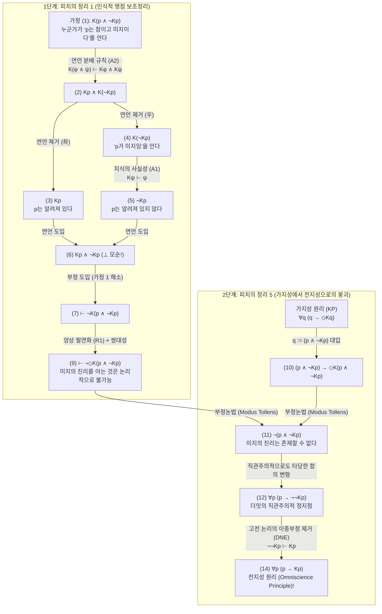
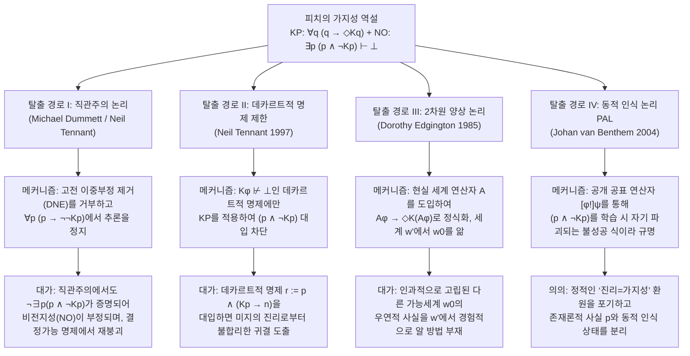

## 1. 서론: 형이상학적 실재론과 의미론적 반실재론의 단층선

“진리(Truth)”란 인간의 인식 능력이나 검증 절차로부터 완전히 독립하여 객관적 세계에 존재하는 것인가, 아니면 유한한 인식 주체가 “원리적으로 알 수 있는(knowable in principle)” 영역 내부에서만 성립하는 개념인가? 이 질문은 현대 분석철학, 언어철학, 형이상학, 수학철학을 양분해 온 가장 거대한 단층선—즉 <strong>형이상학적 실재론(Metaphysical Realism)</strong>과 <strong>의미론적 반실재론(Semantic Anti-Realism / 검증주의 Verificationism)</strong>의 대립축이다.

### 1.1 형이상학적 실재론: 인식을 초월한 진리
프레게(Gottlob Frege), 러셀(Bertrand Russell), 초기 퍼트넘(Hilary Putnam), 그리고 티모시 윌리엄슨(Timothy Williamson)이 옹호하는 <strong>형이상학적 실재론</strong>에 따르면, 명제 $p$의 참·거짓은 오직 객관적 세계의 존재론적 사태(states of affairs)에 의해서만 결정된다. 인식 양상 논리(Bimodal Epistemic-Alethic Logic)의 기호를 사용하여, $p$를 “명제 $p$가 참이다”, $Kp$를 “과거·현재·미래의 어느 시점에 누군가가 $p$를 안다”, $\Diamond\phi$를 “논리적·형이상학적으로 $\phi$가 가능하다”라고 표기할 때, 실재론의 핵심 공약은 <strong>인식 불가능한 진리(Unknowable Truths)</strong>의 존재를 긍정하는 것이다:

$$\text{Realism (Unknowable Truths)}: \quad \exists p \, \big( p \land \neg \Diamond K p \big)$$

예를 들어, “기원전 44년 3월 15일 브루투스에게 암살당하던 순간 율리우스 카이사르의 머리카락 개수는 홀수였다”라는 명제나, 우주론적 사건의 지평선 너머에서 일어난 특정 소립자의 붕괴 사건은, 설령 열역학적 비가역성과 정보 산일로 인해 인류가 영원히 검증할 수 없다 하더라도($\neg \Diamond K p$), 객관적으로는 확정적인 참 또는 거짓이다.

### 1.2 의미론적 반실재론과 가지성 원리(Knowability Principle, KP)
반면 퍼스(C.S. Peirce)의 프래그머티즘, 빈 학파의 논리실증주의, 후기 퍼트넘의 <strong>내재적 실재론(Internal Realism)</strong>, 그리고 <strong>마이클 더밋(Michael Dummett)</strong>의 의미론적 반실재론은 검증을 완전히 초월한 진리 개념을 거부한다. 더밋은 유명한 <strong>‘습득 논증(Acquisition Argument)’</strong>과 <strong>‘현시 논증(Manifestation Argument)’</strong>을 통해, 유한한 언어 사용자가 문장의 의미를 습득하고 실천적으로 현시하기 위해서는 진리 조건이 원리적인 인식 가능성(검증 가능성)과 개념적으로 결합되어 있어야 한다고 주장했다.

이로부터 반실재론의 근본 공리인 <strong>가지성 원리(Knowability Principle, KP)</strong>가 도출된다:

$$\text{KP (Knowability Principle)}: \quad \forall p \, \big( p \to \Diamond K p \big)$$

(“모든 명제 $p$에 대하여, 만약 $p$가 참이라면 누군가가 언젠가 $p$를 아는 것이 원리적으로 가능하다.”)

### 1.3 상식적 전제로서의 ‘비전지성 원리(NO)’와 피치의 폭탄
반실재론자가 인식 연산자 $K$ 앞에 양상 연산자 $\Diamond$(“가능하다”)를 삽입한 이유는 명확하다. 만약 $\Diamond$가 없다면 $\forall p \, (p \to K p)$, 즉 “모든 진리는 현실에서 실제로 알려져 있다”는 광신적인 관념론적 <strong>전지성 원리(Omniscience Principle, OP)</strong>가 되기 때문이다. 반실재론자 역시 인간이 유한한 존재이며 실제로 알려지지 않은 채 사라지는 진리가 무수히 많다는 상식적인 <strong>비전지성 원리(Non-Omniscience Principle, NO)</strong>를 당연한 사실로 받아들인다:

$$\text{NO (Non-Omniscience Principle)}: \quad \exists p \, \big( p \land \neg K p \big)$$

그런데 1963년 예일 대학교의 논리학자 <strong>프레더릭 피치(Frederic B. Fitch, 1908–1987)</strong>는 『기호논리학 저널』(*The Journal of Symbolic Logic*)에 발표한 논문 「어떤 가치 개념들의 논리적 분석」(*"A Logical Analysis of Some Value Concepts"*)의 정리 5(Theorem 5)에서 철학계를 뒤흔든 충격적인 정리를 증명했다:

> <strong>피치의 가지성 역설(Fitch's Paradox of Knowability)</strong>:
> 인식 논리의 가장 기본적이고 논란의 여지가 없는 최소 규칙(지식의 사실성과 연언 분배)과 고전 논리만을 전제하면, 온건해 보이는 <strong>가지성 원리 $\forall p \, (p \to \Diamond K p)$</strong>로부터 광신적인 <strong>전지성 원리 $\forall p \, (p \to K p)$</strong>가 순수한 연역만으로 직접 도출된다!
> 대우를 취하면, 만약 인간이 전지하지 않다면($\exists p \, (p \land \neg K p)$), <strong>원리적으로 그 누구도 절대 알 수 없는 불가지의 진리 $\exists q \, (q \land \neg \Diamond K q)$가 반드시 존재한다!</strong>

---

## 2. 역사적 기원: 알론조 처치의 1945년 익명 심사 보고서와 피치의 1963년 논문

피치는 1963년 논문 138쪽 각주 5(Footnote 5)에 다음과 같은 흥미로운 기록을 남겼다: *“정리 5의 증명은 1945년에 투고되었으나 출판되지 않은 논문의 익명 심사위원에 의해 저자에게 제안된 것이다.”*

60년 넘게 베일에 싸여 있던 이 ‘1945년의 익명 심사위원’의 정체는 철학자 조 살레르노(Joe Salerno, 2009년 『New Essays on the Knowability Paradox』 편저자)가 프린스턴 대학교 도서관 문서고에서 <strong>알론조 처치(Alonzo Church, 1903–1995)</strong>의 미공개 서한을 발굴하면서 밝혀졌다. 람다 대수($\lambda$-calculus)의 창시자이자 처치-튜링 논제로 유명한 수리논리학의 거장 알론조 처치가 바로 그 익명 심사위원이었던 것이다!

1945년 여름, 피치는 진리를 가지성($p \leftrightarrow \Diamond K p$)으로 정의하는 논문을 투고했고, 심사를 맡은 처치는 1945년 7월 심사 보고서에서 복합 명제 $q := (p \land \neg K p)$를 대입하면 $\neg(p \land \neg K p)$를 거쳐 $p \to K p$(전지성)로 붕괴한다는 완벽한 형식 증명을 제시했다. 이에 충격받은 피치는 1945년 논문을 철회했고, 18년 뒤인 1963년 처치의 증명을 일반화하여 정리 1과 정리 5로 출판했다.

---

## 3. 이양상 인식 논리(Bimodal Epistemic Logic)의 형식 구문론과 최소 공리계

언어 $\mathcal{L}_{K,\Box}$에서 $K\phi$는 특정 개인의 현재 지식이 아니라, 과거·현재·미래의 모든 시점 $t$와 모든 인식 주체 $x$에 걸친 지식의 총합으로 정의된다:

$$K\phi \stackrel{\text{def}}{\Longleftrightarrow} \exists x \in \text{Agents}, \, \exists t \in \text{Times} \, \big( K_{x,t} \phi \big)$$

피치의 역설이 갖는 무서운 파괴력은 <strong>KK 원리(양의 내성 공리 4: $K\phi \to KK\phi$)</strong>나 <strong>음의 내성 공리(Axiom 5: $\neg K\phi \to K\neg K\phi$)</strong>, 혹은 <strong>연역적 폐포(Axiom K: $K(\phi \to \psi) \to (K\phi \to K\psi)$)</strong> 같은 강한 공리를 <strong>전혀 사용하지 않는다</strong>는 데 있다. 오직 다음 3가지 최소 규칙만으로 증명이 완결된다:

1. <strong>(A1) 지식의 사실성(Factivity of Knowledge / 공리 T)</strong>:
   $$K\phi \vdash \phi$$
   (“알려진 것은 반드시 참이어야 한다. 거짓인 명제를 ‘안다’고 할 수는 없다.”)
2. <strong>(A2) 연언에 대한 지식의 분배 규칙(Conjunction Distribution)</strong>:
   $$K(\phi \land \psi) \vdash K\phi \land K\psi$$
   (“‘$\phi$이고 $\psi$이다’라는 연언 명제를 안다면, $\phi$를 알고 또한 $\psi$를 안다.”)
3. <strong>(R1) 양상 필연화 규칙(Modal Necessitation Rule)</strong>:
   $$\text{만약 } \vdash \phi \text{ 이면, } \vdash \Box\phi$$
   (“어떤 경험적 가정에도 의존하지 않는 논리적 정리 $\phi$는 모든 가능세계에서 필연적으로 참이다.”)

| 공리 및 규칙 명칭 | 형식 도식 | 직관적 의미 | 피치 증명에서의 필요 여부 |
| :--- | :--- | :--- | :--- |
| <strong>(A1) 지식의 사실성 (Axiom T)</strong> | $K\phi \vdash \phi$ | 참인 명제만이 지식이 될 수 있다 | <strong>필수 (핵심 공리)</strong> |
| <strong>(A2) 연언 분배 규칙 (Distribution)</strong> | $K(\phi \land \psi) \vdash K\phi \land K\psi$ | ‘$A$ 그리고 $B$’를 알면 $A$를 알고 $B$도 안다 | <strong>필수 (핵심 공리)</strong> |
| <strong>(R1) 양상 필연화 규칙</strong> | $\vdash \phi \implies \vdash \Box\phi$ | 논리적 정리는 모든 가능세계에서 필연적이다 | <strong>필수 (1단계에서 사용)</strong> |
| <strong>완전 연역적 폐포 (Axiom K)</strong> | $K(\phi \to \psi) \to (K\phi \to K\psi)$ | 논리적 귀결에 대한 완전한 지식 (논리적 전지) | <strong>불필요</strong> |
| <strong>양의 내성 공리 (KK 원리 / Axiom 4)</strong> | $K\phi \to KK\phi$ | 안다면 자신이 안다는 것을 안다 | <strong>불필요</strong> |
| <strong>음의 내성 공리 (Axiom 5)</strong> | $\neg K\phi \to K\neg K\phi$ | 모른다면 자신이 모른다는 것을 안다 | <strong>불필요</strong> |

---

## 4. 피치 역설의 단계별 완전 형식 증명(Step-by-Step Formal Proof)

### 4.1 1단계(피치의 정리 1): ‘알려지지 않은 진리’를 아는 것은 논리적으로 불가능하다
임의의 명제 $p$에 대하여 복합 연언 명제 $q \stackrel{\text{def}}{\equiv} (p \land \neg K p)$(“$p$는 참이지만, 그 누구에게도 알려져 있지 않다”)를 생각하자. 귀류법(부정 도입 규칙 $\neg$-Introduction)을 통해 <strong>그 누구도 $(p \land \neg K p)$를 알 수 없음</strong>을 증명한다.

| 행 번호 | 형식 논리식 | 적용된 추론 규칙 및 근거 | 의존 가정 |
| :---: | :--- | :--- | :---: |
| (1) | $K(p \land \neg K p)$ | <strong>귀류법 가정 (Assumption for Reductio)</strong> | $\{1\}$ |
| (2) | $K p \land K(\neg K p)$ | (1)에 <strong>(A2) 연언 분배 규칙</strong> $K(\phi \land \psi) \vdash K\phi \land K\psi$ 적용 | $\{1\}$ |
| (3) | $K p$ | (2)에 연언 제거 규칙($\land$-Elimination 좌) 적용 | $\{1\}$ |
| (4) | $K(\neg K p)$ | (2)에 연언 제거 규칙($\land$-Elimination 우) 적용 | $\{1\}$ |
| (5) | $\neg K p$ | (4)에 <strong>(A1) 지식의 사실성</strong> $K\psi \vdash \psi$ ($\psi := \neg K p$) 적용 | $\{1\}$ |
| (6) | $K p \land \neg K p \quad (\bot)$ | (3)과 (5)에 연언 도입 규칙 적용 (<strong>명시적 모순!</strong>) | $\{1\}$ |
| (7) | $\vdash \neg K(p \land \neg K p)$ | (1)–(6)으로부터 부정 도입($\neg$-Introduction, 가정 $\{1\}$ 해소) | $\emptyset$ |
| (8) | $\vdash \Box \neg K(p \land \neg K p)$ | 무가정 정리 (7)에 <strong>(R1) 양상 필연화 규칙</strong> 적용 | $\emptyset$ |
| (9) | $\vdash \neg \Diamond K(p \land \neg K p)$ | (8)에 양상 쌍대 정의 $\Box\neg\phi \equiv \neg\Diamond\phi$ 적용 | $\emptyset$ |

행 (9) $\vdash \neg \Diamond K(p \land \neg K p)$는 $(p \land \neg K p)$가 현실 세계에서 우연적으로 참일 수는 있어도, <strong>그것을 아는 것은 모든 가능세계에서 논리적으로 절대 불가능함</strong>을 보여준다.

### 4.2 2단계(피치의 정리 5): 가지성 원리(KP)에서 전지성 원리(OP)로의 붕괴
이제 반실재론의 <strong>가지성 원리(KP)</strong> $\forall q \, (q \to \Diamond K q)$에 $q := (p \land \neg K p)$를 대입한다:

| 행 번호 | 형식 논리식 | 적용된 추론 규칙 및 근거 | 논리적 성격 |
| :---: | :--- | :--- | :--- |
| (10) | $(p \land \neg K p) \to \Diamond K(p \land \neg K p)$ | <strong>가지성 원리 (KP)</strong> $\forall q (q \to \Diamond K q)$에 $q := (p \land \neg K p)$ 대입 | 전칭 예시화 (UI) |
| (11) | $\neg (p \land \neg K p)$ | (10)과 1단계 정리 (9) $\neg \Diamond K(p \land \neg K p)$에 <strong>부정논법(Modus Tollens)</strong> 적용 | <strong>직관주의 논리에서도 완전 타당!</strong> |
| (12) | $p \to \neg \neg K p$ | (11)에 명제 논리 동치 변형 $\neg(A \land \neg B) \vdash (A \to \neg\neg B)$ 적용 | <strong>직관주의 논리에서도 완전 타당!</strong> |
| (13) | $p \to K p$ | (12)의 후건에 <strong>고전 논리의 이중부정 제거(DNE)</strong> $\neg\neg K p \vdash K p$ 적용 | 고전 논리 DNE 사용 |
| (14) | $\forall p \, (p \to K p)$ | (13)에 전칭 일반화(Universal Generalization) 적용 | <strong>전지성 원리 (Omniscience Principle)!</strong> |

---

## 5. 구조적 진단: 무어의 역설, 인식적 맹점, 그리고 기습 시험의 역설

1. <strong>G.E. 무어의 역설(Moore's Paradox, 1942)의 보편화</strong>:
   무어의 문장 “밖에는 비가 오고 있지만, 나는 비가 오는지 모른다”($p \land \neg K_a p$)는 세계의 상태로는 완전히 무모순적이지만, 주체 $a$가 그것을 아는 순간 자기 논박(self-falsifying)을 일으킨다. 피치의 명제 $(p \land \neg K p)$는 인식 주체를 인류 전체로 확장함으로써 외부 관찰자의 존재 자체를 소거한 <strong>보편적 무어 문장</strong>이다.
2. <strong>로이 소렌슨의 ‘인식적 맹점(Epistemic Blindspots, 1988)’</strong>:
   참일 수 있으되($\Diamond\phi$) 결코 알 수 없는($\neg\Diamond K\phi$) 명제를 ‘인식적 맹점’이라 부른다. 지식 $K$는 대상을 수동적으로 비추는 거울이 아니라, 무지 상태($\neg K p$)를 앎($K p$)으로 전환시켜 원래 명제의 진리값을 파괴하는 <strong>비단조적(non-monotonic) 개입</strong>이다.
3. <strong>기습 시험의 역설(Surprise Examination Paradox) 및 괴델의 불완전성 정리</strong>:
   기습 시험 역설에서 학생이 금요일 시험($E_5 \land \neg K_{\text{Thu}} E_5$)을 불가능하다고 추론하는 오류는 목요일 밤의 인식적 맹점을 진리 자체의 불가능성과 혼동한 데서 비롯된다. 또한 형식 산술의 증명 가능성 술어 $\text{Prov}_T(\ulcorner \phi \urcorner)$는 뢰브의 정리(Löb's Theorem)에 의해 사실성 공리($\text{Prov}_T(\ulcorner \phi \urcorner) \to \phi$)를 일반적으로 증명할 수 없기에 전지성 붕괴를 피하지만, 지식 연산자 $K$는 사실성($K\phi \to \phi$)을 본질적 정의로 갖기 때문에 붕괴가 필연화된다.

---

## 6. 4대 철학적 탈출 경로와 그 대가

### 6.1 탈출 경로 I: 마이클 더밋과 직관주의 논리 (이중부정 제거 거부)
<strong>마이클 더밋(Michael Dummett, 2001, *"Victor's Error"*)</strong>은 피치 증명의 (1)행부터 (12)행까지는 직관주의 논리에서 완전히 타당하며, 오직 (12)행에서 (13)행으로 넘어가는 마지막 단계에서만 고전 논리의 <strong>이중부정 제거 규칙(DNE: $\neg\neg K p \vdash K p$)</strong>이 사용된다는 점에 주목했다. 반실재론자는 이미 직관주의 논리를 채택하고 있으므로, 피치 증명의 결론은 $\forall p \, (p \to \neg\neg K p)$(“어떤 진리도 영원히 알 수 없다고 판명될 수는 없다”)에서 멈춘다는 것이다.

<strong>티모시 윌리엄슨(Timothy Williamson, 1982, 2000)의 반박</strong>:
1. 이중부정 제거를 쓰지 않는 (11)행에서 이미 직관주의 정리로서 $\vdash_{\text{Int}} \neg \exists p \, (p \land \neg K p)$가 증명된다! 즉 직관주의 논리에서도 <strong>비전지성 원리(NO: “알려지지 않은 진리가 존재한다”)는 자기모순(거짓)으로 부정</strong>된다.
2. 인류의 역사가 유한하여 인류가 획득하는 지식의 총집합이 유한하다면, 임의의 명제 $p$에 대해 $K p \lor \neg K p$는 <strong>결정 가능한 명제(Decidable Proposition)</strong>가 되며, 결정 가능한 명제에 대해서는 직관주의에서도 $\neg\neg K p \vdash K p$가 성립하므로 다시 전지성($p \to K p$)으로 붕괴한다!

### 6.2 탈출 경로 II: 닐 테넌트의 ‘데카르트적 명제(Cartesian Propositions)’ 제한
<strong>닐 테넌트(Neil Tennant, 1997, *The Taming of the Sleuth*)</strong>는 앎의 가정 $K\phi$가 논리적 모순을 일으키지 않는 명제만을 <strong>데카르트적 명제($\text{Cartesian}(\phi) \iff K\phi \not\vdash \bot$)</strong>로 정의하고, 가지성 원리를 데카르트적 명제에만 제한했다:

$$\text{KP}_{\text{Tennant}}: \quad \forall \phi \, \Big( \text{Cartesian}(\phi) \implies \big( \phi \to \Diamond K \phi \big) \Big)$$

그러나 <strong>드비디와 솔로몬(DeVidi & Solomon, 2001)</strong> 및 윌리엄슨은 $r \stackrel{\text{def}}{\equiv} p \land (K p \to n)$이라는 반례를 구성했다. $r$은 데카르트적 명제($K r \vdash K p \land n \not\vdash \bot$)이지만, 미지의 진리 $p \land \neg K p$가 성립할 때 $r$을 $\text{KP}_{\text{Tennant}}$에 대입하면 $(p \land \neg K p) \to \Diamond(K p \land n)$이 도출되어 역설이 재발한다!

### 6.3 탈출 경로 III: 도로시 에징턴의 2차원 양상 논리와 현실 연산자 $\mathcal{A}$ (`@`)
<strong>도로시 에징턴(Dorothy Edgington, 1985, *"The Paradox of Knowability"*)</strong>은 2차원 양상 논리의 <strong>현실 세계 연산자(Actuality Operator) $\mathcal{A}$</strong>($\mathcal{M}, w' \models \mathcal{A}\phi \iff \mathcal{M}, w_0 \models \phi$)를 도입하여 가지성 원리를 재정식화했다:

$$\text{KP}_{\text{Edg}}: \quad \forall \phi \, \Big( \mathcal{A}\phi \to \Diamond K(\mathcal{A}\phi) \Big)$$

즉 현실 세계 $w_0$에서 $p$가 참이고 아무도 $p$를 모른다는 사실 $\mathcal{A}(p \land \neg K p)$를, <strong>다른 반사실적 가능세계 $w'$에 있는 관찰자가 아는 것($K_{w'} \mathcal{A}(p \land \neg K p)$)</strong>은 논리적으로 전혀 모순되지 않는다! 하지만 윌리엄슨은 인과적으로 완전히 단절된 다른 가능세계 $w_0$의 우연적 사태에 대해 세계 $w'$의 행위자가 어떻게 경험적 지식을 획득할 수 있는지 설명할 수 없다고 비판했다.

### 6.4 탈출 경로 IV: 동적 인식 논리(DEL)와 공개 공표 논리(PAL)
<strong>요한 판 벤템(Johan van Benthem, 2004)</strong>은 <strong>공개 공표 논리(Public Announcement Logic, PAL)</strong>의 동적 연산자 $[\phi!]\psi$를 통해, $(p \land \neg K p)$가 참으로 공표(학습)되는 순간 주체가 $K p$를 획득하여 $\neg K p$가 거짓으로 바뀌는 <strong>‘불성공 논리식(Unsuccessful Formula / 자기 파괴적 업데이트)’</strong>임을 규명했다:

$$\mathcal{M}, w \models (p \land \neg K p), \quad \text{그러나} \quad \mathcal{M}, w \models [p \land \neg K p !] \Big( K p \land \neg(p \land \neg K p) \Big)$$

---

## 7. 종합 비교 매트릭스 및 철학적 결론

| 이론적 입장 / 제창자 | 가지성 원리 정식화 / 논리 체계 | 역설 차단 메커니즘 | 치명적 한계 및 철학적 대가 |
| :--- | :--- | :--- | :--- |
| <strong>소박한 반실재론</strong> (초기 검증주의) | $\forall p \, (p \to \Diamond K p)$ (고전 이양상 논리) | <strong>차단 불가</strong>: $q := p \land \neg K p$ 대입으로 $\forall p (p \to K p)$ 도출 | 인간이 <strong>전지(Omniscient)</strong>하다는 불합리에 직결 |
| <strong>직관주의적 반실재론</strong> (Dummett 2001) | $\forall p \, (p \to \Diamond K p)$ (직관주의 논리: $\neg\neg\phi \not\vdash \phi$) | 고전 DNE를 거부하고 $\forall p (p \to \neg\neg K p)$에서 정지 | $\vdash_{\text{Int}} \neg\exists p(p \land \neg K p)$가 증명되어 비전지성(NO)이 부정됨 |
| <strong>데카르트적 명제 제한</strong> (Tennant 1997) | $\forall \phi \, (\text{Cartesian}(\phi) \to (\phi \to \Diamond K \phi))$ 단, $K\phi \not\vdash \bot$ | $K(p \land \neg K p) \vdash \bot$이므로 대입 대상에서 제외 | 데카르트적 명제 $r := p \land (K p \to n)$에 의해 돌파됨 (DeVidi & Solomon) |
| <strong>2차원 양상 논리</strong> (Edgington 1985) | $\forall \phi \, (\mathcal{A}\phi \to \Diamond K(\mathcal{A}\phi))$ (현실 연산자 $\mathcal{A}$ 도입) | 현실 세계 $w_0$의 미지의 진리를 가능세계 $w'$에서 인식 | 인과적으로 단절된 가능세계 간의 경험적 지식 불가능성 |
| <strong>동적 인식 논리 (PAL)</strong> (van Benthem 2004) | $\forall p_{\text{ontic}} \, (p \to \Diamond \langle \psi! \rangle K p)$ (공개 공표 연산자 $[\phi!]\psi$) | $(p \land \neg K p)$를 공표 시 거짓이 되는 ‘불성공 논리식’으로 규명 | 모든 진리가 정적으로 가지적이라는 반실재론 테제 자체는 포기해야 함 |

<strong>결론</strong>: 인간이 유한하여 영원히 알지 못한 채 남는 진리가 단 하나라도 존재한다면($\exists p \, (p \land \neg K p)$), 피치의 정리 1($\vdash \neg \Diamond K(p \land \neg K p)$)에 의해 <strong>참이면서 원리적으로도 절대 알 수 없는 진리($\exists q \, (q \land \neg \Diamond K q)$)가 필연적으로 존재한다</strong>. 진리는 원리적인 인식 가능성으로 환원될 수 없으며, 실재(Reality)는 필연적으로 인간 인식의 한계를 초월한다.

---

## 참고문헌 (References)

* Fitch, F. B. (1963). "A Logical Analysis of Some Value Concepts". *The Journal of Symbolic Logic*, 28(2), 135–142.
* Salerno, J. (Ed.). (2009). *New Essays on the Knowability Paradox*. Oxford University Press.
* Dummett, M. (2001). "Victor's Error". *Analysis*, 61(269), 1–2.
* Williamson, T. (2000). *Knowledge and Its Limits*. Oxford University Press.
* Edgington, D. (1985). "The Paradox of Knowability". *Mind*, 94(376), 557–568.
* Tennant, N. (1997). *The Taming of the Sleuth*. Oxford University Press.
* van Benthem, J. (2004). "What One May Come to Know". *Analysis*, 64(282), 95–105.
