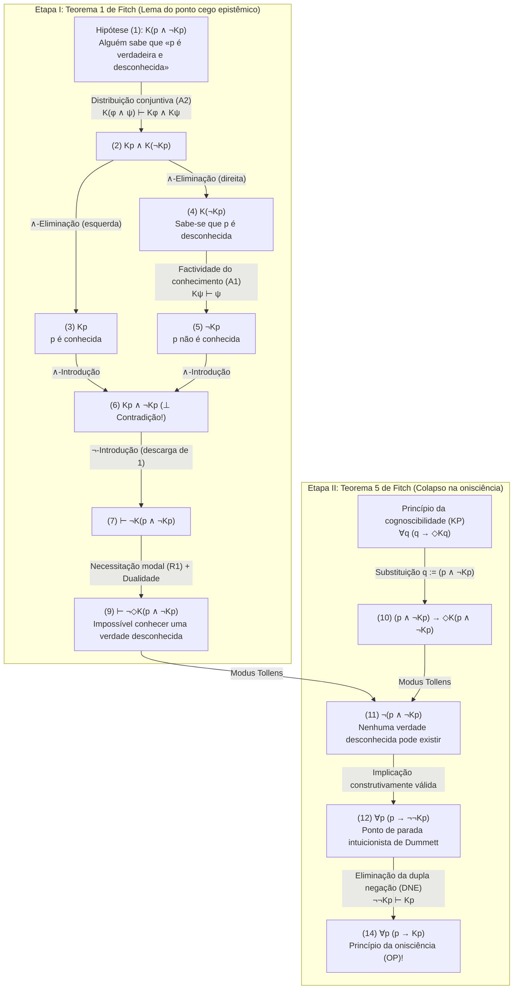
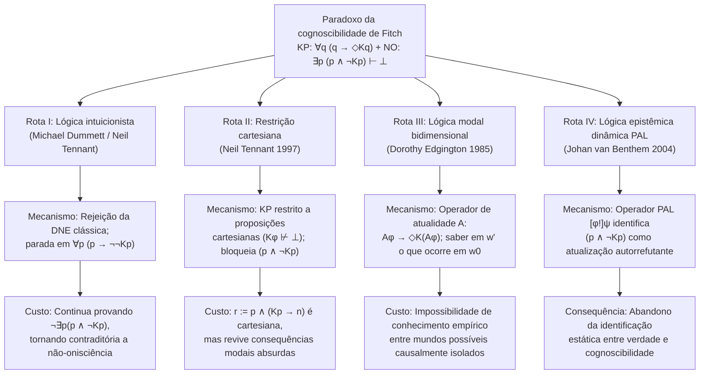

## 1. Introdução: A linha de falha epistemológica entre o realismo metafísico e o antirrealismo semântico

Pode uma proposição ser determinadamente verdadeira mesmo que nenhuma mente finita jamais pudesse — nem mesmo em princípio — verificá-la, descobri-la ou conhecê-la?

Essa questão define a mais profunda linha de fratura na metafísica, epistemologia, filosofia da linguagem e filosofia da matemática contemporâneas: o embate entre o <strong>realismo metafísico (Metaphysical Realism)</strong> e o <strong>antirrealismo semântico (Semantic Anti-Realism / Verificacionismo)</strong>.

### 1.1 O compromisso do realismo metafísico
Segundo o <strong>realismo metafísico</strong> — defendido por Gottlob Frege, Bertrand Russell, o jovem Hilary Putnam e Timothy Williamson —, a verdade transcende radicalmente nossas capacidades de reconhecimento (<strong>recognition-transcendent truth</strong>). Na linguagem formal da lógica bimodal epistêmico-alética, denotando por $p$ que a proposição $p$ é verdadeira, por $Kp$ que «alguém em algum momento (passado, presente ou futuro) conhece $p$», e por $\Diamond\phi$ que «é lógica ou metafisicamente possível que $\phi$», o realismo afirma a existência de <strong>verdades incognoscíveis</strong>:

$$\text{Realismo (Verdades incognoscíveis)}: \quad \exists p \, \big( p \land \neg \Diamond K p \big)$$

Exemplos clássicos incluem micro-fatos históricos irremediavelmente dissipados pela entropia (como se o número de fios de cabelo na cabeça de Júlio César no exato instante em que Brutus o apunhalou em 44 a.C. era ímpar), eventos quânticos além do horizonte de eventos cosmológico ou proposições matemáticas indecidíveis.

### 1.2 O antirrealismo semântico e o princípio da cognoscibilidade (KP)
Em contrapartida, a tradição do <strong>verificacionismo, do pragmatismo e do antirrealismo semântico</strong> — de C.S. Peirce e do Círculo de Viena até o <strong>realismo interno</strong> de Putnam e o antirrealismo intuicionista de <strong>Michael Dummett</strong> — rejeita a noção de uma verdade absolutamente inacessível à verificação. Por meio de seus célebres <strong>argumentos da aquisição (Acquisition Argument)</strong> e <strong>da manifestação (Manifestation Argument)</strong>, Dummett sustentou que falantes finitos só podem aprender e manifestar a compreensão do significado de uma sentença se suas condições de verdade estiverem constitutivamente ligadas à cognoscibilidade em princípio.

Isso resulta no axioma central do antirrealismo moderno, o <strong>princípio da cognoscibilidade (Knowability Principle, KP)</strong>:

$$\text{KP (Princípio da cognoscibilidade)}: \quad \forall p \, \big( p \to \Diamond K p \big)$$

(«Para toda proposição $p$, se $p$ é verdadeira, então é possível que alguém em algum momento conheça $p$.»)

### 1.3 O princípio da não-onisciência (NO) e a bomba lógica de Fitch
O antirrealista não é um idealista subjetivo que afirme $\forall p \, (p \to K p)$ («toda verdade é efetivamente conhecida»). Todo antirrealista aceita como evidente o <strong>princípio da não-onisciência (Non-Omniscience Principle, NO)</strong>:

$$\text{NO (Princípio da não-onisciência)}: \quad \exists p \, \big( p \land \neg K p \big)$$

Contudo, em 1963, o lógico de Yale <strong>Frederic B. Fitch (1908–1987)</strong> publicou no *The Journal of Symbolic Logic* o artigo *"A Logical Analysis of Some Value Concepts"*, cujo Teorema 5 destruiu a compatibilidade entre KP e NO:

> <strong>Paradoxo da cognoscibilidade de Fitch (1963)</strong>:
> Usando apenas as regras de inferência mais fracas e consensuais da lógica epistêmica modal — a <strong>factividade do conhecimento</strong> e a <strong>distribuição sobre a conjunção</strong> —, o modesto <strong>princípio da cognoscibilidade $\forall p \, (p \to \Diamond K p)$</strong> implica diretamente na lógica clássica o absurdo <strong>princípio da onisciência $\forall p \, (p \to K p)$</strong>!
> Por contraposição, se os seres humanos não são oniscientes ($\exists p \, (p \land \neg K p)$), então existe necessariamente pelo menos uma verdade que é logicamente impossível que alguém jamais venha a conhecer ($\exists q \, (q \land \neg \Diamond K q)$).

---

## 2. Gênese histórica: O parecer anônimo de Alonzo Church (1945) e o artigo de Fitch (1963)

Na nota de rodapé 5 (p. 138) de seu artigo de 1963, Fitch atribuiu a demonstração do Teorema 5 a *«um parecerista anônimo de um artigo submetido em 1945, mas nunca publicado»*.

O mistério foi solucionado por Joe Salerno (2009, *New Essays on the Knowability Paradox*) nos arquivos da Universidade de Princeton: o parecerista anônimo de 1945 era ninguém menos que <strong>Alonzo Church (1903–1995)</strong>, o criador do $\lambda$-cálculo! Em julho de 1945, ao avaliar um manuscrito de Fitch que identificava verdade e cognoscibilidade, Church demonstrou que basta substituir a conjunção $q := (p \land \neg K p)$ em $\forall q \, (q \to \Diamond K q)$ para deduzir $\neg(p \land \neg K p)$, colapsando a cognoscibilidade potencial na onisciência atual ($\forall p (p \to K p)$).

---

## 3. Sintaxe formal e sistema axiomático mínimo da lógica bimodal

Na linguagem bimodal $\mathcal{L}_{K,\Box}$, o operador epistêmico $K\phi$ expressa o conhecimento coletivo e onitemporal:

$$K\phi \stackrel{\text{def}}{\Longleftrightarrow} \exists x \in \text{Agents}, \, \exists t \in \text{Times} \, \big( K_{x,t} \phi \big)$$

A prova de Fitch <strong>não requer nenhum axioma epistêmico forte</strong> como o <strong>princípio KK (Axioma 4: $K\phi \to KK\phi$)</strong>, a <strong>introspecção negativa (Axioma 5: $\neg K\phi \to K\neg K\phi$)</strong> ou o <strong>fechamento dedutivo completo (Axioma K: $K(\phi \to \psi) \to (K\phi \to K\psi)$)</strong>. Ela utiliza apenas três princípios mínimos:

1. <strong>(A1) Factividade do conhecimento (Axioma T)</strong>:
   $$K\phi \vdash \phi$$
   («O que é conhecido deve ser verdadeiro; não é possível conhecer o falso.»)
2. <strong>(A2) Distribuição do conhecimento sobre a conjunção</strong>:
   $$K(\phi \land \psi) \vdash K\phi \land K\psi$$
   («Quem conhece a conjunção "$\phi$ e $\psi$", conhece $\phi$ e conhece $\psi$.»)
3. <strong>(R1) Regra de necessitação modal (Modal Necessitation Rule)</strong>:
   $$\text{Se } \vdash \phi, \quad \text{então } \vdash \Box\phi$$
   («Todo teorema lógico é necessariamente verdadeiro em todos os mundos possíveis», com a dualidade $\Box\neg\phi \equiv \neg\Diamond\phi$).

| Princípio / Regra | Esquema formal | Significado filosófico | Necessário para Fitch? |
| :--- | :--- | :--- | :--- |
| <strong>(A1) Factividade (Axioma T)</strong> | $K\phi \vdash \phi$ | Apenas proposições verdadeiras podem ser conhecidas | <strong>SIM (Essencial)</strong> |
| <strong>(A2) Distribuição conjuntiva</strong> | $K(\phi \land \psi) \vdash K\phi \land K\psi$ | Conhecer «$A$ e $B$» implica conhecer $A$ e conhecer $B$ | <strong>SIM (Essencial)</strong> |
| <strong>(R1) Necessitação modal</strong> | $\vdash \phi \implies \vdash \Box\phi$ | Teoremas lógicos são necessários | <strong>SIM (Essencial)</strong> |
| <strong>Fechamento dedutivo completo (Axioma K)</strong> | $K(\phi \to \psi) \to (K\phi \to K\psi)$ | Onisciência lógica sob implicação | <strong>NÃO</strong> |
| <strong>Introspecção positiva (KK / Axioma 4)</strong> | $K\phi \to KK\phi$ | Saber implica saber que se sabe | <strong>NÃO</strong> |
| <strong>Introspecção negativa (Axioma 5)</strong> | $\neg K\phi \to K\neg K\phi$ | Ignorar implica saber que se ignora | <strong>NÃO</strong> |

---

## 4. Derivação formal passo a passo do paradoxo de Fitch

### 4.1 Etapa I (Teorema 1 de Fitch): A impossibilidade lógica de conhecer uma verdade desconhecida
Seja $q \stackrel{\text{def}}{\equiv} (p \land \neg K p)$ («$p$ é verdadeira, mas ninguém jamais conhece $p$»). Provamos por *reductio ad absurdum* ($\neg$-Introdução) que ninguém pode conhecer $q$:

| Linha | Fórmula | Justificativa / Regra de inferência | Hipóteses abertas |
| :---: | :--- | :--- | :---: |
| (1) | $K(p \land \neg K p)$ | <strong>Hipótese para Reductio</strong> | $\{1\}$ |
| (2) | $K p \land K(\neg K p)$ | De (1) por <strong>(A2) Distribuição sobre a conjunção</strong> $K(\phi \land \psi) \vdash K\phi \land K\psi$ | $\{1\}$ |
| (3) | $K p$ | De (2) por $\land$-Eliminação (esquerda) | $\{1\}$ |
| (4) | $K(\neg K p)$ | De (2) por $\land$-Eliminação (direita) | $\{1\}$ |
| (5) | $\neg K p$ | De (4) por <strong>(A1) Factividade do conhecimento</strong> $K\psi \vdash \psi$ ($\psi := \neg K p$) | $\{1\}$ |
| (6) | $K p \land \neg K p \quad (\bot)$ | De (3) e (5) por $\land$-Introdução (<strong>Contradição explícita!</strong>) | $\{1\}$ |
| (7) | $\vdash \neg K(p \land \neg K p)$ | De (1)–(6) por $\neg$-Introdução (descarregando a hipótese $\{1\}$) | $\emptyset$ |
| (8) | $\vdash \Box \neg K(p \land \neg K p)$ | Do teorema (7) por <strong>(R1) Necessitação modal</strong> | $\emptyset$ |
| (9) | $\vdash \neg \Diamond K(p \land \neg K p)$ | De (8) por dualidade modal ($\Box\neg\phi \equiv \neg\Diamond\phi$) | $\emptyset$ |

A linha (9) $\vdash \neg \Diamond K(p \land \neg K p)$ demonstra que <strong>é logicamente impossível jamais conhecer uma verdade desconhecida</strong>.

### 4.2 Etapa II (Teorema 5 de Fitch): O colapso da cognoscibilidade (KP) na onisciência (OP)
Substituímos agora $q := (p \land \neg K p)$ no <strong>princípio da cognoscibilidade (KP)</strong> $\forall q \, (q \to \Diamond K q)$:

| Linha | Fórmula | Justificativa / Regra de inferência | Status lógico |
| :---: | :--- | :--- | :--- |
| (10) | $(p \land \neg K p) \to \Diamond K(p \land \neg K p)$ | Instanciação universal de <strong>KP</strong> com $q := (p \land \neg K p)$ | Instância de KP |
| (11) | $\neg (p \land \neg K p)$ | De (10) e do teorema (9) $\neg \Diamond K(p \land \neg K p)$ por <strong>Modus Tollens</strong> | <strong>Intuicionistamente válido!</strong> |
| (12) | $p \to \neg \neg K p$ | De (11) por equivalência proposicional $\neg(A \land \neg B) \vdash (A \to \neg\neg B)$ | <strong>Intuicionistamente válido!</strong> |
| (13) | $p \to K p$ | De (12) por <strong>eliminação clássica da dupla negação (DNE)</strong> $\neg\neg K p \vdash K p$ | Usa DNE clássica |
| (14) | $\forall p \, (p \to K p)$ | De (13) por Generalização universal | <strong>Princípio da onisciência (OP)!</strong> |

---

## 5. Diagnóstico estrutural: O paradoxo de Moore, os pontos cegos epistêmicos e o exame surpresa

1. <strong>O paradoxo de G.E. Moore (1942)</strong>: A sentença *«Está chovendo lá fora, mas eu não sei que está chovendo»* ($p \land \neg K_a p$) é ontologicamente consistente, mas epistemicamente incognoscível em primeira pessoa. Ao quantificar $K$ sobre todos os agentes e tempos, $(p \land \neg K p)$ torna-se uma <strong>sentença de Moore universalizada</strong> sem observador externo possível.
2. <strong>Os pontos cegos epistêmicos (*Blindspots*) de Roy Sorensen (1988)</strong>: $(p \land \neg K p)$ é um ponto cego epistêmico ($\Diamond\phi \land \neg\Diamond K\phi$): o próprio ato de adquirir o conhecimento $K p$ altera o estado epistêmico do mundo e falsifica o segundo conjunto $\neg K p$.
3. <strong>Paradoxo do exame surpresa e teorema da incompletude de Gödel</strong>: No exame surpresa, os alunos confundem a verdade de $(E_5 \land \neg K_{\text{Qui}} E_5)$ com sua cognoscibilidade na noite de quinta-feira $K_{\text{Qui}}(E_5 \land \neg K_{\text{Qui}} E_5)$. Na aritmética formal, o teorema de Löb impede que o predicado de demonstrabilidade $\text{Prov}_T(\ulcorner \phi \urcorner)$ satisfaça universalmente a factividade ($\text{Prov}_T(\ulcorner \phi \urcorner) \to \phi$), enquanto o conhecimento genuíno $K$ é incondicionalmente factivo.

---

## 6. As quatro grandes rotas de fuga filosóficas e seus custos

### 6.1 Rota I: Michael Dummett e a lógica intuicionista
<strong>Michael Dummett (2001, *"Victor's Error"*)</strong> e <strong>Neil Tennant</strong> observaram que as linhas (1) a (12) são inteiramente válidas na <strong>lógica intuicionista</strong>. A lógica clássica só intervém na passagem de (12) para (13) mediante a <strong>eliminação da dupla negação (DNE: $\neg\neg K p \vdash K p$)</strong>. Sem DNE, a derivação estaciona em:

$$\forall p \, \big( p \to \neg\neg K p \big) \quad \text{e} \quad \forall p \, \neg(p \land \neg K p)$$

<strong>A contracrítica de Timothy Williamson (1982, 2000)</strong>:
1. Mesmo na lógica intuicionista, a linha (11) demonstra $\vdash_{\text{Int}} \neg \exists p \, (p \land \neg K p)$, de modo que <strong>o princípio da não-onisciência (NO) torna-se contraditório (falso) também para o intuicionista</strong>!
2. Para proposições decidíveis ($K p \lor \neg K p$), $\neg\neg K p \vdash_{\text{Int}} K p$ é válido intuicionistamente, fazendo ressurgir o colapso em $p \to K p$.

### 6.2 Rota II: A restrição de Neil Tennant às «proposições cartesianas»
<strong>Neil Tennant (1997, *The Taming of the Sleuth*)</strong> restringe KP às <strong>proposições cartesianas</strong> ($\text{Cartesian}(\phi) \iff K\phi \not\vdash \bot$):

$$\text{KP}_{\text{Cart}}: \quad \forall \phi \, \Big( \text{Cartesian}(\phi) \implies \big( \phi \to \Diamond K \phi \big) \Big)$$

<strong>Contraexemplo de DeVidi & Solomon (2001) e Williamson</strong>: A proposição composta $r \stackrel{\text{def}}{\equiv} p \land (K p \to n)$ é <strong>cartesiana</strong> ($K r \not\vdash \bot$), mas ao ser substituída em $\text{KP}_{\text{Cart}}$ sob a hipótese $p \land \neg K p$ implica $\Diamond(K p \land n)$, reativando o paradoxo!

### 6.3 Rota III: A lógica modal bidimensional de Dorothy Edgington ($\mathcal{A}$ / `@`)
<strong>Dorothy Edgington (1985, *"The Paradox of Knowability"*, *Mind*)</strong> introduz o <strong>operador de atualidade $\mathcal{A}$ («Actually»)</strong> ($\mathcal{M}, w' \models \mathcal{A}\phi \iff \mathcal{M}, w_0 \models \phi$):

$$\text{KP}_{\text{Edg}}: \quad \forall \phi \, \Big( \mathcal{A}\phi \to \Diamond K(\mathcal{A}\phi) \Big)$$

Em um mundo possível contrafactual $w'$, um agente pode saber sem contradição que no mundo atual $w_0$, $p$ é verdadeira e ninguém em $w_0$ a conhece ($K_{w'}(\mathcal{A} p) \land \neg \mathcal{A} K p$). Crítica de Williamson: Como pode um agente em um mundo $w'$ causalmente isolado de $w_0$ obter conhecimento empírico sobre fatos contingentes de $w_0$?

### 6.4 Rota IV: Lógica epistêmica dinâmica (DEL) e lógica de anúncios públicos (PAL)
<strong>Johan van Benthem (2004)</strong> demonstra mediante o operador dinâmico $[\phi!]\psi$ que $(p \land \neg K p)$ é uma <strong>«fórmula malsucedida» (Unsuccessful Formula)</strong> que se falsifica a si mesma no instante em que é anunciada ou aprendida: $\mathcal{M}, w \models [p \land \neg K p !] \neg(p \land \neg K p)$.

---

## 7. Matriz comparativa e conclusão filosófica

| Posição filosófica | Princípio formal / Lógica | Mecanismo de bloqueio | Vulnerabilidade fatal / Custo |
| :--- | :--- | :--- | :--- |
| <strong>Antirrealismo ingênuo</strong> | $\forall p \, (p \to \Diamond K p)$ (Clássica) | <strong>Nenhum</strong>: Colapsa em $\forall p (p \to K p)$ | Implica a <strong>onisciência humana (OP)</strong> |
| <strong>Antirrealismo intuicionista</strong> (Dummett 2001) | $\forall p \, (p \to \Diamond K p)$ (Intuicionista) | Rejeita DNE ($\neg\neg K p \not\vdash K p$); para em $p \to \neg\neg K p$ | Refuta $\exists p (p \land \neg K p)$; colapsa se $K p$ for decidível |
| <strong>Restrição cartesiana</strong> (Tennant 1997) | $\text{Cartesian}(\phi) \to (\phi \to \Diamond K \phi)$ | Exclui $(p \land \neg K p)$ porque $K(p \land \neg K p) \vdash \bot$ | Superada por $r := p \land (K p \to n)$ |
| <strong>Lógica bidimensional</strong> (Edgington 1985) | $\forall \phi \, (\mathcal{A}\phi \to \Diamond K(\mathcal{A}\phi))$ | Separa o mundo da verdade ($w_0$) e o do saber ($w'$) | Mistério do conhecimento empírico trans-mundano |
| <strong>Lógica dinâmica (PAL)</strong> (van Benthem 2004) | Anúncio público $[\phi!]\psi$ | Identifica $(p \land \neg K p)$ como fórmula malsucedida | Renuncia ao antirrealismo semântico estático |

<strong>Conclusão</strong>: Se aceitamos nossa finitude cognitiva ($\exists p \, (p \land \neg K p)$), o Teorema 1 de Fitch ($\vdash \neg \Diamond K(p \land \neg K p)$) nos obriga por pura lógica a aceitar o <strong>realismo metafísico</strong>:

$$\exists p \, (p \land \neg K p) \quad \vdash \quad \exists q \, \big( q \land \neg \Diamond K q \big)$$

---

## Referências

* Fitch, F. B. (1963). "A Logical Analysis of Some Value Concepts". *The Journal of Symbolic Logic*, 28(2), 135–142.
* Salerno, J. (Ed.). (2009). *New Essays on the Knowability Paradox*. Oxford University Press.
* Dummett, M. (2001). "Victor's Error". *Analysis*, 61(269), 1–2.
* Williamson, T. (2000). *Knowledge and Its Limits*. Oxford University Press.
* Edgington, D. (1985). "The Paradox of Knowability". *Mind*, 94(376), 557–568.
* Tennant, N. (1997). *The Taming of the Sleuth*. Oxford University Press.
* van Benthem, J. (2004). "What One May Come to Know". *Analysis*, 64(282), 95–105.
