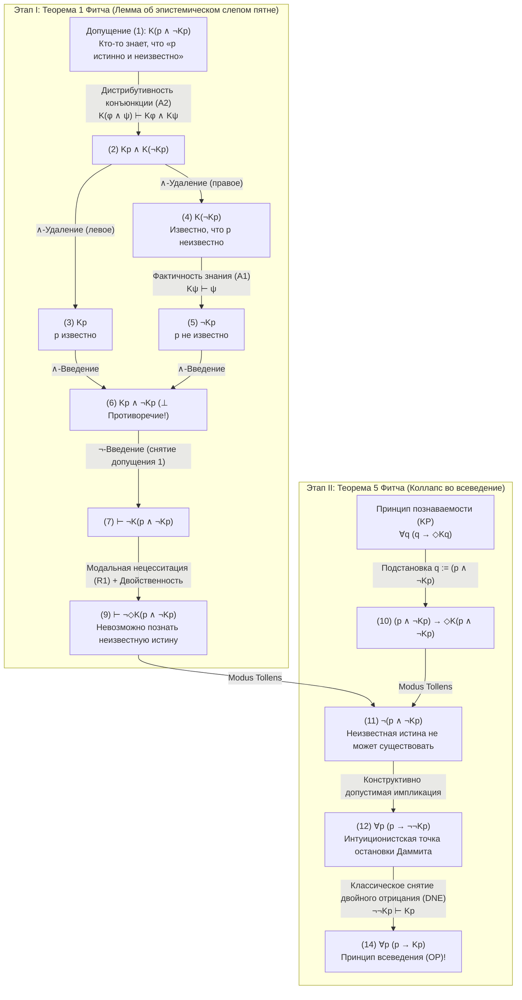
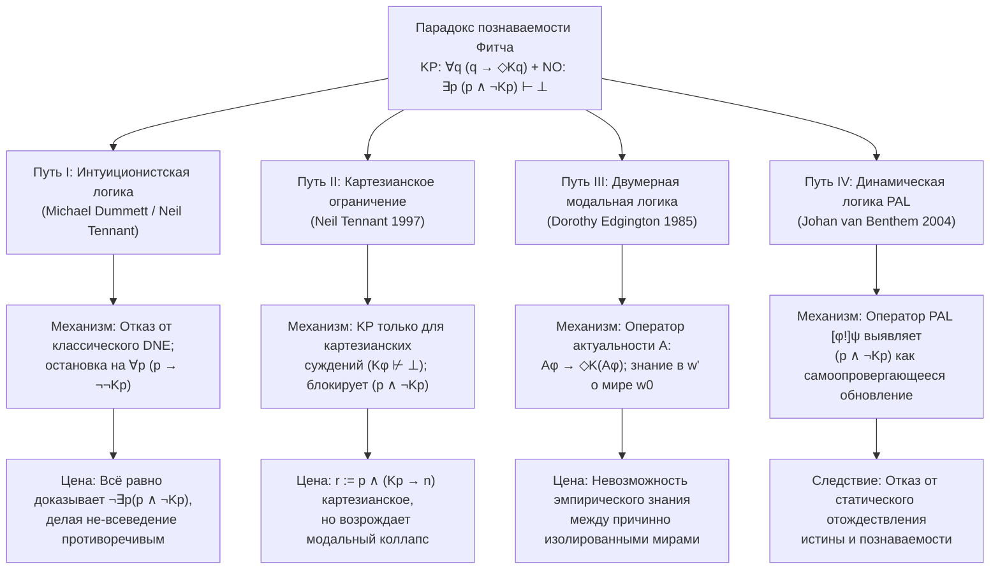

## 1. Введение: Эпистемологический разлом между метафизическим реализмом и семантическим антиреализмом

Может ли суждение быть объективно истинным, даже если ни один конечный разум никогда — даже в принципе — не сможет его проверить, открыть или узнать?

Этот вопрос определяет глубочайший разлом в современной метафизике, эпистемологии, философии языка и философии математики: противостояние между <strong>метафизическим реализмом (Metaphysical Realism)</strong> и <strong>семантическим антиреализмом (Semantic Anti-Realism / верификационизмом)</strong>.

### 1.1 Позиция метафизического реализма
Согласно <strong>метафизическому реализму</strong> — который отстаивали Готлоб Фреге, Бертран Рассел, ранний Хилари Патнэм и Тимоти Уильямсон — истина радикально <strong>трансцендентна по отношению к познанию (recognition-transcendent truth)</strong>. В формальном языке бимодальной эпистемическо-алетической логики, где $p$ означает «суждение $p$ истинно», $Kp$ — «кто-то в некоторый момент времени (в прошлом, настоящем или будущем) знает $p$», а $\Diamond\phi$ — «логически или метафизически возможно, что $\phi$», реализм утверждает существование <strong>непознаваемых истин</strong>:

$$\text{Реализм (Непознаваемые истины)}: \quad \exists p \, \big( p \land \neg \Diamond K p \big)$$

Примерами служат безвозвратно утраченные микроисторические факты (например, «Число волос на голове Юлия Цезаря в точный момент удара кинжалом Брута в 44 году до н. э. было нечётным»), квантовые события за космологическим горизонтом событий или неразрешимые математические утверждения.

### 1.2 Семантический антиреализм и принцип познаваемости (KP)
Напротив, традиция <strong>верификационизма, прагматизма и семантического антиреализма</strong> — от Ч. С. Пирса и Венского кружка до <strong>внутреннего реализма</strong> Патнэма и интуиционистского антиреализма <strong>Майкла Даммита</strong> — отвергает понятие абсолютно неверифицируемой истины. Опираясь на знаменитые <strong>аргумент усвоения (Acquisition Argument)</strong> и <strong>аргумент проявления (Manifestation Argument)</strong>, Даммит доказывал, что конечные носители языка могут усвоить и проявить понимание смысла предложения лишь тогда, когда условия его истинности конститутивно связаны с принципиальной познаваемостью.

Это выражается в фундаментальной аксиоме современного антиреализма — <strong>принципе познаваемости (Knowability Principle, KP)</strong>:

$$\text{KP (Принцип познаваемости)}: \quad \forall p \, \big( p \to \Diamond K p \big)$$

(«Для любого суждения $p$: если $p$ истинно, то принципиально возможно, что кто-то когда-нибудь узнает $p$.»)

### 1.3 Принцип не-всеведения (NO) и логическая бомба Фитча
Антиреалист вовсе не является субъективным идеалистом, утверждающим $\forall p \, (p \to K p)$ («все истины актуально известны»). Признавая конечность человека, каждый антиреалист принимает очевидный <strong>принцип не-всеведения (Non-Omniscience Principle, NO)</strong>:

$$\text{NO (Принцип не-всеведения)}: \quad \exists p \, \big( p \land \neg K p \big)$$

Однако в 1963 году йельский логик <strong>Фредерик Б. Фитч (Frederic B. Fitch, 1908–1987)</strong> опубликовал в *The Journal of Symbolic Logic* статью *"A Logical Analysis of Some Value Concepts"*, в Теореме 5 которой доказал ошеломляющий результат:

> <strong>Парадокс познаваемости Фитча (1963)</strong>:
> Используя лишь самые слабые и бесспорные правила вывода модальной эпистемической логики — <strong>фактичность знания</strong> и <strong>дистрибутивность относительно конъюнкции</strong> — умеренный <strong>принцип познаваемости $\forall p \, (p \to \Diamond K p)$</strong> в классической логике напрямую влечёт абсурдный <strong>принцип всеведения $\forall p \, (p \to K p)$</strong>!
> По контрапозиции: если человечество не всеведуще ($\exists p \, (p \land \neg K p)$), то с логической необходимостью существует истина, которую невозможно познать даже в принципе ($\exists q \, (q \land \neg \Diamond K q)$).

---

## 2. Исторический генезис: Анонимная рецензия Алонзо Чёрча (1945) и статья Фитча (1963)

В сноске 5 (стр. 138) своей статьи 1963 года Фитч отметил, что доказательство Теоремы 5 было предложено ему *«анонимным рецензентом статьи, поданной в 1945 году, но так и не опубликованной»*.

Эта историческая загадка была разгадана Джо Салерно (Joe Salerno, 2009, *New Essays on the Knowability Paradox*) в архивах Принстонского университета: анонимным рецензентом 1945 года оказался сам <strong>Алонзо Чёрч (Alonzo Church, 1903–1995)</strong> — создатель $\lambda$-исчисления! В июле 1945 года, рецензируя рукопись Фитча, отождествлявшую истину с познаваемостью, Чёрч показал, что подстановка конъюнкции $q := (p \land \neg K p)$ в схему $\forall q \, (q \to \Diamond K q)$ немедленно ведёт к $\neg(p \land \neg K p)$ и вырождению потенциальной познаваемости в актуальное всеведение ($\forall p (p \to K p)$).

---

## 3. Формальный синтаксис и минимальная аксиоматика бимодальной логики

В бимодальном языке $\mathcal{L}_{K,\Box}$ эпистемический оператор $K\phi$ обозначает коллективное вневременное знание:

$$K\phi \stackrel{\text{def}}{\Longleftrightarrow} \exists x \in \text{Agents}, \, \exists t \in \text{Times} \, \big( K_{x,t} \phi \big)$$

Убойная сила доказательства Фитча состоит в том, что оно <strong>не требует никаких сильных эпистемических аксиом</strong> — ни <strong>KK-принципа (Аксиома 4: $K\phi \to KK\phi$)</strong>, ни <strong>негативной интроспекции (Аксиома 5: $\neg K\phi \to K\neg K\phi$)</strong>, ни даже <strong>полной дедуктивной замкнутости (Аксиома K: $K(\phi \to \psi) \to (K\phi \to K\psi)$)</strong>. Достаточно трёх минимальных принципов:

1. <strong>(A1) Фактичность знания (Аксиома T)</strong>:
   $$K\phi \vdash \phi$$
   («То, что известно, должно быть истинным; ложное нельзя знать.»)
2. <strong>(A2) Дистрибутивность знания относительно конъюнкции</strong>:
   $$K(\phi \land \psi) \vdash K\phi \land K\psi$$
   («Кто знает конъюнкцию „$\phi$ и $\psi$“, тот знает $\phi$ и знает $\psi$.»)
3. <strong>(R1) Правило модальной нецесситации (Modal Necessitation Rule)</strong>:
   $$\text{Если } \vdash \phi, \quad \text{то } \vdash \Box\phi$$
   («Любая логическая теорема необходимо истинна во всех возможных мирах», при двойственности $\Box\neg\phi \equiv \neg\Diamond\phi$).

| Принцип / Правило | Формальная схема | Философский смысл | Нужен для Фитча? |
| :--- | :--- | :--- | :--- |
| <strong>(A1) Фактичность знания (Аксиома T)</strong> | $K\phi \vdash \phi$ | Знать можно только истинные суждения | <strong>ДА (Ключевой)</strong> |
| <strong>(A2) Дистрибутивность конъюнкции</strong> | $K(\phi \land \psi) \vdash K\phi \land K\psi$ | Знание «$A$ и $B$» влечёт знание $A$ и знание $B$ | <strong>ДА (Ключевой)</strong> |
| <strong>(R1) Модальная нецесситация</strong> | $\vdash \phi \implies \vdash \Box\phi$ | Логические теоремы необходимы | <strong>ДА (Ключевой)</strong> |
| <strong>Полная дедуктивная замкнутость (K)</strong> | $K(\phi \to \psi) \to (K\phi \to K\psi)$ | Логическое всеведение относительно импликации | <strong>НЕТ</strong> |
| <strong>Позитивная интроспекция (KK / Аксиома 4)</strong> | $K\phi \to KK\phi$ | Знание влечёт знание о знании | <strong>НЕТ</strong> |
| <strong>Негативная интроспекция (Аксиома 5)</strong> | $\neg K\phi \to K\neg K\phi$ | Незнание влечёт знание о незнании | <strong>НЕТ</strong> |

---

## 4. Пошаговое формальное доказательство парадокса Фитча

### 4.1 Этап I (Теорема 1 Фитча): Логическая невозможность познаania неизвестной истины
Рассмотрим конъюнктивное суждение $q \stackrel{\text{def}}{\equiv} (p \land \neg K p)$ («$p$ истинно, но никто никогда не знает $p$»). Докажем методом *reductio ad absurdum* ($\neg$-Введение), что никто не может знать $q$:

| Строка | Формула | Обоснование / Правило вывода | Открытые допущения |
| :---: | :--- | :--- | :---: |
| (1) | $K(p \land \neg K p)$ | <strong>Допущение для Reductio</strong> | $\{1\}$ |
| (2) | $K p \land K(\neg K p)$ | Из (1) по <strong>(A2) Дистрибутивности конъюнкции</strong> $K(\phi \land \psi) \vdash K\phi \land K\psi$ | $\{1\}$ |
| (3) | $K p$ | Из (2) по $\land$-Удалению (левому) | $\{1\}$ |
| (4) | $K(\neg K p)$ | Из (2) по $\land$-Удалению (правому) | $\{1\}$ |
| (5) | $\neg K p$ | Из (4) по <strong>(A1) Фактичности знания</strong> $K\psi \vdash \psi$ ($\psi := \neg K p$) | $\{1\}$ |
| (6) | $K p \land \neg K p \quad (\bot)$ | Из (3) и (5) по $\land$-Введению (<strong>Явное противоречие!</strong>) | $\{1\}$ |
| (7) | $\vdash \neg K(p \land \neg K p)$ | Из (1)–(6) по $\neg$-Введению (снятие допущения $\{1\}$) | $\emptyset$ |
| (8) | $\vdash \Box \neg K(p \land \neg K p)$ | Из теоремы (7) по <strong>(R1) Модальной нецесситации</strong> | $\emptyset$ |
| (9) | $\vdash \neg \Diamond K(p \land \neg K p)$ | Из (8) по модальной двойственности ($\Box\neg\phi \equiv \neg\Diamond\phi$) | $\emptyset$ |

Строка (9) $\vdash \neg \Diamond K(p \land \neg K p)$ доказывает: <strong>логически невозможно когда-либо познать неизвестную истину!</strong>

### 4.2 Этап II (Теорема 5 Фитча): Коллапс познаваемости (KP) во всеведение (OP)
Подставим теперь $q := (p \land \neg K p)$ в <strong>принцип познаваемости (KP)</strong> $\forall q \, (q \to \Diamond K q)$:

| Строка | Формула | Обоснование / Правило вывода | Логический статус |
| :---: | :--- | :--- | :--- |
| (10) | $(p \land \neg K p) \to \Diamond K(p \land \neg K p)$ | Универсальная инстанциация <strong>KP</strong> при $q := (p \land \neg K p)$ | Частный случай KP |
| (11) | $\neg (p \land \neg K p)$ | Из (10) и теоремы (9) $\neg \Diamond K(p \land \neg K p)$ по <strong>Modus Tollens</strong> | <strong>Интуиционистски приемлемо!</strong> |
| (12) | $p \to \neg \neg K p$ | Из (11) по пропозициональной эквивалентности $\neg(A \land \neg B) \vdash (A \to \neg\neg B)$ | <strong>Интуиционистски приемлемо!</strong> |
| (13) | $p \to K p$ | Из (12) по <strong>классическому снятию двойного отрицания (DNE)</strong> $\neg\neg K p \vdash K p$ | Использует классическое DNE |
| (14) | $\forall p \, (p \to K p)$ | Из (13) по Универсальному обобщению | <strong>Принцип всеведения (OP)!</strong> |

---

## 5. Структурная диагностика: Парадокс Мура, эпистемические слепые пятна и парадокс неожиданного экзамена

1. <strong>Парадокс Дж. Э. Мура (1942)</strong>: Предложение Мура *«На улице идёт дождь, но я не знаю, что идёт дождь»* ($p \land \neg K_a p$) онтологически непротиворечиво, но эпистемически непознаваемо от первого лица. Когда $K$ охватывает всех субъектов во все времена, $(p \land \neg K p)$ становится <strong>универсализированным предложением Мура</strong>, для которого не существует внешнего наблюдателя.
2. <strong>Эпистемические слепые пятна (*Blindspots*) Роя Соренсена (1988)</strong>: $(p \land \neg K p)$ — это эпистемическое слепое пятно ($\Diamond\phi \land \neg\Diamond K\phi$): сам акт обретения знания $K p$ изменяет эпистемическое состояние мира и опровергает второй конъюнкт $\neg K p$.
3. <strong>Парадокс неожиданного экзамена и теорема Гёделя о неполноте</strong>: В парадоксе неожиданного экзамена ученики путают истинность $(E_5 \land \neg K_{\text{Чт}} E_5)$ с возможностью знать это в четверг вечером $K_{\text{Чт}}(E_5 \land \neg K_{\text{Чт}} E_5)$. В формальной арифметике теорема Лёба запрещает предикату доказуемости $\text{Prov}_T(\ulcorner \phi \urcorner)$ удовлетворять универсальной фактичности ($\text{Prov}_T(\ulcorner \phi \urcorner) \to \phi$), тогда как подлинное знание $K$ безусловно фактично.

---

## 6. Четыре главных философских пути спасения и их цена

### 6.1 Путь I: Майкл Даммит и интуиционистская логика
<strong>Майкл Даммит (2001, *"Victor's Error"*)</strong> и <strong>Нил Теннант</strong> указали, что строки (1)–(12) полностью корректны в <strong>интуиционистской логике</strong>, а классическая логика используется только при переходе от (12) к (13) через <strong>снятие двойного отрицания (DNE: $\neg\neg K p \vdash K p$)</strong>. Без DNE вывод останавливается на:

$$\forall p \, \big( p \to \neg\neg K p \big) \quad \text{и} \quad \forall p \, \neg(p \land \neg K p)$$

<strong>Контраргументы Тимоти Уильямсона (1982, 2000)</strong>:
1. Даже в интуиционистской логике строка (11) доказывает $\vdash_{\text{Int}} \neg \exists p \, (p \land \neg K p)$, то есть <strong>принцип не-всеведения (NO) оказывается внутренне противоречивым (ложным) и для интуициониста</strong>!
2. Для разрешимых суждений ($K p \lor \neg K p$) правило $\neg\neg K p \vdash_{\text{Int}} K p$ действует и в интуиционистской логике, возвращая коллапс к $p \to K p$.

### 6.2 Путь II: Ограничение Нила Теннанта «картезианскими суждениями»
<strong>Нил Теннант (1997, *The Taming of the Sleuth*)</strong> ограничивает KP <strong>картезианскими суждениями</strong> ($\text{Cartesian}(\phi) \iff K\phi \not\vdash \bot$):

$$\text{KP}_{\text{Cart}}: \quad \forall \phi \, \Big( \text{Cartesian}(\phi) \implies \big( \phi \to \Diamond K \phi \big) \Big)$$

<strong>Контрпример ДеВиди и Соломона (2001) и Уильямсона</strong>: Составное суждение $r \stackrel{\text{def}}{\equiv} p \land (K p \to n)$ является <strong>картезианским</strong> ($K r \not\vdash \bot$), но его подстановка в $\text{KP}_{\text{Cart}}$ при условии $p \land \neg K p$ влечёт $\Diamond(K p \land n)$, возрождая парадокс!

### 6.3 Путь III: Двумерная модальная логика Дороти Эджингтон ($\mathcal{A}$ / `@`)
<strong>Дороти Эджингтон (1985, *"The Paradox of Knowability"*, *Mind*)</strong> вводит <strong>оператор актуальности $\mathcal{A}$ («Actually»)</strong> ($\mathcal{M}, w' \models \mathcal{A}\phi \iff \mathcal{M}, w_0 \models \phi$):

$$\text{KP}_{\text{Edg}}: \quad \forall \phi \, \Big( \mathcal{A}\phi \to \Diamond K(\mathcal{A}\phi) \Big)$$

В контрфактическом возможном мире $w'$ субъект может непротиворечиво знать, что в актуальном мире $w_0$ суждение $p$ истинно и никем в $w_0$ не познано ($K_{w'}(\mathcal{A} p) \land \neg \mathcal{A} K p$). Критика Уильямсона: Как субъект в причинно изолированном мире $w'$ может получить эмпирическое знание о случайных фактах мира $w_0$?

### 6.4 Путь IV: Динамическая эпистемическая логика (DEL) и логика публичных объявлений (PAL)
<strong>Йохан ван Бентем (2004)</strong> с помощью динамического оператора $[\phi!]\psi$ показал, что $(p \land \neg K p)$ — это <strong>«неуспешная формула» (Unsuccessful Formula)</strong>, которая опровергает саму себя в момент объявления или изучения: $\mathcal{M}, w \models [p \land \neg K p !] \neg(p \land \neg K p)$.

---

## 7. Сравнительная матрица и философское заключение

| Философская позиция | Формальный принцип / Логика | Механизм блокировки | Уязвимость / Философская цена |
| :--- | :--- | :--- | :--- |
| <strong>Наивный антиреализм</strong> | $\forall p \, (p \to \Diamond K p)$ (Классическая) | <strong>Отсутствует</strong>: Коллапс в $\forall p (p \to K p)$ | Влечёт абсурдное <strong>всеведение человечества (OP)</strong> |
| <strong>Интуиционистский антиреализм</strong> (Dummett 2001) | $\forall p \, (p \to \Diamond K p)$ (Интуиционистская) | Отвергает DNE ($\neg\neg K p \not\vdash K p$); стоп на $p \to \neg\neg K p$ | Опровергает $\exists p (p \land \neg K p)$; коллапс при разрешимом $K p$ |
| <strong>Картезианское ограничение</strong> (Tennant 1997) | $\text{Cartesian}(\phi) \to (\phi \to \Diamond K \phi)$ | Исключает $(p \land \neg K p)$, т.к. $K(p \land \neg K p) \vdash \bot$ | Пробивается формулой $r := p \land (K p \to n)$ |
| <strong>Двумерная модальная логика</strong> (Edgington 1985) | $\forall \phi \, (\mathcal{A}\phi \to \Diamond K(\mathcal{A}\phi))$ | Разделяет мир истины ($w_0$) и мир знания ($w'$) | Загадка трансмирового эмпирического знания |
| <strong>Динамическая логика (PAL)</strong> (van Benthem 2004) | Публичное объявление $[\phi!]\psi$ | Выявляет $(p \land \neg K p)$ как неуспешную формулу | Отказ от статического семантического антиреализма |

<strong>Заключение</strong>: Если мы признаём конечность человеческого познания ($\exists p \, (p \land \neg K p)$), Теорема 1 Фитча ($\vdash \neg \Diamond K(p \land \neg K p)$) с чисто логической необходимостью обязывает нас принять <strong>метафизический реализм</strong>:

$$\exists p \, (p \land \neg K p) \quad \vdash \quad \exists q \, \big( q \land \neg \Diamond K q \big)$$

---

## Литература (References)

* Fitch, F. B. (1963). "A Logical Analysis of Some Value Concepts". *The Journal of Symbolic Logic*, 28(2), 135–142.
* Salerno, J. (Ed.). (2009). *New Essays on the Knowability Paradox*. Oxford University Press.
* Dummett, M. (2001). "Victor's Error". *Analysis*, 61(269), 1–2.
* Williamson, T. (2000). *Knowledge and Its Limits*. Oxford University Press.
* Edgington, D. (1985). "The Paradox of Knowability". *Mind*, 94(376), 557–568.
* Tennant, N. (1997). *The Taming of the Sleuth*. Oxford University Press.
* van Benthem, J. (2004). "What One May Come to Know". *Analysis*, 64(282), 95–105.
