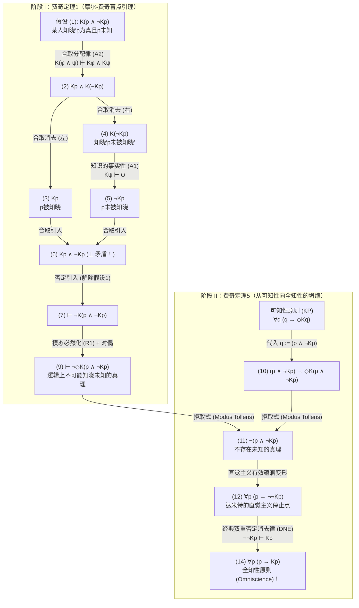
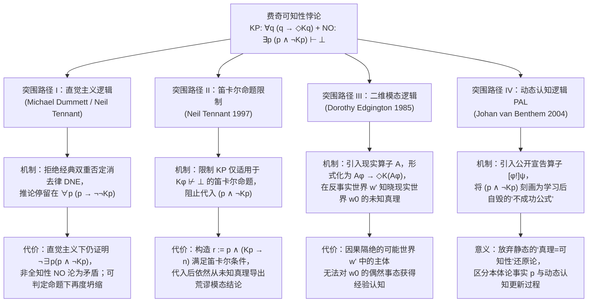

## 1. 引言：形而上学实在论与语义反实在论的断层线

“真理（Truth）”究竟是完全独立于人类认知能力而客观存在的实在，还是必须与有限认知主体“在原则上可验证、可认知（Knowable in principle）”的能力相绑定的概念？这一追问构成了当代分析哲学、语言哲学、形而上学与数学哲学中最核心的断层线——<strong>形而上学实在论（Metaphysical Realism）</strong>与<strong>语义反实在论（Semantic Anti-Realism / 验证主义 Verificationism）</strong>之间的交锋。

### 1.1 形而上学实在论：超越认知的真理
以弗雷格（Gottlob Frege）、罗素（Bertrand Russell）、早期普特南（Hilary Putnam）以及蒂莫西·威廉姆森（Timothy Williamson）为代表的<strong>形而上学实在论</strong>主张，命题 $p$ 的真假完全取决于客观世界的存在论事态（states of affairs），而与任何认知主体能否验证、发现或知晓 $p$ 毫无关系。在双模态认知-真势逻辑（Bimodal Epistemic-Alethic Logic）的语言中，令 $p$ 表示命题 $p$ 为真，$Kp$ 表示“在过去、现在或未来的某个时刻被某人所知（known by someone at some time）”，$\Diamond\phi$ 表示“在逻辑或形而上学上可能 $\phi$”，则实在论的核心承诺可以形式化为承认<strong>不可知真理（Unknowable Truths）</strong>的存在：

$$\text{Realism (Unknowable Truths)}: \quad \exists p \, \big( p \land \neg \Diamond K p \big)$$

例如：“公元前44年3月15日凯撒遇刺瞬间其头上的毛发总数是奇数”、宇宙事件视界之外某颗基本粒子的衰变、或者在热力学不可逆演化中彻底湮灭的远古微观事实。实在论者认为，即便没有任何证据留存、在任何可能世界中都无人能够知晓这些命题，它们依然非真即假。

### 1.2 语义反实在论与可知性原则（Knowability Principle, KP）
相反，从皮尔士（C.S. Peirce）的实用主义、维也纳学派的逻辑实证主义、晚期普特南的<strong>内在实在论（Internal Realism）</strong>，直到<strong>迈克尔·达米特（Michael Dummett）</strong>的语义反实在论，都拒绝这种“绝对超越一切可能认知的真理”概念。达米特通过著名的<strong>“习得论证（Acquisition Argument）”</strong>与<strong>“显现论证（Manifestation Argument）”</strong>指出：有限的人类只能通过可公开观察的证据和证实条件来习得语言并显现对语句意义的理解；如果真值条件完全超越人类一切可能的认知能力，我们就根本不可能理解这样的真值条件。

因此，语义反实在论提出了温和而优雅的<strong>可知性原则（Knowability Principle, KP）</strong>——凡是真命题，至少在<strong>原则上（in principle）</strong>是可能被某人在某时知晓的：

$$\text{KP (Knowability Principle)}: \quad \forall p \, \big( p \to \Diamond K p \big)$$

### 1.3 常识性的“非全知性原则（NO）”与费奇的逻辑炸弹
为什么反实在论者要在认知算子 $K$ 前面加上模态可能性算子 $\Diamond$？因为如果不加 $\Diamond$，就会变成 $\forall p \, (p \to K p)$，即荒谬的唯心主义<strong>全知性原则（Omniscience Principle, OP）</strong>：“一切真理都已经或必将在事实上被人知晓”。反实在论者完全承认人类的有限性，即坚信<strong>非全知性原则（Non-Omniscience Principle, NO）</strong>：

$$\text{NO (Non-Omniscience Principle)}: \quad \exists p \, \big( p \land \neg K p \big)$$

（“至少存在一个真命题 $p$，它在过去、现在和未来的全部历史中事实上从未被任何人知晓。”）

然而，1963年耶鲁大学逻辑学家<strong>弗雷德里克·费奇（Frederic B. Fitch）</strong>在《符号逻辑杂志》（*The Journal of Symbolic Logic*）发表的论文《若干价值概念的逻辑分析》（*"A Logical Analysis of Some Value Concepts"*）定理5中，引爆了一颗震撼整个分析哲学界的逻辑炸弹：

> <strong>费奇可知性悖论（Fitch's Paradox of Knowability）</strong>：
> 仅凭认知模态逻辑中最基础、最无争议的两条规则——<strong>知识的事实性（Factivity）</strong>与<strong>合取分配律（Conjunction Distribution）</strong>——以及经典逻辑，温和的<strong>可知性原则 $\forall p \, (p \to \Diamond K p)$</strong> 就会直接演算出荒谬的<strong>全知性原则 $\forall p \, (p \to K p)$</strong>！
> 换言之，只要承认人类不是全知的（$\exists p \, (p \land \neg K p)$），就必然存在在原则上绝对不可知的真理（$\exists q \, (q \land \neg \Diamond K q)$）！

---

## 2. 历史溯源：阿隆佐·邱奇1945年的匿名审稿报告与费奇1963年的论文

费奇在1963年论文第138页的脚注5中曾留下一句神秘的致谢：*“定理5的证明是由1945年提交但从未发表的一篇论文的匿名审稿人向作者建议的。”*

在长达六十多年的时间里，这位在现代认知逻辑诞生之前就发现可知性悖论的“1945年匿名审稿人”身份一直是个谜。直到哲学家乔·萨勒诺（Joe Salerno，2009年《可知性悖论新论》主编）在普林斯顿大学图书馆档案馆查阅<strong>阿隆佐·邱奇（Alonzo Church, 1903–1995）</strong>的私人档案时，才终于揭开了真相：这位匿名审稿人正是发明 $\lambda$-演算并证明一阶逻辑不可判定性的数理逻辑泰斗<strong>阿隆佐·邱奇</strong>本人！

1945年夏，费奇向《符号逻辑杂志》提交了一篇试图将“真”等同于“可证/可知”的构造主义逻辑手稿。作为审稿人的邱奇在1945年7月的审稿报告中敏锐地指出：只要将复合合取命题 $q := (p \land \neg K p)$ 代入可知性公理 $\forall q \, (q \to \Diamond K q)$，就会立即推导出 $\neg(p \land \neg K p)$，从而导致潜在可知性（$\Diamond K p$）坍缩为现实的全知（$K p$）。费奇随即撤回了1945年的手稿，并在18年后的1963年将邱奇的这一构造正式发表为著名的定理1与定理5。

---

## 3. 双模态认知逻辑的形式语法与极小公理系统

令双模态命题语言 $\mathcal{L}_{K,\Box}$ 由原子命题变量 $p, q, r \in \text{Prop}$、布尔联结词 $\neg, \land, \lor, \to$、认知算子 $K$ 以及真势模态算子 $\Box, \Diamond$（其中 $\Diamond\phi \equiv \neg\Box\neg\phi$，$\Box\neg\phi \equiv \neg\Diamond\phi$）构成。这里 $K\phi$ 定义为跨越一切认知主体 $x$ 与一切时间点 $t$ 的存在量化：

$$K\phi \stackrel{\text{def}}{\Longleftrightarrow} \exists x \in \text{Agents}, \, \exists t \in \text{Times} \, \big( K_{x,t} \phi \big)$$

费奇悖论之所以极其致命，是因为它<strong>完全不需要</strong>认知逻辑中任何强理想化公理（例如<strong>KK原则/正内省公理4：$K\phi \to KK\phi$</strong>、<strong>负内省公理5：$\neg K\phi \to K\neg K\phi$</strong>，甚至不需要<strong>完全演绎闭合公理K：$K(\phi \to \psi) \to (K\phi \to K\psi)$</strong>）。它只需要以下三条最弱的公理与规则：

1. <strong>(A1) 知识的事实性（Factivity of Knowledge / 公理 T）</strong>：
   $$K\phi \vdash \phi$$
   （“凡是被知晓的命题必定为真；虚假的命题不可能被知晓。”）
2. <strong>(A2) 知识对合取的分配律（Conjunction Distribution）</strong>：
   $$K(\phi \land \psi) \vdash K\phi \land K\psi$$
   （“如果某人知晓‘$\phi$ 且 $\psi$’，那么他既知晓 $\phi$，也知晓 $\psi$。”）
3. <strong>(R1) 模态必然化规则（Modal Necessitation Rule）</strong>：
   $$\text{若 } \vdash \phi, \quad \text{则 } \vdash \Box\phi$$
   （“若 $\phi$ 是不依赖任何偶然经验前提的逻辑定理，则 $\phi$ 在一切可能世界中必然成立。”）

| 公理/规则名称 | 形式模式 | 哲学含义 | 费奇证明是否需要？ |
| :--- | :--- | :--- | :--- |
| <strong>(A1) 知识的事实性 (Axiom T)</strong> | $K\phi \vdash \phi$ | 只有真命题才能成为知识 | <strong>必须（核心公理）</strong> |
| <strong>(A2) 合取分配律 (Distribution)</strong> | $K(\phi \land \psi) \vdash K\phi \land K\psi$ | 知晓合取式蕴涵分别知晓各合取支 | <strong>必须（核心公理）</strong> |
| <strong>(R1) 模态必然化规则</strong> | $\vdash \phi \implies \vdash \Box\phi$ | 逻辑定理在一切可能世界中必然为真 | <strong>必须（阶段I使用）</strong> |
| <strong>完全演绎闭合 (Axiom K)</strong> | $K(\phi \to \psi) \to (K\phi \to K\psi)$ | 逻辑全知（知晓蕴涵式即知晓结论） | <strong>不需要</strong> |
| <strong>正内省公理 (KK原则 / Axiom 4)</strong> | $K\phi \to KK\phi$ | 知道 $\phi$ 则知道自己知道 $\phi$ | <strong>不需要</strong> |
| <strong>负内省公理 (Axiom 5)</strong> | $\neg K\phi \to K\neg K\phi$ | 不知道 $\phi$ 则知道自己不知道 $\phi$ | <strong>不需要</strong> |

---

## 4. 费奇悖论的分步形式证明（Step-by-Step Formal Proof）

证明分为两个阶段（对应费奇1963年论文中的定理1与定理5）。

### 4.1 阶段 I（费奇定理1）：未知的真理在逻辑上不可能被知晓（摩尔-费奇盲点引理）
考察特定复合命题 $q \stackrel{\text{def}}{\equiv} (p \land \neg K p)$（“$p$ 为真，但从未有人知晓 $p$”）。我们首先利用归谬法（否定引入规则 $\neg$-Introduction）证明：<strong>没有任何人能够知晓 $(p \land \neg K p)$</strong>。

| 行号 | 形式公式 | 推理规则与依据 | 依赖假设 |
| :---: | :--- | :--- | :---: |
| (1) | $K(p \land \neg K p)$ | <strong>归谬法假设（Assumption for Reductio）</strong> | $\{1\}$ |
| (2) | $K p \land K(\neg K p)$ | 由 (1) 应用 <strong>(A2) 合取分配律</strong> $K(\phi \land \psi) \vdash K\phi \land K\psi$ | $\{1\}$ |
| (3) | $K p$ | 由 (2) 应用合取消去律（$\land$-Elimination 左） | $\{1\}$ |
| (4) | $K(\neg K p)$ | 由 (2) 应用合取消去律（$\land$-Elimination 右） | $\{1\}$ |
| (5) | $\neg K p$ | 由 (4) 应用 <strong>(A1) 知识的事实性</strong> $K\psi \vdash \psi$（令 $\psi := \neg K p$） | $\{1\}$ |
| (6) | $K p \land \neg K p \quad (\bot)$ | 由 (3) 与 (5) 应用合取引入律（<strong>显式逻辑矛盾！</strong>） | $\{1\}$ |
| (7) | $\vdash \neg K(p \land \neg K p)$ | 由 (1)–(6) 应用否定引入律（$\neg$-Introduction，解除假设 $\{1\}$） | $\emptyset$ |
| (8) | $\vdash \Box \neg K(p \land \neg K p)$ | 由无假设定理 (7) 应用 <strong>(R1) 模态必然化规则</strong> | $\emptyset$ |
| (9) | $\vdash \neg \Diamond K(p \land \neg K p)$ | 由 (8) 应用模态对偶定义 $\Box\neg\phi \equiv \neg\Diamond\phi$ | $\emptyset$ |

第 (9) 行 $\vdash \neg \Diamond K(p \land \neg K p)$ 表明：尽管 $(p \land \neg K p)$ 作为客观世界的状态完全是一致的，但<strong>“知晓一个未知的真理”在逻辑上是绝对不可能的</strong>！因为一旦有人知晓了第一个合取支 $p$（即 $K p$ 成立），第二个合取支 $\neg K p$ 就立刻被证伪了。

### 4.2 阶段 II（费奇定理5）：从可知性原则（KP）坍缩为全知性原则（OP）
现在引入反实在论的<strong>可知性原则（KP）</strong> $\forall q \, (q \to \Diamond K q)$，并将 $q := (p \land \neg K p)$ 代入：

| 行号 | 形式公式 | 推理规则与依据 | 逻辑性质 |
| :---: | :--- | :--- | :--- |
| (10) | $(p \land \neg K p) \to \Diamond K(p \land \neg K p)$ | 对 <strong>可知性原则 (KP)</strong> $\forall q (q \to \Diamond K q)$ 实例化 $q := (p \land \neg K p)$ | 全称实例化 (UI) |
| (11) | $\neg (p \land \neg K p)$ | 由 (10) 与阶段I定理 (9) $\neg \Diamond K(p \land \neg K p)$ 应用<strong>拒取式 (Modus Tollens)</strong> | <strong>直觉主义逻辑完全有效！</strong> |
| (12) | $p \to \neg \neg K p$ | 由 (11) 应用命题逻辑等价变形 $\neg(A \land \neg B) \vdash (A \to \neg\neg B)$ | <strong>直觉主义逻辑完全有效！</strong> |
| (13) | $p \to K p$ | 对 (12) 后件应用<strong>经典逻辑双重否定消去律 (DNE)</strong> $\neg\neg K p \vdash K p$ | 仅此处使用经典逻辑 DNE |
| (14) | $\forall p \, (p \to K p)$ | 对 (13) 应用全称概括规则 (Universal Generalization) | <strong>全知性原则 (OP)！</strong> |

由此可见，温和的可知性原则 $\forall p \, (p \to \Diamond K p)$ 在经典逻辑下不可避免地坍缩为全知性原则 $\forall p \, (p \to K p)$！

---

## 5. 结构诊断：摩尔悖论、认知盲点与突击测验悖论

为什么 $q \equiv (p \land \neg K p)$ 具有如此奇特的自我毁灭性质？
1. <strong>G.E.摩尔悖论（Moore's Paradox, 1942）的普遍化</strong>：
   摩尔曾指出，第一人称语句“外面在下雨，但我不知道外面在下雨”（$p \land \neg K_a p$）在客观事态上完全可能为真，但说话者 $a$ 本人永远不可能知晓或真诚断言该合取式。对于单个主体 $a$，旁观者 $b$ 还可以知晓 $K_b(p \land \neg K_a p)$；然而，当反实在论将 $K$ 定义为涵括<strong>一切认知主体与一切时间</strong>的算子时，宇宙中不再存在外在于 $K$ 的“旁观者”，$(p \land \neg K p)$ 遂成为全人类共同体的<strong>普遍化摩尔语句</strong>。
2. <strong>索伦森的“认知盲点（Epistemic Blindspots）”与认知干预效应</strong>：
   罗伊·索伦森（Roy Sorensen, 1988《Blindspots》）将相容但不可知的命题（$\Diamond\phi \land \neg\Diamond K\phi$）命名为“认知盲点”。$(p \land \neg K p)$ 的真值依赖于“无知状态 $\neg K p$”，因此“获取关于 $p$ 的知识”这一认知行为本身就会改变世界的认知事态，犹如打开手电筒去观察黑暗房间中的黑暗——光照亮房间的瞬间，黑暗（$\neg K p$）便消失了。
3. <strong>突击测验悖论（Surprise Examination Paradox）与哥德尔不完全性定理</strong>：
   突击测验悖论中，学生之所以错误地排除周五考试的可能性，正是因为混淆了“周五举行突击考试为真（$E_5 \land \neg K_{\text{Thu}} E_5$）”与“周四晚上学生已经知晓周五举行突击考试（$K_{\text{Thu}}(E_5 \land \neg K_{\text{Thu}} E_5)$）”。而在算术形式系统中，若将 $K$ 替换为可证性谓词 $\text{Prov}_T(\ulcorner \phi \urcorner)$，根据哥德尔第二不完全性定理与勒布定理（Löb's Theorem），相容系统 $T$ 无法普遍证明事实性公理 $\text{Prov}_T(\ulcorner \phi \urcorner) \to \phi$；但认知逻辑中的真知识 $K$ 必须无条件满足事实性 $K\phi \to \phi$，因而无法像形式可证性那样规避坍缩。

---

## 6. 四大哲学突围路径及其代价

面对费奇悖论的致命打击，当代哲学家与逻辑学家提出了四条主要的突围方案：

### 6.1 突围路径 I：迈克尔·达米特的直觉主义逻辑方案（拒绝双重否定消去律）
<strong>迈克尔·达米特（Michael Dummett, 2001, *"Victor's Error"*）</strong>与<strong>尼尔·坦南特（Neil Tennant）</strong>指出：在费奇证明的第 (1) 至第 (14) 行中，<strong>第 (1) 行到第 (12) 行在布劳威尔-海廷-柯尔莫哥洛夫（BHK）直觉主义逻辑中完全有效！</strong>因为第 (7) 行由 $K(p \land \neg K p) \vdash \bot$ 推出 $\neg K(p \land \neg K p)$ 属于直觉主义合法的“否定引入（Intuitionistic Reductio）”，而非经典的归谬消去。唯一使用经典逻辑的地方是第 (12) 行到第 (13) 行的<strong>双重否定消去律（DNE：$\neg\neg K p \vdash K p$）</strong>！

因此，达米特主张，一贯坚持直觉主义逻辑的反实在论者只需将可知性原则的推论停留在第 (12) 行：

$$\forall p \, \big( p \to \neg\neg K p \big) \quad \text{以及} \quad \forall p \, \neg(p \land \neg K p)$$

在直觉主义逻辑中，$p \to \neg\neg K p$ 仅表示“如果 $p$ 为真，则 $p$ 永远不被知晓是不可能的”，并不蕴涵 $p \to K p$。

<strong>威廉姆森（Timothy Williamson, 1982, 2000）的致命反击</strong>：
1. 即便在直觉主义逻辑中，第 (11) 行也已经证明了 $\vdash_{\text{Int}} \neg \exists p \, (p \land \neg K p)$！这意味着常识性的<strong>非全知性原则（NO：$\exists p (p \land \neg K p)$，“存在人类永远不知道的真理”）在直觉主义逻辑内部同样被判定为逻辑矛盾（假）</strong>！
2. 对于任何<strong>可判定命题（Decidable Propositions，满足 $K p \lor \neg K p$）</strong>，直觉主义逻辑完全允许双重否定消去 $\neg\neg K p \vdash_{\text{Int}} K p$。如果人类物种在宇宙中存续的时间是有限的，那么人类历史上的知识集合就是有限集，$K p \lor \neg K p$ 成为可判定命题，$p \to \neg\neg K p$ 依然坍缩回全知性 $p \to K p$！

### 6.2 突围路径 II：尼尔·坦南特的“笛卡尔命题（Cartesian Propositions）”限制策略
<strong>尼尔·坦南特（Neil Tennant, 1997, *The Taming of the Sleuth*）</strong>提出：正如全能的上帝不能制造“自己举不起的石头”并不有损上帝的全能（因为该描述本身逻辑自相矛盾），反实在论的可知性原则也只应适用于那些<strong>“被知晓不会导致逻辑矛盾”的命题（笛卡尔命题，Cartesian Propositions）</strong>：

$$\text{Cartesian}(\phi) \stackrel{\text{def}}{\Longleftrightarrow} K\phi \not\vdash \bot$$

$$\text{KP}_{\text{Tennant}}: \quad \forall \phi \, \Big( \text{Cartesian}(\phi) \implies \big( \phi \to \Diamond K \phi \big) \Big)$$

由于 $K(p \land \neg K p) \vdash \bot$，费奇合取式不是笛卡尔命题，因此不能代入 $\text{KP}_{\text{Tennant}}$。

<strong>德维迪与所罗门（DeVidi & Solomon, 2001）及威廉姆森的反例</strong>：
构造复合命题 $r \stackrel{\text{def}}{\equiv} p \land (K p \to n)$，其中 $n$ 是某个与 $p$ 相容但实际上为假的命题。容易验证 $K r \vdash K p \land n \not\vdash \bot$，因此 <strong>$r$ 确实是笛卡尔命题（$\text{Cartesian}(r)$ 成立）</strong>！然而，若 $p$ 是未知真理（$p \land \neg K p$），则 $K p$ 为假，蕴涵式 $(K p \to n)$ 为真，故 $r$ 为真；对 $r$ 应用 $\text{KP}_{\text{Tennant}}$ 立即推出 $(p \land \neg K p) \to \Diamond(K p \land n)$，通过适当选取 $n$ 即可重新导出荒谬的模态推论！

### 6.3 突围路径 III：多萝西·埃金顿的二维模态逻辑与现实世界算子 $\mathcal{A}$（`@`）
<strong>多萝西·埃金顿（Dorothy Edgington, 1985, *"The Paradox of Knowability"*, *Mind*）</strong>指出，标准模态逻辑中的 $\Diamond K\phi$ 强迫“$\phi$ 为真的可能世界”与“认知主体知晓 $\phi$ 的可能世界”为同一个反事实世界 $w'$。但在现实世界 $w_0$ 中未知的真理 $(p \land \neg K p)$，完全可以被<strong>另一个反事实可能世界 $w'$ 中的观察者知晓其在现实世界 $w_0$ 中成立</strong>！

引入二维模态逻辑的<strong>现实世界算子（Actuality Operator）$\mathcal{A}$</strong>（满足 $\mathcal{M}, w' \models \mathcal{A}\phi \iff \mathcal{M}, w_0 \models \phi$），埃金顿将可知性原则重构为：

$$\text{KP}_{\text{Edg}}: \quad \forall \phi \, \Big( \mathcal{A}\phi \to \Diamond K(\mathcal{A}\phi) \Big)$$

当代入 $\phi := (p \land \neg K p)$ 时，$\Diamond K(\mathcal{A}(p \land \neg K p))$ 仅要求可能世界 $w'$ 中的主体知晓“在现实世界 $w_0$ 中 $p$ 为真且 $w_0$ 中无人知晓 $p$”（$K_{w'}(\mathcal{A} p) \land \neg \mathcal{A} K p$），这在逻辑上完全一致！
然而，威廉姆森（1987, 2000）指出其认识论困境：<strong>处于因果隔绝的可能世界 $w'$ 中的有限主体，究竟如何能够跨越世界边界，对另一个非现实世界 $w_0$ 中的偶然经验事实获得真正的经验知识 $K_{w'}(\mathcal{A} p)$？</strong>

### 6.4 突围路径 IV：动态认知逻辑（DEL）与公开宣告逻辑（PAL）
<strong>约翰·范·本瑟姆（Johan van Benthem, 2004）</strong>等逻辑学家利用<strong>公开宣告逻辑（Public Announcement Logic, PAL）</strong>中的动态算子 $[\phi!]\psi$（“在真实宣告/学习 $\phi$ 从而删去所有 $\neg\phi$-世界后的更新模型 $\mathcal{M}|_\phi$ 中，$\psi$ 成立”）揭示了悖论的动态本质：
对于普通原子命题 $p$，宣告后它依然为真且被知晓（$\vdash [p!] K p$，称为<strong>成功公式 Successful Formula</strong>）。但对于摩尔-费奇合取式 $\phi \equiv (p \land \neg K p)$，一旦它被真实宣告或学习，主体便立即获得了知识 $K p$，从而使后半部分 $\neg K p$ 在更新后的模型中<strong>由真变假</strong>：

$$\mathcal{M}, w \models (p \land \neg K p), \quad \text{但} \quad \mathcal{M}, w \models [p \land \neg K p !] \Big( K p \land \neg(p \land \neg K p) \Big)$$

因此，$(p \land \neg K p)$ 是典型的<strong>“不成功公式（Unsuccessful Formula / 自毁型更新）”</strong>。学习未知真理的过程必然改变认知状态本身，静态地要求一切真命题在被认知后仍保持原真值，正是反实在论陷入费奇悖论的根源。

---

## 7. 总结对比矩阵与哲学结论

| 理论立场 / 代表人物 | 可知性原则形式化 / 逻辑框架 | 阻断悖论的机制 | 核心缺陷与哲学代价 |
| :--- | :--- | :--- | :--- |
| <strong>朴素反实在论</strong> （早期验证主义） | $\forall p \, (p \to \Diamond K p)$ （经典双模态逻辑） | <strong>无法阻断</strong>：代入 $q := p \land \neg K p$ 直接导出 $\forall p (p \to K p)$ | 直接坍缩为荒谬的人类<strong>全知性原则（OP）</strong> |
| <strong>直觉主义反实在论</strong> （Dummett 2001） | $\forall p \, (p \to \Diamond K p)$ （直觉主义逻辑：$\neg\neg\phi \not\vdash \phi$） | 拒绝经典 DNE，停留在 $\forall p (p \to \neg\neg K p)$ | 仍证明 $\vdash_{\text{Int}} \neg\exists p(p \land \neg K p)$，否定了非全知性（NO）；可判定命题下重陷全知 |
| <strong>笛卡尔命题限制</strong> （Tennant 1997） | $\forall \phi \, (\text{Cartesian}(\phi) \to (\phi \to \Diamond K \phi))$ 其中 $K\phi \not\vdash \bot$ | 因 $K(p \land \neg K p) \vdash \bot$，将费奇命题排除在量化域之外 | 被笛卡尔命题 $r := p \land (K p \to n)$ 攻破（DeVidi, Solomon, Williamson） |
| <strong>二维模态逻辑方案</strong> （Edgington 1985） | $\forall \phi \, (\mathcal{A}\phi \to \Diamond K(\mathcal{A}\phi))$ （引入现实世界算子 $\mathcal{A}$） | 在反事实世界 $w'$ 中知晓现实世界 $w_0$ 的未知真理 | 无法解释因果隔绝的跨世界经验知识 $K_{w'}(\mathcal{A} p)$ 如何可能 |
| <strong>动态认知逻辑 (PAL)</strong> （van Benthem 2004） | $\forall p_{\text{ontic}} \, (p \to \Diamond \langle \psi! \rangle K p)$ （公开宣告更新 $[\phi!]\psi$） | 揭示 $(p \land \neg K p)$ 是宣告即自毁的“不成功公式” | 承认包含认知状态的真命题无法在认知更新后保持真值不变 |

<strong>结论</strong>：邱奇与费奇的定理以无可辩驳的数学严格性证明，只要我们承认人类的有限性（$\exists p \, (p \land \neg K p)$：宇宙中存在人类直到灭绝也未曾知晓的事实），根据费奇定理1（$\vdash \neg \Diamond K(p \land \neg K p)$），我们就必然在逻辑上承认<strong>形而上学实在论</strong>：

$$\exists p \, (p \land \neg K p) \quad \vdash \quad \exists q \, \big( q \land \neg \Diamond K q \big)$$

哪怕每一个基础物理事实 $p$ 本身在原则上都可被认知，“$p$ 为真且永远不被人知晓”这一历史性合取真理 $q \equiv (p \land \neg K p)$，也必然作为永恒的认知盲点，独立于一切心智的认知之外而客观实在。

---

## 参考文献（References）

* Fitch, F. B. (1963). "A Logical Analysis of Some Value Concepts". *The Journal of Symbolic Logic*, 28(2), 135–142.
* Salerno, J. (Ed.). (2009). *New Essays on the Knowability Paradox*. Oxford University Press.
* Dummett, M. (2001). "Victor's Error". *Analysis*, 61(269), 1–2.
* Williamson, T. (2000). *Knowledge and Its Limits*. Oxford University Press.
* Edgington, D. (1985). "The Paradox of Knowability". *Mind*, 94(376), 557–568.
* Tennant, N. (1997). *The Taming of the Sleuth*. Oxford University Press.
* van Benthem, J. (2004). "What One May Come to Know". *Analysis*, 64(282), 95–105.
