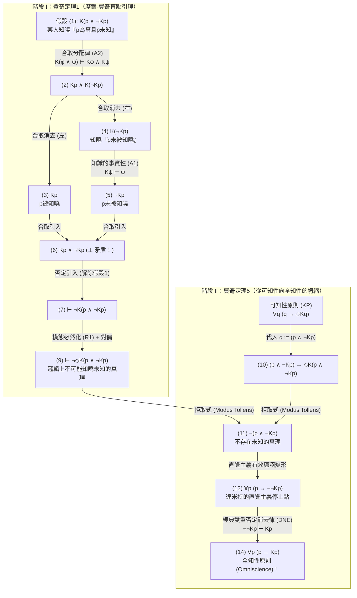
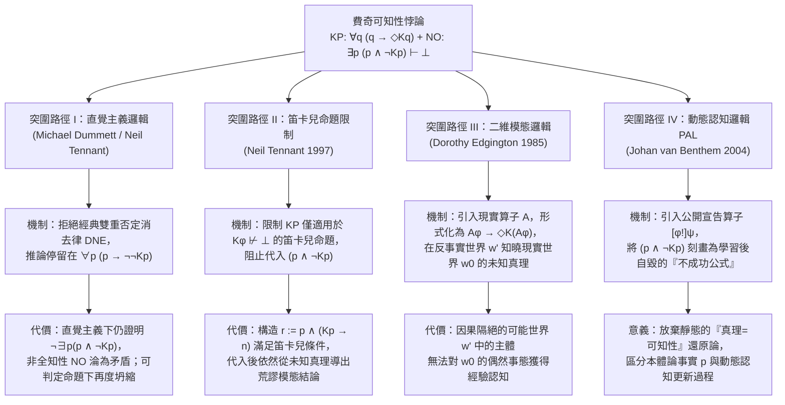

## 1. 引言：形上學實在論與語義反實在論的斷層線

「真理（Truth）」究竟是完全獨立於人類認知能力而客觀存在的實在，還是必須與有限認知主體「在原則上可驗證、可認知（Knowable in principle）」的能力相綁定的概念？這一追問構成了當代分析哲學、語言哲學、形上學與數學哲學中最核心的斷層線——<strong>形上學實在論（Metaphysical Realism）</strong>與<strong>語義反實在論（Semantic Anti-Realism / 驗證主義 Verificationism）</strong>之間的交鋒。

### 1.1 形上學實在論：超越認知的真理
以弗雷格（Gottlob Frege）、羅素（Bertrand Russell）、早期普特南（Hilary Putnam）以及蒂莫西·威廉姆森（Timothy Williamson）為代表的<strong>形上學實在論</strong>主張，命題 $p$ 的真假完全取決於客觀世界的存在論事態（states of affairs），而與任何認知主體能否驗證、發現或知曉 $p$ 毫無關係。在雙模態認知-真勢邏輯（Bimodal Epistemic-Alethic Logic）的語言中，令 $p$ 表示命題 $p$ 為真，$Kp$ 表示「在過去、現在或未來的某個時刻被某人所知（known by someone at some time）」，$\Diamond\phi$ 表示「在邏輯或形上學上可能 $\phi$」，則實在論的核心承諾可以形式化為承認<strong>不可知真理（Unknowable Truths）</strong>的存在：

$$\text{Realism (Unknowable Truths)}: \quad \exists p \, \big( p \land \neg \Diamond K p \big)$$

例如：「西元前44年3月15日凱撒遇刺瞬間其頭上的毛髮總數是奇數」、宇宙事件視界之外某顆基本粒子的衰變、或者在熱力學不可逆演化中徹底湮滅的遠古微觀事實。實在論者認為，即便沒有任何證據留存、在任何可能世界中都無人能夠知曉這些命題，它們依然非真即假。

### 1.2 語義反實在論與可知性原則（Knowability Principle, KP）
相反，從皮爾士（C.S. Peirce）的實用主義、維也納學派的邏輯實證主義、晚期普特南的<strong>內在實在論（Internal Realism）</strong>，直到<strong>邁克爾·達米特（Michael Dummett）</strong>的語義反實在論，都拒絕這種「絕對超越一切可能認知的真理」概念。達米特透過著名的<strong>「習得論證（Acquisition Argument）」</strong>與<strong>「顯現論證（Manifestation Argument）」</strong>指出：有限的人類只能透過可公開觀察的證據和證實條件來習得語言並顯現對語句意義的理解；如果真值條件完全超越人類一切可能的認知能力，我們就根本不可能理解這樣的真值條件。

因此，語義反實在論提出了溫和而優雅的<strong>可知性原則（Knowability Principle, KP）</strong>——凡是真命題，至少在<strong>原則上（in principle）</strong>是可能被某人在某時知曉的：

$$\text{KP (Knowability Principle)}: \quad \forall p \, \big( p \to \Diamond K p \big)$$

### 1.3 常識性的「非全知性原則（NO）」與費奇的邏輯炸彈
為什麼反實在論者要在認知算子 $K$ 前面加上模態可能性算子 $\Diamond$？因為如果不加 $\Diamond$，就會變成 $\forall p \, (p \to K p)$，即荒謬的唯心主義<strong>全知性原則（Omniscience Principle, OP）</strong>：「一切真理都已經或必將在事實上被人知曉」。反實在論者完全承認人類的有限性，即堅信<strong>非全知性原則（Non-Omniscience Principle, NO）</strong>：

$$\text{NO (Non-Omniscience Principle)}: \quad \exists p \, \big( p \land \neg K p \big)$$

（「至少存在一個真命題 $p$，它在過去、現在和未來的全部歷史中事實上從未被任何人知曉。」）

然而，1963年耶魯大學邏輯學家<strong>弗雷德里克·費奇（Frederic B. Fitch）</strong>在《符號邏輯雜誌》（*The Journal of Symbolic Logic*）發表的論文《若干價值概念的邏輯分析》（*"A Logical Analysis of Some Value Concepts"*）定理5中，引爆了一顆震撼整個分析哲學界的邏輯炸彈：

> <strong>費奇可知性悖論（Fitch's Paradox of Knowability）</strong>：
> 僅憑認知模態邏輯中最基礎、最無爭議的兩條規則——<strong>知識的事實性（Factivity）</strong>與<strong>合取分配律（Conjunction Distribution）</strong>——以及經典邏輯，溫和的<strong>可知性原則 $\forall p \, (p \to \Diamond K p)$</strong> 就會直接演算出荒謬的<strong>全知性原則 $\forall p \, (p \to K p)$</strong>！
> 換言之，只要承認人類不是全知的（$\exists p \, (p \land \neg K p)$），就必然存在在原則上絕對不可知的真理（$\exists q \, (q \land \neg \Diamond K q)$）！

---

## 2. 歷史溯源：阿隆佐·邱奇1945年的匿名審稿報告與費奇1963年的論文

費奇在1963年論文第138頁的腳註5中曾留下一句神秘的致謝：*「定理5的證明是由1945年提交但從未發表的一篇論文的匿名審稿人向作者建議的。」*

在長達六十多年的時間裡，這位在現代認知邏輯誕生之前就發現可知性悖論的「1945年匿名審稿人」身份一直是個謎。直到哲學家喬·薩勒諾（Joe Salerno，2009年《可知性悖論新論》主編）在普林斯頓大學圖書館檔案館查閱<strong>阿隆佐·邱奇（Alonzo Church, 1903–1995）</strong>的私人檔案時，才終於揭開了真相：這位匿名審稿人正是發明 $\lambda$-演算並證明一階邏輯不可判定性的數理邏輯泰斗<strong>阿隆佐·邱奇</strong>本人！

1945年夏，費奇向《符號邏輯雜誌》提交了一篇試圖將「真」等同於「可證/可知」的構造主義邏輯手稿。作為審稿人的邱奇在1945年7月的審稿報告中敏銳地指出：只要將複合合取命題 $q := (p \land \neg K p)$ 代入可知性公理 $\forall q \, (q \to \Diamond K q)$，就會立即推導出 $\neg(p \land \neg K p)$，從而導致潛在可知性（$\Diamond K p$）坍縮為現實的全知（$K p$）。費奇隨即撤回了1945年的手稿，並在18年後的1963年將邱奇的這一構造正式發表為著名的定理1與定理5。

---

## 3. 雙模態認知邏輯的形式語法與極小公理系統

令雙模態命題語言 $\mathcal{L}_{K,\Box}$ 由原子命題變數 $p, q, r \in \text{Prop}$、布林聯結詞 $\neg, \land, \lor, \to$、認知算子 $K$ 以及真勢模態算子 $\Box, \Diamond$（其中 $\Diamond\phi \equiv \neg\Box\neg\phi$，$\Box\neg\phi \equiv \neg\Diamond\phi$）構成。這裡 $K\phi$ 定義為跨越一切認知主體 $x$ 與一切時間點 $t$ 的存在量化：

$$K\phi \stackrel{\text{def}}{\Longleftrightarrow} \exists x \in \text{Agents}, \, \exists t \in \text{Times} \, \big( K_{x,t} \phi \big)$$

費奇悖論之所以極其致命，是因為它<strong>完全不需要</strong>認知邏輯中任何強理想化公理（例如<strong>KK原則/正內省公理4：$K\phi \to KK\phi$</strong>、<strong>負內省公理5：$\neg K\phi \to K\neg K\phi$</strong>，甚至不需要<strong>完全演繹閉合公理K：$K(\phi \to \psi) \to (K\phi \to K\psi)$</strong>）。它只需要以下三條最弱的公理與規則：

1. <strong>(A1) 知識的事實性（Factivity of Knowledge / 公理 T）</strong>：
   $$K\phi \vdash \phi$$
   （「凡是被知曉的命題必定為真；虛假的命題不可能被知曉。」）
2. <strong>(A2) 知識對合取的分配律（Conjunction Distribution）</strong>：
   $$K(\phi \land \psi) \vdash K\phi \land K\psi$$
   （「如果某人知曉『$\phi$ 且 $\psi$』，那麼他既知曉 $\phi$，也知曉 $\psi$。」）
3. <strong>(R1) 模態必然化規則（Modal Necessitation Rule）</strong>：
   $$\text{若 } \vdash \phi, \quad \text{則 } \vdash \Box\phi$$
   （「若 $\phi$ 是不依賴任何偶然經驗前提的邏輯定理，則 $\phi$ 在一切可能世界中必然成立。」）

| 公理/規則名稱 | 形式模式 | 哲學含義 | 費奇證明是否需要？ |
| :--- | :--- | :--- | :--- |
| <strong>(A1) 知識的事實性 (Axiom T)</strong> | $K\phi \vdash \phi$ | 只有真命題才能成為知識 | <strong>必須（核心公理）</strong> |
| <strong>(A2) 合取分配律 (Distribution)</strong> | $K(\phi \land \psi) \vdash K\phi \land K\psi$ | 知曉合取式蘊涵分別知曉各合取支 | <strong>必須（核心公理）</strong> |
| <strong>(R1) 模態必然化規則</strong> | $\vdash \phi \implies \vdash \Box\phi$ | 邏輯定理在一切可能世界中必然為真 | <strong>必須（階段I使用）</strong> |
| <strong>完全演繹閉合 (Axiom K)</strong> | $K(\phi \to \psi) \to (K\phi \to K\psi)$ | 邏輯全知（知曉蘊涵式即知曉結論） | <strong>不需要</strong> |
| <strong>正內省公理 (KK原則 / Axiom 4)</strong> | $K\phi \to KK\phi$ | 知道 $\phi$ 則知道自己知道 $\phi$ | <strong>不需要</strong> |
| <strong>負內省公理 (Axiom 5)</strong> | $\neg K\phi \to K\neg K\phi$ | 不知道 $\phi$ 則知道自己不知道 $\phi$ | <strong>不需要</strong> |

---

## 4. 費奇悖論的分步形式證明（Step-by-Step Formal Proof）

證明分為兩個階段（對應費奇1963年論文中的定理1與定理5）。

### 4.1 階段 I（費奇定理1）：未知的真理在邏輯上不可能被知曉（摩爾-費奇盲點引理）
考察特定複合命題 $q \stackrel{\text{def}}{\equiv} (p \land \neg K p)$（「$p$ 為真，但從未有人知曉 $p$」）。我們首先利用歸謬法（否定引入規則 $\neg$-Introduction）證明：<strong>沒有任何人能夠知曉 $(p \land \neg K p)$</strong>。

| 行號 | 形式公式 | 推理規則與依據 | 依賴假設 |
| :---: | :--- | :--- | :---: |
| (1) | $K(p \land \neg K p)$ | <strong>歸謬法假設（Assumption for Reductio）</strong> | $\{1\}$ |
| (2) | $K p \land K(\neg K p)$ | 由 (1) 應用 <strong>(A2) 合取分配律</strong> $K(\phi \land \psi) \vdash K\phi \land K\psi$ | $\{1\}$ |
| (3) | $K p$ | 由 (2) 應用合取消去律（$\land$-Elimination 左） | $\{1\}$ |
| (4) | $K(\neg K p)$ | 由 (2) 應用合取消去律（$\land$-Elimination 右） | $\{1\}$ |
| (5) | $\neg K p$ | 由 (4) 應用 <strong>(A1) 知識的事實性</strong> $K\psi \vdash \psi$（令 $\psi := \neg K p$） | $\{1\}$ |
| (6) | $K p \land \neg K p \quad (\bot)$ | 由 (3) 與 (5) 應用合取引入律（<strong>顯式邏輯矛盾！</strong>） | $\{1\}$ |
| (7) | $\vdash \neg K(p \land \neg K p)$ | 由 (1)–(6) 應用否定引入律（$\neg$-Introduction，解除假設 $\{1\}$） | $\emptyset$ |
| (8) | $\vdash \Box \neg K(p \land \neg K p)$ | 由無假設定理 (7) 應用 <strong>(R1) 模態必然化規則</strong> | $\emptyset$ |
| (9) | $\vdash \neg \Diamond K(p \land \neg K p)$ | 由 (8) 應用模態對偶定義 $\Box\neg\phi \equiv \neg\Diamond\phi$ | $\emptyset$ |

第 (9) 行 $\vdash \neg \Diamond K(p \land \neg K p)$ 表明：儘管 $(p \land \neg K p)$ 作為客觀世界的狀態完全是一致的，但<strong>「知曉一個未知的真理」在邏輯上是絕對不可能的</strong>！因為一旦有人知曉了第一個合取支 $p$（即 $K p$ 成立），第二個合取支 $\neg K p$ 就立刻被證偽了。

### 4.2 階段 II（費奇定理5）：從可知性原則（KP）坍縮為全知性原則（OP）
現在引入反實在論的<strong>可知性原則（KP）</strong> $\forall q \, (q \to \Diamond K q)$，並將 $q := (p \land \neg K p)$ 代入：

| 行號 | 形式公式 | 推理規則與依據 | 邏輯性質 |
| :---: | :--- | :--- | :--- |
| (10) | $(p \land \neg K p) \to \Diamond K(p \land \neg K p)$ | 對 <strong>可知性原則 (KP)</strong> $\forall q (q \to \Diamond K q)$ 實例化 $q := (p \land \neg K p)$ | 全稱實例化 (UI) |
| (11) | $\neg (p \land \neg K p)$ | 由 (10) 與階段I定理 (9) $\neg \Diamond K(p \land \neg K p)$ 應用<strong>拒取式 (Modus Tollens)</strong> | <strong>直覺主義邏輯完全有效！</strong> |
| (12) | $p \to \neg \neg K p$ | 由 (11) 應用命題邏輯等價變形 $\neg(A \land \neg B) \vdash (A \to \neg\neg B)$ | <strong>直覺主義邏輯完全有效！</strong> |
| (13) | $p \to K p$ | 對 (12) 後件應用<strong>經典邏輯雙重否定消去律 (DNE)</strong> $\neg\neg K p \vdash K p$ | 僅此處使用經典邏輯 DNE |
| (14) | $\forall p \, (p \to K p)$ | 對 (13) 應用全稱概括規則 (Universal Generalization) | <strong>全知性原則 (OP)！</strong> |

由此可見，溫和的可知性原則 $\forall p \, (p \to \Diamond K p)$ 在經典邏輯下不可避免地坍縮為全知性原則 $\forall p \, (p \to K p)$！

---

## 5. 結構診斷：摩爾悖論、認知盲點與突擊測驗悖論

為什麼 $q \equiv (p \land \neg K p)$ 具有如此奇特的自我毀滅性質？
1. <strong>G.E.摩爾悖論（Moore's Paradox, 1942）的普遍化</strong>：
   摩爾曾指出，第一人稱語句「外面在下雨，但我不知道外面在下雨」（$p \land \neg K_a p$）在客觀事態上完全可能為真，但說話者 $a$ 本人永遠不可能知曉或真誠斷言該合取式。對於單個主體 $a$，旁觀者 $b$ 還可以知曉 $K_b(p \land \neg K_a p)$；然而，當反實在論將 $K$ 定義為涵括<strong>一切認知主體與一切時間</strong>的算子時，宇宙中不再存在外在於 $K$ 的「旁觀者」，$(p \land \neg K p)$ 遂成為全人類共同體的<strong>普遍化摩爾語句</strong>。
2. <strong>索倫森的「認知盲點（Epistemic Blindspots）」與認知干預效應</strong>：
   羅伊·索倫森（Roy Sorensen, 1988《Blindspots》）將相容但不可知的命題（$\Diamond\phi \land \neg\Diamond K\phi$）命名為「認知盲點」。$(p \land \neg K p)$ 的真值依賴於「無知狀態 $\neg K p$」，因此「獲取關於 $p$ 的知識」這一認知行為本身就會改變世界的認知事態，猶如打開手電筒去觀察黑暗房間中的黑暗——光照亮房間的瞬間，黑暗（$\neg K p$）便消失了。
3. <strong>突擊測驗悖論（Surprise Examination Paradox）與哥德爾不完全性定理</strong>：
   突擊測驗悖論中，學生之所以錯誤地排除週五考試的可能性，正是因為混淆了「週五舉行突擊考試為真（$E_5 \land \neg K_{\text{Thu}} E_5$）」與「週四晚上學生已經知曉週五舉行突擊考試（$K_{\text{Thu}}(E_5 \land \neg K_{\text{Thu}} E_5)$）」。而在算術形式系統中，若將 $K$ 替換為可證性謂詞 $\text{Prov}_T(\ulcorner \phi \urcorner)$，根據哥德爾第二不完全性定理與勒布定理（Löb's Theorem），相容系統 $T$ 無法普遍證明事實性公理 $\text{Prov}_T(\ulcorner \phi \urcorner) \to \phi$；但認知邏輯中的真知識 $K$ 必須無條件滿足事實性 $K\phi \to \phi$，因而無法像形式可證性那樣規避坍縮。

---

## 6. 四大哲學突圍路徑及其代價

面對費奇悖論的致命打擊，當代哲學家與邏輯學家提出了四條主要的突圍方案：

### 6.1 突圍路徑 I：邁克爾·達米特的直覺主義邏輯方案（拒絕雙重否定消去律）
<strong>邁克爾·達米特（Michael Dummett, 2001, *"Victor's Error"*）</strong>與<strong>尼爾·坦南特（Neil Tennant）</strong>指出：在費奇證明的第 (1) 至第 (14) 行中，<strong>第 (1) 行到第 (12) 行在布勞威爾-海廷-柯爾莫哥洛夫（BHK）直覺主義邏輯中完全有效！</strong>因為第 (7) 行由 $K(p \land \neg K p) \vdash \bot$ 推出 $\neg K(p \land \neg K p)$ 屬於直覺主義合法的「否定引入（Intuitionistic Reductio）」，而非經典的歸謬消去。唯一使用經典邏輯的地方是第 (12) 行到第 (13) 行的<strong>雙重否定消去律（DNE：$\neg\neg K p \vdash K p$）</strong>！

因此，達米特主張，一貫堅持直覺主義邏輯的反實在論者只需將可知性原則的推論停留在第 (12) 行：

$$\forall p \, \big( p \to \neg\neg K p \big) \quad \text{以及} \quad \forall p \, \neg(p \land \neg K p)$$

在直覺主義邏輯中，$p \to \neg\neg K p$ 僅表示「如果 $p$ 為真，則 $p$ 永遠不被知曉是不可能的」，並不蘊涵 $p \to K p$。

<strong>威廉姆森（Timothy Williamson, 1982, 2000）的致命反擊</strong>：
1. 即便在直覺主義邏輯中，第 (11) 行也已經證明了 $\vdash_{\text{Int}} \neg \exists p \, (p \land \neg K p)$！這意味著常識性的<strong>非全知性原則（NO：$\exists p (p \land \neg K p)$，「存在人類永遠不知道的真理」）在直覺主義邏輯內部同樣被判定為邏輯矛盾（假）</strong>！
2. 對於任何<strong>可判定命題（Decidable Propositions，滿足 $K p \lor \neg K p$）</strong>，直覺主義邏輯完全允許雙重否定消去 $\neg\neg K p \vdash_{\text{Int}} K p$。如果人類物種在宇宙中存續的時間是有限的，那麼人類歷史上的知識集合就是有限集，$K p \lor \neg K p$ 成為可判定命題，$p \to \neg\neg K p$ 依然坍縮回全知性 $p \to K p$！

### 6.2 突圍路徑 II：尼爾·坦南特的「笛卡兒命題（Cartesian Propositions）」限制策略
<strong>尼爾·坦南特（Neil Tennant, 1997, *The Taming of the Sleuth*）</strong>提出：正如全能的上帝不能製造「自己舉不起的石頭」並不有損上帝的全能（因為該描述本身邏輯自相矛盾），反實在論的可知性原則也只應適用於那些<strong>「被知曉不會導致邏輯矛盾」的命題（笛卡兒命題，Cartesian Propositions）</strong>：

$$\text{Cartesian}(\phi) \stackrel{\text{def}}{\Longleftrightarrow} K\phi \not\vdash \bot$$

$$\text{KP}_{\text{Tennant}}: \quad \forall \phi \, \Big( \text{Cartesian}(\phi) \implies \big( \phi \to \Diamond K \phi \big) \Big)$$

由於 $K(p \land \neg K p) \vdash \bot$，費奇合取式不是笛卡兒命題，因此不能代入 $\text{KP}_{\text{Tennant}}$。

<strong>德維迪與所羅門（DeVidi & Solomon, 2001）及威廉姆森的反例</strong>：
構造複合命題 $r \stackrel{\text{def}}{\equiv} p \land (K p \to n)$，其中 $n$ 是某個與 $p$ 相容但實際上為假的命題。容易驗證 $K r \vdash K p \land n \not\vdash \bot$，因此 <strong>$r$ 確實是笛卡兒命題（$\text{Cartesian}(r)$ 成立）</strong>！然而，若 $p$ 是未知真理（$p \land \neg K p$），則 $K p$ 為假，蘊涵式 $(K p \to n)$ 為真，故 $r$ 為真；對 $r$ 應用 $\text{KP}_{\text{Tennant}}$ 立即推出 $(p \land \neg K p) \to \Diamond(K p \land n)$，透過適當選取 $n$ 即可重新導出荒謬的模態推論！

### 6.3 突圍路徑 III：多蘿西·埃金頓的二維模態邏輯與現實世界算子 $\mathcal{A}$（`@`）
<strong>多蘿西·埃金頓（Dorothy Edgington, 1985, *"The Paradox of Knowability"*, *Mind*）</strong>指出，標準模態邏輯中的 $\Diamond K\phi$ 強迫「$\phi$ 為真的可能世界」與「認知主體知曉 $\phi$ 的可能世界」為同一個反事實世界 $w'$。但在現實世界 $w_0$ 中未知的真理 $(p \land \neg K p)$，完全可以被<strong>另一個反事實可能世界 $w'$ 中的觀察者知曉其在現實世界 $w_0$ 中成立</strong>！

引入二維模態邏輯的<strong>現實世界算子（Actuality Operator）$\mathcal{A}$</strong>（滿足 $\mathcal{M}, w' \models \mathcal{A}\phi \iff \mathcal{M}, w_0 \models \phi$），埃金頓將可知性原則重構為：

$$\text{KP}_{\text{Edg}}: \quad \forall \phi \, \Big( \mathcal{A}\phi \to \Diamond K(\mathcal{A}\phi) \Big)$$

當代入 $\phi := (p \land \neg K p)$ 時，$\Diamond K(\mathcal{A}(p \land \neg K p))$ 僅要求可能世界 $w'$ 中的主體知曉「在現實世界 $w_0$ 中 $p$ 為真且 $w_0$ 中無人知曉 $p$」（$K_{w'}(\mathcal{A} p) \land \neg \mathcal{A} K p$），這在邏輯上完全一致！
然而，威廉姆森（1987, 2000）指出其認識論困境：<strong>處於因果隔絕的可能世界 $w'$ 中的有限主體，究竟如何能夠跨越世界邊界，對另一個非現實世界 $w_0$ 中的偶然經驗事實獲得真正的經驗知識 $K_{w'}(\mathcal{A} p)$？</strong>

### 6.4 突圍路徑 IV：動態認知邏輯（DEL）與公開宣告邏輯（PAL）
<strong>約翰·范·本瑟姆（Johan van Benthem, 2004）</strong>等邏輯學家利用<strong>公開宣告邏輯（Public Announcement Logic, PAL）</strong>中的動態算子 $[\phi!]\psi$（「在真實宣告/學習 $\phi$ 從而刪去所有 $\neg\phi$-世界後的更新模型 $\mathcal{M}|_\phi$ 中，$\psi$ 成立」）揭示了悖論的動態本質：
對於普通原子命題 $p$，宣告後它依然為真且被知曉（$\vdash [p!] K p$，稱為<strong>成功公式 Successful Formula</strong>）。但對於摩爾-費奇合取式 $\phi \equiv (p \land \neg K p)$，一旦它被真實宣告或學習，主體便立即獲得了知識 $K p$，從而使後半部分 $\neg K p$ 在更新後的模型中<strong>由真變假</strong>：

$$\mathcal{M}, w \models (p \land \neg K p), \quad \text{但} \quad \mathcal{M}, w \models [p \land \neg K p !] \Big( K p \land \neg(p \land \neg K p) \Big)$$

因此，$(p \land \neg K p)$ 是典型的<strong>「不成功公式（Unsuccessful Formula / 自毀型更新）」</strong>。學習未知真理的過程必然改變認知狀態本身，靜態地要求一切真命題在被認知後仍保持原真值，正是反實在論陷入費奇悖論的根源。

---

## 7. 總結對比矩陣與哲學結論

| 理論立場 / 代表人物 | 可知性原則形式化 / 邏輯框架 | 阻斷悖論的機制 | 核心缺陷與哲學代價 |
| :--- | :--- | :--- | :--- |
| <strong>樸素反實在論</strong> （早期驗證主義） | $\forall p \, (p \to \Diamond K p)$ （經典雙模態邏輯） | <strong>無法阻斷</strong>：代入 $q := p \land \neg K p$ 直接導出 $\forall p (p \to K p)$ | 直接坍縮為荒謬的人類<strong>全知性原則（OP）</strong> |
| <strong>直覺主義反實在論</strong> （Dummett 2001） | $\forall p \, (p \to \Diamond K p)$ （直覺主義邏輯：$\neg\neg\phi \not\vdash \phi$） | 拒絕經典 DNE，停留在 $\forall p (p \to \neg\neg K p)$ | 仍證明 $\vdash_{\text{Int}} \neg\exists p(p \land \neg K p)$，否定了非全知性（NO）；可判定命題下重陷全知 |
| <strong>笛卡兒命題限制</strong> （Tennant 1997） | $\forall \phi \, (\text{Cartesian}(\phi) \to (\phi \to \Diamond K \phi))$ 其中 $K\phi \not\vdash \bot$ | 因 $K(p \land \neg K p) \vdash \bot$，將費奇命題排除在量化域之外 | 被笛卡兒命題 $r := p \land (K p \to n)$ 攻破（DeVidi, Solomon, Williamson） |
| <strong>二維模態邏輯方案</strong> （Edgington 1985） | $\forall \phi \, (\mathcal{A}\phi \to \Diamond K(\mathcal{A}\phi))$ （引入現實世界算子 $\mathcal{A}$） | 在反事實世界 $w'$ 中知曉現實世界 $w_0$ 的未知真理 | 無法解釋因果隔絕的跨世界經驗知識 $K_{w'}(\mathcal{A} p)$ 如何可能 |
| <strong>動態認知邏輯 (PAL)</strong> （van Benthem 2004） | $\forall p_{\text{ontic}} \, (p \to \Diamond \langle \psi! \rangle K p)$ （公開宣告更新 $[\phi!]\psi$） | 揭示 $(p \land \neg K p)$ 是宣告即自毀的「不成功公式」 | 承認包含認知狀態的真命題無法在認知更新後保持真值不變 |

<strong>結論</strong>：邱奇與費奇的定理以無可辯駁的數學嚴格性證明，只要我們承認人類的有限性（$\exists p \, (p \land \neg K p)$：宇宙中存在人類直到滅絕也未曾知曉的事實），根據費奇定理1（$\vdash \neg \Diamond K(p \land \neg K p)$），我們就必然在邏輯上承認<strong>形上學實在論</strong>：

$$\exists p \, (p \land \neg K p) \quad \vdash \quad \exists q \, \big( q \land \neg \Diamond K q \big)$$

哪怕每一個基礎物理事實 $p$ 本身在原則上都可被認知，「$p$ 為真且永遠不被人知曉」這一歷史性合取真理 $q \equiv (p \land \neg K p)$，也必然作為永恆的認知盲點，獨立於一切心智的認知之外而客觀實在。

---

## 參考文獻（References）

* Fitch, F. B. (1963). "A Logical Analysis of Some Value Concepts". *The Journal of Symbolic Logic*, 28(2), 135–142.
* Salerno, J. (Ed.). (2009). *New Essays on the Knowability Paradox*. Oxford University Press.
* Dummett, M. (2001). "Victor's Error". *Analysis*, 61(269), 1–2.
* Williamson, T. (2000). *Knowledge and Its Limits*. Oxford University Press.
* Edgington, D. (1985). "The Paradox of Knowability". *Mind*, 94(376), 557–568.
* Tennant, N. (1997). *The Taming of the Sleuth*. Oxford University Press.
* van Benthem, J. (2004). "What One May Come to Know". *Analysis*, 64(282), 95–105.
