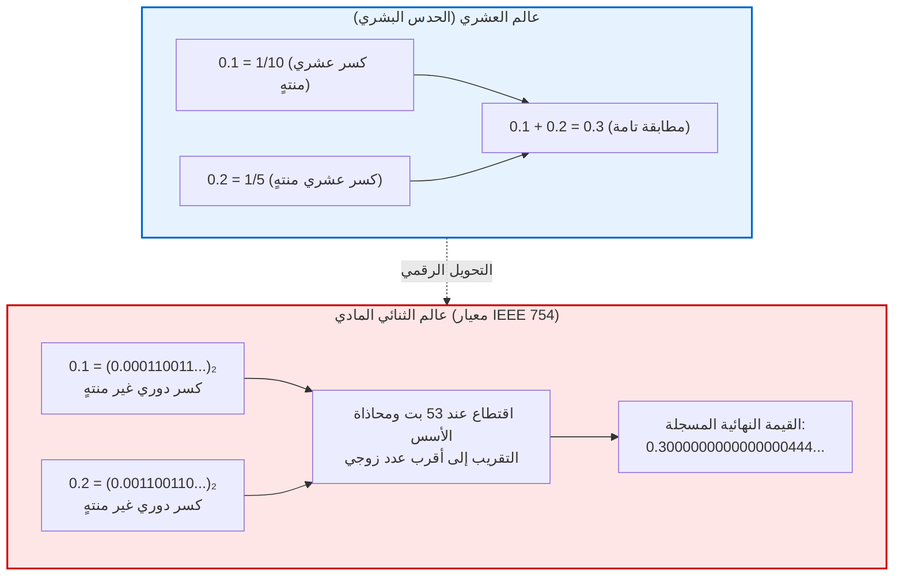

## مقدمة: لغز 0.1 + 0.2 الذي يربك المبرمجين

يشعر كل مبرمج مبتدئ بالدهشة عند تنفيذ هذا الكود البسيط:

```javascript
console.log(0.1 + 0.2);
// النتيجة: 0.30000000000000004
console.log(0.1 + 0.2 === 0.3);
// النتيجة: false
```

كيف يمكن لحاسوب فائق يعالج تريليونات العمليات ويدرب نماذج الذكاء الاصطناعي أن يخطئ في عملية جمع حسابية يتقنها طفل صغير؟
هذا ليس خطأ برمجياً. من هواتف آيفون إلى أقوى الحواسيب الخارقة، <strong>تعطي كافة المعالجات الرقمية النتيجة ذاتها تماماً: 0.30000000000000004.</strong>



---

## 1. لماذا تتحول الكسور العشرية إلى كسور دورية لا نهائية في النظام الثنائي؟

في النظام العشري، الكسر $\frac{1}{3} = 0.3333\dots$ كسر دوري لا نهائي.
في نظرية الأعداد، يكون الكسر $\frac{P}{Q}$ منتهياً في الأساس $N$ إذا وفقط إذا كانت جميع العوامل الأولية للمقام $Q$ قواسم للأساس $N$.
- في النظام العشري ($10 = 2 \times 5$)، تكون الكسور التي تحتوي مقاماتها على العوامل 2 و 5 منتهية ($0.1 = \frac{1}{10}$).
- في النظام الثنائي (الأساس 2)، العامل الأولي الوحيد هو <strong>2</strong>. فقط الكسور ذات المقام $2^k$ تكون منتهية.

بما أن مقام الكسر $0.1$ يحتوي على العامل 5، <strong>فإن 0.1 في النظام الثنائي كسر دوري لا نهائي حتماً</strong>:
$$(0.1)_{10} = (0.0001100110011\dots)_2$$
ولأن مسجلات الذاكرة محدودة الحجم، يضطر الحاسوب إلى اقتطاع الكسر وتقريبه، مما يولد الخطأ.

---

## 2. معيار IEEE 754 وحساب الجمع

يحدد معيار <strong>IEEE 754 (binary64)</strong> الدقة المضاعفة في 64 بت:
- 1 بت للإشارة
- 11 بت للأس الموزون (بانحياز 1023)
- 52 بت للجزء الكسري (بدقة فعلية 53 بت بفضل البت الضمني).

عند جمع 0.1 و 0.2، يقوم المعالج بمحاذاة الأسس وتطبيق تقريب <strong>التقريب إلى أقرب عدد زوجي</strong>. الناتج الفعلي المسجل هو:
$$\mathbf{0.300000000000000044408920985...}$$
لذلك، المقارنة `0.1 + 0.2 === 0.3` تعطي `false`.

---

## 3. كوارث تاريخية وإرشادات هندسية

- <strong>صاروخ باتريوت (1991):</strong> تسبب تراكم خطأ تقريب 0.1 ثانية على مدار 100 ساعة في إزاحة زمنية قدرها 0.34 ثانية، مما جعل الرادار يخطئ موقع صاروخ سكود بمسافة 687 متراً، مما أدى لمقتل 28 جندياً.
- <strong>صاروخ أريان 5 (1996):</strong> أدى خطأ تجاوز السعة عند تحويل عدد فاصلة عائمة 64 بت إلى عدد صحيح 16 بت لانفجار الصاروخ وخسارة 500 مليون دولار.

<strong>القواعد الذهبية:</strong>
1. تجنب المقارنة المباشرة (`==`)، واستخدم دائماً هامش خطأ إبسلون (`math.isclose`).
2. يُحظر استخدام الفاصلة العائمة في الأنظمة المالية؛ استخدم الأعداد الصحيحة (القروش/السنتات) أو مكتبات الفاصلة العشرية الدقيقة (`BigDecimal` / `Decimal`).
---

## 5. وقائع تاريخية إضافية: ثغرة معالج بنتيوم وبورصة فانكوفر

إلى جانب الحوادث العسكرية والفضائية، يزخر تاريخ الحوسبة بأزمات مالية وتقنية كبرى نجمت عن إهمال خصائص الفاصلة العائمة.

### 5.1 التآكل التدريجي لمؤشر بورصة فانكوفر (1982)
في عام 1982، أنشأت بورصة فانكوفر مؤشراً جديداً تم ضبط قيمته الأولية عند 1000.000 نقطة. ومع كل صفقة تجارية، كان المؤشر يُعاد حسابه؛ إلا أن مطوري البرمجيات ارتكبوا خطأ قاتلاً حين قاموا بـ <strong>اقتطاع (بتر)</strong> الأرقام بعد المنزلة العشرية الثالثة بدلاً من تطبيق التقريب الرياضي السليم.
أدى هذا الاقتطاع المستمر للأجزاء الكسرية الموجبة إلى انحراف إحصائي نزولي متراكم. وخلال 22 شهراً فقط، ورغم أن أداء السوق الحقيقي كان في نمو مستمر، هوى المؤشر بشكل غامض إلى قرابة 520 نقطة! وعندما تدخل علماء الرياضيات وأصلحوا البرنامج بتطبيق التقريب الصحيح، قفز المؤشر الحقيقي فوراً إلى أكثر من 1098 نقطة.

### 5.2 ثغرة القسمة FDIV في معالج إنتل بنتيوم (1994)
في خريف عام 1994، اكتشف أستاذ الرياضيات توماس نايسلي خطأً غريباً أثناء دراسته لثابت برون للأعداد الأولية التوأم باستخدام معالج Intel Pentium.
فقد تبين أن عمليات قسمة محددة مثل:
$$\frac{4195835}{3145727}$$
كانت تعطي نتيجة خاطئة بدءاً من الخانة العشرية الخامسة. ويعود السبب إلى خلل في مصفوفة خوارزمية القسمة (SRT) المنقوشة على شريحة السيليكون، حيث تُرِكت 5 خلايا فارغة من أصل 2048 خلية. كلف هذا الخطأ شركة إنتل 475 مليون دولار لاستبدال المعالجات المعيبة حول العالم.

---

## 6. خوارزمية كاهان للجمع التعويضي

لجمع ملايين الأعداد في النماذج العلمية دون فقدان القيم الدقيقة بسبب ظاهرة امتصاص الأرقام الصغيرة، ابتكر ويليام كاهان خوارزمية ذكية تعوض الأجزاء المبتورة:

```python
def kahan_sum(numbers):
    total = 0.0
    c = 0.0  # متغير تعويضي لحفظ البتات المفقودة
    for x in numbers:
        y = x - c
        t = total + y
        c = (t - total) - y  # استرجاع خطأ التقريب المبتور
        total = t
    return total
```

تضمن هذه الخوارزمية بقاء دقة الحسابات مستقرة مهما بلغ حجم البيانات المتراكمة.
