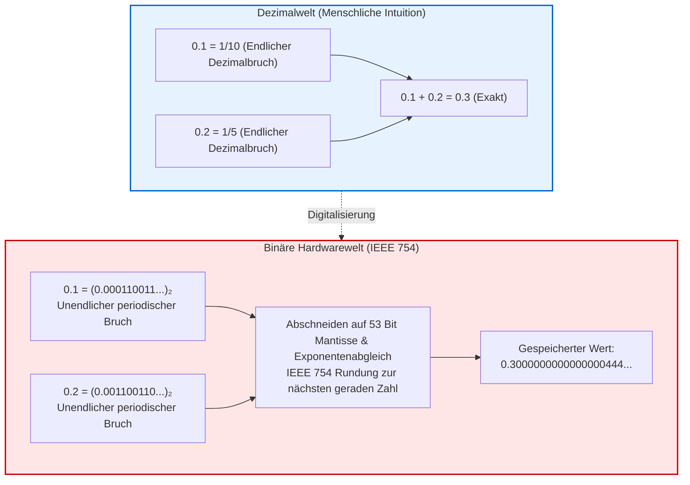
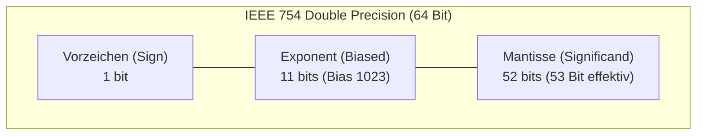

## Einleitung: Das Rätsel von 0.1 + 0.2

Jeder Programmierer erlebt früher oder später diesen Moment der Verblüffung:

```javascript
console.log(0.1 + 0.2);
// Ausgabe: 0.30000000000000004
console.log(0.1 + 0.2 === 0.3);
// Ausgabe: false
```

Wie kann ein moderner Prozessor, der Billionen Rechenoperationen pro Sekunde meistert und komplexe neuronale Netze trainiert, an einer simplen Grundschulaufgabe wie $0.1 + 0.2 = 0.3$ scheitern?
Dies ist kein Fehler der Programmiersprache. Ob x86-CPU, Apple-Silicon oder Hochleistungs-GPU: <strong>Jeder moderne Digitalrechner liefert exakt das Ergebnis 0.30000000000000004.</strong>



---

## 1. Die mathematische Ursache: Periodische Brüche im Binärsystem

Im Dezimalsystem lässt sich der Bruch $\frac{1}{3} = 0.3333\dots$ nicht als endliche Zahl darstellen.
Ein Bruch $\frac{P}{Q}$ ist in einer Basis $N$ genau dann endlich darstellbar, wenn alle Primfaktoren von $Q$ auch Primfaktoren von $N$ sind.
- Im Zehnersystem ($10 = 2 \times 5$) führen Nenner mit den Faktoren 2 und 5 zu endlichen Brüchen ($0.1 = \frac{1}{10}$).
- Im Zweiersystem (Basis 2) ist der einzige Primfaktor die <strong>2</strong>. Nur Brüche mit $2^k$ im Nenner sind endlich.

Da der Nenner von $0.1 = \frac{1}{10} = \frac{1}{2 \times 5}$ den Primfaktor 5 enthält, ist <strong>0.1 im Binärsystem eine unendliche periodische Zahl</strong>:
$$(0.1)_{10} = (0.00011001100110011\dots)_2$$
Da Register endlich sind, muss die Zahl abgeschnitten werden.

---

## 2. Der IEEE 754 Standard und die Addition im Register

Nach <strong>IEEE 754 (binary64)</strong> wird eine 64-Bit-Gleitkommazahl zerlegt in:
- 1 Vorzeichenbit ($s$)
- 11 Exponentenbits mit Bias 1023 ($e$)
- 52 Mantissenbits ($f$) mit impliziter führender Eins (53 Bit effektive Genauigkeit).



Bei der Addition von $0.1$ und $0.2$ gleicht die FPU die Exponenten durch Verschiebung der Mantisse an. Beim Runden nach dem Standardmodus <strong>Round-to-Nearest, Ties-to-Even</strong> wird der Wert aufgerundet.
Das Resultat ist exakt:
$$\mathbf{0.30000000000000004440892098500626...}$$
Da die direkte Repräsentation von $0.3$ ein abweichendes Bitmuster aufweist, schlägt der Vergleich `0.1 + 0.2 === 0.3` fehl.

---

## 3. Typische Fehler und historische Katastrophen

- <strong>Auslöschung (Catastrophic Cancellation):</strong> Bei der Subtraktion fast gleicher Zahlen gehen signifikante Stellen verloren.
- <strong>Absorption:</strong> Bei Addition von $10^{16}$ und $1.0$ fällt die kleine Zahl aus den 53 Bits heraus.
- <strong>Patriot-Raketen-Fehlschlag (1991):</strong> Die ungenaue binäre Repräsentation von 0.1 Sekunden addierte sich über 100 Betriebsstunden zu einer Zeitdrift von 0.34 Sekunden. Das Radar verfehlte die anfliegende Scud-Rakete um 687 Meter – 28 Soldaten starben.
- <strong>Ariane-5-Explosion (1996):</strong> Überlauf beim Konvertieren einer 64-Bit-Gleitkommazahl in eine 16-Bit-Ganzzahl zerstörte eine 500-Millionen-Dollar-Mission.

---

## 4. Best Practices für Software-Entwickler

1. <strong>Niemals direkter Vergleich (`==`):</strong> Verwenden Sie stets Maschinengenauigkeit $\epsilon$ (`math.isclose`).
2. <strong>Finanzmathematik nur mit Festkomma/Decimal:</strong> Nutzen Sie Integer-Cents oder Klassen wie `BigDecimal` / `decimal.Decimal`.
3. <strong>Algebraische Umformungen:</strong> Vermeiden Sie Subtraktionen fast gleicher Werte durch Rationalisierung.

