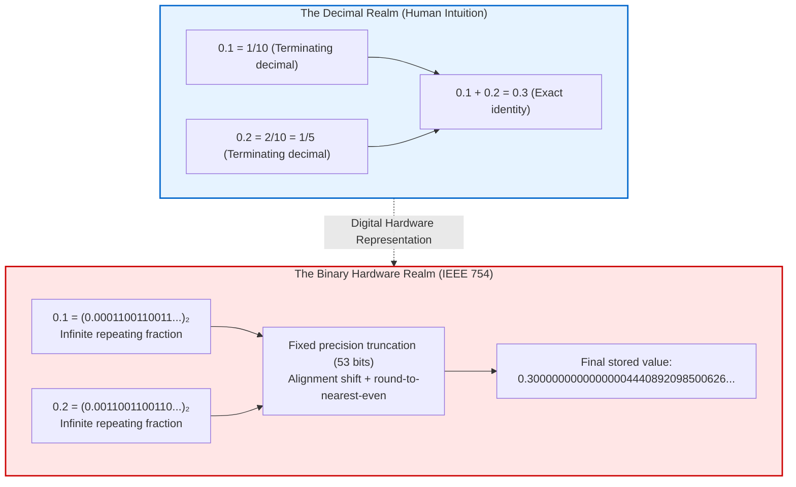
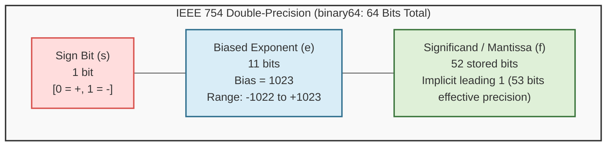
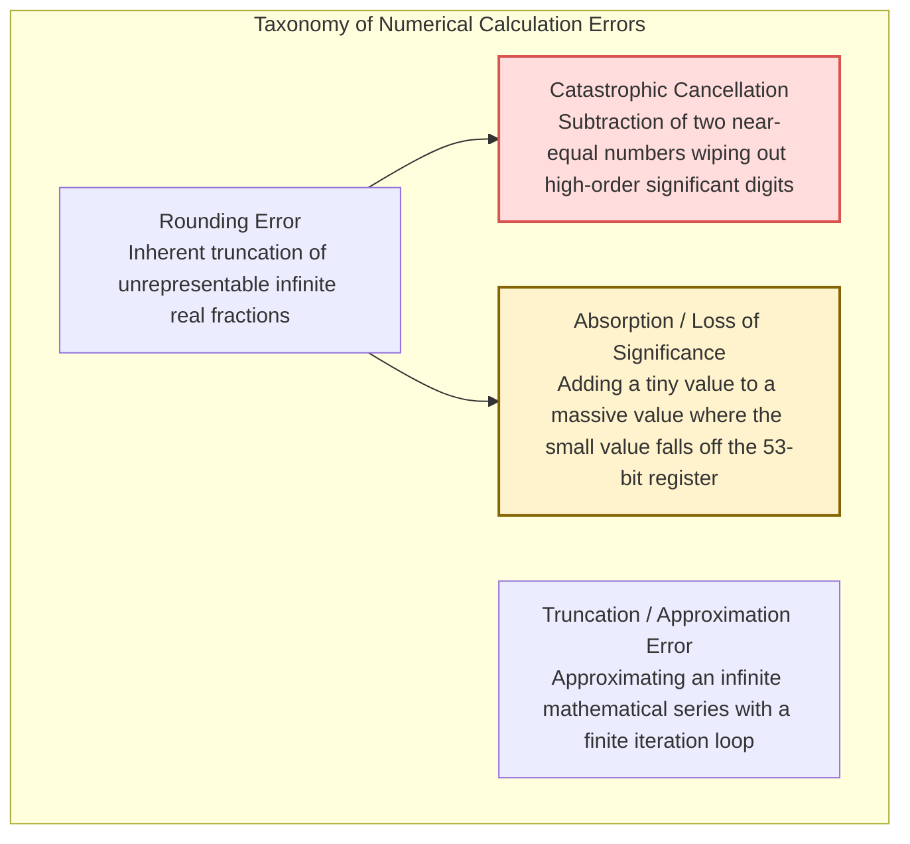
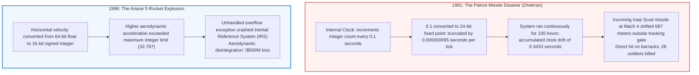
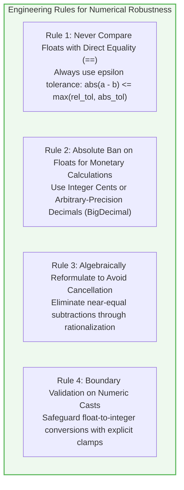

## Introduction: The Haunting Oddity of "0.1 + 0.2"

Every software engineer, at some formative moment in their journey, executes a code snippet like this in their browser console or terminal:

```javascript
console.log(0.1 + 0.2);
// Output: 0.30000000000000004
console.log(0.1 + 0.2 === 0.3);
// Output: false
```

```python
>>> 0.1 + 0.2
0.30000000000000004
>>> 0.1 + 0.2 == 0.3
False
```

The immediate reaction is almost universally one of bewilderment, irritation, or disbelief. 
How can a contemporary microprocessor—capable of executing trillions of floating-point operations per second, rendering hyper-realistic 3D graphics in real time, simulating quantum chromodynamics, and training trillion-parameter artificial intelligence models—fail at an arithmetic addition that a seven-year-old child solves in a split second?

Novice developers routinely suspect a bug in their programming language, an oversight in the compiler, or an egregious hardware flaw in their CPU. Yet this behavior is neither a bug nor a malfunction. From the pocket calculator on your desk to the Apple Silicon M-series chip in your laptop, from high-performance x86 servers to the most sophisticated supercomputers in national laboratories, <strong>every modern computing platform on Earth produces the exact same result: 0.30000000000000004</strong>.



This universal anomaly is not a defect of engineering. It is the direct consequence of a fundamental mathematical reality: <strong>the challenge of mapping an uncountably infinite continuum of real numbers onto a strictly finite register of discrete binary bits (0s and 1s).</strong>

In this comprehensive treatise, we demystify the science of floating-point arithmetic. We explore why clean decimal fractions turn into infinite repeating sequences in binary; dissect the anatomy of the ubiquitous <strong>IEEE 754 standard</strong>; trace the bit-by-bit execution of `0.1 + 0.2` within CPU registers; analyze catastrophic numerical errors such as cancellation and absorption; examine real-world catastrophes like the Patriot missile failure and the Ariane 5 disaster; and outline the definitive engineering protocols required to write rock-solid numerical software.

---

## 1. The Binary Abyss: Why Decimals Become Infinite Fractions

### 1.1 The Analogy of $1/3$ in Decimal
To understand why binary computers struggle with $0.1$, consider how our everyday base-10 (decimal) system handles simple fractions. How do you express the fraction $\frac{1}{3}$ as a decimal?

$$\frac{1}{3} = 0.3333333333\dots \quad (\text{repeating infinitely})$$

No matter how wide your sheet of paper is, you can never write down the exact value of $\frac{1}{3}$ using a finite number of decimal digits. If your calculator display is limited to eight digits, it truncates the number to $0.33333333$. Multiply that truncated number by 3, and you get:

$$0.33333333 \times 3 = 0.99999999 \neq 1$$

We accept this limitation without outrage. We intuitively recognize that within a base-10 system, certain rational fractions cannot be represented finitely.

<strong>For a digital computer operating in base 2, the numbers $0.1$ and $0.2$ are mathematically identical to $\frac{1}{3}$ in base 10.</strong>

### 1.2 The Prime Factorization Theorem of Terminating Radices
Why do some fractions terminate cleanly while others repeat forever? Number theory provides a precise, unequivocal rule:

> <strong>Theorem (Terminating Fractions in Radix-$N$):</strong>
> An irreducible rational fraction $\frac{P}{Q}$ can be expressed as a finite, terminating fractional expansion in base $N$ if and only if every prime factor of the denominator $Q$ is also a prime factor of the base $N$.

- <strong>In Base 10 (Decimal):</strong>
  The prime factors of the base are $10 = 2 \times 5$. Therefore, an irreducible fraction $\frac{P}{Q}$ terminates in decimal if and only if the prime factorization of $Q$ contains <strong>exclusively 2s and 5s</strong>:
  - $\frac{1}{2} = 0.5$ (Terminating)
  - $\frac{1}{4} = \frac{1}{2^2} = 0.25$ (Terminating)
  - $\frac{1}{5} = 0.2$ (Terminating)
  - $\frac{1}{10} = \frac{1}{2 \times 5} = 0.1$ (Terminating)
  - Conversely, $\frac{1}{3}$, $\frac{1}{6}$, and $\frac{1}{7}$ contain prime factors other than 2 and 5, forcing them into infinite periodic cycles.

- <strong>In Base 2 (Binary):</strong>
  The base is 2, which is itself a prime number. Its only prime factor is <strong>2</strong>.
  Consequently, a fraction terminates in binary if and only if its denominator is a <strong>strict power of two ($2^k$)</strong>!
  - $\frac{1}{2} = (0.1)_2$ (Terminating)
  - $\frac{1}{4} = (0.01)_2$ (Terminating)
  - $\frac{1}{8} = (0.001)_2$ (Terminating)
  - $\frac{1}{16} = (0.0001)_2$ (Terminating)

Now consider the innocent-looking decimal number $0.1$. In fractional form, it is $\frac{1}{10} = \frac{1}{2 \times 5}$.
The denominator contains the prime factor <strong>5</strong>. Because 5 is coprime to 2, <strong>the fraction $\frac{1}{10}$ can never terminate in binary notation. It is an infinitely repeating periodic fraction.</strong>

### 1.3 Hand-Calculating the Binary Expansion of 0.1
We can prove this by converting decimal $0.1$ to binary using standard successive multiplication by 2:

$$\begin{aligned}
0.1 \times 2 &= \mathbf{0}.2 \quad (\text{Integer part: } 0) \\
0.2 \times 2 &= \mathbf{0}.4 \quad (\text{Integer part: } 0) \\
0.4 \times 2 &= \mathbf{0}.8 \quad (\text{Integer part: } 0) \\
0.8 \times 2 &= \mathbf{1}.6 \quad (\text{Integer part: } 1, \text{fractional remainder: } 0.6) \\
0.6 \times 2 &= \mathbf{1}.2 \quad (\text{Integer part: } 1, \text{fractional remainder: } 0.2 \leftarrow \text{Cycle restarts!}) \\
0.2 \times 2 &= \mathbf{0}.4 \quad (\text{Integer part: } 0) \\
0.4 \times 2 &= \mathbf{0}.8 \quad (\text{Integer part: } 0) \\
0.8 \times 2 &= \mathbf{1}.6 \quad (\text{Integer part: } 1) \\
0.6 \times 2 &= \mathbf{1}.2 \quad (\text{Integer part: } 1) \\
&\quad \vdots
\end{aligned}$$

Notice that at step 5, the remainder $0.2$ appears again, entering an endless four-bit cycle: `0011`.

$$(0.1)_{10} = (0.00011001100110011001100110011\dots)_2 = (0.000\overline{1100})_2$$

Similarly, $0.2$ is simply double $0.1$, shifting the binary point one position to the right:

$$(0.2)_{10} = (0.00110011001100110011001100110\dots)_2 = (0.0\overline{0110})_2$$

Because computer memory registers are fundamentally finite—providing 32 or 64 bits—the processor has no choice but to truncate this infinite ribbon of bits. That unavoidable truncation is the origin of all floating-point discrepancies.

---

## 2. Anatomy of the IEEE 754 Standard

Before the 1980s, computer manufacturers implemented floating-point arithmetic using proprietary, incompatible hardware designs. Code that executed flawlessly on an IBM mainframe produced wildly different results on a Cray supercomputer or a DEC VAX.

In 1985, under the leadership of UC Berkeley mathematician William Kahan, the Institute of Electrical and Electronics Engineers ratified <strong>IEEE 754</strong>, establishing a universal mathematical specification for binary floating-point computation.



### 2.1 The Three Structural Fields of binary64
Under IEEE 754 double precision (`binary64`), every real number is represented across 64 bits partitioned into three discrete fields:

1. <strong>Sign Bit ($s$, 1 bit):</strong>
   - $s = 0$ designates a positive value; $s = 1$ designates a negative value.
2. <strong>Biased Exponent ($e$, 11 bits):</strong>
   - Encodes unsigned integers from $0$ to $2047$.
   - To represent both massive astronomical quantities and minuscule subatomic dimensions without requiring a separate sign bit for the exponent, an offset of <strong>1023 (the bias)</strong> is applied:
     $$\text{Actual Exponent } E = e - 1023$$
3. <strong>Fraction / Mantissa ($f$, 52 bits):</strong>
   - Encodes the fractional portion of the normalized binary significand.
   - In normalized binary scientific notation, the leading bit before the binary point is always $1$ (e.g., $1.1011_2 \times 2^E$). IEEE 754 takes advantage of this by omitting the leading $1$ entirely from storage. This clever optimization, known as the <strong>hidden bit</strong> or <strong>implicit bit</strong>, provides <strong>53 bits of effective precision</strong> using only 52 bits of physical storage.

The analytical value of a normalized number is given by:

$$V = (-1)^s \times \left(1 + \sum_{i=1}^{52} b_{52-i} 2^{-i}\right) \times 2^{e - 1023}$$

### 2.2 Special Values in the Standard
IEEE 754 reserves specific exponent patterns to handle boundary conditions gracefully without throwing immediate hardware faults:

| Biased Exponent $e$ | Fraction $f$ | Representation | Mathematical Meaning / Usage |
|---|---|---|---|
| $0 < e < 2047$ | Any | <strong>Normalized Number</strong> | Standard real numbers |
| $e = 0$ | $f = 0$ | <strong>$\pm 0$ (Signed Zero)</strong> | Preserves sign under limits ($1 / -0 = -\infty$) |
| $e = 0$ | $f \neq 0$ | <strong>Subnormal Number</strong> | Gradual underflow near zero ($0.f \times 2^{-1022}$) |
| $e = 2047$ | $f = 0$ | <strong>$\pm \infty$ (Infinity)</strong> | Arithmetic overflow or division by zero ($1.0 / 0.0$) |
| $e = 2047$ | $f \neq 0$ | <strong>$\text{NaN}$ (Not a Number)</strong> | Indeterminate forms ($0/0$, $\infty - \infty$, $\sqrt{-1}$) |

---

## 3. Dissecting "0.1 + 0.2" at the Hardware Level

Let us now trace the exact mechanics of what occurs inside CPU registers when evaluating `0.1 + 0.2`.

### 3.1 Encoding 0.1 into IEEE 754 Double Precision
Normalizing the infinite binary expansion of $0.1$:

$$(0.1)_{10} = 1.1001100110011001100110011001100110011001100110011001\dots_2 \times 2^{-4}$$

- <strong>Sign ($s$):</strong> $0$
- <strong>Exponent ($E = -4$):</strong> $e = -4 + 1023 = 1019 = (01111111011)_2$
- <strong>Fraction ($f$):</strong> Truncated to 52 bits.
  Looking at bit 53 and beyond, the remaining bits are `110011...`. Because this remainder is strictly greater than half the value of the least significant bit (LSB), IEEE 754 requires <strong>rounding up</strong>.

Adding $1$ to the LSB yields the stored 64-bit sequence:

$$\begin{aligned}
s &= 0 \\
e &= 01111111011_2 \quad (= 1019) \\
f &= 1001100110011001100110011001100110011001100110011010_2
\end{aligned}$$

Converting this bit sequence back into exact decimal notation reveals what the computer *actually* holds:

$$\text{float64}(0.1) = 0.1000000000000000055511151231257827021181583404541015625$$

Notice that the stored number is slightly *larger* than the true decimal $0.1$.

### 3.2 Encoding 0.2
Similarly, $0.2$ shares the exact same significand, scaled by $2^{-3}$:

$$\begin{aligned}
s &= 0 \\
e &= -3 + 1023 = 1020 = (01111111100)_2 \\
f &= 1001100110011001100110011001100110011001100110011010_2
\end{aligned}$$

Exact decimal value:

$$\text{float64}(0.2) = 0.200000000000000011102230246251565404236316680908203125$$

### 3.3 Alignment and Register Addition
Before two floating-point numbers can be added, the Floating Point Unit (FPU) must align their binary exponents. The number with the smaller exponent is right-shifted by the difference between exponents:

$$\Delta E = (-3) - (-4) = 1 \text{ bit shift}$$

Restoring the implicit leading $1$ and shifting $0.1$ right by one place:

$$\begin{aligned}
\text{Significand of } 0.1: & \quad 0.1100110011001100110011001100110011001100110011001101 \times 2^{-3} \\
\text{Significand of } 0.2: & \quad 1.1001100110011001100110011001100110011001100110011010 \times 2^{-3}
\end{aligned}$$

Adding the significands directly:

$$\begin{aligned}
&\phantom{+} 0.1100110011001100110011001100110011001100110011001101 \\
&+ 1.1001100110011001100110011001100110011001100110011010 \\
\hline
&= 10.0100110011001100110011001100110011001100110011001111 \times 2^{-3}
\end{aligned}$$

Because the sum overflowed the radix point ($10.xxx$), the result must be normalized: shifted right by 1 bit, incrementing the exponent to $2^{-2}$:

$$1.0010011001100110011001100110011001100110011001100111(1) \times 2^{-2}$$

### 3.4 Round-to-Nearest, Ties-to-Even
Applying IEEE 754's standard rounding mode (<strong>Round-to-Nearest, Ties-to-Even</strong>), the discarded trailing bit pattern requires rounding up to the nearest even number. The final stored fraction is:

$$f = 0010011001100110011001100110011001100110011001100100_2$$

Expanding this binary representation into full-precision decimal produces:

$$\mathbf{0.3000000000000000444089209850062616169452667236328125}$$

When formatted by JavaScript or Python, the string conversion algorithm trims digits beyond the reliable 17-digit precision envelope, presenting the infamous:

$$\mathbf{0.30000000000000004}$$

Meanwhile, the binary representation of pure $0.3$ stored directly evaluates to:

$$\text{float64}(0.3) = 0.299999999999999988897769753748434595763683319091796875$$

The bit patterns differ at the least significant positions. Consequently, the conditional check `0.1 + 0.2 === 0.3` is strictly, mathematically <strong>false</strong>.

---

## 4. The Taxonomy of Numerical Calculation Errors

While an error of $10^{-17}$ may seem inconsequential, numerical algorithms can amplify microscopic discrepancies into catastrophic failures.



### 4.1 Catastrophic Cancellation
The most dangerous numerical pitfall is <strong>cancellation</strong>: subtracting two nearly identical floating-point quantities.
When two numbers share their first 14 digits, subtracting them cancels out all 14 leading significant digits. The remaining result is dominated by the noise in the final 2 or 3 digits, which is then shifted into the leading positions, obliterating the precision of subsequent calculations.

Consider the classic quadratic formula:

$$x = \frac{-b + \sqrt{b^2 - 4ac}}{2a}$$

When $b > 0$ and $b^2 \gg 4ac$, $\sqrt{b^2 - 4ac} \approx b$. Evaluating $-b + \sqrt{b^2 - 4ac}$ subtracts two nearly identical numbers, triggering severe catastrophic cancellation.

<strong>The Algebraic Remedy:</strong>
Rationalizing the numerator eliminates the dangerous subtraction:

$$x = \frac{(-b + \sqrt{b^2 - 4ac})(-b - \sqrt{b^2 - 4ac})}{2a(-b - \sqrt{b^2 - 4ac})} = \frac{-2c}{b + \sqrt{b^2 - 4ac}}$$

Replacing subtraction with addition completely neutralizes the error.

### 4.2 Absorption (Loss of Significance)
Absorption occurs when adding quantities of wildly disparate magnitudes:

```python
>>> large = 1e16
>>> small = 1.0
>>> (large + small) - large
0.0
```

Because double precision only preserves 53 bits (roughly 15 to 17 decimal digits), adding $1.0$ to $10^{16}$ forces $1.0$ to be right-shifted past the 53rd bit during alignment. The small number vanishes entirely into the bit bucket.

### 4.3 Kahan Compensated Summation
To accumulate millions of numbers without suffering crippling absorption error, William Kahan devised the <strong>Kahan Summation Algorithm</strong>:

```python
def kahan_sum(data):
    total = 0.0
    c = 0.0  # Running compensation accumulator for lost low-order bits
    
    for x in data:
        y = x - c            # Subtract the previous error from current input
        t = total + y        # Add to total (precision loss occurs here)
        c = (t - total) - y  # (t - total) recovers high bits; subtracting y extracts the lost low bits!
        total = t            # Update total
        
    return total
```

By actively capturing and reapplying discarded low-order bits at each step, Kahan summation achieves near-perfect mathematical accuracy over billions of iterations.

---

## 5. Historical Catastrophes Caused by Floating-Point Errors

Floating-point precision errors are not theoretical curiosities. History records lethal and financially devastating disasters caused by ignoring these principles.



### 5.1 The 1991 Patriot Missile Failure at Dhahran
On February 25, 1991, during Operation Desert Storm, an Iraqi Scud missile struck an American military barracks in Dhahran, Saudi Arabia, killing 28 soldiers and injuring more than 100. The Patriot air defense battery tasked with protecting the base failed to launch an interceptor.

The official General Accounting Office (GAO) investigation uncovered the cause: <strong>the continuous accumulation of a binary rounding error in converting 0.1 seconds</strong>.

- The radar tracking software measured time in tenths of a second ($0.1$s) using an integer counter multiplied by a 24-bit representation of $0.1$.
- In a 24-bit register, the binary expansion of $0.1$ was truncated, introducing a delay of approximately $0.000000095$ seconds per tick.
- The system was designed for mobile deployment and expected to reboot every few hours. In Dhahran, the battery operated continuously for over <strong>100 consecutive hours</strong>.
- Over 100 hours, the accumulated timing drift reached:
  $$0.000000095 \text{ s} \times 100 \times 3600 \times 10 \approx \mathbf{0.3433 \text{ seconds}}$$
- Traveling at Mach 4 (approximately $1,400\text{ m/s}$), an incoming Scud missile travels over <strong>687 meters</strong> in 0.34 seconds.
- When the radar looked for the Scud in the calculated range gate, the missile was nearly 700 meters away from where the clock said it should be. The system classified the echo as a false track and aborted the interception.

### 5.2 The 1996 Ariane 5 Disaster
On June 4, 1996, the European Space Agency's inaugural Ariane 5 rocket exploded 37 seconds after launch, destroying an uninsured \$500 million scientific payload.

The disaster was traced to a software routine reused from the older Ariane 4 launcher:
- A 64-bit floating-point variable measuring horizontal bias was cast into a 16-bit signed integer (range: $-32768$ to $+32767$).
- While Ariane 4 never achieved horizontal velocities sufficient to exceed 32,767, Ariane 5's more powerful engines generated far higher early trajectory angles.
- The float-to-int cast triggered an <strong>unhandled integer overflow hardware exception</strong>.
- Both primary and backup flight computers crashed simultaneously, diagnostic dump codes were misread by the main engine gimbal controller as actual flight corrections, and the rocket violently steered off course and self-destructed.

---

## 6. Engineering Protocols: How to Write Resilient Software

Floating-point limitations cannot be eliminated from digital hardware, but software engineers can follow strict architectural protocols to prevent failures.



### 6.1 Banning Direct Equality (`==`)
Comparing floating-point values with `==` or `===` is an anti-pattern. Engineers must always check whether two values lie within a tiny acceptable boundary (<strong>machine epsilon $\epsilon$</strong>):

```python
import math

# INCORRECT
if a == b:
    pass

# CORRECT: Standard library approximation
if math.isclose(0.1 + 0.2, 0.3, rel_tol=1e-9, abs_tol=1e-12):
    print("Safely matched within tolerance!")
```

### 6.2 The Golden Rule of Financial Software: Zero Floats
In banking, retail, high-frequency trading, and accounting systems, using `float` or `double` is professional malpractice. Rounding errors accumulating across millions of ledger transactions inevitably create audit discrepancies and regulatory violations.

Financial systems use two proven paradigms:
1. <strong>Integer Representation (Sub-unit Scaling):</strong>
   Store all currency in the lowest non-divisible fractional denomination (e.g., cents, cents-of-a-cent, or satoshis). Instead of storing \$10.50 as a float, store `1050` as an integer.
2. <strong>Arbitrary-Precision Decimal Libraries:</strong>
   Utilize dedicated base-10 arithmetic data types such as Python's `decimal.Decimal`, Java's `BigDecimal`, or C#'s `decimal`. These types store decimal digits directly as integer arrays, guaranteeing that `Decimal('0.1') + Decimal('0.2') == Decimal('0.3')`.

```python
from decimal import Decimal

val1 = Decimal('0.1')
val2 = Decimal('0.2')
print(val1 + val2 == Decimal('0.3'))  # Guaranteed True!
```

---

## 7. Conclusion: The Miracle of Finite Bits

The output `0.30000000000000004` is often met with derision, but a deeper inspection of IEEE 754 inspires profound admiration.

Within the confines of just 64 microscopic electrical charges, computer architects successfully captured a dynamic range spanning over 600 orders of magnitude—from the subatomic radius of a proton ($10^{-15}\text{m}$) to the boundary of the observable universe ($10^{26}\text{m}$)—executing billions of calculations each second with deterministic mathematical consistency.

The lingering `4` at the seventeenth decimal place is not a sign of failure. It is the humble physical signature of an extraordinary engineering compromise: the boundary where the infinite elegance of pure mathematics meets the finite constraints of physical silicon. Understanding and mastering that boundary is the true hallmark of an expert software engineer.

