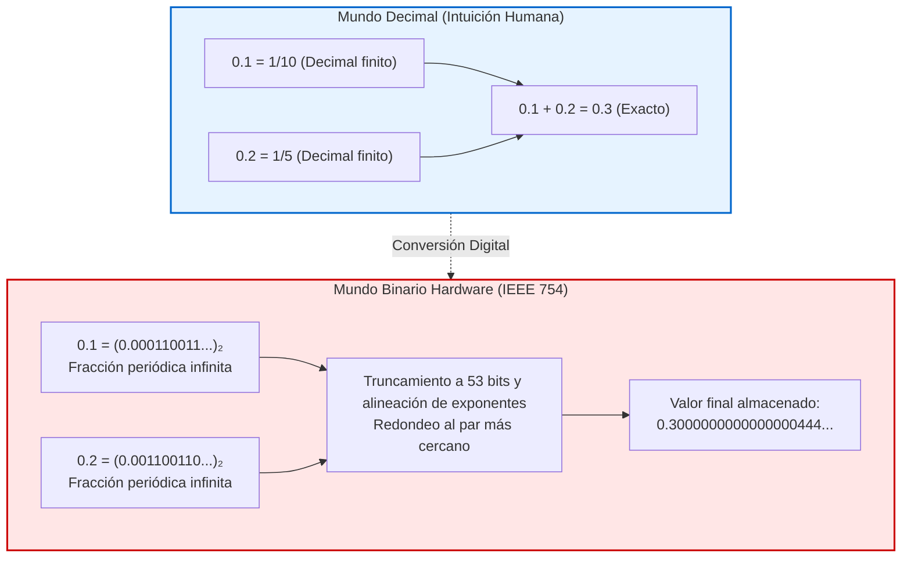

## Introducción: El desconcertante enigma de 0.1 + 0.2

Cualquier programador ha presenciado con asombro este comportamiento:

```javascript
console.log(0.1 + 0.2);
// Salida: 0.30000000000000004
console.log(0.1 + 0.2 === 0.3);
// Salida: false
```

¿Cómo es posible que supercomputadoras capaces de simular el clima global fallen en una suma elemental de primaria?
No es un error de software. Desde un procesador ARM hasta el servidor más potente del mundo, <strong>todos los equipos modernos arrojan idéntico resultado: 0.30000000000000004.</strong>



---

## 1. Por qué los decimales se vuelven infinitos en binario

En base 10, $\frac{1}{3} = 0.3333\dots$ no puede representarse de forma finita.
En teoría de números, una fracción irreducible $\frac{P}{Q}$ tiene una representación finita en base $N$ si y solo si todos los factores primos de $Q$ dividen a la base $N$.
- En base 10 ($10 = 2 \times 5$), los denominadores con factores 2 y 5 son finitos ($0.1 = \frac{1}{10}$).
- En base 2, el único factor primo es <strong>2</strong>. Solo las potencias de dos ($2^k$) son finitas.

Como el denominador de $0.1$ contiene el factor primo 5, <strong>0.1 es una fracción periódica infinita en binario</strong>:
$$(0.1)_{10} = (0.0001100110011\dots)_2$$
Al almacenarlo en un registro finito, el redondeo resulta inevitable.

---

## 2. El estándar IEEE 754 y la suma en registros

El estándar <strong>IEEE 754 (binary64)</strong> divide los 64 bits en:
- 1 bit de signo
- 11 bits de exponente (con sesgo de 1023)
- 52 bits de mantisa (53 bits de precisión efectiva con el bit implícito).

Al sumar 0.1 y 0.2, la FPU alinea los exponentes y aplica el <strong>redondeo al par más cercano (Round-to-Nearest, Ties-to-Even)</strong>. El valor resultante es exactamente:
$$\mathbf{0.300000000000000044408920985...}$$
Por tanto, la comparación `0.1 + 0.2 === 0.3` resulta ser estrictamente <strong>`false`</strong>.

---

## 3. Desastres históricos causados por punto flotante

- <strong>Misil Patriot (1991):</strong> El error de redondeo de 0.1 segundos acumulado durante 100 horas provocó un desvío temporal de 0.34 s. El radar buscó el misil Scud 687 metros lejos de su posición real, causando la muerte de 28 soldados.
- <strong>Cohete Ariane 5 (1996):</strong> El desbordamiento al convertir un flotante de 64 bits a un entero de 16 bits provocó la destrucción de la nave espacial (pérdidas de 500 millones de dólares).

---

## 4. Reglas prácticas para programadores

1. <strong>Nunca usar igualdad directa (`==`):</strong> Utilice siempre márgenes de tolerancia con épsilon (`math.isclose`).
2. <strong>Finanzas sin flotantes:</strong> Use enteros en centavos o tipos decimales de precisión arbitraria (`BigDecimal` o `decimal.Decimal`).
---

## 5. Casos de estudio históricos adicionales: El error FDIV de Pentium y la Bolsa de Vancouver

Más allá de los conocidos desastres militares y aeroespaciales, los anales de la computación documentan graves incidentes financieros y de microarquitectura causados por imprecisiones numéricas.

### 5.1 La erosión del índice de la Bolsa de Vancouver (1982)
En 1982, la Bolsa de Valores de Vancouver introdujo un nuevo índice configurado inicialmente en 1000.000 puntos. Con cada transacción, el índice era recalculado y, por un error de diseño de software, el valor resultante se <strong>truncaba</strong> a tres posiciones decimales en lugar de redondearse al valor más próximo.
Dado que el truncamiento siempre descarta el residuo positivo, se introdujo un sesgo sistemático a la baja. Tras veintidós meses de operaciones continuas y con una economía en crecimiento, ¡el índice se había desplomado misteriosamente a 520 puntos! Cuando las autoridades corrigieron el software aplicando redondeo simétrico estándar, el índice saltó de inmediato por encima de los 1098 puntos.

### 5.2 El error de división FDIV de Intel Pentium (1994)
En octubre de 1994, el profesor de matemáticas Thomas Nicely detectó inconsistencias mientras calculaba la constante de Brun para números primos gemelos utilizando una estación de trabajo con el chip Intel Pentium.
Una simple división como:
$$\frac{4195835}{3145727}$$
producía un resultado inexacto a partir de la quinta cifra decimal. El fallo se originó en la matriz lógica del algoritmo de división SRT en silicio, donde cinco celdas de una tabla de 2048 entradas quedaron vacías por descuido. Intel tuvo que reemplazar millones de chips, asumiendo un costo financiero superior a 475 millones de dólares.

---

## 6. Algoritmo de suma compensada de William Kahan

Para sumar millones de datos numéricos en simulaciones científicas sin perder precisión debido al fenómeno de absorción, el algoritmo de Kahan proporciona una compensación dinámica:

```python
def suma_kahan(datos):
    total = 0.0
    c = 0.0  # Compensador de bits descartados
    for elemento in datos:
        y = elemento - c
        t = total + y
        c = (t - total) - y  # Captura matemática del error de redondeo
        total = t
    return total
```

Este algoritmo garantiza que el error relativo permanezca acotado independientemente del volumen de datos sumados.
