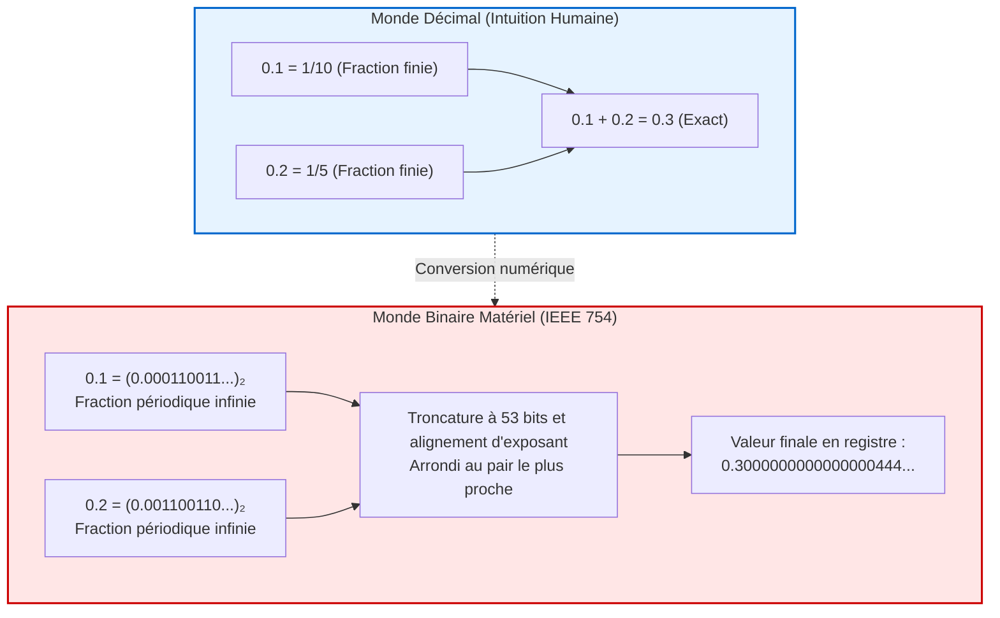

## Introduction : Le mystère de 0.1 + 0.2

Tout développeur a un jour tapé cette commande dans une console :

```javascript
console.log(0.1 + 0.2);
// Résultat : 0.30000000000000004
console.log(0.1 + 0.2 === 0.3);
// Résultat : false
```

Comment des superordinateurs capables d'entraîner des réseaux de neurones gigantesques peuvent-ils échouer sur une simple addition d'école primaire ?
Ce n'est pas un bogue logiciel. Qu'il s'agisse d'un Mac Apple Silicon, d'un processeur Intel ou d'un GPU de pointe, <strong>tous les ordinateurs modernes renvoient rigoureusement 0.30000000000000004.</strong>



---

## 1. Pourquoi les décimaux deviennent infinis en binaire

En base 10, la fraction $\frac{1}{3} = 0.3333\dots$ est infinie. En arithmétique, une fraction irréductible $\frac{P}{Q}$ est finie en base $N$ si et seulement si tous les facteurs premiers de $Q$ divisent $N$.
- En base 10 ($10 = 2 \times 5$), les fractions dont le dénominateur est composé de 2 et 5 sont finies ($0.1 = \frac{1}{10}$).
- En base 2, le seul facteur premier est <strong>2</strong>. Seules les puissances de deux ($2^k$) forment des nombres finis.

Comme le dénominateur de $0.1$ contient le facteur premier 5, <strong>0.1 est un nombre périodique infini en binaire</strong> :
$$(0.1)_{10} = (0.0001100110011\dots)_2$$
La mémoire étant finie, l'ordinateur est obligé de tronquer la valeur, créant une infime erreur d'arrondi.

---

## 2. Le standard IEEE 754 et l'addition binaire

Le standard <strong>IEEE 754 (binary64)</strong> structure un nombre en 64 bits :
- 1 bit de signe
- 11 bits d'exposant (avec un décalage/biais de 1023)
- 52 bits de mantisse (avec le bit implicite '1.', soit 53 bits de précision effective).

Lors de l'addition de 0.1 et 0.2, les exposants sont alignés, les mantisses sont additionnées puis arrondies selon la règle de l'<strong>arrondi au pair le plus proche</strong>.
La valeur résultante est :
$$\mathbf{0.300000000000000044408920985...}$$
Le test `0.1 + 0.2 === 0.3` est donc strictement <strong>faux</strong>.

---

## 3. Catastrophes historiques liées aux flottants

- <strong>Échec du missile Patriot (1991) :</strong> L'accumulation de l'erreur d'arrondi de 0.1 s sur 100 heures d'affilée a créé un décalage temporel de 0.34 s. Le missile Scud fonçant à Mach 4 a été manqué de 687 mètres, tuant 28 soldats.
- <strong>Explosion d'Ariane 5 (1996) :</strong> La conversion d'un flottant 64 bits en entier 16 bits signé a provoqué un dépassement de capacité (overflow), entraînant la destruction de la fusée (500 millions de dollars).

---

## 4. Règles d'or pour les développeurs

1. <strong>Ne jamais tester l'égalité stricte (`==`) :</strong> Toujours utiliser un intervalle de tolérance $\epsilon$ (`math.isclose`).
2. <strong>Proscription absolue des flottants en finance :</strong> Utiliser des entiers représentant la plus petite sous-unité (centimes) ou des types décimaux arbitraires (`BigDecimal` / `Decimal`).
---

## 5. Cas d'école supplémentaires : Le bogue du Pentium et la Bourse de Vancouver

Outre les catastrophes spatiales et militaires, l'histoire de l'informatique regorge d'incidents financiers et matériels majeurs causés par les subtilités du calcul flottant.

### 5.1 Le krach silencieux de la Bourse de Vancouver (1982)
En 1982, la Bourse de Vancouver créa un nouvel indice boursier initialisé à une valeur de 1000,000. À chaque transaction, l'indice était recalculé. Cependant, les développeurs ont programmé le système pour <strong>tronquer</strong> le résultat à trois décimales au lieu d'effectuer un arrondi correct.
Sur des milliers d'opérations quotidiennes, cette troncature constante vers le bas a fonctionné comme une hémorragie statistique continue. Au bout de vingt-deux mois, alors que le marché était globalement haussier, l'indice s'était effondré à environ 520 points ! Après correction du code avec un algorithme d'arrondi conforme, l'indice réel recalculé bondit instantanément au-dessus de 1098 points.

### 5.2 Le fameux bug FDIV du processeur Intel Pentium (1994)
À l'automne 1994, le mathématicien Thomas Nicely découvrit une anomalie dans le calcul de la constante de Brun sur les nouveaux processeurs Intel Pentium. Dans certaines divisions de nombres à virgule flottante très spécifiques, le résultat était faux dès la cinquième décimale.
Par exemple :
$$\frac{4195835}{3145727} = 1.333820449136... \quad \text{mais le Pentium renvoyait} \quad 1.333739068902...$$
La cause venait d'une table de consultation matérielle pour l'algorithme SRT où 5 entrées sur 2048 avaient été accidentellement omises lors de la gravure des puces. Ce défaut contraignit Intel à provisionner 475 millions de dollars pour remplacer les processeurs défectueux dans le monde entier.

---

## 6. L'algorithme de sommation compensée de Kahan

Pour sommer des millions de nombres sans que les petits éléments ne soient absorbés par les grands (phénomène de perte de signification), l'algorithme de William Kahan offre une solution mathématique optimale :

```python
def sommation_kahan(tableau):
    somme = 0.0
    c = 0.0  # Variable de compensation pour stocker les bits perdus
    for x in tableau:
        y = x - c             # Soustraction de l'erreur précédente
        t = somme + y         # Addition (les bits de poids faible peuvent être tronqués)
        c = (t - somme) - y   # Récupération algébrique de l'erreur d'arrondi
        somme = t             # Nouvelle somme
    return somme
```

Grâce à cette astuce algébrique, l'erreur accumulée ne croît que proportionnellement à la précision machine $\epsilon$, plutôt qu'au nombre d'itérations $N$.
