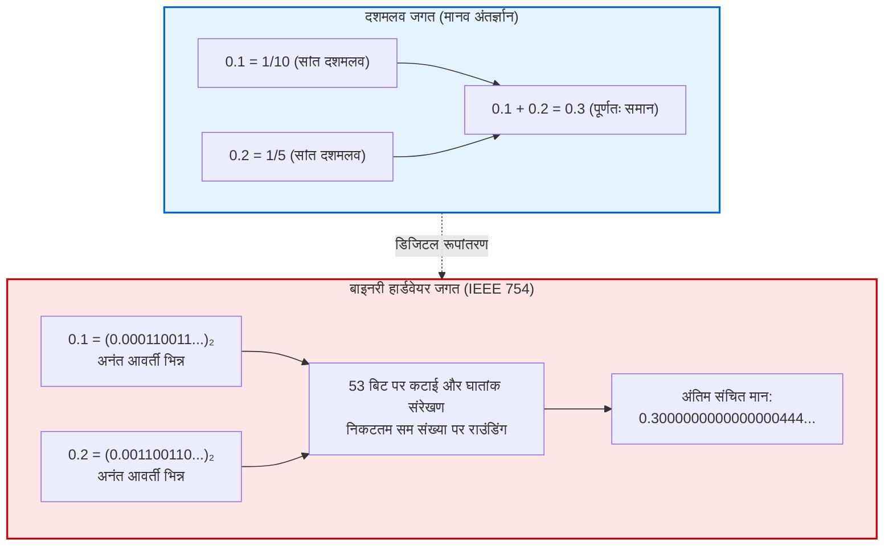

## प्रस्तावना: '0.1 + 0.2' की रहस्यमयी पहेली

प्रत्येक प्रोग्रामर ने अपने जीवन में कभी न कभी इस परिणाम को देखकर आश्चर्य अवश्य महसूस किया होगा:

```javascript
console.log(0.1 + 0.2);
// आउटपुट: 0.30000000000000004
console.log(0.1 + 0.2 === 0.3);
// आउटपुट: false
```

अरबों-खरबों गणनाएं प्रति सेकंड करने वाले आधुनिक सुपरकंप्यूटर $0.1 + 0.2 = 0.3$ जैसे प्राथमिक स्तर के जोड़ में क्यों अटक जाते हैं?
यह किसी प्रोग्रामिंग भाषा का बग नहीं है। स्मार्टफोन से लेकर दुनिया के सबसे शक्तिशाली सुपरकंप्यूटर तक, <strong>सभी डिजिटल सिस्टम सटीक रूप से यही आउटपुट देते हैं: 0.30000000000000004।</strong>



---

## 1. बाइनरी में दशमलव संख्याएं अनंत आवर्ती क्यों बन जाती हैं?

दशमलव प्रणाली में $\frac{1}{3} = 0.3333\dots$ कभी समाप्त नहीं होता।
संख्या सिद्धांत के अनुसार, कोई भिन्न $\frac{P}{Q}$ आधार $N$ में सांत दशमलव तभी बन सकती है जब हर $Q$ के सभी अभाज्य गुणनखंड आधार $N$ के अभाज्य गुणनखंड हों।
- 10 आधार ($10 = 2 \times 5$) में 2 और 5 गुणनखंड वाली भिन्नें सांत होती हैं ($0.1 = \frac{1}{10}$)।
- 2 आधार (बाइनरी) में केवल <strong>2</strong> ही अभाज्य गुणनखंड है। केवल वही भिन्नें सांत होंगी जिनके हर में $2^k$ हो।

चूंकि $0.1$ के हर में गुणनखंड 5 आता है, <strong>बाइनरी प्रणाली में 0.1 एक अनंत आवर्ती भिन्न बन जाता है</strong>:
$$(0.1)_{10} = (0.0001100110011\dots)_2$$
मेमोरी सीमित होने के कारण कंप्यूटर को इसे काटना पड़ता है, जिससे सूक्ष्म त्रुटि उत्पन्न होती है।

---

## 2. IEEE 754 मानक और आंतरिक जोड़ प्रक्रिया

<strong>IEEE 754 (binary64)</strong> के तहत 64 बिट्स इस प्रकार विभाजित होते हैं:
- 1 साइन बिट
- 11 एक्सपोनेंट बिट्स (1023 बायस के साथ)
- 52 मैंटीसा बिट्स (निहित बिट के साथ 53 बिट्स की प्रभावी सटीकता)।

0.1 और 0.2 को जोड़ते समय प्रोसेसर एक्सपोनेंट का मिलान करता है और <strong>निकटतम सम संख्या में राउंडिंग (Round-to-Nearest, Ties-to-Even)</strong> करता है। संचित परिणाम होता है:
$$\mathbf{0.300000000000000044408920985...}$$
इसीलिए `0.1 + 0.2 === 0.3` का मान `false` आता है।

---

## 3. ऐतिहासिक त्रासदियां और समाधान

- <strong>पैट्रियट मिसाइल विफलता (1991):</strong> 0.1 सेकंड की समय त्रुटि 100 घंटे लगातार चलने से 0.34 सेकंड का विचलन बन गई, जिससे राडार स्कड मिसाइल को 687 मीटर से चूक गया और 28 सैनिकों की मृत्यु हुई।
- <strong>एरियन 5 रॉकेट विस्फोट (1996):</strong> 64-बिट फ्लोट को 16-बिट इंटीजर में बदलने से ओवरफ्लो हुआ और 500 मिलियन डॉलर का रॉकेट नष्ट हो गया।

<strong>इंजीनियरिंग नियम:</strong>
1. कभी भी फ्लोटिंग-पॉइंट मानों की सीधे समानता (`==`) से तुलना न करें; एप्सिलॉन टॉलरेंस (`math.isclose`) का प्रयोग करें।
2. वित्तीय प्रणालियों में कभी फ्लोट का प्रयोग न करें; पैसे को इंटीजर (पैसा/सेंट) या `Decimal` लाइब्रेरी में रखें।
---

## 5. अतिरिक्त ऐतिहासिक उदाहरण: पेंटियम बग और वैंकूवर स्टॉक एक्सचेंज

सैन्य और अंतरिक्ष दुर्घटनाओं के अतिरिक्त, कंप्यूटर विज्ञान के इतिहास में ऐसी वित्तीय और तकनीकी घटनाएं भी दर्ज हैं जहां फ्लोटिंग-पॉइंट की उपेक्षा से भारी नुकसान हुआ।

### 5.1 वैंकूवर स्टॉक एक्सचेंज इंडेक्स का रहस्यमयी पतन (1982)
1982 में वैंकूवर स्टॉक एक्सचेंज ने एक नया बाजार सूचकांक तैयार किया जिसका आरंभिक मूल्य 1000.000 रखा गया। प्रत्येक सौदे के बाद सूचकांक को पुनर्गणित किया जाता था। परंतु सॉफ्टवेयर प्रोग्रामर ने एक भूल की: सही राउंडिंग करने के स्थान पर उन्होंने मान को तीसरे दशमलव स्थान पर <strong>काट (truncate)</strong> दिया।
प्रत्येक लेन-देन में थोड़े से धनात्मक अंश को काट देने से एक संचयी ऋणात्मक पूर्वाग्रह पैदा हो गया। 22 महीनों के भीतर, जबकि वास्तविक बाजार बढ़ रहा था, सूचकांक गिरकर 520 अंक पर आ गया! जब गणितज्ञों ने कोड को सुधारा और उचित राउंडिंग लागू की, तो सूचकांक तुरंत छलांग लगाकर 1098 अंक से ऊपर पहुंच गया।

### 5.2 इंटेल पेंटियम का प्रसिद्ध FDIV डिवीजन बग (1994)
1994 में गणितज्ञ थॉमस नाइसली ने अभाज्य संख्याओं पर शोध के दौरान पाया कि नए इंटेल पेंटियम प्रोसेसर में कुछ विशेष फ्लोटिंग-पॉइंट भाग (division) गलत परिणाम दे रहे थे।
उदाहरणार्थ:
$$\frac{4195835}{3145727}$$
का परिणाम पांचवें दशमलव स्थान पर गलत आता था। इसका कारण सिलिकॉन चिप पर बनी SRT डिवीजन एल्गोरिदम तालिका में 2048 में से 5 प्रविष्टियों का छूट जाना था। इस गलती के कारण इंटेल को दुनिया भर से लाखों प्रोसेसर बदलने पड़े और 475 मिलियन डॉलर का नुकसान हुआ।

---

## 6. काहान समेशन एल्गोरिदम: संचयी त्रुटि का गणितीय समाधान

करोड़ों संख्याओं को जोड़ते समय छोटी संख्याओं को बड़े मानों में विलीन होने (Absorption) से बचाने के लिए ट्यूरिंग पुरस्कार विजेता विलियम काहान ने यह सुधारात्मक एल्गोरिदम बनाया:

```python
def kahan_sum(data):
    total = 0.0
    c = 0.0  # खोई हुई त्रुटि को संचित करने वाला चर
    for x in data:
        y = x - c
        t = total + y
        c = (t - total) - y  # छूटे हुए बिट्स की भरपाई
        total = t
    return total
```

इस विधि से करोड़ों डेटा बिंदुओं के योग में भी राउंडिंग एरर नगण्य बना रहता है।
