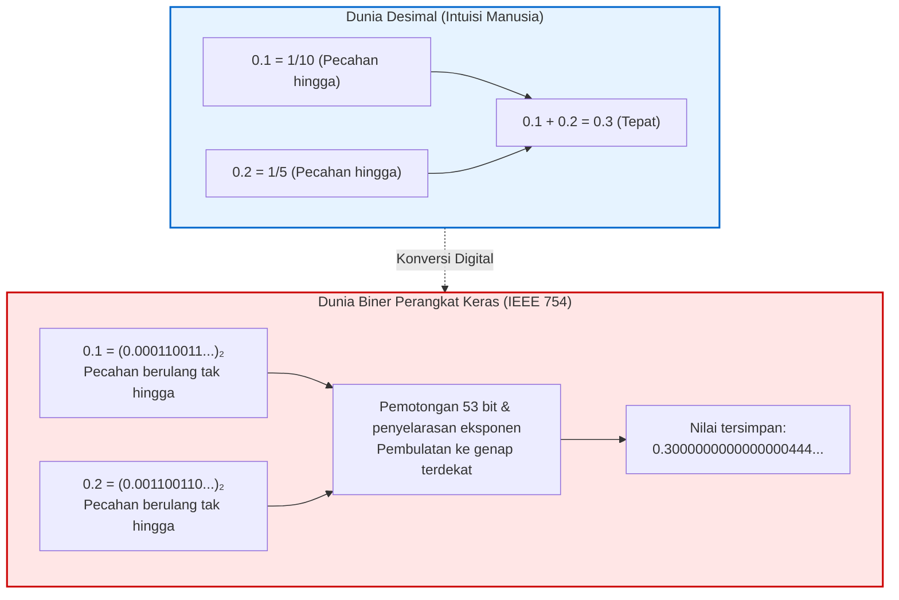

## Pendahuluan: Kejanggalan '0.1 + 0.2' yang Membingungkan Dunia

Setiap programmer pemula pasti pernah terkejut melihat hasil kode berikut:

```javascript
console.log(0.1 + 0.2);
// Output: 0.30000000000000004
console.log(0.1 + 0.2 === 0.3);
// Output: false
```

Mengapa komputer super canggih yang mampu melatih model kecerdasan buatan raksasa bisa salah menghitung penjumlahan sederhana seperti $0.1 + 0.2 = 0.3$?
Ini bukan kutu program (bug). Dari iPhone hingga klaster GPU tercanggih, <strong>semua komputer digital modern menghasilkan nilai yang persis sama: 0.30000000000000004.</strong>



---

## 1. Mengapa Bilangan Desimal Menjadi Pecahan Berulang dalam Biner

Dalam basis 10, pecahan $\frac{1}{3} = 0.3333\dots$ tidak dapat ditulis hingga.
Dalam teori bilangan, pecahan $\frac{P}{Q}$ dapat dinyatakan hingga dalam basis $N$ jika dan hanya jika semua faktor prima dari $Q$ membagi $N$.
- Dalam basis 10 ($10 = 2 \times 5$), penyebut dengan faktor 2 dan 5 menghasilkan desimal hingga ($0.1 = \frac{1}{10}$).
- Dalam basis 2, satu-satunya faktor prima adalah <strong>2</strong>. Hanya pecahan dengan penyebut $2^k$ yang berakhir hingga.

Karena penyebut dari $0.1$ memiliki faktor prima 5, <strong>0.1 dalam sistem biner menjadi pecahan berulang tak terhingga</strong>:
$$(0.1)_{10} = (0.0001100110011\dots)_2$$
Karena register memori terbatas, nilai tersebut terpaksa dipotong dan dibulatkan.

---

## 2. Standar IEEE 754 dan Eksekusi Penjumlahan

Standar <strong>IEEE 754 (binary64)</strong> menyusun bilangan 64-bit menjadi:
- 1 bit tanda (sign)
- 11 bit eksponen (bias 1023)
- 52 bit fraksi/mantisa (presisi efektif 53 bit dengan bit implisit).

Saat menjumlahkan 0.1 dan 0.2, prosesor menyelaraskan eksponen dan menerapkan pembulatan <strong>Round-to-Nearest, Ties-to-Even</strong>. Hasil akhirnya adalah:
$$\mathbf{0.300000000000000044408920985...}$$
Akibatnya, evaluasi `0.1 + 0.2 === 0.3` menghasilkan nilai `false`.

---

## 3. Tragedi Sejarah dan Praktik Terbaik

- <strong>Kegagalan Rudal Patriot (1991):</strong> Akumulasi galat pembulatan 0.1 detik selama 100 jam menyebabkan pergeseran waktu 0.34 detik. Radar meleset 687 meter dalam melacak rudal Scud musuh, menewaskan 28 tentara.
- <strong>Ledakan Roket Ariane 5 (1996):</strong> Galat konversi bilangan pecahan 64-bit ke bilangan bulat 16-bit memicu ledakan roket senilai 500 juta dolar.

<strong>Panduan Rekayasa:</strong>
1. Jangan gunakan operator kesetaraan langsung (`==`). Gunakan toleransi epsilon (`math.isclose`).
2. Jangan pernah gunakan bilangan pecahan untuk transaksi keuangan; gunakan bilangan bulat sen atau tipe desimal presisi tinggi (`BigDecimal` / `decimal.Decimal`).
---

## 5. Preseden Sejarah Lainnya: Bug Intel Pentium dan Bursa Efek Vancouver

Di luar kecelakaan militer dan antariksa, sejarah komputasi mencatat kerugian finansial masif akibat kelalaian dalam memahami representasi floating-point.

### 5.1 Erosi Indeks Saham Bursa Vancouver (1982)
Pada tahun 1982, Bursa Efek Vancouver merilis indeks pasar modal baru bernilai awal 1000.000. Setiap kali transaksi terjadi, indeks dihitung ulang. Sayangnya, pengembang memprogram sistem untuk melakukan <strong>pemotongan (truncation)</strong> ke 3 angka desimal alih-alih pembulatan standar.
Pemotongan ini selalu membuang sisa pecahan positif, menciptakan bias negatif yang konsisten. Dalam 22 bulan, di tengah kondisi pasar yang sebenarnya bertumbuh, indeks tersebut merosot anjlok hingga angka 520! Ketika para pakar matematika memperbaiki algoritma dengan pembulatan akurat, indeks pasar seketika melonjak kembali ke posisi aslinya di atas 1098 poin.

### 5.2 Skandal Bug Pembagian FDIV Intel Pentium (1994)
Pada Oktober 1994, profesor matematika Thomas Nicely menemukan keganjilan saat menghitung konstanta Brun untuk bilangan prima kembar menggunakan komputer berprosesor Intel Pentium.
Pembagian floating-point spesifik seperti:
$$\frac{4195835}{3145727}$$
menghasilkan angka yang keliru pada digit kelima desimal. Masalah ini berakar pada sirkuit logika algoritma pembagian SRT di dalam silikon prosesor, di mana 5 dari 2048 entri tabel lookup tidak sengaja terhapus saat pembuatan mask semikonduktor. Intel terpaksa menarik dan mengganti prosesor rusak di seluruh dunia dengan biaya kerugian mencapai 475 juta dolar AS.

---

## 6. Algoritma Penjumlahan Terkompensasi Kahan

Untuk menjumlahkan jutaan elemen data tanpa kehilangan nilai-nilai kecil akibat efek absorpsi, algoritma Kahan menyediakan solusi optimal:

```python
def penjumlahan_kahan(larik):
    total = 0.0
    c = 0.0  # Penampung galat yang hilang
    for x in larik:
        y = x - c
        t = total + y
        c = (t - total) - y  # Memulihkan bit rendah yang terpotong
        total = t
    return total
```

Dengan teknik kompensasi ini, akumulasi galat tetap minimal dan stabil sepanjang siklus perhitungan sains.
