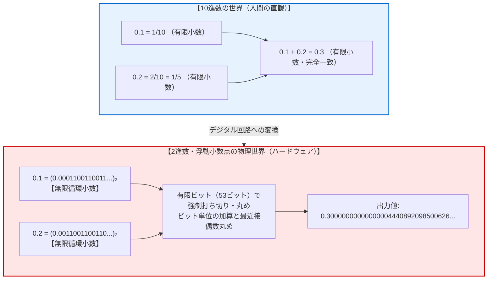
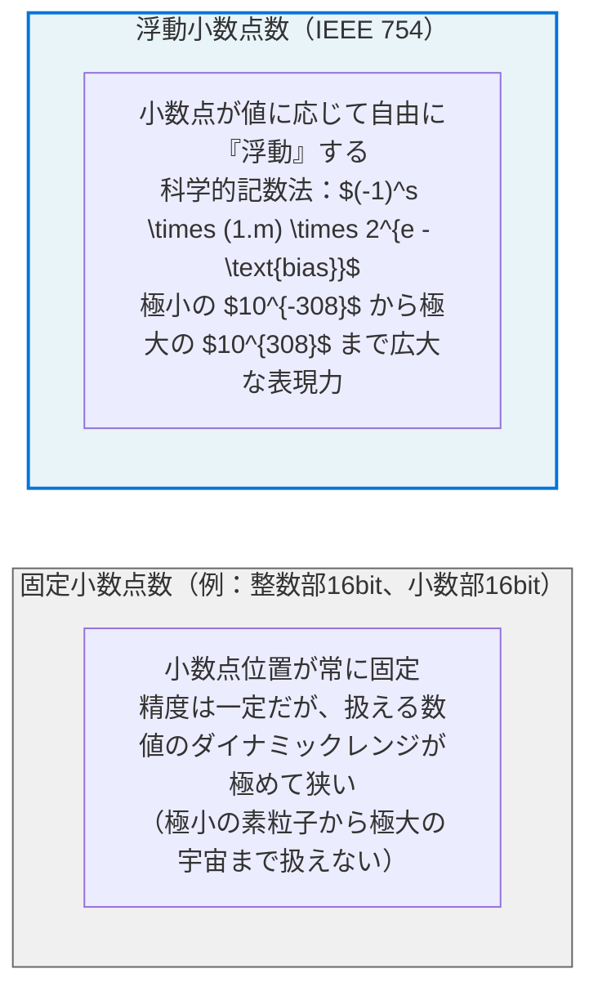
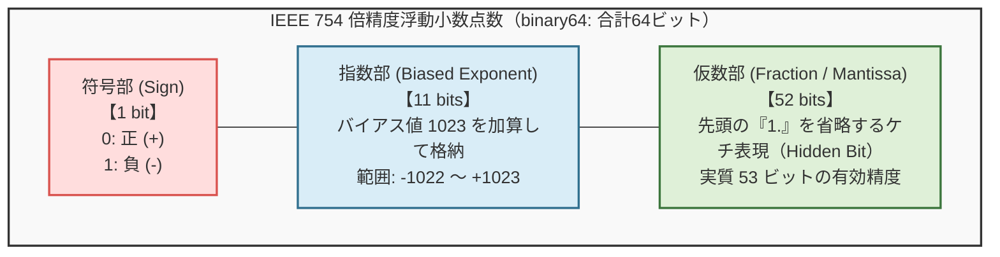
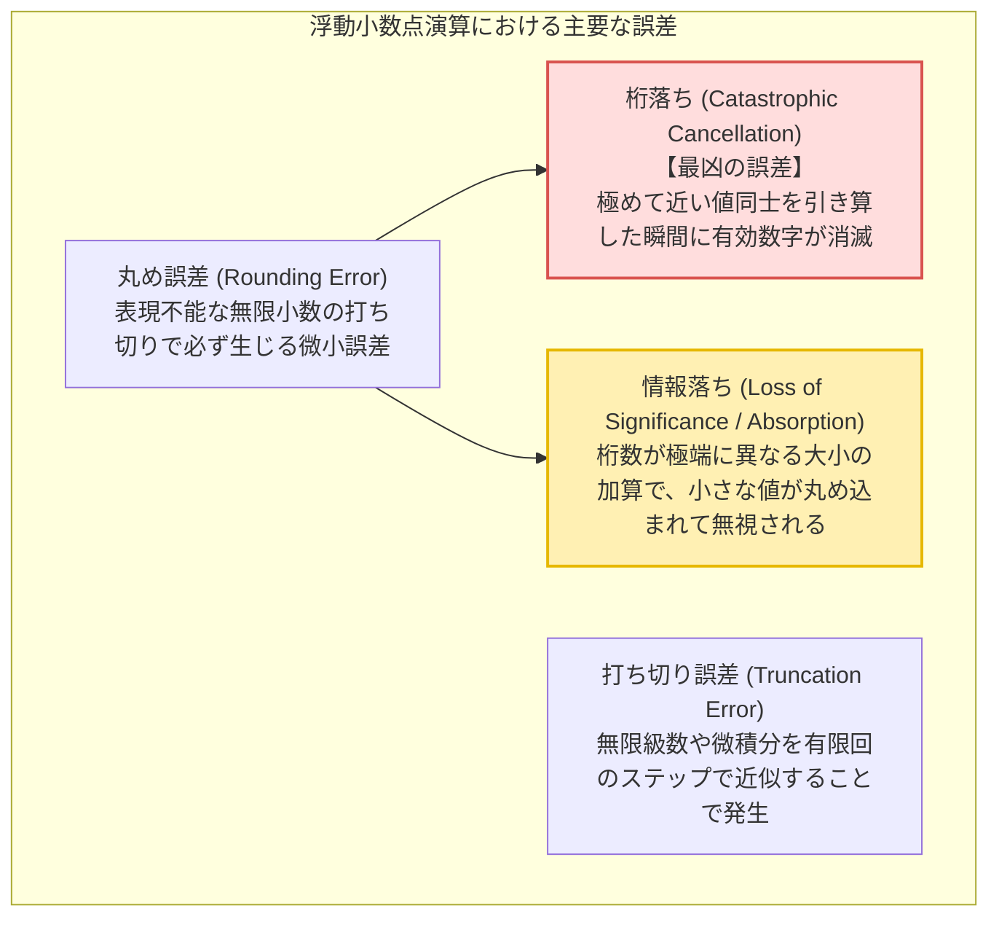
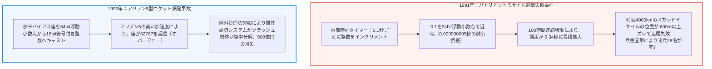
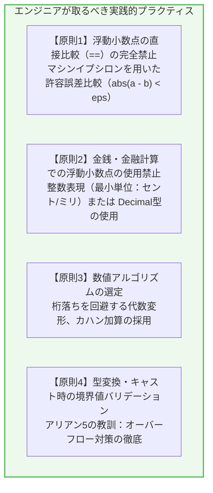

## 序論：世界中のプログラマを戦慄させる「0.1 + 0.2」の怪

プログラミングを学び始めた初学者が、JavaScript、Python、C言語、Java、Go、あるいはRustのコンソールで次のようなコードを実行したとき、ほぼ例外なく強烈な衝撃と当惑を経験します：

```javascript
console.log(0.1 + 0.2);
// 出力: 0.30000000000000004
console.log(0.1 + 0.2 === 0.3);
// 出力: false
```

```python
>>> 0.1 + 0.2
0.30000000000000004
>>> 0.1 + 0.2 == 0.3
False
```

「1秒間に何兆回もの超高速演算を行い、天文学的なビッグデータを解析し、自動運転車を制御し、果ては巨大言語モデル（AI）を動かしている最新のコンピュータが、なぜ小学生でも暗算できる『0.1 + 0.2 = 0.3』という極めて単純な足し算すら正確に計算できないのか？」

多くの初学者はこれをプログラミング言語のバグ、あるいはコンパイラの初歩的な欠陥だと疑います。しかし、これは言語のバグでも処理系の不具合でもありません。世界最高峰のスーパーコンピュータであろうと、最新のiPhoneであろうと、最先端のGPUサーバーであろうと、<strong>現在地球上に存在するほぼすべてのデジタルコンピュータにおいて、まったく同一の『0.30000000000000004』という結果が出力されます</strong>。



この現象の背後には、<strong>「有限の離散的ビット（0と1）を用いて、無限に広がる実数の連続体をどのように表現するか」</strong>という、情報科学と数学における深遠な理論的妥協と格闘の歴史が存在します。

本稿では、なぜ10進数の小数が2進数において無限循環小数になってしまうのかという初等数学の根本原理から、現代の全プロセッサが準拠する<strong>IEEE 754浮動小数点標準規格</strong>の精緻な内部構造、ビット単位での「0.1 + 0.2」の加算プロセスの完全追跡、桁落ち・情報落ちといった悪魔的誤差のメカニズム、パトリオットミサイルやアリアンロケット爆発といった現実世界の悲劇的事故、そして実務エンジニアが知るべき実践的処方箋までを徹底的に解明します。

---

## 1. 2進数の深淵：なぜ10進小数は無限循環小数になるのか？

### 1.1 10進数における $\frac{1}{3}$ のアナロジー
私たちが日常使っている10進数において、「$\frac{1}{3}$」を小数で表そうとするとどうなるでしょうか？

$$\frac{1}{3} = 0.3333333333\dots \quad (\text{無限小数})$$

どれほどノートのページを埋め尽くしても、「3」が無限に続き、有限の桁数で正確に書き切ることはできません。もしノートのスペースが10桁分しかなければ、「0.3333333333」と途中で打ち切るしかありません。そして、それを3倍しても：

$$0.3333333333 \times 3 = 0.9999999999 \neq 1$$

となり、元の「1」には戻らなくなります。私たちはこの現象に対して「10進数なのだから $\frac{1}{3}$ が割り切れないのは当たり前だ」と納得しています。

<strong>コンピュータにとっての「0.1」や「0.2」は、まさに10進数における「$\frac{1}{3}$」と全く同じ存在なのです。</strong>

### 1.2 分母の素因数分解定理
なぜある分数は有限小数になり、別の分数は無限小数（循環小数）になるのでしょうか？ ここには数論における明確な定理が存在します。

> <strong>定理（有限小数の条件）：</strong>
> $N$ 進法において、既約分数 $\frac{P}{Q}$ が有限小数として表現できるための必要十分条件は、分母 $Q$ のすべての素因数が、基数 $N$ の素因数の部分集合であることである。

- <strong>10進数（基数 $N = 10$）の場合：</strong>
  $10 = 2 \times 5$ です。したがって、分母の素因数が <strong>2 と 5 のみ</strong> で構成される既約分数は有限小数になります：
  - $\frac{1}{2} = 0.5$ （有限）
  - $\frac{1}{4} = \frac{1}{2^2} = 0.25$ （有限）
  - $\frac{1}{5} = 0.2$ （有限）
  - $\frac{1}{10} = \frac{1}{2 \times 5} = 0.1$ （有限）
  - 一方、$\frac{1}{3}$、$\frac{1}{6}$、$\frac{1}{7}$ などは素因数に 3 や 7 を含むため、10進数では絶対に有限小数になり得ず、無限循環小数になります。

- <strong>2進数（基数 $N = 2$）の場合：</strong>
  $2$ は素数ですから、基数 2 の素因数は <strong>2 のみ</strong> です。
  したがって、2進法において有限小数として表せる既約分数は、<strong>分母が 2 の累乗（$2^k$）であるものだけ</strong> に限られます！
  - $\frac{1}{2} = (0.1)_2$ （有限）
  - $\frac{1}{4} = (0.01)_2$ （有限）
  - $\frac{1}{8} = (0.001)_2$ （有限）
  - $\frac{3}{16} = (0.0011)_2$ （有限）

では、「0.1」はどうでしょうか？
10進数の「0.1」は分数で書けば $\frac{1}{10} = \frac{1}{2 \times 5}$ です。
分母に <strong>5</strong> という素因数が含まれています。基数 2 は素因数 5 を持たないため、<strong>「0.1」は2進法においては絶対に割り切れず、無限に続く循環小数になってしまう</strong>のです！

### 1.3 0.1を2進数に変換する手計算の証明
実際に 10進数の 0.1 を 2進数に変換してみましょう。小数を2進数に変換するには、「2を掛けて整数部分を取り出す」という操作を繰り返します：

$$\begin{aligned}
0.1 \times 2 &= \mathbf{0}.2 \quad (\text{整数部: } 0) \\
0.2 \times 2 &= \mathbf{0}.4 \quad (\text{整数部: } 0) \\
0.4 \times 2 &= \mathbf{0}.8 \quad (\text{整数部: } 0) \\
0.8 \times 2 &= \mathbf{1}.6 \quad (\text{整数部: } 1, \text{残り: } 0.6) \\
0.6 \times 2 &= \mathbf{1}.2 \quad (\text{整数部: } 1, \text{残り: } 0.2 \leftarrow \text{★ここで 0.2 に戻る！}) \\
0.2 \times 2 &= \mathbf{0}.4 \quad (\text{整数部: } 0) \\
0.4 \times 2 &= \mathbf{0}.8 \quad (\text{整数部: } 0) \\
0.8 \times 2 &= \mathbf{1}.6 \quad (\text{整数部: } 1) \\
0.6 \times 2 &= \mathbf{1}.2 \quad (\text{整数部: } 1) \\
&\quad \vdots
\end{aligned}$$

5ステップ目で「0.2」が再出現し、以降は `0011` という4ビットのパターンが無限にループします。

$$(0.1)_{10} = (0.000110011001100110011\dots)_2 = (0.000\overline{1100})_2$$

同様に、0.2 は 0.1 の 2倍ですから、小数点が1桁右にシフトするだけです：

$$(0.2)_{10} = (0.00110011001100110011\dots)_2 = (0.0\overline{0110})_2$$

コンピュータのメモリ（レジスタ）は有限です。64ビットや32ビットといった有限の領域にこの数値を格納するためには、<strong>どこかで必ず途中でちょん切る（丸める）</strong>しかありません。この「打ち切りと丸め」こそが、すべての浮動小数点誤差の源泉なのです。

---

## 2. IEEE 754標準規格の解剖学：コンピュータは小数をどう格納しているか

コンピュータが数値を扱う方式には、大きく分けて<strong>固定小数点数（Fixed-point number）</strong>と<strong>浮動小数点数（Floating-point number）</strong>の2つが存在します。



1985年、電気電子学会（IEEE）は浮動小数点演算の世界統一規格として<strong>IEEE 754</strong>を制定しました。今日、IntelやAMDのx86 CPU、AppleやQualcommのARMプロセッサ、NVIDIAのGPUに至るまで、例外なくこの規格をハードウェアレベルで実装しています。

### 2.1 ビットレイアウトの構造
IEEE 754において、数値は<strong>科学的記数法（Scientific Notation）</strong>を2進数に応用した形式で保持されます。最も一般的に使われるのは<strong>倍精度（double / binary64）</strong>と<strong>単精度（float / binary32）</strong>です。



倍精度（64ビット）の各フィールドの役割は以下の通りです：

1. <strong>符号部（Sign bit: 1ビット）</strong>
   - $s = 0$ ならば正の数、$s = 1$ ならば負の数を表します。
2. <strong>指数部（Exponent: 11ビット）</strong>
   - 11ビットの符号なし整数（$0 \sim 2047$）として格納されます。
   - 負の指数（小さな数）も表現できるように、<strong>バイアス値（Bias）1023</strong> が引かれます。すなわち、実際の指数を $E$ とすると、格納される値は $e = E + 1023$ となります。
3. <strong>仮数部（Fraction / Mantissa: 52ビット）</strong>
   - 2進数の正規化表現では、最上位ビットは必ず「1」になります（例：$1.10011\dots_2 \times 2^E$）。
   - そのため、この先頭の「1」をわざわざ記録せず省略する<strong>ケチ表現（Hidden Bit / Implicit Bit）</strong>が採用されています。
   - 記録されるのは小数点以下の52ビットですが、メモリ上には実質<strong>53ビット分</strong>の有効数字が確保されることになります。

数学的な表現式は次のようになります：

$$V = (-1)^s \times \left(1 + \sum_{i=1}^{52} b_{52-i} 2^{-i}\right) \times 2^{e - 1023}$$

### 2.2 特殊値の表現（ゼロ、無限大、NaN、非正規化数）
IEEE 754は、ゼロ除算や演算不能な数式に対してもプログラムが即座にクラッシュしないよう、巧みな特殊値エンコーディングを備えています：

| 指数部 $e$ (11bit) | 仮数部 $f$ (52bit) | 表現される意味 | 備考 |
|---|---|---|---|
| $0 < e < 2047$ | 任意 | <strong>正規化数 (Normalized)</strong> | 通常の実数表現 |
| $e = 0$ | $f = 0$ | <strong>$\pm 0$ (Signed Zero)</strong> | 符号ビットにより $+0$ と $-0$ が区別される |
| $e = 0$ | $f \neq 0$ | <strong>非正規化数 (Subnormal)</strong> | ゼロ付近で緩やかにアンダーフローさせる仕組み |
| $e = 2047$ (全ビット1) | $f = 0$ | <strong>$\pm \infty$ (Infinity)</strong> | オーバーフローやゼロ除算（$1.0 / 0.0$）の結果 |
| $e = 2047$ (全ビット1) | $f \neq 0$ | <strong>$\text{NaN}$ (Not a Number)</strong> | $0/0$ や $\sqrt{-1}$ などの未定義演算結果 |

---

## 3. 「0.1 + 0.2」のビットレベル完全追跡

それでは、コンピュータの内部で「0.1 + 0.2」が実行される瞬間に、ビットレベルで何が起きているのかを完全にトレースしてみましょう。

### 3.1 「0.1」の倍精度表現
先ほど求めたように、0.1 の2進数表現は無限循環小数です：

$$(0.1)_{10} = (0.000110011001100110011001100110011\dots)_2$$

これを正規化して、先頭を $1.xxx \times 2^E$ の形に変形します：

$$1.1001100110011001100110011001100110011001100110011001\dots_2 \times 2^{-4}$$

- <strong>符号部 $s$:</strong> $0$ （正の数）
- <strong>指数部 $E = -4$:</strong> バイアス 1023 を加えると $e = -4 + 1023 = 1019 = (01111111011)_2$
- <strong>仮数部（52ビットに丸める）：</strong>
  52ビット目以降の切り捨て部分を見ると、`110011...` と続いており、半分（$0.5$）を超えているため、<strong>切り上げ（Round up）</strong>が発生します。

その結果、最下位ビット（LSB）に 1 が加算され、最終ビット列は次のようになります：

$$\begin{aligned}
s &= 0 \\
e &= 01111111011_2 \quad (= 1019) \\
f &= 1001100110011001100110011001100110011001100110011010_2
\end{aligned}$$

このビット列を10進数に厳密に逆変換すると、正確には次の値になります：
$$\text{float64}(0.1) = 0.1000000000000000055511151231257827021181583404541015625$$
<strong>すでにメモリに読み込まれた段階で、0.1 よりもごくわずかに大きい値として格納されているのです！</strong>

### 3.2 「0.2」の倍精度表現
同様に、0.2 は指数が $2^{-3}$ になるだけで、仮数はまったく同じです：

$$\begin{aligned}
s &= 0 \\
e &= -3 + 1023 = 1020 = (01111111100)_2 \\
f &= 1001100110011001100110011001100110011001100110011010_2
\end{aligned}$$

厳密な10進数値：
$$\text{float64}(0.2) = 0.200000000000000011102230246251565404236316680908203125$$

### 3.3 指数合わせ（Alignment Shift）と加算
浮動小数点の足し算を行う場合、プロセッサ内のALU（算術論理演算装置）は、まず<strong>指数の小さい方を大きい方に合わせるために仮数を右シフト</strong>します。

- 0.1 の指数：$2^{-4}$
- 0.2 の指数：$2^{-3}$

0.1 の指数を $2^{-3}$ に合わせるため、仮数を1ビット右にシフトします（ケチ表現の隠れビット 1 も現れます）：

$$\begin{aligned}
\text{0.1 の仮数（シフト後）:} & \quad 0.1100110011001100110011001100110011001100110011001101 \times 2^{-3} \\
\text{0.2 の仮数:} & \quad 1.1001100110011001100110011001100110011001100110011010 \times 2^{-3}
\end{aligned}$$

この2つの仮数を2進加算します：

$$\begin{aligned}
&\phantom{+} 0.1100110011001100110011001100110011001100110011001101 \\
&+ 1.1001100110011001100110011001100110011001100110011010 \\
\hline
&= 10.0100110011001100110011001100110011001100110011001111 \times 2^{-3}
\end{aligned}$$

加算結果が $10.xxx$ と繰り上がったため、再び正規化（1ビット右シフトして指数を $+1$）します：

$$= 1.0010011001100110011001100110011001100110011001100111(1) \times 2^{-2}$$

### 3.4 最近接偶数丸め（Round to Nearest, Ties to Even）
53ビット目以降の末尾ビットを、IEEE 754のデフォルト規則である<strong>最近接偶数丸め（偶数への丸め）</strong>によって丸めます。
この切り捨てられた末尾ビットがちょうど中間であり、上位ビットが奇数であるため、<strong>切り上げ</strong>が実行されます。

その結果、最終的にレジスタに格納される仮数ビットは：

$$f = 0010011001100110011001100110011001100110011001100100_2$$

この数値を10進数で厳密に展開すると：

$$\mathbf{0.3000000000000000444089209850062616169452667236328125}$$

となります。言語の標準出力（`console.log` や `print`）は、倍精度の有効桁数（約15〜17桁）に合わせて末尾を丸めて表示するため、私たちが目にするのは：

$$\mathbf{0.30000000000000004}$$

という、あの呪われた数字になるのです！

一方、真の「0.3」を倍精度浮動小数点で表現したビット列を逆変換すると：

$$\text{float64}(0.3) = 0.299999999999999988897769753748434595763683319091796875$$

となり、`0.1 + 0.2` の結果とはビットパターンが明確に異なります。だからこそ、`0.1 + 0.2 === 0.3` は冷酷にも <strong>`false`</strong> と判定されるのです。

---

## 4. 数値計算に潜む悪魔たち：浮動小数点誤差の分類

「0.1 + 0.2」の誤差はほんの $10^{-17}$ 程度の微小な差に過ぎません。しかし、計算の組み合わせ次第で、この小さな誤差は<strong>結果の有効数字を完全に破壊し、プログラム全体を破綻させる巨大な悪魔</strong>へと成長します。



### 4.1 桁落ち（Catastrophic Cancellation）：最も危険な罠
数値計算において最も致命的なバグを引き起こすのが<strong>桁落ち</strong>です。
<strong>「値が非常に近い2つの数値を引き算したとき、上位の有効数字がごっそり相殺され、下位に残った誤差が上位へ繰り上がって有効数字が著しく減少する」</strong>現象を指します。

例えば、次の2次方程式の解の公式を考えます：

$$x = \frac{-b + \sqrt{b^2 - 4ac}}{2a}$$

もし $b > 0$ かつ $b^2 \gg 4ac$ である場合、$\sqrt{b^2 - 4ac} \approx b$ となります。
分子は「$b$ に極めて近い数から $b$ を引く」計算になり、激しい桁落ちが発生します。有効数字16桁あったはずの情報が、わずか2〜3桁にまで劣化してしまうのです。

<strong>【回避策：分子の有理化】</strong>
分子を有理化して変形します：

$$x = \frac{(-b + \sqrt{b^2 - 4ac})(-b - \sqrt{b^2 - 4ac})}{2a(-b - \sqrt{b^2 - 4ac})} = \frac{-4ac}{2a(-b - \sqrt{b^2 - 4ac})} = \frac{-2c}{b + \sqrt{b^2 - 4ac}}$$

分母が「足し算」になったことで引き算が消滅し、桁落ちを完全に回避できます。

### 4.2 情報落ち（Absorption / Loss of Significance）
<strong>「絶対値が極めて大きな数値に、絶対値が極めて小さな数値を加算したとき、小さい方の数値が仮数部の53ビット幅から溢れ落ちて完全に無視される」</strong>現象です。

```python
>>> big = 1e16
>>> small = 1.0
>>> (big + small) - big
0.0  # 1.0 を足したはずなのに、完全に消滅した！
```

倍精度浮動小数点数は約15〜17桁の有効数字しか持ちません。$10^{16}$ という数値はすでに17桁を占有しているため、そこへ $1.0$ を足しても、指数合わせの右シフトによって $1.0$ のビットがすべて押し出され、足し算がなかったことにされてしまうのです。

この情報落ちは、統計計算で数百万個のデータを単純ループで足し合わせるときに深刻な誤差の蓄積を引き起こします。

### 4.3 カハン加算アルゴリズム（Kahan Summation Algorithm）
情報落ちによる累積誤差を劇的に削減する美しいアルゴリズムが、チューリング賞受賞者ウィリアム・カハン（William Kahan）によって考案された<strong>カハン加算アルゴリズム（Compensated Summation）</strong>です。

加算のたびに切り捨てられた「誤差（失われた小さなカス）」を変数に保持し、次回の加算時に補正値として還元します：

```python
def kahan_sum(numbers):
    total = 0.0
    c = 0.0  # 失われた下位ビットを保持する補正変数
    
    for x in numbers:
        y = x - c          # 入力値から前回の誤差を差し引く
        t = total + y      # 合計に加算（ここで上位ビットに丸められ、情報落ちが発生）
        c = (t - total) - y  # (t - total) で回復した y から本来の y を引くことで、切り捨てられた誤差を抽出！
        total = t          # 次のステップへ
        
    return total
```

このアルゴリズムを用いれば、倍精度のまま単精度数百倍に匹敵する極小の累積誤差で数億個の総和を正確に算出できます。

---

## 5. 現実世界を揺るがした浮動小数点の悲劇

浮動小数点誤差は、教科書の中のパズルではありません。歴史上、この小さな端数を軽視したことによって、国家規模の軍事事故やロケットの爆発、金融システムの麻痺といった大惨事が現実に発生しています。



### 5.1 1991年 湾岸戦争：パトリオットミサイルの悲劇
1991年2月25日、サウジアラビアのダーランにおいて、米軍のパトリオット地対空ミサイル基地がイラク軍の発射したスカッドミサイルの迎撃に失敗しました。スカッドミサイルは米軍兵舎を直撃し、28名の兵士が死亡、100名近くが負傷するという大惨事となりました。

米政府監査院（GAO）の調査報告により判明した事故原因は、信じがたいことに<strong>「0.1秒」の浮動小数点誤差の累積</strong>でした。

- パトリオットミサイルの内部コンピュータは、内蔵クロック（10分の1秒＝0.1秒単位）のカウント値に、24ビット固定小数点形式の「0.1」を掛け算して実時間を計算していました。
- 0.1 は2進数で循環小数であるため、24ビットレジスタでは末尾が切り捨てられ、1カウントごとに約 <strong>0.000000095秒</strong> の遅れが生じていました。
- 本来、パトリオットシステムは数時間ごとに再起動することを前提に設計されていましたが、ダーラン基地では<strong>約100時間連続</strong>で稼働し続けていました。
- その結果、累積した時間誤差は：
  $$0.000000095 \text{秒} \times 100 \times 3600 \times 10 \approx \mathbf{0.3433 \text{秒}}$$
  に達しました。
- マッハ4（時速約4,000km）で超高速飛来するスカッドミサイルにとって、0.34秒のズレは<strong>距離にして687メートル</strong>もの追尾レーダーの観測ウィンドウのズレを意味します。パトリオットはスカッドミサイルが存在しない空虚な空間を追尾し、迎撃ミサイルを発射することすらできずに直撃を許したのです。

### 5.2 1996年 アリアン5型ロケット爆発事件
1996年6月4日、欧州宇宙機関（ESA）が総開発費数十億ドルを投じて開発した「アリアン5」初号機が、打ち上げからわずか37秒後に高度約4,000メートルで空中分解・大爆発を遂げました。積載されていた約5億ドル（約500億円）の観測衛星群も一瞬にして灰燼に帰しました。

事故調査委員会が特定した原因は、<strong>64ビット浮動小数点数から16ビット符号付き整数へのデータ型変換（キャスト）によるオーバーフロー</strong>でした。

- アリアン5の慣性航法システム（IRS）ソフトウェアは、先代のアリアン4のコードを流用していました。
- 水平ドリフトを表す速度パラメータ（64ビット浮動小数点数）を16ビット符号付き整数（最大値 $+32767$）に変換する処理が存在していました。
- アリアン4ではこの速度が32767を超えることは物理的にあり得なかったため、例外処理（エラーハンドリング）が省かれていました。
- しかし、アリアン5の新型ロケットエンジンはアリアン4よりも圧倒的に高い加速度を持っていたため、打ち上げ直後に水平速度が32767を超過。ハードウェア例外が発生しました。
- バックアップの航法コンピュータもまったく同一のソフトウェアを実行していたため同時にクラッシュ。異常な診断データを姿勢角と誤認した主制御装置がノズルを極端に偏向させ、猛烈な空気抵抗によってロケットは空中分解しました。

---

## 6. エンジニアのための実践的処方箋

コンピュータが2進数浮動小数点数を使い続ける限り、この誤差を完全にゼロにすることは不可能です。しかし、正しいソフトウェア設計とアルゴリズムの選定によって、誤差によるバグや事故を100%未然に防ぐことができます。



### 6.1 比較の鉄則：直接比較（==）の禁止とマシンイプシロン
浮動小数点数同士を `==` で比較することは、バグを招く最大の禁忌です。
常に<strong>許容誤差（イプシロン：$\epsilon$）</strong>を設けた近傍比較を行わなければなりません。

```python
# 危険：絶対にやってはいけないコード
if a == b:
    do_something()

# 正しい実践：絶対誤差と相対誤差を組み合わせた比較
def is_close(a, b, rel_tol=1e-9, abs_tol=1e-12):
    return abs(a - b) <= max(rel_tol * max(abs(a), abs(b)), abs_tol)

# Python 3.5+ の標準ライブラリ
import math
if math.isclose(0.1 + 0.2, 0.3):
    print("安全に等しいと判定されました！")
```

### 6.2 金融・会計システムの絶対ルール：浮動小数点禁止令
銀行、証券取引所、Eコマースなどの金融システムにおいて、`float` や `double` を通貨計算に使用することは厳重に禁止されています。端数の丸め誤差が何百万件もの決済トランザクションで累積すれば、巨額の使途不明金や法的責任が発生します。

金融計算では、以下のいずれかのアプローチを徹底します：
1. <strong>整数演算（Integer Arithmetic）：</strong>
   通貨の最小単位（日本円なら1円、米ドルならセント＝1/100ドル）を整数として保持する。100.50ドルの場合、`10050`（セント）という整数で計算し、表示時にのみ `100.50` と文字列フォーマットする。
2. <strong>10進小数型（Arbitrary-precision Decimal）：</strong>
   プログラミング言語が提供する10進専用の数値型を使用する（Pythonの `decimal.Decimal`、Javaの `BigDecimal`、C#の `decimal`）。内部的に10進数の桁を直接配列等で管理するため、`0.1 + 0.2 === 0.3` が完全に成立します。

```python
from decimal import Decimal

# Decimal を使うことで 10進数の計算を完全正確に実行
d1 = Decimal('0.1')
d2 = Decimal('0.2')
print(d1 + d2 == Decimal('0.3'))  # True!
```

---

## 7. 結論：有限のビットで無限の連続体を捉えるという人間の奇跡

「0.1 + 0.2 = 0.30000000000000004」という結果は、一見するとコンピュータの不甲斐ない欠陥に見えるかもしれません。

しかし、その背景にあるIEEE 754の設計思想を深く理解したとき、私たちは先人たちの驚くべき知恵と工学的美学に圧倒されます。

わずか64個の「0」と「1」のスイッチの組み合わせの中に、原子核の大きさ（$10^{-15}\text{m}$）から観測可能な宇宙の端（$10^{26}\text{m}$）に至るまで、<strong>実に600桁以上もの圧倒的なダイナミックレンジを持つ森羅万象の実数世界を凝縮し、それを毎秒数十億回の超高速で矛盾なく演算させる。</strong> その偉大な工学的トレードオフの代償として現れたのが、末尾にちょこんと顔を出すあの「4」なのです。

コンピュータは万能の魔法の箱ではありません。それは、人間が有限のシリコン素子の上に築き上げた、厳密な数学的論理の結晶です。

その限界を知り、特性を愛し、正しいアルゴリズムによって誤差を手懐けること――それこそが、私たちが一人前のソフトウェアエンジニア、そして情報科学の探究者として歩み出すための、最も価値ある通過儀礼なのです。

