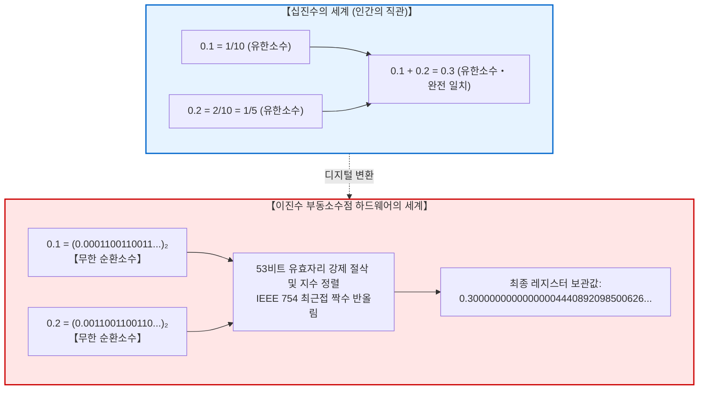
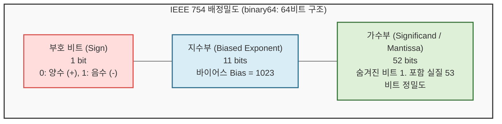
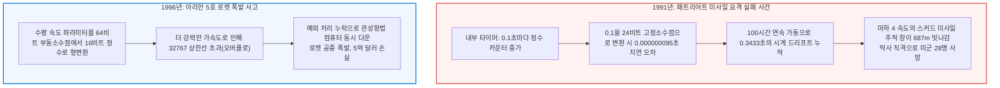

## 서론: 전 세계 개발자들을 당혹스럽게 만드는 ‘0.1 + 0.2’의 수수께끼

프로그래밍을 처음 시작한 개발자가 콘솔에서 다음과 같은 코드를 실행했을 때 겪는 충격은 거의 보편적입니다:

```javascript
console.log(0.1 + 0.2);
// 출력: 0.30000000000000004
console.log(0.1 + 0.2 === 0.3);
// 출력: false
```

```python
>>> 0.1 + 0.2
0.30000000000000004
>>> 0.1 + 0.2 == 0.3
False
```

초당 수조 번의 복잡한 텐서 연산을 수행하고 최첨단 인공지능을 구동하는 현대의 슈퍼컴퓨터가, 왜 초등학생도 암산할 수 있는 단순한 덧셈 `0.1 + 0.2 = 0.3`조차 틀리는 것일까요?

초보자들은 언어의 버그나 컴파일러의 결함을 의심하지만, 이것은 버그가 아닙니다. 최신 아이폰부터 엔비디아 GPU 서버에 이르기까지, <strong>현존하는 거의 모든 디지털 컴퓨터는 정확히 동일한 ‘0.30000000000000004’를 출력합니다</strong>.



이 현상의 이면에는 <strong>‘유한한 이진 비트(0과 1)로 무한한 실수의 연속체를 어떻게 표현할 것인가’</strong>라는 컴퓨터 공학의 깊은 고뇌가 자리 잡고 있습니다.

---

## 1. 이진수의 심연: 왜 십진소수는 무한 순환소수가 되는가?

우리가 일상에서 쓰는 10진수에서 $\frac{1}{3}$을 소수로 쓰면 $0.333333\dots$로 끝없이 이어집니다.
정수론의 기본 정리에 따르면, 기약분수 $\frac{P}{Q}$가 $N$진법에서 유한소수가 되기 위한 필요충분조건은 <strong>분모 $Q$의 모든 소인수가 밑수 $N$의 소인수 집합에 속해야 한다는 것</strong>입니다.

- <strong>10진수 ($10 = 2 \times 5$):</strong> 분모 소인수가 2와 5로만 이루어진 분수는 유한소수가 됩니다 ($\frac{1}{2}=0.5, \frac{1}{10}=0.1$).
- <strong>2진수 (밑수 $2$):</strong> 소인수가 오직 <strong>2</strong>뿐입니다! 따라서 분모가 $2^k$인 분수($\frac{1}{2}, \frac{1}{4}, \frac{1}{8}$ 등)만 유한소수가 될 수 있습니다.

십진수 $0.1$은 분수로 $\frac{1}{10} = \frac{1}{2 \times 5}$입니다. 분모에 소인수 <strong>5</strong>가 포함되어 있으므로, <strong>2진수 체계에서 0.1은 영원히 끝나지 않는 무한 순환소수가 됩니다</strong>:

$$(0.1)_{10} = (0.000110011001100110011\dots)_2$$

컴퓨터의 메모리는 유한하므로 이를 64비트나 32비트 공간에 담기 위해서는 반드시 중간에서 잘라내어 반올림해야 하며, 여기서 미세한 오차가 발생합니다.

---

## 2. IEEE 754 부동소수점 규격의 해부

1985년 제정된 <strong>IEEE 754</strong>는 현대 모든 프로세서의 하드웨어 연산 표준입니다.



배정밀도(double, 64비트)는 다음과 같이 구성됩니다:
- <strong>부호(1비트):</strong> 양수/음수 결정
- <strong>지수(11비트):</strong> 바이어스 1023을 적용하여 $10^{-308} \sim 10^{308}$에 이르는 광활한 범위를 표현
- <strong>가수(52비트):</strong> 정규화된 2진 과학 표기법 $1.f \times 2^E$에서 앞의 '1.'을 생략(Hidden Bit)하여 실질 53비트의 유효숫자를 확보

---

## 3. ‘0.1 + 0.2’의 하드웨어 덧셈 추적

64비트 레지스터에서 0.1은 다음과 같이 저장됩니다:
$$\text{float64}(0.1) = 0.1000000000000000055511151231257827021181583404541015625$$
0.2는 다음과 같이 저장됩니다:
$$\text{float64}(0.2) = 0.200000000000000011102230246251565404236316680908203125$$

CPU는 덧셈 시 지수가 작은 쪽(0.1)의 가수를 오른쪽으로 1비트 시프트(지수 맞춤)한 뒤 가산합니다.
이후 54번째 비트 절삭 과정에서 IEEE 754의 기본 모드인 <strong>최근접 짝수 반올림(Round-to-Nearest, Ties-to-Even)</strong>이 수행됩니다.

그 결과 레지스터에 기록되는 최종 값은 다음과 같습니다:
$$\mathbf{0.3000000000000000444089209850062616169452667236328125}$$
이 값을 언어의 표준 출력 포맷으로 변환하면 바로 그 유명한 <strong>0.30000000000000004</strong>가 나타납니다.
한편 순수한 0.3의 64비트 값은 끝자리가 다르기 때문에 `0.1 + 0.2 === 0.3`은 필연적으로 <strong>`false`</strong>가 됩니다.

---

## 4. 수치 계산의 치명적 오차들과 역사적 재앙



- <strong>자리수 상쇄 (Catastrophic Cancellation):</strong> 매우 가까운 두 부동소수점을 뺄 때 유효 상위 비트가 모두 상쇄되어 잡음만 남는 치명적 현상.
- <strong>정보 소실 (Absorption):</strong> $10^{16}$에 $1.0$을 더할 때 $1.0$의 비트가 53비트 밖으로 밀려나 사라지는 현상. (카한 덧셈 알고리즘으로 극복 가능)
- <strong>1991년 패트리어트 참사:</strong> 0.1초 타이머의 24비트 절삭 오차가 100시간 동안 누적되어 0.34초의 지연을 초래, 스커드 미사일 레이더 조준이 687m 빗나가 28명이 사망함.
- <strong>1996년 아리안 5호 폭발:</strong> 64비트 부동소수점을 16비트 정수로 캐스팅하다가 오버플로가 발생해 로켓이 자폭함.

---

## 5. 실무 엔지니어를 위한 핵심 수칙

1. <strong>직접 비교(==)의 절대 금지:</strong> 반드시 허용 오차 $\epsilon$(머신 엡실론)을 사용해야 합니다:
   ```python
   import math
   math.isclose(a, b, rel_tol=1e-9, abs_tol=1e-12)
   ```
2. <strong>금융·결제 시스템에서의 부동소수점 사용 금지:</strong> 통화 계산에는 무조건 정수 센트 단위나 임의정밀도 십진수 라이브러리(Python `Decimal`, Java `BigDecimal`)를 사용해야 합니다.
3. <strong>대수적 재구성:</strong> 근의 공식 등에서 분자의 유리화를 통해 가까운 수의 뺄셈을 덧셈으로 변환하여 자리수 상쇄를 원천 차단합니다.

---

## 6. 결론: 유한한 비트로 무한을 품은 공학의 기적

`0.1 + 0.2 = 0.30000000000000004`는 컴퓨터의 결함이 아니라, 단 64개의 비트로 우주적 스케일의 연속 실수를 초고속으로 계산해 내기 위한 천재적인 공학적 타협의 결과물입니다. 그 한계를 정확히 이해하고 올바른 수치 알고리즘을 구사하는 것이야말로 진정한 소프트웨어 엔지니어의 핵심 역량입니다.

