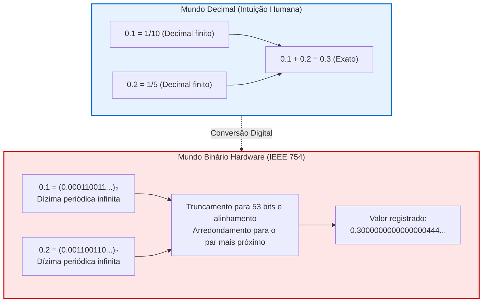

## Introdução: O mistério de 0.1 + 0.2

Todo desenvolvedor já se deparou com este resultado surpreendente:

```javascript
console.log(0.1 + 0.2);
// Saída: 0.30000000000000004
console.log(0.1 + 0.2 === 0.3);
// Saída: false
```

Como supercomputadores capazes de processar modelos de linguagem gigantescos falham numa adição que qualquer criança resolve?
Isso não é um defeito. Qualquer computador moderno, do chip ARM ao supercomputador mais veloz, <strong>produz rigorosamente o mesmo resultado: 0.30000000000000004.</strong>



---

## 1. Por que decimais viram dízimas periódicas em binário

Na base 10, a fração $\frac{1}{3} = 0.3333\dots$ não pode ser expressa de forma finita.
Uma fração $\frac{P}{Q}$ é finita na base $N$ se e somente se todos os fatores primos de $Q$ dividem a base $N$.
- Na base 10 ($10 = 2 \times 5$), denominadores com fatores 2 e 5 são finitos ($0.1 = \frac{1}{10}$).
- Na base 2, o único fator primo é <strong>2</strong>. Somente potências de dois ($2^k$) formam frações finitas.

Como o denominador de $0.1$ contém o fator primo 5, <strong>0.1 é uma dízima periódica infinita em binário</strong>:
$$(0.1)_{10} = (0.0001100110011\dots)_2$$

---

## 2. O padrão IEEE 754 e a soma no processador

O padrão <strong>IEEE 754 (binary64)</strong> aloca:
- 1 bit de sinal
- 11 bits de expoente (com bias de 1023)
- 52 bits de mantissa (53 bits de precisão efetiva com o bit implícito).

Na soma de 0.1 e 0.2, os expoentes são alinhados e aplica-se o <strong>arredondamento ao par mais próximo</strong>. O resultado final armazenado é:
$$\mathbf{0.300000000000000044408920985...}$$
Logo, `0.1 + 0.2 === 0.3` resulta inevitavelmente em <strong>`false`</strong>.

---

## 3. Desastres históricos e regras de ouro

- <strong>Míssil Patriot (1991):</strong> O erro de arredondamento de 0.1 s acumulado em 100 horas causou um desvio de 0.34 s no relógio interno, errando o míssil Scud por 687 metros e matando 28 soldados.
- <strong>Foguete Ariane 5 (1996):</strong> Conversão de ponto flutuante de 64 bits para inteiro de 16 bits provocou estouro (overflow) e autodestruição do foguete (prejuízo de 500 milhões de dólares).

<strong>Recomendações:</strong>
1. Nunca use `==` para comparar números de ponto flutuante; use margem de tolerância épsilon (`math.isclose`).
2. Em aplicações financeiras, utilize inteiros (centavos) ou tipos decimais exatos (`BigDecimal` / `Decimal`).
---

## 5. Incidentes adicionais na história: O bug do Pentium e a Bolsa de Vancouver

Além das falhas em foguetes e mísseis, o registro histórico da computação inclui graves prejuízos financeiros e falhas de hardware originadas em cálculos de ponto flutuante.

### 5.1 O colapso do índice da Bolsa de Valores de Vancouver (1982)
Em 1982, a Bolsa de Vancouver lançou um índice econômico com valor base de 1000.000. O software foi programado para recalcular o índice após cada operação, mas com uma falha elementar: ele <strong>truncava</strong> as frações na terceira casa decimal em vez de aplicar o arredondamento estatístico.
Esse descarte constante de frações gerou uma perda contínua de valor acumulado. Em menos de dois anos, enquanto os ativos subiam, o índice despencou para cerca de 520 pontos. Quando o código foi finalmente corrigido com o algoritmo de arredondamento adequado, o índice real subiu imediatamente para 1098 pontos.

### 5.2 O infame bug FDIV do processador Intel Pentium (1994)
Em 1994, o professor Thomas Nicely investigava a soma dos inversos de primos gêmeos e descobriu que certos cálculos de divisão de ponto flutuante em computadores com o recém-lançado chip Pentium apresentavam erros graves.
Por exemplo, ao calcular:
$$\frac{4195835}{3145727}$$
o resultado exato é aproximadamente $1.333820449$, mas o microprocessador retornava $1.333739068$. A falha foi causada por cinco entradas ausentes numa tabela de consulta do algoritmo de divisão SRT gravada no circuito integrado. A Intel foi forçada a substituir os processadores defeituosos, registrando um encargo contábil de 475 milhões de dólares.

---

## 6. O algoritmo de soma compensada de Kahan

Para somar matrizes volumosas sem que valores pequenos sejam ignorados por números gigantescos (absorção), o cientista William Kahan concebeu a seguinte fórmula programática:

```python
def soma_kahan(valores):
    soma = 0.0
    c = 0.0  # Acumulador de erro de baixa ordem
    for x in valores:
        y = x - c
        t = soma + y
        c = (t - soma) - y  # Recuperação algébrica da perda
        soma = t
    return soma
```

Essa técnica preserva a fidelidade numérica em simulações climáticas e físicas de alta escala.
