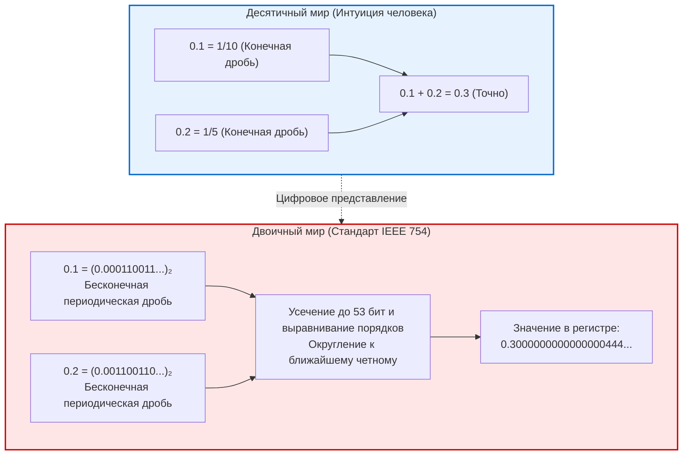

## Введение: Загадка «0.1 + 0.2»

Каждый программист рано или поздно сталкивается с этим парадоксом:

```javascript
console.log(0.1 + 0.2);
// Результат: 0.30000000000000004
console.log(0.1 + 0.2 === 0.3);
// Результат: false
```

Как современные суперкомпьютеры, моделирующие квантовые системы, могут ошибаться в сложении чисел уровня начальной школы?
Это не ошибка в языке программирования. Любой современный процессор на Земле выдает строго одинаковый результат: <strong>0.30000000000000004</strong>.



---

## 1. Почему десятичные дроби становятся бесконечными в двоичном коде

В десятичной системе дробь $\frac{1}{3} = 0.3333\dots$ бесконечна.
Несократимая дробь $\frac{P}{Q}$ конечна в системе счисления с основанием $N$ тогда и только тогда, когда все простые делители знаменателя $Q$ делят основание $N$.
- В десятичной системе ($10 = 2 \times 5$) делители 2 и 5 дают конечные дроби ($0.1 = \frac{1}{10}$).
- В двоичной системе единственный простой делитель — <strong>2</strong>. Конечными являются лишь дроби со знаменателем $2^k$.

Так как знаменатель $0.1$ содержит простой множитель 5, <strong>в двоичной системе 0.1 является бесконечной периодической дробью</strong>:
$$(0.1)_{10} = (0.0001100110011\dots)_2$$
Поскольку разрядность регистров конечна, неизбежно происходит усечение числа.

---

## 2. Стандарт IEEE 754 и сложение в процессоре

По стандарту <strong>IEEE 754 (binary64)</strong> число кодируется в 64 битах:
- 1 бит знака
- 11 бит порядка (со смещением 1023)
- 52 бита мантиссы (53 бита эффективной точности благодаря неявному первому биту).

При сложении 0.1 и 0.2 порядки выравниваются, мантиссы складываются, и применяется режим <strong>округления к ближайшему четному (Round-to-Nearest, Ties-to-Even)</strong>.
В итоге получается:
$$\mathbf{0.300000000000000044408920985...}$$
Поэтому проверка `0.1 + 0.2 === 0.3` возвращает `false`.

---

## 3. Исторические катастрофы и практические правила

- <strong>Трагедия с ракетой Patriot (1991):</strong> Накопление погрешности таймера на 0.1 с за 100 часов непрерывной работы привело к временному сдвигу на 0.34 с. Радар потерял ракету Scud на дистанции 687 метров, в результате чего погибло 28 солдат.
- <strong>Взрыв ракеты Ариан-5 (1996):</strong> Переполнение при конвертации 64-битного числа с плавающей запятой в 16-битное целое число привело к самоуничтожению ракеты стоимостью 500 миллионов долларов.

<strong>Правила для разработчиков:</strong>
1. Никогда не сравнивайте числа с плавающей запятой через `==`. Используйте машинный эпсилон $\epsilon$ (`math.isclose`).
2. В финансовых системах используйте целые числа (копейки/центы) или специализированные десятичные типы (`BigDecimal` / `decimal.Decimal`).
---

## 5. Дополнительные исторические прецеденты: Баг процессора Pentium и Ванкуверская биржа

История информатики знает немало других драматических эпизодов, когда пренебрежение особенностями чисел с плавающей запятой приводило к колоссальным убыткам и технологическим кризисам.

### 5.1 Медленное крушение индекса Ванкуверской фондовой биржи (1982)
В 1982 году Ванкуверская фондовая биржа разработала новый биржевой индекс, стартовавший с отметки 1000.000. При каждой сделке индекс пересчитывался заново, однако в коде программы вместо честного округления к ближайшему числу использовалось простое <strong>усечение (отбрасывание)</strong> знаков после третьего десятичного разряда.
Каждая операция отсекала крошечную положительную дробь. В результате тысяч ежедневных сделок этот систематический сдвиг вниз привел к тому, что за двадцать два месяца растущий в реальности рынок потерял по индексу почти половину величины, опустившись до 520 пунктов! Лишь после вмешательства математиков и исправления алгоритма на корректное округление истинный индекс мгновенно восстановился до отметки свыше 1098 пунктов.

### 5.2 Знаменитая ошибка FDIV в процессоре Intel Pentium (1994)
Осенью 1994 года американский профессор математики Томас Найсли обнаружил нестыковки при вычислении суммы обратных величин для простых чисел-близнецов. Причиной оказалась ошибка в аппаратном блоке деления с плавающей запятой микропроцессора Intel Pentium.
При делении определенных чисел:
$$\frac{4195835}{3145727}$$
процессор выдавал ошибочную мантиссу уже в пятом знаке из-за того, что на кристалле кремния в таблице алгоритма SRT по недосмотру инженеров оказались пустыми 5 ячеек из 2048. Скандал обошелся корпорации Intel в 475 миллионов долларов, потраченных на замену миллионов дефектных процессоров по всему миру.

---

## 6. Алгоритм компенсационного суммирования Кэхэна

Для устранения эффекта поглощения при суммировании миллионов чисел лауреат премии Тьюринга Уильям Кэхэн создал элегантный алгоритм:

```python
def kahan_sum(numbers):
    total = 0.0
    c = 0.0  # Переменная для компенсации погрешности
    for x in numbers:
        y = x - c
        t = total + y
        c = (t - total) - y  # Извлечение отброшенных младших битов
        total = t
    return total
```

Этот алгоритм сводит накапливаемую погрешность практически к нулю даже при миллиардах итераций.
