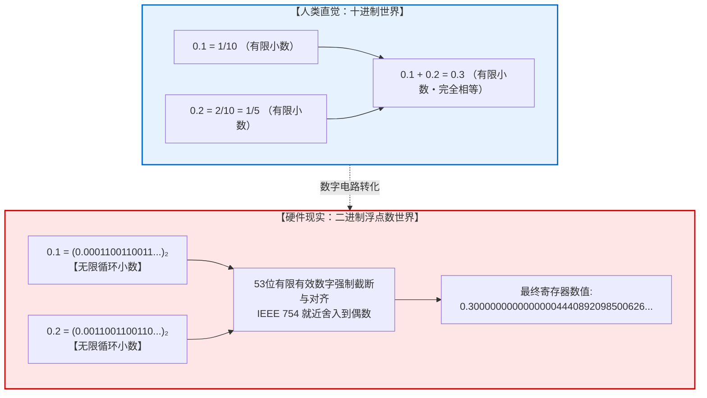
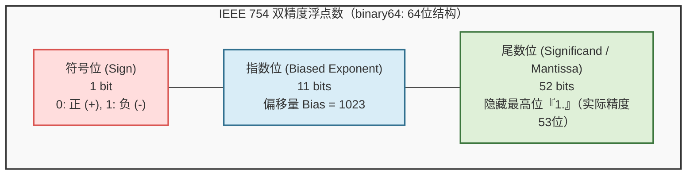
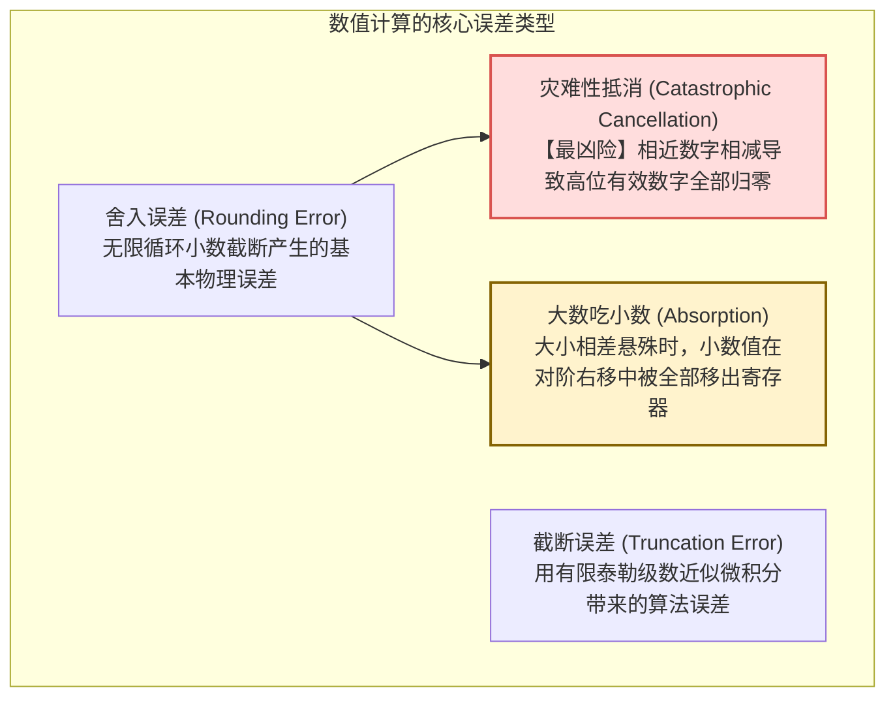
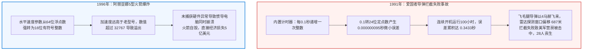

## 引言：令全球程序员困惑的“0.1 + 0.2”之谜

几乎每一位初学编程的开发者，在控制台输入以下代码时，都会经历一次认知冲击：

```javascript
console.log(0.1 + 0.2);
// 输出: 0.30000000000000004
console.log(0.1 + 0.2 === 0.3);
// 输出: false
```

```python
>>> 0.1 + 0.2
0.30000000000000004
>>> 0.1 + 0.2 == 0.3
False
```

一台每秒能执行数万亿次浮点运算、能渲染逼真3D游戏、能驱动巨大人工智能模型的超级计算机，为什么连小学生都能心算出来的简单算术题 `0.1 + 0.2 = 0.3` 都会算错？

很多新手会下意识地认为这是某种编程语言的底层缺陷或编译器的偶发故障。然而，无论是苹果M系列芯片、英特尔至强CPU，还是英伟达最新的AI GPU，全球所有的数字计算平台给出的都是完全一致的 <strong>0.30000000000000004</strong>。



这一现象揭示了计算机科学的核心妥协：<strong>如何用有限的离散比特（0与1）来逼近无限连续的实数世界？</strong>

---

## 1. 二进制的深渊：为什么十进制小数会变成无限循环小数？

### 1.1 十进制中的 $1/3$ 类比
在日常使用的十进制中，如果我们试图用小数写出 $\frac{1}{3}$，结果是：
$$\frac{1}{3} = 0.33333333\dots \quad (\text{无限循环小数})$$
无论纸张多大，我们都无法在有限位数内写完。如果计算器只能显示8位，它会截断为 $0.33333333$。将其乘3，我们得到 $0.99999999 \neq 1$。
<strong>对于二进制计算机而言，十进制的 0.1 和 0.2 就如同十进制中的 $1/3$ 一样，是绝对无法除尽的无限小数！</strong>

### 1.2 有限小数的数论充要条件
数论中有一条著名的整除定理：
> 在 $N$ 进制下，一个既约分数 $\frac{P}{Q}$ 能够表示为有限小数的充要条件是：分母 $Q$ 的所有质因数，都必须是基数 $N$ 质因数的子集。

- <strong>十进制基数 $10 = 2 \times 5$：</strong>
  分母质因数只包含 2 和 5 的分数是有限小数（如 $\frac{1}{2}=0.5, \frac{1}{4}=0.25, \frac{1}{5}=0.2, \frac{1}{10}=0.1$）。
- <strong>二进制基数 $2$：</strong>
  基数 2 只有唯一质因数 <strong>2</strong>！因此在二进制中，只有分母是 $2^k$（如 $\frac{1}{2}, \frac{1}{4}, \frac{1}{8}, \frac{1}{16}$）的分数才能写成有限小数。

而十进制小数 $0.1 = \frac{1}{10} = \frac{1}{2 \times 5}$，分母中含有质因数 <strong>5</strong>。因为 2 无法整除 5，<strong>0.1 在二进制下必然是不可除尽的无限循环小数</strong>：

$$(0.1)_{10} = (0.000110011001100110011\dots)_2$$

计算机内存是有限的，必须在某一位强行截断，微小的舍入误差就此诞生。

---

## 2. IEEE 754 浮点数标准解剖

1985年，电气电子工程师学会制定了 <strong>IEEE 754</strong> 标准，成为现代所有处理器的硬件浮点规范。



双精度浮点数（64位）分为三个部分：
1. <strong>符号位（1位）：</strong> 决定正负号。
2. <strong>阶码/指数位（11位）：</strong> 加上偏移量 1023，范围覆盖从 $2^{-1022}$ 到 $2^{1023}$ 的极其广阔的动态范围。
3. <strong>尾数位（52位）：</strong> 采用科学计数法规格化表示，隐含省略最高位整数 `1.`，实际拥有 <strong>53位</strong> 二进制有效数字精度（相当于十进制约15至17位精度）。

其实际数学公式为：
$$V = (-1)^s \times (1 + f) \times 2^{e - 1023}$$

---

## 3. “0.1 + 0.2”的底层执行全过程

在64位寄存器中，0.1 被编码为：
$$\text{float64}(0.1) = 0.1000000000000000055511151231257827021181583404541015625$$
0.2 被编码为：
$$\text{float64}(0.2) = 0.200000000000000011102230246251565404236316680908203125$$

当两个数相加时，CPU首先执行<strong>对阶（Alignment Shift）</strong>，将阶码较小的 0.1 尾数向右移动 1 位，然后与 0.2 的尾数相加。
相加后的结果在第54位发生截断，并触发 IEEE 754 的默认舍入模式——<strong>就近舍入到偶数（Round-to-Nearest, Ties-to-Even）</strong>。

最终存储的值转换为十进制，正是：
$$\mathbf{0.3000000000000000444089209850062616169452667236328125}$$
而真正的 0.3 存储值为：
$$\text{float64}(0.3) = 0.299999999999999988897769753748434595763683319091796875$$
两个二进制位模式截然不同，因此 `0.1 + 0.2 === 0.3` 判定为 `false`。

---

## 4. 数值计算中的四种恶魔误差



1. <strong>灾难性抵消（Catastrophic Cancellation）：</strong>
   当两个极其接近的浮点数相减时，原本相同的有效高位被全部抵消，只留下充满舍入噪声的末尾几位，导致计算结果的有效位数断崖式崩塌。
2. <strong>大数吃小数（Absorption）：</strong>
   例如在 Python 中计算 `(1e16 + 1.0) - 1e16`，由于 $10^{16}$ 已经占满了双精度的全部有效位，加 $1.0$ 时其尾数被完全移出53位范围，结果输出 `0.0`。
3. <strong>卡汉求和算法（Kahan Summation）：</strong>
   利用一个独立的补偿变量记录每次加法丢失的低位舍入残差，在下一次循环中补偿回来，从而实现亿级数据累加的零误差累积。

---

## 5. 改变历史的浮点灾难



- <strong>海湾战争爱国者导弹惨剧（1991）：</strong> 0.1秒时钟转换的微小截断误差，在连续运行100小时后累积成0.34秒的时钟漂移。对于以4马赫高速飞行的飞毛腿导弹，这相当于687米的雷达追踪窗口偏差，导致雷达锁定虚空，最终28名美军士兵牺牲。
- <strong>阿丽亚娜5型运载火箭首飞爆炸（1996）：</strong> 软件将一个64位浮点水平速度强转为16位整数，超过32767上限发生溢出崩溃，导致价值5亿美元的火箭与卫星在空中化为火球。

---

## 6. 工程师的实践准则

1. <strong>禁止直接等值比较：</strong> 严禁使用 `a == b`，必须使用机器精度 $\epsilon$（Epsilon）：
   ```python
   import math
   math.isclose(a, b, rel_tol=1e-9, abs_tol=1e-12)
   ```
2. <strong>金融会计领域的绝对禁令：</strong> 金融系统中严禁使用 `float`。必须使用<strong>整数最小货币单位（分/厘）</strong>或<strong>任意精度十进制库（Python `decimal.Decimal` / Java `BigDecimal`）</strong>。
3. <strong>算法代数重构：</strong> 在二次方程求根等场景中，通过分子有理化将相近减法改写为加法，彻底规避灾难性抵消。

---

## 7. 结语：有限比特征服无限连续的工程奇迹

`0.1 + 0.2 = 0.30000000000000004` 绝不是计算机的耻辱，而是人类工程学的巅峰杰作。
用区区64个微小的电荷开关，将横跨600个数量级的浩瀚物理宇宙实数浓缩其中，并在数十亿分之一秒内完成精确运算。理解这一妥协的本质，正是我们成为卓越软件工程师的必经之路。

