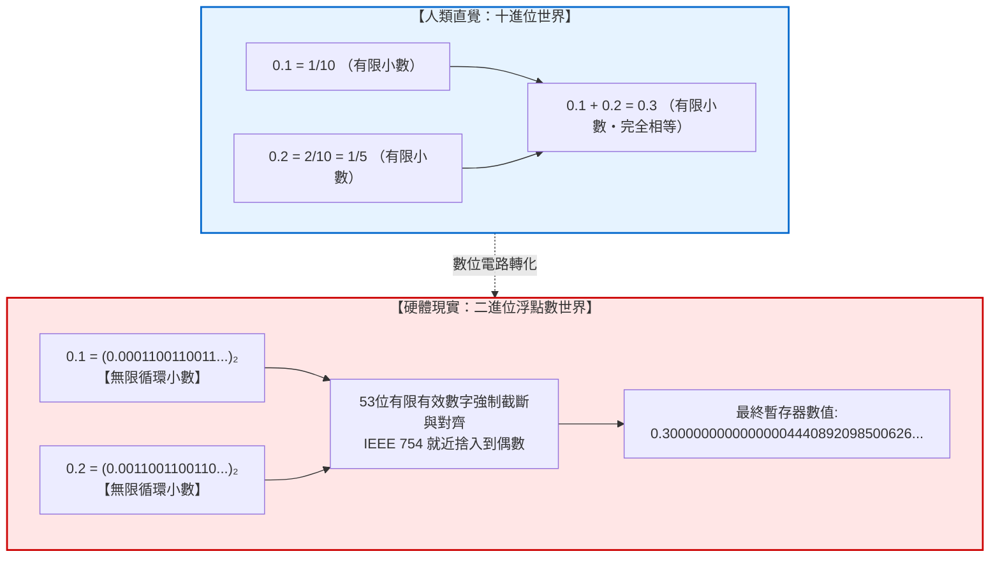
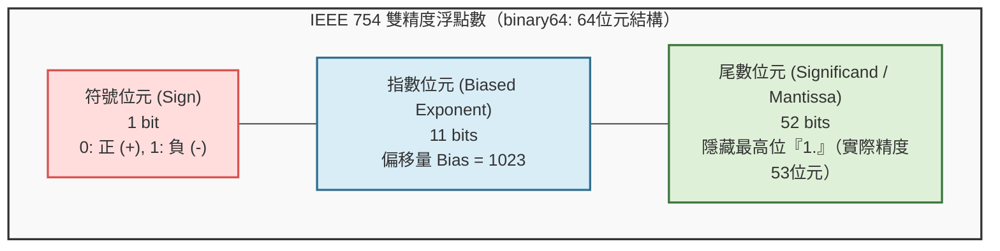
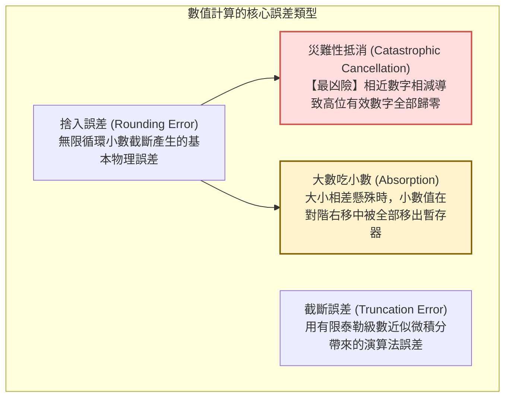
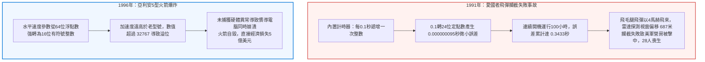

## 引言：令全球程式設計師困惑的「0.1 + 0.2」之謎

幾乎每一位初學程式設計的開發者，在控制台輸入以下程式碼時，都會經歷一次認知衝擊：

```javascript
console.log(0.1 + 0.2);
// 輸出: 0.30000000000000004
console.log(0.1 + 0.2 === 0.3);
// 輸出: false
```

```python
>>> 0.1 + 0.2
0.30000000000000004
>>> 0.1 + 0.2 == 0.3
False
```

一台每秒能執行數萬億次浮點運算、能渲染逼真3D遊戲、能驅動巨大人工智慧模型的超級電腦，為什麼連小學生都能心算出來的簡單算術題 `0.1 + 0.2 = 0.3` 都會算錯？

很多新手會下意識地認為這是某種程式語言的底層缺陷或編譯器的偶發故障。然而，無論是蘋果M系列晶片、英特爾至強CPU，還是輝達最新的AI GPU，全球所有的數位計算平台給出的都是完全一致的 <strong>0.30000000000000004</strong>。



這一現象揭示了電腦科學的核心妥協：<strong>如何用有限的離散位元（0與1）來逼近無限連續的實數世界？</strong>

---

## 1. 二進位的深淵：為什麼十進位小數會變成無限循環小數？

### 1.1 十進位中的 $1/3$ 類比
在日常使用的十進位中，如果我們試圖用小數寫出 $\frac{1}{3}$，結果是：
$$\frac{1}{3} = 0.33333333\dots \quad (\text{無限循環小數})$$
無論紙張多大，我們都無法在有限位數內寫完。如果計算機只能顯示8位，它會截斷為 $0.33333333$。將其乘3，我們得到 $0.99999999 \neq 1$。
<strong>對於二進位電腦而言，十進位的 0.1 和 0.2 就如同十進位中的 $1/3$ 一樣，是絕對無法除盡的無限小數！</strong>

### 1.2 有限小數的數論充要條件
數論中有一條著名的整除定理：
> 在 $N$ 進位下，一個既約分數 $\frac{P}{Q}$ 能夠表示為有限小數的充要條件是：分母 $Q$ 的所有質因數，都必須是基數 $N$ 質因數的子集。

- <strong>十進位基數 $10 = 2 \times 5$：</strong>
  分母質因數只包含 2 和 5 的分數是有限小數（如 $\frac{1}{2}=0.5, \frac{1}{4}=0.25, \frac{1}{5}=0.2, \frac{1}{10}=0.1$）。
- <strong>二進位基數 $2$：</strong>
  基數 2 只有唯一質因數 <strong>2</strong>！因此在二進位中，只有分母是 $2^k$（如 $\frac{1}{2}, \frac{1}{4}, \frac{1}{8}, \frac{1}{16}$）的分數才能寫成有限小數。

而十進位小數 $0.1 = \frac{1}{10} = \frac{1}{2 \times 5}$，分母中含有質因數 <strong>5</strong>。因為 2 無法整除 5，<strong>0.1 在二進位下必然是不可除盡的無限循環小數</strong>：

$$(0.1)_{10} = (0.000110011001100110011\dots)_2$$

電腦記憶體是有限的，必須在某一位強行截斷，微小的捨入誤差就此誕生。

---

## 2. IEEE 754 浮點數標準解剖

1985年，電機電子工程師學會制定了 <strong>IEEE 754</strong> 標準，成為現代所有處理器的硬體浮點規範。



雙精度浮點數（64位元）分為三個部分：
1. <strong>符號位元（1位元）：</strong> 決定正負號。
2. <strong>階碼/指數位元（11位元）：</strong> 加上偏移量 1023，範圍覆蓋從 $2^{-1022}$ 到 $2^{1023}$ 的極其廣闊的動態範圍。
3. <strong>尾數位元（52位元）：</strong> 採用科學記號法規格化表示，隱含省略最高位整數 `1.`，實際擁有 <strong>53位元</strong> 二進位有效數字精度（相當於十進位約15至17位精度）。

其實際數學公式為：
$$V = (-1)^s \times (1 + f) \times 2^{e - 1023}$$

---

## 3. 「0.1 + 0.2」的底層執行全過程

在64位元暫存器中，0.1 被編碼為：
$$\text{float64}(0.1) = 0.1000000000000000055511151231257827021181583404541015625$$
0.2 被編碼為：
$$\text{float64}(0.2) = 0.200000000000000011102230246251565404236316680908203125$$

當兩個數相加時，CPU首先執行<strong>對階（Alignment Shift）</strong>，將階碼較小的 0.1 尾數向右移動 1 位元，然後與 0.2 的尾數相加。
相加後的結果在第54位元發生截斷，並觸發 IEEE 754 的預設捨入模式——<strong>就近捨入到偶數（Round-to-Nearest, Ties-to-Even）</strong>。

最終儲存的值轉換為十進位，正是：
$$\mathbf{0.3000000000000000444089209850062616169452667236328125}$$
而真正的 0.3 儲存值為：
$$\text{float64}(0.3) = 0.299999999999999988897769753748434595763683319091796875$$
兩個二進位位元模式截然不同，因此 `0.1 + 0.2 === 0.3` 判定為 `false`。

---

## 4. 數值計算中的四種惡魔誤差



1. <strong>災難性抵消（Catastrophic Cancellation）：</strong>
   當兩個極其接近的浮點數相減時，原本相同的有效高位被全部抵消，只留下充滿捨入噪聲的末尾幾位，導致計算結果的有效位數斷崖式崩塌。
2. <strong>大數吃小數（Absorption）：</strong>
   例如在 Python 中計算 `(1e16 + 1.0) - 1e16`，由於 $10^{16}$ 已經佔滿了雙精度的全部有效位元，加 $1.0$ 時其尾數被完全移出53位元範圍，結果輸出 `0.0`。
3. <strong>卡漢求和演算法（Kahan Summation）：</strong>
   利用一個獨立的補償變數記錄每次加法丟失的低位捨入殘差，在下一次循環中補償回來，從而實現億級數據累加的零誤差累積。

---

## 5. 改變歷史的浮點災難



- <strong>海灣戰爭愛國者飛彈慘劇（1991）：</strong> 0.1秒時鐘轉換的微小截斷誤差，在連續運行100小時後累計成0.34秒的時鐘漂移。對於以4馬赫高速飛行的飛毛腿飛彈，這相當於687公尺的雷達追蹤視窗偏差，導致雷達鎖定虛空，最終28名美軍士兵犧牲。
- <strong>亞利安5型運載火箭首飛爆炸（1996）：</strong> 軟體將一個64位元浮點水平速度強轉為16位元整數，超過32767上限發生溢位崩潰，導致價值5億美元的火箭與衛星在空中化為火球。

---

## 6. 工程師的實踐準則

1. <strong>禁止直接等值比較：</strong> 嚴禁使用 `a == b`，必須使用機器精度 $\epsilon$（Epsilon）：
   ```python
   import math
   math.isclose(a, b, rel_tol=1e-9, abs_tol=1e-12)
   ```
2. <strong>金融會計領域的絕對禁令：</strong> 金融系統中嚴禁使用 `float`。必須使用<strong>整數最小貨幣單位（分/厘）</strong>或<strong>任意精度十進位庫（Python `decimal.Decimal` / Java `BigDecimal`）</strong>。
3. <strong>演算法代數重構：</strong> 在二次方程求根等場景中，透過分子有理化將相近減法改寫為加法，徹底規避災難性抵消。

---

## 7. 結語：有限位元征服無限連續的工程奇蹟

`0.1 + 0.2 = 0.30000000000000004` 絕不是電腦的恥辱，而是人類工程學的巔峰傑作。
用區區64個微小的電荷開關，將橫跨600個數量級的浩瀚物理宇宙實數濃縮其中，並在數十億分之一秒內完成精確運算。理解這一妥協的本質，正是我們成為卓越軟體工程師的必經之路。

