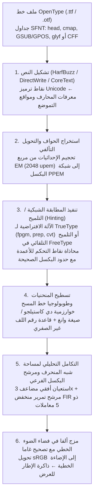

تخيل أنك تفحص النص الذي تقرؤه الآن على شاشتك عبر عدسة مكبرة عالية القوة. عند حجم النص القياسي البالغ $12\,\text{px}$ ($9\,\text{pt}$ على شاشة مكتبية تقليدية بدقة $96\,\text{DPI}$)، فإن الخلية الكاملة للحرف الواحد ليست سوى رقعة شطرنج متقطعة متناهية الصغر بعرض $12$ بكسل وارتفاع $12$ بكسل — أي ما مجموعه $144$ مربعاً مضيئاً مجهرياً فقط.

ومع ذلك، داخل هذه الشبكة الضيقة ($12 \times 12$)، يقوم نظام التشغيل لديك برسم عشرات الآلاف من المحارف (Glyphs) المعقدة في الثانية الواحدة في الوقت الفعلي: بدءاً من الحروف العربية المتصلة بنقاطها وتشكيلاتها الدقيقة، أو رمز الكانجي «鬱» المكون من $29$ ضربة فرشاة، وصولاً إلى الحرف اللاتيني ذي الرقيقات «`g`» أو الحرف «`m`» ذي الأعمدة الرأسية الثلاثة المتساوية. يحتفظ كل عمود رأسي بسُمك وكثافة متطابقين، ولا تلتصق الخطوط الأفقية المتقاربة لتتحول إلى لطخة سوداء غير مقروءة، كما لا تسقط في الفجوات بين مراكز البكسلات لتختفي (Dropout)، وتنساب المنحنيات القطرية بنعومة دون تعرجات سُلّمية (Jaggies).

من منظور <strong>نظرية المعلومات</strong> و<strong>المعالجة الرقمية للإشارات (DSP)</strong>، يُعد هذا الإنجاز اليومي معجزة رياضية تتحدى حدود <strong>مبرهنة الاستعيان لنايكويست-شانون (Nyquist-Shannon Sampling Theorem)</strong>. فلو قمنا بتصغير مخطط متجهي عالي الدقة وإسقاطه مباشرة على شبكة $12 \times 12$ بكسل، فإن الترددات المكانية العالية التي تتجاوز حد نايكويست ستنطوي مسببةً تشوهاً تداخلياً شديداً (Aliasing) يحول النص إلى غيمة رمادية يستحيل قراءتها.

يقف وراء وضوح النصوص الصغيرة نصف قرن من عبقرية علوم الحاسوب: <strong>الهندسة الحسابية</strong> (كثيرات حدود برنشتاين ومنحنيات بيزييه)، <strong>الطوبولوجيا الجبرية</strong> (أرقام اللف للمنحنيات الموجهة)، <strong>الآلات الافتراضية</strong> (شيفرة بايت قابلة للتنفيذ داخل كل ملف خط `.ttf`)، <strong>الفيزياء النفسية للإبصار البشري وتصميم مرشحات FIR</strong> (التصيير بالبكسل الفرعي ClearType)، <strong>علم القياس الإشعاعي للألوان</strong> (المزج في فضاء الضوء الخطي)، و<strong>خوارزميات مظللات وحدة معالجة الرسوميات GPU</strong> (تقنية MSDF والتقييم المباشر `Slug`).

---

## 1. من قيود الخطوط النقطية إلى الخطوط المتجهية المستقلة عن الدقة

اعتمدت الحواسيب المبكرة على <strong>الخطوط النقطية (Bitmap Fonts)</strong> التي تخزن كل محرف كمصفوفة ثنائية $M \in \{0, 1\}^{H \times W}$. ورغم حدتها عند حجمها الأصلي، عانت من <strong>الاعتماد الكلي على الدقة</strong>: فالتكبير أو التدوير يولد حوافاً متعرجة، والبيانات المصممة لشاشة $72\,\text{DPI}$ لا تصلح لطابعات الليزر ($300\,\text{DPI}$) أو آلات الطباعة التجارية ($2400\,\text{DPI}$).

جاءت الثورة عبر <strong>خطوط الحواف المتجهية (Outline Fonts)</strong>: أولاً مع <strong>PostScript Type 1</strong> (عام 1984) الذي ابتكره <strong>John Warnock</strong> و<strong>Chuck Geschke</strong> في شركة Adobe باستخدام منحنيات بيزييه التكعيبية، ثم <strong>TrueType</strong> (`.ttf`، عام 1991) من تطوير Apple وMicrosoft باستخدام منحنيات بيزييه التربيعية وآلة افتراضية مكدسية للتلميح، قبل توحيدهما عام 1996 ضمن معيار <strong>OpenType</strong> (جدولي `glyf` و`CFF`/`CFF2`).

---

## 2. الهندسة الحسابية لخطوط الحواف: كثيرات حدود برنشتاين ومنحنيات بيزييه

### الخصائص الرياضية الأربع لأساس برنشتاين

إن كثيرات الحدود الصريحة في أساس القوى $y = a_3 x^3 + a_2 x^2 + a_1 x + a_0$ تعجز عن تمثيل المماسات الرأسية وتفتقر إلى الاستقرار العددي عند التدوير. صاغ مهندسا السيارات الفرنسيان <strong>Paul de Casteljau</strong> (سيتروين، 1959) و<strong>Pierre Bézier</strong> (رينو، 1962) المنحنيات الوسيطية باستخدام <strong>كثيرات حدود أساس برنشتاين (Bernstein Basis Polynomials)</strong> من الدرجة $n$ مع $n+1$ من نقاط التحكم $\mathbf{P}_0, \dots, \mathbf{P}_n \in \mathbb{R}^2$:

$$\mathbf{B}_n(t) = \sum_{i=0}^{n} B_{i,n}(t)\,\mathbf{P}_i, \qquad B_{i,n}(t) = \binom{n}{i} (1 - t)^{n - i} t^i, \qquad t \in [0, 1]$$

1. <strong>عدم السلبية، تجزئة الوحدة، وخاصية الغلاف المحدب (Convex Hull Property)</strong>:
   لكل $t \in [0, 1]$ يكون $B_{i,n}(t) \ge 0$، وبموجب نظرية ذات الحدين فإن مجموع كل دوال الأساس يساوي $1$ دائماً:
   $$\sum_{i=0}^{n} B_{i,n}(t) = \bigl((1 - t) + t\bigr)^n = 1$$
   بما أن المنحنى تركيب محدب لنقاط التحكم، فإنه يقع بالكامل داخل <strong>الغلاف المحدب (Convex Hull)</strong> لنقاط التحكم، مما يتيح استبعاد المنحنيات التي لا تتقاطع مع خط المسح الحالي في زمن $O(1)$ عبر فحص صندوق الإحاطة.
2. <strong>الثبات التآلفي (Affine Invariance)</strong>:
   لأي تحويل تآلفي $\Phi(\mathbf{x}) = A\mathbf{x} + \mathbf{b}$ يتحقق $\Phi(\mathbf{B}_n(t)) = \sum B_{i,n}(t)\,\Phi(\mathbf{P}_i)$، أي يكفي تحويل نقاط التحكم القليلة فقط.
3. <strong>استيفاء نقاط النهاية والتحكم بالمماسات</strong>:
   $\mathbf{B}_n(0) = \mathbf{P}_0$ و$\mathbf{B}_n(1) = \mathbf{P}_n$، مع متجهي المماس عند الطرفين $\mathbf{B}_n'(0) = n(\mathbf{P}_1 - \mathbf{P}_0)$ و$\mathbf{B}_n'(1) = n(\mathbf{P}_n - \mathbf{P}_{n-1})$.
4. <strong>خاصية تقليل التباين (Variation Diminishing Property)</strong>:
   لا يتقاطع أي خط مستقيم مع منحنى بيزييه عدداً من المرات يفوق تقاطعه مع مضلع التحكم.

---

### منحنيات بيزييه التربيعية ($n=2$، TrueType) مقابل التكعيبية ($n=3$، OpenType CFF)

- <strong>منحنيات بيزييه التربيعية ($n=2$، جدول `glyf` في TrueType)</strong>:
  $$\mathbf{B}_2(t) = (1-t)^2 \mathbf{P}_0 + 2(1-t)t \mathbf{P}_1 + t^2 \mathbf{P}_2$$
  إلى جانب سرعة إيجاد التقاطع مع خط المسح عبر القانون العام للمعادلة التربيعية، يستخدم TrueType تقنية ضغط ذكية هي <strong>النقاط الوسطى الضمنية على المنحنى (Implicit On-Curve Midpoints)</strong>: عندما تتتالى نقطتا تحكم خارج المنحنى $\mathbf{P}_1, \mathbf{P}_2$، يقوم المفكك تلقائياًبتوليد نقطة وصل على المنحنى في منتصفهما تماماً $\mathbf{M} = \frac{1}{2}(\mathbf{P}_1 + \mathbf{P}_2)$، مما يضمن اتصالاً أملس من الدرجة $C^1$ ويوفر نحو $30\%$ من حجم الملف.
- <strong>منحنيات بيزييه التكعيبية ($n=3$، PostScript / جدول `CFF` في OpenType)</strong>:
  $$\mathbf{B}_3(t) = (1-t)^3 \mathbf{P}_0 + 3(1-t)^2 t \mathbf{P}_1 + 3(1-t)t^2 \mathbf{P}_2 + t^3 \mathbf{P}_3$$
  لأن المشتقة الثانية للمنحنى التربيعي ثابتة ($\mathbf{B}_2''(t) = \text{const}$)، لا يمكن لقطعة تربيعية واحدة أن تحتوي أبداً على <strong>نقطة انعطاف (Inflection Point)</strong> مثل العمود الفقري لحرف «`S`». أما المنحنى التكعيبي فمشتقته الثانية خطية في $t$، مما يسمح بتمثيل نقاط الانعطاف وضبط انحناء $G^2$ عند الطرفين باستقلالية تامة.

| وجه المقارنة | بيزييه التربيعية ($n=2$، TrueType `glyf`) | بيزييه التكعيبية ($n=3$، OpenType `CFF`) |
| :--- | :--- | :--- |
| <strong>المعادلة الوسيطية $\mathbf{B}(t)$</strong> | $(1-t)^2\mathbf{P}_0 + 2(1-t)t\mathbf{P}_1 + t^2\mathbf{P}_2$ | $(1-t)^3\mathbf{P}_0 + 3(1-t)^2t\mathbf{P}_1 + 3(1-t)t^2\mathbf{P}_2 + t^3\mathbf{P}_3$ |
| <strong>نقاط الانعطاف في القطعة الواحدة</strong> | $0$ (قوس قطع مكافئ بإشارة تقوس ثابتة) | حتى $2$ (تمثيل انحناء «`S`» في قطعة واحدة) |
| <strong>درجات الحرية (مع ثبات المماسات)</strong> | $0$ ($\mathbf{P}_1$ مقيدة عند تقاطع المماسين) | $2$ (ضبط نصف قطر الانحناء $G^2$ عبر طولي المقبضين) |
| <strong>آلية الضغط الثنائي</strong> | النقاط الوسطى الضمنية $\mathbf{M} = \frac{1}{2}(\mathbf{P}_1 + \mathbf{P}_2)$ | روتينات CFF CharString الفرعية والترميز التفاضلي |

وبفضل <strong>خوارزمية دي كاستيلجو</strong> $\mathbf{P}_i^{(r)}(t) = (1-t)\mathbf{P}_i^{(r-1)}(t) + t\mathbf{P}_{i+1}^{(r-1)}(t)$ (التي تؤول عند $t = \frac{1}{2}$ إلى جمع وإزاحة بتية `>> 1`) و<strong>صيغة وانغ (1985)</strong>

$$N = \left\lceil \sqrt{ \frac{n(n-1)}{8\tau} \max_{0 \le i \le n-2} \|\mathbf{P}_{i+2} - 2\mathbf{P}_{i+1} + \mathbf{P}_i\| } \right\rceil$$

يتم تسطيح المنحنيات إلى $N$ قطعة مستقيمة ضمن التفاوت المسموح $\tau$ دون الحاجة إلى استدعاءات عودية.

---

## 3. التحويل النقطي لخط المسح: قاعدة رقم اللف وتكامل مساحة شبه المنحرف

### قاعدة الزوجي-الفردي مقابل قاعدة رقم اللف غير الصفري

للتمييز بين داخل الحرف والفراغات الداخلية (مثل الفجوة داخل «`O`» أو «`8`» أو «`ه`»)، تفشل <strong>قاعدة الزوجي-الفردي (Even-Odd Rule)</strong> عندما تتقاطع ضربتان متراكبتان (كما في <strong>الخطوط المتغيرة Variable Fonts</strong> أو تداخل الحروف العربية)، إذ يصبح عدد التقاطعات زوجياً ($2$) فتظهر ثقوب بيضاء مشوهة عند التقاطع. لذلك تعتمد محركات الخطوط على <strong>قاعدة رقم اللف غير الصفري (Non-Zero Winding Rule)</strong>:

$$w(P) = \frac{1}{2\pi} \oint_{\partial\Gamma} d\theta = \sum_{\text{crossings}} \operatorname{sgn}(\Delta y) \ne 0$$

فالحواف الخارجية (باتجاه عقارب الساعة CW في TrueType، $-1$) والفجوات الداخلية (بعكس عقارب الساعة CCW، $+1$) يلغي بعضها بعضاً ($w(P) = 0$) داخل الفجوات، بينما تتجمع الضربات المتراكبة ذات الاتجاه الواحد ($w(P) = -2 \ne 0$) لتظل مطموسة بالكامل دون ثقوب.

### التكامل التحليلي الدقيق لمساحة شبه المنحرف (Libart / FreeType `ftgrays` / `stb_truetype`)

بدلاً من الاستعيان الفائق البطيء، تحسب خوارزمية راف ليفين (المعتمدة في FreeType `ftgrays.c` و`stb_truetype` و`font-rs`) لكل قطعة تعبر البكسل $(i, j)$ (بارتفاع موقع $\Delta y = y_1 - y_0$ ومنتصف أفقي $\bar{x} \in [0, 1]$) مساحة شبه المنحرف الدقيقة على يمينها $\text{delta\_area}[i] \mathrel{+}= (1 - \bar{x})\Delta y$، وزيادة التغطية الكاملة $\text{delta\_cover}[i+1] \mathrel{+}= \Delta y$ لجميع البكسلات الواقعة إلى اليمين. وبمسحة خطية واحدة لحساب <strong>المجموع البادئ (Prefix Sum)</strong>، نحصل على التغطية الدقيقة $\alpha_i \in [0, 1]$ بـ 256 تدرجاً رمادياً:

$$C_i = C_{i-1} + \text{delta\_cover}[i], \qquad A_i = C_i + \text{delta\_area}[i], \qquad \alpha_i = \min\bigl(1.0,\; |A_i|\bigr)$$

---

## 4. الآلة الافتراضية السرية داخل الخط: التلميح (Hinting) والفلسفات الثلاث

من دون التلميح عند حجم $12\,\text{px}$، تسقط الأعمدة الرأسية الثلاثة المتطابقة لحرف «`m`» بطور مختلف على شبكة البكسل: يسقط العمود الأول داخل بكسل واحد ($\alpha = 0.80$، أسود حاد)، بينما يمتطي العمود الثاني حدود بكسلين فيتلطخ إلى شريط رمادي ضبابي بعرض بكسلين ($\alpha = 0.60$ و$\alpha = 0.20$).

لمنع ذلك، يتضمن كل ملف TrueType برنامج شيفرة بايت (`cvt `، `fpgm`، `prep`، `glyf`) تنفذه <strong>آلة افتراضية مكدسية</strong> بحساب النقطة الثابتة $26.6$. وباستخدام <strong>متجه الإسقاط ($\mathbf{P}$)</strong> و<strong>متجه الحرية ($\mathbf{F}$)</strong>، تقوم تعليمات مثل `MDAP` و`MIRP` بمحاذاة النقاط إلى حدود البكسل الصحيحة، وتوحيد عرض الأعمدة عبر جدول `cvt`، وضمان المسافة الدنيا لمنع اختفاء الخطوط الرقيقة، وتطبيق استثناءات دقيقة بالحجم عبر `DELTAP1`، ثم استيفاء بقية النقاط غير الملموسة بسلاسة عبر `IUP[0]` / `IUP[1]`.

- <strong>فلسفة مايكروسوفت (GDI / ClearType)</strong>: الأولوية القصوى للحدة والتباين عبر إجبار الأعمدة على الانطباق على شبكة البكسل حتى لو تغيرت نسب التصميم الأصلي قليلاً.
- <strong>فلسفة أبل (Quartz / CoreText)</strong>: الحفاظ الأمين على أشكال مصمم الخط (WYSIWYG) عبر تجاهل شيفرة التلميح، وهو ما تألق تماماً مع شاشات Retina عالية الكثافة.
- <strong>التلميح التلقائي في FreeType (`autofit`) والتلميح الرأسي فقط (Y-only)</strong>: تحليل هندسي آلي للحواف ومناطق المحاذاة الزرقاء (Blue Zones) أثناء التشغيل، مع الاكتفاء بمحاذاة المحور الرأسي Y وترك المحور الأفقي X حراً للتموضع بالبكسل الفرعي.

---

## 5. التصيير بالبكسل الفرعي (ClearType) والمزج الخطي المصحح بمعامل غاما

يتكون كل بكسل في شاشات LCD من ثلاثة بكسلات فرعية رأسية ($R, G, B$) تفصل بينها مسافة $\frac{1}{3}$ بكسل أفقياً. وبما أن العين البشرية تمتلك حدة مكانية فائقة للإضاءة ($Y = 0.2126R + 0.7152G + 0.0722B$) وحساسية منخفضة للتغيرات اللونية الدقيقة، يقوم المصير بأخذ عينات أفقية <strong>بدقة مضاعفة $3\times$</strong>. ولإزالة الحواف الملونة (Color Fringing)، يُطبق <strong>مرشح التمرير المنخفض FIR المتناظر ذو 5 معاملات لـ Gibson</strong> ($\frac{1}{3}[1,1,1] * \frac{1}{3}[1,1,1]$):

$$h_{\text{Gibson}} = \left[\frac{1}{9},\; \frac{2}{9},\; \frac{3}{9},\; \frac{2}{9},\; \frac{1}{9}\right]$$

حيث يساوي مجموع كل مجموعة بمعامل قسمة 3 القيمة $\frac{3}{9} = \frac{2}{9} + \frac{1}{9} = \frac{1}{3}$ تماماً، مما يوزع الطاقة بالتساوي بين $R$ و$G$ و$B$. وأخيراً، يجب إجراء مزج ألفا في <strong>فضاء الضوء الخطي</strong> ($\gamma \approx 2.2$) لتجنب تشوه سُمك الخطوط بين الوضع الفاتح والوضع الداكن:

$$C_{\text{out}, c} = \Bigl( \alpha_c \, C_{\text{fg}, c}^{\gamma} + (1 - \alpha_c) \, C_{\text{bg}, c}^{\gamma} \Bigr)^{1/\gamma}, \qquad c \in \{R, G, B\},\; \gamma \approx 2.2$$

---

## 6. عصر GPU: حقول المسافة الموقعة (SDF) وMSDF (`msdfgen`) ومظللات بيزييه المباشرة (`Slug`)

```mermaid
flowchart TD
    subgraph CPU["التحويل النقطي على CPU (FreeType / DirectWrite)"]
        C1["منحنيات بيزييه + آلة التلميح VM"] --> C2["تكامل شبه المنحرف + مرشح FIR ذو 5 معاملات"]
        C2 --> C3["ذاكرة تخزين نقطية لكل حجم<br/>الميزة: أقصى وضوح عند 10–14px<br/>القيد: ضبابية أو إعادة حساب عند التكبير والتدوير ثلاثي الأبعاد"]
    end
    subgraph MSDF["حقول المسافة على GPU (Valve SDF / Chlumský MSDF)"]
        S1["حساب مسبق لحقل المسافة الموقعة"] --> S2["MSDF: تلوين الحواف بقنوات RGB للحفاظ على الزوايا الحادة"]
        S2 --> S3["مظلل الشظايا: d = median(r, g, b) + smoothstep<br/>الميزة: زوايا حادة تماماً عند أي مستوى تكبير"]
    end
    subgraph Slug["مظللات بيزييه المباشرة على GPU (Eric Lengyel 'Slug' / 'Vello')"]
        G1["نقاط تحكم بيزييه مباشرة في مخزن GPU"] --> G2["تقسيم مكاني إلى أشرطة أفقية ورأسية"]
        G2 --> G3["حل المعادلات التربيعية ورقم اللف داخل المظلل<br/>الميزة: بلا أطلس أنسجة، مثالي لـ 50,000 محرف معقد"]
    end
```

في محركات الألعاب ثلاثية الأبعاد، قدم <strong>Chris Green (Valve، 2007)</strong> تقنية <strong>حقول المسافة الموقعة (SDF)</strong> التي تخزن المسافة الإقليدية $d(\mathbf{p})$ إلى أقرب حافة. ولمنع استدارة الزوايا الحادة عند التكبير، ابتكر <strong>Viktor Chlumský (2015)</strong> تقنية <strong>MSDF (`msdfgen`)</strong> التي توزع مسافات الحواف المتلاقية على قنوات RGB الثلاث وتستعيد الزاوية الحادة داخل المظلل عبر الوسيط الحسابي:

$$d_{\text{MSDF}} = \operatorname{median}(r, g, b) = \max\Bigl(\min(r, g),\; \min\bigl(\max(r, g),\; b\bigr)\Bigr)$$

وللتعامل مع الخطوط فائقة الكثافة دون أي أطلس أنسجة، تقوم خوارزميات GPU المباشرة مثل <strong>`Slug` لإريك لينجيل (2017)</strong> و<strong>`Vello` لراف ليفين</strong> بحساب تقاطعات منحنيات بيزييه ورقم اللف مباشرة داخل المظلل بدقة رياضية لا نهائية.
