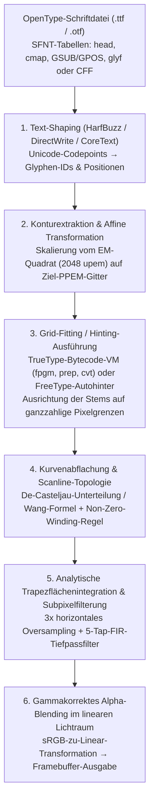

Betrachten wir den Text auf diesem Bildschirm gedanklich durch eine starke Lupe. Bei einer typischen Fließtextgröße von $12\,\text{px}$ ($9\,\text{pt}$ auf einem klassischen $96\,\text{DPI}$-Monitor) steht für einen gesamten Buchstaben lediglich ein diskretes Schachbrett von $12 \times 12 = 144$ winzigen Leuchtpixeln zur Verfügung.

Dennoch zeichnet das Betriebssystem in dieses extrem enge $12 \times 12$-Raster zehntausende Male pro Sekunde komplexe Glyphen wie das aus $29$ Strichen bestehende Kanji „鬱“, das doppelstöckige lateinische Serif-„`g`“ oder das kleine „`m`“ mit seinen drei identischen vertikalen Grundstrichen (Stems). Jeder vertikale Strich besitzt exakt dieselbe Schärfe und Schwärze, feine Querstriche verschmelzen weder zu einem schwarzen Klecks noch fallen sie durch das Abtastraster (Dropout), und diagonale Kurven zeigen keinerlei Treppeneffekte (Jaggies).

Aus Sicht der <strong>Informationstheorie</strong> und der <strong>digitalen Signalverarbeitung (DSP)</strong> grenzt dies an ein Wunder im Kampf gegen das <strong>Nyquist-Shannon-Abtasttheorem</strong>. Würde man hochauflösende Vektorkonturen naiv verkleinern und auf ein $12 \times 12$-Gitter projizieren, würden hohe Ortsfrequenzen oberhalb der Nyquist-Grenze als massives Aliasing zurückfalten und die Schrift in einen unleserlichen grauen Nebel verwandeln.

Hinter der scheinbar selbstverständlichen Lesbarkeit kleiner Bildschirmschrift verbirgt sich ein halbes Jahrhundert brillanter Informatik: <strong>Algorithmische Geometrie</strong> (Bernstein-Polynome und Bézier-Splines), <strong>algebraische Topologie</strong> (Umlaufzahlen orientierter Randkurven), <strong>Virtuelle Maschinen</strong> (ausführbarer Bytecode in jeder `.ttf`-Datei), <strong>Psychophysik des menschlichen Sehens und FIR-Filtertheorie</strong> (ClearType-Subpixel-Rendering), <strong>Radiometrie</strong> (lineares Gamma-Blending) sowie <strong>GPU-Shader-Algorithmen</strong> (MSDF und direkte Bézier-Auswertung).

---

## 1. Vom Bitmap-Gefängnis zu auflösungsunabhängigen Vektorschriften

Frühe Computersysteme nutzten <strong>Bitmap-Schriften</strong>, die jede Glyphe als binäre Matrix $M \in \{0, 1\}^{H \times W}$ speicherten. Obwohl handoptimierte Bitmaps bei ihrer Nennauflösung scharf waren, litten sie unter <strong>Auflösungsabhängigkeit</strong>: Skalierung oder Rotation führte zu Treppenstufen, und $72\,\text{DPI}$-Bildschirmbitmaps waren für $300\,\text{DPI}$-Laserdrucker oder $2400\,\text{DPI}$-Belichter unbrauchbar.

Den Durchbruch brachten <strong>John Warnock</strong> und <strong>Chuck Geschke</strong> (Adobe) mit <strong>PostScript Type 1</strong> (1984, basierend auf kubischen Bézierkurven) sowie Apple und Microsoft mit <strong>TrueType</strong> (`.ttf`, 1991, basierend auf quadratischen Bézierkurven und einer offenen stapelbasierten Hinting-VM), bevor beide Welten 1996 im <strong>OpenType</strong>-Standard (`glyf`- und `CFF`/`CFF2`-Tabellen) vereint wurden.

---

## 2. Algorithmische Geometrie der Konturschriften: Bernstein-Basis und Bézierkurven

### Die vier fundamentalen Eigenschaften der Bernstein-Polynome

Explizite Polynome in der Monombasis $y = a_3 x^3 + a_2 x^2 + a_1 x + a_0$ können keine vertikalen Tangenten darstellen und sind unter Rotation numerisch instabil. <strong>Paul de Casteljau</strong> (Citroën, 1959) und <strong>Pierre Bézier</strong> (Renault, 1962) formulierten parametrische Kurven über <strong>Bernstein-Basispolynome</strong> vom Grad $n$ mit Kontrollpunkten $\mathbf{P}_0, \dots, \mathbf{P}_n \in \mathbb{R}^2$:

$$\mathbf{B}_n(t) = \sum_{i=0}^{n} B_{i,n}(t)\,\mathbf{P}_i, \qquad B_{i,n}(t) = \binom{n}{i} (1 - t)^{n - i} t^i, \qquad t \in [0, 1]$$

1. <strong>Nichtnegativität, Zerlegung der Eins und Eigenschaft der konvexen Hülle</strong>:
   Für alle $t \in [0, 1]$ gilt $B_{i,n}(t) \ge 0$, und nach dem binomischen Lehrsatz ist die Summe aller Basisfunktionen identisch $1$:
   $$\sum_{i=0}^{n} B_{i,n}(t) = \bigl((1 - t) + t\bigr)^n = 1$$
   Als konvexe Kombination liegt die gesamte Kurve $\mathbf{B}_n(t)$ vollständig innerhalb der <strong>konvexen Hülle (Convex Hull)</strong> ihrer Kontrollpunkte, was extrem schnelles Bounding-Box-Culling in $O(1)$ ermöglicht.
2. <strong>Affine Invarianz</strong>:
   Für jede affine Abbildung $\Phi(\mathbf{x}) = A\mathbf{x} + \mathbf{b}$ gilt $\Phi(\mathbf{B}_n(t)) = \sum B_{i,n}(t)\,\Phi(\mathbf{P}_i)$: Es genügt, nur die wenigen Kontrollpunkte zu transformieren.
3. <strong>Endpunktinterpolation und Tangentenvektoren</strong>:
   $\mathbf{B}_n(0) = \mathbf{P}_0$, $\mathbf{B}_n(1) = \mathbf{P}_n$ sowie $\mathbf{B}_n'(0) = n(\mathbf{P}_1 - \mathbf{P}_0)$ und $\mathbf{B}_n'(1) = n(\mathbf{P}_n - \mathbf{P}_{n-1})$.
4. <strong>Variationsmindernde Eigenschaft</strong>:
   Keine Gerade schneidet die Bézierkurve häufiger als ihr Kontrollpolygon.

---

### Quadratische Bézierkurven ($n=2$, TrueType) vs. Kubische Bézierkurven ($n=3$, OpenType CFF)

- <strong>Quadratische Bézierkurven ($n=2$, TrueType `glyf`)</strong>:
  $$\mathbf{B}_2(t) = (1-t)^2 \mathbf{P}_0 + 2(1-t)t \mathbf{P}_1 + t^2 \mathbf{P}_2$$
  Scanline-Schnittpunkte lassen sich direkt über die quadratische Lösungsformel berechnen. Zudem nutzt TrueType <strong>implizite On-Curve-Mittelpunkte</strong>: Folgen zwei Off-Curve-Kontrollpunkte $\mathbf{P}_1, \mathbf{P}_2$ direkt aufeinander, ergänzt der Decoder automatisch den Mittelpunkt $\mathbf{M} = \frac{1}{2}(\mathbf{P}_1 + \mathbf{P}_2)$ als On-Curve-Punkt, was exakte $C^1$-Stetigkeit garantiert und rund $30\%$ Speicherplatz spart.
- <strong>Kubische Bézierkurven ($n=3$, PostScript / OpenType `CFF`)</strong>:
  $$\mathbf{B}_3(t) = (1-t)^3 \mathbf{P}_0 + 3(1-t)^2 t \mathbf{P}_1 + 3(1-t)t^2 \mathbf{P}_2 + t^3 \mathbf{P}_3$$
  Da die zweite Ableitung einer quadratischen Kurve konstant ist ($\mathbf{B}_2''(t) = \text{const}$), kann ein einzelnes quadratisches Segment niemals einen <strong>Wendepunkt (Inflection Point, z. B. im Buchstaben „`S`“)</strong> darstellen. Kubische Kurven besitzen eine lineare zweite Ableitung und erlauben Wendepunkte sowie unabhängige $G^2$-Krümmungskontrolle an beiden Enden.

| Eigenschaft | Quadratische Bézierkurve ($n=2$, TrueType `glyf`) | Kubische Bézierkurve ($n=3$, OpenType `CFF`) |
| :--- | :--- | :--- |
| <strong>Parametergleichung $\mathbf{B}(t)$</strong> | $(1-t)^2\mathbf{P}_0 + 2(1-t)t\mathbf{P}_1 + t^2\mathbf{P}_2$ | $(1-t)^3\mathbf{P}_0 + 3(1-t)^2t\mathbf{P}_1 + 3(1-t)t^2\mathbf{P}_2 + t^3\mathbf{P}_3$ |
| <strong>Wendepunkte pro Segment</strong> | $0$ (Parabelbogen mit konstantem Krümmungsvorzeichen) | Bis zu $2$ (stellt „`S`“-Kurven in 1 Segment dar) |
| <strong>Freiheitsgrade bei festen Tangenten</strong> | $0$ ($\mathbf{P}_1$ liegt fest am Tangentenschnittpunkt) | $2$ (unabhängige $G^2$-Krümmungssteuerung über Hebellängen) |
| <strong>Binäre Kompression</strong> | Implizite Mittelpunkte $\mathbf{M} = \frac{1}{2}(\mathbf{P}_1 + \mathbf{P}_2)$ | Stapelbasierte CFF-CharString-Subroutinen |

Über den <strong>De-Casteljau-Algorithmus</strong> $\mathbf{P}_i^{(r)}(t) = (1-t)\mathbf{P}_i^{(r-1)}(t) + t\mathbf{P}_{i+1}^{(r-1)}(t)$ (bei $t = \frac{1}{2}$ reine Bit-Shifts `>> 1`) und die <strong>Formel von Wang (1985)</strong>

$$N = \left\lceil \sqrt{ \frac{n(n-1)}{8\tau} \max_{0 \le i \le n-2} \|\mathbf{P}_{i+2} - 2\mathbf{P}_{i+1} + \mathbf{P}_i\| } \right\rceil$$

werden die Kurven ohne Rekursions-Overhead in Liniensegmente innerhalb der Fehlertoleranz $\tau$ zerlegt.

---

## 3. Scanline-Rasterisierung: Umlaufzahl und analytische Trapezflächenintegration

### Even-Odd-Regel vs. Non-Zero-Winding-Regel

Um das Innere einer Glyphe von den Punzen (Hohlräumen in „`O`“ oder „`8`“) zu unterscheiden, versagt die einfache <strong>Even-Odd-Regel</strong> bei sich überlappenden Teilstrichen (etwa in <strong>Variable Fonts</strong>), da dort eine gerade Schnittzahl ($2$) entsteht und weiße Löcher aufklaffen. Moderne Rasterizer nutzen daher die topologische <strong>Umlaufzahl (Non-Zero Winding Rule)</strong>:

$$w(P) = \frac{1}{2\pi} \oint_{\partial\Gamma} d\theta = \sum_{\text{crossings}} \operatorname{sgn}(\Delta y) \ne 0$$

Aufsteigende Kanten ($\Delta y > 0$) zählen $+1$, absteigende ($\Delta y < 0$) zählen $-1$. Da Außenkonturen in TrueType im Uhrzeigersinn (CW) und innere Löcher gegen den Uhrzeigersinn (CCW) verlaufen, hebt sich die Summe in Punzen zu $w(P) = 0$ auf, während überlappende gleichsinnige Striche mit $w(P) = -2 \ne 0$ lückenlos gefüllt bleiben.

### Exakte analytische Trapezflächenintegration (FreeType `ftgrays` / `stb_truetype`)

Statt langsamem Supersampling berechnen moderne Engines (Libart, AGG, FreeType `ftgrays.c`, `stb_truetype`, `font-rs`) für jedes Kantensegment in Pixel $(i, j)$ mit vertikaler Spanne $\Delta y = y_1 - y_0$ und horizontalem Mittelpunkt $\bar{x} \in [0, 1]$ exakt die vorzeichenbehaftete Trapezfläche $\text{delta\_area}[i] \mathrel{+}= (1 - \bar{x})\Delta y$ sowie den vollen Streifenbeitrag $\text{delta\_cover}[i+1] \mathrel{+}= \Delta y$ für alle rechts liegenden Pixel. Ein einziger linearer <strong>Präfixsummen-Durchlauf (Prefix Sum)</strong> von links nach rechts liefert die exakte 256-stufige Pixelabdeckung $\alpha_i$:

$$C_i = C_{i-1} + \text{delta\_cover}[i], \qquad A_i = C_i + \text{delta\_area}[i], \qquad \alpha_i = \min\bigl(1.0,\; |A_i|\bigr)$$

---

## 4. Die versteckte Virtuelle Maschine: Grid-Fitting (Hinting) und die drei Designphilosophien

Ohne Hinting fallen die drei identischen vertikalen Stems eines „`m`“ bei $12\,\text{px}$ mit unterschiedlicher Phasenlage auf das Pixelgitter: Der erste Strich trifft ein einzelnes Pixel ($\alpha = 0.80$, scharfes Schwarz), während der zweite Strich eine Pixelgrenze schneidet und zu einem $2\,\text{px}$ breiten grauen Streifen ($\alpha = 0.60$ und $\alpha = 0.20$) verschmiert!

Deshalb enthält jede TrueType-Schrift ein ausführbares Bytecode-Programm (`cvt `, `fpgm`, `prep`, `glyf`) für eine <strong>stapelbasierte Virtuelle Maschine</strong> in $26.6$-Festkommaarithmetik. Über den <strong>Projektionsvektor ($\mathbf{P}$)</strong> und den <strong>Freiheitsvektor ($\mathbf{F}$)</strong> rasten Befehle wie `MDAP` und `MIRP` die Stems auf ganzzahlige Pixelgrenzen ein, erzwingen über die `cvt`-Tabelle identische Strichstärken sowie Mindestabstände gegen Dropouts, korrigieren Einzelfälle per `DELTAP1` und interpolieren alle übrigen Kurvenpunkte glatt mittels `IUP[0]` / `IUP[1]`.

- <strong>Microsoft (GDI / ClearType)</strong>: Maximale Schärfe und Kontrast durch aggressives Einrasten auf das Pixelgitter, selbst wenn sich Glyphenproportionen leicht verändern.
- <strong>Apple (Quartz / CoreText)</strong>: Kompromisslose Treue zum Originalentwurf des Schriftgestalters (WYSIWYG) durch Ignorieren von Bytecode-Hints – perfektioniert auf hochauflösenden Retina-Displays.
- <strong>FreeType Autohinter (`autofit`) & Y-only Hinting</strong>: Automatische geometrische Erkennung von Stems und Blue Zones zur Laufzeit; heute dominiert leichtes vertikales Hinting (Y-Achse) kombiniert mit freier Subpixel-Positionierung in X-Richtung.

---

## 5. Subpixel-Rendering (ClearType) und gammakorrektes Alpha-Blending

Ein LCD-Pixel besteht physisch aus drei vertikalen Farb-Subpixeln ($R, G, B$) im Abstand von $\frac{1}{3}$ Pixel. Da das menschliche Auge für Helligkeit ($Y = 0.2126R + 0.7152G + 0.0722B$) eine weitaus höhere Ortsauflösung besitzt als für Farbkontraste, tastet Subpixel-Rendering die Glyphe horizontal mit <strong>$3\times$ Auflösung</strong> ab. Um farbige Säume (Color Fringing) an harten Kanten zu unterdrücken, wird das Signal mit dem <strong>symmetrischen 5-Tap-Gibson-FIR-Tiefpassfilter</strong> gefaltet (der Faltung zweier Box-Filter $\frac{1}{3}[1,1,1] * \frac{1}{3}[1,1,1]$):

$$h_{\text{Gibson}} = \left[\frac{1}{9},\; \frac{2}{9},\; \frac{3}{9},\; \frac{2}{9},\; \frac{1}{9}\right]$$

Da jede Modulo-3-Gruppe exakt $\frac{3}{9} = \frac{2}{9} + \frac{1}{9} = \frac{1}{3}$ ergibt, wird jeder Impuls farbneutral auf $R, G$ und $B$ verteilt. Abschließend muss das Alpha-Blending zwingend im <strong>linearen Lichtraum</strong> ($\gamma \approx 2.2$) erfolgen, da direktes sRGB-Blending die Strichstärken zwischen Hell- und Dunkelmodus massiv verfälscht:

$$C_{\text{out}, c} = \Bigl( \alpha_c \, C_{\text{fg}, c}^{\gamma} + (1 - \alpha_c) \, C_{\text{bg}, c}^{\gamma} \Bigr)^{1/\gamma}, \qquad c \in \{R, G, B\},\; \gamma \approx 2.2$$

---

## 6. Die GPU-Ära: SDF, MSDF (`msdfgen`) und direkte Bézier-Shader (`Slug`)

```mermaid
flowchart TD
    subgraph CPU["CPU-Rasterisierung (FreeType / DirectWrite)"]
        C1["Bézierkurven + Hinting-VM"] --> C2["Analytische Trapezintegration + 5-Tap-FIR-Filter"]
        C2 --> C3["Größenspezifischer Bitmap-Cache<br/>Vorteil: Unschlagbare Schärfe bei 10–14px<br/>Nachteil: Unschärfe oder Neuberechnung bei 3D-Zoom"]
    end
    subgraph MSDF["GPU-Distanzfelder (Valve SDF / Chlumský MSDF)"]
        S1["Offline-Berechnung vorzeichenbehafteter Distanzfelder"] --> S2["MSDF: RGB-Kantencodierung zur Eckenerhaltung"]
        S2 --> S3["Fragment-Shader: d = median(r, g, b) + smoothstep<br/>Vorteil: Gestochen scharfe Ecken bei beliebigem Zoom"]
    end
    subgraph Slug["Direkte GPU-Bézier-Shader (Eric Lengyel 'Slug' / 'Vello')"]
        G1["Bézier-Kontrollpunkte direkt im GPU-Puffer"] --> G2["Räumliche Unterteilung in horizontale/vertikale Bänder"]
        G2 --> G3["Analytische Gleichungslösung & Umlaufzahl pro Pixel im Shader<br/>Vorteil: Kein Texturatlas nötig, perfekt für 50.000 CJK-Glyphen"]
    end
```

Für 3D-Engines führte <strong>Chris Green (Valve, 2007)</strong> <strong>Signed Distance Fields (SDF)</strong> ein, die den vorzeichenbehafteten euklidischen Abstand $d(\mathbf{p})$ zur Kontur speichern. Um das Abrunden scharfer Ecken bei hoher Vergrößerung zu verhindern, entwickelte <strong>Viktor Chlumský (2015)</strong> <strong>Multi-Channel SDF (MSDF / `msdfgen`)</strong>, das zusammenlaufende Kanten auf RGB-Kanäle aufteilt und im Shader über den Median

$$d_{\text{MSDF}} = \operatorname{median}(r, g, b) = \max\Bigl(\min(r, g),\; \min\bigl(\max(r, g),\; b\bigr)\Bigr)$$

messerscharfe Ecken rekonstruiert. Für extrem komplexe Schriften berechnen moderne GPU-Verfahren wie <strong>Eric Lengyels `Slug` (2017)</strong> und <strong>Raph Leviens `Vello`</strong> die Schnitte mit den quadratischen Bézierkurven und die Umlaufzahl direkt im Fragment- bzw. Compute-Shader – vollkommen ohne Texturatlas und mit unendlicher Präzision.
