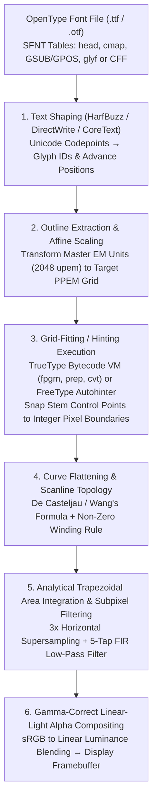

Pause for a moment and imagine examining the text on your screen right now through a high-powered magnifying glass. At a standard body text size of $12\,\text{px}$ ($9\,\text{pt}$ on a conventional $96\,\text{DPI}$ desktop monitor), an entire character cell is a tiny discrete checkerboard measuring just $12$ pixels wide by $12$ pixels tall—a mere $144$ microscopic light-emitting squares in total.

Yet inside that cramped $12 \times 12$ grid, your operating system effortlessly renders the 29-stroke Kanji ideograph `鬱` ("melancholy/dense"), the 16-stroke `薔` ("rose"), or the intricate double-story lowercase Latin serif `g` and three-stemmed `m` tens of thousands of times every second. Every vertical stem maintains crisp, uniform thickness and darkness. Adjacent horizontal bars in dense characters never fuse into an illegible black smudge, nor do thin crossbars fall between pixel centers and vanish into thin air. Diagonal strokes and delicate bowls flow smoothly without jagged stair-stepping ("jaggies").

From the standpoint of <strong>Information Theory</strong> and <strong>Digital Signal Processing</strong>, this everyday occurrence is nothing short of a mathematical miracle—a defiant victory over the <strong>Nyquist-Shannon Sampling Theorem</strong>. If you were to take a high-resolution master drawing of a 29-stroke character or a delicate serif typeface and naively project it onto a $12 \times 12$ discrete sampling grid, spatial frequencies exceeding the Nyquist limit ($\frac{1}{2}\,\text{cycle/pixel}$) would fold back as severe aliasing distortion, reducing the text to a blotchy, unreadable cloud of gray noise.

Behind the deceptively simple act of reading crisp small text on a screen lies half a century of computer science ingenuity: <strong>computational geometry</strong> (Bernstein polynomials and parametric splines), <strong>algebraic topology</strong> (winding numbers on oriented planar contours), <strong>compiler and virtual machine design</strong> (an executable stack-based bytecode VM embedded inside every TrueType font file), <strong>human visual psychophysics and digital filter theory</strong> (subpixel chroma multiplexing and FIR anti-fringing filters), <strong>radiometric color science</strong> (linear-light gamma-correct compositing), and <strong>massively parallel GPU shader algorithms</strong> (Multi-Channel Signed Distance Fields and direct GPU curve evaluation).

In this comprehensive treatise, we will trace the complete mathematical and algorithmic pipeline that transforms an abstract mathematical outline stored inside a `.ttf` or `.otf` file into the exact photon intensities emitted by the red, green, and blue subpixels of your display.

---

## 1. From the Tyranny of Bitmaps to Resolution-Independent Vector Outlines

From the dawn of computing through the late 1980s, digital typography relied on <strong>Bitmap Fonts</strong> (such as the $16 \times 16$ Kanji ROMs inside Japanese PC-9801 machines, Apple's early Macintosh system fonts, or the X Window System's BDF format). A bitmap font represents each visual character shape—known in typography as a <strong>glyph</strong> (as distinct from an abstract Unicode character code point)—explicitly as a binary matrix $M \in \{0, 1\}^{H \times W}$. Because human pixel artists painstakingly toggled every individual dot by hand for a specific target size (e.g., $12\,\text{px}$), bitmap fonts were exceptionally crisp at their native size.

However, bitmap fonts suffered from a fatal architectural flaw: <strong>Resolution Dependence</strong>.

1. <strong>Catastrophic Breakdown Under Affine Transformations</strong>: If a user scaled text to $1.3\times$ magnification, zoomed into a document, or rotated a headline by $15^\circ$ in a desktop publishing layout, nearest-neighbor resampling introduced grotesque stair-step artifacts, while bilinear interpolation turned crisp strokes into blurry smudges.
2. <strong>Incompatibility Across Display and Print Media</strong>: A bitmap designed for a $72\,\text{DPI}$ CRT screen was useless on a $300\,\text{DPI}$ office laser printer or a $2400\,\text{DPI}$ commercial Linotronic typesetter. Storing separate pre-rendered bitmaps for every combination of point size, rotation angle, and device DPI would cause storage requirements to explode—especially for East Asian (CJK) typefaces containing $20,000$ to $50,000$ glyphs.

The paradigm shift came from abandoning "which pixels are black" and instead describing <strong>the continuous mathematical boundary (outline)</strong> of each glyph in an idealized, high-precision master coordinate space (the <strong>EM Square</strong>, typically divided into $1000 \times 1000$ or $2048 \times 2048$ integer design units, known as *funits* or *Units Per Em*).

In the early 1980s, <strong>John Warnock</strong> and <strong>Chuck Geschke</strong> left Xerox PARC to found Adobe Systems, launching the <strong>PostScript</strong> page description language alongside <strong>PostScript Type 1</strong> outline fonts (1984). Type 1 fonts described glyph boundaries using <strong>Cubic Bézier Curves</strong> ($n=3$) and relied on proprietary, encrypted <strong>hinting algorithms</strong> inside Adobe's ATM (Adobe Type Manager) rasterizer to keep text legible at low screen resolutions.

Unwilling to pay Adobe's steep PostScript licensing fees or cede control of operating system typography, Apple initiated a clean-room vector font project codenamed *"Royal"* in the late 1980s, subsequently cross-licensing it with Microsoft to release <strong>TrueType</strong> (`.ttf`) in 1991. TrueType made two bold engineering choices: first, it replaced cubic curves with <strong>Quadratic Bézier Curves</strong> ($n=2$) for faster scanline intersection math on 1990-era microprocessors; second, instead of hardcoding hinting heuristics inside the OS rasterizer, it turned every font file into an <strong>executable bytecode program</strong> running on a fully documented, stack-based virtual machine.

Following the "Font Wars" of the early 1990s, Microsoft and Adobe joined forces in 1996 to create <strong>OpenType</strong> (`.ttf` / `.otf`, standardized as ISO/IEC 14496-22), unifying both worlds into a single SFNT table-based container format that supports either TrueType quadratic outlines (`glyf` table) or PostScript cubic outlines (`CFF` / `CFF2` Compact Font Format tables), alongside rich typographic layout tables (`GSUB` for ligatures and glyph substitution, `GPOS` for kerning and mark attachment) and variable font interpolation (`gvar` / `fvar`).

---

## 2. Computational Geometry of Outline Fonts: Bernstein Polynomials and Bézier Curves

### Why Not Power-Basis Polynomials?

When tasked with representing smooth curves in a computer, a mathematician's first instinct might be an explicit polynomial in the standard power basis (monomial basis), $y = a_3 x^3 + a_2 x^2 + a_1 x + a_0$. For typography and geometric modeling, however, the power basis is a disaster:
- <strong>Singularity at Vertical Tangents</strong>: A function $y(x)$ cannot represent vertical lines or vertical curve tangents ($dx/dt = 0$, slope $\to \infty$).
- <strong>Numerical Instability & Lack of Affine Invariance</strong>: Rotating a glyph by $30^\circ$ or shearing it for faux-italic style requires recomputing all polynomial coefficients from scratch, amplifying floating-point or fixed-point rounding errors.
- <strong>Zero Geometric Intuition</strong>: Tweaking $a_2$ from $0.41$ to $0.43$ gives a typeface designer no predictable visual control over the curve's shape.

The solution was independently discovered by two French automotive engineers seeking a mathematically rigorous way to sculpt car body panels: <strong>Paul de Casteljau</strong> at Citroën (1959) and <strong>Pierre Bézier</strong> at Renault (1962). Their breakthrough was to express a parametric curve $\mathbf{B}_n(t) = (x(t), y(t))^T$ as a weighted average of $n+1$ geometric <strong>Control Points</strong> $\mathbf{P}_0, \mathbf{P}_1, \dots, \mathbf{P}_n \in \mathbb{R}^2$, using the <strong>Bernstein Basis Polynomials</strong> $B_{i,n}(t)$ of degree $n$:

$$\mathbf{B}_n(t) = \sum_{i=0}^{n} B_{i,n}(t)\,\mathbf{P}_i, \qquad t \in [0, 1]$$

where the $i$-th Bernstein basis polynomial of degree $n$ is defined as:

$$B_{i,n}(t) = \binom{n}{i} (1 - t)^{n - i} t^i = \frac{n!}{i!(n - i)!} (1 - t)^{n - i} t^i \qquad (i = 0, 1, \dots, n)$$

### The Four Foundational Properties of the Bernstein Basis

Why do Bernstein polynomials make Bézier curves the undisputed gold standard for font rendering and vector graphics? Because $B_{i,n}(t)$ satisfies four extraordinary algebraic and geometric invariants:

1. <strong>Non-Negativity, Partition of Unity, and the Convex Hull Property</strong>:
   For every $t \in [0, 1]$, both $t \ge 0$ and $(1-t) \ge 0$, ensuring that every basis weight is strictly non-negative: $B_{i,n}(t) \ge 0$. Furthermore, by the <strong>Binomial Theorem</strong>, the sum of all basis functions is identically equal to $1$ everywhere on $[0, 1]$:
   $$\sum_{i=0}^{n} B_{i,n}(t) = \sum_{i=0}^{n} \binom{n}{i} (1 - t)^{n - i} t^i = \bigl((1 - t) + t\bigr)^n = 1^n = 1$$
   In linear algebra, a linear combination with non-negative weights that sum to $1$ is a <strong>Convex Combination</strong>. Geometrically, this proves that <strong>for all $t \in [0, 1]$, the curve $\mathbf{B}_n(t)$ is guaranteed to lie entirely inside the Convex Hull of its control points $\{\mathbf{P}_0, \dots, \mathbf{P}_n\}$</strong>!
   For a font rasterizer, this property is priceless: without evaluating a single point on the curve, the engine can compute the axis-aligned bounding box (AABB) simply by taking $\bigl[\min_i x_i, \max_i x_i\bigr] \times \bigl[\min_i y_i, \max_i y_i\bigr]$ of the control points in $O(1)$ time, instantly culling curves that do not intersect the current scanline or pixel band.

2. <strong>Affine Invariance</strong>:
   Let $\Phi(\mathbf{x}) = A\mathbf{x} + \mathbf{b}$ be any arbitrary 2D affine transformation (scaling, rotation, shearing/obliquing, or translation), where $A \in \mathbb{R}^{2 \times 2}$ and $\mathbf{b} \in \mathbb{R}^2$. Because $\sum_{i=0}^n B_{i,n}(t) = 1$, applying $\Phi$ to every point on the curve is algebraically identical to applying $\Phi$ only to the $n+1$ control points:
   $$\Phi\bigl(\mathbf{B}_n(t)\bigr) = A\left(\sum_{i=0}^{n} B_{i,n}(t)\,\mathbf{P}_i\right) + \mathbf{b}\sum_{i=0}^{n} B_{i,n}(t) = \sum_{i=0}^{n} B_{i,n}(t)\,\bigl(A\mathbf{P}_i + \mathbf{b}\bigr) = \sum_{i=0}^{n} B_{i,n}(t)\,\Phi(\mathbf{P}_i)$$
   To rotate or scale an entire glyph outline, the rasterizer merely multiplies the discrete control points $\mathbf{P}_i$ by the transformation matrix once before rasterization!

3. <strong>Endpoint Interpolation and Explicit Tangent Control</strong>:
   At the endpoints $t=0$ and $t=1$, $\mathbf{B}_n(0) = \mathbf{P}_0$ and $\mathbf{B}_n(1) = \mathbf{P}_n$, meaning the curve always starts at $\mathbf{P}_0$ ("on-curve point") and ends at $\mathbf{P}_n$ ("on-curve point"), while intermediate points $\mathbf{P}_1, \dots, \mathbf{P}_{n-1}$ act as magnetic "off-curve handles." Differentiating $B_{i,n}(t)$ with respect to $t$ yields the clean recurrence:
   $$\mathbf{B}_n'(t) = n \sum_{i=0}^{n-1} B_{i,n-1}(t)\,\bigl(\mathbf{P}_{i+1} - \mathbf{P}_i\bigr)$$
   Evaluating at $t=0$ and $t=1$ gives the exact endpoint tangent vectors:
   $$\mathbf{B}_n'(0) = n(\mathbf{P}_1 - \mathbf{P}_0), \qquad \mathbf{B}_n'(1) = n(\mathbf{P}_n - \mathbf{P}_{n-1})$$
   Thus, tangent continuity ($G^1$) across two joined Bézier segments requires nothing more than keeping the shared on-curve junction point and its two adjacent off-curve handles collinear.

4. <strong>Variation Diminishing Property</strong>:
   No straight line (such as a horizontal raster scanline $y = y_s$) can intersect a planar Bézier curve $\mathbf{B}_n(t)$ more times than it intersects the piecewise-linear control polygon $\mathbf{P}_0 \mathbf{P}_1 \cdots \mathbf{P}_n$. Consequently, a Bézier curve never introduces spurious oscillations or wiggles beyond those present in its control points.

---

### Quadratic Bézier Curves ($n=2$, TrueType) vs. Cubic Bézier Curves ($n=3$, PostScript / OpenType CFF)

A pivotal architectural divide in digital typography lies between <strong>Quadratic Bézier Curves ($n=2$)</strong> used in TrueType (`.ttf` `glyf` table) and <strong>Cubic Bézier Curves ($n=3$)</strong> used in PostScript Type 1 and OpenType (`.otf` `CFF` / `CFF2` tables).

#### 1. Quadratic Bézier Curves ($n = 2$, TrueType `glyf` Table)

Expanding the Bernstein sum for $n=2$ with two on-curve endpoints $\mathbf{P}_0, \mathbf{P}_2$ and a single off-curve control point $\mathbf{P}_1$ gives:

$$\mathbf{B}_2(t) = (1-t)^2 \mathbf{P}_0 + 2(1-t)t \mathbf{P}_1 + t^2 \mathbf{P}_2 = (\mathbf{P}_0 - 2\mathbf{P}_1 + \mathbf{P}_2)t^2 + 2(\mathbf{P}_1 - \mathbf{P}_0)t + \mathbf{P}_0$$

Why did Apple and Microsoft choose degree $n=2$ for TrueType?
- <strong>Closed-Form Scanline Intersection via the Quadratic Formula</strong>: Finding where a curve intersects a horizontal scanline $y = y_s$ means solving $y(t) = y_s$. For a quadratic curve, $a_y t^2 + 2b_y t + (c_y - y_s) = 0$ has the trivial closed-form solution $t = \frac{-b_y \pm \sqrt{b_y^2 - a_y(c_y - y_s)}}{a_y}$, requiring only a single integer square root—an enormous performance win on 1991 Macintosh 68000 and Intel 80386 CPUs lacking hardware floating-point units.
- <strong>Compression via Implicit On-Curve Midpoints</strong>: Suppose two quadratic Bézier segments $(\mathbf{P}_0, \mathbf{P}_1, \mathbf{M})$ and $(\mathbf{M}, \mathbf{P}_2, \mathbf{P}_3)$ meet at an on-curve point $\mathbf{M}$. For their first derivatives to match continuously ($C^1$ continuity), we require $\mathbf{B}_{\text{left}}'(1) = \mathbf{B}_{\text{right}}'(0)$:
  $$2(\mathbf{M} - \mathbf{P}_1) = 2(\mathbf{P}_2 - \mathbf{M}) \iff \mathbf{M} = \frac{\mathbf{P}_1 + \mathbf{P}_2}{2}$$
  Notice that $\mathbf{M}$ is the <strong>exact midpoint</strong> of the two adjacent off-curve control points $\mathbf{P}_1$ and $\mathbf{P}_2$! In the TrueType `glyf` binary stream, whenever two off-curve points $\mathbf{P}_1, \mathbf{P}_2$ are stored consecutively without an intervening on-curve point, the font decoder automatically synthesizes the on-curve junction at $\mathbf{M} = \frac{1}{2}(\mathbf{P}_1 + \mathbf{P}_2)$. This simple rule guarantees exact $C^1$ smoothness across spline chains while omitting nearly half of the on-curve coordinates from the file, shrinking `.ttf` files by roughly $30\%$.

#### 2. Cubic Bézier Curves ($n = 3$, PostScript & OpenType `CFF` / `CFF2`)

Expanding the Bernstein basis for $n=3$ with endpoints $\mathbf{P}_0, \mathbf{P}_3$ and two off-curve handles $\mathbf{P}_1, \mathbf{P}_2$ gives:

$$\mathbf{B}_3(t) = (1-t)^3 \mathbf{P}_0 + 3(1-t)^2 t \mathbf{P}_1 + 3(1-t)t^2 \mathbf{P}_2 + t^3 \mathbf{P}_3$$

When human typeface designers draw glyphs in professional editors (Glyphs, FontLab, RoboFont), they almost universally work with <strong>Cubic Bézier Curves</strong>, converting to quadratic curves only at compile time if generating a `.ttf` binary. Why? Because quadratic curves suffer from severe geometric rigidity:

Differentiating $\mathbf{B}_2(t)$ twice yields a <strong>constant vector</strong>:
$$\mathbf{B}_2''(t) = 2(\mathbf{P}_0 - 2\mathbf{P}_1 + \mathbf{P}_2) = \text{const}$$
Every quadratic Bézier segment is merely a parabolic arc. Recall the formula for the signed planar curvature $\kappa(t)$:
$$\kappa(t) = \frac{\mathbf{B}'(t) \times \mathbf{B}''(t)}{\|\mathbf{B}'(t)\|^3} = \frac{x'(t)y''(t) - y'(t)x''(t)}{\bigl(x'(t)^2 + y'(t)^2\bigr)^{3/2}}$$
For a quadratic curve, the numerator $x'(t)y''(t) - y'(t)x''(t)$ simplifies to a constant determinant $4\bigl[(x_1 - x_0)(y_2 - y_1) - (y_1 - y_0)(x_2 - x_1)\bigr]$ that is independent of $t$! This proves two major limitations of quadratic curves:
1. <strong>Inability to Represent an Inflection Point</strong>: Because the numerator of $\kappa(t)$ never changes sign, a single quadratic Bézier segment can *never* contain an inflection point ($\kappa(t) = 0$) where curvature flips from clockwise to counter-clockwise (such as the spine of the letter `"S"` or a tilde `"~"`).
2. <strong>Zero Curvature Freedom Under Fixed Endpoint Tangents</strong>: Once a designer fixes the endpoint positions $\mathbf{P}_0, \mathbf{P}_2$ and their tangent directions, the single off-curve point $\mathbf{P}_1$ is uniquely locked at the intersection of the two tangent lines. The designer has *zero* remaining degrees of freedom to adjust the fullness ("tension") or $G^2$ curvature at the endpoints without subdividing the curve into multiple pieces.

In contrast, a cubic Bézier curve has a <strong>linearly varying second derivative</strong>:
$$\mathbf{B}_3''(t) = 6(1-t)(\mathbf{P}_2 - 2\mathbf{P}_1 + \mathbf{P}_0) + 6t(\mathbf{P}_3 - 2\mathbf{P}_2 + \mathbf{P}_1)$$
It can effortlessly capture an S-shaped inflection point within a single segment, and its two independent off-curve handles $\mathbf{P}_1, \mathbf{P}_2$ can slide along their respective tangent lines to fine-tune the endpoint curvatures $\kappa(0)$ and $\kappa(1)$ for seamless $G^2$ (curvature-continuous) transitions into straight stems.

| Feature / Property | Quadratic Bézier ($n=2$, TrueType `glyf`) | Cubic Bézier ($n=3$, PostScript / OpenType `CFF`) |
| :--- | :--- | :--- |
| <strong>Parametric Equation $\mathbf{B}(t)$</strong> | $(1-t)^2\mathbf{P}_0 + 2(1-t)t\mathbf{P}_1 + t^2\mathbf{P}_2$ | $(1-t)^3\mathbf{P}_0 + 3(1-t)^2t\mathbf{P}_1 + 3(1-t)t^2\mathbf{P}_2 + t^3\mathbf{P}_3$ |
| <strong>Algebraic Curve Class</strong> | Parabola segment ($\mathbf{B}_2''(t) = \text{const}$) | Cubic curve ($\mathbf{B}_3''(t)$ linear in $t$) |
| <strong>Inflection Points per Segment</strong> | $0$ (curvature sign cannot flip) | Up to $2$ (represents `"S"` spines in 1 segment) |
| <strong>Degrees of Freedom (Fixed Tangents)</strong> | $0$ ($\mathbf{P}_1$ locked at tangent intersection) | $2$ (handle lengths adjust $G^2$ curvature radii) |
| <strong>Binary Compression Strategy</strong> | Implicit on-curve midpoints $\mathbf{M} = \frac{1}{2}(\mathbf{P}_1 + \mathbf{P}_2)$ | Stack-based CFF CharString subroutines & deltas |
| <strong>Exact Scanline Intersection</strong> | Direct quadratic formula ($1$ square root) | Recursive subdivision or iterative root finding |

---

### De Casteljau's Subdivision Algorithm and Wang's Flattening Formula

How does a software rasterizer evaluate or subdivide a Bézier curve without suffering from floating-point instability? It uses <strong>De Casteljau's Algorithm (1959)</strong>, a geometric pyramid of repeated linear interpolations.

Starting from the initial control points $\mathbf{P}_i^{(0)} := \mathbf{P}_i \;(i = 0, \dots, n)$, we recursively compute intermediate points at level $r = 1, \dots, n$:

$$\mathbf{P}_i^{(r)}(t) = (1 - t)\,\mathbf{P}_i^{(r-1)}(t) + t\,\mathbf{P}_{i+1}^{(r-1)}(t) \qquad (r = 1, \dots, n;\; i = 0, \dots, n - r)$$

At the apex of the triangle ($r = n$), the single point $\mathbf{P}_0^{(n)}(t)$ equals the exact curve position $\mathbf{B}_n(t)$. Even better, the two outer edges of the De Casteljau triangle:

$$\text{Left Sub-Curve } [0, t]: \bigl(\mathbf{P}_0^{(0)},\; \mathbf{P}_0^{(1)}(t),\; \dots,\; \mathbf{P}_0^{(n)}(t)\bigr), \qquad \text{Right Sub-Curve } [t, 1]: \bigl(\mathbf{P}_0^{(n)}(t),\; \mathbf{P}_1^{(n-1)}(t),\; \dots,\; \mathbf{P}_n^{(0)}\bigr)$$

form the <strong>exact control points of the two subdivided Bézier curves</strong> partitioning the original curve at parameter $t$!

When we split at the midpoint $t = \frac{1}{2}$, every interpolation reduces to $\frac{1}{2}(\mathbf{A} + \mathbf{B})$—which in fixed-point integer arithmetic is nothing more than <strong>an integer addition followed by a 1-bit right shift (`>> 1`)</strong>! Each midpoint split shrinks the curve's maximum deviation (flatness error) from its baseline chord by a factor of $4$ (quadratic convergence).

To eliminate the branch misprediction overhead of recursive subdivision altogether, high-performance rasterizers (such as FreeType's `ftgrays.c` and modern GPU path renderers) invoke <strong>Wang's Formula (1985)</strong> to compute upfront the exact number of uniform segments $N$ needed so that the chordal approximation error never exceeds a tolerance $\tau$ (typically $\tau = \frac{1}{16}\text{ to }\frac{1}{8}\,\text{px}$):

$$N = \left\lceil \sqrt{ \frac{n(n-1)}{8\tau} \max_{0 \le i \le n-2} \|\mathbf{P}_{i+2} - 2\mathbf{P}_{i+1} + \mathbf{P}_i\| } \right\rceil$$

Knowing $N$ before entering the loop allows the rasterizer to step through the curve using <strong>Forward Differencing</strong> or SIMD vector instructions in a tight, branchless loop.

---

## 3. Scanline Rasterization: Topological Winding Rules and Exact Analytical Area Coverage

Once a glyph's Bézier contours have been scaled to device pixel coordinates and flattened into oriented line segments, the rasterizer must answer two fundamental questions for every pixel $(i, j)$:
1. <strong>Topological Interior Test</strong>: Is this point inside the filled body of the glyph, or is it outside (such as inside the hollow counter of an `"O"`, `"8"`, or `"e"`)?
2. <strong>Fractional Coverage Integration</strong>: When an outline edge slices diagonally through pixel square $[i, i+1] \times [j, j+1]$, what exact fraction $\alpha \in [0, 1]$ of the pixel's area is covered by ink?

### Even-Odd Rule vs. Non-Zero Winding Number Rule

Computer graphics defines two distinct topological conventions for determining the interior of a closed planar boundary $\partial\Gamma$:

1. <strong>The Even-Odd (Parity) Rule</strong>:
   Cast a horizontal ray from point $P = (x, y)$ to $+\infty$ and count the total number of boundary intersections $N_{\text{cross}}$. By the Jordan Curve Theorem, $P$ is classified as <strong>inside if $N_{\text{cross}}$ is odd</strong> ($N_{\text{cross}} \equiv 1 \pmod 2$) and <strong>outside if $N_{\text{cross}}$ is even</strong>.
   While simple and insensitive to contour direction, the Even-Odd rule fails catastrophically whenever two strokes overlap—for instance, in a crossbar of `"十"`, `"A"`, or in <strong>OpenType Variable Fonts</strong> where component strokes are stored as separate overlapping closed contours so they can slide past each other smoothly along weight/width axes. Under the Even-Odd rule, the overlapping region has $N_{\text{cross}} = 2$ (even), punching an ugly hollow white hole right where the strokes cross!

2. <strong>The Non-Zero Winding Number Rule</strong>:
   Assign an orientation (direction of travel) to every contour and compute the topological <strong>Winding Number</strong> $w(P) \in \mathbb{Z}$—the net number of counter-clockwise turns the boundary makes around $P$:
   $$w(P) = \frac{1}{2\pi} \oint_{\partial\Gamma} d\theta = \frac{1}{2\pi} \oint_{\partial\Gamma} \frac{(x - x_P)\,dy - (y - y_P)\,dx}{(x - x_P)^2 + (y - y_P)^2}$$
   Algorithmically, as our horizontal scanline ray from $P$ to $+\infty$ crosses each oriented contour edge, we add $+1$ if the edge crosses <strong>upward ($\Delta y > 0$)</strong> and $-1$ if the edge crosses <strong>downward ($\Delta y < 0$)</strong>:
   $$w(P) = \sum_{\text{crossings}} \operatorname{sgn}(\Delta y) \in \mathbb{Z}$$
   Point $P$ is filled (<strong>inside</strong>) if and only if <strong>$w(P) \ne 0$</strong>, and left blank (<strong>outside</strong>) if <strong>$w(P) = 0$</strong>.

Notice how gracefully the Non-Zero Winding Rule handles both hollow counters and overlapping strokes:
- <strong>Outer Contours vs. Inner Holes</strong>: In a standard $y$-up Cartesian coordinate system, <strong>TrueType (`glyf`) mandates that outer contours wind Clockwise (CW, contributing $-1$) and inner holes wind Counter-Clockwise (CCW, contributing $+1$)</strong> (whereas PostScript/OpenType `CFF` uses the reverse convention: outer CCW, inner CW). Inside the hollow hole of an `"O"`, a ray crosses the inner contour ($+1$) and the outer contour ($-1$), summing to $w(P) = (+1) + (-1) = 0$ (unfilled hole!).
- <strong>Self-Overlapping Variable Font Components</strong>: When two clockwise strokes overlap, a point inside their intersection crosses both downward edges, yielding $w(P) = (-1) + (-1) = -2 \ne 0$. The intersection remains solidly filled without any white dropout artifacts!

---

### Exact Analytical Trapezoidal Area Integration (Libart / FreeType `ftgrays` / `stb_truetype`)

How should we compute the anti-aliased opacity $\alpha \in [0, 1]$ of boundary pixels?
Point-sampling only pixel centers $(i + 0.5, j + 0.5)$ produces binary 1-bit rendering plagued by staircase aliasing ("jaggies"). Early anti-aliasing systems used <strong>$4 \times 4$ or $8 \times 8$ Supersampling</strong>, testing $16$ or $64$ discrete sub-points per pixel. However, $4 \times 4$ supersampling yields only $17$ gray levels while multiplying scanline work by $4\times$.

In 1999, <strong>Raph Levien</strong> revolutionized 2D vector rasterization with <strong>Libart</strong>, introducing an <strong>exact analytical signed trapezoidal area integration algorithm</strong> later adopted by Maxim Shemanarev's <strong>Anti-Grain Geometry (AGG)</strong>, <strong>FreeType's smooth rasterizer (`ftgrays.c`)</strong>, Sean Barrett's <strong>`stb_truetype`</strong>, and Levien's own <strong>`font-rs`</strong> (Rust). Instead of point-sampling, this algorithm computes the exact continuous geometric area of the polygon clipped to each $1 \times 1$ pixel square in a single left-to-right prefix sum!

Let us derive the exact recurrence. Consider a single horizontal scanline row $y \in [j, j+1]$ of height $1$. We slice all flattened contour edges at pixel cell boundaries so that each micro-segment lies entirely inside a single pixel $(i, j)$, running from $(x_0, y_0)$ to $(x_1, y_1)$ with $x_0, x_1 \in [i, i+1]$ and $y_0, y_1 \in [j, j+1]$.

Define the segment's <strong>signed vertical displacement</strong> $\Delta y$ and its <strong>normalized horizontal midpoint</strong> $\bar{x}$ within pixel $i$:

$$\Delta y = y_1 - y_0 \in [-1, 1], \qquad \bar{x} = \frac{(x_0 - i) + (x_1 - i)}{2} \in [0, 1]$$

As a horizontal ray sweeps from left to right across scanline $j$, this single micro-segment inside pixel $i$ contributes to the signed area of the scanline in exactly two ways:
1. <strong>Inside Pixel $i$ Itself (Trapezoid Area)</strong>:
   The region inside pixel square $[i, i+1] \times [y_0, y_1]$ lying to the *right* of the segment forms a horizontal trapezoid of height $\Delta y$, top width $1 - (x_1 - i)$, and bottom width $1 - (x_0 - i)$. Its exact signed area is:
   $$\Delta A_i = (1 - \bar{x})\,\Delta y$$
2. <strong>To All Subsequent Pixels $k \ge i+1$ on the Right (Full Strip Coverage)</strong>:
   For every pixel $k \ge i+1$ strictly to the right of pixel $i$, the segment lies entirely to its left, shifting the winding coverage across the vertical band $[y_0, y_1]$ by a rectangle of width $1$ and height $\Delta y$:
   $$\Delta C_{i+1} = \Delta y$$

Therefore, the rasterizer maintains two sparse float/fixed-point accumulators per scanline row (`delta_area[W]` and `delta_cover[W]`). For each micro-segment in pixel $i$, it executes just two additions:

$$\text{delta\_area}[i] \mathrel{+}= (1 - \bar{x})\,\Delta y, \qquad \text{delta\_cover}[i+1] \mathrel{+}= \Delta y$$

Once all edges on scanline $j$ have been processed, a <strong>single linear pass (prefix sum)</strong> from $i = 0$ to $W - 1$ reconstructs the exact signed area $A_i$ and clamped coverage $\alpha_i \in [0, 1]$ for every pixel on the row:

$$C_i = C_{i-1} + \text{delta\_cover}[i], \qquad A_i = C_i + \text{delta\_area}[i], \qquad \alpha_i = \min\bigl(1.0,\; |A_i|\bigr)$$

With zero sorting required per pixel and full 256-level grayscale precision, this prefix-sum formulation maps directly onto SIMD instructions (`_mm256_add_ps`), allowing a single CPU core to rasterize millions of glyphs per second.

---

## 4. The Secret Bytecode Inside Every Font: Grid-Fitting, Hinting, and the TrueType Virtual Machine

If analytical area integration computes exact 256-level pixel coverage, why can't we just scale the master outlines directly to $12\,\text{px}$ and rasterize them? On a $300\text{–}450\,\text{PPI}$ smartphone screen, we can.

On a standard $96\text{–}110\,\text{DPI}$ desktop monitor at body sizes of $10\text{–}14\,\text{px}$, however, <strong>unhinted mathematically scaled text looks appallingly blurry, uneven, and blotchy</strong>.

### The Sampling Phase Catastrophe at Low PPEM

To see why, trace a lowercase Latin `"m"` (or the three vertical strokes of `"川"`) rendered at $12\,\text{px}$ without hinting. In the master typeface design, all three vertical stems have the exact same mathematical width—say, $0.80\,\text{px}$ after scaling—separated by counter spaces of $1.50\,\text{px}$:
- <strong>Stem 1</strong> lands across $x \in [1.10, 1.90]$. Because it falls almost entirely inside pixel column $x=1$, pixel $1$ receives $\alpha = 0.80$ ($80\%$ black)—a crisp, dark 1-pixel vertical line.
- <strong>Stem 2</strong>, shifted by $0.80 + 1.50 = 2.30\,\text{px}$, lands across $x \in [3.40, 4.20]$, straddling the pixel boundary $x = 4.0$! Pixel $3$ receives $\alpha = 0.60$ and pixel $4$ receives $\alpha = 0.20$. Visually, Stem 2 smears into a <strong>wide, blurry 2-pixel gray smudge</strong>!
- <strong>Stem 3</strong>, shifted by another $2.30\,\text{px}$, lands across $x \in [5.70, 6.50]$, splitting its ink unevenly into $\alpha = 0.30$ on pixel $5$ and $\alpha = 0.50$ on pixel $6$.

Even though all three stems are geometrically identical in the font outline, <strong>their phase offset relative to the discrete pixel grid makes the first stem look razor-sharp, the second wide and muddy, and the third lopsided</strong>! Worse still:
- <strong>Stroke Dropouts & Clumping</strong>: The thin horizontal bar of an `"e"` or the $29$ strokes of `"鬱"` can straddle two pixel rows at $20\%$ gray each (looking washed out or disappearing entirely) or bridge across a $0.6\,\text{px}$ white gap so adjacent strokes fuse into a solid black blob.
- <strong>Broken Symmetry & Jumping Baselines</strong>: If the left stem of `"H"` or `"O"` falls on a pixel center while the right stem straddles a boundary, symmetric letters look crooked. Meanwhile, curved bowls (`"o"`, `"c"`, `"e"`) have a small typographic <strong>overshoot</strong> extending slightly below the baseline and above the x-height so they look optically aligned with flat letters (`"x"`, `"z"`). If that overshoot barely grazes an extra pixel row at $11\,\text{px}$, round letters suddenly jump 1 pixel taller than flat letters!

### Inside the TrueType Stack-Based Virtual Machine

To prevent this phase catastrophe, <strong>Grid-Fitting (Hinting)</strong> mathematically deforms the glyph's control points *before* rasterization so that critical stems, baselines, and counters align cleanly with the integer pixel grid.

What shocks many software engineers when they first inspect the OpenType specification is how TrueType accomplishes this: <strong>every `.ttf` font file contains an executable bytecode program written for a Turing-complete, stack-based Virtual Machine!</strong>

When a TrueType rasterizer (such as FreeType's `ttinterp.c` or Windows DirectWrite) loads a font, it initializes the TrueType VM state—including an operand stack, a storage area, a <strong>Control Value Table (`cvt `)</strong>, two point zones (<strong>Zone 0</strong>: the temporary "Twilight Zone", and <strong>Zone 1</strong>: the glyph's actual outline points), three reference point registers (`rp0`, `rp1`, `rp2`), and two unit direction vectors:
- <strong>The Projection Vector ($\mathbf{P}$)</strong>: The axis along which distances between points are measured.
- <strong>The Freedom Vector ($\mathbf{F}$)</strong>: The axis along which control points are permitted to move to satisfy a distance constraint.

All coordinates inside the VM are represented in <strong>$26.6$ fixed-point format</strong>, where the lower $6$ bits represent fractional sixty-fourths ($\frac{1}{64}$) of a pixel. Execution proceeds in three stages across four dedicated SFNT tables:

| SFNT Table | Full Name | Execution Stage & Architectural Role |
| :--- | :--- | :--- |
| <strong>`cvt `</strong> | Control Value Table | A global array of master dimensions (standard vertical stem width, horizontal crossbar thickness, cap height, x-height, overshoot depths) stored in master `funits`. |
| <strong>`fpgm`</strong> | Font Program | Bytecode executed <strong>once when the font file is opened</strong>. Uses `FDEF` ... `ENDF` instructions to define reusable bytecode functions (subroutines for stem snapping, serif alignment, diagonal control). |
| <strong>`prep`</strong> | Control Value Program | Bytecode executed <strong>whenever the point size (PPEM) or display DPI changes</strong>. Scales and rounds the `cvt` entries so that global stem widths snap to identical integer pixel widths across the entire typeface, and configures dropout control (`SCANCTRL`, `SCANTYPE`). |
| <strong>`glyf`</strong> | Glyph Data Bytecode | Per-glyph bytecode executed <strong>each time a specific glyph is rasterized</strong> at a given PPEM. Manipulates the glyph's control points in Zone 1 using around 150 specialized geometric opcodes. |

Let us trace the exact VM instructions that transform our blurry lowercase `"m"` into a razor-sharp glyph:

1. <strong>`SVTCA[1]` (Set Vectors To Coordinate Axis - X)</strong>:
   Sets both the Projection Vector $\mathbf{P}$ and Freedom Vector $\mathbf{F}$ to the horizontal X-axis $(1, 0)$.
2. <strong>`MDAP[1]` (Move Direct Absolute Point with Rounding)</strong>:
   Pops the point index of the left edge of Stem 1 ($p_0$), rounds its X-coordinate to the nearest integer pixel grid line (e.g., $x = 1.0$), marks $p_0$ as <strong>"touched"</strong> along X, and stores $p_0$ in reference register `rp0`.
3. <strong>`MIRP[11101]` (Move Indirect Relative Point)</strong>:
   Pops a `cvt` index (the global lowercase vertical stem width) and the point index of the right edge of Stem 1 ($p_1$). In a single opcode, `MIRP` performs four critical operations:
   - Compares the glyph's actual distance $|p_1 - p_0|$ against the `cvt` standard width. If their difference is within the <strong>Single-Width Cut-In</strong> threshold, it replaces the distance with the global `cvt` width—guaranteeing that every vertical stem in every letter (`"m"`, `"n"`, `"h"`, `"i"`) has the exact same pixel thickness!
   - Enforces the <strong>Minimum Distance</strong> flag: even at tiny sizes like $8\,\text{px}$ where a stem scales to $0.3\,\text{px}$, `MIRP` clamps the rounded distance to at least $1.0\,\text{px}$ so the stem can never collapse to zero width (preventing dropout).
   - Rounds the target distance according to the current rounding state (`RTG`: Round To Grid) and places $p_1$ at $x = 2.0$, marking $p_1$ as touched.
4. <strong>Chaining `MDRP` and `MIRP` Across Stems 2 and 3</strong>:
   Using `MDRP` (Move Direct Relative Point) to snap the white counter spaces and `MIRP` to lock Stems 2 and 3 to the exact same `cvt` entry, all three stems of `"m"` now sit squarely on integer pixel intervals $[1.0, 2.0]$, $[4.0, 5.0]$, and $[7.0, 8.0]$!
5. <strong>`DELTAP1` / `DELTAP2` (Delta Exceptions)</strong>:
   For intricate Kanji or problematic sizes (e.g., at $12\,\text{ppem}$ only), a hinting engineer can insert `DELTAP1` instructions that nudge a specific point index by $\pm \frac{k}{8}\,\text{px}$ at one exact pixel size without affecting any other size!
6. <strong>`IUP[1]` and `IUP[0]` (Interpolate Untouched Points in X and Y)</strong>:
   After the skeletal stem points have been snapped ("touched"), all remaining untouched curve handles (such as the arches at the top of `"m"`) would look kinked if left in their original unhinted positions. Calling `IUP[1]` (and `IUP[0]` after vertical Y-hinting) instructs the VM to walk around each contour and <strong>linearly interpolate all untouched points proportionally between their nearest enclosing touched points</strong>. The entire glyph outline stretches organically around its newly grid-fitted skeleton!

---

### The Great Philosophical Schism: Microsoft (GDI / ClearType) vs. Apple (Quartz / CoreText) vs. FreeType Autohinter

Why has text historically looked so dramatically different on Windows versus macOS, even when displaying the exact same font on the exact same monitor? The answer lies in a legendary philosophical disagreement between <strong>Microsoft</strong> and <strong>Apple</strong> over how to resolve the conflict between continuous typography and discrete screen pixels:

- <strong>Microsoft's Philosophy (Pixel Grid Supremacy & Maximum Contrast)</strong>:
  Championed by Microsoft's typography team (Beat Stamm, Greg Hitchcock, and type designers Matthew Carter and Steve Matteson), Windows prioritized <strong>on-screen legibility and crispness above all else</strong>. If a stem at $12\,\text{px}$ measures $1.3\,\text{px}$ wide, Windows hinting forces it to $1.0\,\text{px}$ (or $2.0\,\text{px}$) aligned strictly to pixel boundaries. Fonts like *Verdana*, *Tahoma*, *Segoe UI*, and Japanese *Meiryo* were engineered with thousands of hours of hand-tuned TrueType bytecode. The result on $96\,\text{DPI}$ monitors is razor-sharp black stems with zero blur—at the cost of altering the typeface's true stroke weight hierarchy, glyph widths, and spacing at small sizes.
- <strong>Apple's Philosophy (WYSIWYG Typeface Fidelity)</strong>:
  Rooted in Steve Jobs's PostScript heritage from NeXTSTEP and carried into macOS Quartz / CoreText, Apple maintained that <strong>the typeface designer's original outline geometry is sacred</strong>. Deforming letterforms to fit a coarse pixel grid corrupts the character of the typeface and causes screen line breaks to diverge from printed output. Consequently, macOS essentially <strong>ignores TrueType bytecode hints</strong>, relying instead on subpixel glyph positioning (rendering multiple phase-shifted versions of each glyph at $\frac{1}{4}\text{-pixel}$ horizontal offsets) and pure anti-aliased coverage. On $96\,\text{DPI}$ monitors, Apple text appeared softer and slightly "fuzzier" to Windows users, but once <strong>Retina Displays ($>220\,\text{PPI}$)</strong> arrived, Apple's fidelity-first pipeline triumphed effortlessly.
- <strong>FreeType's Third Way (`autofit` Autohinter & Y-Only Light Hinting)</strong>:
  In the open-source ecosystem (Linux, Android, ChromeOS), <strong>FreeType</strong> created a geometric <strong>Autohinter (`autofit`)</strong> that analyzes glyph contours at runtime—automatically detecting vertical/horizontal stems, serifs, and typographic <strong>Blue Zones</strong> (baseline, x-height, cap-height, and CJK ideographic bounding frames)—so even unhinted fonts and massive CJK typefaces get clean grid alignment without needing hand-coded bytecode. Today, both FreeType (`FT_LOAD_TARGET_LIGHT`) and modern Windows DirectWrite converge on a balanced <strong>Y-Only (Vertical-Only) Hinting</strong> strategy: snapping horizontal stems and baselines vertically to integer pixel rows while leaving horizontal X-positions completely unhinted so that subpixel antialiasing can preserve exact glyph spacing and kerning.

---

## 5. Subpixel Rendering (ClearType) and Gamma-Correct Linear Alpha Blending

In 2000, as flat-panel Liquid Crystal Displays (LCDs) began replacing bulky cathode-ray tubes (CRTs), Microsoft Research and Steve Gibson popularized <strong>Subpixel Rendering</strong> (<strong>ClearType</strong> on Windows, <strong>LCD Filtering</strong> in FreeType).

### Multiplexing Spatial Resolution Across Physical RGB Subpixels

A conventional rasterizer treats each pixel on an LCD screen as an indivisible square point of light. Physically, however, each pixel of width $\Delta x$ on a standard RGB stripe LCD panel is composed of <strong>three separate, vertically elongated subpixel emitters—Red ($R$), Green ($G$), and Blue ($B$)</strong>—spaced horizontally by $\frac{1}{3}\Delta x$:

$$\text{Position}(R_i) = i - \frac{1}{3}, \qquad \text{Position}(G_i) = i, \qquad \text{Position}(B_i) = i + \frac{1}{3}$$

Human visual perception relies on two distinct neural pathways in the retina and visual cortex:
1. <strong>The Luminance Channel ($Y = 0.2126 R + 0.7152 G + 0.0722 B$)</strong>: Driven primarily by L and M cones, possessing <strong>extremely high spatial acuity</strong> for sharp edges and fine detail.
2. <strong>The Chrominance Channels ($C_b, C_r$)</strong>: Possessing <strong>much lower spatial acuity</strong> (the human eye cannot resolve high-frequency color changes over a span of $\frac{1}{3}$ of a millimeter at normal reading distance).

By treating the $R$, $G$, and $B$ subpixels not as color components of a single sample, but as <strong>three independent luminance samples spaced at $\frac{1}{3}$-pixel horizontal intervals</strong>, the font rasterizer can scale the glyph outline by <strong>$3\times$ horizontally</strong> before running the analytical trapezoidal area integrator! Without changing the display hardware, horizontal spatial resolution and Nyquist frequency triple—turning a $96\,\text{DPI}$ monitor into an effective $288\,\text{DPI}$ display along the horizontal axis.

---

### Why Naive $3\times$ Subpixel Sampling Produces Rainbow Color Fringing

What happens if we take the $3\times$ horizontally oversampled coverage values $(\alpha_{3i-1}, \alpha_{3i}, \alpha_{3i+1})$ and map them directly to the $(R, G, B)$ subpixel alpha channels?

Suppose we are drawing black text $(0, 0, 0)$ on a white background $(1, 1, 1)$, and a thin $\frac{1}{3}\text{-pixel}$ vertical stem lands purely on the Red subpixel of pixel $i$: $(\alpha_R, \alpha_G, \alpha_B) = (1, 0, 0)$. Shutting off only the Red subpixel while leaving Green and Blue at full intensity emits $(R, G, B) = (0, 1, 1)$—<strong>pure, saturated Cyan</strong>! Conversely, covering only the Blue subpixel emits $(1, 1, 0)$—<strong>bright Yellow</strong>! The text becomes surrounded by distracting rainbow halos known as <strong>Color Fringing</strong>.

In signal processing terms, because the $R, G, B$ subpixel lattices are spatially shifted by $-\frac{1}{3}, 0, +\frac{1}{3}$ of a pixel, their Fourier transforms carry phase factors $e^{j\omega/3}, 1, e^{-j\omega/3}$. High spatial frequencies in a sharp glyph edge alias directly into the low-frequency chrominance band!

### Deriving the 5-Tap Gibson FIR Anti-Fringing Filter

To eliminate color fringing while retaining $3\times$ subpixel edge positioning, <strong>Steve Gibson (1998)</strong> and <strong>John Platt (Microsoft Research, 2000)</strong> applied linear digital filter theory.

First, for any single subpixel impulse to produce an achromatic (neutral gray) change rather than a colored spike, its energy must be distributed equally across three adjacent $R, G, B$ subpixels via a 3-tap box filter:

$$h_3 = \left[\frac{1}{3},\; \frac{1}{3},\; \frac{1}{3}\right]$$

Second, to ensure that a minimum 1-pixel-wide stroke (spanning 3 subpixels) has balanced chromatic energy on both its entry and exit edges, we convolve the 3-subpixel reconstruction kernel $h_3$ with the 3-tap color-balancing kernel $h_3$. Discrete convolution $h_{\text{Gibson}} = h_3 * h_3$ yields the celebrated <strong>5-tap triangular FIR low-pass filter</strong>:

$$h_{\text{Gibson}} = \left[\frac{1}{3},\; \frac{1}{3},\; \frac{1}{3}\right] * \left[\frac{1}{3},\; \frac{1}{3},\; \frac{1}{3}\right] = \left[\frac{1}{9},\; \frac{2}{9},\; \frac{3}{9},\; \frac{2}{9},\; \frac{1}{9}\right]$$

Look at the mathematical magic of the coefficients $\left[\frac{1}{9}, \frac{2}{9}, \frac{3}{9}, \frac{2}{9}, \frac{1}{9}\right]$ when grouped modulo 3 (by subpixel color channel):
- Offset $0$ (center channel): $\frac{3}{9} = \frac{1}{3}$
- Offsets $-1$ and $+2$ (second channel): $\frac{2}{9} + \frac{1}{9} = \frac{3}{9} = \frac{1}{3}$
- Offsets $+1$ and $-2$ (third channel): $\frac{2}{9} + \frac{1}{9} = \frac{3}{9} = \frac{1}{3}$

Because every modulo-3 coset sums to exactly $\frac{1}{3}$, <strong>any single-subpixel impulse convolved with this 5-tap filter deposits equal total energy into the Red, Green, and Blue channels</strong>, driving net chromatic error to zero while preserving sub-pixel center-of-mass shifts of $\frac{1}{3}\,\text{px}$! FreeType's `FT_LCD_FILTER_DEFAULT` refines these 5 taps to $\frac{1}{256}[8, 77, 86, 77, 8]$ to maximize perceived MTF sharpness while keeping color fringing below the human perceptual threshold.

---

### The Non-Linearity Trap: Gamma-Correct Alpha Blending in Linear Light Space

Even with exact analytical area integration and a 5-tap FIR filter, a font renderer will fail horribly if it performs alpha blending naively in sRGB space.

When the area integrator reports coverage $\alpha = 0.50$, that number represents a <strong>physical ratio of areas—and therefore a linear ratio of emitted photons (physical luminance $L$)</strong>. However, standard 8-bit display framebuffers store <strong>sRGB transfer-encoded code values $V \in [0, 1]$</strong>, which are non-linearly compressed according to a power law with gamma $\gamma \approx 2.2$:

$$L_{\text{physical}} = V_{\text{sRGB}}^{\gamma}, \qquad V_{\text{sRGB}} = L_{\text{physical}}^{1/\gamma} \qquad (\gamma \approx 2.2)$$

If a naive compositor blends foreground color $V_{\text{fg}}$ and background color $V_{\text{bg}}$ directly in sRGB space:

$$V_{\text{naive}} = \alpha\,V_{\text{fg}} + (1 - \alpha)\,V_{\text{bg}} \qquad (\text{WRONG: Non-linear sRGB blending!})$$

then an edge pixel with $\alpha = 0.50$ between black ($0$) and white ($1$) produces code value $V_{\text{naive}} = 0.50$ (`128` in 8-bit). When sent to the monitor, $V = 0.50$ emits a physical luminance of:

$$L = (0.50)^{2.2} \approx 0.2176 \quad (21.8\%\text{ brightness instead of } 50\%!)$$

This massive radiometric error causes three notorious visual bugs:
1. <strong>Rope-Like Aliasing & Washed-Out Stems</strong>: Diagonal strokes alternate in apparent thickness as they cross pixel rows, and thin dark strokes on white backgrounds lose half their intended transition smoothness.
2. <strong>Dark-Mode Weight Distortion</strong>: When rendering white text ($V_{\text{fg}} = 1$) on a black background ($V_{\text{bg}} = 0$) versus black text on a white background, incorrect gamma blending makes white-on-black text look <strong>visibly bloated and overly bold</strong>, while black-on-white text looks <strong>pinched and thin</strong>!
3. <strong>Resurgent Color Fringing in Subpixel AA</strong>: Because the 5-tap FIR filter balances energy in *linear photon space* ($\frac{1}{3} L_R, \frac{1}{3} L_G, \frac{1}{3} L_B$), applying the filter to non-linear sRGB values breaks the $\frac{1}{3}$ sum invariant and reintroduces severe color fringes!

The exact, physically correct <strong>Linear-Space Subpixel Alpha Compositing Equation</strong> must decode both foreground and background to linear luminance ($V^\gamma$), blend each subpixel channel $c \in \{R, G, B\}$ independently using its filtered coverage $\alpha_c$, and re-encode to sRGB ($L^{1/\gamma}$):

$$C_{\text{out}, c} = \Bigl( \alpha_c \, C_{\text{fg}, c}^{\gamma} + (1 - \alpha_c) \, C_{\text{bg}, c}^{\gamma} \Bigr)^{1/\gamma}, \qquad c \in \{R, G, B\},\; \gamma \approx 2.2$$

---

## 6. The GPU Era: Signed Distance Fields (SDF), Multi-Channel SDF (`msdfgen`), and Direct GPU Bézier Shaders (`Slug`)

In 3D video games, VR/AR headsets, digital map engines, and 120Hz GPU-accelerated UI frameworks, text is constantly scaled, rotated, and projected in 3D perspective. Rasterizing glyphs on the CPU at a fixed pixel size and magnifying the resulting bitmap texture on the GPU results in blurry edges, while re-rasterizing on the CPU every frame stalls the rendering pipeline.

### Chris Green's Valve Paper (SIGGRAPH 2007): Single-Channel Signed Distance Fields (SDF)

In 2007, <strong>Chris Green</strong> at Valve Corporation introduced <strong>Signed Distance Field (SDF)</strong> font rendering. Instead of storing pixel opacity $\alpha \in [0, 1]$ inside the font texture atlas, the offline generator stores the <strong>signed Euclidean distance $d(\mathbf{p})$</strong> from each texel center $\mathbf{p}$ to the nearest point on the vector glyph outline $\partial\Omega$:

$$d(\mathbf{p}) = \operatorname{sgn}(\mathbf{p}) \min_{\mathbf{q} \in \partial\Omega} \|\mathbf{p} - \mathbf{q}\|_2, \qquad \operatorname{sgn}(\mathbf{p}) = \begin{cases} +1 & \text{if } \mathbf{p} \in \Omega \text{ (inside)} \\ -1 & \text{if } \mathbf{p} \notin \Omega \text{ (outside)} \end{cases}$$

Why does storing distance $d$ instead of opacity $\alpha$ allow infinite magnification without blur?
Because opacity $\alpha(\mathbf{p})$ is a discontinuous <strong>step function</strong> across the glyph boundary—bilinearly interpolating a step function smears the step over a wide ramp. By contrast, the signed distance $d(\mathbf{p})$ to a straight edge is a <strong>smooth, linear plane</strong>! Bilinear interpolation of a linear function is mathematically exact. Thus, even from a tiny $32 \times 32$ texel SDF atlas magnified $50\times$ on screen, the GPU's bilinear texture unit reconstructs the exact zero level set $\{ \mathbf{p} \mid d(\mathbf{p}) = 0 \}$!

In the fragment shader, screen-space partial derivatives `fwidth(d) = |ddx(d)| + |ddy(d)|` convert the interpolated distance directly into screen pixels for crisp analytical antialiasing:

$$w = 0.7071\,\|\nabla_{\text{screen}} d\|_2 \approx 0.5\,\operatorname{fwidth}(d), \qquad \alpha = \operatorname{smoothstep}(-w,\; +w,\; d)$$

Better yet, SDF provides <strong>free procedural effects</strong> inside the fragment shader: shifting the threshold $d = 0$ emboldens or thins the font; testing the band $|d| \le \tau$ draws a uniform outline stroke; and sampling $d(\mathbf{uv} - \Delta\mathbf{uv})$ generates soft drop shadows and outer glows in a single pass.

---

### Viktor Chlumský's Multi-Channel SDF (`msdfgen`, 2015): Preserving Sharp Corners via $\operatorname{median}(r, g, b)$

Single-channel SDF suffers from one notorious geometric flaw: <strong>at high magnification, all sharp corners round off into blunt arcs</strong>.
Outside a convex $90^\circ$ corner, the true Euclidean distance isolines form circular arcs centered on the corner vertex. Worse, when the GPU bilinearly interpolates a single scalar distance across the four texels surrounding a corner, it averages the two perpendicular edge half-planes, rounding off the apex of `"A"`, `"M"`, `"N"`, and sharp serifs.

In 2015, <strong>Viktor Chlumský</strong> solved this problem in his Master's thesis by inventing <strong>Multi-Channel Signed Distance Fields (MSDF / `msdfgen`)</strong>.
Instead of storing a single scalar distance, MSDF decomposes the glyph contour by <strong>coloring its edges with combinations of Red, Green, and Blue channels</strong> (typically Cyan `GB`, Magenta `RB`, and Yellow `RG`) such that <strong>whenever two edges meet at a sharp corner, they share one channel and differ in the other two</strong>.

Each texture channel $(R, G, B)$ stores the signed pseudo-distance to its assigned subset of edges (extending smoothly along the infinite tangent lines past the corner vertex). In the fragment shader, the GPU fetches the bilinearly interpolated $(r, g, b)$ triplet and evaluates the <strong>median of the three channels</strong>:

$$d_{\text{MSDF}} = \operatorname{median}(r, g, b) = \max\Bigl(\min(r, g),\; \min\bigl(\max(r, g),\; b\bigr)\Bigr)$$

Why does $\operatorname{median}(r, g, b)$ magically preserve razor-sharp corners?
Suppose at a convex corner, the left edge has signed distance $d_L$ (stored in Yellow: $R$ and $G$) and the right edge has signed distance $d_R$ (stored in Cyan: $G$ and $B$). The shared channel $G$ holds $\min(d_L, d_R)$ pre-interpolation, while $R = d_L$ and $B = d_R$ remain purely linear across the corner! Because a convex corner is the boolean intersection of two half-planes ($d_L > 0 \land d_R > 0$), and $G \le \min(R, B)$ near the apex, the median of $(R, G, B)$ evaluates to $\min(R, B) = \min(d_L, d_R)$—reconstructing the <strong>exact, infinitely sharp intersection of the two linear half-planes</strong>! Conversely, at a concave inner corner, the median automatically evaluates to the boolean union $\max(d_L, d_R)$.

---

### Direct GPU Bézier Evaluation: Eric Lengyel's `Slug` and Raph Levien's `Vello`

Even MSDF hits a fundamental Nyquist limit when two distinct strokes pass closer than a single texel in the texture atlas—a routine occurrence in complex $29\text{-stroke}$ Kanji like `鬱` or dense UI icon sets.

To achieve true resolution independence without texture atlases, modern GPU font engines—most notably <strong>Eric Lengyel's `Slug` algorithm (2017)</strong> and <strong>Raph Levien's WebGPU compute renderer `Vello`</strong>—upload the raw Quadratic/Cubic Bézier control points directly into GPU buffers (SSBOs), partition each glyph into horizontal and vertical spatial bands, and <strong>solve the quadratic ray-curve intersections and topological winding numbers analytically inside the fragment/compute shader for every pixel on screen</strong>. By classifying each curve's control-point Y-coordinates into a 3-bit equivalence class bitmask $(b_2 b_1 b_0)_2 \in \{0, \dots, 7\}$, `Slug` guarantees branchless, artifact-free winding number evaluation immune to floating-point endpoint dropouts at any zoom level from $8\,\text{px}$ to $80,000\,\text{px}$.

| Rendering Architecture | Core Representation | 3D / Zoom / Rotation | Crispness at $10\text{–}14\,\text{px}$ | Complex CJK Scalability | Representative Engines |
| :--- | :--- | :--- | :--- | :--- | :--- |
| <strong>CPU Raster + Hinting VM + Subpixel FIR</strong> | Per-size rasterized bitmap cache | Poor (requires re-rasterizing on scale/rotate) | <strong>Unmatched</strong> (TrueType VM + $3\times$ LCD FIR) | High (scales linearly with active glyph cache) | FreeType, Windows DirectWrite, macOS CoreText |
| <strong>Single-Channel SDF (Valve 2007)</strong> | 1-channel Euclidean distance atlas | Good (fast, but rounds sharp corners) | Moderate (no grid-fitting; thin stems blur) | Limited (dense strokes merge in low-res atlas) | Unity Legacy, Source Engine, Mapbox GL |
| <strong>Multi-Channel MSDF (`msdfgen` 2015)</strong> | 3-channel RGB directional distance atlas | <strong>Excellent</strong> ($\operatorname{median}(r,g,b)$ keeps corners sharp) | Good (clean analytical edges) | Moderate (requires larger atlas for dense Kanji) | Chlumský `msdfgen`, Unity TextMeshPro, Unreal UI |
| <strong>Direct GPU Bézier Shader (`Slug` / `Vello`)</strong> | Raw Bézier control points + spatial bands in VRAM | <strong>Perfect</strong> (exact mathematical curves at infinite zoom) | Very Good (supports shader stem darkening) | <strong>Unmatched</strong> (zero texture baking; instant $50,000$ CJK glyphs) | Eric Lengyel `Slug`, Raph Levien `Vello`, Frostbite |

---

## 7. Conclusion: A Symphony of Mathematics in $144$ Squares of Light

Every time your eyes glide across a line of $12\,\text{px}$ text on your screen, an extraordinary chain of mathematical theorems executes silently beneath the glass:
- <strong>Bernstein basis polynomials</strong> and <strong>De Casteljau's subdivision</strong> sculpt resolution-independent curves confined strictly inside their convex hulls;
- <strong>Topological winding numbers</strong> and <strong>analytical trapezoidal integration</strong> resolve complex self-overlapping contours and hollow counters into exact area integrals in a single linear prefix sum;
- <strong>A stack-based bytecode Virtual Machine</strong> inside the `.ttf` file executes `MDAP`, `MIRP`, and `IUP` instructions in $26.6$ fixed-point arithmetic to lock vertical and horizontal stems onto the discrete Nyquist sampling grid;
- <strong>A 5-tap Gibson FIR low-pass filter</strong> exploits the human retina's high luminance acuity and low chromatic acuity to triple horizontal resolution across physical RGB LCD subpixels, while <strong>gamma-correct linear-light alpha blending</strong> ($L = V^{2.2}$) preserves true physical stroke weights across light and dark modes;
- And on the GPU, <strong>Multi-Channel Signed Distance Fields</strong> ($\operatorname{median}(r, g, b)$) and <strong>direct Bézier curve shaders (`Slug`)</strong> project razor-sharp typography across 3D worlds at hundreds of frames per second.

What feels like the simplest thing a computer does—putting tiny letters on a screen—is in truth one of the deepest, most elegant triumphs of applied mathematics and systems engineering in the history of computing.
