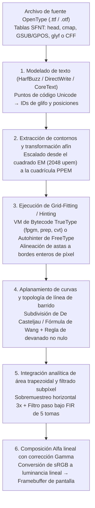

Imagina observar el texto que estás leyendo ahora mismo en tu pantalla a través de una lupa de gran aumento. A un tamaño de cuerpo estándar de $12\,\text{px}$ ($9\,\text{pt}$ en un monitor de escritorio convencional de $96\,\text{DPI}$), toda la celda de un carácter no es más que un diminuto tablero de ajedrez discreto de $12$ píxeles de ancho por $12$ píxeles de alto: apenas $144$ minúsculos cuadrados emisores de luz en total.

Sin embargo, dentro de esa estrecha cuadrícula de $12 \times 12$, tu sistema operativo dibuja en tiempo real decenas de miles de glifos por segundo: desde el complejo kanji «鬱» de $29$ trazos hasta la minúscula latina con serifa «`g`» de doble piso o la «`m`» con sus tres astas verticales (Stems) equidistantes. Cada asta vertical conserva un grosor y una oscuridad uniformes, los trazos horizontales densos nunca se funden en un borrón negro ilegible ni desaparecen al caer entre los centros de los píxeles (Dropout), y las curvas diagonales fluyen sin escalonamientos dentados (Jaggies).

Desde la perspectiva de la <strong>teoría de la información</strong> y el <strong>procesamiento digital de señales (DSP)</strong>, esta hazaña cotidiana es un milagro matemático frente al <strong>teorema de muestreo de Nyquist-Shannon</strong>. Si proyectáramos directamente un contorno vectorial de alta resolución sobre una rejilla de $12 \times 12$ píxeles mediante una simple reducción geométrica, las altas frecuencias espaciales por encima del límite de Nyquist producirían un severo solapamiento (Aliasing), reduciendo el texto a una mancha gris irreconocible.

Detrás de la lectura nítida de letras pequeñas se esconde medio siglo de ciencias de la computación: <strong>geometría computacional</strong> (polinomios de Bernstein y curvas de Bézier), <strong>topología algebraica</strong> (números de devanado), <strong>máquinas virtuales</strong> (bytecode ejecutable dentro de cada archivo `.ttf`), <strong>psicofísica visual y filtros digitales FIR</strong> (renderizado subpíxel ClearType), <strong>radiometría</strong> (mezcla alfa en espacio de luz lineal) y <strong>algoritmos de shaders en GPU</strong> (MSDF y evaluación directa `Slug`).

---

## 1. De la tiranía de los mapas de bits a las fuentes de contorno independientes de la resolución

Los primeros sistemas informáticos dependían de <strong>fuentes de mapa de bits (Bitmap Fonts)</strong>, que almacenaban cada glifo como una matriz binaria $M \in \{0, 1\}^{H \times W}$. Aunque eran nítidas a su tamaño nativo, sufrían de una <strong>dependencia total de la resolución</strong>: escalar o rotar el texto producía bordes dentados o borrosos, y los mapas de bits de $72\,\text{DPI}$ para pantalla eran inútiles en impresoras láser de $300\,\text{DPI}$ o filmadoras de $2400\,\text{DPI}$.

La solución llegó con las <strong>fuentes vectoriales de contorno (Outline Fonts)</strong>: primero <strong>PostScript Type 1</strong> (1984) de <strong>John Warnock</strong> y <strong>Chuck Geschke</strong> en Adobe (basado en curvas de Bézier cúbicas), seguido por <strong>TrueType</strong> (`.ttf`, 1991) de Apple y Microsoft (basado en curvas de Bézier cuadráticas y una máquina virtual de hinting basada en pila), que finalmente se unificaron en 1996 bajo el estándar <strong>OpenType</strong> (tablas `glyf` y `CFF`/`CFF2`).

---

## 2. Geometría computacional de contornos: Polinomios de Bernstein y curvas de Bézier

### Las cuatro propiedades fundamentales de la base de Bernstein

Los polinomios explícitos en la base de potencias $y = a_3 x^3 + a_2 x^2 + a_1 x + a_0$ no pueden representar tangentes verticales y son numéricamente inestables bajo rotaciones. <strong>Paul de Casteljau</strong> (Citroën, 1959) y <strong>Pierre Bézier</strong> (Renault, 1962) definieron curvas paramétricas mediante los <strong>polinomios base de Bernstein</strong> de grado $n$ y $n+1$ puntos de control $\mathbf{P}_0, \dots, \mathbf{P}_n \in \mathbb{R}^2$:

$$\mathbf{B}_n(t) = \sum_{i=0}^{n} B_{i,n}(t)\,\mathbf{P}_i, \qquad B_{i,n}(t) = \binom{n}{i} (1 - t)^{n - i} t^i, \qquad t \in [0, 1]$$

1. <strong>No negatividad, partición de la unidad y propiedad de la envolvente convexa</strong>:
   Para todo $t \in [0, 1]$ se cumple $B_{i,n}(t) \ge 0$, y por el teorema del binomio la suma de todos los polinomios base es idénticamente $1$:
   $$\sum_{i=0}^{n} B_{i,n}(t) = \bigl((1 - t) + t\bigr)^n = 1$$
   Al ser una combinación convexa, toda la curva $\mathbf{B}_n(t)$ yace estrictamente dentro de la <strong>envolvente convexa (Convex Hull)</strong> de sus puntos de control, permitiendo descartar intersecciones por caja delimitadora en tiempo $O(1)$.
2. <strong>Invariancia afín</strong>:
   Para cualquier transformación afín $\Phi(\mathbf{x}) = A\mathbf{x} + \mathbf{b}$, se cumple $\Phi(\mathbf{B}_n(t)) = \sum B_{i,n}(t)\,\Phi(\mathbf{P}_i)$: basta con transformar los puntos de control.
3. <strong>Interpolación de extremos y control de tangentes</strong>:
   $\mathbf{B}_n(0) = \mathbf{P}_0$, $\mathbf{B}_n(1) = \mathbf{P}_n$, con derivadas en los extremos $\mathbf{B}_n'(0) = n(\mathbf{P}_1 - \mathbf{P}_0)$ y $\mathbf{B}_n'(1) = n(\mathbf{P}_n - \mathbf{P}_{n-1})$.
4. <strong>Propiedad de disminución de la variación</strong>:
   Ninguna línea recta puede cortar una curva de Bézier más veces de las que corta a su polígono de control.

---

### Curvas cuadráticas ($n=2$, TrueType) vs. Curvas cúbicas ($n=3$, OpenType CFF)

- <strong>Curvas de Bézier cuadráticas ($n=2$, tabla `glyf` de TrueType)</strong>:
  $$\mathbf{B}_2(t) = (1-t)^2 \mathbf{P}_0 + 2(1-t)t \mathbf{P}_1 + t^2 \mathbf{P}_2$$
  Además de resolver intersecciones con líneas de barrido mediante la fórmula cuadrática, TrueType emplea <strong>puntos medios implícitos en la curva (Implicit On-Curve Midpoints)</strong>: cuando dos puntos de control fuera de la curva $\mathbf{P}_1, \mathbf{P}_2$ aparecen consecutivamente, el decodificador sintetiza automáticamente un punto de unión en su punto medio exacto $\mathbf{M} = \frac{1}{2}(\mathbf{P}_1 + \mathbf{P}_2)$, garantizando continuidad $C^1$ y reduciendo el tamaño del archivo en un $30\%$.
- <strong>Curvas de Bézier cúbicas ($n=3$, PostScript / tabla `CFF` de OpenType)</strong>:
  $$\mathbf{B}_3(t) = (1-t)^3 \mathbf{P}_0 + 3(1-t)^2 t \mathbf{P}_1 + 3(1-t)t^2 \mathbf{P}_2 + t^3 \mathbf{P}_3$$
  Dado que la segunda derivada de una curva cuadrática es constante ($\mathbf{B}_2''(t) = \text{const}$), un solo segmento cuadrático jamás puede representar un <strong>punto de inflexión</strong> (como la espina dorsal de la letra «`S`»). Las curvas cúbicas tienen segunda derivada lineal en $t$, lo que permite capturar puntos de inflexión en un único segmento y controlar independientemente la curvatura $G^2$ en ambos extremos.

| Característica | Bézier cuadrática ($n=2$, TrueType `glyf`) | Bézier cúbica ($n=3$, OpenType `CFF`) |
| :--- | :--- | :--- |
| <strong>Ecuación paramétrica $\mathbf{B}(t)$</strong> | $(1-t)^2\mathbf{P}_0 + 2(1-t)t\mathbf{P}_1 + t^2\mathbf{P}_2$ | $(1-t)^3\mathbf{P}_0 + 3(1-t)^2t\mathbf{P}_1 + 3(1-t)t^2\mathbf{P}_2 + t^3\mathbf{P}_3$ |
| <strong>Puntos de inflexión por segmento</strong> | $0$ (arco de parábola, signo de curvatura fijo) | Hasta $2$ (representa la espina de la «`S`» en 1 segmento) |
| <strong>Grados de libertad (tangentes fijas)</strong> | $0$ ($\mathbf{P}_1$ bloqueado en la intersección tangente) | $2$ (longitudes de manejadores ajustan curvatura $G^2$) |
| <strong>Compresión binaria</strong> | Puntos medios implícitos $\mathbf{M} = \frac{1}{2}(\mathbf{P}_1 + \mathbf{P}_2)$ | Subrutinas CharString en pila y codificación delta |

El <strong>algoritmo de De Casteljau</strong> $\mathbf{P}_i^{(r)}(t) = (1-t)\mathbf{P}_i^{(r-1)}(t) + t\mathbf{P}_{i+1}^{(r-1)}(t)$ (que en $t = \frac{1}{2}$ requiere solo sumas y desplazamientos de bits `>> 1`) y la <strong>fórmula de Wang (1985)</strong>

$$N = \left\lceil \sqrt{ \frac{n(n-1)}{8\tau} \max_{0 \le i \le n-2} \|\mathbf{P}_{i+2} - 2\mathbf{P}_{i+1} + \mathbf{P}_i\| } \right\rceil$$

permiten aplanar las curvas en $N$ segmentos lineales dentro de la tolerancia $\tau$ sin sobrecarga recursiva.

---

## 3. Rasterización por línea de barrido: Número de devanado e integración trapezoidal

### Regla par-impar vs. Regla del número de devanado no nulo

Para distinguir el interior del glifo de sus contrapunzones (los huecos internos en «`O`» u «`8`»), la <strong>regla par-impar (Even-Odd)</strong> falla cuando dos trazos se superponen (como ocurre en las <strong>fuentes variables OpenType</strong>), dejando un agujero blanco en la intersección. Por ello se utiliza la <strong>regla del número de devanado no nulo (Non-Zero Winding Rule)</strong>:

$$w(P) = \frac{1}{2\pi} \oint_{\partial\Gamma} d\theta = \sum_{\text{crossings}} \operatorname{sgn}(\Delta y) \ne 0$$

Los contornos exteriores (sentido horario CW en TrueType, $-1$) y los huecos interiores (sentido antihorario CCW, $+1$) se cancelan ($w(P) = 0$) dentro de los agujeros, mientras que los trazos superpuestos del mismo sentido suman $w(P) = -2 \ne 0$ y permanecen sólidamente rellenos.

### Integración analítica exacta de área trapezoidal (Libart / FreeType `ftgrays` / `stb_truetype`)

En lugar de usar supermuestreo lento, el algoritmo de Raph Levien (adoptado en FreeType `ftgrays.c`, `stb_truetype` y `font-rs`) calcula para cada microsegmento dentro del píxel $(i, j)$ (con altura con signo $\Delta y = y_1 - y_0$ y punto medio horizontal $\bar{x} \in [0, 1]$) el área trapezoidal exacta a su derecha $\text{delta\_area}[i] \mathrel{+}= (1 - \bar{x})\Delta y$ y el incremento de cobertura completa $\text{delta\_cover}[i+1] \mathrel{+}= \Delta y$ para los píxeles a la derecha. Una sola <strong>suma prefija (Prefix Sum)</strong> de izquierda a derecha obtiene la cobertura exacta $\alpha_i \in [0, 1]$ con precisión de 256 niveles:

$$C_i = C_{i-1} + \text{delta\_cover}[i], \qquad A_i = C_i + \text{delta\_area}[i], \qquad \alpha_i = \min\bigl(1.0,\; |A_i|\bigr)$$

---

## 4. La máquina virtual secreta en cada fuente: Grid-Fitting (Hinting) y las tres filosofías

Sin hinting a $12\,\text{px}$, las tres astas verticales idénticas de una «`m`» caen con diferente fase sobre la cuadrícula de píxeles: la primera cae dentro de un solo píxel ($\alpha = 0.80$, negro nítido), mientras que la segunda cabalga sobre una frontera de píxel y se difumina en una banda gris borrosa de 2 píxeles ($\alpha = 0.60$ y $\alpha = 0.20$).

Para evitarlo, cada fuente TrueType incluye un programa en bytecode (`cvt `, `fpgm`, `prep`, `glyf`) ejecutado por una <strong>máquina virtual basada en pila</strong> en punto fijo $26.6$. Mediante el <strong>vector de proyección ($\mathbf{P}$)</strong> y el <strong>vector de libertad ($\mathbf{F}$)</strong>, instrucciones como `MDAP` y `MIRP` ajustan los puntos a bordes enteros de píxel, unifican el grosor de las astas con la tabla global `cvt`, imponen distancias mínimas contra desapariciones (Dropouts), aplican ajustes por tamaño con `DELTAP1` e interpolan suavemente el resto de puntos no tocados mediante `IUP[0]` / `IUP[1]`.

- <strong>Filosofía de Microsoft (GDI / ClearType)</strong>: Prioriza la nitidez y el contraste ajustando agresivamente las astas a la cuadrícula de píxeles, incluso si altera ligeramente las proporciones del diseño original.
- <strong>Filosofía de Apple (Quartz / CoreText)</strong>: Preserva fielmente las formas originales del diseñador (WYSIWYG) ignorando el bytecode de hinting, logrando su esplendor en pantallas Retina de alta densidad.
- <strong>Autohinter de FreeType (`autofit`) y Hinting solo en Y</strong>: Analiza geométricamente los contornos en tiempo de ejecución para detectar astas y zonas azules (Blue Zones), alineando ligeramente solo el eje vertical Y y dejando el eje horizontal X libre para el posicionamiento subpíxel.

---

## 5. Renderizado subpíxel (ClearType) y mezcla Alfa lineal con corrección gamma

Cada píxel físico de un panel LCD consta de tres subpíxeles verticales ($R, G, B$) separados por $\frac{1}{3}$ de píxel horizontalmente. Aprovechando que la visión humana posee una agudeza espacial altísima para la luminancia ($Y = 0.2126R + 0.7152G + 0.0722B$) pero baja para la crominancia, el rasterizador muestrea el glifo a <strong>$3\times$ la resolución horizontal</strong>. Para suprimir los halos de color (Color Fringing), aplica el <strong>filtro paso bajo FIR simétrico de 5 tomas de Gibson</strong> ($\frac{1}{3}[1,1,1] * \frac{1}{3}[1,1,1]$):

$$h_{\text{Gibson}} = \left[\frac{1}{9},\; \frac{2}{9},\; \frac{3}{9},\; \frac{2}{9},\; \frac{1}{9}\right]$$

Como cada grupo módulo 3 suma exactamente $\frac{3}{9} = \frac{2}{9} + \frac{1}{9} = \frac{1}{3}$, cualquier impulso reparte igual energía en $R, G$ y $B$. Finalmente, la composición alfa debe realizarse en el <strong>espacio de luz lineal</strong> ($\gamma \approx 2.2$) para mantener el peso visual correcto tanto en modo claro como oscuro:

$$C_{\text{out}, c} = \Bigl( \alpha_c \, C_{\text{fg}, c}^{\gamma} + (1 - \alpha_c) \, C_{\text{bg}, c}^{\gamma} \Bigr)^{1/\gamma}, \qquad c \in \{R, G, B\},\; \gamma \approx 2.2$$

---

## 6. La era de la GPU: SDF, MSDF (`msdfgen`) y shaders directos de Bézier (`Slug`)

```mermaid
flowchart TD
    subgraph CPU["Rasterización en CPU (FreeType / DirectWrite)"]
        C1["Curvas de Bézier + VM de Hinting"] --> C2["Integración trapezoidal + Filtro FIR de 5 tomas"]
        C2 --> C3["Caché de mapas de bits por tamaño<br/>Ventaja: Nitidez insuperable a 10–14px<br/>Límite: Desenfoque o recálculo al escalar/rotar en 3D"]
    end
    subgraph MSDF["Campos de distancia en GPU (Valve SDF / Chlumský MSDF)"]
        S1["Horneado offline del campo de distancia con signo"] --> S2["MSDF: Codificación RGB de aristas para preservar esquinas"]
        S2 --> S3["Fragment Shader: d = median(r, g, b) + smoothstep<br/>Ventaja: Esquinas afiladas a cualquier nivel de zoom"]
    end
    subgraph Slug["Shaders GPU de Bézier directos (Eric Lengyel 'Slug' / 'Vello')"]
        G1["Puntos de control de Bézier en búfer de GPU"] --> G2["Partición espacial en bandas horizontales y verticales"]
        G2 --> G3["Intersección cuadrática y número de devanado en el shader<br/>Ventaja: Sin atlas de texturas, ideal para 50.000 glifos CJK"]
    end
```

Para gráficos 3D en tiempo real, <strong>Chris Green (Valve, 2007)</strong> introdujo los <strong>campos de distancia con signo (SDF)</strong> que almacenan la distancia euclidiana $d(\mathbf{p})$ al contorno. Para evitar que las esquinas agudas se redondeen al ampliar, <strong>Viktor Chlumský (2015)</strong> inventó el <strong>MSDF (`msdfgen`)</strong>, codificando las aristas convergentes en los tres canales RGB y reconstruyendo la esquina exacta en el shader mediante la mediana:

$$d_{\text{MSDF}} = \operatorname{median}(r, g, b) = \max\Bigl(\min(r, g),\; \min\bigl(\max(r, g),\; b\bigr)\Bigr)$$

Por último, para ideogramas densos sin límite de resolución, los motores GPU directos como <strong>`Slug` de Eric Lengyel (2017)</strong> y <strong>`Vello` de Raph Levien</strong> evalúan directamente las curvas de Bézier y el número de devanado dentro del shader sin necesidad de texturas intermedias.
