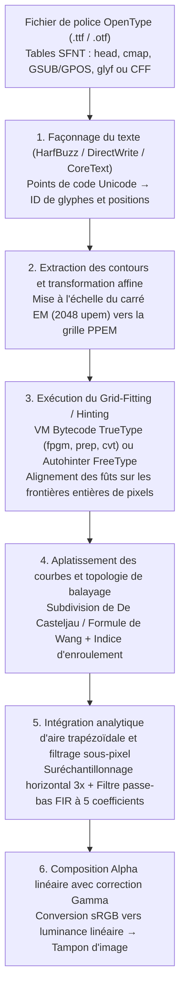

Imaginez observer le texte que vous lisez en ce moment à travers une loupe à fort grossissement. À une taille de corps standard de $12\,\text{px}$ ($9\,\text{pt}$ sur un moniteur classique à $96\,\text{DPI}$), la boîte englobante d'un caractère n'est qu'un minuscule échiquier discret de $12$ pixels de large sur $12$ pixels de haut — soit à peine $144$ petits carrés lumineux au total.

Pourtant, dans cette grille exiguë de $12 \times 12$ pixels, votre système d'exploitation dessine en temps réel des dizaines de milliers de glyphes par seconde : qu'il s'agisse du kanji « 鬱 » et ses $29$ traits, du « `g` » romain à double boucle ou du « `m` » minuscule avec ses trois fûts verticaux (Stems) équidistants. Chaque fût conserve une épaisseur et une densité parfaitement uniformes, les barres horizontales denses ne fusionnent jamais en une tache noire illisible ni ne disparaissent entre deux lignes de pixels (Dropout), et les courbes diagonales sont dépourvues d'effets d'escalier (Jaggies).

Du point de vue de la <strong>théorie de l'information</strong> et du <strong>traitement numérique du signal (DSP)</strong>, cette prouesse quotidienne relève du miracle face au <strong>théorème d'échantillonnage de Nyquist-Shannon</strong>. Une simple réduction géométrique projetée sur une grille de $12 \times 12$ pixels provoquerait un repliement spectral (Aliasing) catastrophique des hautes fréquences spatiales.

Derrière la netteté de ces petits caractères se cache un demi-siècle d'ingéniosité informatique : <strong>géométrie algorithmique</strong> (polynômes de Bernstein et courbes de Bézier), <strong>topologie algébrique</strong> (indice d'enroulement), <strong>machines virtuelles</strong> (bytecode exécutable au cœur de chaque fichier `.ttf`), <strong>psychophysique visuelle et filtrage FIR</strong> (rendu sous-pixel ClearType), <strong>radiométrie</strong> (mélange alpha en lumière linéaire) et <strong>shaders GPU massivement parallèles</strong> (MSDF et évaluation directe `Slug`).

---

## 1. De la tyrannie des bitmaps aux polices vectorielles indépendantes de la résolution

Les premiers systèmes informatiques utilisaient des <strong>polices matricielles (Bitmap Fonts)</strong> stockant chaque glyphe sous forme de matrice binaire $M \in \{0, 1\}^{H \times W}$. Bien que très nettes à leur taille native, elles souffraient d'une <strong>dépendance totale à la résolution</strong> : tout redimensionnement ou rotation produisait d'affreux crénelages, et les bitmaps d'écran à $72\,\text{DPI}$ étaient inutilisables sur les imprimantes laser à $300\,\text{DPI}$ ou les photocomposeuses à $2400\,\text{DPI}$.

La révolution vint des <strong>polices à contours vectoriels (Outline Fonts)</strong> : d'abord <strong>PostScript Type 1</strong> (1984) créé par <strong>John Warnock</strong> et <strong>Chuck Geschke</strong> chez Adobe (utilisant des courbes de Bézier cubiques), puis <strong>TrueType</strong> (`.ttf`, 1991) développé par Apple et Microsoft (utilisant des courbes de Bézier quadratiques et une machine virtuelle de hinting à pile), avant leur unification en 1996 dans le format <strong>OpenType</strong> (`glyf` et `CFF`/`CFF2`).

---

## 2. Géométrie algorithmique des contours : Polynômes de Bernstein et courbes de Bézier

### Les quatre propriétés fondamentales de la base de Bernstein

Les polynômes explicites dans la base monomiale $y = a_3 x^3 + a_2 x^2 + a_1 x + a_0$ ne peuvent pas représenter de tangentes verticales et sont numériquement instables sous rotation. Les ingénieurs automobiles français <strong>Paul de Casteljau</strong> (Citroën, 1959) et <strong>Pierre Bézier</strong> (Renault, 1962) ont formulé des courbes paramétriques à partir des <strong>polynômes de base de Bernstein</strong> de degré $n$ et de $n+1$ points de contrôle $\mathbf{P}_0, \dots, \mathbf{P}_n \in \mathbb{R}^2$ :

$$\mathbf{B}_n(t) = \sum_{i=0}^{n} B_{i,n}(t)\,\mathbf{P}_i, \qquad B_{i,n}(t) = \binom{n}{i} (1 - t)^{n - i} t^i, \qquad t \in [0, 1]$$

1. <strong>Non-négativité, partition de l'unité et propriété de l'enveloppe convexe</strong> :
   Pour tout $t \in [0, 1]$, $B_{i,n}(t) \ge 0$, et d'après la formule du binôme de Newton, la somme des poids vaut identiquement $1$ :
   $$\sum_{i=0}^{n} B_{i,n}(t) = \bigl((1 - t) + t\bigr)^n = 1$$
   La courbe $\mathbf{B}_n(t)$ est donc une combinaison convexe de ses points de contrôle et reste intégralement confinée dans leur <strong>enveloppe convexe (Convex Hull)</strong>, permettant une élimination rapide par boîte englobante en $O(1)$.
2. <strong>Invariance affine</strong> :
   Pour toute transformation affine $\Phi(\mathbf{x}) = A\mathbf{x} + \mathbf{b}$, on a $\Phi(\mathbf{B}_n(t)) = \sum B_{i,n}(t)\,\Phi(\mathbf{P}_i)$ : il suffit de transformer les points de contrôle.
3. <strong>Interpolation des extrémités et contrôle des tangentes</strong> :
   $\mathbf{B}_n(0) = \mathbf{P}_0$, $\mathbf{B}_n(1) = \mathbf{P}_n$, avec les vecteurs tangents $\mathbf{B}_n'(0) = n(\mathbf{P}_1 - \mathbf{P}_0)$ et $\mathbf{B}_n'(1) = n(\mathbf{P}_n - \mathbf{P}_{n-1})$.
4. <strong>Propriété de diminution de la variation</strong> :
   Aucune droite ne coupe la courbe de Bézier plus de fois qu'elle ne coupe son polygone de contrôle.

---

### Courbes quadratiques ($n=2$, TrueType) vs. Courbes cubiques ($n=3$, OpenType CFF)

- <strong>Courbes de Bézier quadratiques ($n=2$, table `glyf` TrueType)</strong> :
  $$\mathbf{B}_2(t) = (1-t)^2 \mathbf{P}_0 + 2(1-t)t \mathbf{P}_1 + t^2 \mathbf{P}_2$$
  Outre la résolution analytique directe des intersections avec une ligne de balayage via l'équation du second degré, TrueType utilise l'astuce des <strong>milieux implicites sur la courbe (Implicit On-Curve Midpoints)</strong> : lorsque deux points hors-courbe $\mathbf{P}_1, \mathbf{P}_2$ se suivent dans le flux binaire, le décodeur insère automatiquement un point de jonction sur la courbe en leur milieu exact $\mathbf{M} = \frac{1}{2}(\mathbf{P}_1 + \mathbf{P}_2)$, assurant une continuité $C^1$ parfaite tout en réduisant la taille du fichier d'environ $30\%$.
- <strong>Courbes de Bézier cubiques ($n=3$, PostScript / table `CFF` OpenType)</strong> :
  $$\mathbf{B}_3(t) = (1-t)^3 \mathbf{P}_0 + 3(1-t)^2 t \mathbf{P}_1 + 3(1-t)t^2 \mathbf{P}_2 + t^3 \mathbf{P}_3$$
  La dérivée seconde d'une courbe quadratique étant constante ($\mathbf{B}_2''(t) = \text{const}$), un segment quadratique unique ne peut jamais contenir de <strong>point d'inflexion</strong> (comme l'épine dorsale de la lettre « `S` »). La courbe cubique possède une dérivée seconde linéaire en $t$, permettant de représenter des inflexions en un seul segment et d'ajuster indépendamment la courbure $G^2$ aux deux extrémités.

| Caractéristique | Bézier quadratique ($n=2$, TrueType `glyf`) | Bézier cubique ($n=3$, OpenType `CFF`) |
| :--- | :--- | :--- |
| <strong>Équation paramétrique $\mathbf{B}(t)$</strong> | $(1-t)^2\mathbf{P}_0 + 2(1-t)t\mathbf{P}_1 + t^2\mathbf{P}_2$ | $(1-t)^3\mathbf{P}_0 + 3(1-t)^2t\mathbf{P}_1 + 3(1-t)t^2\mathbf{P}_2 + t^3\mathbf{P}_3$ |
| <strong>Points d'inflexion par segment</strong> | $0$ (arc de parabole, signe de courbure constant) | Jusqu'à $2$ (représente un « `S` » en 1 seul segment) |
| <strong>Degrés de liberté (tangentes fixes)</strong> | $0$ ($\mathbf{P}_1$ verrouillé à l'intersection des tangentes) | $2$ (longueurs des poignées ajustant la courbure $G^2$) |
| <strong>Stratégie de compression binaire</strong> | Milieux implicites $\mathbf{M} = \frac{1}{2}(\mathbf{P}_1 + \mathbf{P}_2)$ | Sous-routines CFF CharString à pile et deltas |

L'<strong>algorithme de De Casteljau</strong> $\mathbf{P}_i^{(r)}(t) = (1-t)\mathbf{P}_i^{(r-1)}(t) + t\mathbf{P}_{i+1}^{(r-1)}(t)$ (réduit à des décalages binaires `>> 1` en $t = \frac{1}{2}$) et la <strong>formule de Wang (1985)</strong>

$$N = \left\lceil \sqrt{ \frac{n(n-1)}{8\tau} \max_{0 \le i \le n-2} \|\mathbf{P}_{i+2} - 2\mathbf{P}_{i+1} + \mathbf{P}_i\| } \right\rceil$$

permettent d'aplatir chaque courbe en $N$ segments rectilignes respectant la tolérance $\tau$ sans aucune récursion.

---

## 3. Rastérisation par ligne de balayage : Indice d'enroulement et intégration trapézoïdale

### Règle pair-impair vs. Règle de l'indice d'enroulement non nul

Pour distinguer l'intérieur plein d'un glyphe de ses contrepoinçons (les trous dans « `O` » ou « `8` »), la <strong>règle pair-impair (Even-Odd)</strong> échoue dès que deux traits se chevauchent (comme dans les <strong>polices variables OpenType</strong>), créant un trou blanc au croisement des contours. Les moteurs typographiques utilisent donc la <strong>règle de l'indice d'enroulement non nul (Non-Zero Winding Rule)</strong> :

$$w(P) = \frac{1}{2\pi} \oint_{\partial\Gamma} d\theta = \sum_{\text{crossings}} \operatorname{sgn}(\Delta y) \ne 0$$

Les contours extérieurs (sens horaire CW dans TrueType, $-1$) et les trous intérieurs (sens anti-horaire CCW, $+1$) s'annulent ($w(P) = 0$) dans les contrepoinçons, tandis que deux traits superposés de même orientation s'additionnent ($w(P) = -2 \ne 0$) et restent parfaitement remplis.

### Intégration analytique d'aire trapézoïdale (Libart / FreeType `ftgrays` / `stb_truetype`)

Au lieu d'un suréchantillonnage coûteux, l'algorithme de Raph Levien (utilisé par FreeType `ftgrays.c`, `stb_truetype` et `font-rs`) calcule pour chaque segment traversant le pixel $(i, j)$ (hauteur signée $\Delta y = y_1 - y_0$, abscisse moyenne locale $\bar{x} \in [0, 1]$) l'aire trapézoïdale exacte à sa droite $\text{delta\_area}[i] \mathrel{+}= (1 - \bar{x})\Delta y$ et l'incrément de couverture pleine $\text{delta\_cover}[i+1] \mathrel{+}= \Delta y$ pour les pixels suivants. Une simple <strong>somme préfixe (Prefix Sum)</strong> de gauche à droite donne l'opacité exacte $\alpha_i \in [0, 1]$ sur $256$ niveaux :

$$C_i = C_{i-1} + \text{delta\_cover}[i], \qquad A_i = C_i + \text{delta\_area}[i], \qquad \alpha_i = \min\bigl(1.0,\; |A_i|\bigr)$$

---

## 4. La machine virtuelle secrète : Grid-Fitting (Hinting) et le choc des philosophies

Sans hinting à $12\,\text{px}$, les trois fûts verticaux identiques d'un « `m` » tombent avec des phases différentes sur la grille de pixels : le premier tombe dans un seul pixel ($\alpha = 0.80$, noir net), tandis que le deuxième chevauche une frontière et s'étale sur deux pixels gris flous ($\alpha = 0.60$ et $\alpha = 0.20$) !

Pour l'éviter, chaque police TrueType embarque un programme en bytecode (`cvt `, `fpgm`, `prep`, `glyf`) exécuté par une <strong>machine virtuelle à pile</strong> en virgule fixe $26.6$. À l'aide du <strong>vecteur de projection ($\mathbf{P}$)</strong> et du <strong>vecteur de liberté ($\mathbf{F}$)</strong>, les instructions `MDAP` et `MIRP` alignent les fûts sur la grille entière, unifient leur épaisseur via la table globale `cvt`, garantissent une distance minimale contre les disparitions (Dropouts), appliquent des corrections chirurgicales via `DELTAP1`, puis interpolent linéairement les points non touchés via `IUP[0]` / `IUP[1]`.

- <strong>Philosophie Microsoft (GDI / ClearType)</strong> : Priorité absolue à la netteté et au contraste en forçant les fûts sur la grille de pixels, quitte à altérer les proportions du dessin original.
- <strong>Philosophie Apple (Quartz / CoreText)</strong> : Fidélité absolue au dessin typographique (WYSIWYG) en ignorant le bytecode de hinting — une approche couronnée de succès sur les écrans Retina haute densité.
- <strong>Autohinter FreeType (`autofit`) et Hinting vertical léger (Y-only)</strong> : Détection géométrique automatique des fûts et des zones bleues (Blue Zones) à l'exécution, alignant uniquement l'axe vertical Y tout en laissant l'axe horizontal X libre pour le positionnement sous-pixel.

---

## 5. Rendu sous-pixel (ClearType) et mélange Alpha linéaire corrigé du gamma

Chaque pixel LCD est composé de trois sous-pixels verticaux ($R, G, B$) espacés de $\frac{1}{3}$ de pixel. Le système visuel humain ayant une acuité spatiale très élevée en luminance ($Y = 0.2126R + 0.7152G + 0.0722B$) mais faible en chrominance, le moteur rastérise les contours à une <strong>résolution horizontale $3\times$ supérieure</strong>. Pour éliminer les franges colorées (Color Fringing), la couverture sous-pixel est convoluée avec le <strong>filtre passe-bas FIR symétrique à 5 coefficients de Gibson</strong> ($\frac{1}{3}[1,1,1] * \frac{1}{3}[1,1,1]$) :

$$h_{\text{Gibson}} = \left[\frac{1}{9},\; \frac{2}{9},\; \frac{3}{9},\; \frac{2}{9},\; \frac{1}{9}\right]$$

Chaque groupe modulo 3 sommant exactement à $\frac{3}{9} = \frac{2}{9} + \frac{1}{9} = \frac{1}{3}$, l'énergie est répartie de manière parfaitement neutre entre $R, G$ et $B$. Enfin, la fusion alpha doit impérativement s'effectuer dans l'<strong>espace lumineux linéaire</strong> ($\gamma \approx 2.2$) pour éviter d'épaissir le texte blanc sur fond sombre :

$$C_{\text{out}, c} = \Bigl( \alpha_c \, C_{\text{fg}, c}^{\gamma} + (1 - \alpha_c) \, C_{\text{bg}, c}^{\gamma} \Bigr)^{1/\gamma}, \qquad c \in \{R, G, B\},\; \gamma \approx 2.2$$

---

## 6. L'ère du GPU : SDF, MSDF (`msdfgen`) et évaluation directe de Bézier (`Slug`)

```mermaid
flowchart TD
    subgraph CPU["Rastérisation CPU (FreeType / DirectWrite)"]
        C1["Courbes de Bézier + VM de Hinting"] --> C2["Intégration trapézoïdale + Filtre FIR à 5 coefficients"]
        C2 --> C3["Cache bitmap par taille<br/>Avantage : Netteté inégalée à 10–14px<br/>Limite : Flou ou recalcul lors de zooms/rotations 3D"]
    end
    subgraph MSDF["Champs de distance GPU (Valve SDF / Chlumský MSDF)"]
        S1["Précalcul hors-ligne du champ de distance signée"] --> S2["MSDF : Coloration RGB des arêtes pour préserver les coins"]
        S2 --> S3["Fragment Shader : d = median(r, g, b) + smoothstep<br/>Avantage : Coins parfaitement vifs à tout facteur de zoom"]
    end
    subgraph Slug["Shaders GPU Bézier directs (Eric Lengyel 'Slug' / 'Vello')"]
        G1["Points de contrôle Bézier stockés dans un tampon GPU"] --> G2["Découpage spatial en bandes horizontales et verticales"]
        G2 --> G3["Résolution quadratique et indice d'enroulement dans le shader<br/>Avantage : Sans atlas de textures, idéal pour 50 000 kanjis"]
    end
```

Pour le rendu 3D temps réel, <strong>Chris Green (Valve, 2007)</strong> a introduit les <strong>champs de distance signée (SDF)</strong> stockant la distance euclidienne $d(\mathbf{p})$ au contour. Afin d'éviter l'arrondissement des angles vifs au grossissement, <strong>Viktor Chlumský (2015)</strong> a conçu le <strong>MSDF (`msdfgen`)</strong> qui répartit les pseudo-distances directionnelles sur les trois canaux RGB et reconstruit les coins parfaits dans le shader grâce à la médiane :

$$d_{\text{MSDF}} = \operatorname{median}(r, g, b) = \max\Bigl(\min(r, g),\; \min\bigl(\max(r, g),\; b\bigr)\Bigr)$$

Enfin, pour les idéogrammes extrêmement denses, les algorithmes GPU directs comme <strong>`Slug` d'Eric Lengyel (2017)</strong> et <strong>`Vello` de Raph Levien</strong> évaluent directement les intersections de Bézier et l'indice d'enroulement au sein du shader, sans aucune texture intermédiaire.
