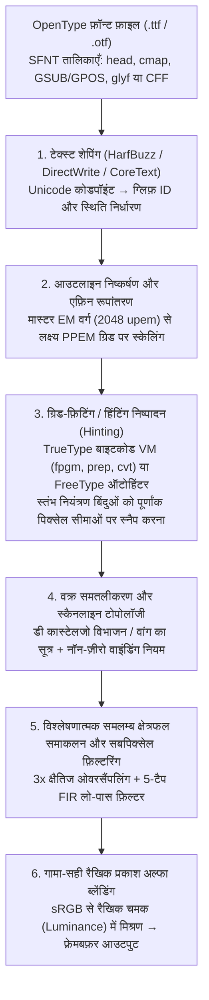

कल्पना कीजिए कि आप अभी अपनी स्क्रीन पर लिखे इस पाठ को एक उच्च-क्षमता वाले आवर्धक लेंस (Magnifying glass) से देख रहे हैं। एक मानक $96\,\text{DPI}$ डेस्कटॉप मॉनिटर पर $12\,\text{px}$ ($9\,\text{pt}$) के सामान्य फ़ॉन्ट आकार में, एक पूरे अक्षर का स्थान केवल $12$ पिक्सेल चौड़ा और $12$ पिक्सेल ऊँचा एक सूक्ष्म शतरंज का बोर्ड होता है — यानी कुल मिलाकर मात्र $144$ सूक्ष्म प्रकाश-उत्सर्जक वर्ग!

फिर भी, इस अत्यंत संकुचित $12 \times 12$ ग्रिड के भीतर, आपका ऑपरेटिंग सिस्टम प्रति सेकंड हजारों जटिल ग्लिफ़ (Glyphs) को वास्तविक समय में चित्रित करता है: चाहे वह देवनागरी के संयुक्त अक्षर और मात्राएँ हों (‘क्ष’, ‘त्र’, ‘द्ध’), $29$ स्ट्रोक वाला जटिल कांजी ‘鬱’ हो, या दोहरे लूप वाला लैटिन सेरिफ़ ‘`g`’ और तीन समान ऊर्ध्वाधर स्तंभों (Stems) वाला ‘`m`’ हो। प्रत्येक ऊर्ध्वाधर रेखा अपनी समान मोटाई और गहराई बनाए रखती है, घनी क्षैतिज रेखाएँ आपस में मिलकर काली स्याही का धब्बा नहीं बनतीं और न ही पिक्सेल केंद्रों के बीच गिरकर गायब (Dropout) होती हैं, तथा तिरछी रेखाओं में सीढ़ीदार कटाव (Jaggies) भी दिखाई नहीं देते।

<strong>सूचना सिद्धांत (Information Theory)</strong> और <strong>डिजिटल सिग्नल प्रोसेसिंग (DSP)</strong> के दृष्टिकोण से, यह दैनिक घटना <strong>नाइक्विस्ट-शैनन सैंपलिंग प्रमेय (Nyquist-Shannon Sampling Theorem)</strong> की भौतिक सीमाओं के विरुद्ध एक इंजीनियरिंग चमत्कार है। यदि किसी उच्च-रिज़ॉल्यूशन वेक्टर आकृति को सीधे ज्यामितीय रूप से छोटा करके $12 \times 12$ ग्रिड पर प्रक्षेपित कर दिया जाए, तो नाइक्विस्ट सीमा से अधिक की स्थानिक आवृत्तियाँ गंभीर एलियासिंग (Aliasing) उत्पन्न करेंगी और अक्षर एक अपठनीय धुंधले धब्बे में बदल जाएंगे।

इस स्पष्टता के पीछे आधी सदी का कंप्यूटर विज्ञान छिपा है: <strong>कम्प्यूटेशनल ज्यामिति</strong> (बर्नस्टीन बहुपद और बेज़ियर वक्र), <strong>बीजगणितीय टोपोलॉजी</strong> (वाइंडिंग संख्या), <strong>वर्चुअल मशीन आर्किटेक्चर</strong> (प्रत्येक `.ttf` फ़ाइल के भीतर निष्पादन योग्य बाइटकोड), <strong>मानव दृश्य मनोभौतिकी और FIR डिजिटल फ़िल्टर</strong> (ClearType सबपिक्सेल रेंडरिंग), <strong>रेडियोमेट्रिक रंग विज्ञान</strong> (रैखिक प्रकाश स्थान में गामा-सही मिश्रण), और <strong>GPU समानांतर शेडर एल्गोरिदम</strong> (MSDF और `Slug`)।

---

## 1. बिटमैप फ़ॉन्ट की सीमाओं से रिज़ॉल्यूशन-स्वतंत्र आउटलाइन फ़ॉन्ट तक

प्रारंभिक कंप्यूटर सिस्टम <strong>बिटमैप फ़ॉन्ट (Bitmap Fonts)</strong> का उपयोग करते थे, जो प्रत्येक ग्लिफ़ को द्विआधारी मैट्रिक्स $M \in \{0, 1\}^{H \times W}$ के रूप में संग्रहीत करते थे। अपने मूल आकार में तीक्ष्ण होने के बावजूद, उनमें <strong>रिज़ॉल्यूशन निर्भरता (Resolution Dependence)</strong> का घातक दोष था: आकार बदलने या घुमाने पर सीढ़ीदार विकृति आती थी, और $72\,\text{DPI}$ स्क्रीन बिटमैप $300\,\text{DPI}$ लेज़र प्रिंटर या $2400\,\text{DPI}$ इमेजसेटर पर बेकार हो जाते थे।

इसका समाधान <strong>वेक्टर आउटलाइन फ़ॉन्ट (Outline Fonts)</strong> ने दिया: सर्वप्रथम Adobe के <strong>John Warnock</strong> और <strong>Chuck Geschke</strong> ने <strong>PostScript Type 1</strong> (1984, त्रिघात बेज़ियर वक्रों पर आधारित) प्रस्तुत किया, जिसके उत्तर में Apple और Microsoft ने 1991 में <strong>TrueType</strong> (`.ttf`, द्विघात बेज़ियर वक्रों और स्टैक-आधारित हिंटिंग वर्चुअल मशीन पर आधारित) विकसित किया। 1996 में दोनों तकनीकों को <strong>OpenType</strong> मानक (`glyf` और `CFF`/`CFF2` तालिकाओं) में एकीकृत कर दिया गया।

---

## 2. आउटलाइन फ़ॉन्ट की कम्प्यूटेशनल ज्यामिति: बर्नस्टीन बहुपद और बेज़ियर वक्र

### बर्नस्टीन आधार के चार मूलभूत गणितीय गुण

साधारण घात-आधार बहुपद $y = a_3 x^3 + a_2 x^2 + a_1 x + a_0$ ऊर्ध्वाधर स्पर्शरेखाओं ($dx = 0$) को व्यक्त नहीं कर सकते और घूर्णन के तहत संख्यात्मक रूप से अस्थिर होते हैं। फ्रांसीसी ऑटोमोबाइल इंजीनियर <strong>Paul de Casteljau</strong> (Citroën, 1959) और <strong>Pierre Bézier</strong> (Renault, 1962) ने $n+1$ नियंत्रण बिंदुओं $\mathbf{P}_0, \dots, \mathbf{P}_n \in \mathbb{R}^2$ और $n$-घात के <strong>बर्नस्टीन आधार बहुपदों (Bernstein Basis Polynomials)</strong> $B_{i,n}(t)$ के माध्यम से प्राचलिक वक्र परिभाषित किए:

$$\mathbf{B}_n(t) = \sum_{i=0}^{n} B_{i,n}(t)\,\mathbf{P}_i, \qquad B_{i,n}(t) = \binom{n}{i} (1 - t)^{n - i} t^i, \qquad t \in [0, 1]$$

1. <strong>अऋणात्मकता, इकाई का विभाजन और उत्तल आवरण गुण (Convex Hull Property)</strong>:
   $t \in [0, 1]$ में सदैव $B_{i,n}(t) \ge 0$ होता है, और द्विपद प्रमेय (Binomial Theorem) के अनुसार सभी आधार फलनों का योग सर्वदा $1$ होता है:
   $$\sum_{i=0}^{n} B_{i,n}(t) = \bigl((1 - t) + t\bigr)^n = 1$$
   अतः संपूर्ण वक्र $\mathbf{B}_n(t)$ अपने नियंत्रण बिंदुओं के <strong>उत्तल आवरण (Convex Hull)</strong> के भीतर ही सीमित रहता है, जिससे बाउंडिंग बॉक्स द्वारा $O(1)$ समय में तेज़ कलिंग (Culling) संभव होती है।
2. <strong>एफ़िन निश्चरता (Affine Invariance)</strong>:
   किसी भी एफ़िन रूपांतरण $\Phi(\mathbf{x}) = A\mathbf{x} + \mathbf{b}$ के लिए $\Phi(\mathbf{B}_n(t)) = \sum B_{i,n}(t)\,\Phi(\mathbf{P}_i)$ सत्य है; अर्थात् केवल नियंत्रण बिंदुओं को रूपांतरित करना पर्याप्त है।
3. <strong>अंतिम बिंदु अंतर्वेशन और स्पर्शरेखा नियंत्रण</strong>:
   $\mathbf{B}_n(0) = \mathbf{P}_0$, $\mathbf{B}_n(1) = \mathbf{P}_n$, तथा सिरों पर अवकलज $\mathbf{B}_n'(0) = n(\mathbf{P}_1 - \mathbf{P}_0)$ और $\mathbf{B}_n'(1) = n(\mathbf{P}_n - \mathbf{P}_{n-1})$ होते हैं।
4. <strong>विचरण ह्रास गुण (Variation Diminishing Property)</strong>:
   कोई भी सरल रेखा बेज़ियर वक्र को उसके नियंत्रण बहुभुज से अधिक बार प्रतिच्छेद नहीं कर सकती।

---

### द्विघात बेज़ियर वक्र ($n=2$, TrueType) बनाम त्रिघात बेज़ियर वक्र ($n=3$, OpenType CFF)

- <strong>द्विघात बेज़ियर वक्र ($n=2$, TrueType `glyf` तालिका)</strong>:
  $$\mathbf{B}_2(t) = (1-t)^2 \mathbf{P}_0 + 2(1-t)t \mathbf{P}_1 + t^2 \mathbf{P}_2$$
  स्कैनलाइन प्रतिच्छेदन द्विघात सूत्र से सीधे निकल आता है। इसके अतिरिक्त, TrueType <strong>अंतर्निहित मध्य-बिंदु (Implicit On-Curve Midpoints)</strong> संपीड़न का उपयोग करता है: जब दो ऑफ-कर्व नियंत्रण बिंदु $\mathbf{P}_1, \mathbf{P}_2$ लगातार आते हैं, तो डिकोडर उनके ठीक मध्य $\mathbf{M} = \frac{1}{2}(\mathbf{P}_1 + \mathbf{P}_2)$ में स्वतः एक ऑन-कर्व बिंदु बना देता है, जिससे $C^1$ सातत्य सुनिश्चित होता है और फ़ाइल का आकार लगभग $30\%$ कम हो जाता है।
- <strong>त्रिघात बेज़ियर वक्र ($n=3$, PostScript / OpenType `CFF` तालिका)</strong>:
  $$\mathbf{B}_3(t) = (1-t)^3 \mathbf{P}_0 + 3(1-t)^2 t \mathbf{P}_1 + 3(1-t)t^2 \mathbf{P}_2 + t^3 \mathbf{P}_3$$
  द्विघात वक्र का द्वितीय अवकलज अचर ($\mathbf{B}_2''(t) = \text{const}$) होने के कारण एकल द्विघात खंड कभी भी <strong>नतिपरिवर्तन बिंदु (Inflection Point, जैसे ‘`S`’ का वक्र)</strong> नहीं बना सकता। त्रिघात वक्र का द्वितीय अवकलज $t$ में रैखिक होता है, जो एक ही खंड में नतिपरिवर्तन बिंदु और दोनों सिरों पर स्वतंत्र $G^2$ वक्रता नियंत्रण प्रदान करता है।

| तुलनात्मक विशेषता | द्विघात बेज़ियर ($n=2$, TrueType `glyf`) | त्रिघात बेज़ियर ($n=3$, OpenType `CFF`) |
| :--- | :--- | :--- |
| <strong>प्राचलिक समीकरण $\mathbf{B}(t)$</strong> | $(1-t)^2\mathbf{P}_0 + 2(1-t)t\mathbf{P}_1 + t^2\mathbf{P}_2$ | $(1-t)^3\mathbf{P}_0 + 3(1-t)^2t\mathbf{P}_1 + 3(1-t)t^2\mathbf{P}_2 + t^3\mathbf{P}_3$ |
| <strong>प्रति खंड नतिपरिवर्तन बिंदु</strong> | $0$ (परवलय चाप, वक्रता चिह्न अपरिवर्तित) | अधिकतम $2$ (एकल खंड में ‘`S`’ वक्र का निरूपण) |
| <strong>स्वतंत्रता की कोटि (स्थिर स्पर्शरेखा)</strong> | $0$ ($\mathbf{P}_1$ स्पर्शरेखाओं के प्रतिच्छेदन पर स्थिर) | $2$ (हैंडल की लंबाई से स्वतंत्र $G^2$ वक्रता नियंत्रण) |
| <strong>बाइनरी संपीड़न विधि</strong> | अंतर्निहित मध्य-बिंदु $\mathbf{M} = \frac{1}{2}(\mathbf{P}_1 + \mathbf{P}_2)$ | स्टैक-आधारित CFF CharString सबरूटीन और डेल्टा |

<strong>डी कास्टेलजो एल्गोरिदम</strong> $\mathbf{P}_i^{(r)}(t) = (1-t)\mathbf{P}_i^{(r-1)}(t) + t\mathbf{P}_{i+1}^{(r-1)}(t)$ ($t = \frac{1}{2}$ पर केवल पूर्णांक योग और बिट शिफ्ट `>> 1`) तथा <strong>वांग के सूत्र (1985)</strong>

$$N = \left\lceil \sqrt{ \frac{n(n-1)}{8\tau} \max_{0 \le i \le n-2} \|\mathbf{P}_{i+2} - 2\mathbf{P}_{i+1} + \mathbf{P}_i\| } \right\rceil$$

की सहायता से बिना रिकर्सन के वक्र को सहनशीलता $\tau$ के भीतर $N$ सरल रेखाखंडों में विभाजित किया जाता है।

---

## 3. स्कैनलाइन रास्टराइज़ेशन: वाइंडिंग नियम और विश्लेषणात्मक समलम्ब क्षेत्रफल समाकलन

### सम-विषम नियम बनाम नॉन-ज़ीरो वाइंडिंग नियम

अक्षर के भरे हुए भाग और आंतरिक छिद्रों (जैसे ‘`O`’, ‘`8`’ या ‘`व`’ के बीच का खाली स्थान) में अंतर करने के लिए <strong>सम-विषम नियम (Even-Odd Rule)</strong> तब विफल हो जाता है जब दो स्ट्रोक एक-दूसरे को काटते हैं (जैसे <strong>Variable Fonts</strong> में), क्योंकि प्रतिच्छेदन संख्या सम ($2$) होने से जोड़ पर सफेद छेद बन जाता है। इसलिए फ़ॉन्ट इंजन <strong>नॉन-ज़ीरो वाइंडिंग नियम (Non-Zero Winding Rule)</strong> का उपयोग करते हैं:

$$w(P) = \frac{1}{2\pi} \oint_{\partial\Gamma} d\theta = \sum_{\text{crossings}} \operatorname{sgn}(\Delta y) \ne 0$$

बाहरी समोच्च रेखा (TrueType में दक्षिणावर्त CW, $-1$) और आंतरिक छिद्र (वामावर्त CCW, $+1$) छिद्र के भीतर एक-दूसरे को निरस्त ($w(P) = 0$) कर देते हैं, जबकि समान दिशा वाले ओवरलैपिंग स्ट्रोक जुड़कर ($w(P) = -2 \ne 0$) पूरी तरह भरे रहते हैं।

### विश्लेषणात्मक समलम्ब क्षेत्रफल समाकलन (Libart / FreeType `ftgrays` / `stb_truetype`)

धीमी सुपरसैंपलिंग के बजाय, Raph Levien का एल्गोरिदम (FreeType `ftgrays.c`, `stb_truetype` और `font-rs` में प्रयुक्त) पिक्सेल $(i, j)$ को पार करने वाले प्रत्येक रेखाखंड (ऊर्ध्वाधर विस्थापन $\Delta y = y_1 - y_0$, क्षैतिज मध्य-बिंदु $\bar{x} \in [0, 1]$) के लिए दाईं ओर का सटीक समलम्ब क्षेत्रफल $\text{delta\_area}[i] \mathrel{+}= (1 - \bar{x})\Delta y$ और आगे के पिक्सेलों के लिए पूर्ण आवरण वृद्धि $\text{delta\_cover}[i+1] \mathrel{+}= \Delta y$ संचित करता है। बाएँ से दाएँ केवल एक <strong>प्रीफ़िक्स सम (Prefix Sum)</strong> पास में 256-स्तर का सटीक अल्फा $\alpha_i \in [0, 1]$ प्राप्त हो जाता है:

$$C_i = C_{i-1} + \text{delta\_cover}[i], \qquad A_i = C_i + \text{delta\_area}[i], \qquad \alpha_i = \min\bigl(1.0,\; |A_i|\bigr)$$

---

## 4. फ़ॉन्ट के भीतर छिपी वर्चुअल मशीन: ग्रिड-फ़िटिंग (Hinting) और तीन दर्शन

$12\,\text{px}$ पर बिना हिंटिंग के ‘`m`’ के तीन समान ऊर्ध्वाधर स्तंभ पिक्सेल ग्रिड पर अलग-अलग कला (Phase) में गिरते हैं: पहला स्तंभ एक पिक्सेल में गिरकर तीक्ष्ण काला ($\alpha = 0.80$) दिखता है, जबकि दूसरा स्तंभ पिक्सेल सीमा पर पड़कर दो पिक्सेल चौड़ी धुंधली धूसर पट्टी ($\alpha = 0.60$ और $\alpha = 0.20$) में फैल जाता है।

इसे रोकने के लिए प्रत्येक TrueType फ़ाइल में एक <strong>स्टैक-आधारित वर्चुअल मशीन</strong> के लिए बाइटकोड प्रोग्राम (`cvt `, `fpgm`, `prep`, `glyf`) होता है जो $26.6$ फ़िक्स्ड-पॉइंट गणित पर चलता है। <strong>प्रोजेक्शन वेक्टर ($\mathbf{P}$)</strong> और <strong>फ़्रीडम वेक्टर ($\mathbf{F}$)</strong> के माध्यम से `MDAP` और `MIRP` निर्देश बिंदुओं को पूर्णांक पिक्सेल सीमाओं पर स्नैप करते हैं, `cvt` तालिका से स्तंभों की चौड़ाई एकसमान रखते हैं, ड्रॉपआउट रोकते हैं, `DELTAP1` से आकार-विशिष्ट सुधार करते हैं, और `IUP[0]` / `IUP[1]` द्वारा अछूते बिंदुओं को सुचारू रूप से अंतर्निहित करते हैं।

- <strong>Microsoft दर्शन (GDI / ClearType)</strong>: अधिकतम तीक्ष्णता और पठनीयता के लिए स्तंभों को पिक्सेल ग्रिड पर कठोरता से स्नैप करना, भले ही मूल अनुपात थोड़ा बदल जाए।
- <strong>Apple दर्शन (Quartz / CoreText)</strong>: बाइटकोड हिंटिंग को अनदेखा कर टाइपफ़ेस डिज़ाइनर के मूल आकार (WYSIWYG) को सुरक्षित रखना, जो उच्च-घनत्व वाले Retina डिस्प्ले पर सर्वोत्तम सिद्ध हुआ।
- <strong>FreeType ऑटोहिंटर (`autofit`) और Y-ओनली हिंटिंग</strong>: रनटाइम पर ज्यामितीय विश्लेषण द्वारा स्तंभों और ब्लू ज़ोन (Blue Zones) की पहचान करना और केवल ऊर्ध्वाधर Y-अक्ष पर हल्का ग्रिड संरेखण करना।

---

## 5. सबपिक्सेल रेंडरिंग (ClearType) और गामा-सही रैखिक अल्फा ब्लेंडिंग

LCD पैनल का प्रत्येक पिक्सेल क्षैतिज रूप से $\frac{1}{3}$ पिक्सेल की दूरी पर स्थित तीन ऊर्ध्वाधर सबपिक्सेल ($R, G, B$) से बना होता है। चूँकि मानव दृष्टि में चमक ($Y = 0.2126R + 0.7152G + 0.0722B$) के प्रति स्थानिक तीक्ष्णता बहुत अधिक और रंग (Chrominance) के प्रति कम होती है, रास्टराइज़र <strong>$3\times$ क्षैतिज रिज़ॉल्यूशन</strong> पर सैंपलिंग करता है। रंगीन झालरों (Color Fringing) को समाप्त करने के लिए <strong>5-टैप सममित गिब्सन FIR लो-पास फ़िल्टर</strong> ($\frac{1}{3}[1,1,1] * \frac{1}{3}[1,1,1]$) लगाया जाता है:

$$h_{\text{Gibson}} = \left[\frac{1}{9},\; \frac{2}{9},\; \frac{3}{9},\; \frac{2}{9},\; \frac{1}{9}\right]$$

प्रत्येक मॉड्यूलो-3 समूह का योग $\frac{3}{9} = \frac{2}{9} + \frac{1}{9} = \frac{1}{3}$ होने से ऊर्जा $R, G, B$ में बराबर बँटती है। अंत में, लाइट और डार्क मोड में अक्षरों की मोटाई को सटीक रखने के लिए अल्फा ब्लेंडिंग अनिवार्य रूप से <strong>रैखिक प्रकाश स्थान (Linear Light Space)</strong> ($\gamma \approx 2.2$) में की जाती है:

$$C_{\text{out}, c} = \Bigl( \alpha_c \, C_{\text{fg}, c}^{\gamma} + (1 - \alpha_c) \, C_{\text{bg}, c}^{\gamma} \Bigr)^{1/\gamma}, \qquad c \in \{R, G, B\},\; \gamma \approx 2.2$$

---

## 6. GPU युग: SDF, MSDF (`msdfgen`) और प्रत्यक्ष बेज़ियर शेडर (`Slug`)

```mermaid
flowchart TD
    subgraph CPU["CPU रास्टराइज़ेशन (FreeType / DirectWrite)"]
        C1["बेज़ियर वक्र + हिंटिंग VM"] --> C2["समलम्ब समाकलन + 5-टैप FIR फ़िल्टर"]
        C2 --> C3["आकार-आधारित बिटमैप कैश<br/>लाभ: 10–14px पर सर्वोत्तम स्पष्टता<br/>सीमा: 3D ज़ूम/घूर्णन पर धुंधलापन या पुनः गणना"]
    end
    subgraph MSDF["GPU दूरी क्षेत्र (Valve SDF / Chlumský MSDF)"]
        S1["चिह्नित दूरी क्षेत्र (SDF) की ऑफ़लाइन बेकिंग"] --> S2["MSDF: तीक्ष्ण कोनों की रक्षा हेतु RGB कोर कोडिंग"]
        S2 --> S3["फ़्रैगमेंट शेडर: d = median(r, g, b) + smoothstep<br/>लाभ: किसी भी ज़ूम स्तर पर तीक्ष्ण कोने सुरक्षित"]
    end
    subgraph Slug["प्रत्यक्ष GPU बेज़ियर शेडर (Eric Lengyel 'Slug' / 'Vello')"]
        G1["GPU बफ़र में सीधे बेज़ियर नियंत्रण बिंदु"] --> G2["क्षैतिज और ऊर्ध्वाधर स्थानिक बैंड में विभाजन"]
        G2 --> G3["शेडर के भीतर द्विघात समीकरण और वाइंडिंग संख्या की गणना<br/>लाभ: टेक्सचर एटलस मुक्त, 50,000+ जटिल अक्षरों का त्वरित चित्रण"]
    end
```

3D इंजन के लिए <strong>Chris Green (Valve, 2007)</strong> ने <strong>Signed Distance Fields (SDF)</strong> प्रस्तुत किया जो समोच्च रेखा तक की यूक्लिडियन दूरी $d(\mathbf{p})$ संग्रहीत करता है। ज़ूम करने पर तीक्ष्ण कोनों के गोल होने की समस्या को <strong>Viktor Chlumský (2015)</strong> ने <strong>MSDF (`msdfgen`)</strong> द्वारा हल किया, जो कोने की दोनों भुजाओं को तीन RGB चैनलों में विभाजित कर शेडर में माध्यिका (Median) द्वारा तीक्ष्ण कोना पुनर्निर्मित करता है:

$$d_{\text{MSDF}} = \operatorname{median}(r, g, b) = \max\Bigl(\min(r, g),\; \min\bigl(\max(r, g),\; b\bigr)\Bigr)$$

और अत्यंत घने अक्षरों के लिए <strong>Eric Lengyel का `Slug` (2017)</strong> तथा <strong>Raph Levien का `Vello`</strong> बिना किसी मध्यवर्ती टेक्सचर के सीधे GPU शेडर के भीतर बेज़ियर वक्रों के प्रतिच्छेदन और वाइंडिंग संख्या की गणना कर असीमित रिज़ॉल्यूशन प्रदान करते हैं।
