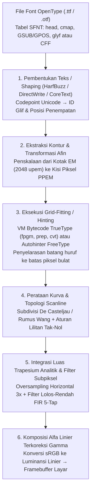

Bayangkan mengamati teks yang sedang Anda baca di layar saat ini menggunakan kaca pembesar berkekuatan tinggi. Pada ukuran teks standar $12\,\text{px}$ ($9\,\text{pt}$ pada monitor desktop konvensional $96\,\text{DPI}$), seluruh kotak karakter hanyalah papan catur diskrit mungil berukuran lebar $12$ piksel kali tinggi $12$ piksel—total hanya $144$ kotak pemancar cahaya mikroskopis.

Namun, di dalam kisi sempit $12 \times 12$ tersebut, sistem operasi Anda merender puluhan ribu glif rumit setiap detik secara *real-time*: mulai dari kanji «鬱» yang memiliki $29$ guratan, huruf kecil serif Latin «`g`» bertingkat dua, hingga huruf «`m`» dengan tiga batang vertikal (Stems) berjarak sama. Setiap batang vertikal mempertahankan ketebalan dan kepekatan yang seragam, garis-garis horizontal yang rapat tidak pernah menyatu menjadi gumpalan hitam maupun hilang tertelan celah antar-piksel (Dropout), dan lengkungan diagonal mengalir mulus tanpa gerigi tangga (Jaggies).

Dari sudut pandang <strong>Teori Informasi</strong> dan <strong>Pemrosesan Sinyal Digital (DSP)</strong>, fenomena sehari-hari ini adalah keajaiban rekayasa yang menantang batas <strong>Teorema Sampling Nyquist-Shannon</strong>. Jika kita langsung mengecilkan kontur vektor beresolusi tinggi ke kisi $12 \times 12$ secara geometris naif, frekuensi spasial tinggi di atas batas Nyquist akan mengalami *aliasing* parah dan menghancurkan huruf menjadi bercak abu-abu yang mustahil dibaca.

Di balik ketajaman teks kecil ini terdapat setengah abad inovasi ilmu komputer: <strong>geometri komputasional</strong> (polinomial Bernstein dan kurva Bézier), <strong>topologi aljabar</strong> (bilangan lilitan / *winding number*), <strong>mesin virtual</strong> (*bytecode* yang dapat dieksekusi di dalam setiap file `.ttf`), <strong>psikofisika visual manusia dan filter digital FIR</strong> (rendering subpiksel ClearType), <strong>ilmu warna radiometrik</strong> (pencampuran alfa di ruang cahaya linier), serta <strong>algoritma shader GPU paralel</strong> (MSDF dan evaluasi kurva langsung `Slug`).

---

## 1. Dari Belenggu Font Bitmap ke Font Kontur Vektor Independen Resolusi

Sistem komputer generasi awal mengandalkan <strong>Font Bitmap</strong> yang menyimpan setiap glif sebagai matriks biner $M \in \{0, 1\}^{H \times W}$. Meskipun sangat tajam pada ukuran aslinya, font bitmap menderita <strong>ketergantungan resolusi</strong> yang fatal: pembesaran atau rotasi menghasilkan gerigi kasar, dan bitmap layar $72\,\text{DPI}$ tidak dapat digunakan pada printer laser $300\,\text{DPI}$ atau mesin cetak $2400\,\text{DPI}$.

Terobosan hadir melalui <strong>Font Kontur Vektor (Outline Fonts)</strong>: diawali oleh <strong>PostScript Type 1</strong> (1984) karya <strong>John Warnock</strong> dan <strong>Chuck Geschke</strong> di Adobe (berbasis kurva Bézier kubik), diikuti oleh <strong>TrueType</strong> (`.ttf`, 1991) dari Apple dan Microsoft (berbasis kurva Bézier kuadratik dan mesin virtual hinting berbasis tumpukan), hingga akhirnya disatukan pada tahun 1996 dalam standar <strong>OpenType</strong> (tabel `glyf` dan `CFF`/`CFF2`).

---

## 2. Geometri Komputasional Font Kontur: Polinomial Bernstein dan Kurva Bézier

### Empat Sifat Fundamental Basis Bernstein

Polinomial eksplisit dalam basis pangkat $y = a_3 x^3 + a_2 x^2 + a_1 x + a_0$ tidak mampu merepresentasikan garis singgung vertikal dan tidak stabil secara numerik saat dirotasi. Insinyur otomotif Prancis <strong>Paul de Casteljau</strong> (Citroën, 1959) dan <strong>Pierre Bézier</strong> (Renault, 1962) merumuskan kurva parametrik menggunakan <strong>polinomial basis Bernstein</strong> berderajat $n$ dengan $n+1$ titik kontrol $\mathbf{P}_0, \dots, \mathbf{P}_n \in \mathbb{R}^2$:

$$\mathbf{B}_n(t) = \sum_{i=0}^{n} B_{i,n}(t)\,\mathbf{P}_i, \qquad B_{i,n}(t) = \binom{n}{i} (1 - t)^{n - i} t^i, \qquad t \in [0, 1]$$

1. <strong>Non-negativitas, Partisi Satu, dan Sifat Selubung Konveks (Convex Hull Property)</strong>:
   Untuk setiap $t \in [0, 1]$ berlaku $B_{i,n}(t) \ge 0$, dan menurut teorema binomial jumlah seluruh fungsi basis selalu identik dengan $1$:
   $$\sum_{i=0}^{n} B_{i,n}(t) = \bigl((1 - t) + t\bigr)^n = 1$$
   Sebagai kombinasi konveks, seluruh kurva $\mathbf{B}_n(t)$ dijamin berada sepenuhnya di dalam <strong>selubung konveks (Convex Hull)</strong> titik-titik kontrolnya, memungkinkan pemangkasan kotak pembatas (*bounding box culling*) secara instan dalam waktu $O(1)$.
2. <strong>Invariansi Afin</strong>:
   Untuk sembarang transformasi afin $\Phi(\mathbf{x}) = A\mathbf{x} + \mathbf{b}$, berlaku $\Phi(\mathbf{B}_n(t)) = \sum B_{i,n}(t)\,\Phi(\mathbf{P}_i)$: cukup mentransformasikan titik-titik kontrolnya saja.
3. <strong>Interpolasi Titik Ujung dan Kendali Garis Singgung</strong>:
   $\mathbf{B}_n(0) = \mathbf{P}_0$, $\mathbf{B}_n(1) = \mathbf{P}_n$, dengan vektor turunan di ujung $\mathbf{B}_n'(0) = n(\mathbf{P}_1 - \mathbf{P}_0)$ dan $\mathbf{B}_n'(1) = n(\mathbf{P}_n - \mathbf{P}_{n-1})$.
4. <strong>Sifat Pengurangan Variasi (Variation Diminishing Property)</strong>:
   Tidak ada garis lurus yang memotong kurva Bézier lebih banyak daripada jumlah potongannya terhadap poligon kontrol.

---

### Kurva Bézier Kuadratik ($n=2$, TrueType) vs. Kubik ($n=3$, OpenType CFF)

- <strong>Kurva Bézier Kuadratik ($n=2$, tabel `glyf` TrueType)</strong>:
  $$\mathbf{B}_2(t) = (1-t)^2 \mathbf{P}_0 + 2(1-t)t \mathbf{P}_1 + t^2 \mathbf{P}_2$$
  Selain memudahkan pencarian titik potong *scanline* melalui rumus persamaan kuadrat, TrueType memanfaatkan kompresi <strong>titik tengah implisit pada kurva (Implicit On-Curve Midpoints)</strong>: ketika dua titik kontrol di luar kurva $\mathbf{P}_1, \mathbf{P}_2$ muncul berurutan, dekoder otomatis menyisipkan titik sambung pada kurva tepat di titik tengahnya $\mathbf{M} = \frac{1}{2}(\mathbf{P}_1 + \mathbf{P}_2)$, menjamin kontinuitas $C^1$ sekaligus menghemat ukuran file sekitar $30\%$.
- <strong>Kurva Bézier Kubik ($n=3$, PostScript / tabel `CFF` OpenType)</strong>:
  $$\mathbf{B}_3(t) = (1-t)^3 \mathbf{P}_0 + 3(1-t)^2 t \mathbf{P}_1 + 3(1-t)t^2 \mathbf{P}_2 + t^3 \mathbf{P}_3$$
  Karena turunan kedua kurva kuadratik bernilai konstan ($\mathbf{B}_2''(t) = \text{const}$), satu segmen kuadratik tidak pernah bisa memuat <strong>titik belok (Inflection Point)</strong> seperti tulang punggung huruf «`S`». Kurva kubik memiliki turunan kedua yang linier terhadap $t$, sehingga mampu merepresentasikan titik belok dalam satu segmen dan mengatur kelengkungan $G^2$ secara independen di kedua ujungnya.

| Karakteristik | Bézier Kuadratik ($n=2$, TrueType `glyf`) | Bézier Kubik ($n=3$, OpenType `CFF`) |
| :--- | :--- | :--- |
| <strong>Persamaan Parametrik $\mathbf{B}(t)$</strong> | $(1-t)^2\mathbf{P}_0 + 2(1-t)t\mathbf{P}_1 + t^2\mathbf{P}_2$ | $(1-t)^3\mathbf{P}_0 + 3(1-t)^2t\mathbf{P}_1 + 3(1-t)t^2\mathbf{P}_2 + t^3\mathbf{P}_3$ |
| <strong>Titik Belok per Segmen</strong> | $0$ (busur parabola, tanda kelengkungan tetap) | Hingga $2$ (merepresentasikan lengkungan «`S`» dalam 1 segmen) |
| <strong>Derajat Kebebasan (Garis Singgung Tetap)</strong> | $0$ ($\mathbf{P}_1$ terkunci di perpotongan garis singgung) | $2$ (panjang lengan mengatur jari-jari kelengkungan $G^2$) |
| <strong>Strategi Kompresi Biner</strong> | Titik tengah implisit $\mathbf{M} = \frac{1}{2}(\mathbf{P}_1 + \mathbf{P}_2)$ | Subrutin tumpukan CFF CharString dan pengkodean delta |

Melalui <strong>algoritma De Casteljau</strong> $\mathbf{P}_i^{(r)}(t) = (1-t)\mathbf{P}_i^{(r-1)}(t) + t\mathbf{P}_{i+1}^{(r-1)}(t)$ (yang pada $t = \frac{1}{2}$ hanya membutuhkan penjumlahan dan geser bit `>> 1`) serta <strong>rumus Wang (1985)</strong>

$$N = \left\lceil \sqrt{ \frac{n(n-1)}{8\tau} \max_{0 \le i \le n-2} \|\mathbf{P}_{i+2} - 2\mathbf{P}_{i+1} + \mathbf{P}_i\| } \right\rceil$$

kurva diratakan menjadi $N$ segmen garis lurus dalam batas toleransi $\tau$ tanpa *overhead* rekursi.

---

## 3. Rasterisasi Scanline: Aturan Bilangan Lilitan dan Integrasi Luas Trapesium

### Aturan Ganjil-Genap vs. Aturan Bilangan Lilitan Tak-Nol

Untuk membedakan bagian dalam glif dari lubang kosongnya (seperti lubang pada «`O`» atau «`8`»), <strong>aturan ganjil-genap (Even-Odd Rule)</strong> gagal ketika dua guratan saling bertumpukan (seperti pada <strong>Variable Fonts</strong>), karena menghasilkan jumlah potongan genap ($2$) yang menciptakan lubang putih di persimpangan guratan. Oleh sebab itu, mesin font menggunakan <strong>aturan bilangan lilitan tak-nol (Non-Zero Winding Rule)</strong>:

$$w(P) = \frac{1}{2\pi} \oint_{\partial\Gamma} d\theta = \sum_{\text{crossings}} \operatorname{sgn}(\Delta y) \ne 0$$

Kontur luar (searah jarum jam CW pada TrueType, $-1$) dan lubang dalam (berlawanan arah jarum jam CCW, $+1$) saling meniadakan ($w(P) = 0$) di dalam lubang, sedangkan guratan bertumpuk yang searah menjumlah menjadi $w(P) = -2 \ne 0$ dan tetap terisi penuh.

### Integrasi Luas Trapesium Analitik Eksak (Libart / FreeType `ftgrays` / `stb_truetype`)

Alih-alih menggunakan *supersampling* yang lambat, algoritma Raph Levien (diadopsi oleh FreeType `ftgrays.c`, `stb_truetype`, dan `font-rs`) menghitung untuk setiap segmen garis di dalam piksel $(i, j)$ (dengan tinggi bertanda $\Delta y = y_1 - y_0$ dan titik tengah horizontal $\bar{x} \in [0, 1]$) luas trapesium eksak di sebelah kanannya $\text{delta\_area}[i] \mathrel{+}= (1 - \bar{x})\Delta y$ serta tambahan cakupan penuh $\text{delta\_cover}[i+1] \mathrel{+}= \Delta y$ bagi seluruh piksel di sebelah kanan. Satu sapuan <strong>jumlah prefiks (Prefix Sum)</strong> dari kiri ke kanan menghasilkan nilai cakupan $\alpha_i \in [0, 1]$ 256 tingkat secara eksak:

$$C_i = C_{i-1} + \text{delta\_cover}[i], \qquad A_i = C_i + \text{delta\_area}[i], \qquad \alpha_i = \min\bigl(1.0,\; |A_i|\bigr)$$

---

## 4. Mesin Virtual Rahasia di Dalam Font: Grid-Fitting (Hinting) dan Tiga Filosofi

Tanpa hinting pada ukuran $12\,\text{px}$, tiga batang vertikal identik pada huruf «`m`» jatuh dengan fase berbeda terhadap kisi piksel: batang pertama jatuh tepat di satu piksel ($\alpha = 0.80$, hitam tajam), sedangkan batang kedua mengangkangi batas piksel dan melebar menjadi pita abu-abu buram selebar 2 piksel ($\alpha = 0.60$ dan $\alpha = 0.20$).

Untuk mencegahnya, setiap font TrueType menyimpan program *bytecode* (`cvt `, `fpgm`, `prep`, `glyf`) yang dieksekusi oleh <strong>mesin virtual berbasis tumpukan</strong> dalam aritmetika titik tetap $26.6$. Menggunakan <strong>vektor proyeksi ($\mathbf{P}$)</strong> dan <strong>vektor kebebasan ($\mathbf{F}$)</strong>, instruksi seperti `MDAP` dan `MIRP` mengunci titik kontrol ke batas piksel bulat, menyeragamkan ketebalan batang melalui tabel `cvt`, menjaga jarak minimum terhadap *dropout*, memberikan koreksi spesifik ukuran melalui `DELTAP1`, lalu menginterpolasi titik kurva lainnya secara mulus dengan `IUP[0]` / `IUP[1]`.

- <strong>Filosofi Microsoft (GDI / ClearType)</strong>: Mengutamakan ketajaman dan kontras maksimum dengan memaksa batang huruf mengikuti kisi piksel meskipun sedikit mengubah proporsi desain asli.
- <strong>Filosofi Apple (Quartz / CoreText)</strong>: Menjaga kemurnian bentuk desain huruf asli (WYSIWYG) dengan mengabaikan *bytecode* hinting, yang mencapai kesempurnaan visual pada layar Retina berdensitas tinggi.
- <strong>Autohinter FreeType (`autofit`) & Hinting Sumbu-Y Saja</strong>: Menganalisis geometri kontur secara otomatis saat *runtime* untuk mendeteksi batang dan *Blue Zones*, menyelaraskan secara ringan hanya pada sumbu vertikal Y.

---

## 5. Rendering Subpiksel (ClearType) dan Pencampuran Alfa Linier Terkoreksi Gamma

Setiap piksel fisik panel LCD terdiri dari tiga subpiksel vertikal ($R, G, B$) yang terpisah sejauh $\frac{1}{3}$ piksel secara horizontal. Karena penglihatan manusia sangat tajam terhadap luminansi ($Y = 0.2126R + 0.7152G + 0.0722B$) namun kurang peka terhadap krominansi spasial, rasterizer melakukan penyempelan pada <strong>$3\times$ resolusi horizontal</strong>. Untuk menghilangkan pinggiran warna pelangi (*Color Fringing*), diterapkan <strong>filter lolos-rendah FIR simetris 5-tap Gibson</strong> ($\frac{1}{3}[1,1,1] * \frac{1}{3}[1,1,1]$):

$$h_{\text{Gibson}} = \left[\frac{1}{9},\; \frac{2}{9},\; \frac{3}{9},\; \frac{2}{9},\; \frac{1}{9}\right]$$

Karena setiap kelompok modulo 3 berjumlah tepat $\frac{3}{9} = \frac{2}{9} + \frac{1}{9} = \frac{1}{3}$, energi terdistribusi secara seimbang ke kanal $R, G$, dan $B$. Terakhir, pencampuran alfa wajib dilakukan di <strong>ruang cahaya linier</strong> ($\gamma \approx 2.2$) agar ketebalan teks tidak berubah antara mode terang dan mode gelap:

$$C_{\text{out}, c} = \Bigl( \alpha_c \, C_{\text{fg}, c}^{\gamma} + (1 - \alpha_c) \, C_{\text{bg}, c}^{\gamma} \Bigr)^{1/\gamma}, \qquad c \in \{R, G, B\},\; \gamma \approx 2.2$$

---

## 6. Era GPU: SDF, MSDF (`msdfgen`), dan Shader Bézier Langsung (`Slug`)

```mermaid
flowchart TD
    subgraph CPU["Rasterisasi CPU (FreeType / DirectWrite)"]
        C1["Kurva Bézier + VM Hinting"] --> C2["Integrasi Trapesium + Filter FIR 5-Tap"]
        C2 --> C3["Cache Bitmap per Ukuran<br/>Keunggulan: Ketajaman terbaik pada 10–14px<br/>Batas: Buram atau hitung ulang saat zoom/rotasi 3D"]
    end
    subgraph MSDF["Medan Jarak GPU (Valve SDF / Chlumský MSDF)"]
        S1["Pemanggangan Offline Medan Jarak Bertanda"] --> S2["MSDF: Pewarnaan Tepi RGB untuk Menjaga Sudut Tajam"]
        S2 --> S3["Fragment Shader: d = median(r, g, b) + smoothstep<br/>Keunggulan: Sudut tetap runcing pada perbesaran berapa pun"]
    end
    subgraph Slug["Shader GPU Bézier Langsung (Eric Lengyel 'Slug' / 'Vello')"]
        G1["Titik Kontrol Bézier di Buffer GPU"] --> G2["Partisi Spasial ke Pita Horizontal & Vertikal"]
        G2 --> G3["Solusi Persamaan Kuadrat & Bilangan Lilitan di Shader<br/>Keunggulan: Tanpa atlas tekstur, instan untuk 50.000 glif CJK"]
    end
```

Untuk grafik 3D *real-time*, <strong>Chris Green (Valve, 2007)</strong> memperkenalkan <strong>Signed Distance Fields (SDF)</strong> yang menyimpan jarak Euklides bertanda $d(\mathbf{p})$ ke kontur terdekat. Agar sudut tajam tidak membulat saat diperbesar, <strong>Viktor Chlumský (2015)</strong> menciptakan <strong>MSDF (`msdfgen`)</strong> yang mengkodekan tepi-tepi sudut ke dalam tiga kanal RGB dan merekonstruksi sudut tajam di dalam *fragment shader* menggunakan nilai median:

$$d_{\text{MSDF}} = \operatorname{median}(r, g, b) = \max\Bigl(\min(r, g),\; \min\bigl(\max(r, g),\; b\bigr)\Bigr)$$

Sebagai puncak evolusi, untuk karakter kanji yang sangat rapat tanpa batas resolusi, algoritma GPU langsung seperti <strong>`Slug` karya Eric Lengyel (2017)</strong> dan <strong>`Vello` karya Raph Levien</strong> mengevaluasi perpotongan kurva Bézier dan bilangan lilitan secara langsung di dalam shader tanpa memerlukan tekstur perantara.
