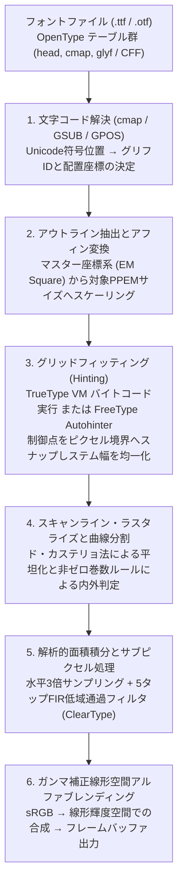
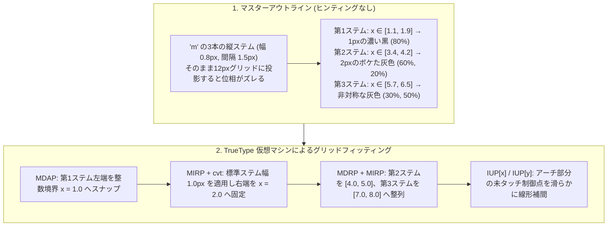
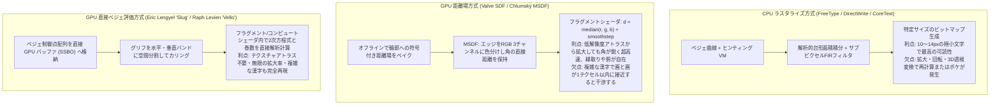

いま、あなたが読んでいるこの画面上のテキストを、ルーペで極限まで拡大して想像してみてほしい。一般的なデスクトップ環境やスマートフォンの本文サイズである $12\,\text{px}$（$96\,\text{DPI}$ 環境における $9\,\text{pt}$）という文字枠は、縦 $12$ 個、横 $12$ 個、合計わずか $144$ 個の微小な正方形（ピクセル）の集合体にすぎない。

しかし、このたった $12 \times 12$ という極小のチェス盤の上に、オペレーティングシステムは画数 $29$ 画の「鬱」や $16$ 画の「薔」といった複雑な漢字、あるいは二階建て構造を持つ欧文小文字の「`g`」や、3本の垂直ステムが等間隔に並ぶ「`m`」を、毎秒何万文字という速度でリアルタイムに描画している。しかも、縦線はどれも均一な濃さと太さを保ち、横線は隣の線と癒着して黒い塊（潰れ）になることもなければ、標本化の隙間に落ちて消滅（ドロップアウト）することもない。斜めのストロークには不快な階段状のギザギザ（ジャギー）も見当たらない。

情報理論およびデジタル信号処理の観点から見れば、これはほとんど<strong>「標本化定理の限界に対する奇跡的な勝利」</strong>と呼ぶべき現象である。もし $29$ 画の漢字を単純な幾何学的縮小によって $12 \times 12$ グリッドへ射影すれば、ナイキスト周波数（Nyquist frequency）をはるかに超える高周波の空間成分が折り返し雑音（エイリアシング）を引き起こし、文字は判読不能な灰色のシミへと崩壊するはずだからである。

私たちが日々何気なく読んでいる「美しく読みやすい小さな文字」の背後には、計算幾何学、トポロジー（位相幾何学）、スタック型仮想マシンによるバイトコード実行、人間の視覚生理学を応用したデジタルフィルタ設計、そして現代のGPUシェーダに至るまで、半世紀にわたって蓄積されたコンピュータサイエンスの粋が凝縮されている。本稿では、フォントファイルの中に格納された数学的曲線が、最終的にディスプレイ上のRGBサブピクセルの発光輝度へと変換されるまでの全パイプラインを、厳密な数理とともに解き明かす。

---

## 1. ビットマップの呪縛からアウトラインフォントの誕生へ

コンピュータ黎明期から1980年代後半にかけて、画面やプリンタ上の文字は<strong>ビットマップフォント（Bitmap Font）</strong>として表現されていた。日本のPC-9801シリーズに搭載されていた漢字ROM（$16 \times 16$ ドット）や、X Window SystemのBDF（Bitmap Distribution Format）フォントがその代表例である。ビットマップフォントは、各文字（グリフ：Glyph）を2次元の2値行列 $M \in \{0, 1\}^{H \times W}$ として直接記録する。職人（ドット打ちデザイナー）が1ピクセル単位で白黒の配置を最適化するため、設計された特定サイズ（たとえば $12\,\text{px}$ や $16\,\text{px}$）においては抜群の視認性を誇った。

しかし、ビットマップ表現には決定的な構造的欠陥があった。<strong>「解像度依存性（Resolution Dependence）」</strong>である。

1. <strong>拡大・縮小・回転に対する脆弱性</strong>：文字サイズを $1.3$ 倍に拡大したり、DTP（Desktop Publishing）ソフトウェア上で文字を $15^\circ$ 回転させたりすると、最近傍補間（Nearest-neighbor interpolation）では激しい階段状のジャギーが発生し、双線形補間（Bilinear interpolation）では輪郭がぼやけた雲のように崩れ去る。
2. <strong>出力デバイス間の非互換性</strong>：画面表示用の $72\text{〜}96\,\text{DPI}$（Dots Per Inch）のビットマップデータは、$300\,\text{DPI}$ のレーザープリンタや $2400\,\text{DPI}$ の商業印刷用イメージセッタでは使い物にならない。すべてのポイントサイズと解像度の組み合わせに対して個別のビットマップテーブルを用意すれば、特に数万字を擁するCJK（日中韓）フォントでは記憶容量が爆発してしまう。

この壁を打ち破ったのが、文字の「塗られたピクセル」ではなく、文字の輪郭（アウトライン）を<strong>連続的な数学的曲線（パラメトリック曲線）</strong>として記述する<strong>アウトラインフォント（Outline Font / Vector Font）</strong>の概念であった。

1980年代初頭、ゼロックスのパロアルト研究所（PARC）を離れたジョン・ワーノック（John Warnock）とチャック・ゲシキ（Chuck Geschke）はアドビシステムズ（Adobe Systems）を創業し、ページ記述言語<strong>PostScript</strong>とともに<strong>Type 1 フォント</strong>を発表した。Type 1 フォントは輪郭の記述に「3次ベジェ曲線」を採用し、低解像度デバイスでも文字が崩れないための「ヒンティング（Hinting）」と呼ばれる独自アルゴリズムを暗号化してフォント内部に封印した。

アドビによるフォント技術と高価なPostScriptライセンスの独占に危機感を抱いたアップル（Apple）は、1980年代後半に「Royal」というコードネームで独自のアウトラインフォント規格の開発に着手し、のちにマイクロソフト（Microsoft）と提携して<strong>TrueType</strong>（拡張子 `.ttf`）を1991年に世に送り出した。TrueTypeは高速なラスタライズを優先して「2次ベジェ曲線」を採用し、ヒンティングの仕組みを「チューリング完全に近いスタック型仮想マシンの命令列」として仕様書ごと全面公開する戦略をとった。

その後、1990年代後半の「フォント戦争」を経て、マイクロソフトとアドビは和解し、両者の技術を統合したコンテナ規格<strong>OpenType</strong>（1996年〜）を策定した。今日私たちが使っているフォントファイルは、内部にTrueType由来の2次ベジェ曲線テーブル（`glyf`）を持つか、PostScript由来の3次ベジェ曲線テーブル（`CFF` / `CFF2`：Compact Font Format）を持つかの違いはあれど、すべてこのOpenTypeの枠組みの上で動作している。



---

## 2. アウトラインフォントの計算幾何学：ベルンシュタイン基底とベジェ曲線

### なぜ通常の多項式ではなくベジェ曲線なのか？

平面上の曲線をコンピュータで表現しようとするとき、最も素朴な発想は、デカルト座標系におけるべき基底（Power basis）の陽関数 $y = a_3 x^3 + a_2 x^2 + a_1 x + a_0$ を用いることだろう。しかし、フォントの輪郭記述においてこの表現は致命的に不向きである。第一に、垂直な接線（$dx = 0$ すなわち傾き $\infty$）を扱えない。第二に、文字を回転させたり傾けたり（イタリック化）するアフィン変換に対して不変ではなく、係数 $a_i$ が数値的に極めて不安定に変動する。第三に、係数 $a_i$ の値を少し変えたときに曲線がどう変形するのか、フォントデザイナーにとって直感的な幾何学的意味がまったくない。

この問題を解決したのが、フランスの自動車メーカー・シトロエン社の数学者<strong>ポール・ド・カステリョ（Paul de Casteljau, 1959年）</strong>と、ルノー社の技師<strong>ピエール・ベジェ（Pierre Bézier, 1962年）</strong>が自動車のボディ曲面設計のために独立に考案した<strong>ベジェ曲線（Bézier Curve）</strong>である。

$n$ 次のベジェ曲線 $\mathbf{B}_n(t) = (x(t), y(t))^T$ は、空間上の $n+1$ 個の<strong>制御点（Control Points）</strong> $\mathbf{P}_0, \mathbf{P}_1, \dots, \mathbf{P}_n \in \mathbb{R}^2$ と、パラメータ $t \in [0, 1]$ を用いて、<strong>ベルンシュタイン基底多項式（Bernstein Basis Polynomials）</strong> $B_{i,n}(t)$ の線形結合として定義される。

$$\mathbf{B}_n(t) = \sum_{i=0}^{n} B_{i,n}(t)\,\mathbf{P}_i, \qquad t \in [0, 1]$$

ここで、$n$ 次の第 $i$ ベルンシュタイン多項式 $B_{i,n}(t)$ は次式で与えられる。

$$B_{i,n}(t) = \binom{n}{i} (1 - t)^{n - i} t^i = \frac{n!}{i!(n - i)!} (1 - t)^{n - i} t^i \qquad (i = 0, 1, \dots, n)$$

### ベルンシュタイン基底が持つ4つの至高の数学的性質

ベジェ曲線がフォントレンダリングおよびCADの絶対的標準となった理由は、ベルンシュタイン基底 $B_{i,n}(t)$ が備える以下の4つの性質にある。

1. <strong>非負性と1の分割（Partition of Unity）による凸包性（Convex Hull Property）</strong>：
   閉区間 $t \in [0, 1]$ において、明らかにすべての $i$ について $B_{i,n}(t) \ge 0$ である。さらに、二項定理（Binomial Theorem）より、すべての基底関数の総和は恒等的に $1$ となる。
   $$\sum_{i=0}^{n} B_{i,n}(t) = \sum_{i=0}^{n} \binom{n}{i} (1 - t)^{n - i} t^i = \bigl((1 - t) + t\bigr)^n = 1^n = 1$$
   重みがすべて非負であり、かつその総和が $1$ であるような線形結合は、幾何学において<strong>凸結合（Convex Combination）</strong>と呼ばれる。すなわち、曲線上の任意の点 $\mathbf{B}_n(t)$ は、制御点集合 $\{\mathbf{P}_0, \mathbf{P}_1, \dots, \mathbf{P}_n\}$ が張る<strong>凸包（Convex Hull：すべての制御点を包む最小の凸多角形）の内部に必ず完全に収まる</strong>。
   ラスタライザにとってこの性質は絶大な威力を発揮する。曲線を実際に評価しなくても、制御点の最小・最大座標（バウンディングボックス）を調べるだけで、「この曲線セグメントが現在のスキャンライン $y = y_s$ と交差し得るか」を $O(1)$ で確実に枝刈り（カリング）できるからである。

2. <strong>アフィン不変性（Affine Invariance）</strong>：
   任意の線形変換行列 $A \in \mathbb{R}^{2 \times 2}$ と平行移動ベクトル $\mathbf{c} \in \mathbb{R}^2$ からなるアフィン変換 $\Phi(\mathbf{x}) = A\mathbf{x} + \mathbf{c}$ を考える。1の分割 $\sum_{i=0}^n B_{i,n}(t) = 1$ により、以下が厳密に成り立つ。
   $$\Phi\bigl(\mathbf{B}_n(t)\bigr) = A \left(\sum_{i=0}^{n} B_{i,n}(t)\mathbf{P}_i\right) + \mathbf{c} \cdot 1 = \sum_{i=0}^{n} B_{i,n}(t)\bigl(A\mathbf{P}_i + \mathbf{c}\bigr) = \sum_{i=0}^{n} B_{i,n}(t)\,\Phi(\mathbf{P}_i)$$
   つまり、曲線上の無数の点を拡大・回転・剪断（斜体化）したい場合、曲線の式を変更する必要は一切なく、<strong>わずか数個の制御点 $\mathbf{P}_i$ にアフィン変換を施してから同じベジェ曲線を評価すればよい</strong>。

3. <strong>端点補間性と接線ベクトルの直感性</strong>：
   $t=0$ のとき $B_{0,n}(0)=1$（他は $0$）、$t=1$ のとき $B_{n,n}(1)=1$（他は $0$）となるため、曲線は必ず始点 $\mathbf{P}_0$ と終点 $\mathbf{P}_n$ を通過する（$\mathbf{B}_n(0) = \mathbf{P}_0, \mathbf{B}_n(1) = \mathbf{P}_n$）。さらに、1階微分 $\mathbf{B}_n'(t)$ を計算すると、
   $$\mathbf{B}_n'(t) = n \sum_{i=0}^{n-1} B_{i,n-1}(t)\,(\mathbf{P}_{i+1} - \mathbf{P}_i)$$
   となり、両端点における接線ベクトルは $\mathbf{B}_n'(0) = n(\mathbf{P}_1 - \mathbf{P}_0)$ および $\mathbf{B}_n'(1) = n(\mathbf{P}_n - \mathbf{P}_{n-1})$ となる。したがって、2つのベジェ曲線セグメントを滑らかに（$G^1$ 連続または $C^1$ 連続で）接続したい場合、デザイナーは接合点とその前後の制御点（ハンドル）を一直線上に並べるだけでよい。

4. <strong>変動減少性（Variation Diminishing Property）</strong>：
   平面上のいかなる直線（たとえばラスタライズ時の水平スキャンライン $y = y_s$）も、ベジェ曲線と交差する回数は、その制御多角形（$\mathbf{P}_0\mathbf{P}_1\cdots\mathbf{P}_n$ を順に結んだ折れ線）と交差する回数を超えない。すなわち、曲線が制御多角形以上に激しく波打つ（振動する）ことは数学的にあり得ない。

---

### 2次ベジェ曲線（TrueType） vs. 3次ベジェ曲線（PostScript / OpenType CFF）

フォント規格の歴史において最大の技術的分岐点となったのが、次数 $n$ として $n=2$（2次ベジェ曲線）を選ぶか、$n=3$（3次ベジェ曲線）を選ぶかという選択であった。

#### 1. 2次ベジェ曲線（Quadratic Bézier Curve：$n = 2$、TrueType `glyf`）

TrueTypeは、始点 $\mathbf{P}_0$（オンカーブ点）、1つの制御点 $\mathbf{P}_1$（オフカーブ点）、終点 $\mathbf{P}_2$（オンカーブ点）の3点で定義される2次ベジェ曲線を採用した。

$$\mathbf{B}_2(t) = (1-t)^2 \mathbf{P}_0 + 2(1-t)t \mathbf{P}_1 + t^2 \mathbf{P}_2 = (\mathbf{P}_0 - 2\mathbf{P}_1 + \mathbf{P}_2)t^2 + 2(\mathbf{P}_1 - \mathbf{P}_0)t + \mathbf{P}_0$$

なぜアップルとマイクロソフトは2次ベジェ曲線を選んだのか？理由は2つある。

第一に、<strong>1990年当時のCPUにおける圧倒的な計算速度</strong>である。水平スキャンライン $y = y_s$ と曲線の交点を直接求める場合、2次ベジェ曲線であれば2次方程式 $a_y t^2 + 2b_y t + (c_y - y_s) = 0$ の解の公式 $t = \frac{-b_y \pm \sqrt{b_y^2 - a_y(c_y - y_s)}}{a_y}$ によって、平方根演算1回だけで解析的かつ厳密に交点を算出できる。

第二に、TrueType特有の巧妙なデータ圧縮機構である<strong>「暗黙のオンカーブ中点（Implicit On-Curve Midpoints）」</strong>である。複数の2次ベジェ曲線 $\mathbf{B}^{(1)}, \mathbf{B}^{(2)}$ を滑らかに（$C^1$ 連続で）繋ぐ条件を考えよう。第1セグメントの制御点を $(\mathbf{P}_0, \mathbf{P}_1, \mathbf{M})$、第2セグメントの制御点を $(\mathbf{M}, \mathbf{P}_2, \mathbf{P}_3)$ とする。接合点 $\mathbf{M}$ において1階微分が一致する条件 $\mathbf{B}^{(1)\prime}(1) = \mathbf{B}^{(2)\prime}(0)$ は、

$$2(\mathbf{M} - \mathbf{P}_1) = 2(\mathbf{P}_2 - \mathbf{M}) \iff \mathbf{M} = \frac{\mathbf{P}_1 + \mathbf{P}_2}{2}$$

となる。つまり、接合点 $\mathbf{M}$ が前後のオフカーブ制御点 $\mathbf{P}_1, \mathbf{P}_2$ の<strong>厳密な中点</strong>に位置するとき、曲線は自動的に $C^1$ 連続となる。TrueTypeの `glyf` テーブルでは、点列のフラグにおいてオフカーブ点が2つ連続して出現した場合、デコーダが自動的にその中点 $\mathbf{M} = \frac{1}{2}(\mathbf{P}_1 + \mathbf{P}_2)$ にオンカーブ点を補間する規約になっている。これにより、オンカーブ点の座標データをファイルに保存する必要がなくなり、フォントサイズを約 $25\text{〜}35\%$ 削減することに成功した。

#### 2. 3次ベジェ曲線（Cubic Bézier Curve：$n = 3$、PostScript / OpenType `CFF`）

一方、アドビのPostScript Type 1 および OpenType の `CFF`（Compact Font Format）テーブルは、始点 $\mathbf{P}_0$、2つのオフカーブ制御点 $\mathbf{P}_1, \mathbf{P}_2$、終点 $\mathbf{P}_3$ の4点で定義される3次ベジェ曲線を採用した。

$$\mathbf{B}_3(t) = (1-t)^3 \mathbf{P}_0 + 3(1-t)^2 t \mathbf{P}_1 + 3(1-t)t^2 \mathbf{P}_2 + t^3 \mathbf{P}_3$$

書体デザイナーが実際にフォントを制作する現場（Glyphs、FontLab、RoboFontなどのフォントエディタ）では、ほぼ例外なく3次ベジェ曲線が使われる。なぜなら、2次ベジェ曲線には幾何学的な表現力の限界があるからだ。

2次ベジェ曲線の2階微分を計算すると、$\mathbf{B}_2''(t) = 2(\mathbf{P}_0 - 2\mathbf{P}_1 + \mathbf{P}_2)$ となり、パラメータ $t$ に依存しない<strong>定ベクトル</strong>となる（幾何学的には常に放物線の一部にすぎない）。平面曲線の符号付き曲率（Signed Curvature）$\kappa(t)$ は外積を用いて

$$\kappa(t) = \frac{\mathbf{B}'(t) \times \mathbf{B}''(t)}{\|\mathbf{B}'(t)\|^3} = \frac{x'(t)y''(t) - y'(t)x''(t)}{\bigl(x'(t)^2 + y'(t)^2\bigr)^{3/2}}$$

で定義されるが、2次ベジェ曲線では分子の $x'(t)y''(t) - y'(t)x''(t)$ が $t$ に無関係な定数となってしまう。したがって、<strong>単一の2次ベジェ曲線は、曲率の符号が反転する「変曲点（Inflection Point：$\kappa(t) = 0$）」を絶対に表現できない</strong>。たとえばアルファベットの「`S`」の背骨（スパイン）やチルダ「`~`」のようなS字カーブを描くには、少なくとも2本以上の2次ベジェ曲線を接合しなければならない。また、両端点における接線の向きを固定すると、2次ベジェ曲線のオフカーブ点 $\mathbf{P}_1$ は2本の接線の交点として一意に拘束されてしまい、曲線の膨らみ具合（曲率半径）を調整する自由度がゼロになる。

これに対し、3次ベジェ曲線の2階微分は $t$ の1次関数

$$\mathbf{B}_3''(t) = 6(1-t)(\mathbf{P}_2 - 2\mathbf{P}_1 + \mathbf{P}_0) + 6t(\mathbf{P}_3 - 2\mathbf{P}_2 + \mathbf{P}_1)$$

となるため、単一セグメント内で変曲点（S字曲線）を自在に表現できるほか、両端点の接線方向を保ったままハンドル長 $|\mathbf{P}_1 - \mathbf{P}_0|$ と $|\mathbf{P}_3 - \mathbf{P}_2|$ を独立に伸縮させて、<strong>$G^2$ 連続（曲率連続）</strong>の滑らかな円の弧やセリフのブラケット（曲線的な接合部）を少ない制御点数で精密に造形できるのである。

| 比較項目 | 2次ベジェ曲線 ($n=2$, TrueType `glyf`) | 3次ベジェ曲線 ($n=3$, OpenType `CFF`/`CFF2`) |
| :--- | :--- | :--- |
| <strong>定義式 $\mathbf{B}(t)$</strong> | $(1-t)^2\mathbf{P}_0 + 2(1-t)t\mathbf{P}_1 + t^2\mathbf{P}_2$ | $(1-t)^3\mathbf{P}_0 + 3(1-t)^2t\mathbf{P}_1 + 3(1-t)t^2\mathbf{P}_2 + t^3\mathbf{P}_3$ |
| <strong>幾何学的実体</strong> | 放物線（Parabola）のセグメント | 3次パラメトリック曲線（変曲点・ループを表現可能） |
| <strong>単一セグメント内の変曲点</strong> | 不可能（曲率の符号が一定） | 可能（S字カーブを1セグメントで表現） |
| <strong>端点接線固定時の自由度</strong> | $0$（2接線の交点として $\mathbf{P}_1$ が一意に決定） | $2$（両端のハンドル長により曲率 $G^2$ を独立制御） |
| <strong>データ圧縮の仕組み</strong> | 連続オフカーブ点の中点 $\frac{1}{2}(\mathbf{P}_1+\mathbf{P}_2)$ を暗黙補間 | 差分符号化とサブルーチン化（CharString VM） |
| <strong>スキャンライン交点計算</strong> | 2次方程式の解の公式で高速・厳密に算出可能 | ド・カステリョ再帰分割または3次方程式の数値解法 |

---

### ド・カステリョのアルゴリズム（De Casteljau's Algorithm）と適応的平坦化

フォントラスタライザがベジェ曲線を画面に描画する際、パラメータ $t$ に小数を代入して $t^2, t^3$ を直接乗算することは稀である。代わりに用いられるのが、数値的に極めて安定し、かつ「曲線の評価」と「曲線の2分割」を同時に達成する<strong>ド・カステリョの再帰的線形補間アルゴリズム</strong>である。

制御点列 $\mathbf{P}_i^{(0)} := \mathbf{P}_i \;(i = 0, \dots, n)$ から出発し、各段階 $r = 1, \dots, n$ において隣り合う点を $1-t : t$ に内分する操作を繰り返す。

$$\mathbf{P}_i^{(r)}(t) = (1 - t)\,\mathbf{P}_i^{(r-1)}(t) + t\,\mathbf{P}_{i+1}^{(r-1)}(t) \qquad (r = 1, \dots, n;\; i = 0, \dots, n - r)$$

最終段階 $r = n$ で得られるただ1つの点 $\mathbf{P}_0^{(n)}(t)$ は、元のベジェ曲線上の点 $\mathbf{B}_n(t)$ に厳密に一致する。しかも驚くべきことに、この計算過程で生成された三角形の斜辺にあたる点列

$$\text{左部分曲線}: \bigl(\mathbf{P}_0^{(0)},\; \mathbf{P}_0^{(1)}(t),\; \dots,\; \mathbf{P}_0^{(n)}(t)\bigr), \qquad \text{右部分曲線}: \bigl(\mathbf{P}_0^{(n)}(t),\; \mathbf{P}_1^{(n-1)}(t),\; \dots,\; \mathbf{P}_n^{(0)}\bigr)$$

は、元のベジェ曲線を点 $\mathbf{B}_n(t)$ で2つに切断したときの、<strong>前半区間 $[0, t]$ と後半区間 $[t, 1]$ をそれぞれ完全に表現する新しいベジェ曲線の制御点列</strong>になっているのである。

特に中点 $t = \frac{1}{2}$ における分割を考えよう。このとき内分計算はすべて $\frac{1}{2}(\mathbf{A} + \mathbf{B})$ となり、整数または固定小数点演算における<strong>加算と1ビット右シフト（`>> 1`）だけ</strong>で浮動小数点乗算を一切使わずに実行できる。たとえば3次ベジェ曲線 $(\mathbf{P}_0, \mathbf{P}_1, \mathbf{P}_2, \mathbf{P}_3)$ の $t = \frac{1}{2}$ 分割は以下のわずか6回の平均化で完了する。

$$\begin{aligned}
\mathbf{P}_0^{(1)} &= \frac{\mathbf{P}_0 + \mathbf{P}_1}{2}, \quad \mathbf{P}_1^{(1)} = \frac{\mathbf{P}_1 + \mathbf{P}_2}{2}, \quad \mathbf{P}_2^{(1)} = \frac{\mathbf{P}_2 + \mathbf{P}_3}{2} \\
\mathbf{P}_0^{(2)} &= \frac{\mathbf{P}_0^{(1)} + \mathbf{P}_1^{(1)}}{2}, \quad \mathbf{P}_1^{(2)} = \frac{\mathbf{P}_1^{(1)} + \mathbf{P}_2^{(1)}}{2} \\
\mathbf{P}_0^{(3)} &= \frac{\mathbf{P}_0^{(2)} + \mathbf{P}_1^{(2)}}{2} = \mathbf{B}_3\left(\frac{1}{2}\right)
\end{aligned}$$

曲線は分割を繰り返すごとに急速に直線へと近づいていく（2次収束：$1$ 回の2分割で直線からの最大乖離誤差は $\frac{1}{4}$ に減少する）。制御点が始点と終点を結ぶ弦（Chord）から許容誤差 $\tau$（たとえば $\frac{1}{16}\,\text{px}$）以内に収まった時点で再帰を止め、曲線を微小な線分（ポリライン）として扱う手法を<strong>適応的平坦化（Adaptive Flattening）</strong>と呼ぶ。

さらに現代の高速ラスタライザ（FreeTypeやWebGPUベースのレンダラなど）では、再帰呼び出しの分岐オーバーヘッドすら嫌い、<strong>王の公式（Wang's Formula, 1985年）</strong>を用いて、平坦化に必要な分割数 $N$ をループ開始前に一発で事前計算する。$n$ 次ベジェ曲線の2階差分ベクトル $\Delta^2 \mathbf{P}_i = \mathbf{P}_{i+2} - 2\mathbf{P}_{i+1} + \mathbf{P}_i$ を用いると、曲線と弦との最大距離を $\tau$ 以下に抑えるための等分割数 $N$ は次の上界で与えられる。

$$N = \left\lceil \sqrt{ \frac{n(n-1)}{8\tau} \max_{0 \le i \le n-2} \|\mathbf{P}_{i+2} - 2\mathbf{P}_{i+1} + \mathbf{P}_i\| } \right\rceil$$

2次ベジェ曲線（$n=2$）なら $N = \lceil \sqrt{\|\mathbf{P}_2 - 2\mathbf{P}_1 + \mathbf{P}_0\| / (4\tau)} \rceil$、3次ベジェ曲線（$n=3$）なら $N = \lceil \sqrt{\frac{3}{4\tau} \max(\|\mathbf{P}_2 - 2\mathbf{P}_1 + \mathbf{P}_0\|, \|\mathbf{P}_3 - 2\mathbf{P}_2 + \mathbf{P}_1\|)} \rceil$ となり、再帰スタックを一切使わずに前進差分法（Forward Differencing）やSIMD命令で一気に線分列を生成できる。

---

## 3. スキャンライン・ラスタライズ：巻数ルールと解析的面積積分

ベジェ曲線が目標のピクセル座標系へスケーリングされ、微小線分（あるいは単調曲線）へと分解された後、ラスタライザが解くべき核心的問いは2つある。
1. <strong>トポロジー的問い</strong>：「あるピクセル $(x, y)$ は、文字の『内側（塗るべき領域）』にあるのか、それとも『外側（または `O` や `8` の穴の中）』にあるのか？」
2. <strong>信号処理的問い</strong>：「文字の輪郭線がピクセル $(x, y)$ の内部を横切っているとき、そのピクセルの面積の何パーセント（$\alpha \in [0, 1]$）が文字で覆われているか？」

### 奇偶規則（Even-Odd Rule） vs. 非ゼロ巻数規則（Non-Zero Winding Rule）

閉曲線群 $\partial\Gamma$ で囲まれた平面領域の「内外判定」には、2種類の数学的規則が存在する。

1. <strong>奇偶規則（Even-Odd Rule / Parity Rule）</strong>：
   判定したい点 $P=(x, y)$ から任意の方向（通常は水平右方向 $+\infty$）へ半直線を伸ばし、輪郭線と交差する回数 $N_{\text{cross}}$ を数える（ジョルダンの曲線定理の応用）。$N_{\text{cross}}$ が<strong>奇数なら内側</strong>、<strong>偶数なら外側</strong>と判定する。
   このルールは輪郭線の向き（時計回りか反時計回りか）を意識しなくてよいという利点があるが、フォント描画においては重大な弱点を持つ。書体デザインの過程や、<strong>バリアブルフォント（Variable Fonts：太さや幅を連続的に変えられるフォント）</strong>において、2つのストローク（たとえば「`十`」や「`A`」の交差部）を別々の閉曲線として重ね合わせた場合、重なった領域では半直線が輪郭を2回（偶数回）横切るため、<strong>ストロークの交差点に白い三角形の「穴」が空いてしまう</strong>のである。

2. <strong>非ゼロ巻数規則（Non-Zero Winding Number Rule）</strong>：
   すべての輪郭線に<strong>向き（Orientation）</strong>を与え、点 $P$ の周りを輪郭線が何回周回したかを表すトポロジー不変量<strong>巻数（Winding Number）</strong> $w(P) \in \mathbb{Z}$ を計算する。複素平面または線積分として厳密に書けば、

   $$w(P) = \frac{1}{2\pi} \oint_{\partial\Gamma} d\theta = \frac{1}{2\pi} \oint_{\partial\Gamma} \frac{(x - x_P)\,dy - (y - y_P)\,dx}{(x - x_P)^2 + (y - y_P)^2}$$

   である。計算機上では、点 $P$ から水平右方向へ伸ばした半直線が輪郭エッジを横切る際、エッジが<strong>下から上へ（$\Delta y > 0$）横切れば $+1$</strong>、<strong>上から下へ（$\Delta y < 0$）横切れば $-1$</strong> を加算する符号付き交差数の総和として $O(1)$ で求まる。

   $$w(P) = \sum_{\text{crossings}} \operatorname{sgn}(\Delta y) \in \mathbb{Z}$$

   そして、<strong>$w(P) \ne 0$ であれば内側（塗る）、$w(P) = 0$ であれば外側（塗らない）</strong>と判定する。

この非ゼロ巻数規則により、フォントの「外枠」と「内側の穴（カウンター：Counter）」は曲線の巻き方向だけでエレガントに区別される。たとえば「`O`」という文字を描く場合（$y$ 軸が上向きの標準デカルト座標系において）：
- <strong>TrueType（`glyf`）の規約</strong>：外側の輪郭を<strong>時計回り（Clockwise: CW）</strong>に定義し、内側の穴の輪郭を<strong>反時計回り（Counter-Clockwise: CCW）</strong>に定義する。
- <strong>PostScript / OpenType（`CFF`）の規約</strong>：逆に、外側の輪郭を<strong>反時計回り（CCW）</strong>、内側の穴を<strong>時計回り（CW）</strong>に定義する。

いずれの規約でも、外枠と内枠の間にある点では交差の符号が $+1$（または $-1$）となって $w(P) \ne 0$（塗られる）となり、中央の穴の中の点では外枠の $+1$ と内枠の $-1$ が相殺して $w(P) = (+1) + (-1) = 0$（白抜きの穴になる）となる。一方で、同じ向き（たとえばCW同士）の2つのストロークが重なった交差領域では $w(P) = (-1) + (-1) = -2 \ne 0$ となるため、奇偶規則のように白抜けする事故が決して起きない。OpenType 1.8 で導入されたバリアブルフォントや絵文字フォントがパーツを分割して自在に変形できるのは、この非ゼロ巻数規則のおかげである。

---

### スーパーサンプリングを超えて：解析的台形面積積分アルゴリズム

輪郭の内側がわかったとして、輪郭がピクセルを斜めに横切る境界部分はどう塗るべきか。ピクセルの中心点 $(i + 0.5, j + 0.5)$ だけで内外を判定する<strong>2値ラスタライズ（バイレベル描画）</strong>を行うと、斜線や曲線に激しい階段状のギザギザ（ジャギー）が生じる。これは連続的な2次元ステップ関数を離散的な矩形グリッドで標本化した際に生じる折り返し雑音（空間エイリアシング）そのものである。

これを防ぐアンチエイリアシング（Anti-aliasing）手法として、初期のグラフィックスシステムは1ピクセルを縦横 $4 \times 4 = 16$ 個や $8 \times 8 = 64$ 個のサブグリッドに分割して内外判定を行う<strong>スーパーサンプリング（Supersampling）</strong>を採用した。しかし、$4 \times 4$ サンプリングでは表現できる階調がわずか $17$ 段階しかなく、しかもスキャンライン数が4倍〜8倍に膨れ上がるためCPUキャッシュとメモリ帯域を浪費する。

現代のあらゆる高性能フォントラスタライザ——Raph Levien 氏が1999年に開発した <strong>Libart</strong>、Maxim Shemanarev 氏の <strong>Anti-Grain Geometry (AGG)</strong>、それを継承した <strong>FreeType の `ftgrays.c`</strong>、Sean Barrett 氏の <strong>`stb_truetype`</strong>、そして Rust 製の高速ラスタライザ <strong>`font-rs` / `ab_glyph`</strong>——は、スーパーサンプリングを一切行わない。代わりに、<strong>1ピクセルの正方形 $[i, i+1] \times [j, j+1]$ と輪郭線分が作る「符号付き台形面積（Signed Trapezoidal Area）」を解析的に厳密積分し、1回の線形スイープ（累積和）で256階調の被覆率 $\alpha$ を算出するアルゴリズム</strong>を用いている。

その数学的導出を示そう。1本のスキャンライン $y \in [j, j+1]$（高さ $1$）に注目し、座標を $y_s = y - j \in [0, 1]$ と正規化する。ある有向エッジ線分が、単一のピクセル列 $x \in [i, i+1]$ の内部を $(x_0, y_0)$ から $(x_1, y_1)$ まで横切ったとしよう（ピクセル境界をまたぐ線分はあらかじめピクセル境界で分割しておく）。

この微小線分の垂直変位（符号付き高さ）を

$$\Delta y = y_1 - y_0 \in [-1, 1]$$

とし、ピクセル左端 $i$ から測った線分の水平方向の中点位置（平均 $x$ 座標）を

$$\bar{x} = \frac{(x_0 - i) + (x_1 - i)}{2} \in [0, 1]$$

とおく。この線分がスキャンラインに与える幾何学的寄与は、以下の2つに完全に分解できる。

1. <strong>当該ピクセル $i$ 内部における台形面積</strong>：
   線分の右側（$[x(y), i+1]$）に切り取られる台形の幅は、上底が $1 - (x_0 - i)$、下底が $1 - (x_1 - i)$、高さが $\Delta y$ であるから、その符号付き面積 $\Delta A_i$ は
   $$\Delta A_i = \bigl(1 - \bar{x}\bigr)\,\Delta y$$
   となる。
2. <strong>ピクセル $i+1$ 以降のすべての右側ピクセル（$k \ge i+1$）に対する被覆寄与</strong>：
   ピクセル $i$ より右にあるピクセル $k \ge i+1$ にとって、この線分は完全に左側を通過しているため、高さ $\Delta y$ 分のフル幅（幅 $1$）の長方形面積、すなわち
   $$\Delta C_{i+1} = \Delta y$$
   だけの巻数（被覆率）を一律に増加させる。

したがって、各スキャンラインにつき2つの1次元配列 `delta_area[W]` と `delta_cover[W]`（または1つの配列に統合可能）を用意し、すべてのエッジ線分について

$$\text{delta\_area}[i] \mathrel{+}= (1 - \bar{x})\,\Delta y, \qquad \text{delta\_cover}[i+1] \mathrel{+}= \Delta y$$

を $O(1)$ で加算していくだけでよい。すべてのエッジを登録し終えたら、最後にスキャンラインの左端 $i = 0$ から右端 $i = W-1$ まで<strong>累積和（Prefix Sum）</strong>を1回走らせる。

$$C_i = C_{i-1} + \text{delta\_cover}[i], \qquad A_i = C_i + \text{delta\_area}[i]$$

すると、$A_i$ がそのままピクセル $(i, j)$ における<strong>厳密な符号付き面積積分値（巻数で重み付けされた被覆率）</strong>となる！非ゼロ巻数規則の下での最終的な不透明度（アルファ値）$\alpha_i \in [0, 1]$ は、

$$\alpha_i = \min\bigl(1.0,\; |A_i|\bigr)$$

（奇偶規則の場合は $\alpha_i = \bigl| (A_i \bmod 2) \bigr|$ の折り返し関数）として直ちに求まる。このアルゴリズムはエッジのソートすら不要にでき、SIMD命令（AVX2やNEONの並列プレフィックスサム）と組み合わせることで、1コアあたり毎秒数百万グリフという驚異的なスループットを実現している。

---

## 4. フォントに隠された仮想マシン：グリッドフィッティング（ヒンティング）の魔術

ここまでの議論で、「ベジェ曲線をピクセル座標にスケーリングし、解析的台形面積積分で厳密な被覆率 $\alpha \in [0, 1]$ を求めれば、完璧な文字が描けるはずだ」と思われるかもしれない。300 DPI のスマートフォン（Retinaディスプレイ）や 4K モニターであれば、その通りである。

しかし、長らくPCの標準であった $96\,\text{DPI}$〜$120\,\text{DPI}$ のモニターにおいて、$10\,\text{px}$〜$14\,\text{px}$ の小さな文字を<strong>「数学的に正しいそのままの座標」でアンチエイリアシング描画すると、壊滅的に汚く、読みづらい文字になってしまう</strong>。なぜだろうか？

### 標本化位相のズレが引き起こす3つの悲劇

アルファベットの小文字「`m`」や漢字の「`川`」のように、同じ太さの3本の垂直線（ステム：Stem）が等間隔に並ぶ文字を、$12\,\text{px}$ グリッドにそのまま縮小投影した場面を想像してみよう。マスターデザイン上では3本のステムの太さはすべて均一で、ピクセル換算でちょうど $0.8\,\text{px}$ 幅、ステム間の空白は $1.5\,\text{px}$ だったとする。

1. <strong>第1のステム</strong>が運良くピクセル $x \in [1.1, 1.9]$ に落ちたとする。このステムはピクセル $x=1$ の単一セル内にほぼ収まるため、ピクセル $x=1$ の被覆率は $\alpha = 0.80$（くっきりとした濃い黒）になる。
2. <strong>第2のステム</strong>は、$0.8 + 1.5 = 2.3\,\text{px}$ 右にずれるため、$x \in [3.4, 4.2]$ に落ちる。これはピクセル境界 $x=4.0$ をまたいでしまう！結果として、ピクセル $x=3$ が $\alpha = 0.60$、ピクセル $x=4$ が $\alpha = 0.20$ となり、<strong>2ピクセルにまたがるぼやけた灰色の太い帯</strong>に見えてしまう。
3. <strong>第3のステム</strong>はさらに $2.3\,\text{px}$ 右の $x \in [5.7, 6.5]$ に落ち、ピクセル $x=5$ が $\alpha = 0.30$、ピクセル $x=6$ が $\alpha = 0.50$ という、<strong>左右非対称なにじみ</strong>になる。

数学的には3本とも完全に同じ $0.8\,\text{px}$ 幅であるにもかかわらず、離散的なピクセル格子に対する<strong>位相（Phase）がずれた結果、1本目は細く鋭い黒、2本目はぼやけた太い灰色、3本目は中途半端な灰色に見え、「`m`」という文字がガタガタに歪んで見える</strong>のである。

さらに深刻な問題が他にも起こる。
- <strong>ドロップアウト（Dropout）と濃度消失</strong>：小文字「`e`」の中央の横棒（クロスバー）や、漢字「`鬱`」「`書`」の密集した水平画が $0.4\,\text{px}$ 幅になり、しかもピクセル境界 $y = 5.0$ を上下に $0.2\,\text{px}$ ずつまたいだ場合、上下2行のピクセルがどちらも $\alpha = 0.20$ という薄い灰色になり、人間の目には横棒が消えたように見える。
- <strong>対称性の崩壊</strong>：大文字「`O`」や「`H`」の左右の縦棒がピクセル境界に対して非対称な位置に落ちると、左の縦棒は1ピクセルの黒、右の縦棒は2ピクセルの灰色になり、文字が左右非対称に傾いて見える。
- <strong>ベースラインとハイトの暴れ</strong>：「`o`」「`e`」「`c`」のような丸みを持つ文字は、視覚的に平らな文字（「`x`」「`z`」）と同じ高さに見せるため、マスターデザインではわずかに上下へはみ出す<strong>オーバーシュート（Overshoot）</strong>が設けられている。無制御にスケーリングすると、あるポイントサイズで突然オーバーシュート分が隣のスキャンラインをかすめ、丸文字だけが1ピクセル飛び出して単語の上端ラインが凸凹に波打ってしまう。

### TrueType フォントの正体は「スタック型仮想マシンのプログラム」である

この離散格子の悲劇を克服するために発明されたのが、ラスタライズの直前にアウトラインの制御点座標をプログラム的に動かし、ピクセル境界へと強制的に整列させる<strong>グリッドフィッティング（Grid-Fitting）</strong>、通称<strong>ヒンティング（Hinting）</strong>である。

驚くべきことに、`.ttf`（TrueType）ファイルの中に格納されているのは単なる座標データではない。TrueTypeは<strong>約150種類のオペコード（命令セット）、コールスタック、関数定義、条件分岐（`IF` / `ELSE` / `EIF`）、配列メモリ、そして $26.6$ 固定小数点演算ユニット（1ピクセルの $\frac{1}{64}$ の精度）を備えた「スタック型仮想マシン（TrueType Virtual Machine）」の実行可能バイトコード</strong>を内蔵しているのである。

OpenType / TrueType ファイル内部でヒンティングを司る主要なテーブル群を見てみよう。

| テーブル名 | 正式名称 | 役割と実行タイミング |
| :--- | :--- | :--- |
| <strong>`head` / `maxp`</strong> | Font Header / Maximum Profile | マスター座標系の解像度 `unitsPerEm`（TrueTypeでは通常 $2048$、OpenType CFFでは $1000$）や、VMが必要とする最大スタック深度・最大ストレージ領域サイズを宣言する。 |
| <strong>`cvt `</strong> | Control Value Table | フォント全体で共有される「基準寸法のグローバル配列」。大文字の縦ステム幅、小文字の縦ステム幅、横ステム幅、キャップハイト、x-ハイト、オーバーシュート量などがマスター単位で格納されている。 |
| <strong>`fpgm`</strong> | Font Program | フォントがメモリにロードされた際に<strong>1回だけ実行される</strong>バイトコード。`FDEF`（Function Definition）命令を用いて、ステム幅の丸め処理やセリフ整列などの共通サブルーチンをVMに登録する。 |
| <strong>`prep`</strong> | Control Value Program (Pre-Program) | 文字サイズ（PPEM: Pixels Per Em）や画面解像度（DPI）が変更されるたびに<strong>グリフ描画前に実行される</strong>初期化プログラム。`cvt` テーブルの基準寸法を現在のピクセルサイズで丸めたり、極小サイズや極大サイズでヒンティングを無効化（`INSTCTRL`）したりする。 |
| <strong>`glyf`</strong> | Glyph Data | 各グリフのベジェ制御点列とともに、<strong>そのグリフ専用のバイトコード命令列</strong>を格納する。ラスタライズ時に各グリフごとにVM上で実行され、制御点群（Zone 1）の座標を直接書き換える。 |

### TrueType VM の幾何学エンジン：自由ベクトル・投影ベクトルと主要命令

TrueType VM がユニークなのは、一般的な算術命令だけでなく、平面幾何学の拘束条件を直接操作するための2つの単位ベクトル状態レジスタを持っている点である。
- <strong>投影ベクトル（Projection Vector: $\mathbf{P}$）</strong>：「どの方向に沿って2点間の距離を測定するか」を規定する単位ベクトル。
- <strong>自由ベクトル（Freedom Vector: $\mathbf{F}$）</strong>：「距離の条件を満たすために、制御点をどの方向へ動かすことを許可するか」を規定する単位ベクトル。

たとえば、斜体（イタリック）や「`A`」「`V`」の斜めストロークにおいて、「ストロークに垂直な方向の太さ（$\mathbf{P}$ 方向）を1ピクセルに揃えたいが、文字の上端・下端の高さが狂わないように、制御点は水平方向（$\mathbf{F} = (1, 0)$）にだけスライドさせたい」といった高度な幾何学的拘束が、$\mathbf{P}$ と $\mathbf{F}$ を別々に設定することで1命令で解ける（移動量は内積 $\mathbf{P} \cdot \mathbf{F}$ で自動的に割られる）。

実際に1つのグリフ（たとえば小文字「`m`」）がTrueType VMでグリッドフィッティングされるステップを追ってみよう。

1. <strong>軸の設定（`SVTCA[1]` / `SVTCA[0]`）</strong>：
   まず投影ベクトルと自由ベクトルをX軸方向（水平方向）にセットする。これにより、3本の垂直ステムのX座標と太さを制御する準備が整う。
2. <strong>基準点のグリッドスナップ（`MDAP[1]`：Move Direct Absolute Point with Rounding）</strong>：
   第1の垂直ステムの左端の制御点 $p_0$ を指定し、最も近い整数ピクセル境界へと丸めて（Snap）固定する。同時に、VMはこの点 $p_0$ に「タッチ済み（Touched）」フラグを立て、参照点レジスタ `rp0` に $p_0$ をセットする。
3. <strong>cvt を用いたステム幅の均一化（`MIRP[abcde]`：Move Indirect Relative Point）</strong>：
   次に、第1ステムの右端の制御点 $p_1$ に対して `MIRP` 命令を発行する。この1命令は内部で驚くほど精緻な処理を自動実行する：
   - グローバルな `cvt` テーブルから「小文字の標準縦ステム幅」を読み出す。
   - 現在のグリフにおける $p_0$ と $p_1$ の距離と、`cvt` の標準幅との差が閾値（<strong>Single-Width Cut-In</strong>）以内であれば、デザイン上の微細な誤差を無視して<strong>強制的に `cvt` の標準幅（すでに `prep` プログラムで整数ピクセルに丸められている値、たとえばちょうど $1.0\,\text{px}$）を採用</strong>する。
   - さらに<strong>最小距離フラグ（Minimum Distance）</strong>が有効であれば、どんなに縮小されてもステム幅が $0\,\text{px}$ に潰れて消滅（ドロップアウト）しないよう、最低 $1\,\text{px}$ の距離を保証する。
   - この結果、$p_1$ は $p_0 + 1.0\,\text{px}$ の整数ピクセル境界へピタリと配置される！
4. <strong>残りのステムの連鎖整列（`MDRP` と `MIRP`）</strong>：
   第2ステム、第3ステムに対しても同様に参照点からの相対移動（`MDRP`）と `cvt` 参照移動（`MIRP`）を繰り返すことで、<strong>「`m`」の3本の縦ステムすべてが、1ピクセルの狂いもなく全く同じ整数ピクセル幅（たとえば $1\,\text{px}$ 幅）で、しかもピクセル境界に完全整列した状態</strong>へと変形される。
5. <strong>特定サイズ専用のピクセル外科手術（`DELTAP1` / `DELTAP2`）</strong>：
   「他のサイズでは美しいが、$12\,\text{ppem}$ のときだけ、この漢字の右払いの制御点 $p_{42}$ が隣の画とくっついて見える」といった場合、ヒンティングエンジニアは `DELTAP` 命令を埋め込む。これは「現在のサイズが $12\,\text{ppem}$ のときだけ、点 $p_{42}$ を $-\frac{2}{8}\,\text{px}$ だけ移動せよ」という、特定サイズ狙い撃ちの例外パッチ命令である。
6. <strong>未タッチ点の滑らかな線形補間（`IUP[0]` / `IUP[1]`：Interpolate Untouched Points）</strong>：
   主要なステムの端点だけを強引にピクセル境界へ動かすと、動かされなかった途中のベジェ制御点（カーブの膨らみ部分など）との整合性が崩れて曲線が折れ曲がってしまう。そこでプログラムの最後に `IUP[1]`（X方向）および `IUP[0]`（Y方向）を実行する。この命令は、輪郭線に沿って隣り合う2つの「タッチ済み点」$A, B$ の間にあるすべての「未タッチ点」$Q$ の座標を、元のマスター座標での比率を保ったまま線形補間によって自動的に再配置する。これにより、骨格をピクセル格子にカッチリ合わせつつ、曲線の有機的な滑らかさが保たれるのである。



---

### ジョブズ（Apple）vs. ゲイツ（Microsoft）：フォント描画を巡る二大哲学の激突

「なぜ同じフォントなのに、MacとWindowsでは文字の見え方がこれほど違うのか？」——この長年語られてきた疑問の核心こそ、まさにヒンティングに対する<strong>アップル（CoreText / Quartz）とマイクロソフト（GDI / DirectWrite）の設計哲学の真っ向からの対立</strong>にある。

伝説的なタイポグラフィ研究者であり、マイクロソフトでClearTypeのヒンティング開発を率いた Beat Stamm 氏や、Daring Fireball の John Gruber 氏が定式化したように、両社の思想は次のように要約できる。

- <strong>マイクロソフトの哲学（Readability & Pixel Grid Supremacy）</strong>：
  <strong>「画面上のピクセル格子こそが絶対の王である。たとえ書体本来のデザイン比率や字幅を歪めてでも、すべてのステムをピクセル境界へ強制的にスナップさせ、にじみのないカミソリのように鋭いコントラストを実現すべきだ」</strong>。
  Windowsの長年の標準フォントである *Verdana*, *Tahoma*, *Segoe UI*（Matthew Carter 氏や Steve Matteson 氏らが設計）、および日本語の *MSゴシック* や *メイリオ（Meiryo）* には、何千時間ものエンジニアリング工数をかけた職人技のTrueTypeバイトコード（Delta Hinting）が埋め込まれている。その結果、$96\,\text{DPI}$ の安価な液晶モニター上でも、Windowsの小さな文字は一切ボケず、1ピクセル単位でパキッと黒く発色し、長時間のオフィス作業での眼精疲労を極限まで抑えることに成功した。その代償として、文字の太さやカーニング（文字間隔）がポイントサイズごとに段階的にジャンプし、本来の書体プロポーションからは変質する。

- <strong>アップルの哲学（WYSIWYG & Typeface Design Fidelity）</strong>：
  <strong>「書体デザイナーが意図した字形（アウトラインのプロポーションとウェイトの階層）こそが絶対である。低解像度モニターの都合で文字の骨格を歪めてはならない。画面上のピクセル境界が合わなければ、アンチエイリアシングの階調によってそのまま正直にぼかせばよい」</strong>。
  スティーブ・ジョブズがNeXTSTEPおよびMac OS X（Quartz 2D / CoreText）で貫いたこの方針により、macOSはフォント内部のTrueTypeバイトコードヒントを<strong>事実上無視</strong>する。その代わり、文字を水平方向にサブピクセル単位（たとえば $\frac{1}{4}\text{〜}\frac{1}{8}\,\text{px}$ 刻み）で配置し、印刷物と画面のレイアウトが完全に一致する真の WYSIWYG（What You See Is What You Get）を実現した。$96\,\text{DPI}$ 時代の非Retina Macでは「Macの文字はボケて見える（太って見える）」と批判されたが、2012年以降の <strong>Retina ディスプレイ（$220\,\text{PPI}$ 以上）</strong>の普及によってピクセル自体が肉眼の分解能を下回ると、アップルのアプローチは書体本来の優美な曲線を完璧に再現する方式として結実した。

- <strong>第3の道：FreeType のオートヒンター（Autohinter / `autofit` モジュール）</strong>：
  Linux、Android、ChromeOS などのオープンソース陣営を支える <strong>FreeType</strong> エンジン（David Turner 氏、Werner Lemberg 氏らにより開発）は、さらに興味深い問題に直面した。第一に、1990年代末〜2000年代初頭、TrueTypeバイトコードの主要命令（特に斜め方向のヒンティングに関する特許）はアップルが保有しており、OSSで無断実装できなかった（特許は2010年に失効）。第二に、数万字を含むCJK（日本語・中国語・韓国語）フォントやフリーフォントのすべてに手動でTrueTypeバイトコードを書くことはコスト的に不可能だった。
  そこでFreeTypeは、<strong>フォントファイルにヒント命令が一切入っていなくても、実行時にグリフの幾何形状を解析して自動的にヒンティングを行う「Autohinter（`autofit`）」</strong>を開発した。Autohinterはラスタライズ時に各グリフの輪郭を走査して垂直・水平ステムやセリフ、そして<strong>ブルーゾーン（Blue Zones：ベースライン、x-ハイト、キャップハイト、および漢字の外枠基準線）</strong>を自動抽出し、言語スクリプト（ラテン文字かCJK漢字か）に応じた最適な強さでグリッドスナップを実行する。さらに現代の <strong>DirectWrite</strong> や <strong>FreeType</strong> では、「水平方向（X軸）はサブピクセルレンダリングに任せて変形させず、<strong>垂直方向（Y軸）の横画とベースラインだけを軽くグリッドスナップする（Y-only Hinting / Light Hinting）</strong>」という、マイクロソフトの鋭さとアップルの形状忠実性をいいとこ取りしたハイブリッド方式が主流となっている。

---

## 5. サブピクセルレンダリング（ClearType）とガンマ補正の数理

2000年代初頭、ブラウン管（CRT）モニターから液晶ディスプレイ（LCD）への歴史的転換が起きたとき、フォントレンダリングに革命的なブレイクスルーがもたらされた。マイクロソフトがWindows XPで導入した <strong>ClearType</strong>（およびFreeTypeのLCDフィルタリング、macOSの旧Subpixel AA）こと、<strong>サブピクセルレンダリング（Subpixel Rendering）</strong>である。

### 空間解像度を3倍に引き上げる「RGBストライプ」のトリック

これまで私たちは「1ピクセルは、単一の色を放つ正方形の点である」と暗黙に仮定してきた。しかし、標準的な液晶ディスプレイのパネル表面を顕微鏡で覗くと、1つの正方形ピクセル（幅 $\Delta x$）は決して一様な塊ではない。実際には、水平方向に3分割された細長い短冊状の3つの発光素子——<strong>赤（Red: R）、緑（Green: G）、青（Blue: B）のサブピクセル（Subpixels）</strong>——が、水平ピッチ $\frac{1}{3}\Delta x$ で規則正しく並んでいるのである。

```
+-------------------+-------------------+-------------------+
|  R  |  G  |  B  |  R  |  G  |  B  |  R  |  G  |  B  |   ← 3つの物理ピクセル (9つのサブピクセル)
| -1/3|  0  | +1/3|     |     |     |     |     |     |
+-------------------+-------------------+-------------------+
|<--- Pixel x-1 --->|<---- Pixel x ---->|<--- Pixel x+1 --->|
```

ここで、人間の視覚系（Human Visual System: HVS）の生理学的特性を思い出そう。網膜上の錐体細胞（L錐体、M錐体、S錐体）と視神経の経路は、光の<strong>輝度（Luminance：明るさの濃淡）</strong>に対しては極めて高い空間周波数分解能（視力）を持つ一方で、<strong>色度（Chrominance：色相や彩度の変化）</strong>に対しては空間分解能が著しく低い（この性質はJPEG画像圧縮やテレビ放送の $Y C_b C_r \; 4:2:0$ 色差サブサンプリングでも利用されている）。国際照明委員会（CIE）が定める標準比視感度（Rec. 709 / sRGB）によれば、人間が感じる輝度 $Y$ は

$$Y = 0.2126\,R + 0.7152\,G + 0.0722\,B$$

であり、緑が約 $71.5\%$、赤が約 $21.3\%$、青が約 $7.2\%$ の寄与を持つ。

ならば、R・G・B の3つのサブピクセルを「1つのピクセルの色を作るための部品」として見るのをやめ、<strong>「水平方向に $\frac{1}{3}$ ピクセル間隔で並んだ、独立した3つの微小な輝度制御素子」</strong>として扱ったらどうなるか？

グリフのアウトラインをラスタライズする際、垂直解像度はそのまま $1\times$ とし、<strong>水平方向の解像度だけを3倍（$3\times$）に引き上げて</strong>解析的面積積分を行い、サブピクセル単位の被覆率列 $\dots, \alpha_{3i-1}, \alpha_{3i}, \alpha_{3i+1}, \dots$ を算出する。これにより、文字の縦ステムの配置精度や太さの表現分解能（ナイキスト周波数）は、ハードウェアを一切変えることなく<strong>水平方向に一挙に3倍（たとえば $96\,\text{DPI}$ が仮想的に $288\,\text{DPI}$ 相当）へと跳ね上がる</strong>のである！

---

### なぜ単純な3倍サンプリングは虹色の偽色（カラーフリンジ）を生むのか？

しかし、3倍解像度で計算した被覆率 $(\alpha_{R}, \alpha_{G}, \alpha_{B})$ をそのまま各サブピクセルのアルファ値として割り当てると、文字の輪郭に赤や青の激しい<strong>虹色のにじみ（Color Fringing / 色収差）</strong>が発生してしまい、とても読めたものではない。

なぜか？白背景 $(R, G, B) = (1, 1, 1)$ の上に黒い文字 $(0, 0, 0)$ を描く場面を考えよう。もし細い縦線のエッジが1つのピクセルの左端 $\frac{1}{3}$ だけ（すなわち $R$ サブピクセルだけ）を覆ったとすると、$(\alpha_R, \alpha_G, \alpha_B) = (1, 0, 0)$ となる。すると、そのピクセルの $R$ 素子だけが消灯し、$G$ と $B$ 素子は全力で点灯したままとなるため、出力される光は $(R, G, B) = (0, 1, 1)$——すなわち<strong>鮮やかな純色のシアン（水色）</strong>になってしまう！逆に右端の $B$ 素子だけを覆えば $(1, 1, 0)$ の<strong>純色の黄色</strong>が光り輝く。

信号処理の言葉で定式化しよう。サブピクセル格子は、赤・緑・青のサンプリング位置がそれぞれ $-\frac{1}{3}, 0, +\frac{1}{3}$ ピクセルだけ空間的にオフセット（位相シフト）した<strong>インターリーブ標本化系</strong>である。フーリエ領域において、空間領域での $\Delta x_c$ の位置シフトは、周波数 $\omega$ に対して複素位相回転因子 $e^{-j\omega \Delta x_c}$ を乗じることに対応する。したがって、高周波成分を含む急峻なステップエッジをそのまま標本化すると、R・G・B 各チャンネルの位相ズレが低周波の色度エイリアシング（偽色）へと変換されてしまうのである。

### ギブソンとプラットの5タップFIR低域通過フィルタ設計

この色収差を完全に抑え込みつつ3倍の空間位相精度を維持する数学的解法を確立したのが、Steve Gibson 氏（1998年）やマイクロソフトリサーチの John Platt 氏（2000年, *"Optimal Filtering for Patterned Displays"*）による<strong>空間FIR（Finite Impulse Response：有限インパルス応答）ローパスフィルタリング</strong>である。

偽色が発生する根本原因は、単一のサブピクセル（たとえば $R$ だけ）にエネルギーが局所集中し、近傍における R・G・B のエネルギー総和のバランスが崩れることにある。これを防ぐための最も基本的な条件は、<strong>「任意の1サブピクセルのインパルス入力が、隣接するR・G・Bの3サブピクセルへ均等に（$\frac{1}{3}$ ずつ）分配されること」</strong>である。これは長さ3の移動平均フィルタ（Box Filter）

$$h_3 = \left[\frac{1}{3},\; \frac{1}{3},\; \frac{1}{3}\right]$$

をサブピクセル被覆率列 $\alpha[k]$ に畳み込む（Convolution）ことに相当する。しかし、太さ1ピクセル（＝3サブピクセル幅）の縦ステムを単一のサブピクセルインパルスから生成し、さらにその色バランスを取るためには、3サブピクセル幅の再構成カーネル $h_3$ と色バランスフィルタ $h_3$ を<strong>2回畳み込む（自己畳み込み：Auto-convolution）</strong>必要がある。離散畳み込み $h_{\text{Gibson}} = h_3 * h_3$ を計算すると、長さ $3 + 3 - 1 = 5$ の対称な<strong>5タップ三角フィルタ（Gibson Filter）</strong>が導出される！

$$h_{\text{Gibson}} = \left[\frac{1}{3},\; \frac{1}{3},\; \frac{1}{3}\right] * \left[\frac{1}{3},\; \frac{1}{3},\; \frac{1}{3}\right] = \left[\frac{1}{9},\; \frac{2}{9},\; \frac{3}{9},\; \frac{2}{9},\; \frac{1}{9}\right]$$

この5タップフィルタ $\left[\frac{1}{9}, \frac{2}{9}, \frac{3}{9}, \frac{2}{9}, \frac{1}{9}\right]$ が持つ驚異的な性質を確認してみよう。フィルタ係数のうち、3つ飛びのインデックス（同じ色のサブピクセルに落ちる係数）の和を計算すると、
- 中央の素子（オフセット $0$）：$\frac{3}{9} = \frac{1}{3}$
- 左隣と2つ右の素子（オフセット $-1$ と $+2$）：$\frac{2}{9} + \frac{1}{9} = \frac{3}{9} = \frac{1}{3}$
- 右隣と2つ左の素子（オフセット $+1$ と $-2$）：$\frac{2}{9} + \frac{1}{9} = \frac{3}{9} = \frac{1}{3}$

なんと、<strong>どの位置にインパルスが来ても、最終的に赤・緑・青のチャンネルに配分されるエネルギーの総和が厳密に $\frac{1}{3} : \frac{1}{3} : \frac{1}{3}$ で完全に一致し、色相の偏り（無彩色からのズレ）が数学的にゼロになる</strong>のである！

FreeType のデフォルトLCDフィルタ（`FT_LCD_FILTER_DEFAULT`）では、この三角フィルタをさらに人間の視覚コントラスト感度に合わせて微調整した5タップ係数

$$h_{\text{FreeType}} = \frac{1}{256}\bigl[8,\; 77,\; 86,\; 77,\; 8\bigr] \approx \bigl[0.031,\; 0.301,\; 0.336,\; 0.301,\; 0.031\bigr]$$

（または軽量版の `FT_LCD_FILTER_LIGHT` である $\frac{1}{3}[0, 1, 1, 1, 0]$）を採用しており、エッジの鋭さと色収差抑制の完璧なトレードオフを実現している。

---

### 非線形性の罠：なぜガンマ補正なしの文字合成は太さが狂うのか？

サブピクセルごとの精緻な被覆率 $\alpha_c \in [0, 1] \;(c \in \{R, G, B\})$ が求まった後、最後に待ち受けている最大の落とし穴が<strong>「ガンマ補正（Gamma Correction）と線形光空間でのアルファブレンディング」</strong>である。

多くの素朴なグラフィックスプログラムは、前景の文字色 $C_{\text{fg}}$ と背景色 $C_{\text{bg}}$ をフレームバッファ上のsRGB値（$0\text{〜}255$ を $[0, 1]$ に正規化した値）のまま、次のように線形補間してしまう。

$$C_{\text{out, naive}} = \alpha \, C_{\text{fg}} + (1 - \alpha) \, C_{\text{bg}} \qquad (\text{誤ったsRGB空間直接合成})$$

なぜこれが致命的な誤りなのか？ラスタライザが面積積分で求めた被覆率 $\alpha = 0.5$ とは、物理学的に<strong>「ピクセルの面積の半分が文字で覆われている＝画面から放出される光子（Photon）の数（物理的な線形輝度 $L$）が半分になるべきである」</strong>ことを意味する。

ところが、sRGB色空間に格納されているピクセル値 $V \in [0, 1]$ は、人間の目の非線形な明るさ知覚（ヴェーバー‐フェヒナーの法則）に合わせて圧縮符号化された値であり、実際の物理的な発光輝度 $L$ との間には近似的にべき乗則（ガンマ特性 $\gamma \approx 2.2$）の関係がある。

$$L = V^{\gamma}, \qquad V = L^{1/\gamma} \qquad (\gamma \approx 2.2)$$

もし sRGB 空間で直接 $V = 0.5$（数値上のグレー `128`）を出力してしまうと、モニターが実際に放つ物理輝度は $L = 0.5^{2.2} \approx 0.2176$——すなわち<strong>本来の $50\%$ ではなく、わずか $21.8\%$ の明るさ（圧倒的に暗い黒寄りのグレー）</strong>になってしまうのである！

この非線形エラーは、背景色と文字色の組み合わせによって2つの正反対の視覚的破綻を引き起こす。
1. <strong>白背景に黒文字（ライトモード）の場合</strong>：本来 $50\%$ の明るさであるべき境界ピクセルが $21.8\%$ の暗さで塗られるため、アンチエイリアシングの境界が濃くなりすぎ、あるいは逆に細線の白が侵食されて文字のコントラストが不自然に硬くなる（または逆方向のガンマ未補正では黒文字が白背景に食われて<strong>細くかすれて見える</strong>）。
2. <strong>黒背景に白文字（ダークモード）の場合</strong>：黒（$0$）の上に白（$1$）を $\alpha = 0.5$ で直接ブレンドして $V = 0.5$ を出すと、人間の目には「物理輝度 $50\%$（$V = 0.5^{1/2.2} \approx 0.73$）に相当するさらに明るいグレー」ではなく、ガンマの非対称性によって<strong>ダークモードの白文字だけが異様に太って（膨張して）ボケて見える</strong>現象が起きる。macOSや初期のWebブラウザで「ダークモードにすると急にフォントが太って読みづらくなる」原因の正体がこれである。

したがって、物理的に正しいフォント合成（<strong>Gamma-Correct Linear Alpha Blending</strong>）は、必ず一度 sRGB 値を $\gamma$ 乗して<strong>線形輝度空間（Linear Light Space）</strong>へ変換し、そこで被覆率 $\alpha_c$ による重み付き和をとってから、最後に $1/\gamma$ 乗して sRGB へ戻さなければならない。

$$C_{\text{out}, c} = \Bigl( \alpha_c \, C_{\text{fg}, c}^{\gamma} + (1 - \alpha_c) \, C_{\text{bg}, c}^{\gamma} \Bigr)^{1/\gamma} \qquad (c \in \{R, G, B\},\; \gamma \approx 2.2)$$

さらにサブピクセルレンダリングにおいては、前述のFIRフィルタがサブピクセル間で輝度エネルギーを保存することを前提としているため、この線形空間ブレンディングを行わないと、フィルタで消したはずのカラーフリンジ（偽色）が非線形歪みによって再び出現してしまう。DirectWrite や FreeType + Skia などの現代のテキストエンジンは、内部のルックアップテーブル（LUT）やGPUの `sRGB` フレームバッファ拡張を用いて、この線形光空間での合成とコントラスト強調（Stem Darkening）を厳密に実行している。

### 2020年代におけるサブピクセルレンダリングの黄昏

一世を風靡したClearType等のサブピクセルレンダリングだが、実は近年、macOS Mojave（2018年）での廃止を皮切りに、Webブラウザやゲームエンジンでも急速に<strong>グレースケール・アンチエイリアシングへの回帰</strong>が進んでいる。理由は3つある。

1. <strong>スマートフォンの画面回転と有機EL（OLED）ペンタイル配列</strong>：サブピクセルAAは「R・G・Bが水平に並んでいること」に強く依存する。スマートフォンやタブレットを $90^\circ$ 回転させて縦横を切り替えると、RGBストライプが垂直並びになってしまい、水平3倍サンプリングが破綻する。さらに現代のスマートフォンで主流の<strong>有機EL（OLED）ディスプレイ</strong>は、緑（G）の寿命と発光効率に合わせて「R・G・B・G」をひし形に配置する<strong>ダイヤモンド・ペンタイル配列（Diamond PenTile Matrix）</strong>を採用しており、従来のRGBストライプ前提のFIRフィルタが通用しない。
2. <strong>コンポジット（透明レイヤー合成）との相性の悪さ</strong>：モダンなUIフレームワークやWebブラウザは、テキストを一度透明なオフスクリーンテクスチャ（レイヤー）に描画し、それをGPUでスクロールやフェードインさせる。通常のグレースケールAAなら1ピクセルあたり `(R, G, B, A)` の4チャンネルで済むが、サブピクセルAAを透明背景に焼き込むには、背景色と合成するための<strong>3つの独立したアルファチャンネル $(\alpha_R, \alpha_G, \alpha_B)$</strong>（すなわち1ピクセルあたり6チャンネルのデュアルソースブレンディング）が必要になり、GPUコンポジタのパイプラインを著しく複雑化させてしまう。
3. <strong>高DPI（Retina / 4K）ディスプレイの普及</strong>：物理ピクセル密度が $200\text{〜}450\,\text{PPI}$ に達すると、$1$ ピクセル自体の大きさが約 $50\text{〜}120\,\mu\text{m}$ となり、人間の瞳孔の回折限界を下回る。この領域ではサブピクセルの位相トリックに頼らずとも、通常のグレースケールAA（＋線形ガンマ合成）だけで印刷物と見紛うほどの滑らかさが得られるようになったのである。

---

## 6. GPU時代のフォント描画：SDF（符号付き距離場）、MSDF、そして直接ベジェシェーダ

最後に、3Dゲームエンジン（Unreal Engine、Unity）、VR/ARヘッドセット、地図アプリ（Mapbox）、そして 120Hz で動作するモダンUI（Flutter Impeller や WebGPU ベースのテキストエディタ）におけるフォント描画の最前線を見てみよう。

これらの環境では、文字が毎フレーム連続的に拡大・縮小・回転したり、3次元空間のパースペクティブ（透視投影）によって斜め奥へと傾いたりする。もしCPU上のFreeTypeで毎フレーム文字をラスタライズしてGPUへテクスチャ転送していたら、PCIeバス帯域が飽和してフレームレートが崩壊する。かといって、事前ラスタライズした通常のビットマップテクスチャ（フォントアトラス）をGPUで拡大表示すれば、双線形補間（Bilinear filtering）によって輪郭がモヤモヤにぼやけてしまう。

### Chris Green（Valve, 2007年）の革命：符号付き距離場（Signed Distance Field: SDF）

このジレンマを鮮やかに解決したのが、2007年のSIGGRAPHで Valve 社の Chris Green 氏が発表した論文 *"Improved Alpha-Tested Magnification for Vector Textures and Special Effects"* で実用化された<strong>符号付き距離場（Signed Distance Field: SDF）</strong>によるフォント描画である。

発想の転換はこうだ。「テクスチャアトラスの各テクセル（Texel）に『色の濃さ（被覆率 $\alpha$）』を記録するのをやめよう。代わりに、<strong>そのテクセル中心 $\mathbf{p} = (x, y)$ から、文字の輪郭線 $\partial\Omega$ 上の最も近い点までの『符号付きユークリッド距離 $d(\mathbf{p})$』</strong>を記録しておくのだ！」

$$d(\mathbf{p}) = \operatorname{sgn}(\mathbf{p}) \min_{\mathbf{q} \in \partial\Omega} \|\mathbf{p} - \mathbf{q}\|_2, \qquad \operatorname{sgn}(\mathbf{p}) = \begin{cases} +1 & (\mathbf{p} \in \Omega \text{：文字の内側}) \\ -1 & (\mathbf{p} \notin \Omega \text{：文字の外側}) \end{cases}$$

この定義により、文字の輪郭線 $\partial\Omega$ は<strong>距離がちょうどゼロになる等高線（ゼロ等値面：Zero Level Set $\{ \mathbf{p} \mid d(\mathbf{p}) = 0 \}$）</strong>として表現される。

なぜ「被覆率 $\alpha$」ではなく「距離 $d$」をテクスチャに保存すると、拡大してもボケないのか？
被覆率 $\alpha(\mathbf{p})$ は、輪郭の境界付近で $0$ から $1$ へ急激に立ち上がる<strong>非線形なステップ関数</strong>であるため、ハードウェアの双線形補間（Bilinear interpolation）で拡大するとステップの傾きが寝てしまい、境界が太いボケ帯に広がってしまう。
これに対し、直線エッジからの符号付き距離関数 $d(\mathbf{p})$ は、空間座標に対して<strong>完全に線形な平面（一次関数）</strong>である！一次関数を双線形補間しても数学的に誤差はゼロであるため、たとえ $32 \times 32$ テクセルという極めて低解像度のSDFテクスチャを画面上で $100$ 倍に拡大しても、GPUのテクスチャサンプラが返す補間後の距離値 $d$ から求まるゼロ等高線 $d(\mathbf{p}) = 0$ は、<strong>どこまでもカミソリのように鋭い直線を維持し続ける</strong>のである。

フラグメントシェーダ（ピクセルシェーダ）内でのアンチエイリアシング処理もわずか数行で完結する。GPUがハードウェア的に備えている隣接ピクセル間の偏微分命令 `dFdx(d)`, `dFdy(d)`（その絶対値和またはユークリッドノルム `fwidth(d)`）を使えば、「現在の画面上の1ピクセルが距離場の中でどれだけの幅 $w$ に相当するか」が瞬時に求まる。あとはエルミート補間関数 `smoothstep` に通すだけである。

$$w = 0.7071 \, \sqrt{\left(\frac{\partial d}{\partial x_{\text{screen}}}\right)^2 + \left(\frac{\partial d}{\partial y_{\text{screen}}}\right)^2} \approx 0.5 \, \operatorname{fwidth}(d)$$

$$\alpha = \operatorname{smoothstep}(-w,\; +w,\; d) = \operatorname{clamp}\left(\frac{d + w}{2w},\; 0,\; 1\right) \text{ の3次エルミート平滑化}$$

さらにSDFには、ラスタフォントでは到底不可能な<strong>「装飾エフェクトがシェーダ内で計算コストほぼゼロで手に入る」</strong>という絶大な副産物がある。
- <strong>太字化・細字化（Weight Adjustment）</strong>：閾値を $d = 0$ から $d = +\delta$ や $d = -\delta$ にずらすだけで、任意の太さの文字になる。
- <strong>縁取り（Outline / Stroke）</strong>：距離区間 $|d| \le \tau$ の色を縁取り色にすれば、均一な幅の美しいアウトライン文字が即座に描ける。
- <strong>ドロップシャドウ・光彩（Glow）</strong>：オフセットしたUV座標で距離 $d$ を参照し、指数減衰 $e^{-k \max(0, -d)}$ をかければ、滑らかな影やネオン発光エフェクトが1パスで完成する。

---

### 単一チャンネルSDFの弱点と Viktor Chlumský の MSDF（Multi-Channel SDF）

しかし、Valveの単一チャンネルSDFには1つだけ致命的な幾何学的弱点があった。<strong>「文字の鋭い角（コーナー）が、拡大すると丸まって溶けてしまう」</strong>という問題である。

なぜ角が丸まるのか？2本の直線エッジが $90^\circ$（あるいは鋭角）で交わる凸の角（たとえば大文字「`A`」の頂点や「`N`」「`M`」の角、セリフの先端）の外側領域を考えよう。ユークリッド距離の定義上、角の外側にある点から最も近い輪郭上の点は「角の頂点そのもの」になるため、等距離線（アイソライン）は頂点を中心とした<strong>同心円弧</strong>になる。さらに、角を囲む4つのテクセルの間で単一のスカラー距離値を双線形補間すると、2つの異なるエッジの半平面が平均化されてしまい、ゼロ等高線 $d=0$ が必ず内側にえぐれた曲線（丸まった角）になってしまうのである。角を鋭く保つにはSDFテクスチャの解像度を非常に高くするしかなく、省メモリというSDF本来の利点が失われていた。

この難問を2015年に劇的なアイデアで解決したのが、チェコの工科大学（CTU）の <strong>Viktor Chlumský 氏</strong>が修士論文で発表した <strong>MSDF（Multi-Channel Signed Distance Field / `msdfgen`）</strong>である。

Chlumský 氏の着想は、<strong>「テクスチャには R・G・B の3つのカラーチャンネルがあるではないか！1つの角を構成する2本のエッジの距離を別々のチャンネルに分離して記録し、シェーダ内で『中央値（Median）』をとれば、2つの半平面のブーリアン積（AND）と和（OR）が完全に復元できるはずだ！」</strong>というものだった。

具体的なアルゴリズムはこうである。
1. <strong>輪郭エッジの3色彩色（Edge Coloring）</strong>：
   グリフの輪郭を構成する各エッジに対して、R（赤）、G（緑）、B（青）の3つのチャンネルのうち「少なくとも1つ、通常は2つのチャンネル（すなわちシアン $GB$、マゼンタ $RB$、イエロー $RG$）」を割り当てる。このとき、<strong>鋭い角で交わる2本のエッジが「1つのチャンネルだけを共有し、もう1つのチャンネルで互いに異なる」ように彩色</strong>する（たとえば左のエッジをイエロー $RG$、右のエッジをシアン $GB$ とする）。
2. <strong>チャンネル別擬似距離の記録</strong>：
   テクスチャの各チャンネル $(r, g, b)$ には、そのチャンネルが割り当てられたエッジ群だけに対する符号付き擬似距離（エッジの延長線への直線距離を含む）を独立に計算して格納する。
3. <strong>シェーダにおける中央値演算 $\operatorname{median}(r, g, b)$</strong>：
   描画時、フラグメントシェーダは双線形補間された $(r, g, b)$ の3つの距離値をフェッチし、たった1行の<strong>中央値（3つの値のうち2番目に大きい値）</strong>を計算して最終的な符号付き距離 $d_{\text{MSDF}}$ とする！

   $$d_{\text{MSDF}} = \operatorname{median}(r, g, b) = \max\Bigl(\min(r, g),\; \min\bigl(\max(r, g),\; b\bigr)\Bigr)$$

なぜ $\operatorname{median}(r, g, b)$ で鋭い角が復元されるのか？先ほどの凸の角（左エッジが $RG$、右エッジが $GB$）で確かめてみよう。両方のエッジに共通する $G$ チャンネルには従来の単一SDFに近い距離が入り、$R$ チャンネルには左エッジを無限に延長した直線への符号付き距離 $d_L$、$B$ チャンネルには右エッジを無限に延長した直線への符号付き距離 $d_R$ が入っている。
凸の角の内側とは、「左エッジの内側（$d_L > 0$）<strong>かつ</strong>右エッジの内側（$d_R > 0$）」という<strong>論理積（$\min(d_L, d_R)$）</strong>の領域である。角の先端付近では $G \le \min(R, B)$ の関係が成り立つため、3つの値 $(R, G, B)$ の中央値 $\operatorname{median}(R, G, B)$ は自動的に $\min(R, B) = \min(d_L, d_R)$ となり、<strong>2本の直線の交点（鋭利な頂点）が双線形補間後であっても1ミリの丸まりもなく数学的に完全復元される</strong>！同様に凹の角（内角）では $\max(d_L, d_R)$ が自動的に選択される。

この `msdfgen` により、わずか $32 \times 32$ テクセルの極小テクスチャから、画面いっぱいに拡大しても角がピンと尖ったままの完璧な文字が、最小限のシェーダ命令で描画できるようになった。



---

### 究極の到達点：テクスチャを捨てた GPU 直接ベジェ評価（`Slug` と `Vello`）

では、MSDF でフォント描画の歴史は完結したのだろうか？実は、MSDF にも最後の壁が残されていた。<strong>「画数が極めて多い漢字（『鬱』『麤』『ビャン』など）や、微小な装飾を持つ書体」</strong>である。
距離場（SDF / MSDF）は、1つのテクセルにつき1組の距離データしか持てない（標本化定理の制約）。そのため、テクスチャアトラスの解像度（たとえば $32 \times 32$）に対して、文字の2本の平行なストロークの間隔が $1$ テクセル未満に接近すると、距離場同士が干渉してストロークが癒着したり消滅したりしてしまう。かといって漢字数万字すべてを巨大な高解像度MSDFアトラスとしてVRAMに展開するのはメモリ効率が悪い。

そこで2010年代後半から現在にかけて登場した究極のアプローチが、<strong>「中間テクスチャ（ビットマップもSDFも）を一切作らず、ベジェ曲線の制御点データを直接GPUのバッファ（SSBO / テクスチャバッファ）に送り込み、フラグメントシェーダ（またはコンピュートシェーダ）の中でピクセルごとにベジェ曲線の交点と巻数をリアルタイムに解析計算する」</strong>という手法である。

2005年に Charles Loop 氏と Jim Blinn 氏（Microsoft Research）が発表した GPU ベジェ曲線描画（Loop-Blinn 法）を起点とし、2017年に <strong>Eric Lengyel 氏</strong>が発表した <strong>`Slug` アルゴリズム</strong>（*Journal of Computer Graphics Techniques*, 2017年、現在は Unreal Engine や Frostbite 等に採用、さらに2026年にはNVIDIA等の推進によりオープンソース化・業界標準化が進展）や、Raph Levien 氏が WebGPU 上で開発する <strong>`Vello`</strong> がその代表格である。

`Slug` シェーダがどのようにしてフラグメントシェーダ内でベジェ曲線を高速かつ数値的破綻なく描画しているのか、その核心原理を見よう。
1. <strong>空間バンド分割（Band Decomposition）</strong>：
   1つのグリフに含まれる何十本ものベジェ曲線をすべてのピクセルで全探索したらGPUといえども重すぎる。そこでグリフのバウンディングボックスを水平方向・垂直方向の短冊（バンド）に分割し、各バンドと交差するベジェ曲線のインデックスリストだけをGPUバッファに格納しておく。各ピクセルのシェーダは自分の属するバンドの曲線（通常わずか2〜5本）だけを走査する。
2. <strong>ピクセル中心からのレイキャスティングと等価クラス分類</strong>：
   シェーダ内でピクセル中心から水平方向（$+x$）および垂直方向（$+y$）へ半直線を伸ばし、2次ベジェ曲線 $y(t) = a_y t^2 + 2b_y t + c_y = y_{\text{pixel}}$ の2次方程式を直接解いて交点の $x$ 座標と巻数への寄与を求める。
   このとき、浮動小数点の丸め誤差によって「2本の曲線が繋がっている端点ちょうどを半直線が通過したとき、2重に交差カウントしてしまったり、逆にすり抜けて1ピクセルの白いノイズ（Sparkle artifact）が出たりする」という悪名高い問題が生じる。Lengyel 氏は、曲線の始点・制御点・終点のY座標がスキャンラインより上にあるか下にあるかを3ビットのビットマスク $(b_2 b_1 b_0)_2 \in \{0, \dots, 7\}$（等価クラス：Equivalence Class）に符号化し、ビット演算テーブルによって「2つの実数解のうちどちらを有効な交差として採用するか」を分岐なしで厳密に決定する手法を編み出した。これにより、端点の二重カウントやゼロ除算が数学的に100%排除される。
3. <strong>シェーダ内での分数被覆率計算</strong>：
   ピクセルに最も近い交差距離をピクセル幅（`fwidth`）で正規化して `[0, 1]` にクランプし、水平方向と垂直方向の2回の計算結果を平均することで、あらゆる回転角・透視投影下でもジャギーのない完璧なアンチエイリアシングを実現する。

| レンダリング手法 | データ表現 | 拡大・回転・3D耐性 | 極小サイズ ($10\text{px}$) の鮮明度 | CJK（複雑漢字）適性 | 主な採用例・ライブラリ |
| :--- | :--- | :--- | :--- | :--- | :--- |
| <strong>CPU ラスタライズ + Hinting + Subpixel AA</strong> | スケーリング済みラスタ画像（アトラス） | ✕（サイズ変更ごとに再生成が必要） | ◎（TrueType VMとLCDフィルタで最高） | ◎（メモリは文字サイズごとに消費） | FreeType, Windows DirectWrite, macOS CoreText |
| <strong>単一チャンネル SDF (Valve)</strong> | 1チャンネル距離テクスチャ | ○（高速だが高倍率で角が丸まる） | △（ヒンティング不可のため細線がボケやすい） | △（画が密集すると高解像度が必要） | Unity (旧TextMesh), Source Engine, Mapbox |
| <strong>マルチチャンネル MSDF (`msdfgen`)</strong> | RGB 3チャンネル擬似距離テクスチャ | ◎（`median(r,g,b)` により角が完全に鋭い） | ○（小サイズでもエッジが比較的シャープ） | ○（画の極端な密集部のみ注意） | Chlumský `msdfgen`, Unity TextMeshPro, ゲームUI全般 |
| <strong>GPU 直接ベジェ評価 (`Slug` / `Vello`)</strong> | ベジェ制御点バッファ + 空間バンド索引 | ◎（無限に拡大しても数学的に完全な曲線） | ○（シェーダ内でのステム補正と併用） | ◎（事前アトラス生成が不要で数万字に即対応） | Eric Lengyel `Slug`, Raph Levien `Vello`, モダン3Dエンジン |

---

## 7. おわりに：144個の正方形に込められた半世紀の知恵

私たちが毎日スマートフォンやPCの画面で何気なく目にしている「1文字」の裏側を振り返ってみよう。

1. ルノーとシトロエンの技師が自動車の流線型ボディを描くために生み出した<strong>ベルンシュタイン基底とベジェ曲線</strong>が、凸包性とアフィン不変性という完璧な幾何学的性質によって文字の輪郭を定義し、
2. トポロジーの<strong>非ゼロ巻数定理</strong>と<strong>解析的台形面積積分</strong>が、穴の空いた文字や重なり合うストロークの被覆率を1回の線形走査で厳密に算出し、
3. フォントファイル内部に潜む<strong>TrueTypeスタック型仮想マシン</strong>が、ナイキスト限界に挑むかのように制御点をピクセル格子へと整列させてステムの滲みと消失を防ぎ、
4. 人間の網膜の錐体細胞が持つ輝度・色度分解能の非対称性を突いた<strong>サブピクセルレンダリングと5タップFIRフィルタ</strong>が、物理的なRGB素子を操って水平解像度を3倍に引き上げ、物理法則に忠実な<strong>線形光空間でのガンマ補正ブレンディング</strong>が本来の太さを再現し、
5. そして現代のGPU上では、<strong>マルチチャンネル符号付き距離場（MSDF）</strong>の $\operatorname{median}(r, g, b)$ 演算や、シェーダ内で2次方程式を直接解く<strong>`Slug` アルゴリズム</strong>が、3次元空間を自在に舞うテキストをリアルタイムに描き出している。

「小さな文字が潰れずに美しく読める」という、あまりにも当たり前に思える日常の体験は、純粋数学（代数幾何・位相幾何・関数解析）とデジタル信号処理、視覚生理学、そして泥臭いハードウェア最適化が半世紀にわたって織り上げた、コンピュータサイエンス史上最も洗練された総合芸術のひとつなのである。次にあなたが画面上の小さな「鬱」や「`g`」を目にするとき、そのわずか $12 \times 12$ ピクセルの光の格子の中で毎秒何百万回も実行されている数学の交響曲に、ぜひ思いを馳せてみてほしい。
