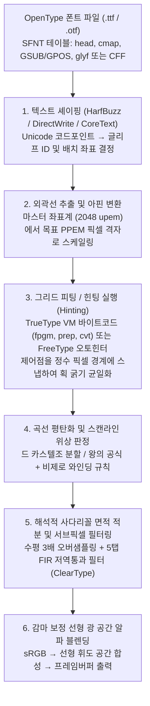
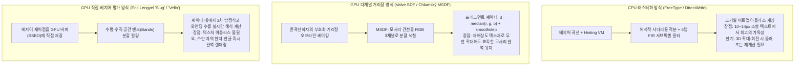

지금 여러분이 읽고 있는 화면 속 글자를 고배율 돋보기로 확대해 본다고 상상해 보자. 일반적인 데스크톱 모니터($96\,\text{DPI}$)에서 본문 크기로 흔히 쓰이는 $12\,\text{px}$($9\,\text{pt}$)이라는 글자 틀은 가로 $12$개, 세로 $12$개, 합쳐서 고작 $144$개의 미세한 정사각형 픽셀들로 이루어진 작은 체스판에 불과하다.

하지만 이 협소한 $12 \times 12$ 격자 위에 운영체제는 29획의 한자 ‘鬱’이나 복잡한 한글 음절(‘뷁’, ‘쓩’), 혹은 정교한 라틴 소문자 세리프 ‘`g`’와 세 개의 수직 줄기(Stem)가 나란히 서 있는 ‘`m`’을 매초 수만 글자씩 실시간으로 그려낸다. 놀랍게도 모든 수직 획은 균일한 굵기와 진하기를 유지하며, 촘촘한 수평 획들은 서로 엉겨 붙어 검은 덩어리로 뭉개지지도 않고 픽셀 사이의 빈틈으로 빠져 증발(Dropout)하지도 않는다. 대각선과 곡선에서는 계단 현상(Jaggies)조차 찾아볼 수 없다.

<strong>정보이론</strong>과 <strong>디지털 신호처리(DSP)</strong>의 관점에서 볼 때, 이는 <strong>나이퀴스트-섀넌 표본화 정리(Nyquist-Shannon Sampling Theorem)</strong>의 물리적 한계를 정면으로 돌파한 공학적 기적에 가깝다. 만약 고해상도 마스터 디자인을 단순한 기하학적 축소만으로 $12 \times 12$ 이산 격자에 사영한다면, 나이퀴스트 주파수를 초과하는 고주파 공간 성분들이 심각한 에일리어싱(Aliasing)을 일으켜 글자는 판독 불가능한 회색 얼룩으로 붕괴하고 말 것이다.

우리가 매일 당연하게 누리는 ‘작고 선명한 텍스트’의 이면에는 반세기에 걸쳐 축적된 컴퓨터 과학의 정수가 집약되어 있다. 본고에서는 `.ttf` 및 `.otf` 폰트 파일 내부의 수학적 곡선이 디스플레이의 RGB 서브픽셀 발광 휘도로 변환되기까지의 전 파이프라인을 엄밀한 수식과 함께 해부한다.

---

## 1. 비트맵 폰트의 한계에서 해상도 독립적 외곽선 폰트의 탄생으로

컴퓨터 여명기부터 1980년대 후반까지 화면의 글자는 각 글리프(Glyph)를 2차원 이진 행렬 $M \in \{0, 1\}^{H \times W}$로 직접 기록하는 <strong>비트맵 폰트(Bitmap Font)</strong>였다. 비트맵 방식은 특정 크기에서는 선명했지만 <strong>해상도 종속성(Resolution Dependence)</strong>이라는 치명적 결함을 안고 있었다. 크기를 $1.3$배 확대하거나 회전시키면 심각한 계단 현상이나 블러가 발생했고, $72\,\text{DPI}$ 화면용 비트맵은 $300\,\text{DPI}$ 레이저 프린터나 $2400\,\text{DPI}$ 인쇄기에서 쓸모가 없었다.

이 한계를 돌파한 것이 글자의 외곽선(Outline)을 연속적인 매개변수 곡선으로 기술하는 <strong>외곽선 폰트(Outline Font)</strong>다. 1980년대 초 Xerox PARC를 나온 <strong>John Warnock</strong>과 <strong>Chuck Geschke</strong>는 Adobe를 설립하여 <strong>PostScript Type 1</strong> 폰트(3차 베지어 곡선 기반)를 발표했고, 이에 맞서 Apple과 Microsoft는 1991년 2차 베지어 곡선과 스택 기반 바이트코드 가상머신을 탑재한 <strong>TrueType</strong>(`.ttf`)을 공개했다. 이후 1996년 양측은 기술을 통합한 <strong>OpenType</strong> 표준을 제정하여 오늘날의 `glyf`(2차 곡선) 및 `CFF`/`CFF2`(3차 곡선) 체계를 완성했다.

---

## 2. 외곽선 폰트의 계산기하학: 번스타인 기저 다항식과 베지어 곡선

### 번스타인 기저의 4대 수학적 불변성

일반적인 멱기저 다항식 $y = a_3 x^3 + a_2 x^2 + a_1 x + a_0$는 수직 접선($dx = 0$)을 표현할 수 없고 회전 변환에 수치적으로 불안정하다. 시트로엥의 <strong>Paul de Casteljau(1959)</strong>와 르노의 <strong>Pierre Bézier(1962)</strong>는 $n+1$개의 제어점 $\mathbf{P}_0, \dots, \mathbf{P}_n \in \mathbb{R}^2$과 <strong>번스타인 기저 다항식(Bernstein Basis Polynomials)</strong> $B_{i,n}(t)$의 선형 결합으로 매개변수 곡선을 정의했다:

$$\mathbf{B}_n(t) = \sum_{i=0}^{n} B_{i,n}(t)\,\mathbf{P}_i, \qquad B_{i,n}(t) = \binom{n}{i} (1 - t)^{n - i} t^i, \qquad t \in [0, 1]$$

1. <strong>비음수성과 1의 분할(Partition of Unity)에 의한 볼록 껍질 성질(Convex Hull Property)</strong>:
   $t \in [0, 1]$에서 $B_{i,n}(t) \ge 0$이며, 이항정리에 의해 가중치의 총합은 항등적으로 $1$이다:
   $$\sum_{i=0}^{n} B_{i,n}(t) = \bigl((1 - t) + t\bigr)^n = 1$$
   따라서 곡선 위의 모든 점은 제어점들의 <strong>볼록 결합(Convex Combination)</strong>이며, 곡선 전체는 제어점들이 이루는 <strong>볼록 껍질(Convex Hull)</strong> 내부에 완전히 갇힌다. 래스터라이저는 제어점의 최소·최대 경계 상자(Bounding Box)만 검사하여 현재 스캔라인과 교차하지 않는 곡선을 $O(1)$에 컬링할 수 있다.
2. <strong>아핀 불변성(Affine Invariance)</strong>:
   임의의 아핀 변환 $\Phi(\mathbf{x}) = A\mathbf{x} + \mathbf{b}$에 대해 $\Phi(\mathbf{B}_n(t)) = \sum B_{i,n}(t)\,\Phi(\mathbf{P}_i)$가 성립하므로, 곡선 위의 무수한 점 대신 몇 개의 제어점만 변환하면 된다.
3. <strong>끝점 보간 및 접선 벡터 제어</strong>:
   $\mathbf{B}_n(0) = \mathbf{P}_0, \mathbf{B}_n(1) = \mathbf{P}_n$이며, 양 끝점에서의 1계 도함수는 $\mathbf{B}_n'(0) = n(\mathbf{P}_1 - \mathbf{P}_0)$, $\mathbf{B}_n'(1) = n(\mathbf{P}_n - \mathbf{P}_{n-1})$이다.
4. <strong>변동 감소 성질(Variation Diminishing Property)</strong>:
   어떤 직선도 제어 다각형과 교차하는 횟수보다 더 많이 베지어 곡선과 교차할 수 없다.

---

### 2차 베지어 곡선(TrueType) vs. 3차 베지어 곡선(OpenType CFF)

- <strong>2차 베지어 곡선($n=2$, TrueType `glyf` 테이블)</strong>:
  $$\mathbf{B}_2(t) = (1-t)^2 \mathbf{P}_0 + 2(1-t)t \mathbf{P}_1 + t^2 \mathbf{P}_2$$
  스캔라인 $y = y_s$와의 교점을 2차 방정식 근의 공식으로 즉시 구할 수 있으며, 두 오프커브 제어점 $\mathbf{P}_1, \mathbf{P}_2$가 연속될 때 그 중점 $\mathbf{M} = \frac{1}{2}(\mathbf{P}_1 + \mathbf{P}_2)$에 온커브 접합점을 자동으로 생성하는 <strong>암묵적 중점(Implicit Midpoint)</strong> 기법으로 $C^1$ 연속성을 보장하면서 파일 크기를 약 $30\%$ 절감한다.
- <strong>3차 베지어 곡선($n=3$, PostScript / OpenType `CFF` 테이블)</strong>:
  $$\mathbf{B}_3(t) = (1-t)^3 \mathbf{P}_0 + 3(1-t)^2 t \mathbf{P}_1 + 3(1-t)t^2 \mathbf{P}_2 + t^3 \mathbf{P}_3$$
  2차 곡선은 2계 도함수 $\mathbf{B}_2''(t) = 2(\mathbf{P}_0 - 2\mathbf{P}_1 + \mathbf{P}_2)$가 상수이므로 단일 세그먼트 내에서 곡률의 부호가 바뀌는 <strong>변곡점(Inflection Point, 예: ‘`S`’의 등뼈 곡선)</strong>을 절대 표현할 수 없다. 반면 3차 곡선은 2계 도함수가 $t$에 대해 선형이므로 단일 세그먼트로 변곡점과 $G^2$ 곡률 연속성을 자유자재로 표현한다.

| 비교 항목 | 2차 베지어 곡선 ($n=2$, TrueType `glyf`) | 3차 베지어 곡선 ($n=3$, OpenType `CFF`/`CFF2`) |
| :--- | :--- | :--- |
| <strong>매개변수 방정식 $\mathbf{B}(t)$</strong> | $(1-t)^2\mathbf{P}_0 + 2(1-t)t\mathbf{P}_1 + t^2\mathbf{P}_2$ | $(1-t)^3\mathbf{P}_0 + 3(1-t)^2t\mathbf{P}_1 + 3(1-t)t^2\mathbf{P}_2 + t^3\mathbf{P}_3$ |
| <strong>단일 세그먼트 내 변곡점</strong> | 불가능 ($0$개, 포물선 호) | 가능 (최대 $2$개, `S`자 곡선 단일 표현) |
| <strong>양 끝 접선 고정 시 자유도</strong> | $0$ ($\mathbf{P}_1$이 두 접선의 교점에 고정됨) | $2$ (양쪽 핸들 길이로 $G^2$ 곡률 반경 독립 제어) |
| <strong>데이터 압축 방식</strong> | 연속 오프커브 점의 중점 $\frac{1}{2}(\mathbf{P}_1+\mathbf{P}_2)$ 암묵적 보간 | CharString 스택 서브루틴 및 차분 부호화 |

### 드 카스텔조(De Casteljau) 알고리즘과 왕의 평탄화 공식

재귀적 선형 보간 $\mathbf{P}_i^{(r)}(t) = (1-t)\mathbf{P}_i^{(r-1)}(t) + t\mathbf{P}_{i+1}^{(r-1)}(t)$을 중점 $t = \frac{1}{2}$에서 수행하면 덧셈과 비트 우측 시프트(`>> 1`)만으로 곡선을 정확히 이등분할 수 있다. 나아가 현대 래스터라이저는 재귀 분기 없이 허용 오차 $\tau$ 이내로 평탄화하기 위한 분할 횟수 $N$을 <strong>왕의 공식(Wang's Formula, 1985)</strong>으로 사전 계산한다:

$$N = \left\lceil \sqrt{ \frac{n(n-1)}{8\tau} \max_{0 \le i \le n-2} \|\mathbf{P}_{i+2} - 2\mathbf{P}_{i+1} + \mathbf{P}_i\| } \right\rceil$$

---

## 3. 스캔라인 래스터화: 비제로 와인딩 규칙과 해석적 사다리꼴 면적 적분

### 기우 규칙(Even-Odd) vs. 비제로 와인딩 규칙(Non-Zero Winding)

점 $P$가 글자 내부인지 ‘`O`’, ‘`8`’의 속공간(Counter)인지 판별할 때, 단순 교차 횟수의 홀짝만 보는 <strong>기우 규칙</strong>은 가변 폰트(Variable Fonts)나 한자 ‘`十`’처럼 두 획의 윤곽선이 겹치는 교차 영역에서 교차수가 짝수($2$)가 되어 <strong>획이 겹친 자리에 하얀 구멍이 뚫리는 결함</strong>을 일으킨다.
따라서 폰트 엔진은 윤곽선에 방향을 부여하여 위상수학적 <strong>와인딩 수(Winding Number)</strong>를 계산하는 <strong>비제로 와인딩 규칙</strong>을 사용한다:

$$w(P) = \frac{1}{2\pi} \oint_{\partial\Gamma} d\theta = \sum_{\text{crossings}} \operatorname{sgn}(\Delta y) \ne 0$$

외곽선(시계 방향 CW, $-1$)과 내측 구멍(반시계 방향 CCW, $+1$)은 부호가 상쇄되어 $w(P) = 0$(빈 구멍)이 되고, 같은 방향의 두 획이 겹친 영역은 $w(P) = -2 \ne 0$이 되어 완벽하게 채워진다.

### 해석적 사다리꼴 면적 적분 (FreeType `ftgrays` / `stb_truetype`)

초기의 $4 \times 4$ 슈퍼샘플링은 17단계의 거친 계조만 생성했다. Raph Levien의 Libart에서 출발해 FreeType `ftgrays.c`와 `stb_truetype`의 핵심이 된 <strong>해석적 부호화 사다리꼴 면적 적분</strong>은 선분이 픽셀 $(i, j)$를 가로지를 때($\Delta y = y_1 - y_0$, 수평 중점 $\bar{x}$), 해당 픽셀 내부의 사다리꼴 면적 $\text{delta\_area}[i] \mathrel{+}= (1 - \bar{x})\Delta y$와 우측 픽셀 전체에 대한 직사각형 덮임 증분 $\text{delta\_cover}[i+1] \mathrel{+}= \Delta y$를 기록한 뒤, 좌에서 우로 단 한 번의 <strong>누적합(Prefix Sum)</strong>을 수행하여 256계조 알파값 $\alpha_i$를 정확히 산출한다:

$$C_i = C_{i-1} + \text{delta\_cover}[i], \qquad A_i = C_i + \text{delta\_area}[i], \qquad \alpha_i = \min\bigl(1.0,\; |A_i|\bigr)$$

---

## 4. 폰트 속의 바이트코드 가상머신: 그리드 피팅(Hinting)과 3대 렌더링 철학

### 저해상도 샘플링 위상 참사와 TrueType VM

힌팅 없이 소문자 ‘`m`’($0.8\,\text{px}$ 줄기 3개, 간격 $1.5\,\text{px}$)을 $12\,\text{px}$ 격자에 그리면 첫 줄기는 픽셀 $1$ 안에 들어가 선명한 검은 선($\alpha=0.8$)이 되지만, 두 번째 줄기는 픽셀 경계 $x=4.0$에 걸쳐 $\alpha=0.6$과 $\alpha=0.2$의 흐릿한 2픽셀 회색 띠로 퍼져버린다.

이를 막기 위해 TrueType 폰트는 `cvt `(기준 치수 테이블), `fpgm`(폰트 프로그램), `prep`(초기화 프로그램), `glyf`(글리프 명령)로 구성된 <strong>스택 기반 가상머신(TrueType VM) 바이트코드</strong>를 내장하고 있다. VM은 $26.6$ 고정소수점 정밀도에서 <strong>투영 벡터($\mathbf{P}$)</strong>와 <strong>자유 벡터($\mathbf{F}$)</strong>를 사용해 `MDAP`(제어점을 정수 격자에 스냅), `MIRP`(`cvt` 표준 굵기를 적용하고 최소 거리 $1\,\text{px}$를 보장하여 드롭아웃 방지), `DELTAP1`(특정 픽셀 크기 전용 예외 보정), `IUP`(터치되지 않은 나머지 곡선 제어점들의 선형 보간) 명령을 순차 실행한다.

- <strong>Microsoft 철학(GDI / ClearType)</strong>: 글자 모양이 약간 변형되더라도 모든 획을 픽셀 격자에 강력하게 스냅시켜 최상의 대비와 가독성을 확보한다.
- <strong>Apple 철학(Quartz / CoreText)</strong>: 바이트코드 힌팅을 무시하고 서체 디자이너의 원본 비례와 조판 일관성(WYSIWYG)을 최우선으로 보존한다.
- <strong>FreeType 오토힌터(`autofit`)와 Y축 전용 힌팅</strong>: 실행 시간에 윤곽선에서 줄기와 블루존(Blue Zones)을 자동 추출하며, 수직(Y) 방향으로만 격자에 스냅하고 수평(X) 방향은 서브픽셀 렌더링에 맡기는 하이브리드 방식을 취한다.

---

## 5. 서브픽셀 렌더링(ClearType)과 감마 보정 선형 알파 블렌딩

### 5탭 Gibson FIR 저역통과 필터

LCD 패널의 한 픽셀은 수평으로 $\frac{1}{3}$ 픽셀씩 떨어진 $R, G, B$ 세 개의 수직 스트라이프 서브픽셀로 구성된다. 인간 시각계가 <strong>휘도($Y = 0.2126R + 0.7152G + 0.0722B$)에는 공간 해상도가 매우 높고 색도(Chrominance)에는 둔감하다</strong>는 점을 이용해 수평 방향으로 <strong>$3\times$ 오버샘플링</strong>을 수행하면 수평 해상도가 3배로 도약한다.

이때 발생하는 무지개색 색수차(Color Fringing)를 제거하기 위해, 3서브픽셀 박스 필터 $\frac{1}{3}[1, 1, 1]$를 자기 합성곱(Auto-convolution)한 <strong>5탭 대칭 삼각 FIR 필터(Gibson Filter)</strong>를 적용한다:

$$h_{\text{Gibson}} = \left[\frac{1}{3},\; \frac{1}{3},\; \frac{1}{3}\right] * \left[\frac{1}{3},\; \frac{1}{3},\; \frac{1}{3}\right] = \left[\frac{1}{9},\; \frac{2}{9},\; \frac{3}{9},\; \frac{2}{9},\; \frac{1}{9}\right]$$

모듈로 3 간격의 합이 모두 $\frac{3}{9} = \frac{2}{9}+\frac{1}{9} = \frac{1}{3}$로 일치하므로, 어떤 서브픽셀 임펄스도 $R, G, B$에 동일한 에너지를 분배하여 색 번짐을 수학적으로 완전히 상쇄한다.

### 감마 보정 선형 광 공간 합성

면적 적분으로 구한 $\alpha$는 물리적 광자 비율(선형 휘도 $L$)이지만, sRGB 프레임버퍼는 비선형 전압 $V = L^{1/\gamma}$($\gamma \approx 2.2$)를 저장한다. sRGB 공간에서 직접 블렌딩하면 $\alpha = 0.5$가 물리 휘도 $0.5^{2.2} \approx 21.8\%$로 어두워져 라이트 모드의 검은 글씨는 가늘어지고 다크 모드의 흰 글씨는 비정상적으로 두꺼워진다. 따라서 반드시 <strong>선형 광 공간(Linear Light Space)</strong>에서 각 서브픽셀 채널을 합성해야 한다:

$$C_{\text{out}, c} = \Bigl( \alpha_c \, C_{\text{fg}, c}^{\gamma} + (1 - \alpha_c) \, C_{\text{bg}, c}^{\gamma} \Bigr)^{1/\gamma}, \qquad c \in \{R, G, B\},\; \gamma \approx 2.2$$

---

## 6. GPU 시대의 폰트 렌더링: SDF, MSDF, 그리고 직접 베지어 셰이더(`Slug`)

3D 게임과 VR/AR 환경을 위해 <strong>Chris Green(Valve, 2007)</strong>은 텍스처에 알파값 대신 윤곽선까지의 부호화 유클리드 거리 $d(\mathbf{p})$를 저장하는 <strong>부호화 거리장(SDF)</strong> 기법을 도입했다. 직선 경계의 거리 함수는 선형 평면이므로 저해상도 텍스처를 쌍선형 보간해도 영등위면 $d(\mathbf{p}) = 0$이 칼날처럼 날카롭게 복원되며, `smoothstep(-w, +w, d)`($w \approx 0.5\,\operatorname{fwidth}(d)$)로 안티에일리어싱과 외곽선·그림자 효과를 단 한 번의 패스로 처리한다.

단일 채널 SDF에서 뾰족한 모서리가 둥글게 깎이는 문제는 <strong>Viktor Chlumský(2015)</strong>의 <strong>다채널 SDF(MSDF / `msdfgen`)</strong>가 해결했다. 모서리를 이루는 두 간선의 방향별 의사 거리를 RGB 3채널에 나누어 담고 셰이더에서 <strong>중앙값(Median)</strong>을 취함으로써 두 반평면의 불리언 교집합과 합집합을 완벽히 복원한다:

$$d_{\text{MSDF}} = \operatorname{median}(r, g, b) = \max\Bigl(\min(r, g),\; \min\bigl(\max(r, g),\; b\bigr)\Bigr)$$

나아가 획이 극도로 밀집된 한자까지 텍스처 없이 완벽히 그리기 위해, <strong>Eric Lengyel의 `Slug` 알고리즘(2017)</strong>과 <strong>Raph Levien의 `Vello`</strong>는 베지어 제어점을 직접 GPU 버퍼에 올리고 3비트 동치류 마스크를 이용해 프래그먼트 셰이더 내부에서 곡선 교차점과 와인딩 수를 직접 계산하여 해상도 독립적 타이포그래피의 궁극에 도달했다.
