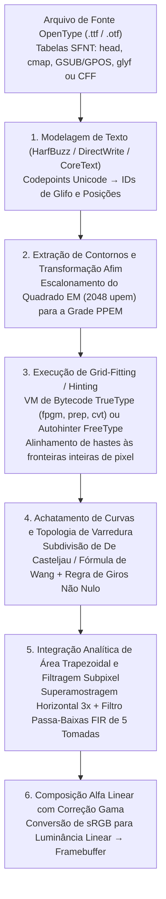

Imagine observar o texto que você está lendo agora na tela através de uma lupa de alta potência. Em um tamanho de corpo padrão de $12\,\text{px}$ ($9\,\text{pt}$ em um monitor convencional de $96\,\text{DPI}$), a célula inteira de um caractere não passa de um minúsculo tabuleiro de xadrez discreto medindo apenas $12$ pixels de largura por $12$ pixels de altura — um total de apenas $144$ pequenos quadrados emissores de luz.

No entanto, dentro dessa grade apertada de $12 \times 12$, seu sistema operacional desenha em tempo real dezenas de milhares de glifos por segundo: desde o complexo kanji «鬱» de $29$ traços até a minúscula latina com serifa «`g`» de dois andares ou o «`m`» com suas três hastes verticais (Stems) equidistantes. Cada haste vertical mantém espessura e escuridão uniformes, barras horizontais densas nunca se fundem em um borrão preto ilegível nem desaparecem entre os centros dos pixels (Dropout), e curvas diagonais fluem sem serrilhados em forma de escada (Jaggies).

Do ponto de vista da <strong>Teoria da Informação</strong> e do <strong>Processamento Digital de Sinais (DSP)</strong>, essa façanha cotidiana é um verdadeiro milagre matemático diante do <strong>Teorema da Amostragem de Nyquist-Shannon</strong>. Se projetássemos diretamente um contorno vetorial de alta resolução sobre uma grade de $12 \times 12$ pixels por simples redução geométrica, as altas frequências espaciais acima do limite de Nyquist produziriam um severo serrilhado (Aliasing), reduzindo o texto a uma mancha cinza irreconhecível.

Por trás da leitura nítida de letras pequenas esconde-se meio século de ciência da computação: <strong>geometria computacional</strong> (polinômios de Bernstein e curvas de Bézier), <strong>topologia algébrica</strong> (números de giros), <strong>máquinas virtuais</strong> (bytecode executável dentro de cada arquivo `.ttf`), <strong>psicofísica visual e filtros digitais FIR</strong> (renderização subpixel ClearType), <strong>radiometria</strong> (mistura alfa em espaço de luz linear) e <strong>algoritmos de shaders em GPU</strong> (MSDF e avaliação direta `Slug`).

---

## 1. Da tirania dos bitmaps às fontes de contorno independentes de resolução

Os primeiros sistemas computacionais dependiam de <strong>fontes de mapa de bits (Bitmap Fonts)</strong>, que armazenavam cada glifo como uma matriz binária $M \in \{0, 1\}^{H \times W}$. Embora fossem nítidas em seu tamanho nativo, sofriam de <strong>dependência total de resolução</strong>: redimensionar ou girar o texto produzia bordas serrilhadas ou borradas, e bitmaps de $72\,\text{DPI}$ para tela eram inúteis em impressoras a laser de $300\,\text{DPI}$ ou fotocompositoras de $2400\,\text{DPI}$.

A revolução veio com as <strong>fontes vetoriais de contorno (Outline Fonts)</strong>: primeiro o <strong>PostScript Type 1</strong> (1984) criado por <strong>John Warnock</strong> e <strong>Chuck Geschke</strong> na Adobe (baseado em curvas de Bézier cúbicas), seguido pelo <strong>TrueType</strong> (`.ttf`, 1991) da Apple e Microsoft (baseado em curvas de Bézier quadráticas e uma máquina virtual de hinting baseada em pilha), que finalmente se unificaram em 1996 sob o padrão <strong>OpenType</strong> (tabelas `glyf` e `CFF`/`CFF2`).

---

## 2. Geometria Computacional de Contornos: Polinômios de Bernstein e Curvas de Bézier

### As quatro propriedades fundamentais da base de Bernstein

Polinômios explícitos na base de potências $y = a_3 x^3 + a_2 x^2 + a_1 x + a_0$ não conseguem representar tangentes verticais e são numericamente instáveis sob rotações. <strong>Paul de Casteljau</strong> (Citroën, 1959) e <strong>Pierre Bézier</strong> (Renault, 1962) definiram curvas paramétricas usando os <strong>polinômios base de Bernstein</strong> de grau $n$ e $n+1$ pontos de controle $\mathbf{P}_0, \dots, \mathbf{P}_n \in \mathbb{R}^2$:

$$\mathbf{B}_n(t) = \sum_{i=0}^{n} B_{i,n}(t)\,\mathbf{P}_i, \qquad B_{i,n}(t) = \binom{n}{i} (1 - t)^{n - i} t^i, \qquad t \in [0, 1]$$

1. <strong>Não negatividade, partição da unidade e propriedade do fecho convexo</strong>:
   Para todo $t \in [0, 1]$ vale $B_{i,n}(t) \ge 0$, e pelo teorema binomial a soma de todos os polinômios base é identicamente $1$:
   $$\sum_{i=0}^{n} B_{i,n}(t) = \bigl((1 - t) + t\bigr)^n = 1$$
   Por ser uma combinação convexa, toda a curva $\mathbf{B}_n(t)$ permanece estritamente dentro do <strong>fecho convexo (Convex Hull)</strong> de seus pontos de controle, permitindo descarte rápido por caixa delimitadora em tempo $O(1)$.
2. <strong>Invariância afim</strong>:
   Para qualquer transformação afim $\Phi(\mathbf{x}) = A\mathbf{x} + \mathbf{b}$, vale $\Phi(\mathbf{B}_n(t)) = \sum B_{i,n}(t)\,\Phi(\mathbf{P}_i)$: basta transformar os pontos de controle.
3. <strong>Interpolação das extremidades e controle de tangentes</strong>:
   $\mathbf{B}_n(0) = \mathbf{P}_0$, $\mathbf{B}_n(1) = \mathbf{P}_n$, com derivadas nas extremidades $\mathbf{B}_n'(0) = n(\mathbf{P}_1 - \mathbf{P}_0)$ e $\mathbf{B}_n'(1) = n(\mathbf{P}_n - \mathbf{P}_{n-1})$.
4. <strong>Propriedade de diminuição de variação</strong>:
   Nenhuma linha reta pode interceptar uma curva de Bézier mais vezes do que intercepta seu polígono de controle.

---

### Curvas quadráticas ($n=2$, TrueType) vs. Curvas cúbicas ($n=3$, OpenType CFF)

- <strong>Curvas de Bézier quadráticas ($n=2$, tabela `glyf` do TrueType)</strong>:
  $$\mathbf{B}_2(t) = (1-t)^2 \mathbf{P}_0 + 2(1-t)t \mathbf{P}_1 + t^2 \mathbf{P}_2$$
  Além de resolver interseções com linhas de varredura pela fórmula de Bhaskara, o TrueType emprega <strong>pontos médios implícitos na curva (Implicit On-Curve Midpoints)</strong>: quando dois pontos de controle fora da curva $\mathbf{P}_1, \mathbf{P}_2$ aparecem consecutivamente, o decodificador sintetiza automaticamente um ponto de junção em seu ponto médio exato $\mathbf{M} = \frac{1}{2}(\mathbf{P}_1 + \mathbf{P}_2)$, garantindo continuidade $C^1$ e reduzindo o tamanho do arquivo em cerca de $30\%$.
- <strong>Curvas de Bézier cúbicas ($n=3$, PostScript / tabela `CFF` do OpenType)</strong>:
  $$\mathbf{B}_3(t) = (1-t)^3 \mathbf{P}_0 + 3(1-t)^2 t \mathbf{P}_1 + 3(1-t)t^2 \mathbf{P}_2 + t^3 \mathbf{P}_3$$
  Como a segunda derivada de uma curva quadrática é constante ($\mathbf{B}_2''(t) = \text{const}$), um único segmento quadrático jamais pode conter um <strong>ponto de inflexão</strong> (como a espinha dorsal da letra «`S`»). As curvas cúbicas possuem segunda derivada linear em $t$, permitindo capturar pontos de inflexão em um único segmento e controlar independentemente a curvatura $G^2$ em ambas as extremidades.

| Característica | Bézier Quadrática ($n=2$, TrueType `glyf`) | Bézier Cúbica ($n=3$, OpenType `CFF`) |
| :--- | :--- | :--- |
| <strong>Equação paramétrica $\mathbf{B}(t)$</strong> | $(1-t)^2\mathbf{P}_0 + 2(1-t)t\mathbf{P}_1 + t^2\mathbf{P}_2$ | $(1-t)^3\mathbf{P}_0 + 3(1-t)^2t\mathbf{P}_1 + 3(1-t)t^2\mathbf{P}_2 + t^3\mathbf{P}_3$ |
| <strong>Pontos de inflexão por segmento</strong> | $0$ (arco de parábola, sinal de curvatura fixo) | Até $2$ (representa a curva do «`S`» em 1 segmento) |
| <strong>Graus de liberdade (tangentes fixas)</strong> | $0$ ($\mathbf{P}_1$ travado na interseção das tangentes) | $2$ (comprimentos das alças ajustam a curvatura $G^2$) |
| <strong>Compressão binária</strong> | Pontos médios implícitos $\mathbf{M} = \frac{1}{2}(\mathbf{P}_1 + \mathbf{P}_2)$ | Sub-rotinas CharString em pilha e codificação delta |

O <strong>algoritmo de De Casteljau</strong> $\mathbf{P}_i^{(r)}(t) = (1-t)\mathbf{P}_i^{(r-1)}(t) + t\mathbf{P}_{i+1}^{(r-1)}(t)$ (que em $t = \frac{1}{2}$ requer apenas somas e deslocamentos de bits `>> 1`) e a <strong>fórmula de Wang (1985)</strong>

$$N = \left\lceil \sqrt{ \frac{n(n-1)}{8\tau} \max_{0 \le i \le n-2} \|\mathbf{P}_{i+2} - 2\mathbf{P}_{i+1} + \mathbf{P}_i\| } \right\rceil$$

permitem achatar as curvas em $N$ segmentos lineares dentro da tolerância $\tau$ sem sobrecarga recursiva.

---

## 3. Rasterização Scanline: Número de Giros e Integração Trapezoidal

### Regra Par-Ímpar vs. Regra do Número de Giros Não Nulo

Para distinguir o interior do glifo de seus espaços internos (os furos em «`O`» ou «`8`»), a <strong>regra par-ímpar (Even-Odd)</strong> falha quando dois traços se sobrepõem (como ocorre nas <strong>fontes variáveis OpenType</strong>), abrindo um buraco branco na interseção. Por isso utiliza-se a <strong>regra do número de giros não nulo (Non-Zero Winding Rule)</strong>:

$$w(P) = \frac{1}{2\pi} \oint_{\partial\Gamma} d\theta = \sum_{\text{crossings}} \operatorname{sgn}(\Delta y) \ne 0$$

Os contornos externos (sentido horário CW no TrueType, $-1$) e os furos internos (sentido anti-horário CCW, $+1$) cancelam-se ($w(P) = 0$) dentro dos furos, enquanto traços sobrepostos de mesma orientação somam $w(P) = -2 \ne 0$ e permanecem solidamente preenchidos.

### Integração Analítica Exata de Área Trapezoidal (Libart / FreeType `ftgrays` / `stb_truetype`)

Em vez de usar superamostragem lenta, o algoritmo de Raph Levien (adotado no FreeType `ftgrays.c`, `stb_truetype` e `font-rs`) calcula para cada microssegmento dentro do pixel $(i, j)$ (com altura com sinal $\Delta y = y_1 - y_0$ e ponto médio horizontal $\bar{x} \in [0, 1]$) a área trapezoidal exata à sua direita $\text{delta\_area}[i] \mathrel{+}= (1 - \bar{x})\Delta y$ e o incremento de cobertura cheia $\text{delta\_cover}[i+1] \mathrel{+}= \Delta y$ para os pixels à direita. Uma única <strong>soma de prefixos (Prefix Sum)</strong> da esquerda para a direita obtém a cobertura exata $\alpha_i \in [0, 1]$ em 256 níveis de cinza:

$$C_i = C_{i-1} + \text{delta\_cover}[i], \qquad A_i = C_i + \text{delta\_area}[i], \qquad \alpha_i = \min\bigl(1.0,\; |A_i|\bigr)$$

---

## 4. A Máquina Virtual Secreta em Cada Fonte: Grid-Fitting (Hinting) e as Três Filosofias

Sem hinting em $12\,\text{px}$, as três hastes verticais idênticas de um «`m`» caem com fases diferentes sobre a grade de pixels: a primeira cai dentro de um único pixel ($\alpha = 0.80$, preto nítido), enquanto a segunda cavalga sobre uma fronteira de pixel e se espalha em uma faixa cinza borrada de 2 pixels ($\alpha = 0.60$ e $\alpha = 0.20$).

Para evitar isso, cada fonte TrueType inclui um programa em bytecode (`cvt `, `fpgm`, `prep`, `glyf`) executado por uma <strong>máquina virtual baseada em pilha</strong> em ponto fixo $26.6$. Por meio do <strong>vetor de projeção ($\mathbf{P}$)</strong> e do <strong>vetor de liberdade ($\mathbf{F}$)</strong>, instruções como `MDAP` e `MIRP` ajustam os pontos às fronteiras inteiras de pixel, unificam a espessura das hastes com a tabela global `cvt`, impõem distâncias mínimas contra desaparecimentos (Dropouts), aplicam ajustes cirúrgicos por tamanho com `DELTAP1` e interpolam suavemente o restante dos pontos não tocados mediante `IUP[0]` / `IUP[1]`.

- <strong>Filosofia da Microsoft (GDI / ClearType)</strong>: Prioriza nitidez e contraste ajustando agressivamente as hastes à grade de pixels, mesmo que altere ligeiramente as proporções do desenho original.
- <strong>Filosofia da Apple (Quartz / CoreText)</strong>: Preserva fielmente as formas originais do designer (WYSIWYG) ignorando o bytecode de hinting, atingindo a perfeição em telas Retina de alta densidade.
- <strong>Autohinter do FreeType (`autofit`) e Hinting apenas em Y</strong>: Analisa geometricamente os contornos em tempo de execução para detectar hastes e zonas azuis (Blue Zones), alinhando suavemente apenas o eixo vertical Y e deixando o eixo horizontal X livre para o posicionamento subpixel.

---

## 5. Renderização Subpixel (ClearType) e Mistura Alfa Linear com Correção Gama

Cada pixel físico de um painel LCD consiste em três subpixels verticais ($R, G, B$) separados por $\frac{1}{3}$ de pixel horizontalmente. Aproveitando que a visão humana possui altíssima acuidade espacial para luminância ($Y = 0.2126R + 0.7152G + 0.0722B$), mas baixa para crominância, o rasterizador amostra o glifo com <strong>$3\times$ a resolução horizontal</strong>. Para suprimir franjas de cor (Color Fringing), aplica o <strong>filtro passa-baixas FIR simétrico de 5 tomadas de Gibson</strong> ($\frac{1}{3}[1,1,1] * \frac{1}{3}[1,1,1]$):

$$h_{\text{Gibson}} = \left[\frac{1}{9},\; \frac{2}{9},\; \frac{3}{9},\; \frac{2}{9},\; \frac{1}{9}\right]$$

Como cada grupo módulo 3 soma exatamente $\frac{3}{9} = \frac{2}{9} + \frac{1}{9} = \frac{1}{3}$, qualquer impulso distribui energia idêntica em $R, G$ e $B$. Finalmente, a composição alfa deve ser realizada no <strong>espaço de luz linear</strong> ($\gamma \approx 2.2$) para manter o peso visual correto tanto no modo claro quanto no modo escuro:

$$C_{\text{out}, c} = \Bigl( \alpha_c \, C_{\text{fg}, c}^{\gamma} + (1 - \alpha_c) \, C_{\text{bg}, c}^{\gamma} \Bigr)^{1/\gamma}, \qquad c \in \{R, G, B\},\; \gamma \approx 2.2$$

---

## 6. A Era da GPU: SDF, MSDF (`msdfgen`) e Shaders Diretos de Bézier (`Slug`)

```mermaid
flowchart TD
    subgraph CPU["Rasterização em CPU (FreeType / DirectWrite)"]
        C1["Curvas de Bézier + VM de Hinting"] --> C2["Integração Trapezoidal + Filtro FIR de 5 Tomadas"]
        C2 --> C3["Cache de Bitmaps por Tamanho<br/>Vantagem: Nitidez imbatível em 10–14px<br/>Limite: Borrão ou recálculo ao escalar/girar em 3D"]
    end
    subgraph MSDF["Campos de Distância em GPU (Valve SDF / Chlumský MSDF)"]
        S1["Pré-cálculo Offline do Campo de Distância com Sinal"] --> S2["MSDF: Codificação RGB de Arestas para Preservar Cantos"]
        S2 --> S3["Fragment Shader: d = median(r, g, b) + smoothstep<br/>Vantagem: Cantos afiados em qualquer nível de zoom"]
    end
    subgraph Slug["Shaders GPU de Bézier Diretos (Eric Lengyel 'Slug' / 'Vello')"]
        G1["Pontos de Controle de Bézier em Buffer de GPU"] --> G2["Partição Espacial em Bandas Horizontais e Verticais"]
        G2 --> G3["Interseção Quadrática e Número de Giros no Shader<br/>Vantagem: Sem atlas de texturas, ideal para 50.000 glifos CJK"]
    end
```

Para gráficos 3D em tempo real, <strong>Chris Green (Valve, 2007)</strong> introduziu os <strong>campos de distância com sinal (SDF)</strong> que armazenam a distância euclidiana $d(\mathbf{p})$ ao contorno. Para evitar que cantos agudos fiquem arredondados ao ampliar, <strong>Viktor Chlumský (2015)</strong> inventou o <strong>MSDF (`msdfgen`)</strong>, codificando as arestas convergentes nos três canais RGB e reconstruindo o canto exato no shader por meio da mediana:

$$d_{\text{MSDF}} = \operatorname{median}(r, g, b) = \max\Bigl(\min(r, g),\; \min\bigl(\max(r, g),\; b\bigr)\Bigr)$$

Por fim, para ideogramas densos sem limite de resolução, motores GPU diretos como o <strong>`Slug` de Eric Lengyel (2017)</strong> e o <strong>`Vello` de Raph Levien</strong> avaliam diretamente as curvas de Bézier e o número de giros dentro do shader sem necessidade de texturas intermediárias.
