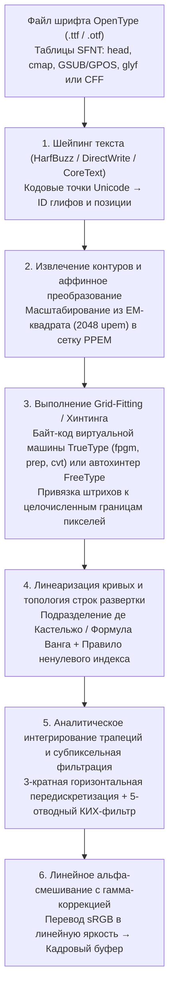

Представьте, что вы рассматриваете текст на этом экране через мощную лупу. При стандартном кегле основного текста $12\,\text{px}$ ($9\,\text{pt}$ на классическом мониторе с разрешением $96\,\text{DPI}$) вся знакоместо буквы представляет собой крошечную дискретную шахматную доску размером всего $12$ на $12$ пикселей — лишь $144$ микроскопических светящихся квадратика.

Тем не менее внутри этой тесной сетки $12 \times 12$ операционная система десятки тысяч раз в секунду отрисовывает сложнейшие глифы: от иероглифа кандзи «鬱» из $29$ черт до двухъярусной латинской строчной антиквы «`g`» или буквы «`m`» с тремя равноудаленными вертикальными штрихами (Stems). Каждый вертикальный штрих сохраняет идеально ровную толщину и насыщенность, плотные горизонтальные перекладины не сливаются в черное пятно и не проваливаются между центрами пикселей (Dropout), а диагональные кривые лишены ступенчатых зазубрин (Jaggies).

С точки зрения <strong>теории информации</strong> и <strong>цифровой обработки сигналов (DSP)</strong> это повседневное явление — настоящее инженерное чудо, бросающее вызов <strong>теореме Котельникова (Найквиста — Шеннона)</strong>. При наивном геометрическом уменьшении векторного контура на сетку $12 \times 12$ высокие пространственные частоты выше предела Найквиста породили бы катастрофический алиасинг, превратив текст в нечитаемое серое пятно.

За четкостью мелкого текста стоит полвека достижений информатики: <strong>вычислительная геометрия</strong> (многочлены Бернштейна и сплайны Безье), <strong>алгебраическая топология</strong> (индекс обхода ориентированных контуров), <strong>виртуальные машины</strong> (исполняемый байт-код внутри каждого файла `.ttf`), <strong>психофизика зрения и теория КИХ-фильтров</strong> (субпиксельный рендеринг ClearType), <strong>радиометрия</strong> (альфа-смешивание в линейном световом пространстве) и <strong>параллельные алгоритмы GPU-шейдеров</strong> (MSDF и прямое вычисление кривых `Slug`).

---

## 1. От растрового плена к независимым от разрешения контурным шрифтам

Ранние компьютерные системы полагались на <strong>растровые шрифты (Bitmap Fonts)</strong>, хранившие каждый глиф как бинарную матрицу $M \in \{0, 1\}^{H \times W}$. Несмотря на четкость в родном размере, они страдали от фатальной <strong>зависимости от разрешения</strong>: масштабирование или поворот порождали «лесенки» или размытие, а экранные шрифты $72\,\text{DPI}$ не годились для лазерных принтеров ($300\,\text{DPI}$) и фотонаборных автоматов ($2400\,\text{DPI}$).

Прорыв совершили <strong>контурные векторные шрифты (Outline Fonts)</strong>: сначала <strong>PostScript Type 1</strong> (1984), созданный <strong>Джоном Уорноком</strong> и <strong>Чаком Гешке</strong> в Adobe на базе кубических кривых Безье, затем <strong>TrueType</strong> (`.ttf`, 1991) от Apple и Microsoft на базе квадратичных кривых Безье и открытой стековой виртуальной машины хинтинга. В 1996 году обе технологии объединились в стандарте <strong>OpenType</strong> (таблицы `glyf` и `CFF`/`CFF2`).

---

## 2. Вычислительная геометрия контуров: базис Бернштейна и кривые Безье

### Четыре фундаментальных свойства многочленов Бернштейна

Явные многочлены в степенном базисе $y = a_3 x^3 + a_2 x^2 + a_1 x + a_0$ не способны описать вертикальные касательные и численно неустойчивы при поворотах. Инженеры <strong>Поль де Кастельжо</strong> (Citroën, 1959) и <strong>Пьер Безье</strong> (Renault, 1962) определили параметрические кривые через <strong>базисные многочлены Бернштейна</strong> степени $n$ и $n+1$ опорных точек $\mathbf{P}_0, \dots, \mathbf{P}_n \in \mathbb{R}^2$:

$$\mathbf{B}_n(t) = \sum_{i=0}^{n} B_{i,n}(t)\,\mathbf{P}_i, \qquad B_{i,n}(t) = \binom{n}{i} (1 - t)^{n - i} t^i, \qquad t \in [0, 1]$$

1. <strong>Неотрицательность, разбиение единицы и свойство выпуклой оболочки</strong>:
   На отрезке $t \in [0, 1]$ всегда $B_{i,n}(t) \ge 0$, а по биному Ньютона сумма всех базисных функций тождественно равна $1$:
   $$\sum_{i=0}^{n} B_{i,n}(t) = \bigl((1 - t) + t\bigr)^n = 1$$
   Являясь выпуклой комбинацией опорных точек, кривая $\mathbf{B}_n(t)$ целиком лежит внутри их <strong>выпуклой оболочки (Convex Hull)</strong>, что позволяет за $O(1)$ отсекать кривые по ограничивающему прямоугольнику (Bounding Box).
2. <strong>Аффинная инвариантность</strong>:
   Для любого аффинного преобразования $\Phi(\mathbf{x}) = A\mathbf{x} + \mathbf{b}$ справедливо $\Phi(\mathbf{B}_n(t)) = \sum B_{i,n}(t)\,\Phi(\mathbf{P}_i)$: достаточно преобразовать только опорные точки.
3. <strong>Интерполяция концов и управление касательными</strong>:
   $\mathbf{B}_n(0) = \mathbf{P}_0$, $\mathbf{B}_n(1) = \mathbf{P}_n$, а векторы производных на концах равны $\mathbf{B}_n'(0) = n(\mathbf{P}_1 - \mathbf{P}_0)$ и $\mathbf{B}_n'(1) = n(\mathbf{P}_n - \mathbf{P}_{n-1})$.
4. <strong>Свойство уменьшения вариации</strong>:
   Никакая прямая не пересекает кривую Безье большее число раз, чем её контрольную ломаную.

---

### Квадратичные кривые ($n=2$, TrueType) против кубических ($n=3$, OpenType CFF)

- <strong>Квадратичные кривые Безье ($n=2$, таблица `glyf` TrueType)</strong>:
  $$\mathbf{B}_2(t) = (1-t)^2 \mathbf{P}_0 + 2(1-t)t \mathbf{P}_1 + t^2 \mathbf{P}_2$$
  Пересечение со строкой развертки находится напрямую через квадратное уравнение. Кроме того, TrueType использует сжатие через <strong>неявные срединные точки на кривой (Implicit On-Curve Midpoints)</strong>: если в потоке данных подряд идут две внеконтурные точки $\mathbf{P}_1, \mathbf{P}_2$, декодер автоматически восстанавливает узловую точку на кривой ровно посередине $\mathbf{M} = \frac{1}{2}(\mathbf{P}_1 + \mathbf{P}_2)$, гарантируя гладкую стыковку $C^1$ и экономя около $30\%$ объема файла.
- <strong>Кубические кривые Безье ($n=3$, PostScript / таблица `CFF` OpenType)</strong>:
  $$\mathbf{B}_3(t) = (1-t)^3 \mathbf{P}_0 + 3(1-t)^2 t \mathbf{P}_1 + 3(1-t)t^2 \mathbf{P}_2 + t^3 \mathbf{P}_3$$
  Поскольку вторая производная квадратичной кривой постоянна ($\mathbf{B}_2''(t) = \text{const}$), один квадратичный сегмент не может содержать <strong>точку перегиба</strong> (например, изгиб буквы «`S`»). У кубической кривой вторая производная линейна по $t$, что позволяет описывать S-образные перегибы одним сегментом и независимо регулировать кривизну $G^2$ на концах.

| Характеристика | Квадратичная Безье ($n=2$, TrueType `glyf`) | Кубическая Безье ($n=3$, OpenType `CFF`) |
| :--- | :--- | :--- |
| <strong>Уравнение $\mathbf{B}(t)$</strong> | $(1-t)^2\mathbf{P}_0 + 2(1-t)t\mathbf{P}_1 + t^2\mathbf{P}_2$ | $(1-t)^3\mathbf{P}_0 + 3(1-t)^2t\mathbf{P}_1 + 3(1-t)t^2\mathbf{P}_2 + t^3\mathbf{P}_3$ |
| <strong>Точки перегиба на сегмент</strong> | $0$ (дуга параболы с постоянным знаком кривизны) | До $2$ (описывает «`S`» одним сегментом) |
| <strong>Степени свободы (при фикс. касательных)</strong> | $0$ ($\mathbf{P}_1$ жестко задана пересечением касательных) | $2$ (длины рычагов управляют кривизной $G^2$) |
| <strong>Бинарное сжатие</strong> | Неявные середины $\mathbf{M} = \frac{1}{2}(\mathbf{P}_1 + \mathbf{P}_2)$ | Стековые подпрограммы CFF CharString и дельты |

С помощью <strong>алгоритма де Кастельжо</strong> $\mathbf{P}_i^{(r)}(t) = (1-t)\mathbf{P}_i^{(r-1)}(t) + t\mathbf{P}_{i+1}^{(r-1)}(t)$ (сводящегося при $t = \frac{1}{2}$ к сложению и битовому сдвигу `>> 1`) и <strong>формулы Ванга (1985)</strong>

$$N = \left\lceil \sqrt{ \frac{n(n-1)}{8\tau} \max_{0 \le i \le n-2} \|\mathbf{P}_{i+2} - 2\mathbf{P}_{i+1} + \mathbf{P}_i\| } \right\rceil$$

кривая без рекурсии разбивается на $N$ отрезков с точностью $\tau$.

---

## 3. Сканирующая растеризация: индекс обхода и аналитическое интегрирование трапеций

### Четно-нечетное правило против правила ненулевого индекса обхода

Чтобы отличить тело глифа от внутрибуквенных просветов (дырок в «`O`» или «`8`»), <strong>четно-нечетное правило (Even-Odd)</strong> дает сбой при самопересечении или наложении штрихов (например, в <strong>вариативных шрифтах OpenType</strong>), оставляя белые дыры на перекрестьях. Поэтому растеризаторы используют топологическое <strong>правило ненулевого индекса обхода (Non-Zero Winding Rule)</strong>:

$$w(P) = \frac{1}{2\pi} \oint_{\partial\Gamma} d\theta = \sum_{\text{crossings}} \operatorname{sgn}(\Delta y) \ne 0$$

Внешние контуры (по часовой стрелке CW в TrueType, $-1$) и внутренние отверстия (против часовой стрелки CCW, $+1$) взаимно уничтожаются ($w(P) = 0$) внутри отверстий, тогда как перекрывающиеся однонаправленные штрихи дают $w(P) = -2 \ne 0$ и остаются полностью закрашенными.

### Аналитическое интегрирование площади трапеций (Libart / FreeType `ftgrays` / `stb_truetype`)

Вместо медленного суперсэмплинга алгоритм Рафа Левина (применяемый в FreeType `ftgrays.c`, `stb_truetype` и `font-rs`) вычисляет для каждого отрезка внутри пикселя $(i, j)$ (со знаковым приращением $\Delta y = y_1 - y_0$ и средней абсциссой $\bar{x} \in [0, 1]$) точную площадь трапеции справа от него $\text{delta\_area}[i] \mathrel{+}= (1 - \bar{x})\Delta y$ и приращение полного покрытия $\text{delta\_cover}[i+1] \mathrel{+}= \Delta y$ для всех пикселей правее. Один линейный проход <strong>префиксной суммы (Prefix Sum)</strong> слева направо дает точное покрытие $\alpha_i \in [0, 1]$ с 256 градациями:

$$C_i = C_{i-1} + \text{delta\_cover}[i], \qquad A_i = C_i + \text{delta\_area}[i], \qquad \alpha_i = \min\bigl(1.0,\; |A_i|\bigr)$$

---

## 4. Секретная виртуальная машина внутри шрифта: хинтинг и три философии рендеринга

Без хинтинга при $12\,\text{px}$ три одинаковых вертикальных штриха буквы «`m`» попадают в разную фазу пиксельной сетки: первый ложится в один пиксель ($\alpha = 0.80$, четкая черная линия), а второй пересекает границу пикселей и размазывается в мутную двухпиксельную серую полосу ($\alpha = 0.60$ и $\alpha = 0.20$).

Для борьбы с этим каждый файл TrueType содержит байт-код (`cvt `, `fpgm`, `prep`, `glyf`), исполняемый <strong>стековой виртуальной машиной</strong> в формате с фиксированной запятой $26.6$. С помощью <strong>вектора проекции ($\mathbf{P}$)</strong> и <strong>вектора свободы ($\mathbf{F}$)</strong> инструкции `MDAP` и `MIRP` привязывают опорные точки к границам пикселей, выравнивают ширину штрихов по глобальной таблице `cvt`, защищают тонкие линии от исчезновения (Minimum Distance), вносят точечные поправки через `DELTAP1` и плавно интерполируют остальные точки кривой командами `IUP[0]` / `IUP[1]`.

- <strong>Философия Microsoft (GDI / ClearType)</strong>: Максимальная резкость и контраст за счет жесткой привязки штрихов к пиксельной сетке даже ценой искажения пропорций гарнитуры.
- <strong>Философия Apple (Quartz / CoreText)</strong>: Абсолютная верность замыслу шрифтового дизайнера (WYSIWYG) и игнорирование байт-кода хинтинга, раскрывшаяся во всей красе на экранах Retina.
- <strong>Автохинтер FreeType (`autofit`) и вертикальный хинтинг (Y-only)</strong>: Автоматический геометрический анализ штрихов и синих зон (Blue Zones) во время выполнения с легкой привязкой только по вертикальной оси Y.

---

## 5. Субпиксельный рендеринг (ClearType) и линейное смешивание с гамма-коррекцией

Каждый пиксель ЖК-панели состоит из трех вертикальных субпикселей ($R, G, B$) с шагом $\frac{1}{3}$ пикселя по горизонтали. Поскольку человеческое зрение обладает высокой разрешающей способностью по яркости ($Y = 0.2126R + 0.7152G + 0.0722B$) и низкой по цветности, растеризатор выполняет горизонтальную выборку с <strong>$3$-кратным разрешением</strong>. Для подавления цветных ореолов (Color Fringing) применяется <strong>5-отводный симметричный КИХ-фильтр Гибсона</strong> ($\frac{1}{3}[1,1,1] * \frac{1}{3}[1,1,1]$):

$$h_{\text{Gibson}} = \left[\frac{1}{9},\; \frac{2}{9},\; \frac{3}{9},\; \frac{2}{9},\; \frac{1}{9}\right]$$

Сумма коэффициентов с шагом 3 равна $\frac{3}{9} = \frac{2}{9} + \frac{1}{9} = \frac{1}{3}$, что гарантирует идеальный цветовой баланс. Наконец, альфа-смешивание обязано выполняться в <strong>линейном пространстве света</strong> ($\gamma \approx 2.2$), чтобы избежать искажения толщины шрифта между светлой и темной темами:

$$C_{\text{out}, c} = \Bigl( \alpha_c \, C_{\text{fg}, c}^{\gamma} + (1 - \alpha_c) \, C_{\text{bg}, c}^{\gamma} \Bigr)^{1/\gamma}, \qquad c \in \{R, G, B\},\; \gamma \approx 2.2$$

---

## 6. Эпоха GPU: SDF, MSDF (`msdfgen`) и прямые шейдеры Безье (`Slug`)

```mermaid
flowchart TD
    subgraph CPU["Растеризация на CPU (FreeType / DirectWrite)"]
        C1["Кривые Безье + ВМ хинтинга"] --> C2["Интегрирование трапеций + 5-отводный КИХ-фильтр"]
        C2 --> C3["Кэш растровых битмапов по размерам<br/>Плюс: Идеальная четкость при 10–14px<br/>Минус: Размытие или пересчет при 3D-масштабировании"]
    end
    subgraph MSDF["Поля расстояний на GPU (Valve SDF / Chlumský MSDF)"]
        S1["Офлайн-запекание знакового поля расстояний"] --> S2["MSDF: RGB-кодирование ребер для сохранения острых углов"]
        S2 --> S3["Фрагментный шейдер: d = median(r, g, b) + smoothstep<br/>Плюс: Острые углы при любом увеличении из малой текстуры"]
    end
    subgraph Slug["Прямые GPU-шейдеры Безье (Eric Lengyel 'Slug' / 'Vello')"]
        G1["Опорные точки Безье напрямую в буфере GPU"] --> G2["Пространственное разбиение на полосы (Bands)"]
        G2 --> G3["Аналитическое решение квадратных уравнений и индекса обхода в шейдере<br/>Плюс: Без текстурных атласов, мгновенная отрисовка 50 000 кандзи"]
    end
```

Для 3D-движков <strong>Крис Грин (Valve, 2007)</strong> предложил <strong>знаковые поля расстояний (SDF)</strong>, хранящие евклидово расстояние $d(\mathbf{p})$ до контура. Чтобы острые углы не скруглялись при увеличении, <strong>Виктор Хлумский (2015)</strong> разработал <strong>MSDF (`msdfgen`)</strong>, кодирующий смежные ребра угла в каналах RGB и восстанавливающий угол в шейдере через медиану:

$$d_{\text{MSDF}} = \operatorname{median}(r, g, b) = \max\Bigl(\min(r, g),\; \min\bigl(\max(r, g),\; b\bigr)\Bigr)$$

А для предельно сложных иероглифов алгоритмы прямой оценки на GPU — <strong>`Slug` Эрика Ленгиела (2017)</strong> и <strong>`Vello` Рафа Левина</strong> — вычисляют пересечения с кривыми Безье и индекс обхода непосредственно во фрагментном или вычислительном шейдере без промежуточных текстур.
