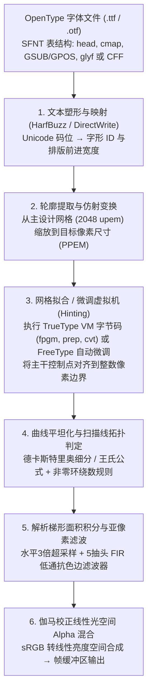
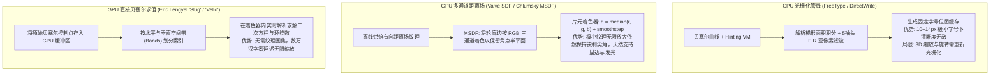

试想用高倍放大镜观察你正在阅读的这块屏幕。在标准桌面显示器（$96\,\text{DPI}$）上，常用的 $12\,\text{px}$（即 $9\,\text{pt}$）正文字号意味着每一个字符都必须被塞进一个仅有 $12 \times 12 = 144$ 个微小发光像素组成的离散棋盘格中。

然而，在这区区 $144$ 个像素方格内，操作系统每秒钟能够实时渲染出数以万计的复杂字形——无论是多达 $29$ 画的汉字“鬱”、$16$ 画的“薔”，还是结构精密的拉丁衬线体小写字母“`g`”与拥有三根等距竖画（Stem）的“`m`”。令人惊叹的是，每一根竖画都保持着均匀的粗细与黑度，密集的横画既不会粘连成一团黑墨，也不会掉进像素中心之间的缝隙而凭空消失（Dropout），斜线与弧线更没有恼人的锯齿状阶梯（Jaggies）。

从<strong>信息论</strong>与<strong>数字信号处理（DSP）</strong>的视角来看，这几乎是一场对抗<strong>奈奎斯特-香农采样定理（Nyquist-Shannon Sampling Theorem）</strong>物理极限的工程奇迹。如果直接将 $29$ 画的高精度矢量汉字按几何比例缩小并投影到 $12 \times 12$ 的粗糙网格上，超过奈奎斯特极限的空间高频分量将产生严重的混叠伪影（Aliasing），使文字彻底坍缩成一团无法辨认的灰色噪点。

支撑日常清晰阅读体验的背后，凝聚了半个世纪计算机科学的巅峰智慧：<strong>计算几何学</strong>（伯恩斯坦多项式与参数样条）、<strong>代数拓扑学</strong>（平面有向曲线的环绕数）、<strong>编译器与虚拟机架构</strong>（隐藏在每个 `.ttf` 字体文件内部的堆栈式字节码虚拟机）、<strong>人类视觉心理物理学与FIR数字滤波器设计</strong>（ClearType亚像素渲染）、<strong>辐射度色彩科学</strong>（线性光空间的伽马校正合成），以及<strong>现代GPU并行着色器算法</strong>（MSDF与直接贝塞尔曲线求值）。本文将完整推导从轮廓数学方程到屏幕RGB亚像素光子发射的全过程。

---

## 1. 从点阵字体的桎梏到分辨率无关的轮廓字体

计算机早期（如日本PC-9801的 $16 \times 16$ 汉字ROM、早期Macintosh系统字体以及X11的BDF格式）普遍采用<strong>点阵字体（Bitmap Font）</strong>，即将每个字形（Glyph）直接存储为二维二值矩阵 $M \in \{0, 1\}^{H \times W}$。虽然人工逐像素雕刻的点阵在特定字号下极为锐利，但它具有致命的<strong>分辨率依赖性（Resolution Dependence）</strong>：一旦进行非整数倍缩放或旋转，就会产生严重的锯齿或模糊；为 $72\,\text{DPI}$ 屏幕设计的点阵无法用于 $300\,\text{DPI}$ 激光打印机或 $2400\,\text{DPI}$ 照排机。

为了彻底实现分辨率无关性，20世纪80年代初，离开施乐帕洛阿尔托研究中心（Xerox PARC）的 <strong>John Warnock</strong> 与 <strong>Chuck Geschke</strong> 创立了 Adobe，推出 <strong>PostScript</strong> 页面描述语言与 <strong>Type 1 字体</strong>（1984年），用三次贝塞尔曲线定义字形轮廓，并将低分辨率微调（Hinting）算法加密封装。为打破 Adobe 的垄断，Apple 与 Microsoft 联手于1991年推出 <strong>TrueType</strong>（`.ttf`），改用计算更快的二次贝塞尔曲线，并将微调逻辑设计为公开规范的堆栈式虚拟机字节码。1996年，双方达成和解并联合发布 <strong>OpenType</strong>（ISO/IEC 14496-22），将 TrueType 的 `glyf` 表（二次曲线）与 PostScript 的 `CFF`/`CFF2` 表（三次曲线）统一在同一个 SFNT 容器格式之中。

---

## 2. 轮廓字体的计算几何学：伯恩斯坦基多项式与贝塞尔曲线

### 伯恩斯坦基多项式的四大数学性质

为什么字体轮廓不使用普通的幂基多项式 $y = a_3 x^3 + a_2 x^2 + a_1 x + a_0$？因为显式函数 $y(x)$ 无法表示垂直切线（斜率 $\infty$），在旋转变换下数值极不稳定，且系数毫无几何直观性。法国汽车工程师 <strong>Paul de Casteljau</strong>（雪铁龙，1959）与 <strong>Pierre Bézier</strong>（雷诺，1962）引入了以<strong>伯恩斯坦基多项式（Bernstein Basis Polynomials）</strong>为基础的参数曲线。给定 $n+1$ 个控制点 $\mathbf{P}_0, \mathbf{P}_1, \dots, \mathbf{P}_n \in \mathbb{R}^2$，$n$ 次贝塞尔曲线定义为：

$$\mathbf{B}_n(t) = \sum_{i=0}^{n} B_{i,n}(t)\,\mathbf{P}_i, \qquad B_{i,n}(t) = \binom{n}{i} (1 - t)^{n - i} t^i, \qquad t \in [0, 1]$$

伯恩斯坦基函数赋予了贝塞尔曲线四个完美的数学不变性：

1. <strong>非负性与单位分解（Partition of Unity）带来的凸包性（Convex Hull Property）</strong>：
   在 $t \in [0, 1]$ 上恒有 $B_{i,n}(t) \ge 0$，且由二项式定理可知权重之和恒等于 $1$：
   $$\sum_{i=0}^{n} B_{i,n}(t) = \sum_{i=0}^{n} \binom{n}{i} (1 - t)^{n - i} t^i = \bigl((1 - t) + t\bigr)^n = 1$$
   这意味着曲线上的任意一点都是控制点的<strong>凸组合（Convex Combination）</strong>，整条曲线必然严格位于控制点构成的<strong>凸包（Convex Hull）</strong>内部。光栅化器只需检查控制点的最小/最大坐标（包围盒），就能以 $O(1)$ 时间快速剔除不与当前扫描线相交的曲线。
2. <strong>仿射不变性（Affine Invariance）</strong>：
   对整条曲线进行任意旋转、缩放、斜切或平移变换 $\Phi(\mathbf{x}) = A\mathbf{x} + \mathbf{b}$，完全等价于先对寥寥几个控制点执行变换 $\Phi(\mathbf{P}_i)$，再求值贝塞尔曲线：$\Phi(\mathbf{B}_n(t)) = \sum B_{i,n}(t)\,\Phi(\mathbf{P}_i)$。
3. <strong>端点插值与切线方向控制</strong>：
   $\mathbf{B}_n(0) = \mathbf{P}_0$，$\mathbf{B}_n(1) = \mathbf{P}_n$，且端点导数为 $\mathbf{B}_n'(0) = n(\mathbf{P}_1 - \mathbf{P}_0)$ 与 $\mathbf{B}_n'(1) = n(\mathbf{P}_n - \mathbf{P}_{n-1})$。要使两段曲线在连接处达到 $G^1$ 或 $C^1$ 光滑连续，只需让连接点与前后两个离轨控制点（Off-curve handles）三点共线即可。
4. <strong>变差缩减性（Variation Diminishing Property）</strong>：
   任何直线（如扫描线 $y = y_s$）与贝塞尔曲线的交点个数，绝不会超过该直线与控制多边形的交点个数，保证曲线不会产生多余的寄生振荡。

---

### 二次贝塞尔曲线（TrueType） vs. 三次贝塞尔曲线（OpenType CFF）

- <strong>二次贝塞尔曲线（$n=2$，TrueType `glyf` 表）</strong>：
  $$\mathbf{B}_2(t) = (1-t)^2 \mathbf{P}_0 + 2(1-t)t \mathbf{P}_1 + t^2 \mathbf{P}_2 = (\mathbf{P}_0 - 2\mathbf{P}_1 + \mathbf{P}_2)t^2 + 2(\mathbf{P}_1 - \mathbf{P}_0)t + \mathbf{P}_0$$
  TrueType 选择二次曲线有两个精妙原因：第一，求扫描线 $y = y_s$ 与曲线的交点只需解一元二次方程，仅需一次开方运算；第二，<strong>隐式在轨中点（Implicit On-Curve Midpoints）压缩</strong>。当两段二次曲线在点 $\mathbf{M}$ 处满足 $C^1$ 导数连续时，必有 $2(\mathbf{M} - \mathbf{P}_1) = 2(\mathbf{P}_2 - \mathbf{M})$，即 $\mathbf{M} = \frac{1}{2}(\mathbf{P}_1 + \mathbf{P}_2)$。因此，当 `glyf` 数据流中连续出现两个离轨控制点 $\mathbf{P}_1, \mathbf{P}_2$ 时，解码器会自动在其中点生成在轨连接点 $\mathbf{M}$，从而节省约 $30\%$ 的坐标存储空间！

- <strong>三次贝塞尔曲线（$n=3$，PostScript / OpenType `CFF` 表）</strong>：
  $$\mathbf{B}_3(t) = (1-t)^3 \mathbf{P}_0 + 3(1-t)^2 t \mathbf{P}_1 + 3(1-t)t^2 \mathbf{P}_2 + t^3 \mathbf{P}_3$$
  二次曲线的二阶导数 $\mathbf{B}_2''(t) = 2(\mathbf{P}_0 - 2\mathbf{P}_1 + \mathbf{P}_2)$ 是常数向量（抛物线弧），其有向曲率 $\kappa(t) = (\mathbf{B}' \times \mathbf{B}'') / \|\mathbf{B}'\|^3$ 的分子符号永远不变，因此<strong>单段二次曲线绝不可能包含拐点（Inflection Point，如字母 `S` 的脊线）</strong>，且固定两端切线方向后曲率半径毫无调节自由度。而三次曲线的二阶导数是 $t$ 的线性函数，不仅能用单段曲线优雅地描绘 `S` 形拐点，还能独立调节两端手柄长度以实现 $G^2$ 曲率连续。

| 对比维度 | 二次贝塞尔曲线 ($n=2$, TrueType `glyf`) | 三次贝塞尔曲线 ($n=3$, OpenType `CFF`/`CFF2`) |
| :--- | :--- | :--- |
| <strong>参数方程 $\mathbf{B}(t)$</strong> | $(1-t)^2\mathbf{P}_0 + 2(1-t)t\mathbf{P}_1 + t^2\mathbf{P}_2$ | $(1-t)^3\mathbf{P}_0 + 3(1-t)^2t\mathbf{P}_1 + 3(1-t)t^2\mathbf{P}_2 + t^3\mathbf{P}_3$ |
| <strong>单段曲线内的拐点数量</strong> | $0$（曲率符号恒定，无法单独表示 `S` 形） | 最多 $2$ 个（单段即可表示 `S` 形拐点与环） |
| <strong>固定端点切线后的自由度</strong> | $0$（控制点 $\mathbf{P}_1$ 被锁定在两切线交点） | $2$（可通过两端手柄长度独立调节 $G^2$ 曲率） |
| <strong>二进制压缩机制</strong> | 连续离轨点自动插值隐式中点 $\mathbf{M} = \frac{1}{2}(\mathbf{P}_1+\mathbf{P}_2)$ | 基于堆栈的 CharString 子程序与差分编码 |

### 德卡斯特里奥（De Casteljau）细分算法与王氏平坦化公式

光栅化器通过<strong>德卡斯特里奥递推线性插值</strong>同时完成求值与曲线二分：

$$\mathbf{P}_i^{(r)}(t) = (1 - t)\,\mathbf{P}_i^{(r-1)}(t) + t\,\mathbf{P}_{i+1}^{(r-1)}(t) \qquad (r = 1, \dots, n;\; i = 0, \dots, n - r)$$

取中点 $t = \frac{1}{2}$ 时，所有插值简化为整数加法与右移一位（`>> 1`）。现代引擎（如 FreeType）进一步利用<strong>王氏公式（Wang's Formula, 1985）</strong>在循环前直接算出使弦误差小于容差 $\tau$ 所需的均匀分段数 $N$：

$$N = \left\lceil \sqrt{ \frac{n(n-1)}{8\tau} \max_{0 \le i \le n-2} \|\mathbf{P}_{i+2} - 2\mathbf{P}_{i+1} + \mathbf{P}_i\| } \right\rceil$$

---

## 3. 扫描线光栅化：非零环绕数规则与解析梯形面积积分

### 奇偶规则（Even-Odd） vs. 非零环绕数规则（Non-Zero Winding）

如何判断像素点 $P$ 位于字形内部还是像“`O`”、“`8`”中心的镂空孔洞（Counter）中？
- <strong>奇偶规则</strong>：从 $P$ 向右发射射线，交点数为奇数则在内部，偶数则在外部。但在<strong>可变字体（Variable Fonts）</strong>或笔画交叉处（如“`十`”字重叠轮廓），交点数变为 $2$（偶数），会导致笔画重叠处出现难看的白色空洞！
- <strong>非零环绕数规则</strong>：赋予轮廓方向，计算拓扑环绕数（Winding Number）：
  $$w(P) = \frac{1}{2\pi} \oint_{\partial\Gamma} d\theta = \sum_{\text{crossings}} \operatorname{sgn}(\Delta y) \ne 0$$
  向上穿过扫描线（$\Delta y > 0$）记 $+1$，向下穿过（$\Delta y < 0$）记 $-1$。在 TrueType 中，外轮廓按<strong>顺时针（CW）</strong>绘制，内孔按<strong>逆时针（CCW）</strong>绘制（OpenType CFF 则相反）。因此，孔洞内部 $(+1) + (-1) = 0$ 保持镂空，而同向笔画重叠处 $(-1) + (-1) = -2 \ne 0$ 依然被正确填充，彻底消除了重叠空洞问题。

### 解析梯形面积积分算法（FreeType `ftgrays` / `stb_truetype`）

早期抗锯齿采用 $4 \times 4$ 超采样，仅能提供 $17$ 级灰度且性能低下。Raph Levien 在 Libart 中提出的<strong>解析有向梯形面积积分</strong>（被 FreeType、`stb_truetype`、`font-rs` 采用）能够直接计算轮廓线段在每个 $1 \times 1$ 像素格内切割出的精确几何面积。

设某线段在像素 $(i, j)$ 内部从 $(x_0, y_0)$ 延伸至 $(x_1, y_1)$，其垂直有向高度为 $\Delta y = y_1 - y_0$，相对于像素左边界 $i$ 的水平中点为 $\bar{x} = \frac{1}{2}((x_0 - i) + (x_1 - i)) \in [0, 1]$。该线段对当前像素 $i$ 贡献的右侧有向梯形面积为 $(1 - \bar{x})\Delta y$，对右侧所有像素 $k \ge i+1$ 贡献的矩形覆盖增量为 $\Delta y$。只需在扫描线上维护两个差分数组并执行一次从左至右的<strong>前缀和（Prefix Sum）</strong>：

$$C_i = C_{i-1} + \text{delta\_cover}[i], \qquad A_i = C_i + \text{delta\_area}[i], \qquad \alpha_i = \min\bigl(1.0,\; |A_i|\bigr)$$

即可在 $O(W + E)$ 时间内算出精确到 $256$ 级灰度的覆盖率 $\alpha_i \in [0, 1]$。

---

## 4. 字体内部的字节码虚拟机：网格拟合（Hinting）与三大哲学流派

### 低分辨率下的采样相位灾难

如果直接将未微调（Unhinted）的小写字母“`m`”缩放到 $12\,\text{px}$，设三根竖画宽度均为 $0.8\,\text{px}$，间距为 $1.5\,\text{px}$：
- 第一根竖画落在 $x \in [1.1, 1.9]$，几乎独占像素 $1$（$\alpha = 0.80$，锐利黑线）；
- 第二根竖画落在 $x \in [3.4, 4.2]$，跨在像素边界 $x=4.0$ 上，分裂为像素 $3$（$\alpha = 0.60$）和像素 $4$（$\alpha = 0.20$），变成一条<strong>宽达2像素的模糊灰带</strong>！
- 第三根竖画落在 $x \in [5.7, 6.5]$，变成不对称的灰色边缘。

更糟的是，汉字“鬱”的密集横画或“`e`”的横杠可能因跨界稀释而消失，或粘连成黑块。

### TrueType 堆栈式虚拟机（TrueType VM）

为了解决相位偏移，TrueType 将每个字体文件设计成了包含四大字节码表（`cvt ` 控制值表、`fpgm` 字体程序、`prep` 预程序、`glyf` 字形指令）的<strong>堆栈式虚拟机程序</strong>！VM 在 $26.6$ 定点数精度（$\frac{1}{64}$ 像素）下运行，通过<strong>投影向量（$\mathbf{P}$，测量距离的方向）</strong>与<strong>自由向量（$\mathbf{F}$，允许移动控制点的方向）</strong>操控几何约束：
1. `MDAP[1]`（Move Direct Absolute Point）：将第一根竖画左边缘对齐（Snap）到整数像素网格并标记为“已触碰（Touched）”；
2. `MIRP`（Move Indirect Relative Point）：读取全局 `cvt` 表中的标准竖画宽度，通过切入阈值（Single-Width Cut-In）与最小距离保障（Minimum Distance，防止笔画缩为 $0\,\text{px}$），将右边缘锁定在恰好 $+1.0\,\text{px}$ 处；
3. `DELTAP1`：针对特定字号（如仅在 $12\,\text{ppem}$ 时）对个别控制点实施 $\pm \frac{1}{8}\,\text{px}$ 的外科手术级微调；
4. `IUP[0]` / `IUP[1]`（Interpolate Untouched Points）：将所有未触碰的曲线控制点在已触碰的骨架点之间按比例平滑线性插值，保证曲线变形后依然自然流畅。

### 微软 vs. 苹果 vs. FreeType 的渲染哲学交锋

- <strong>微软哲学（GDI / ClearType：像素网格至上）</strong>：宁可改变字体的原始设计比例与字宽，也要强行将所有笔画边缘对齐到整数像素网格，在 $96\,\text{DPI}$ 屏幕上呈现刀锋般锐利的黑白对比度。
- <strong>苹果哲学（Quartz / CoreText：设计忠实度与所见即所得）</strong>：坚持字形轮廓神圣不可侵犯，完全忽略 TrueType 字节码微调，宁可在低分屏上轻微模糊也要保持真实的字重层次与印刷排版一致性，并在 Retina 高分屏时代大获全胜。
- <strong>FreeType 自动微调器（`autofit`）与现代仅垂直微调（Y-only Hinting）</strong>：实时分析字形轮廓提取主干与蓝区（Blue Zones），无需手工编写字节码即可完成网格对齐；现代 DirectWrite 与 FreeType 普遍采用“仅在垂直 Y 轴做轻微对齐，水平 X 轴交由亚像素抗锯齿自由定位”的混合策略。

---

## 5. 亚像素渲染（ClearType）与伽马校正线性光混合

### 5抽头 Gibson FIR 滤波器

标准 LCD 屏幕的每个像素由水平排列的红（$R$）、绿（$G$）、蓝（$B$）三个条状亚像素组成，间距为 $\frac{1}{3}$ 像素。利用人类视觉系统<strong>对亮度（Luminance, $Y = 0.2126R + 0.7152G + 0.0722B$）空间分辨率极高、而对色度（Chrominance）空间分辨率极低</strong>的生理特性，光栅化器可以在水平方向进行 <strong>$3\times$ 超采样</strong>，将水平有效分辨率提升三倍！

若直接将 $3\times$ 覆盖率赋给 $(R,G,B)$，单亚像素边缘会产生刺眼的青色或黄色伪影（Color Fringing）。通过将3亚像素重构盒式滤波器 $\frac{1}{3}[1, 1, 1]$ 与3通道色彩平衡核 $\frac{1}{3}[1, 1, 1]$ 进行离散卷积，可导出著名的 <strong>5抽头对称三角 FIR 低通滤波器（Gibson Filter）</strong>：

$$h_{\text{Gibson}} = \left[\frac{1}{3},\; \frac{1}{3},\; \frac{1}{3}\right] * \left[\frac{1}{3},\; \frac{1}{3},\; \frac{1}{3}\right] = \left[\frac{1}{9},\; \frac{2}{9},\; \frac{3}{9},\; \frac{2}{9},\; \frac{1}{9}\right]$$

按模 $3$ 分组求和可见：$\frac{3}{9} = \frac{2}{9} + \frac{1}{9} = \frac{1}{3}$，任何单亚像素脉冲的能量都会严格均等地分配给 $R, G, B$ 三个通道，从而在保留 $\frac{1}{3}$ 像素相位精度的同时彻底消除彩色边缘！

### 伽马校正线性空间混合

覆盖率 $\alpha$ 代表物理光子通量（线性亮度 $L$）的比例，而 sRGB 帧缓冲区存储的是非线性编码值 $V = L^{1/\gamma}$（$\gamma \approx 2.2$）。若直接在 sRGB 空间混合，$\alpha = 0.5$ 会产生 $L = 0.5^{2.2} \approx 21.8\%$ 的物理亮度（而非 $50\%$），导致白底黑字变细发虚、黑底白字（暗黑模式）异常发胖且重现彩色伪影。正确的亚像素合成必须在<strong>线性光空间</strong>中对每个通道 $c \in \{R, G, B\}$ 独立计算：

$$C_{\text{out}, c} = \Bigl( \alpha_c \, C_{\text{fg}, c}^{\gamma} + (1 - \alpha_c) \, C_{\text{bg}, c}^{\gamma} \Bigr)^{1/\gamma}, \qquad \gamma \approx 2.2$$

---

## 6. GPU 时代的字体渲染：SDF、MSDF 与直接贝塞尔着色器（`Slug`）

在 3D 游戏引擎与高刷 UI 中，<strong>Chris Green（Valve, 2007）</strong>提出了<strong>有向距离场（SDF）</strong>渲染：纹理不再存储覆盖率 $\alpha$，而是存储到最近轮廓边界的有向欧氏距离 $d(\mathbf{p})$。由于直线边界的距离场是线性平面，双线性插值能够精确重构零等值面 $d(\mathbf{p}) = 0$，配合 `smoothstep(-w, +w, d)`（其中 $w \approx 0.5\,\operatorname{fwidth}(d)$）实现任意倍率下的锐利边缘。

为解决单通道 SDF 放大时尖角变圆的缺陷，<strong>Viktor Chlumský（2015）</strong>发明了<strong>多通道有向距离场（MSDF / `msdfgen`）</strong>：用 RGB 组合对相交于尖角的两条边分别编码，并在片元着色器中取三通道<strong>中位数（Median）</strong>：

$$d_{\text{MSDF}} = \operatorname{median}(r, g, b) = \max\Bigl(\min(r, g),\; \min\bigl(\max(r, g),\; b\bigr)\Bigr)$$

从而完美还原两个半平面的布尔交集（凸角）与并集（凹角）。而对于笔画极度密集的汉字，<strong>Eric Lengyel 的 `Slug` 算法（2017）</strong>与 <strong>Raph Levien 的 `Vello`</strong> 更进一步，完全摒弃距离纹理，将贝塞尔控制点按空间带（Bands）直接送入 GPU 缓冲区，利用 3 位等价类掩码在片元着色器中实时求解射线交点与环绕数，实现了真正意义上的无限分辨率矢量渲染。
