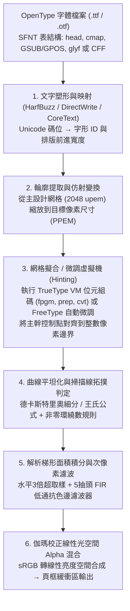
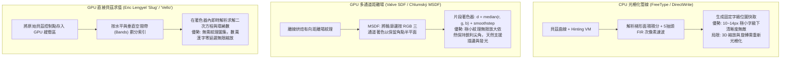

試想用高倍放大鏡觀察你正在閱讀的這塊螢幕。在標準桌面顯示器（$96\,\text{DPI}$）上，常用的 $12\,\text{px}$（即 $9\,\text{pt}$）內文字級意味著每一個字元都必須被塞進一個僅有 $12 \times 12 = 144$ 個微小發光像素組成的離散棋盤格中。

然而，在這區區 $144$ 個像素方格內，作業系統每秒鐘能夠即時渲染出數以萬計的複雜字形——無論是多達 $29$ 畫的漢字「鬱」、$16$ 畫的「薔」，還是結構精密的拉丁襯線體小寫字母「`g`」與擁有三根等距豎筆（Stem）的「`m`」。令人驚嘆的是，每一根豎筆都保持著均勻的粗細與黑度，密集的橫畫既不會黏連成一團黑墨，也不會掉進像素中心之間的縫隙而憑空消失（Dropout），斜線與弧線更沒有惱人的鋸齒狀階梯（Jaggies）。

從<strong>資訊理論</strong>與<strong>數位訊號處理（DSP）</strong>的視角來看，這幾乎是一場對抗<strong>奈奎斯特-香農取樣定理（Nyquist-Shannon Sampling Theorem）</strong>物理極限的工程奇蹟。如果直接將 $29$ 畫的高精度向量漢字按幾何比例縮小並投影到 $12 \times 12$ 的粗糙網格上，超過奈奎斯特極限的空間高頻分量將產生嚴重的混疊偽影（Aliasing），使文字徹底坍縮成一團無法辨認的灰色噪點。

支撐日常清晰閱讀體驗的背後，凝聚了半個世紀電腦科學的巔峰智慧：<strong>計算幾何學</strong>（伯恩斯坦多項式與參數樣條）、<strong>代數拓撲學</strong>（平面有向曲線的環繞數）、<strong>編譯器與虛擬機架構</strong>（隱藏在每個 `.ttf` 字體檔案內部的堆疊式位元組碼虛擬機）、<strong>人類視覺心理物理學與FIR數位濾波器設計</strong>（ClearType次像素渲染）、<strong>輻射度色彩科學</strong>（線性光空間的伽瑪校正合成），以及<strong>現代GPU平行著色器演算法</strong>（MSDF與直接貝茲曲線求值）。本文將完整推導從輪廓數學方程到螢幕RGB次像素光子發射的全過程。

---

## 1. 從點陣字體的桎梏到解析度無關的輪廓字體

電腦早期（如日本PC-9801的 $16 \times 16$ 漢字ROM、早期Macintosh系統字體以及X11的BDF格式）普遍採用<strong>點陣字體（Bitmap Font）</strong>，即將每個字形（Glyph）直接儲存為二維二值矩陣 $M \in \{0, 1\}^{H \times W}$。雖然人工逐像素雕刻的點陣在特定字級下極為銳利，但它具有致命的<strong>解析度依賴性（Resolution Dependence）</strong>：一旦進行非整數倍縮放或旋轉，就會產生嚴重的鋸齒或模糊；為 $72\,\text{DPI}$ 螢幕設計的點陣無法用於 $300\,\text{DPI}$ 雷射印表機或 $2400\,\text{DPI}$ 商業照排機。

為了徹底實現解析度無關性，1980年代初，離開 Xerox PARC 的 <strong>John Warnock</strong> 與 <strong>Chuck Geschke</strong> 創立了 Adobe，推出 <strong>PostScript</strong> 頁面描述語言與 <strong>Type 1 字體</strong>（1984年），用三次貝茲曲線定義字形輪廓，並將低解析度微調（Hinting）演算法加密封裝。為打破 Adobe 的壟斷，Apple 與 Microsoft 聯手於1991年推出 <strong>TrueType</strong>（`.ttf`），改用計算更快的二次貝茲曲線，並將微調邏輯設計為公開規範的堆疊式虛擬機位元組碼。1996年，雙方達成和解並聯合發布 <strong>OpenType</strong>（ISO/IEC 14496-22），將 TrueType 的 `glyf` 表（二次曲線）與 PostScript 的 `CFF`/`CFF2` 表（三次曲線）統一在同一個 SFNT 容器格式之中。

---

## 2. 輪廓字體的計算幾何學：伯恩斯坦基底多項式與貝茲曲線

### 伯恩斯坦基底多項式的四大數學性質

為什麼字體輪廓不使用普通的冪基底多項式 $y = a_3 x^3 + a_2 x^2 + a_1 x + a_0$？因為顯式函數 $y(x)$ 無法表示垂直切線（斜率 $\infty$），在旋轉變換下數值極不穩定，且係數毫無幾何直觀性。法國汽車工程師 <strong>Paul de Casteljau</strong>（雪鐵龍，1959）與 <strong>Pierre Bézier</strong>（雷諾，1962）引入了以<strong>伯恩斯坦基底多項式（Bernstein Basis Polynomials）</strong>為基礎的參數曲線。給定 $n+1$ 個控制點 $\mathbf{P}_0, \mathbf{P}_1, \dots, \mathbf{P}_n \in \mathbb{R}^2$，$n$ 次貝茲曲線定義為：

$$\mathbf{B}_n(t) = \sum_{i=0}^{n} B_{i,n}(t)\,\mathbf{P}_i, \qquad B_{i,n}(t) = \binom{n}{i} (1 - t)^{n - i} t^i, \qquad t \in [0, 1]$$

伯恩斯坦基底函數賦予了貝茲曲線四個完美的數學不變性：

1. <strong>非負性與單位分解（Partition of Unity）帶來的凸包性（Convex Hull Property）</strong>：
   在 $t \in [0, 1]$ 上恆有 $B_{i,n}(t) \ge 0$，且由二項式定理可知權重之和恆等於 $1$：
   $$\sum_{i=0}^{n} B_{i,n}(t) = \sum_{i=0}^{n} \binom{n}{i} (1 - t)^{n - i} t^i = \bigl((1 - t) + t\bigr)^n = 1$$
   這意味著曲線上的任意一點都是控制點的<strong>凸組合（Convex Combination）</strong>，整條曲線必然嚴格位於控制點構成的<strong>凸包（Convex Hull）</strong>內部。光柵化器只需檢查控制點的最小/最大座標（包圍盒），就能以 $O(1)$ 時間快速剔除不與當前掃描線相交的曲線。
2. <strong>仿射不變性（Affine Invariance）</strong>：
   對整條曲線進行任意旋轉、縮放、斜切或平移變換 $\Phi(\mathbf{x}) = A\mathbf{x} + \mathbf{b}$，完全等價於先對寥寥幾個控制點執行變換 $\Phi(\mathbf{P}_i)$，再求值貝茲曲線：$\Phi(\mathbf{B}_n(t)) = \sum B_{i,n}(t)\,\Phi(\mathbf{P}_i)$。
3. <strong>端點插值與切線方向控制</strong>：
   $\mathbf{B}_n(0) = \mathbf{P}_0$，$\mathbf{B}_n(1) = \mathbf{P}_n$，且端點導數為 $\mathbf{B}_n'(0) = n(\mathbf{P}_1 - \mathbf{P}_0)$ 與 $\mathbf{B}_n'(1) = n(\mathbf{P}_n - \mathbf{P}_{n-1})$。要使兩段曲線在連接處達到 $G^1$ 或 $C^1$ 光滑連續，只需讓連接點與前後兩個離軌控制點（Off-curve handles）三點共線即可。
4. <strong>變差縮減性（Variation Diminishing Property）</strong>：
   任何直線（如掃描線 $y = y_s$）與貝茲曲線的交點個數，絕不會超過該直線與控制多邊形的交點個數，保證曲線不會產生多餘的寄生振盪。

---

### 二次貝茲曲線（TrueType） vs. 三次貝茲曲線（OpenType CFF）

- <strong>二次貝茲曲線（$n=2$，TrueType `glyf` 表）</strong>：
  $$\mathbf{B}_2(t) = (1-t)^2 \mathbf{P}_0 + 2(1-t)t \mathbf{P}_1 + t^2 \mathbf{P}_2 = (\mathbf{P}_0 - 2\mathbf{P}_1 + \mathbf{P}_2)t^2 + 2(\mathbf{P}_1 - \mathbf{P}_0)t + \mathbf{P}_0$$
  TrueType 選擇二次曲線有兩個精妙原因：第一，求掃描線 $y = y_s$ 與曲線的交點只需解一元二次方程，僅需一次開方運算；第二，<strong>隱式在軌中點（Implicit On-Curve Midpoints）壓縮</strong>。當兩段二次曲線在點 $\mathbf{M}$ 處滿足 $C^1$ 導數連續時，必有 $2(\mathbf{M} - \mathbf{P}_1) = 2(\mathbf{P}_2 - \mathbf{M})$，即 $\mathbf{M} = \frac{1}{2}(\mathbf{P}_1 + \mathbf{P}_2)$。因此，當 `glyf` 資料流中連續出現兩個離軌控制點 $\mathbf{P}_1, \mathbf{P}_2$ 時，解碼器會自動在其中點生成在軌連接點 $\mathbf{M}$，從而節省約 $30\%$ 的座標儲存空間！

- <strong>三次貝茲曲線（$n=3$，PostScript / OpenType `CFF` 表）</strong>：
  $$\mathbf{B}_3(t) = (1-t)^3 \mathbf{P}_0 + 3(1-t)^2 t \mathbf{P}_1 + 3(1-t)t^2 \mathbf{P}_2 + t^3 \mathbf{P}_3$$
  二次曲線的二階導數 $\mathbf{B}_2''(t) = 2(\mathbf{P}_0 - 2\mathbf{P}_1 + \mathbf{P}_2)$ 是常數向量（拋物線弧），其有向曲率 $\kappa(t) = (\mathbf{B}' \times \mathbf{B}'') / \|\mathbf{B}'\|^3$ 的分子符號永遠不變，因此<strong>單段二次曲線絕不可能包含反曲點（Inflection Point，如字母 `S` 的脊線）</strong>，且固定兩端切線方向後曲率半徑毫無調節自由度。而三次曲線的二階導數是 $t$ 的線性函數，不僅能用單段曲線優雅地描繪 `S` 形反曲點，還能獨立調節兩端控制桿長度以實現 $G^2$ 曲率連續。

| 對比維度 | 二次貝茲曲線 ($n=2$, TrueType `glyf`) | 三次貝茲曲線 ($n=3$, OpenType `CFF`/`CFF2`) |
| :--- | :--- | :--- |
| <strong>參數方程 $\mathbf{B}(t)$</strong> | $(1-t)^2\mathbf{P}_0 + 2(1-t)t\mathbf{P}_1 + t^2\mathbf{P}_2$ | $(1-t)^3\mathbf{P}_0 + 3(1-t)^2t\mathbf{P}_1 + 3(1-t)t^2\mathbf{P}_2 + t^3\mathbf{P}_3$ |
| <strong>單段曲線內的反曲點數量</strong> | $0$（曲率符號恆定，無法單獨表示 `S` 形） | 最多 $2$ 個（單段即可表示 `S` 形反曲點與環） |
| <strong>固定端點切線後的自由度</strong> | $0$（控制點 $\mathbf{P}_1$ 被鎖定在兩切線交點） | $2$（可透過兩端控制桿長度獨立調節 $G^2$ 曲率） |
| <strong>二進位壓縮機制</strong> | 連續離軌點自動插值隱式中點 $\mathbf{M} = \frac{1}{2}(\mathbf{P}_1+\mathbf{P}_2)$ | 基於堆疊的 CharString 子常式與差分編碼 |

### 德卡斯特里奧（De Casteljau）細分演算法與王氏平坦化公式

光柵化器透過<strong>德卡斯特里奧遞迴線性插值</strong>同時完成求值與曲線二分：

$$\mathbf{P}_i^{(r)}(t) = (1 - t)\,\mathbf{P}_i^{(r-1)}(t) + t\,\mathbf{P}_{i+1}^{(r-1)}(t) \qquad (r = 1, \dots, n;\; i = 0, \dots, n - r)$$

取中點 $t = \frac{1}{2}$ 時，所有插值簡化為整數加法與右移一位（`>> 1`）。現代引擎（如 FreeType）進一步利用<strong>王氏公式（Wang's Formula, 1985）</strong>在迴圈前直接算出使弦誤差小於容差 $\tau$ 所需的均勻分段數 $N$：

$$N = \left\lceil \sqrt{ \frac{n(n-1)}{8\tau} \max_{0 \le i \le n-2} \|\mathbf{P}_{i+2} - 2\mathbf{P}_{i+1} + \mathbf{P}_i\| } \right\rceil$$

---

## 3. 掃描線光柵化：非零環繞數規則與解析梯形面積積分

### 奇偶規則（Even-Odd） vs. 非零環繞數規則（Non-Zero Winding）

如何判斷像素點 $P$ 位於字形內部還是像「`O`」、「`8`」中心的鏤空孔洞（Counter）中？
- <strong>奇偶規則</strong>：從 $P$ 向右發射射線，交點數為奇數則在內部，偶數則在外部。但在<strong>可變字體（Variable Fonts）</strong>或筆畫交叉處（如「`十`」字重疊輪廓），交點數變為 $2$（偶數），會導致筆畫重疊處出現難看的白色空洞！
- <strong>非零環繞數規則</strong>：賦予輪廓方向，計算拓撲環繞數（Winding Number）：
  $$w(P) = \frac{1}{2\pi} \oint_{\partial\Gamma} d\theta = \sum_{\text{crossings}} \operatorname{sgn}(\Delta y) \ne 0$$
  向上穿過掃描線（$\Delta y > 0$）記 $+1$，向下穿過（$\Delta y < 0$）記 $-1$。在 TrueType 中，外輪廓按<strong>順時針（CW）</strong>繪製，內孔按<strong>逆時針（CCW）</strong>繪製（OpenType CFF 則相反）。因此，孔洞內部 $(+1) + (-1) = 0$ 保持鏤空，而同向筆畫重疊處 $(-1) + (-1) = -2 \ne 0$ 依然被正確填滿，徹底消除了重疊空洞問題。

### 解析梯形面積積分演算法（FreeType `ftgrays` / `stb_truetype`）

早期抗鋸齒採用 $4 \times 4$ 超取樣，僅能提供 $17$ 級灰階且效能低下。Raph Levien 在 Libart 中提出的<strong>解析有向梯形面積積分</strong>（被 FreeType、`stb_truetype`、`font-rs` 採用）能夠直接計算輪廓線段在每個 $1 \times 1$ 像素格內切割出的精確幾何面積。

設某線段在像素 $(i, j)$ 內部從 $(x_0, y_0)$ 延伸至 $(x_1, y_1)$，其垂直有向高度為 $\Delta y = y_1 - y_0$，相對於像素左邊界 $i$ 的水平中點為 $\bar{x} = \frac{1}{2}((x_0 - i) + (x_1 - i)) \in [0, 1]$。該線段對當前像素 $i$ 貢獻的右側有向梯形面積為 $(1 - \bar{x})\Delta y$，對右側所有像素 $k \ge i+1$ 貢獻的矩形覆蓋增量為 $\Delta y$。只需在掃描線上維護兩個差分陣列並執行一次從左至右的<strong>前綴和（Prefix Sum）</strong>：

$$C_i = C_{i-1} + \text{delta\_cover}[i], \qquad A_i = C_i + \text{delta\_area}[i], \qquad \alpha_i = \min\bigl(1.0,\; |A_i|\bigr)$$

即可在 $O(W + E)$ 時間內算出精確到 $256$ 級灰階的覆蓋率 $\alpha_i \in [0, 1]$。

---

## 4. 字體內部的位元組碼虛擬機：網格擬合（Hinting）與三大哲學流派

### 低解析度下的取樣相位災難

如果直接將未微調（Unhinted）的小寫字母「`m`」縮放到 $12\,\text{px}$，設三根豎筆寬度均為 $0.8\,\text{px}$，間距為 $1.5\,\text{px}$：
- 第一根豎筆落在 $x \in [1.1, 1.9]$，幾乎獨佔像素 $1$（$\alpha = 0.80$，銳利黑線）；
- 第二根豎筆落在 $x \in [3.4, 4.2]$，跨在像素邊界 $x=4.0$ 上，分裂為像素 $3$（$\alpha = 0.60$）和像素 $4$（$\alpha = 0.20$），變成一條<strong>寬達2像素的模糊灰帶</strong>！
- 第三根豎筆落在 $x \in [5.7, 6.5]$，變成不對稱的灰色邊緣。

更糟的是，漢字「鬱」的密集橫畫或「`e`」的橫槓可能因跨界稀釋而消失，或黏連成黑塊。

### TrueType 堆疊式虛擬機（TrueType VM）

為了解決相位偏移，TrueType 將每個字體檔案設計成了包含四大位元組碼表（`cvt ` 控制值表、`fpgm` 字體程式、`prep` 預程式、`glyf` 字形指令）的<strong>堆疊式虛擬機程式</strong>！VM 在 $26.6$ 定點數精度（$\frac{1}{64}$ 像素）下執行，透過<strong>投影向量（$\mathbf{P}$，測量距離的方向）</strong>與<strong>自由向量（$\mathbf{F}$，允許移動控制點的方向）</strong>操控幾何約束：
1. `MDAP[1]`（Move Direct Absolute Point）：將第一根豎筆左邊緣對齊（Snap）到整數像素網格並標記為「已觸碰（Touched）」；
2. `MIRP`（Move Indirect Relative Point）：讀取全域 `cvt` 表中的標準豎筆寬度，透過切入閾值（Single-Width Cut-In）與最小距離保障（Minimum Distance，防止筆畫縮為 $0\,\text{px}$），將右邊緣鎖定在恰好 $+1.0\,\text{px}$ 處；
3. `DELTAP1`：針對特定字級（如僅在 $12\,\text{ppem}$ 時）對個別控制點實施 $\pm \frac{1}{8}\,\text{px}$ 的外科手術級微調；
4. `IUP[0]` / `IUP[1]`（Interpolate Untouched Points）：將所有未觸碰的曲線控制點在已觸碰的骨架點之間按比例平滑線性插值，保證曲線變形後依然自然流暢。

### 微軟 vs. 蘋果 vs. FreeType 的渲染哲學交鋒

- <strong>微軟哲學（GDI / ClearType：像素網格至上）</strong>：寧可改變字體的原始設計比例與字寬，也要強行將所有筆畫邊緣對齊到整數像素網格，在 $96\,\text{DPI}$ 螢幕上呈現刀鋒般銳利的黑白對比度。
- <strong>蘋果哲學（Quartz / CoreText：設計忠實度與所見即所得）</strong>：堅持字形輪廓神聖不可侵犯，完全忽略 TrueType 位元組碼微調，寧可在低分屏上輕微模糊也要保持真實的字重層次與印刷排版一致性，並在 Retina 高分屏時代大獲全勝。
- <strong>FreeType 自動微調器（`autofit`）與現代僅垂直微調（Y-only Hinting）</strong>：即時分析字形輪廓提取主幹與藍區（Blue Zones），無需手工編寫位元組碼即可完成網格對齊；現代 DirectWrite 與 FreeType 普遍採用「僅在垂直 Y 軸做輕微對齊，水平 X 軸交由次像素抗鋸齒自由定位」的混合策略。

---

## 5. 次像素渲染（ClearType）與伽瑪校正線性光混合

### 5抽頭 Gibson FIR 濾波器

標準 LCD 螢幕的每個像素由水平排列的紅（$R$）、綠（$G$）、藍（$B$）三個條狀次像素組成，間距為 $\frac{1}{3}$ 像素。利用人類視覺系統<strong>對亮度（Luminance, $Y = 0.2126R + 0.7152G + 0.0722B$）空間解析度極高、而對色度（Chrominance）空間解析度極低</strong>的生理特性，光柵化器可以在水平方向進行 <strong>$3\times$ 超取樣</strong>，將水平有效解析度提升三倍！

若直接將 $3\times$ 覆蓋率賦給 $(R,G,B)$，單次像素邊緣會產生刺眼的青色或黃色偽影（Color Fringing）。透過將3次像素重構盒式濾波器 $\frac{1}{3}[1, 1, 1]$ 與3通道色彩平衡核 $\frac{1}{3}[1, 1, 1]$ 進行離散卷積，可導出著名的 <strong>5抽頭對稱三角 FIR 低通濾波器（Gibson Filter）</strong>：

$$h_{\text{Gibson}} = \left[\frac{1}{3},\; \frac{1}{3},\; \frac{1}{3}\right] * \left[\frac{1}{3},\; \frac{1}{3},\; \frac{1}{3}\right] = \left[\frac{1}{9},\; \frac{2}{9},\; \frac{3}{9},\; \frac{2}{9},\; \frac{1}{9}\right]$$

按模 $3$ 分組求和可見：$\frac{3}{9} = \frac{2}{9} + \frac{1}{9} = \frac{1}{3}$，任何單次像素脈衝的能量都會嚴格均等地分配給 $R, G, B$ 三個通道，從而在保留 $\frac{1}{3}$ 像素相位精度的同時徹底消除彩色邊緣！

### 伽瑪校正線性空間混合

覆蓋率 $\alpha$ 代表物理光子通量（線性亮度 $L$）的比例，而 sRGB 頁框緩衝區儲存的是非線性編碼值 $V = L^{1/\gamma}$（$\gamma \approx 2.2$）。若直接在 sRGB 空間混合，$\alpha = 0.5$ 會產生 $L = 0.5^{2.2} \approx 21.8\%$ 的物理亮度（而非 $50\%$），導致白底黑字變細發虛、黑底白字（深色模式）異常發胖且重現彩色偽影。正確的次像素合成必須在<strong>線性光空間</strong>中對每個通道 $c \in \{R, G, B\}$ 獨立計算：

$$C_{\text{out}, c} = \Bigl( \alpha_c \, C_{\text{fg}, c}^{\gamma} + (1 - \alpha_c) \, C_{\text{bg}, c}^{\gamma} \Bigr)^{1/\gamma}, \qquad \gamma \approx 2.2$$

---

## 6. GPU 時代的字體渲染：SDF、MSDF 與直接貝茲著色器（`Slug`）

在 3D 遊戲引擎與高刷 UI 中，<strong>Chris Green（Valve, 2007）</strong>提出了<strong>有向距離場（SDF）</strong>渲染：紋理不再儲存覆蓋率 $\alpha$，而是儲存到最近輪廓邊界的有向歐氏距離 $d(\mathbf{p})$。由於直線邊界的距離場是線性平面，雙線性插值能夠精確重構零等值面 $d(\mathbf{p}) = 0$，配合 `smoothstep(-w, +w, d)`（其中 $w \approx 0.5\,\operatorname{fwidth}(d)$）實現任意倍率下的銳利邊緣。

為解決單通道 SDF 放大時尖角變圓的缺陷，<strong>Viktor Chlumský（2015）</strong>發明了<strong>多通道有向距離場（MSDF / `msdfgen`）</strong>：用 RGB 組合對相交於尖角的兩條邊分別編碼，並在片段著色器中取三通道<strong>中位數（Median）</strong>：

$$d_{\text{MSDF}} = \operatorname{median}(r, g, b) = \max\Bigl(\min(r, g),\; \min\bigl(\max(r, g),\; b\bigr)\Bigr)$$

從而完美還原兩個半平面的布林交集（凸角）與聯集（凹角）。而對於筆畫極度密集的漢字，<strong>Eric Lengyel 的 `Slug` 演算法（2017）</strong>與 <strong>Raph Levien 的 `Vello`</strong> 更進一步，完全摒棄距離紋理，將貝茲控制點按空間帶（Bands）直接送入 GPU 緩衝區，利用 3 位元等價類遮罩在片段著色器中即時求解射線交點與環繞數，實現了真正意義上的無限解析度向量渲染。
