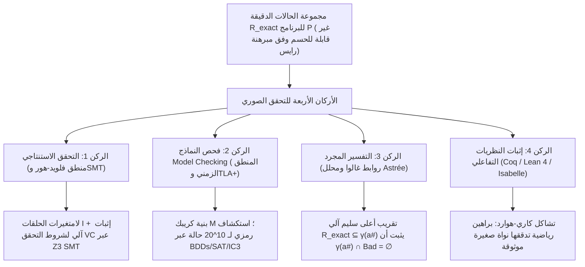
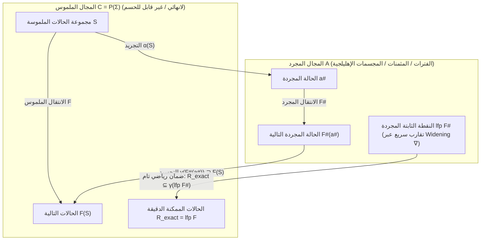

## 1. حدود الاختبار البرمجي وجدار عدم القابلية للحسم: لماذا لا يكفي اجتياز مليون اختبار؟

### 1.1 مقولة ديكسترا الخالدة والانفجار التوافقي لفضاء المدخلات

في عام 1969، وخلال مؤتمر حلف الناتو لهندسة البرمجيات، أطلق العالم الحائز على جائزة تورينغ <strong>إدسخر ديكسترا (Edsger W. Dijkstra)</strong> أشهر قاعدة في تاريخ علوم الحاسوب:

> <strong>"Program testing can be used to show the presence of bugs, but never to show their absence!"</strong>
> (يمكن استخدام اختبار البرامج لإثبات <strong>وجود</strong> الأخطاء، لكن لا يمكن أبداً استخدامه لإثبات <strong>عدم وجودها</strong>!)

لنتأمل دالة بسيطة `f(x, y)` تستقبل عددين صحيحين بطول 64 بت (`int64_t`). إن إجمالي عدد أزواج المدخلات الممكنة هو:

$$N_{\text{inputs}} = 2^{64} \times 2^{64} = 2^{128} \approx 3.4028 \times 10^{38}$$

حتى لو استخدمنا حاسوباً خارقاً ينفذ <strong>مليار ($10^9$) اختبار في الثانية الواحدة</strong>، فإن تجربة جميع المدخلات ستستغرق نحو <strong>$1.08 \times 10^{22}$ سنة</strong> — أي حوالي 780 مليار ضعف عمر الكون! ومع إضافة الذاكرة الديناميكية وتداخل الخيوط المتزامنة (Interleaving)، يقفز عدد مسارات التنفيذ إلى <strong>ما لا نهاية ($\infty$)</strong>.

في عام 2006، كشف <strong>جوشوا بلوخ (Joshua Bloch)</strong> من Google عن خطأ برمجي ظل كامناً لمدة <strong>9 سنوات</strong> في مكتبة Java القياسية (`java.util.Arrays.binarySearch`)، وهو <strong>خطأ الطفح الحسابي (Integer Overflow) في البحث الثنائي</strong>:

```java
public static int binarySearch(int[] a, int key) {
    int low = 0;
    int high = a.length - 1;
    while (low <= high) {
        int mid = (low + high) / 2; // ★ خطأ قاتل: طفح حسابي إلى عدد سالب عندما يكون low + high >= 2^31!
        int midVal = a[mid];
        if (midVal < key) low = mid + 1;
        else if (midVal > key) high = mid - 1;
        else return mid;
    }
    return -(low + 1);
}
```

عندما يتجاوز المجموع `low + high` الحد الأقصى لعدد صحيح بطول 32 بت ($2^{31} - 1 = 2,147,483,647$)، يتحول الناتج إلى عدد سالب، مما يؤدي فوراً إلى انهيار البرنامج بالاستثناء `ArrayIndexOutOfBoundsException`.

### 1.2 مسألة التوقف لتورينغ (1936) ومبرهنة رايس (1953)

لماذا لا نبتكر أداة تحليل ساكن تقرأ الكود المصدري لأي برنامج $P$ وتقرر بدقة 100% ما إذا كان خالياً من الأخطاء؟ تقف <strong>مسألة التوقف لآلان تورينغ (Halting Problem, 1936)</strong> و<strong>مبرهنة رايس (Rice's Theorem, 1953)</strong> سداً منيعاً أمام ذلك:

$$\text{Theorem (Rice, 1953): Every non-trivial semantic property } \mathcal{S} \text{ of computable functions is undecidable.}$$

أي أنه يستحيل رياضياً لأي أداة أن تجمع في وقت واحد بين: <strong>(1) الأتمتة الكاملة</strong>، و<strong>(2) السلامة المنطقية (Soundness: صفر نتائج سلبية كاذبة)</strong>، و<strong>(3) الاكتمال (Completeness: صفر إنذارات كاذبة)</strong>.

### 1.3 كيف يتجاوز التحقق الصوري مبرهنة رايس؟ التقريب الأعلى السليم (Sound Over-Approximation)

يتمسك <strong>التحقق الصوري (Formal Verification)</strong> بشرط <strong>السلامة المنطقية (Soundness)</strong> دون أي مساومة: فإذا أعلنت الأداة أن البرنامج `"SAFE"`، فهو مضمون رياضياً بنسبة 100% ضد الأخطاء عبر جميع المسارات اللانهائية ($\infty$). ولتحقيق ذلك آلياً، تحسب الأداة <strong>تقريباً أعلى سليماً (Sound Over-Approximation)</strong> $\mathcal{R}_{\text{approx}} \supseteq \mathcal{R}_{\text{exact}}$ يحيط بجميع الحالات الممكنة، وتثبت أن تقاطعه مع حالات الخطأ $\mathcal{B}$ خالٍ تماماً:

$$\mathcal{R}_{\text{approx}} \cap \mathcal{B} = \emptyset \implies \mathcal{R}_{\text{exact}} \cap \mathcal{B} = \emptyset$$



---

## 2. الركن الأول: التحقق الاستنتاجي — منطق فلويد-هور، أضعف شرط مسبق، وحلّالات SMT

### 2.1 ثلاثية هور (Hoare Triple) ولامتغيرات الحلقات

في عام 1969، أسس <strong>توني هور (C. A. R. Hoare)</strong> <strong>منطق فلويد-هور</strong> القائم على <strong>ثلاثية هور</strong>:

$$\{P\}\; C \;\{Q\}$$

- <strong>الصحة الجزئية (Partial Correctness)</strong>: إذا تحقق الشرط المسبق $P$ قبل تنفيذ الأمر $C$، <strong>وإذا توقف $C$</strong>، فإن الشرط اللاحق $Q$ يتحقق حتماً بعده.
- <strong>الصحة الكلية (Total Correctness)</strong>: تحت الشرط $P$، <strong>يتوقف $C$ حتماً</strong> في خطوات منتهية ويحقق $Q$.

تشمل قواعد الاستنتاج بديهية الإسناد $\{\,Q[E/x]\,\}\; x := E \;\{\,Q\,\}$، وقاعدة حلقة `while` المزودة بـ <strong>لامتغير الحلقة (Loop Invariant)</strong> $I$ و<strong>دالة الرتبة (Ranking Function)</strong> $V \in \mathbb{N}$ المتناقصة قطعيّاً:

$$\frac{\{I \land B \land V = v_0\}\; S \;\{I \land V < v_0\} \qquad (I \land B) \implies V \ge 0}{[I]\; \text{while } B \text{ do } S \;[I \land \neg B]}$$

وبفضل حساب <strong>أضعف شرط مسبق (Weakest Precondition, $\text{wp}(C, Q)$)</strong> الذي قدمه ديكسترا عام 1975، يتحول إثبات البرنامج إلى صيغ رياضية بحتة تُعرف بـ <strong>شروط التحقق (VCs)</strong>: $P \implies \text{wp}(C, Q)$.

### 2.2 إثبات صحة البحث الثنائي باستخدام Dafny وحلّال Z3 SMT

عند تعديل حساب المنتصف إلى `mid := low + (high - low) / 2` في لغة <strong>Dafny</strong>، يقوم حلّال <strong>Z3 SMT</strong> (المبني على معمارية <strong>DPLL(T)</strong> التي تدمج الدوال غير المفسرة EUF، والحساب الخطي الصحيح LIA، ومتجهات البتات $\mathcal{T}_{\text{BV}}$، ونظرية المصفوفات $\mathcal{T}_{\text{A}}$) بإثبات استحالة الطفح الحسابي وصحة الخوارزمية بنسبة 100% خلال أجزاء من الثانية:

```dafny
method BinarySearch(a: array<int>, key: int) returns (index: int)
  requires forall i, j :: 0 <= i < j < a.Length ==> a[i] <= a[j]
  ensures 0 <= index ==> index < a.Length && a[index] == key
  ensures index < 0 ==> forall k :: 0 <= k < a.Length ==> a[k] != key
{
  var low := 0;
  var high := a.Length;
  while low < high
    invariant 0 <= low <= high <= a.Length
    invariant forall i :: 0 <= i < a.Length && !(low <= i < high) ==> a[i] != key
    decreases high - low
  {
    var mid := low + (high - low) / 2; // يثبت Z3 استحالة الطفح وأن 0 <= mid < a.Length!
    if a[mid] < key { low := mid + 1; }
    else if key < a[mid] { high := mid; }
    else { return mid; }
  }
  return -1;
}
```

---

## 3. الركن الثاني: فحص النماذج (Model Checking) والمنطق الزمني للأنظمة الموزعة

### 3.1 بنى كريبك والمنطق الزمني LTL / CTL

في عام 1981، ابتكر <strong>كلارك</strong> و<strong>إيمرسون</strong> و<strong>سيفاكيس</strong> (جائزة تورينغ 2007) تقنية <strong>فحص النماذج (Model Checking)</strong>، بينما طوّر <strong>ليزلي لامبورت</strong> (جائزة تورينغ 2013) لغة <strong>TLA+</strong>. يُنمذج النظام التزامني على هيئة <strong>بنية كريبك (Kripke Structure)</strong> $M = (S, S_0, R, L)$، وتُصاغ خصائصه بالمنطق الزمني الخطي <strong>LTL</strong> أو منطق شجرة الحساب <strong>CTL</strong>:

1. <strong>الأمان (Safety — «لا يحدث شيء سيئ أبداً»)</strong>: الاستبعاد المتبادل:
   $$\text{LTL}: \quad \mathbf{G}\, \neg (\text{crit}_1 \land \text{crit}_2) \qquad \text{CTL}: \quad \mathbf{AG}\, \neg (\text{crit}_1 \land \text{crit}_2)$$
2. <strong>الحيوية (Liveness — «الشيء الجيد سيحدث حتماً في النهاية»)</strong>: عدم المجاعة (Starvation Freedom):
   $$\text{LTL}: \quad \mathbf{G}\, (\text{req}_1 \implies \mathbf{F}\, \text{crit}_1) \qquad \text{CTL}: \quad \mathbf{AG}\, (\text{req}_1 \implies \mathbf{AF}\, \text{crit}_1)$$

### 3.2 آلات بوخي، ومخططات القرار الثنائي BDD، وقصة نجاح TLA+ في AWS

يحوّل فاحص النماذج نفي الخاصية $\neg \varphi$ إلى <strong>آلة بوخي (Büchi Automaton)</strong> $A_{\neg \varphi}$، ثم يفحص فراغ الجداء المتزامن ($\mathcal{L}(M \times A_{\neg \varphi}) = \emptyset$). وللتغلب على <strong>انفجار فضاء الحالات</strong>، تُستخدم <strong>مخططات القرار الثنائي (BDDs، براينت 1986 / ماكميلان 1990)</strong> القادرة على فحص $10^{20}$ حالة، إضافة إلى <strong>الفحص المحدود (BMC)</strong> وخوارزمية <strong>IC3 / PDR</strong>.

في <strong>Amazon Web Services (AWS)</strong>، مكّن استخدام <strong>TLA+ (TLC)</strong> في تصميم <strong>S3</strong> و<strong>DynamoDB</strong> من اكتشاف خطأ خفي يؤدي لفقدان البيانات ويتطلب تسلسلاً دقيقاً من <strong>35 خطوة متداخلة</strong> من انقطاعات الشبكة وتأخر الرسائل، وذلك قبل كتابة سطر واحد من الكود الإنتاجي!

---

## 4. الركن الثالث: التفسير المجرد ودرس كارثة صاروخ أريان 5

### 4.1 4 يونيو 1996: لماذا انفجر صاروخ أريان 5 البالغة تكلفته 370 مليون دولار بعد 37 ثانية؟

في 4 يونيو 1996، انفجر صاروخ <strong>Ariane 5</strong> الأوروبي في رحلته الأولى (<strong>Flight 501</strong>) بعد <strong>37 ثانية</strong> فقط من إطلاقه، مسبباً خسائر بقيمة <strong>370 مليون دولار</strong>. كان السبب إعادة استخدام وحدة برمجية بلغة Ada من صاروخ <strong>Ariane 4</strong> داخل نظام الملاحة بالقصور الذاتي (SRI)، حيث كانت تحوّل متغيراً عشرياً بطول 64 بت يمثل السرعة الأفقية (`BH`) إلى <strong>عدد صحيح بطول 16 بت ($-32,768 \dots +32,767$)</strong>. وبسبب التسارع الهائل لصاروخ Ariane 5، تجاوزت قيمة `BH` سقف $32,767$، مما أطلق استثناء طفح حسابي عتادي (`Operand Error`) غير معالج. توقف الحاسوب الاحتياطي والرئيسي، وأرسلا نمط بتات تشخيصي إلى حاسوب التوجيه الرئيسي (OBC) الذي ظنه بيانات انحراف حقيقية، فوجه فوهات الدفع إلى أقصى زاوية مما أدى لتفكك الصاروخ في الجو.

### 4.2 التفسير المجرد لكوزو (1977)، وروابط غالوا، وإنجاز Astrée في طائرة Airbus A380

يربط <strong>التفسير المجرد (Abstract Interpretation)</strong> الذي ابتكره <strong>باتريك كوزو</strong> و<strong>راضية كوزو</strong> عام 1977 بين الشبكة الملموسة $(\mathcal{C}, \subseteq) = (\mathcal{P}(\Sigma), \subseteq)$ والمجال المجرد $(\mathcal{A}, \sqsubseteq^\#)$ (كالفترات $[a,b]$، والمثمنات $\pm x \pm y \le c$، ومتعددات الوجوه المحدبة) عبر <strong>رابطة غالوا (Galois Connection)</strong>:

$$(\mathcal{C}, \subseteq) \underset{\alpha}{\overset{\gamma}{\leftrightarrows}} (\mathcal{A}, \sqsubseteq^\#) \quad \text{حيث} \quad \alpha(S) \sqsubseteq^\# a^\# \iff S \subseteq \gamma(a^\#)$$

ومع شرط السلامة المحلية $\alpha(F(\gamma(a^\#))) \sqsubseteq^\# F^\#(a^\#)$ و<strong>مؤثر التوسيع (Widening $\nabla$)</strong>، تحيط النقطة الثابتة المجردة بجميع الحالات الممكنة بنسبة أمان 100%:

$$\mathcal{R}_{\text{exact}} = \text{lfp}\, F \subseteq \gamma(\text{lfp}\, F^\#)$$



نجح المحلل الساكن <strong>Astrée</strong> في التحقق آلياً من <strong>برمجيات التحكم بالطيران Fly-by-Wire لطائرة Airbus A380 (نحو مليون سطر من كود C)</strong> مع <strong>صفر إنذارات كاذبة</strong>، مثبتاً رياضياً استحالة حدوث أي خطأ تشغيلي!

---

## 5. الركن الرابع: مبرهنات النظريات التفاعلية (Coq / Lean 4 / Isabelle) والمقارنة الشاملة

استناداً إلى <strong>تشاكل كاري-هوارد (Curry-Howard Isomorphism)</strong> (*القضايا المنطقية هي أنواع، والبراهين هي برامج*)، حققت الأنظمة التفاعلية (<strong>Coq / Rocq</strong> و<strong>Lean 4</strong> و<strong>Isabelle/HOL</strong>) معجزتين صناعيتين:
1. <strong>CompCert (Xavier Leroy, INRIA)</strong>: مصرّف C محسّن موثق بالكامل في Coq. في اختبار <strong>Csmith</strong> الشهير (PLDI 2011)، وُجد أكثر من 325 خطأ ترجمة في GCC وLLVM، بينما سجل الجزء الموثق من <strong>CompCert صفر أخطاء</strong>!
2. <strong>seL4 (Gerwin Klein et al.)</strong>: أول نواة نظام تشغيل مصغرة في العالم يتم إثبات صحتها الوظيفية وأمنها بالكامل في Isabelle/HOL حتى مستوى الكود الثنائي لمعالجات ARM وRISC-V.

| منهجية التحقق | الأساس الرياضي | الأدوات واللغات | مستوى الأتمتة | أبرز التطبيقات الصناعية | نقاط القوة والمقايضات |
| :--- | :--- | :--- | :--- | :--- | :--- |
| <strong>1. التحقق الاستنتاجي</strong> | منطق هور، حساب $\text{wp}$، حلّالات SMT | <strong>Dafny</strong>, <strong>Frama-C</strong>, <strong>SPARK Ada</strong>, <strong>Verus</strong>, <strong>Z3</strong> | شبه آلي (لامتغيرات + SMT) | التشفير، الملاحة الجوية، محرك AWS Cedar | يثبت الصحة الوظيفية العميقة للكود مباشرة. |
| <strong>2. فحص النماذج</strong> | بنى كريبك، LTL/CTL، آلات بوخي، BDD | <strong>TLA+ (TLC)</strong>, <strong>SPIN</strong>, <strong>NuSMV</strong>, <strong>CBMC</strong> | آلي بالكامل (للنماذج المنتهية) | <strong>AWS S3 & DynamoDB</strong>، بروتوكولات Paxos/Raft | يولّد مسارات أمثلة مضادة دقيقة لأخطاء التزامن. |
| <strong>3. التفسير المجرد</strong> | الشبكات الكاملة، روابط غالوا $(\alpha,\gamma)$، $\nabla$ | <strong>Astrée</strong>, <strong>Polyspace</strong>, <strong>Infer</strong> (Meta) | آلي بالكامل | <strong>طائرات Airbus A380/A350</strong>، الأنظمة المدمجة | يتوسع لمليون سطر من كود C دون تعليقات يدوية. |
| <strong>4. الإثبات التفاعلي</strong> | تشاكل كاري-هوارد، نظرية الأنواع التابعة | <strong>Coq (Rocq)</strong>, <strong>Lean 4</strong>, <strong>Isabelle/HOL</strong> | تفاعلي (بشر + تكتيكات + ذكاء اصطناعي) | مصرّف <strong>CompCert</strong>، نواة النظام <strong>seL4</strong> | قدرة تعبيرية غير محدودة ويقين رياضي تام عبر نواة صغيرة. |
