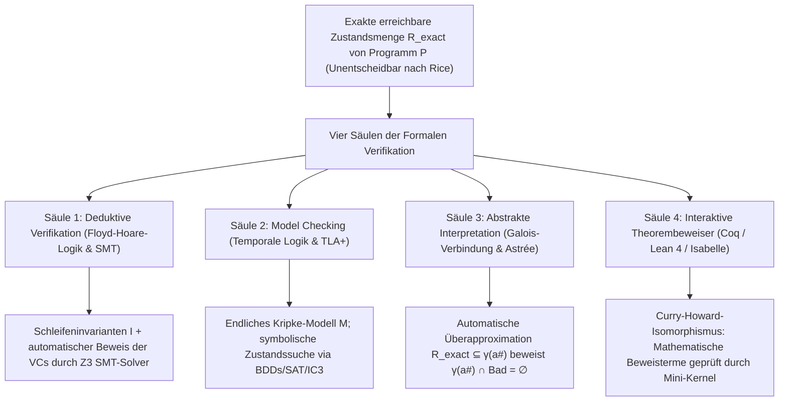
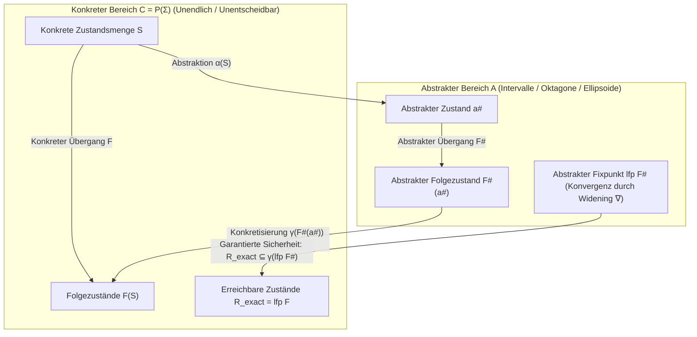

## 1. Die Grenzen des Testens und die Unentscheidbarkeit: Warum 1.000.000 bestandene Tests nichts beweisen

### 1.1 Dijkstras unsterblicher Leitsatz und die Explosion des Eingaberaums

Im Jahr 1969 formulierte der Turing-Preisträger <strong>Edsger W. Dijkstra</strong> auf der NATO-Konferenz für Software Engineering das berühmteste Urteil über das Testen von Software:

> <strong>"Program testing can be used to show the presence of bugs, but never to show their absence!"</strong>
> (Programmtests können dazu benutzt werden, die Anwesenheit von Fehlern zu zeigen, aber niemals deren Abwesenheit!)

Selbst eine elementare Funktion `f(x, y)`, die lediglich zwei vorzeichenbehaftete 64-Bit-Ganzzahlen (`int64_t`) entgegennimmt, besitzt eine astronomische Anzahl möglicher Eingabepaare:

$$N_{\text{inputs}} = 2^{64} \times 2^{64} = 2^{128} \approx 3{,}4028 \times 10^{38}$$

Würde ein Supercomputer <strong>eine Milliarde ($10^9$) Tests pro Sekunde</strong> ausführen, dauerte der vollständige Test aller Eingaben rund <strong>$1{,}08 \times 10^{22}$ Jahre</strong> – das 780-Milliarden-Fache des Alters unseres Universums! Kommen dynamischer Heap-Speicher, Netzwerkverzögerungen und nichtdeterministische Thread-Verschränkungen (Interleavings) hinzu, divergiert die Zahl der Ausführungspfade gegen <strong>unendlich ($\infty$)</strong>.

Ein berühmtes reales Beispiel enthüllte <strong>Joshua Bloch</strong> im Jahr 2006: In der Java-Standardbibliothek (`java.util.Arrays.binarySearch`) schlummerte <strong>neun Jahre lang</strong> ein kritischer <strong>Integer-Overflow-Bug in der binären Suche</strong>:

```java
public static int binarySearch(int[] a, int key) {
    int low = 0;
    int high = a.length - 1;
    while (low <= high) {
        int mid = (low + high) / 2; // ★ FATALER OVERFLOW-BUG: negativ, wenn low + high >= 2^31!
        int midVal = a[mid];
        if (midVal < key) low = mid + 1;
        else if (midVal > key) high = mid - 1;
        else return mid;
    }
    return -(low + 1);
}
```

Sobald die Summe `low + high` bei großen Arrays das Maximum einer vorzeichenbehafteten 32-Bit-Ganzzahl ($2^{31} - 1 = 2.147.483.647$) überschreitet, läuft die Addition im Zweierkomplement in eine negative Zahl über und löst sofort eine `ArrayIndexOutOfBoundsException` aus.

### 1.2 Das Halteproblem von Turing (1936) und der Satz von Rice (1953)

Warum schreiben wir dann nicht einfach ein Analyseprogramm, das den Quellcode jedes beliebigen Programms $P$ liest und exakt entscheidet, ob $P$ jemals abstürzt? Dem stehen <strong>Alan Turings Halteproblem (1936)</strong> und der <strong>Satz von Rice (1953)</strong> entgegen:

$$\text{Satz (Rice, 1953): Jede nichttriviale semantische Eigenschaft } \mathcal{S} \text{ berechenbarer Funktionen ist unentscheidbar.}$$

Kein Verifikationswerkzeug kann für beliebige Programme gleichzeitig <strong>(1) vollautomatisch terminieren</strong>, <strong>(2) korrekt sein (Soundness: keine übersehenen Fehler / Null False Negatives)</strong> und <strong>(3) vollständig sein (Completeness: keine Fehlalarme / Null False Positives)</strong>.

### 1.3 Wie formale Verifikation den Satz von Rice überwindet: Sound Over-Approximation

Die <strong>formale Verifikation</strong> garantiert kompromisslose <strong>Korrektheit (Soundness)</strong>, indem sie entweder menschliche bzw. KI-gestützte Invarianten nutzt oder eine <strong>korrekte Überapproximation (Sound Over-Approximation)</strong> $\mathcal{R}_{\text{approx}} \supseteq \mathcal{R}_{\text{exact}}$ aller erreichbaren Zustände berechnet. Gilt für die Menge der verbotenen Fehlerzustände $\mathcal{B}$:

$$\mathcal{R}_{\text{approx}} \cap \mathcal{B} = \emptyset \implies \mathcal{R}_{\text{exact}} \cap \mathcal{B} = \emptyset$$

dann ist das Programm mathematisch zu 100 % fehlerfrei über alle unendlich vielen Ausführungen hinweg!



---

## 2. Säule 1: Deduktive Verifikation — Floyd-Hoare-Logik, Schwächste Vorbedingungen und SMT-Solver

### 2.1 Das Hoare-Tripel, Schleifeninvarianten und Ranking-Funktionen

1969 begründete <strong>C. A. R. Hoare</strong> aufbauend auf Robert W. Floyd die <strong>Floyd-Hoare-Logik</strong>. Ihr Grundbaustein ist das <strong>Hoare-Tripel</strong>:

$$\{P\}\; C \;\{Q\}$$

- <strong>Partielle Korrektheit</strong>: Gilt Vorbedingung $P$ vor der Ausführung von Befehl $C$ und <strong>terminiert</strong> $C$, so gilt danach Nachbedingung $Q$.
- <strong>Totale Korrektheit</strong>: Unter Vorbedingung $P$ <strong>terminiert $C$ garantiert</strong>, und im Endzustand gilt $Q$.

Die zentralen Schlussregeln lauten:
1. <strong>Zuweisungsaxiom (Assignment)</strong>: $\{\,Q[E/x]\,\}\; x := E \;\{\,Q\,\}$.
2. <strong>While-Schleifenregel mit Schleifeninvariante $I$ und Ranking-Funktion $V \in \mathbb{N}$</strong>:
   $$\frac{\{I \land B \land V = v_0\}\; S \;\{I \land V < v_0\} \qquad (I \land B) \implies V \ge 0}{[I]\; \text{while } B \text{ do } S \;[I \land \neg B]}$$

Mit Dijkstras <strong>Kalkül der schwächsten Vorbedingungen (Weakest Precondition, $\text{wp}(C, Q)$, 1975)</strong> wird die Programmverifikation vollständig auf die Gültigkeit mathematischer <strong>Verifikationsbedingungen (Verification Conditions, VCs)</strong> $P \implies \text{wp}(C, Q)$ zurückgeführt.

### 2.2 Verifizierte Binärsuche in Dafny und der Z3-SMT-Solver

Wenn wir die Mittelpunktsberechnung zu `mid := low + (high - low) / 2` korrigieren, beweist der <strong>Z3-SMT-Solver</strong> (entwickelt von Leonardo de Moura und Nikolaj Bjørner bei Microsoft Research, basierend auf <strong>DPLL(T)</strong> über uninterpretierte Funktionen EUF, lineare Ganzzahlarithmetik LIA, Bitvektoren $\mathcal{T}_{\text{BV}}$ und Arrays $\mathcal{T}_{\text{A}}$) in Millisekunden die vollständige Korrektheit:

```dafny
method BinarySearch(a: array<int>, key: int) returns (index: int)
  requires forall i, j :: 0 <= i < j < a.Length ==> a[i] <= a[j]
  ensures 0 <= index ==> index < a.Length && a[index] == key
  ensures index < 0 ==> forall k :: 0 <= k < a.Length ==> a[k] != key
{
  var low := 0;
  var high := a.Length;
  while low < high
    invariant 0 <= low <= high <= a.Length
    invariant forall i :: 0 <= i < a.Length && !(low <= i < high) ==> a[i] != key
    decreases high - low
  {
    var mid := low + (high - low) / 2; // Z3 beweist: kein Overflow und 0 <= mid < a.Length!
    if a[mid] < key { low := mid + 1; }
    else if key < a[mid] { high := mid; }
    else { return mid; }
  }
  return -1;
}
```

---

## 3. Säule 2: Model Checking und Temporale Logik — Erschöpfende Zustandssuche in verteilten Systemen

### 3.1 Kripke-Strukturen, LTL / CTL, Sicherheit (Safety) und Lebendigkeit (Liveness)

Für nebenläufige und verteilte Protokolle erfanden <strong>Edmund M. Clarke</strong>, <strong>E. Allen Emerson</strong> und <strong>Joseph Sifakis</strong> 1981 das <strong>Model Checking</strong> (Turing Award 2007), während <strong>Leslie Lamport</strong> <strong>TLA+</strong> entwickelte (Turing Award 2013). Ein System wird als <strong>Kripke-Struktur</strong> $M = (S, S_0, R, L)$ modelliert und mit <strong>Linearer Temporaler Logik (LTL)</strong> oder <strong>Computation Tree Logic (CTL)</strong> (Amir Pnueli, 1977) spezifiziert:

1. <strong>Sicherheit (Safety — „Nichts Schlimmes passiert jemals“)</strong>: Gegenseitiger Ausschluss (Mutual Exclusion):
   $$\text{LTL}: \quad \mathbf{G}\, \neg (\text{crit}_1 \land \text{crit}_2) \qquad \text{CTL}: \quad \mathbf{AG}\, \neg (\text{crit}_1 \land \text{crit}_2)$$
2. <strong>Lebendigkeit (Liveness — „Etwas Gutes passiert schließlich garantiert“)</strong>: Freiheit von Aushungerung (Starvation Freedom):
   $$\text{LTL}: \quad \mathbf{G}\, (\text{req}_1 \implies \mathbf{F}\, \text{crit}_1) \qquad \text{CTL}: \quad \mathbf{AG}\, (\text{req}_1 \implies \mathbf{AF}\, \text{crit}_1)$$

### 3.2 Büchi-Automaten, BDDs, IC3 und TLA+ bei Amazon Web Services (AWS)

Ein LTL-Model-Checker übersetzt die negierte Spezifikation $\neg \varphi$ in einen <strong>Büchi-Automaten</strong> $A_{\neg \varphi}$ und prüft, ob das synchrone Produkt leer ist:

$$\mathcal{L}(M \times A_{\neg \varphi}) = \emptyset$$

Gegen die <strong>Zustandsexplosion (State Explosion Problem)</strong> nutzen moderne Werkzeuge <strong>Binary Decision Diagrams (BDDs, Bryant 1986 / McMillan 1990)</strong> für bis zu $10^{20}$ Zustände sowie SAT-basiertes <strong>Bounded Model Checking (BMC)</strong> und <strong>IC3 / PDR</strong>. Bei <strong>Amazon Web Services (AWS)</strong> deckte der Model Checker <strong>TLC (TLA+)</strong> in <strong>S3</strong> und <strong>DynamoDB</strong> subtile verteilte Fehler auf, die eine exakte Sequenz von <strong>35 verschränkten Schritten</strong> (Netzwerkpartitionen, Nachrichtenverzögerungen, Leader-Failover) erforderten – noch bevor eine einzige Zeile Produktionscode geschrieben wurde!

---

## 4. Säule 3: Abstrakte Interpretation und die Katastrophe der Ariane 5 (Flug 501)

### 4.1 4. Juni 1996: Warum sich die 370-Millionen-Dollar-Rakete Ariane 5 nach 37 Sekunden selbst zerstörte

Am 4. Juni 1996 explodierte die europäische Trägerrakete <strong>Ariane 5</strong> auf ihrem Erstflug (Flug 501) nur <strong>37 Sekunden</strong> nach dem Start – ein Schaden von <strong>370 Millionen US-Dollar</strong>. Die Ursache war ein aus der Ariane 4 übernommenes Ada-Modul im Trägheitsnavigationssystem (SRI): Eine 64-Bit-Gleitkommavariable `BH` (Horizontalgeschwindigkeit) wurde in eine <strong>vorzeichenbehaftete 16-Bit-Ganzzahl ($-32.768 \dots +32.767$)</strong> konvertiert. Durch die weitaus höhere Beschleunigung der Ariane 5 überschritt `BH` den Wert $32.767$ und löste einen ungefangenen Hardware-Overflow-Trap aus. Sowohl das Backup- als auch das Hauptsystem schalteten sich ab und sendeten ein Diagnose-Bitmuster an den Bordcomputer, der dieses fälschlich als extreme Fluglage-Abweichung interpretierte und die Schubdüsen bis zum Anschlag auslenkte.

### 4.2 Abstrakte Interpretation (Cousot & Cousot 1977), Galois-Verbindungen und Astrée beim Airbus A380

Die von <strong>Patrick Cousot</strong> und <strong>Radhia Cousot</strong> 1977 begründete <strong>Abstrakte Interpretation</strong> verbindet den konkreten Zustandsverband $(\mathcal{C}, \subseteq) = (\mathcal{P}(\Sigma), \subseteq)$ über eine <strong>Galois-Verbindung (Galois Connection)</strong> mit einem abstrakten Verband $(\mathcal{A}, \sqsubseteq^\#)$ (wie Intervallen $[a,b]$, Oktagonen $\pm x \pm y \le c$ oder konvexen Polyedern):

$$(\mathcal{C}, \subseteq) \underset{\alpha}{\overset{\gamma}{\leftrightarrows}} (\mathcal{A}, \sqsubseteq^\#) \quad \text{mit} \quad \alpha(S) \sqsubseteq^\# a^\# \iff S \subseteq \gamma(a^\#)$$

Gilt die lokale Korrektheitsbedingung $\alpha(F(\gamma(a^\#))) \sqsubseteq^\# F^\#(a^\#)$, so umschließt der mittels <strong>Widening-Operator ($\nabla$)</strong> schnell berechnete abstrakte Fixpunkt $\text{lfp}\, F^\#$ garantiert alle erreichbaren Zustände:

$$\mathcal{R}_{\text{exact}} = \text{lfp}\, F \subseteq \gamma(\text{lfp}\, F^\#)$$



Mit dem statischen Analysator <strong>Astrée</strong> gelang es dem Team um Cousot, den <strong>fast 1.000.000 Zeilen umfassenden C-Flugsteuerungscode des Airbus A380</strong> vollautomatisch und mit <strong>null Fehlalarmen (Zero False Alarms)</strong> auf die vollständige Abwesenheit jeglicher Laufzeitfehler (Overflows, Division durch Null, Array-Grenzenverletzungen, ungültige Zeiger) zu verifizieren!

---

## 5. Säule 4: Interaktive Theorembeweiser (Coq / Lean 4 / Isabelle) und Gesamtvergleich

Auf Basis des <strong>Curry-Howard-Isomorphismus</strong> (*Propositionen als Typen, Beweise als Programme*) schufen interaktive Theorembeweiser (<strong>Coq / Rocq</strong>, <strong>Lean 4</strong>, <strong>Isabelle/HOL</strong>) zwei Meilensteine der Informatik:
1. <strong>CompCert (Xavier Leroy, INRIA)</strong>: Ein in Coq vollständig verifizierter optimierender C-Compiler. Beim berühmten <strong>Csmith</strong>-Fuzzing-Test (PLDI 2011) wurden in GCC und LLVM über 325 Miscompilation-Bugs gefunden – im verifizierten Teil von <strong>CompCert kein einziger</strong>!
2. <strong>seL4 (Gerwin Klein et al.)</strong>: Der weltweit erste in Isabelle/HOL bis hinunter zum ARM/RISC-V-Binärcode formal verifizierte Betriebssystem-Mikrokernel.

| Verifikations-Paradigma | Mathematisches Fundament | Werkzeuge & Sprachen | Automatisierung | Industrielle Referenzprojekte | Kernstärke & Trade-off |
| :--- | :--- | :--- | :--- | :--- | :--- |
| <strong>1. Deduktive Verifikation</strong> | Floyd-Hoare-Logik, $\text{wp}$-Kalkül, SMT-Solver | <strong>Dafny</strong>, <strong>Frama-C</strong>, <strong>SPARK Ada</strong>, <strong>Verus</strong>, <strong>Z3</strong> | Halbautomatisch (Invarianten + SMT) | Kryptobibliotheken, Flugsicherung, AWS Cedar | Beweist tiefe funktionale Korrektheit direkt im Code. |
| <strong>2. Model Checking</strong> | Kripke-Strukturen, LTL/CTL, Büchi-Automaten, BDDs | <strong>TLA+ (TLC)</strong>, <strong>SPIN</strong>, <strong>NuSMV</strong>, <strong>CBMC</strong> | Vollautomatisch (auf endlichen Modellen) | <strong>AWS S3 & DynamoDB</strong>, Paxos/Raft, CPU-Design | Liefert exakte Gegenbeispiel-Traces für Nebenläufigkeits-Bugs. |
| <strong>3. Abstrakte Interpretation</strong> | Verbände, Galois-Verbindungen $(\alpha,\gamma)$, Widening $\nabla$ | <strong>Astrée</strong>, <strong>Polyspace</strong>, <strong>Infer</strong> (Meta) | Vollautomatisch (leitet Invarianten selbst ab) | <strong>Airbus A380/A350 Fly-by-Wire</strong>, Automotive-C-Code | Skaliert auf 1.000.000+ Zeilen C-Code ohne manuelle Annotationen. |
| <strong>4. Interaktive Theorembeweiser</strong> | Curry-Howard-Isomorphismus, Abhängige Typentheorie / HOL | <strong>Coq (Rocq)</strong>, <strong>Lean 4</strong>, <strong>Isabelle/HOL</strong> | Interaktiv (Mensch + Taktiken + KI) | <strong>CompCert</strong> C-Compiler, <strong>seL4</strong> OS-Mikrokernel | Uneingeschränkte Ausdruckskraft; 100 % Sicherheit durch Mini-Kernel. |
