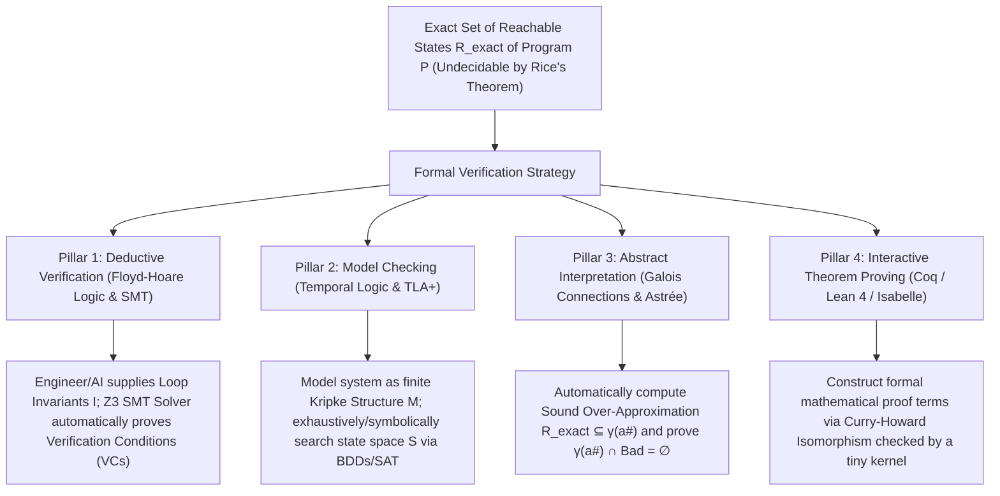
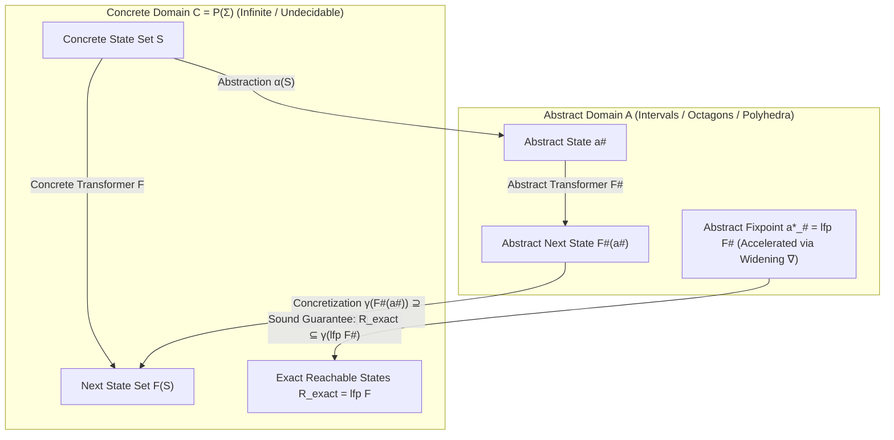

## 1. The Limits of Testing and the Wall of Undecidability: Why Passing 1,000,000 Tests Proves Nothing

### 1.1 Dijkstra's Immortal Maxim and the Combinatorial Explosion of Input Spaces

In 1969, at the NATO Software Engineering Conference in Rome, Turing Award laureate and structured programming pioneer <strong>Edsger W. Dijkstra</strong> delivered the single most famous and sobering verdict in the history of software engineering:

> <strong>"Program testing can be used to show the presence of bugs, but never to show their absence!"</strong>

In modern industrial software development, unit tests, integration tests, property-based testing (such as QuickCheck), and coverage-guided fuzzing form the backbone of continuous integration (CI/CD) pipelines. When a test suite of 100,000 assertions turns green, engineers naturally feel a sense of confidence that their code is reliable. Yet from a strictly mathematical standpoint, executing a program on any finite set of inputs cannot guarantee correctness across all possible executions.

Consider an elementary example: a pure function `f(x, y)` that takes two 64-bit signed integers (`int64_t`) and performs an arithmetic computation. The total number of distinct input pairs $(x, y)$ is:

$$N_{\text{inputs}} = 2^{64} \times 2^{64} = 2^{128} \approx 3.4028 \times 10^{38}$$

Suppose we harness a supercomputer capable of executing <strong>one billion ($10^9$) test cases per second</strong> without pause. The time $T$ required to exhaustively test every possible input pair for this single two-argument function is:

$$T = \frac{3.4028 \times 10^{38}}{10^9 \times 3.1536 \times 10^7 \text{ seconds/year}} \approx 1.079 \times 10^{22} \text{ years}$$

That is roughly <strong>780 billion times the age of the universe</strong> ($\approx 1.38 \times 10^{10}$ years). If a stateless function of two 64-bit integers already defies exhaustive testing, consider a real-world system featuring heap-allocated data structures, dynamic arrays, network packet arrivals, and concurrent threads whose non-deterministic OS scheduler interleavings cause the number of execution paths to diverge to <strong>actual infinity ($\infty$)</strong>.

A dramatic real-world illustration of the blindness of testing was revealed in 2006 by Google's <strong>Joshua Bloch</strong>: the infamous <strong>Binary Search Integer Overflow Bug</strong>. Originally published in Jon Bentley's classic book *Programming Pearls* and implemented in the Java standard library (`java.util.Arrays.binarySearch`), the following code ran every day on hundreds of millions of machines worldwide for <strong>nine years</strong>, passing every test suite in existence:

```java
// The binary search implementation in java.util.Arrays that harbored a bug for 9 years
public static int binarySearch(int[] a, int key) {
    int low = 0;
    int high = a.length - 1;
    while (low <= high) {
        int mid = (low + high) / 2; // <-- FATAL INTEGER OVERFLOW BUG HERE!
        int midVal = a[mid];
        if (midVal < key)
            low = mid + 1;
        else if (midVal > key)
            high = mid - 1;
        else
            return mid; // key found
    }
    return -(low + 1);  // key not found
}
```

Whenever the array is large enough that the sum `low + high` exceeds the maximum value of a 32-bit signed integer ($2^{31} - 1 = 2,147,483,647$)—for instance, when searching the upper half of an array containing $1.2 \times 10^9$ elements—the addition `low + high` wraps around into a <strong>negative number</strong> via two's-complement arithmetic overflow. Consequently, `mid` becomes negative, and `a[mid]` immediately crashes the program with an `ArrayIndexOutOfBoundsException`. Billions of dynamic test runs never triggered the bug simply because standard test suites did not allocate gigabyte-scale arrays and query keys in the upper half.

### 1.2 Turing's Halting Problem (1936) and Rice's Theorem (1953)

If dynamic testing cannot cover all inputs, a natural question arises: *"Why not write a static analyzer program that reads the source code of any program $P$ and automatically decides, without running $P$, whether $P$ can ever crash or violate its specification?"*

Standing directly in the path of this ambition are two foundational impossibility theorems of theoretical computer science: <strong>Alan Turing's Halting Problem (1936)</strong> and its sweeping generalization, <strong>Henry Gordon Rice's Theorem (1953)</strong>.

For any Turing-complete programming language, let $\llbracket P \rrbracket$ denote the partial function computed by program $P$. A property $\mathcal{S}$ of programs is called <strong>semantic</strong> if it depends only on the input-output behavior $\llbracket P \rrbracket$ rather than the syntactic text of $P$ (that is, if $\llbracket P_1 \rrbracket = \llbracket P_2 \rrbracket$, then $P_1$ satisfies $\mathcal{S}$ if and only if $P_2$ satisfies $\mathcal{S}$). Furthermore, $\mathcal{S}$ is called <strong>non-trivial</strong> if there exists at least one program that satisfies $\mathcal{S}$ and at least one program that violates $\mathcal{S}$.

Every safety and correctness question we care about in software engineering is a non-trivial semantic property:
- *"Program $P$ never divides by zero on any input."*
- *"Program $P$ never dereferences a NULL pointer or indexes out of bounds."*
- *"Program $P$ terminates on all valid inputs."*
- *"Program $P$ always returns an output satisfying specification $\Phi(x, y)$."*

Rice's Theorem delivers an uncompromising mathematical barrier:

$$\text{Theorem (Rice, 1953): Every non-trivial semantic property } \mathcal{S} \text{ of computable functions is undecidable.}$$

The proof proceeds by an elegant reduction from the Halting Problem. Suppose, for the sake of contradiction, that there existed a fully automatic, always-terminating algorithm $\text{CheckZeroDiv}(P)$ that could decide with 100% accuracy whether an arbitrary program $P$ ever performs a division by zero. Then, given any Turing machine (program) $M$ and input $w$, we could construct the following synthetic program $P_{M,w}$:

```python
def P_M_w(dummy_input):
    M(w)          # If M(w) loops forever, execution never reaches the next line
    return 1 / 0  # The instant M(w) halts, P_M_w executes a division by zero!
```

Assuming $M(w)$ itself does not divide by zero, $P_{M,w}$ divides by zero <strong>if and only if</strong> $M$ halts on input $w$. Feeding the source code of $P_{M,w}$ into our hypothetical analyzer $\text{CheckZeroDiv}(P_{M,w})$ would therefore solve the Halting Problem—a logical impossibility.

Consequently, <strong>no verification tool can simultaneously achieve all three of the following properties</strong> for arbitrary programs:

1. <strong>Full Automation (Termination)</strong>: Push-button execution that always halts in finite time without human guidance.
2. <strong>Soundness (No False Negatives)</strong>: If the tool reports `"SAFE"`, the program is 100% guaranteed to have zero bugs across all possible inputs. Never misses a real bug.
3. <strong>Completeness (No False Positives)</strong>: If the program is genuinely bug-free, the tool is guaranteed to report `"SAFE"`. Never raises a false alarm.

### 1.3 How Formal Verification Circumvents Rice's Theorem: Strategic Trade-offs and Sound Over-Approximation

How, then, is it possible for <strong>Formal Verification</strong> to mathematically prove that the fly-by-wire software of an Airbus A380, an operating system microkernel, or a cryptographic library is <strong>100% free of runtime errors</strong> without running it on every input?

The answer lies in how formal verification navigates Rice's triad: <strong>Formal verification refuses to compromise on Soundness</strong> (when it certifies a program as `"SAFE"`, it is mathematically guaranteed to be bug-free), and instead strategically relaxes either <strong>Full Automation</strong> (by incorporating human or AI-supplied inductive invariants and interactive proofs) or <strong>Completeness</strong> (by computing a conservative <strong>Sound Over-Approximation</strong>).



Let $\mathcal{R}_{\text{exact}}$ denote the true set of all runtime states reachable by program $P$ across all possible inputs, and let $\mathcal{B}$ denote the set of <strong>Bad States</strong> (arithmetic overflow, division by zero, out-of-bounds memory access, assertion violation). Proving $P$ bug-free is equivalent to proving:

$$\mathcal{R}_{\text{exact}} \cap \mathcal{B} = \emptyset$$

Although computing $\mathcal{R}_{\text{exact}}$ exactly is undecidable, static verifiers can compute an <strong>over-approximating superset</strong> $\mathcal{R}_{\text{approx}}$ in finite time such that:

$$\mathcal{R}_{\text{exact}} \subseteq \mathcal{R}_{\text{approx}}$$

If the verifier proves that even this larger bounding envelope $\mathcal{R}_{\text{approx}}$ never intersects the forbidden region $\mathcal{B}$:

$$\mathcal{R}_{\text{approx}} \cap \mathcal{B} = \emptyset \implies \mathcal{R}_{\text{exact}} \cap \mathcal{B} = \emptyset$$

then the original program $P$ is <strong>100% mathematically guaranteed to be free of bugs across all $\infty$ executions</strong>! If $\mathcal{R}_{\text{approx}} \cap \mathcal{B} \neq \emptyset$, the overlap might represent either a genuine bug or a <strong>False Alarm (False Positive)</strong> caused by an overly coarse approximation, prompting the engineer or analyzer to refine the abstraction. Crucially, however, a <strong>False Negative (missing an actual bug when certifying `"SAFE"`) is mathematically impossible</strong>.

In the sections that follow, we examine the three foundational pillars of automated and semi-automated formal verification—<strong>Deductive Verification (Floyd-Hoare Logic & SMT Solvers)</strong>, <strong>Model Checking & Temporal Logic</strong>, and <strong>Abstract Interpretation</strong>—followed by <strong>Interactive Theorem Proving</strong>.

---

## 2. Pillar 1: Deductive Verification — Floyd-Hoare Logic, Weakest Preconditions, and SMT Solvers

### 2.1 The Hoare Triple: Partial Correctness vs. Total Correctness

Building upon Robert W. Floyd's 1967 work on assigning mathematical meanings to flowcharts, <strong>C. A. R. Hoare</strong> published his landmark 1969 paper *"An Axiomatic Basis for Computer Programming"*, introducing a formal deductive system for reasoning about imperative programs strictly through symbolic logic: <strong>Floyd-Hoare Logic</strong>.

The fundamental judgment of Hoare logic is the <strong>Hoare Triple</strong>:

$$\{P\}\; C \;\{Q\}$$

where:
- $C$ is a program command (a statement, loop, or entire function body),
- $P$ is the <strong>Precondition</strong>: a logical predicate over program variables describing the state *before* $C$ executes, and
- $Q$ is the <strong>Postcondition</strong>: a logical predicate describing the state guaranteed to hold *after* $C$ executes.

Hoare logic distinguishes critically between two levels of correctness depending on whether program termination is guaranteed:

1. <strong>Partial Correctness</strong> ($\models_{\text{partial}} \{P\}\; C \;\{Q\}$):
   *"For every initial state $\sigma$ satisfying precondition $P$, <strong>if</strong> the execution of command $C$ from $\sigma$ terminates in some final state $\sigma'$, then $\sigma'$ is guaranteed to satisfy postcondition $Q$."*
   (Note that if $C$ diverges into an infinite loop, partial correctness holds vacuously!)
2. <strong>Total Correctness</strong> ($\models_{\text{total}} [P]\; C \;[Q]$):
   *"For every initial state $\sigma$ satisfying precondition $P$, the execution of command $C$ is <strong>guaranteed to terminate in a finite number of steps</strong>, and the resulting final state $\sigma'$ satisfies postcondition $Q$."*

$$\text{Total Correctness} = \text{Partial Correctness} + \text{Termination}$$

### 2.2 The Inference Rules of Hoare Logic (and Why Assignment Works Backward)

Floyd-Hoare logic provides syntax-directed <strong>inference rules</strong> that decompose any structured program into pure mathematical proof obligations.

#### 1. The Axiom of Assignment

At first glance, Hoare's axiom for an assignment statement $x := E$ looks counterintuitive because it operates *backward* from the postcondition $Q$:

$$\frac{}{\{Q[E/x]\}\; x := E \;\{Q\}} \quad (\text{Assignment})$$

Here, $Q[E/x]$ denotes the predicate obtained by substituting the expression $E$ for every free occurrence of variable $x$ inside $Q$.

Why does the rule work backward rather than forward? Consider the statement `x := x + 1` and suppose we want the postcondition $Q \equiv (x > 5)$ to hold *after* the assignment. What must be true of $x$ *before* the assignment executes? The new value of $x$ will be $x_{\text{old}} + 1$, so we require $x_{\text{old}} + 1 > 5$, which simplifies to $x_{\text{old}} > 4$. Substituting $E = (x+1)$ for $x$ in $Q = (x > 5)$ yields:

$$Q[x+1 / x] \equiv (x + 1 > 5) \iff (x > 4)$$

Thus $\{\,x > 4\,\}\; x := x + 1 \;\{\,x > 5\,\}$ is exact and loses zero information!

#### 2. Sequential Composition and Conditional Branching

Sequential execution $C_1 ; C_2$ chains states via an intermediate assertion $R$, while `if B then C1 else C2` splits the proof into the branch where guard $B$ holds and the branch where $\neg B$ holds:

$$\frac{\{P\}\; C_1 \;\{R\} \qquad \{R\}\; C_2 \;\{Q\}}{\{P\}\; C_1 ; C_2 \;\{Q\}} \quad (\text{Composition})$$

$$\frac{\{P \land B\}\; C_1 \;\{Q\} \qquad \{P \land \neg B\}\; C_2 \;\{Q\}}{\{P\}\; \text{if } B \text{ then } C_1 \text{ else } C_2 \;\{Q\}} \quad (\text{Conditional})$$

#### 3. The Rule of Consequence

The Rule of Consequence bridges program deductions with pure mathematical implication ($\implies$), allowing us to strengthen a precondition ($P' \implies P$) or weaken a postcondition ($Q \implies Q'$):

$$\frac{P' \implies P \qquad \{P\}\; C \;\{Q\} \qquad Q \implies Q'}{\{P'\}\; C \;\{Q'\}} \quad (\text{Consequence})$$

#### 4. The While Loop Rule: Loop Invariants and Ranking Functions

How can a finite mathematical proof reason about a `while B do S` loop that might execute ten times, ten billion times, or an arbitrary number of times depending on runtime inputs? We cannot unroll the loop infinitely. Instead, Hoare logic tames unbounded iteration using mathematical induction via a <strong>Loop Invariant</strong> $I$—a predicate that holds before the loop begins and is preserved by every single execution of the loop body $S$:

$$\frac{\{I \land B\}\; S \;\{I\}}{\{I\}\; \text{while } B \text{ do } S \;\{I \land \neg B\}} \quad (\text{While — Partial Correctness})$$

Observe the inductive elegance of this rule:
1. Before the loop starts, the invariant $I$ holds (Base Case).
2. Whenever the loop guard $B$ is true alongside $I$, executing the body $S$ once re-establishes $I$ (Inductive Step: $\{I \land B\}\; S \;\{I\}$).
3. Therefore, no matter how many millions of iterations occur, $I$ remains unbroken. When the loop finally terminates, the guard $B$ must have evaluated to false; hence at loop exit we are guaranteed <strong>$I \land \neg B$</strong>!

To elevate partial correctness to <strong>Total Correctness</strong> (proving that the loop cannot run forever), we equip the loop with a <strong>Loop Variant (Ranking Function)</strong> $V(\sigma) \in \mathbb{N}$ mapping the program state to a natural number (or any well-founded set):

$$\frac{[I \land B \land V = v_0]\; S \;[I \land V < v_0] \qquad (I \land B) \implies V \ge 0}{[I]\; \text{while } B \text{ do } S \;[I \land \neg B]} \quad (\text{While — Total Correctness})$$

Because $V$ is bounded below by $0$ whenever the loop continues ($I \land B \implies V \ge 0$) and strictly decreases by at least $1$ on every iteration ($V < v_0$), the well-foundedness of the natural numbers $\mathbb{N}$ guarantees that $V$ cannot decrease infinitely many times. The loop is <strong>mathematically forced to terminate</strong>.

### 2.3 Dijkstra's Weakest Precondition Calculus (1975)

In his seminal 1975 work *"Guarded Commands, Nondeterminacy and Formal Derivation of Programs"*, Edsger Dijkstra transformed Hoare logic into an algorithmic calculus by defining the <strong>Weakest Precondition Predicate Transformer</strong> $\text{wp}(C, Q)$. Given a command $C$ and desired postcondition $Q$, $\text{wp}(C, Q)$ computes the weakest (most general) predicate over initial states such that executing $C$ is guaranteed to terminate in a state satisfying $Q$:

$$\begin{aligned}
\text{wp}(\text{skip}, Q) &= Q \\
\text{wp}(x := E, Q) &= Q[E/x] \\
\text{wp}(C_1 ; C_2, Q) &= \text{wp}(C_1, \text{wp}(C_2, Q)) \\
\text{wp}(\text{if } B \text{ then } C_1 \text{ else } C_2, Q) &= (B \implies \text{wp}(C_1, Q)) \land (\neg B \implies \text{wp}(C_2, Q))
\end{aligned}$$

For a loop annotated with invariant $I$, precondition $P$, and postcondition $Q$, the $\text{wp}$ calculus automatically reduces the entire correctness of the program $\{P\}\; C \;\{Q\}$ into a finite conjunction of pure mathematical formulas called <strong>Verification Conditions (VCs)</strong>:

1. <strong>Entry (Initialization)</strong>: $P \implies I$
2. <strong>Preservation (Inductiveness)</strong>: $(I \land B) \implies \text{wp}(S, I)$
3. <strong>Exit (Postcondition)</strong>: $(I \land \neg B) \implies Q$

### 2.4 Walkthrough: Proving Binary Search Bug-Free in Dafny and Z3

Let us apply Floyd-Hoare logic and weakest preconditions directly to Joshua Bloch's binary search bug from Section 1.1, and see how modern deductive verification languages—such as <strong>Dafny</strong> (Microsoft Research), <strong>Frama-C</strong> (for C), <strong>SPARK Ada</strong>, and <strong>Verus</strong> (for Rust)—discharge these proofs automatically via the <strong>Z3 SMT Solver</strong>.

When a verification compiler analyzes the buggy statement `mid := (low + high) / 2` over 32-bit signed two's-complement integers (where $\text{MAX\_INT} = 2^{31} - 1$), it automatically injects an implicit safety precondition requiring that every arithmetic operation stays within hardware bounds:

$$\text{VC}_{\text{overflow}} : \quad (0 \le \text{low} \le \text{high} < \text{len} \le \text{MAX\_INT}) \implies (\text{low} + \text{high} \le \text{MAX\_INT})$$

To test whether $\text{VC}_{\text{overflow}}$ is universally valid, the verifier queries the Z3 SMT solver for the satisfiability of its <strong>negation</strong> ($\neg \text{VC}_{\text{overflow}}$). Within milliseconds, Z3 finds a satisfying assignment—a concrete <strong>counterexample</strong>:

$$\text{Counterexample}: \quad \text{len} = 1,600,000,000, \quad \text{low} = 1,200,000,000, \quad \text{high} = 1,200,000,000$$

Here $\text{low} + \text{high} = 2,400,000,000 > 2,147,483,647$, exposing the exact overflow that eluded nine years of testing!

Now let us replace the midpoint computation with `mid := low + (high - low) / 2` and write the complete, formally verified implementation in <strong>Dafny</strong>:

```dafny
// Complete formally verified Binary Search in Dafny
method BinarySearch(a: array<int>, key: int) returns (index: int)
  // Precondition P: The array 'a' is sorted in non-decreasing order
  requires forall i, j :: 0 <= i < j < a.Length ==> a[i] <= a[j]
  // Postcondition Q1: If a non-negative index is returned, it points to 'key'
  ensures 0 <= index ==> index < a.Length && a[index] == key
  // Postcondition Q2: If a negative index is returned, 'key' does not exist anywhere in 'a'
  ensures index < 0 ==> forall k :: 0 <= k < a.Length ==> a[k] != key
{
  var low := 0;
  var high := a.Length;

  while low < high
    // Loop Invariant I1: Search bounds always remain within valid array indices
    invariant 0 <= low <= high <= a.Length
    // Loop Invariant I2: 'key' is guaranteed not to exist outside the active interval [low, high)
    invariant forall i :: 0 <= i < a.Length && !(low <= i < high) ==> a[i] != key
    // Ranking Function V (Termination Proof): The interval width strictly decreases every iteration
    decreases high - low
  {
    // Overflow-free midpoint calculation:
    // Since 0 <= low < high <= MAX_INT, subtraction 0 < high - low <= MAX_INT cannot overflow,
    // and low + (high - low) / 2 < high <= MAX_INT cannot overflow either!
    var mid := low + (high - low) / 2;

    if a[mid] < key {
      low := mid + 1;
    } else if key < a[mid] {
      high := mid;
    } else {
      return mid;
    }
  }
  return -1;
}
```

Let us trace how the Hoare logic verification conditions guarantee 100% total correctness:
1. <strong>Absence of Overflow and Out-of-Bounds Access</strong>: Inside the loop body, $I_1 \land (\text{low} < \text{high})$ gives $0 \le \text{low} < \text{high} \le N \le \text{MAX\_INT}$. Therefore:
   - The subtraction $\text{high} - \text{low}$ satisfies $1 \le \text{high} - \text{low} \le \text{MAX\_INT}$ (no overflow or underflow).
   - By integer division, $0 \le \lfloor(\text{high} - \text{low})/2\rfloor < \text{high} - \text{low}$, which implies:
     $$0 \le \text{low} \le \underbrace{\text{low} + \left\lfloor\frac{\text{high} - \text{low}}{2}\right\rfloor}_{\text{mid}} < \text{high} \le N \le \text{MAX\_INT}$$
     Thus `mid` never overflows 32-bit integers, and the array access `a[mid]` is mathematically guaranteed to satisfy $0 \le \text{mid} < a.\text{Length}$.
2. <strong>Invariant Preservation</strong>: When `a[mid] < key`, the program updates $\text{low}' := \text{mid} + 1$. Because the array is sorted ($P$), for every index $k \le \text{mid}$ we have $a[k] \le a[\text{mid}] < \text{key}$, so $a[k] \neq \text{key}$. Combined with $I_2$, no element outside $[\text{mid}+1, \text{high})$ can equal $\text{key}$, preserving $I_2$.
3. <strong>Guaranteed Termination</strong>: The ranking function $V = \text{high} - \text{low}$ is positive on loop entry ($\text{low} < \text{high} \implies V \ge 1$). Since $\text{low} \le \text{mid} < \text{high}$, the first branch sets $\text{low}' = \text{mid} + 1 > \text{low}$ (decreasing $V$ to $\text{high} - \text{mid} - 1 < V$), and the second branch sets $\text{high}' = \text{mid} < \text{high}$ (decreasing $V$ to $\text{mid} - \text{low} < V$). Thus the loop must terminate.
4. <strong>Functional Completeness at Exit</strong>: If the loop exits normally and returns `-1`, we have $I_1 \land I_2 \land \neg(\text{low} < \text{high})$. Combining $\text{low} \le \text{high}$ with $\text{low} \ge \text{high}$ forces $\text{low} = \text{high}$. The half-open interval $[\text{low}, \text{high})$ collapses to the empty set $\emptyset$! Substituting $[\text{low}, \text{high}) = \emptyset$ into $I_2$ yields $\forall i \in [0, N),\; a[i] \neq \text{key}$, which proves Postcondition $Q_2$.

### 2.5 Inside SMT Solvers (Z3, CVC5) and Symbolic Execution

The automated reasoning powerhouse underneath Dafny, Frama-C, Boogie, and KLEE is the <strong>SMT (Satisfiability Modulo Theories) Solver</strong>, pioneered by systems like <strong>Z3</strong> (developed by Leonardo de Moura and Nikolaj Bjørner at Microsoft Research) and <strong>CVC5</strong>.

Whereas a Boolean SAT solver only decides formulas over propositional variables $p_i \in \{\text{True}, \text{False}\}$, an SMT solver decides first-order formulas modulo rich <strong>background theories</strong> via the <strong>DPLL(T) / CDCL(T)</strong> architecture:

- <strong>Theory of Equality with Uninterpreted Functions ($\mathcal{T}_{\text{EUF}}$)</strong>: Enforces congruence $x = y \implies f(x) = f(y)$ via the Congruence Closure graph algorithm.
- <strong>Theory of Linear Integer and Real Arithmetic ($\mathcal{T}_{\text{LIA}}, \mathcal{T}_{\text{LRA}}$)</strong>: Solves systems of linear inequalities over $\mathbb{R}$ (Dual Simplex) and $\mathbb{Z}$ (Presburger arithmetic, branch-and-bound, Gomory cuts).
- <strong>Theory of Fixed-Size Bit-Vectors ($\mathcal{T}_{\text{BV}}$)</strong>: Models exact 32-bit and 64-bit hardware two's-complement arithmetic, bitwise shifts (`<<`, `>>`), bitwise XOR, and modular wrap-around down to the individual bit ("bit-blasting").
- <strong>Theory of Arrays ($\mathcal{T}_{\text{A}}$)</strong>: Reasons about memory heaps and arrays using McCarthy's Read-over-Write axioms:
  $$\begin{aligned}
  i = j &\implies \text{select}(\text{store}(a, i, v), j) = v \\
  i \neq j &\implies \text{select}(\text{store}(a, i, v), j) = \text{select}(a, j)
  \end{aligned}$$

In <strong>Symbolic Execution</strong> (pioneered by James C. King in 1976 and modernized by tools like <strong>KLEE</strong> and <strong>angr</strong>), an interpreter executes a program using symbolic variables $\alpha, \beta$ instead of concrete inputs. Whenever execution reaches a conditional branch `if (cond)`, the engine forks the symbolic state, conjoining `cond` to the <strong>Path Condition ($\text{PC}$)</strong> on the `true` branch and $\neg\text{cond}$ on the `false` branch, querying Z3 at each step to prune infeasible paths and automatically synthesize concrete inputs that trigger assertions or memory bugs.

---

## 3. Pillar 2: Model Checking and Temporal Logic — Exhaustive Exploration of Concurrent and Distributed Systems

### 3.1 Reactive Systems and Kripke Structures

Floyd-Hoare logic excels at sequential programs that transform an initial state into a final state upon termination. However, operating system kernels, multi-core cache-coherency protocols, and cloud distributed systems (such as Paxos, Raft, Amazon S3, and DynamoDB) are <strong>concurrent, non-deterministic, reactive systems</strong>. They are designed to run continuously, where correctness depends not on a final return value, but on the <strong>infinite sequence of state transitions over time</strong> across all possible thread and message interleavings.

To verify such systems automatically, <strong>Edmund M. Clarke</strong>, <strong>E. Allen Emerson</strong>, and <strong>Joseph Sifakis</strong> independently invented <strong>Model Checking</strong> in 1981 (for which they shared the 2007 Turing Award), while <strong>Leslie Lamport</strong> developed the <strong>Temporal Logic of Actions (TLA+)</strong> (2013 Turing Award).

In model checking, a concurrent hardware or software design is formalized as a <strong>Kripke Structure</strong> $M$:

$$M = (S, S_0, R, L)$$

where:
- $S$ is a (typically finite) set of all possible system states,
- $S_0 \subseteq S$ is the set of initial states,
- $R \subseteq S \times S$ is a <strong>total transition relation</strong> ($\forall s \in S,\, \exists s' \in S \text{ such that } (s, s') \in R$; deadlocked or halting states are modeled with self-loops $(s, s) \in R$), and
- $L : S \to 2^{AP}$ is a labeling function mapping each state $s$ to the set of <strong>Atomic Propositions ($AP$)</strong> that hold true in $s$.

An infinite execution path (trace) starting from $s_0 \in S_0$ is an infinite sequence of states $\pi = s_0, s_1, s_2, \dots$ such that $(s_i, s_{i+1}) \in R$ for all $i \ge 0$.

### 3.2 Temporal Logic (LTL and CTL): Specifying Safety and Liveness

In 1977, <strong>Amir Pnueli</strong> (1996 Turing Award) proposed using <strong>Temporal Logic</strong> to specify properties of reactive systems over time without explicitly introducing clock variables. Two major temporal logics dominate formal verification: <strong>Linear Temporal Logic (LTL)</strong>, which reasons over individual linear execution paths $\pi$, and <strong>Computation Tree Logic (CTL)</strong>, which reasons over the branching tree of all possible futures starting from a state.

Both logics employ four fundamental <strong>Temporal Operators</strong>:
- <strong>$\mathbf{X}\, \varphi$ (Next)</strong>: $\varphi$ holds in the very next state $s_1$ of the path.
- <strong>$\mathbf{G}\, \varphi$ or $\square\, \varphi$ (Globally / Always)</strong>: $\varphi$ holds in *every* state $s_i$ ($i \ge 0$) along the path forever.
- <strong>$\mathbf{F}\, \varphi$ or $\lozenge\, \varphi$ (Finally / Eventually)</strong>: $\varphi$ holds in *at least one* future state $s_i$ ($i \ge 0$) along the path. Note the duality: $\mathbf{F}\,\varphi \equiv \neg \mathbf{G}\,\neg \varphi$.
- <strong>$\varphi \,\mathbf{U}\, \psi$ (Until)</strong>: $\psi$ eventually holds at some state $s_k$ ($k \ge 0$), and $\varphi$ holds at every preceding state $s_0, s_1, \dots, s_{k-1}$.

In <strong>CTL</strong>, every temporal operator is immediately preceded by a <strong>Path Quantifier</strong>: either <strong>$\mathbf{A}$ (For All paths)</strong> or <strong>$\mathbf{E}$ (There Exists a path)</strong> branching from the current state (producing operators like $\mathbf{AG}, \mathbf{EG}, \mathbf{AF}, \mathbf{EF}, \mathbf{AU}, \mathbf{EU}$).

As Leslie Lamport famously proved, every temporal specification can be decomposed into the intersection of two foundational classes of properties:

#### 1. Safety Properties ("Nothing bad ever happens")

For a mutual exclusion protocol between two processes $P_1$ and $P_2$, the requirement that both processes never occupy their critical sections ($\text{crit}_1$ and $\text{crit}_2$) simultaneously is a safety property:

$$\text{LTL}: \quad \mathbf{G}\, \neg (\text{crit}_1 \land \text{crit}_2) \qquad \text{CTL}: \quad \mathbf{AG}\, \neg (\text{crit}_1 \land \text{crit}_2)$$

Any violation of a safety property occurs at a specific point in time and is therefore witnessed by a <strong>finite counterexample prefix</strong> $s_0 \to s_1 \to \dots \to s_k$.

#### 2. Liveness Properties ("Something good eventually happens")

A trivial system that permanently blocks all processes from ever entering the critical section satisfies safety ($\mathbf{G}\,\neg(\text{crit}_1 \land \text{crit}_2)$), yet is completely useless! We must also specify <strong>Liveness</strong> (such as Starvation Freedom): whenever process 1 requests access ($\text{req}_1$), it will *eventually* be granted access to its critical section ($\text{crit}_1$):

$$\text{LTL}: \quad \mathbf{G}\, (\text{req}_1 \implies \mathbf{F}\, \text{crit}_1) \qquad \text{CTL}: \quad \mathbf{AG}\, (\text{req}_1 \implies \mathbf{AF}\, \text{crit}_1)$$

Furthermore, CTL can express branching-time resettable properties that LTL cannot express, such as *"From every reachable state in the system, there always exists at least one viable recovery path back to the `reset` state"*:

$$\text{CTL}: \quad \mathbf{AG}\, (\mathbf{EF}\, \text{reset})$$

### 3.3 Automata-Theoretic Model Checking via Büchi Automata

How does an LTL model checker (such as Gerard Holzmann's <strong>SPIN</strong> or the <strong>TLC</strong> checker for TLA+) algorithmically decide whether a Kripke structure $M$ satisfies an LTL formula $\varphi$ ($M \models \varphi$)?

Following the <strong>Automata-Theoretic Framework</strong> developed by Moshe Y. Vardi and Pierre Wolper (1986), the verifier translates the logical verification problem into a graph-theoretic emptiness check over <strong>Büchi Automata</strong>—finite-state automata over infinite words ($\omega$-automata) that accept an infinite trace if and only if the trace visits the set of accepting states $F$ <strong>infinitely often</strong>:

1. Negate the specification $\varphi$ to obtain $\neg \varphi$ (describing all *bad* infinite executions that violate the specification).
2. Construct a Büchi automaton $A_{\neg \varphi}$ that accepts precisely the infinite traces satisfying $\neg \varphi$.
3. Construct the <strong>synchronous product automaton</strong> $M \times A_{\neg \varphi}$, whose infinite paths correspond to executions of the system $M$ that simultaneously violate $\varphi$.
4. Check whether the language of the product automaton is empty:

$$\mathcal{L}(M) \subseteq \mathcal{L}(\varphi) \iff \mathcal{L}(M) \cap \mathcal{L}(\neg \varphi) = \emptyset \iff \mathcal{L}(M \times A_{\neg \varphi}) = \emptyset$$

In a finite graph, an infinite path visits an accepting state $f \in F$ infinitely often if and only if there is a reachable cycle containing $f$—a <strong>lasso-shaped path</strong> (a finite stem from $s_0$ to $f$, followed by a cycle from $f$ back to $f$). Using Robert Tarjan's Strongly Connected Components (SCC) algorithm or Nested Depth-First Search (NDFS), the model checker searches $M \times A_{\neg \varphi}$ in linear time $O(|M| \cdot 2^{|\varphi|})$. If a lasso cycle is found, the model checker prints out the exact sequence of states and transitions as a <strong>step-by-step reproducible counterexample trace</strong>!

### 3.4 Taming the State Explosion Problem: BDDs, BMC, and IC3 / PDR

Model checking faces a formidable adversary: the <strong>State Explosion Problem</strong>. If a concurrent system comprises $n$ threads, each with $k$ local control states, plus $m$ 32-bit variables, the total number of global states is:

$$|S| = k^n \times 2^{32m}$$

Even a modest protocol or hardware circuit rapidly exceeds $10^{20}$ to $10^{100}$ states, dwarfing the number of atoms in the observable universe ($\approx 10^{80}$). Explicit-state enumeration quickly exhausts all physical RAM.

Three monumental algorithmic breakthroughs conquered this barrier:

1. <strong>Symbolic Model Checking with Binary Decision Diagrams (BDDs — Bryant 1986, McMillan 1990)</strong>:
   Instead of storing states individually in a hash table, <strong>Randall Bryant</strong> introduced <strong>Reduced Ordered Binary Decision Diagrams (ROBDDs)</strong>—a canonical, exponentially compressed DAG representation of Boolean functions. <strong>Kenneth McMillan</strong> realized that any set of states $X \subseteq \{0, 1\}^n$ can be represented by its characteristic Boolean function $\chi_X(\vec{v})$, and the transition relation $R$ by $\chi_R(\vec{v}, \vec{v}')$. Forward and backward reachability fixpoints (such as $\text{EF}\,\text{Bad} = \mu Z.\, (\text{Bad} \lor \text{EX}\, Z)$) are computed over entire sets of billions of states simultaneously via BDD Boolean algebra, enabling the verification of hardware circuits with more than <strong>$10^{20}$ states</strong>!
2. <strong>Bounded Model Checking (BMC — Biere, Cimatti, Clarke, Zhu 1999)</strong>:
   BMC unrolls the transition relation $R$ for $k$ steps and encodes the existence of a $k$-step bug trace directly as a single propositional SAT/SMT formula:
   $$\text{BMC}_k \equiv I(s_0) \land \bigwedge_{i=0}^{k-1} R(s_i, s_{i+1}) \land \text{Bad}(s_k)$$
   Modern CDCL SAT solvers can solve $\text{BMC}_k$ formulas with millions of variables, uncovering deep subtle protocol bugs up to $k \approx 50\text{--}100$ steps.
3. <strong>IC3 / Property Directed Reachability (PDR — Aaron Bradley 2011)</strong>:
   Today's gold-standard unbounded model checking engine. Without ever unrolling the transition relation, IC3 maintains a sequence of over-approximating state frames $F_0, F_1, \dots, F_k$ and uses localized SAT queries to incrementally learn compact inductive clauses backward from the bad states, automatically discovering inductive invariants that prove safety across $\infty$ steps.

### 3.5 Industrial Impact: How AWS Uses TLA+ to Catch 35-Step Bugs in S3 and DynamoDB

In 2014, <strong>Chris Newcombe</strong> and a team of principal engineers at <strong>Amazon Web Services (AWS)</strong> published a landmark article in *Communications of the ACM* titled *"How Amazon Web Services Uses Formal Methods"*.

To guarantee the reliability of foundational cloud infrastructure—including <strong>Amazon S3</strong>, <strong>DynamoDB</strong>, <strong>EBS</strong>, and internal distributed lock managers—AWS engineers wrote formal specifications of their fault-tolerant distributed algorithms in Leslie Lamport's <strong>TLA+ (and PlusCal)</strong> and verified them with the <strong>TLC model checker</strong> *before writing production code*.

The results were extraordinary. TLA+ uncovered multiple critical concurrency and fault-tolerance bugs that had survived extensive design reviews by senior distributed systems architects, code inspections, and months of stress and chaos testing. In DynamoDB's replication and membership reconfiguration protocol, TLC discovered a subtle bug that caused data loss, but <strong>triggering the bug required a specific sequence of 35 interleaved steps</strong> involving network partitions, delayed messages, leader failovers, and node recoveries! No human engineer could mentally trace a 35-step non-deterministic distributed execution, and random stress tests had virtually zero probability of stumbling upon that exact 35-step path—yet TLA+ found it automatically in minutes.

---

## 4. Pillar 3: Abstract Interpretation and the Lesson of the Ariane 5 Rocket Disaster

### 4.1 June 4, 1996: Why the \$370 Million Ariane 5 Rocket Self-Destructed in 37 Seconds

While deductive verification requires human-written invariants and model checking operates primarily on finite protocol models, how can we automatically verify <strong>one million lines of production C or Ada embedded flight-control code</strong> against all possible runtime crashes without human intervention?

The urgency of this question was etched into history on <strong>June 4, 1996</strong>, during the maiden flight (<strong>Flight 501</strong>) of the European Space Agency's <strong>Ariane 5</strong> expendable launch system from Kourou, French Guiana.

Just <strong>37 seconds after liftoff</strong>, at an altitude of 3,700 meters, the Ariane 5 rocket abruptly veered off course, experienced extreme aerodynamic forces that tore its boosters from the main stage, and triggered its automated self-destruct system. The explosion destroyed the rocket and its payload of four Cluster scientific satellites, resulting in an uninsured loss of <strong>approximately \$370 million</strong>—one of the most expensive software bugs in human history.

The official inquiry report uncovered a chain of software failures that stunned the engineering world:

1. The Ariane 5's dual <strong>Inertial Reference Systems (SRI 1 and SRI 2)</strong> reused a legacy Ada software module directly from its predecessor, the <strong>Ariane 4</strong>.
2. Inside the horizontal alignment routine, a single line of Ada code converted a 64-bit floating-point variable named `BH` (*Horizontal Bias*, representing an integral of horizontal velocity) into a <strong>16-bit signed integer</strong> (whose valid range is $-32,768$ to $+32,767$).
3. On the slower Ariane 4 trajectory, `BH` never approached $32,767$ during the first 40 seconds of flight. To save CPU cycles, engineers had deliberately omitted an Ada exception handler around the conversion of `BH`, assuming it could never overflow.
4. However, the much more powerful <strong>Ariane 5</strong> accelerated with nearly five times the initial horizontal velocity of Ariane 4. At $T + 37$ seconds, `BH` exceeded <strong>$32,767$</strong>!
5. The float-to-int hardware instruction immediately raised an unhandled <strong>Arithmetic Overflow Trap (`Operand Error`)</strong>.
6. Because both the active computer (SRI 2) and the hot-standby backup computer (SRI 1) ran identical software on identical inertial inputs, <strong>the backup computer had crashed from the exact same 16-bit integer overflow 72 milliseconds earlier</strong>, and the primary computer shut down right after it!
7. Upon halting, the SRI dumped a 32-bit <strong>diagnostic error bit-pattern</strong> onto the data bus. The On-Board Computer (OBC) misinterpreted this diagnostic bit-pattern as <strong>actual flight attitude data</strong> (indicating an extreme, nonexistent pitch deviation) and commanded the booster nozzles to deflect to their maximum limit, ripping the rocket apart in mid-air.

### 4.2 Patrick & Radhia Cousot's Abstract Interpretation (1977) and Galois Connections

Following the disaster, French computer scientists <strong>Patrick Cousot</strong> and <strong>Radhia Cousot</strong> demonstrated that the mathematical framework they had invented in their classic 1977 POPL paper—<strong>Abstract Interpretation</strong>—could statically analyze the entire embedded flight software and automatically pinpoint such overflow bugs before launch, or rigorously prove their complete absence.

Rather than executing a program on individual concrete numbers, Abstract Interpretation executes the program symbolically over an <strong>Abstract Domain</strong> (such as intervals, octagons, or convex polyhedra), computing an abstract fixpoint that is mathematically guaranteed to <strong>soundly over-approximate</strong> all reachable concrete states.

The rigorous mathematical bridge between the concrete semantics of a program and its abstract semantics is a <strong>Galois Connection</strong> between two complete lattices:

$$(\mathcal{C}, \sqsubseteq) \underset{\alpha}{\overset{\gamma}{\leftrightarrows}} (\mathcal{A}, \sqsubseteq^\#)$$

- <strong>Concrete Domain $(\mathcal{C}, \sqsubseteq)$</strong>: The powerset of all concrete program memory states $\mathcal{C} = \mathcal{P}(\Sigma)$, ordered by standard set inclusion $\sqsubseteq \;=\; \subseteq$.
- <strong>Abstract Domain $(\mathcal{A}, \sqsubseteq^\#)$</strong>: A computer-representable lattice of abstract properties $a^\# \in \mathcal{A}$ (e.g., intervals $[l, u]$), ordered by abstract precision $\sqsubseteq^\#$.
- <strong>Abstraction Function $\alpha : \mathcal{C} \to \mathcal{A}$</strong>: Maps any set of concrete states $S \in \mathcal{C}$ to the most precise abstract element $\alpha(S)$ representing $S$.
- <strong>Concretization Function $\gamma : \mathcal{A} \to \mathcal{C}$</strong>: Maps an abstract element $a^\# \in \mathcal{A}$ back to the set of all concrete states $\gamma(a^\#)$ that satisfy property $a^\#$.

The pair $(\alpha, \gamma)$ forms a <strong>Galois Connection</strong> if and only if for every concrete state set $S \in \mathcal{C}$ and every abstract element $a^\# \in \mathcal{A}$:

$$\forall S \in \mathcal{C},\; \forall a^\# \in \mathcal{A} : \qquad \alpha(S) \sqsubseteq^\# a^\# \iff S \subseteq \gamma(a^\#)$$

Setting $a^\# = \alpha(S)$ on the left side yields $\alpha(S) \sqsubseteq^\# \alpha(S)$ (which is trivially true by reflexivity), immediately implying the fundamental <strong>Sound Over-Approximation Property</strong>:

$$S \subseteq \gamma(\alpha(S))$$

In other words, abstracting a set of states via $\alpha$ and concretizing back via $\gamma$ may lose precision (adding extra states to the bounding box), but <strong>it can never drop any reachable concrete state</strong>!

Let $F : \mathcal{C} \to \mathcal{C}$ be the concrete state transition transformer of the program, whose least fixpoint $\text{lfp}\, F = \bigcup_{n \ge 0} F^n(\emptyset)$ is the exact set of reachable states $\mathcal{R}_{\text{exact}}$. If we design an abstract transfer function $F^\# : \mathcal{A} \to \mathcal{A}$ satisfying the <strong>Local Soundness Condition</strong>:

$$\forall a^\# \in \mathcal{A} : \qquad \alpha(F(\gamma(a^\#))) \sqsubseteq^\# F^\#(a^\#)$$

then by the Knaster-Tarski Fixpoint Theorem, the abstract least fixpoint $\text{lfp}\, F^\#$ is guaranteed to over-approximate the concrete least fixpoint:

$$\mathcal{R}_{\text{exact}} = \text{lfp}\, F \subseteq \gamma(\text{lfp}\, F^\#)$$

If $\gamma(\text{lfp}\, F^\#) \cap \mathcal{B} = \emptyset$, the program is <strong>100% mathematically guaranteed to have zero runtime errors</strong>!



### 4.3 Numerical Abstract Domains (Intervals, Octagons, Polyhedra) and Widening ($\nabla$)

The choice of abstract domain $\mathcal{A}$ governs the balance between <strong>precision</strong> (eliminating false alarms) and <strong>computational complexity</strong>:

1. <strong>The Interval Domain ($\text{Intervals}$, Cousot & Cousot 1976)</strong>:
   Approximates each variable $x_i$ independently by a bounding interval $[l_i, u_i]$ with $l_i, u_i \in \mathbb{Z} \cup \{-\infty, +\infty\}$. For example, $\alpha(\{1, 5, 10\}) = [1, 10]$. Interval arithmetic computes:
   $$\begin{aligned}
   [a, b] +^\# [c, d] &= [a + c,\; b + d] \\
   [a, b] -^\# [c, d] &= [a - d,\; b - c]
   \end{aligned}$$
   To prevent loops like `while (x < 1000000) x++;` from requiring $1,000,000$ iterations to converge, Cousot & Cousot introduced the <strong>Widening Operator ($\nabla$)</strong>, which extrapolates unstable bounds directly to $\pm\infty$:
   $$[a, b] \nabla [c, d] = \Big[\text{if } c < a \text{ then } -\infty \text{ else } a, \quad \text{if } d > b \text{ then } +\infty \text{ else } b\Big]$$
   Followed by a single <strong>Narrowing ($\Delta$)</strong> pass using the loop guard `x < 1000000`, the analyzer converges to the exact loop invariant $x \in [0, 1000000]$ in just <strong>two iterations</strong>!
2. <strong>The Octagon Domain ($\text{Octagons}$, Antoine Miné 2001)</strong>:
   Intervals are *non-relational*: if $x \in [0, 10]$ and we execute `y := x; z := x - y;`, the Interval domain forgets that $x = y$ and computes $z \in [0, 10] -^\# [0, 10] = [-10, 10]$. The <strong>Octagon domain</strong> tracks all two-variable relational inequalities of the form:
   $$\pm x_i \pm x_j \le c$$
   Represented via Difference Bound Matrices (DBMs) and closed using the Floyd-Warshall shortest-path algorithm in $O(n^3)$ time, Octagons immediately preserve $x - y \le 0 \land y - x \le 0 \implies z \in [0, 0]$.
3. <strong>The Convex Polyhedra Domain ($\text{Polyhedra}$, Cousot & Halbwachs 1978)</strong>:
   Tracks arbitrary $n$-variable linear inequalities $\sum_{i=1}^n a_i x_i \le c$. It achieves extraordinary precision for complex array indexing and loop bounds, at the cost of exponential worst-case complexity $O(2^n)$.

| Abstract Domain | Mathematical Constraint Form | Relational? | Time Complexity ($n$ vars) | Primary Strength & Industrial Use |
| :--- | :--- | :--- | :--- | :--- |
| <strong>Sign Domain</strong> | $x > 0,\; x = 0,\; x < 0$ | Non-relational | $O(n)$ | Ultra-fast, very coarse precision |
| <strong>Interval Domain</strong> | $l_i \le x_i \le u_i$ | Non-relational | $O(n)$ | Fast range & overflow checking |
| <strong>Zone Domain (DBM)</strong> | $x_i - x_j \le c$ | 2-var difference | $O(n^3)$ | Timed automata & real-time clocks |
| <strong>Octagon Domain</strong> | $\pm x_i \pm x_j \le c$ | 2-var sum/diff | $O(n^3)$ | <strong>Sweet spot of precision & scalability (Astrée)</strong> |
| <strong>Convex Polyhedra</strong> | $\sum_{i=1}^n a_i x_i \le c$ | $n$-var linear | $O(2^n)$ | Highest linear precision |

### 4.4 The Triumph of Astrée on the Airbus A380: 1,000,000 Lines of C with Zero False Alarms

The crowning industrial triumph of Abstract Interpretation is the <strong>Astrée Static Analyzer</strong>, developed by Patrick Cousot, Radhia Cousot, Bruno Blanchet, Laurent Mauborgne, Antoine Miné, David Monniaux, and Xavier Rival at ENS Paris.

Tasked with verifying the primary <strong>fly-by-wire flight control software of the Airbus A380</strong>—comprising hundreds of thousands to nearly <strong>1,000,000 lines of embedded C code</strong>—Astrée combined the Interval and Octagon domains with specialized <strong>Second-Order Digital Filter Ellipsoid Domains</strong> ($x^2 + a xy + b y^2 \le c$, essential for proving that IIR feedback control loops remain bounded and never oscillate to infinity) and <strong>IEEE 754 Floating-Point Rounding Error Domains</strong>.

The result made aviation and computer science history: <strong>Astrée proved the complete absence of any runtime error</strong> (no integer or floating-point overflow, no division by zero, no out-of-bounds array indexing, no invalid pointer dereference, no `NaN` or `Inf`) across the entire Airbus A380 flight control software with <strong>zero false alarms</strong>. What failed catastrophically on Ariane 5 in 1996 was rendered mathematically impossible on the Airbus A380 and A350.

---

## 5. Ultimate Assurance: Interactive Theorem Proving (Coq / Rocq, Lean 4, Isabelle/HOL) and Industrial Miracles

### 5.1 The Curry-Howard Isomorphism: Propositions as Types, Proofs as Programs

When we need to prove arbitrary higher-order mathematical properties—such as *"An optimizing C compiler preserves the exact observable semantics of every input program"* or *"An operating system kernel enforces complete memory isolation between processes"*—we turn to <strong>Interactive Theorem Provers (Proof Assistants)</strong> such as <strong>Coq (Rocq)</strong>, <strong>Lean 4</strong>, and <strong>Isabelle/HOL</strong>.

At the heart of Coq and Lean 4 lies the <strong>Curry-Howard Isomorphism</strong> (Propositions-as-Types) in Dependent Type Theory:

| Mathematical Logic Concept | Type Theory / Programming Concept |
| :--- | :--- |
| <strong>Proposition</strong> $P$ | <strong>Type</strong> $T$ |
| <strong>Proof</strong> $p$ of Proposition $P$ | <strong>Program / Term</strong> $t$ of Type $T$ ($t : T$) |
| Implication $P \implies Q$ | Function Type $P \to Q$ |
| Conjunction $P \land Q$ | Product / Pair Type $P \times Q$ |
| Universal Quantification $\forall x : A,\; P(x)$ | Dependent Function Type ($\Pi$-type) $\prod_{x:A} P(x)$ |
| Existential Quantification $\exists x : A,\; P(x)$ | Dependent Pair Type ($\Sigma$-type) $\sum_{x:A} P(x)$ |
| <strong>Checking that a mathematical proof is valid</strong> | <strong>Type-checking that program $t$ has type $P$</strong> |

Because checking a proof reduces to type-checking a term inside a tiny, auditable <strong>Type-Checking Kernel</strong> (the *De Bruijn Criterion*), no bug in a proof search tactic, external SMT solver, or AI assistant can ever trick the kernel into accepting a false theorem.

### 5.2 CompCert and seL4: Shattering the Myth That Real Systems Cannot Be Verified

Two landmark projects forever dispelled the skepticism that full functional verification could only be applied to toy programs:

1. <strong>CompCert — The Formally Verified Optimizing C Compiler (Xavier Leroy et al., INRIA, 2006–)</strong>:
   Even if you verify your C source code, a bug in `gcc` or `clang` can silently miscompile your code into buggy machine assembly. <strong>Xavier Leroy</strong> constructed <strong>CompCert</strong> in Coq, proving the <strong>Semantic Preservation Theorem</strong>: for every valid C source program $S$, if $\text{CompCert}(S)$ produces assembly code $C$, then every observable behavior of $C$ is a permissible behavior of $S$:
   $$\forall S, C.\; \text{Compile}(S) = \text{OK}(C) \implies \text{Behaviors}(C) \subseteq \text{Behaviors}(S)$$
   In 2011, John Regehr's team at the University of Utah built the <strong>Csmith</strong> randomized C fuzzer and hammered every major C compiler on Earth for six CPU-years (PLDI 2011). They uncovered <strong>79+ miscompilation bugs in GCC</strong>, <strong>202+ bugs in LLVM/Clang</strong>, and <strong>325+ bugs overall</strong>—yet <strong>they could not find a single wrong-code bug in the verified middle-end of CompCert</strong>!
2. <strong>seL4 — The World's First Formally Verified OS Microkernel (Gerwin Klein et al., NICTA / UNSW, 2009)</strong>:
   Using <strong>Isabelle/HOL</strong>, Gerwin Klein's team proved the full functional correctness of the <strong>seL4</strong> operating system microkernel (8,700 lines of C and 600 lines of assembly) down to the compiled ARM and RISC-V machine binary, mathematically guaranteeing the complete absence of buffer overflows, NULL pointer dereferences, memory leaks, arithmetic overflows, and deadlocks, alongside formal proofs of confidentiality and integrity.

---

## 6. Comprehensive Comparison of the Four Pillars and the AI × Verification Frontier

| Verification Paradigm | Mathematical Foundation | Representative Tools | Automation Level | Flagship Industrial Applications | Core Strengths & Trade-offs |
| :--- | :--- | :--- | :--- | :--- | :--- |
| <strong>1. Deductive Verification</strong> | Floyd-Hoare Logic, Weakest Preconditions ($\text{wp}$), SMT Solvers | <strong>Dafny</strong>, <strong>Frama-C</strong>, <strong>SPARK Ada</strong>, <strong>Verus</strong>, <strong>Z3</strong>, <strong>CVC5</strong> | Semi-Automatic (User/AI provides invariants; SMT proves VCs) | Cryptographic libraries, air traffic control (SPARK), AWS Cedar authorization engine | Proves deep functional correctness directly on source code; requires loop invariants. |
| <strong>2. Model Checking</strong> | Kripke Structures, Temporal Logic (LTL/CTL), Büchi Automata, BDDs, IC3 | <strong>TLA+ (TLC)</strong>, <strong>SPIN</strong>, <strong>NuSMV / nuXmv</strong>, <strong>CBMC</strong>, <strong>Alloy</strong> | Fully Automatic (Over finite-state models) | <strong>AWS S3 & DynamoDB</strong>, Paxos/Raft distributed protocols, CPU cache coherency | Automatically produces concrete counterexample traces for subtle concurrency bugs; battles state explosion. |
| <strong>3. Abstract Interpretation</strong> | Complete Lattices, Galois Connections $(\alpha,\gamma)$, Widening $\nabla$ | <strong>Astrée</strong>, <strong>Polyspace</strong>, <strong>Infer</strong> (Meta), <strong>ikos</strong> (NASA) | Fully Automatic (Infers loop invariants automatically) | <strong>Airbus A380 / A350</strong> fly-by-wire C code, automotive controllers, Meta mobile apps | Scales to 1,000,000+ lines of C code with zero human annotations; focuses on runtime safety. |
| <strong>4. Interactive Theorem Proving</strong> | Curry-Howard Isomorphism, Dependent Type Theory / HOL | <strong>Coq (Rocq)</strong>, <strong>Lean 4</strong>, <strong>Isabelle/HOL</strong>, <strong>Agda</strong>, <strong>F\</strong>* | Interactive (Human + Tactics + AI proof synthesis) | <strong>CompCert</strong> C compiler, <strong>seL4</strong> OS microkernel, Project Everest (verified TLS 1.3) | Unlimited expressive power; 100% mathematical certainty via tiny kernel; highest proof effort. |

### Conclusion: The Era of AI-Assisted Formal Verification ("Vericoding")

For decades, the primary barrier to universal adoption of formal verification was the human cost of writing loop invariants and interactive proof scripts. Today, the convergence of <strong>Large Language Models (LLMs)</strong> and <strong>Formal Verifiers (Lean 4, Dafny, Verus, Z3)</strong> is igniting a revolution across computer science.

LLMs excel at rapidly proposing code, loop invariants, and proof tactics, but suffer from stochastic hallucinations. Formal verification engines never hallucinate: they act as an infallible mathematical oracle that either certifies the LLM's proof as 100% sound or returns an exact logical counterexample for the AI to self-correct. By uniting AI intuition with the ironclad deductive foundations forged by Dijkstra, Hoare, Clarke, Lamport, and the Cousots, software engineering is entering an age where we no longer merely hope our critical systems are bug-free—we <strong>prove</strong> it.

---

## References

1. <strong>Dijkstra, E. W.</strong> (1970). *Notes on Structured Programming*. T.H. Report 70-WSK-03, Technological University Eindhoven.
2. <strong>Dijkstra, E. W.</strong> (1975). "Guarded commands, nondeterminacy and formal derivation of programs". *Communications of the ACM*, 18(8), 453–457.
3. <strong>Floyd, R. W.</strong> (1967). "Assigning meanings to programs". *Proceedings of Symposia in Applied Mathematics*, Vol. 19, 19–32.
4. <strong>Hoare, C. A. R.</strong> (1969). "An axiomatic basis for computer programming". *Communications of the ACM*, 12(10), 576–580.
5. <strong>Clarke, E. M., Emerson, E. A., & Sistla, A. P.</strong> (1986). "Automatic verification of finite-state concurrent systems using temporal logic specifications". *ACM Transactions on Programming Languages and Systems (TOPLAS)*, 8(2), 244–263.
6. <strong>Cousot, P., & Cousot, R.</strong> (1977). "Abstract interpretation: a unified lattice model for static analysis of programs by construction or approximation of fixpoints". *Proceedings of the 4th ACM SIGACT-SIGPLAN Symposium on Principles of Programming Languages (POPL)*, 238–252.
7. <strong>Newcombe, C., Rath, T., Zhang, F., Munteanu, B., Brooker, M., & Deardeuff, M.</strong> (2015). "How Amazon Web Services uses formal methods". *Communications of the ACM*, 58(4), 66–73.
8. <strong>Leroy, X.</strong> (2009). "Formal verification of a realistic compiler". *Communications of the ACM*, 52(7), 107–115.
9. <strong>Klein, G., Elphinstone, K., Heiser, G., Andronick, J., Cock, D., Derrin, P., ... & Winwood, S.</strong> (2009). "seL4: formal verification of an OS kernel". *Proceedings of the ACM SIGOPS 22nd Symposium on Operating Systems Principles (SOSP)*, 207–220.
10. <strong>Yang, X., Chen, Y., Eide, E., & Regehr, J.</strong> (2011). "Finding and understanding bugs in C compilers". *Proceedings of the 32nd ACM SIGPLAN Conference on Programming Language Design and Implementation (PLDI)*, 283–294.
