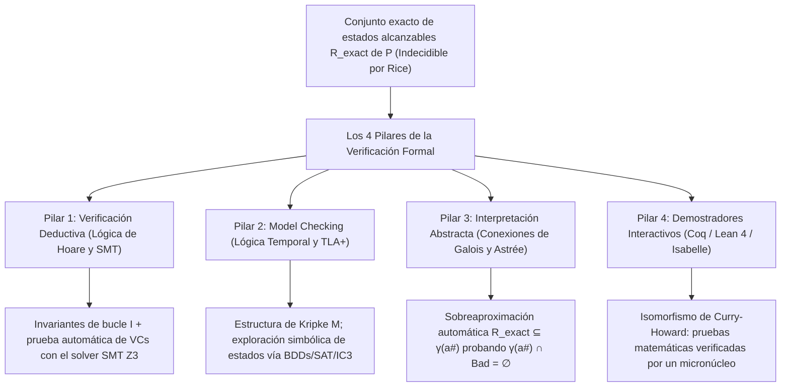
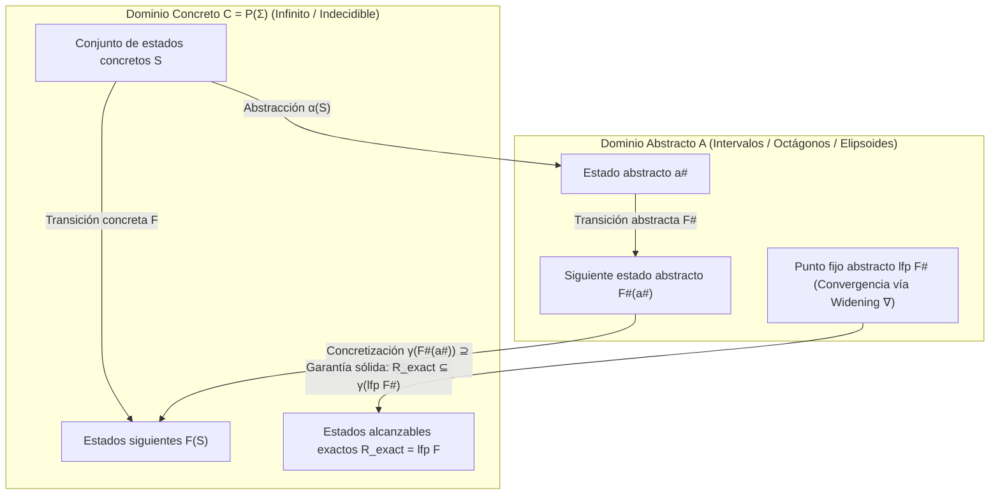

## 1. Los límites del testing y el muro de la indecidibilidad: por qué pasar 1.000.000 de pruebas no demuestra nada

### 1.1 La máxima inmortal de Dijkstra y la explosión combinatoria

En 1969, el ganador del Premio Turing <strong>Edsger W. Dijkstra</strong> pronunció en la conferencia de Ingeniería de Software de la OTAN la sentencia más célebre de la informática:

> <strong>"Program testing can be used to show the presence of bugs, but never to show their absence!"</strong>
> (¡Las pruebas de programas pueden usarse para mostrar la presencia de errores, pero nunca para mostrar su ausencia!)

Consideremos una función pura elemental `f(x, y)` que recibe dos enteros con signo de 64 bits (`int64_t`). El número total de entradas posibles es:

$$N_{\text{inputs}} = 2^{64} \times 2^{64} = 2^{128} \approx 3,4028 \times 10^{38}$$

Incluso con una supercomputadora capaz de ejecutar <strong>mil millones ($10^9$) de pruebas por segundo</strong>, probar todas las combinaciones llevaría <strong>$1,08 \times 10^{22}$ años</strong>, ¡unas 780 mil millones de veces la edad del universo! Si añadimos memoria dinámica, red e intercalaciones (interleavings) no deterministas de hilos concurrentes, el número de rutas de ejecución diverge hacia el <strong>infinito ($\infty$)</strong>.

En 2006, <strong>Joshua Bloch</strong> (Google) reveló un error que permaneció oculto durante <strong>9 años</strong> en la biblioteca estándar de Java (`java.util.Arrays.binarySearch`): el famoso <strong>bug de desbordamiento de enteros en la búsqueda binaria</strong>:

```java
public static int binarySearch(int[] a, int key) {
    int low = 0;
    int high = a.length - 1;
    while (low <= high) {
        int mid = (low + high) / 2; // ★ BUG FATAL: ¡desbordamiento negativo cuando low + high >= 2^31!
        int midVal = a[mid];
        if (midVal < key) low = mid + 1;
        else if (midVal > key) high = mid - 1;
        else return mid;
    }
    return -(low + 1);
}
```

Cuando `low + high` supera el máximo de un entero con signo de 32 bits ($2^{31} - 1 = 2.147.483.647$), la suma se desborda hacia un valor negativo en complemento a dos y lanza `ArrayIndexOutOfBoundsException`.

### 1.2 El problema de la parada de Turing (1936) y el teorema de Rice (1953)

¿Por qué no construir un analizador estático universal que lea el código de cualquier programa $P$ y decida con 100 % de exactitud si tiene errores? <strong>El problema de la parada de Alan Turing (1936)</strong> y <strong>el teorema de Rice (1953)</strong> demuestran que es imposible:

$$\text{Teorema (Rice, 1953): Toda propiedad semántica no trivial } \mathcal{S} \text{ de las funciones computables es indecidible.}$$

Ningún verificador puede ofrecer simultáneamente <strong>(1) automatización total</strong>, <strong>(2) corrección / solidez (Soundness: cero falsos negativos)</strong> y <strong>(3) completitud (Completeness: cero falsos positivos)</strong>.

### 1.3 Cómo supera la verificación formal el teorema de Rice: sobreaproximación sólida

La <strong>verificación formal</strong> mantiene de forma innegociable la <strong>solidez (Soundness)</strong>: si certifica que un programa es `"SAFE"`, está matemáticamente garantizado al 100 % libre de errores en sus $\infty$ ejecuciones. Para lograrlo automáticamente, calcula una <strong>sobreaproximación sólida (Sound Over-Approximation)</strong> $\mathcal{R}_{\text{approx}} \supseteq \mathcal{R}_{\text{exact}}$ y demuestra que no interseca el conjunto de estados peligrosos $\mathcal{B}$:

$$\mathcal{R}_{\text{approx}} \cap \mathcal{B} = \emptyset \implies \mathcal{R}_{\text{exact}} \cap \mathcal{B} = \emptyset$$



---

## 2. Pilar 1: Verificación deductiva — Lógica de Floyd-Hoare, precondición más débil y solucionadores SMT

### 2.1 La terna de Hoare, invariantes de bucle y funciones de rango

En 1969, <strong>C. A. R. Hoare</strong> formuló la <strong>lógica de Floyd-Hoare</strong> basada en la <strong>terna de Hoare</strong>:

$$\{P\}\; C \;\{Q\}$$

- <strong>Corrección parcial</strong>: Si la precondición $P$ se cumple antes de ejecutar $C$ y <strong>si $C$ termina</strong>, entonces la postcondición $Q$ se cumple al finalizar.
- <strong>Corrección total</strong>: Bajo $P$, <strong>$C$ termina garantizadamente</strong> y cumple $Q$.

Las reglas fundamentales incluyen el axioma de asignación $\{\,Q[E/x]\,\}\; x := E \;\{\,Q\,\}$ y la regla del bucle `while` con un <strong>invariante de bucle</strong> $I$ y una <strong>función de rango (variante)</strong> $V \in \mathbb{N}$ estrictamente decreciente:

$$\frac{\{I \land B \land V = v_0\}\; S \;\{I \land V < v_0\} \qquad (I \land B) \implies V \ge 0}{[I]\; \text{while } B \text{ do } S \;[I \land \neg B]}$$

Mediante el cálculo de la <strong>precondición más débil (Weakest Precondition, $\text{wp}(C, Q)$, Dijkstra 1975)</strong>, la verificación se transforma en <strong>condiciones de verificación (VCs)</strong> puramente matemáticas: $P \implies \text{wp}(C, Q)$.

### 2.2 Verificación formal de la búsqueda binaria en Dafny y Z3

Al corregir el punto medio a `mid := low + (high - low) / 2` en <strong>Dafny</strong>, el solucionador SMT <strong>Z3</strong> (arquitectura <strong>DPLL(T)</strong> sobre funciones no interpretadas EUF, aritmética lineal entera LIA, vectores de bits $\mathcal{T}_{\text{BV}}$ y arrays $\mathcal{T}_{\text{A}}$) demuestra automáticamente en milisegundos la ausencia total de desbordamientos y errores de índice:

```dafny
method BinarySearch(a: array<int>, key: int) returns (index: int)
  requires forall i, j :: 0 <= i < j < a.Length ==> a[i] <= a[j]
  ensures 0 <= index ==> index < a.Length && a[index] == key
  ensures index < 0 ==> forall k :: 0 <= k < a.Length ==> a[k] != key
{
  var low := 0;
  var high := a.Length;
  while low < high
    invariant 0 <= low <= high <= a.Length
    invariant forall i :: 0 <= i < a.Length && !(low <= i < high) ==> a[i] != key
    decreases high - low
  {
    var mid := low + (high - low) / 2; // ¡Z3 demuestra que no hay overflow y 0 <= mid < a.Length!
    if a[mid] < key { low := mid + 1; }
    else if key < a[mid] { high := mid; }
    else { return mid; }
  }
  return -1;
}
```

---

## 3. Pilar 2: Model Checking y lógica temporal — Exploración exhaustiva de sistemas concurrentes

### 3.1 Estructuras de Kripke y lógica temporal LTL / CTL

En 1981, <strong>Clarke</strong>, <strong>Emerson</strong> y <strong>Sifakis</strong> (Premio Turing 2007) crearon el <strong>Model Checking</strong>, mientras <strong>Leslie Lamport</strong> (Premio Turing 2013) desarrolló <strong>TLA+</strong>. El sistema se modela como una <strong>estructura de Kripke</strong> $M = (S, S_0, R, L)$ y sus propiedades se especifican en <strong>LTL</strong> o <strong>CTL</strong>:

1. <strong>Seguridad (Safety — «Nada malo ocurre jamás»)</strong>: Exclusión mutua:
   $$\text{LTL}: \quad \mathbf{G}\, \neg (\text{crit}_1 \land \text{crit}_2) \qquad \text{CTL}: \quad \mathbf{AG}\, \neg (\text{crit}_1 \land \text{crit}_2)$$
2. <strong>Vivacidad (Liveness — «Algo bueno acaba ocurriendo siempre»)</strong>: Ausencia de inanición:
   $$\text{LTL}: \quad \mathbf{G}\, (\text{req}_1 \implies \mathbf{F}\, \text{crit}_1) \qquad \text{CTL}: \quad \mathbf{AG}\, (\text{req}_1 \implies \mathbf{AF}\, \text{crit}_1)$$

### 3.2 Autómatas de Büchi, BDDs, IC3 y el éxito de TLA+ en AWS

El verificador traduce $\neg \varphi$ en un <strong>autómata de Büchi</strong> $A_{\neg \varphi}$ y comprueba si el producto síncrono es vacío ($\mathcal{L}(M \times A_{\neg \varphi}) = \emptyset$). Para superar la <strong>explosión de estados</strong>, se emplean <strong>diagramas de decisión binaria (BDDs, Bryant 1986 / McMillan 1990)</strong> capaces de explorar $10^{20}$ estados, <strong>Bounded Model Checking (BMC)</strong> e <strong>IC3 / PDR</strong>.

En <strong>Amazon Web Services (AWS)</strong>, el uso de <strong>TLA+ (TLC)</strong> en <strong>S3</strong> y <strong>DynamoDB</strong> permitió descubrir, antes de escribir una sola línea de código en producción, un sutil bug distribuido que requería una secuencia exacta de <strong>35 pasos intercalados</strong> de fallos de red y retrasos de mensajes.

---

## 4. Pilar 3: Interpretación abstracta y la lección del desastre del cohete Ariane 5

### 4.1 4 de junio de 1996: Por qué el cohete Ariane 5 (370 millones $) se autodestruyó a los 37 segundos

El 4 de junio de 1996, el vuelo inaugural (<strong>Vuelo 501</strong>) del cohete europeo <strong>Ariane 5</strong> explotó <strong>37 segundos</strong> después del despegue, causando pérdidas por <strong>370 millones de dólares</strong>. El sistema de referencia inercial (SRI) reutilizaba código Ada del <strong>Ariane 4</strong> que convertía una variable en coma flotante de 64 bits de velocidad horizontal (`BH`) en un <strong>entero con signo de 16 bits ($-32.768 \dots +32.767$)</strong>. Debido a la mayor aceleración del Ariane 5, `BH` superó $32.767$ y disparó una excepción hardware de desbordamiento (`Operand Error`) no capturada. Tanto el computador de respaldo como el principal se apagaron y enviaron un patrón de bits de diagnóstico que el computador de a bordo (OBC) interpretó erróneamente como un ángulo extremo de actitud, girando las toberas al máximo y desintegrando el cohete.

### 4.2 La interpretación abstracta de Cousot (1977), conexiones de Galois y Astrée en el Airbus A380

Creada en 1977 por <strong>Patrick Cousot</strong> y <strong>Radhia Cousot</strong>, la <strong>interpretación abstracta</strong> conecta el retículo concreto $(\mathcal{C}, \subseteq) = (\mathcal{P}(\Sigma), \subseteq)$ con un dominio abstracto $(\mathcal{A}, \sqsubseteq^\#)$ (intervalos $[a,b]$, octágonos $\pm x \pm y \le c$, poliedros convexos) mediante una <strong>conexión de Galois</strong>:

$$(\mathcal{C}, \subseteq) \underset{\alpha}{\overset{\gamma}{\leftrightarrows}} (\mathcal{A}, \sqsubseteq^\#) \quad \text{tal que} \quad \alpha(S) \sqsubseteq^\# a^\# \iff S \subseteq \gamma(a^\#)$$

Con la condición de solidez local $\alpha(F(\gamma(a^\#))) \sqsubseteq^\# F^\#(a^\#)$ y el <strong>operador de ensanchamiento (Widening $\nabla$)</strong>, el punto fijo abstracto envuelve de forma 100 % segura todos los estados alcanzables:

$$\mathcal{R}_{\text{exact}} = \text{lfp}\, F \subseteq \gamma(\text{lfp}\, F^\#)$$



El analizador estático <strong>Astrée</strong> verificó automáticamente el <strong>software de control de vuelo Fly-by-Wire del Airbus A380 (cerca de 1.000.000 de líneas de código C)</strong> con <strong>cero falsas alarmas</strong>, demostrando matemáticamente la ausencia total de desbordamientos, divisiones por cero o accesos fuera de límites.

---

## 5. Pilar 4: Demostradores interactivos de teoremas (Coq / Lean 4 / Isabelle) y comparativa global

Basados en el <strong>isomorfismo de Curry-Howard</strong> (*las proposiciones son tipos, las pruebas son programas*), <strong>Coq (Rocq)</strong>, <strong>Lean 4</strong> e <strong>Isabelle/HOL</strong> lograron dos hitos históricos:
1. <strong>CompCert (Xavier Leroy, INRIA)</strong>: Compilador optimizador de C verificado en Coq. En el estudio de fuzzing <strong>Csmith</strong> (PLDI 2011), se hallaron más de 325 errores de compilación en GCC y LLVM, ¡pero <strong>cero errores en el middle-end verificado de CompCert</strong>!
2. <strong>seL4 (Gerwin Klein et al.)</strong>: Primer micronúcleo de sistema operativo verificado formalmente en Isabelle/HOL hasta el código binario ARM/RISC-V.

| Paradigma de verificación | Base matemática | Herramientas y lenguajes | Automatización | Casos industriales clave | Fortaleza y compromiso |
| :--- | :--- | :--- | :--- | :--- | :--- |
| <strong>1. Verificación deductiva</strong> | Lógica de Hoare, cálculo $\text{wp}$, SMT | <strong>Dafny</strong>, <strong>Frama-C</strong>, <strong>SPARK Ada</strong>, <strong>Verus</strong>, <strong>Z3</strong> | Semiautomática (Invariantes + SMT) | Criptografía, control aéreo, AWS Cedar | Demuestra corrección funcional profunda en el código. |
| <strong>2. Model Checking</strong> | Estructuras de Kripke, LTL/CTL, Büchi, BDDs | <strong>TLA+ (TLC)</strong>, <strong>SPIN</strong>, <strong>NuSMV</strong>, <strong>CBMC</strong> | Automática (en modelos finitos) | <strong>AWS S3 y DynamoDB</strong>, Paxos/Raft, CPUs | Genera contraejemplos exactos para errores concurrentes. |
| <strong>3. Interpretación abstracta</strong> | Retículos, conexiones de Galois $(\alpha,\gamma)$, $\nabla$ | <strong>Astrée</strong>, <strong>Polyspace</strong>, <strong>Infer</strong> (Meta) | Totalmente automática | <strong>Airbus A380/A350 Fly-by-Wire</strong>, C embebido | Escala a más de 1.000.000 de líneas de C sin anotaciones. |
| <strong>4. Prueba interactiva</strong> | Isomorfismo de Curry-Howard, teoría de tipos | <strong>Coq (Rocq)</strong>, <strong>Lean 4</strong>, <strong>Isabelle/HOL</strong> | Interactiva (Humano + Tácticas + IA) | Compilador <strong>CompCert</strong>, micronúcleo <strong>seL4</strong> | Expresividad ilimitada y certeza absoluta vía micronúcleo. |
