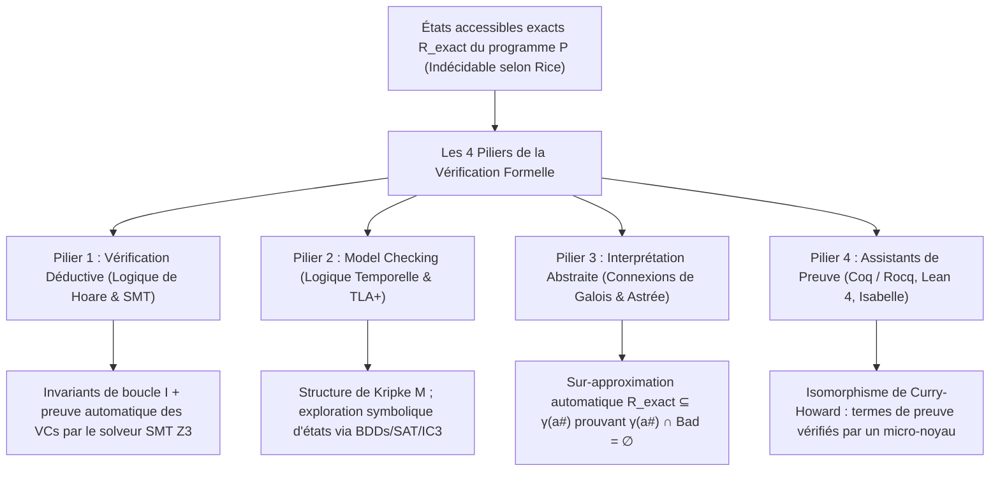
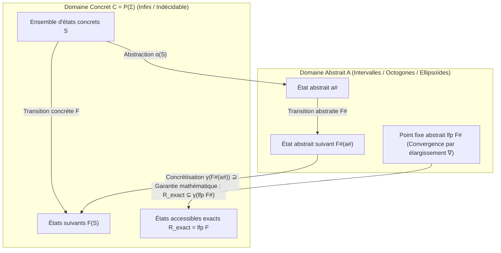

## 1. Les limites des tests et le mur de l'indécidabilité : pourquoi 1 000 000 de tests réussis ne prouvent rien

### 1.1 L'aphorisme immortel de Dijkstra et l'explosion combinatoire

En 1969, lors de la conférence de l'OTAN sur le génie logiciel, le lauréat du prix Turing <strong>Edsger W. Dijkstra</strong> énonça la vérité la plus fondamentale de l'histoire de l'informatique :

> <strong>"Program testing can be used to show the presence of bugs, but never to show their absence!"</strong>
> (Les tests de programmes peuvent servir à montrer la présence de bugs, mais jamais leur absence !)

Prenons une simple fonction pure `f(x, y)` acceptant deux entiers signés de 64 bits (`int64_t`). Le nombre total de paires d'entrées possibles est :

$$N_{\text{inputs}} = 2^{64} \times 2^{64} = 2^{128} \approx 3,4028 \times 10^{38}$$

Même avec un supercalculateur testant <strong>un milliard ($10^9$) de cas par seconde</strong>, il faudrait environ <strong>$1,08 \times 10^{22}$ années</strong> — soit 780 milliards de fois l'âge de l'univers — pour épuiser toutes les entrées de cette unique fonction ! En présence d'allocations dynamiques sur le tas, de paquets réseau et d'entrelacements (interleavings) non déterministes de threads, le nombre de chemins d'exécution diverge vers <strong>l'infini ($\infty$)</strong>.

En 2006, <strong>Joshua Bloch</strong> (Google) révéla un bug resté caché pendant <strong>9 ans</strong> dans la bibliothèque standard Java (`java.util.Arrays.binarySearch`) : le célèbre <strong>bug de dépassement d'entier de la recherche dichotomique</strong> :

```java
public static int binarySearch(int[] a, int key) {
    int low = 0;
    int high = a.length - 1;
    while (low <= high) {
        int mid = (low + high) / 2; // ★ BUG FATAL : dépassement d'entier si low + high >= 2^31 !
        int midVal = a[mid];
        if (midVal < key) low = mid + 1;
        else if (midVal > key) high = mid - 1;
        else return mid;
    }
    return -(low + 1);
}
```

Lorsque la somme `low + high` dépasse $2^{31} - 1 = 2\,147\,483\,647$, l'addition déborde en un nombre négatif en complément à deux, provoquant immédiatement une exception `ArrayIndexOutOfBoundsException`.

### 1.2 Le problème de l'arrêt de Turing (1936) et le théorème de Rice (1953)

Pourquoi ne pas construire un analyseur universel capable de décider automatiquement si n'importe quel programme $P$ contient un bug ? <strong>Le problème de l'arrêt d'Alan Turing (1936)</strong> et <strong>le théorème de Rice (1953)</strong> prouvent que c'est mathématiquement impossible :

$$\text{Théorème (Rice, 1953) : Toute propriété sémantique non triviale } \mathcal{S} \text{ d'un programme est indécidable.}$$

Aucun outil ne peut garantir simultanément : <strong>(1) l'automatisation totale</strong>, <strong>(2) la correction / sûreté (Soundness : zéro faux négatif)</strong> et <strong>(3) la complétude (Completeness : zéro faux positif)</strong>.

### 1.3 Comment la vérification formelle contourne le théorème de Rice : la sur-approximation saine

La <strong>vérification formelle</strong> refuse tout compromis sur la <strong>sûreté (Soundness)</strong> : si l'outil certifie le programme `"SAFE"`, il est mathématiquement garanti sans bug sur la totalité de ses $\infty$ exécutions. Pour contourner le théorème de Rice, elle calcule une <strong>sur-approximation saine (Sound Over-Approximation)</strong> $\mathcal{R}_{\text{approx}} \supseteq \mathcal{R}_{\text{exact}}$ des états accessibles et démontre que son intersection avec les états d'erreur $\mathcal{B}$ est vide :

$$\mathcal{R}_{\text{approx}} \cap \mathcal{B} = \emptyset \implies \mathcal{R}_{\text{exact}} \cap \mathcal{B} = \emptyset$$



---

## 2. Pilier 1 : Vérification déductive — Logique de Floyd-Hoare, plus faible précondition et solveurs SMT

### 2.1 Le triplet de Hoare, les invariants de boucle et les variants

En 1969, <strong>C. A. R. Hoare</strong> fonda la <strong>logique de Floyd-Hoare</strong> autour du <strong>triplet de Hoare</strong> :

$$\{P\}\; C \;\{Q\}$$

- <strong>Correction partielle</strong> : Si la précondition $P$ est vraie avant l'exécution de la commande $C$, et <strong>si $C$ termine</strong>, alors la postcondition $Q$ est vraie après.
- <strong>Correction totale</strong> : Sous la précondition $P$, <strong>$C$ termine obligatoirement</strong> en un nombre fini d'étapes et satisfait $Q$.

Les règles d'inférence fondamentales incluent l'axiome d'affectation $\{\,Q[E/x]\,\}\; x := E \;\{\,Q\,\}$ et la règle de la boucle `while` munie d'un <strong>invariant de boucle</strong> $I$ et d'un <strong>variant (fonction de rang)</strong> $V \in \mathbb{N}$ strictement décroissant :

$$\frac{\{I \land B \land V = v_0\}\; S \;\{I \land V < v_0\} \qquad (I \land B) \implies V \ge 0}{[I]\; \text{while } B \text{ do } S \;[I \land \neg B]}$$

Grâce au calcul de la <strong>plus faible précondition (Weakest Precondition, $\text{wp}(C, Q)$)</strong> introduit par Dijkstra en 1975, la preuve d'un programme est réduite à des formules logiques appelées <strong>conditions de vérification (VCs)</strong> : $P \implies \text{wp}(C, Q)$.

### 2.2 Preuve formelle de la recherche dichotomique avec Dafny et le solveur SMT Z3

En remplaçant le calcul du milieu par `mid := low + (high - low) / 2` dans <strong>Dafny</strong>, <strong>Frama-C</strong> ou <strong>SPARK Ada</strong>, le solveur SMT <strong>Z3</strong> (architecture <strong>DPLL(T)</strong> combinant fonctions non interprétées EUF, arithmétique linéaire entière LIA, vecteurs de bits $\mathcal{T}_{\text{BV}}$ et tableaux $\mathcal{T}_{\text{A}}$) démontre automatiquement l'absence totale de dépassement et la correction fonctionnelle :

```dafny
method BinarySearch(a: array<int>, key: int) returns (index: int)
  requires forall i, j :: 0 <= i < j < a.Length ==> a[i] <= a[j]
  ensures 0 <= index ==> index < a.Length && a[index] == key
  ensures index < 0 ==> forall k :: 0 <= k < a.Length ==> a[k] != key
{
  var low := 0;
  var high := a.Length;
  while low < high
    invariant 0 <= low <= high <= a.Length
    invariant forall i :: 0 <= i < a.Length && !(low <= i < high) ==> a[i] != key
    decreases high - low
  {
    var mid := low + (high - low) / 2; // Z3 prouve : aucun dépassement et 0 <= mid < a.Length !
    if a[mid] < key { low := mid + 1; }
    else if key < a[mid] { high := mid; }
    else { return mid; }
  }
  return -1;
}
```

---

## 3. Pilier 2 : Model Checking et logique temporelle — Exploration exhaustive des systèmes distribués

### 3.1 Structures de Kripke et logiques temporelles LTL / CTL

En 1981, <strong>Edmund M. Clarke</strong>, <strong>E. Allen Emerson</strong> et <strong>Joseph Sifakis</strong> (prix Turing 2007) inventèrent le <strong>Model Checking</strong>, tandis que <strong>Leslie Lamport</strong> (prix Turing 2013) créa <strong>TLA+</strong>. Le système concurrent est modélisé par une <strong>structure de Kripke</strong> $M = (S, S_0, R, L)$, et ses propriétés temporelles sont exprimées en <strong>LTL</strong> ou <strong>CTL</strong> :

1. <strong>Sûreté (Safety — « Rien de mauvais n'arrive jamais »)</strong> : Exclusion mutuelle :
   $$\text{LTL} : \quad \mathbf{G}\, \neg (\text{crit}_1 \land \text{crit}_2) \qquad \text{CTL} : \quad \mathbf{AG}\, \neg (\text{crit}_1 \land \text{crit}_2)$$
2. <strong>Vivacité (Liveness — « Quelque chose de bon finit toujours par arriver »)</strong> : Absence de famine :
   $$\text{LTL} : \quad \mathbf{G}\, (\text{req}_1 \implies \mathbf{F}\, \text{crit}_1) \qquad \text{CTL} : \quad \mathbf{AG}\, (\text{req}_1 \implies \mathbf{AF}\, \text{crit}_1)$$

### 3.2 Automates de Büchi, BDDs, IC3 et le succès de TLA+ chez AWS

Le Model Checker traduit la négation de la propriété $\neg \varphi$ en un <strong>automate de Büchi</strong> $A_{\neg \varphi}$ et vérifie que le produit synchrone est vide ($\mathcal{L}(M \times A_{\neg \varphi}) = \emptyset$). Pour vaincre l'<strong>explosion combinatoire des états</strong>, le Model Checking symbolique utilise les <strong>diagrammes de décision binaire (BDDs, Bryant 1986 / McMillan 1990)</strong> capables de traiter $10^{20}$ états, ainsi que le <strong>Bounded Model Checking (BMC)</strong> et <strong>IC3 / PDR</strong>.

Chez <strong>Amazon Web Services (AWS)</strong>, l'utilisation de <strong>TLA+ (TLC)</strong> sur <strong>S3</strong> et <strong>DynamoDB</strong> a permis de découvrir, avant même d'écrire le code de production, un bug critique de perte de données nécessitant une séquence précise de <strong>35 étapes entrelacées</strong> (partitions réseau, retards de messages, basculement de leader).

---

## 4. Pilier 3 : Interprétation abstraite et la catastrophe du vol 501 d'Ariane 5

### 4.1 4 juin 1996 : Pourquoi la fusée Ariane 5 (370 millions $) a explosé après 37 secondes de vol

Le 4 juin 1996, le vol inaugural (<strong>Vol 501</strong>) du lanceur européen <strong>Ariane 5</strong> s'autodétruisit <strong>37 secondes</strong> après le décollage à Kourou, entraînant une perte de <strong>370 millions de dollars</strong>. La cause résidait dans le système de référence inertielle (SRI), qui réutilisait un module Ada d'<strong>Ariane 4</strong> convertissant une variable flottante 64 bits de vitesse horizontale (`BH`) en un <strong>entier signé 16 bits ($-32\,768 \dots +32\,767$)</strong>. Plus rapide qu'Ariane 4, Ariane 5 fit dépasser $32\,767$ à `BH`, déclenchant une exception matérielle de dépassement d'entier (`Operand Error`) non interceptée. Les deux calculateurs SRI (nominal et secours) s'arrêtèrent et envoyèrent sur le bus une trame de diagnostic binaire que le calculateur de bord (OBC) prit pour une donnée d'attitude réelle, braquant les tuyères au maximum jusqu'à la dislocation du lanceur.

### 4.2 L'interprétation abstraite de Patrick et Radhia Cousot (1977) et l'analyseur Astrée sur l'Airbus A380

Inventée dès 1977 par les chercheurs français <strong>Patrick Cousot</strong> et <strong>Radhia Cousot</strong>, l'<strong>interprétation abstraite</strong> relie le treillis concret $(\mathcal{C}, \subseteq) = (\mathcal{P}(\Sigma), \subseteq)$ à un treillis abstrait $(\mathcal{A}, \sqsubseteq^\#)$ (intervalles $[a,b]$, octogones $\pm x \pm y \le c$ d'Antoine Miné, polyèdres convexes) par une <strong>connexion de Galois</strong> :

$$(\mathcal{C}, \subseteq) \underset{\alpha}{\overset{\gamma}{\leftrightarrows}} (\mathcal{A}, \sqsubseteq^\#) \quad \text{telle que} \quad \alpha(S) \sqsubseteq^\# a^\# \iff S \subseteq \gamma(a^\#)$$

Grâce à la condition de sûreté locale $\alpha(F(\gamma(a^\#))) \sqsubseteq^\# F^\#(a^\#)$ et à l'<strong>opérateur d'élargissement (Widening $\nabla$)</strong> qui accélère la convergence des boucles, le point fixe abstrait sur-approxime de façon 100 % fiable tous les états accessibles :

$$\mathcal{R}_{\text{exact}} = \text{lfp}\, F \subseteq \gamma(\text{lfp}\, F^\#)$$



Développé à l'ENS Paris par l'équipe de Cousot, l'analyseur statique <strong>Astrée</strong> (combinant intervalles, octogones et <strong>domaines ellipsoïdaux</strong> pour les filtres numériques du second ordre) a vérifié le <strong>logiciel de commandes de vol électriques (Fly-by-Wire) de l'Airbus A380 (près d'un million de lignes de C)</strong> avec <strong>zéro fausse alarme</strong>, prouvant l'absence absolue de toute erreur d'exécution !

---

## 5. Pilier 4 : Assistants de preuve (Coq / Rocq, Lean 4, Isabelle) et synthèse comparative

Fondés sur l'<strong>isomorphisme de Curry-Howard</strong> (*une proposition est un type, une preuve est un programme*), les assistants de preuve (<strong>Coq / Rocq</strong>, <strong>Lean 4</strong>, <strong>Isabelle/HOL</strong>) ont donné naissance à deux monuments :
1. <strong>CompCert (Xavier Leroy, INRIA)</strong> : Compilateur C optimisant intégralement prouvé en Coq. Lors des tests par fuzzing <strong>Csmith</strong> (PLDI 2011), plus de 325 bugs de génération de code ont été trouvés dans GCC et LLVM, mais <strong>zéro dans la partie vérifiée de CompCert</strong> !
2. <strong>seL4 (Gerwin Klein et al.)</strong> : Premier micro-noyau de système d'exploitation formellement vérifié en Isabelle/HOL jusqu'au binaire ARM/RISC-V.

| Paradigme de vérification | Fondement mathématique | Outils & Langages | Automatisation | Applications industrielles | Forces & Compromis |
| :--- | :--- | :--- | :--- | :--- | :--- |
| <strong>1. Vérification déductive</strong> | Logique de Hoare, calcul $\text{wp}$, solveurs SMT | <strong>Dafny</strong>, <strong>Frama-C</strong>, <strong>SPARK Ada</strong>, <strong>Verus</strong>, <strong>Z3</strong> | Semi-automatique (Invariants + SMT) | Cryptographie, contrôle aérien, AWS Cedar | Prouve la correction fonctionnelle du code source. |
| <strong>2. Model Checking</strong> | Structures de Kripke, LTL/CTL, Büchi, BDDs | <strong>TLA+ (TLC)</strong>, <strong>SPIN</strong>, <strong>NuSMV</strong>, <strong>CBMC</strong> | Automatique (sur modèles finis) | <strong>AWS S3 & DynamoDB</strong>, Paxos/Raft, processeurs | Génère des contre-exemples précis pour les bugs concurrents. |
| <strong>3. Interprétation abstraite</strong> | Treillis, connexions de Galois $(\alpha,\gamma)$, $\nabla$ | <strong>Astrée</strong>, <strong>Polyspace</strong>, <strong>Infer</strong> (Meta) | Totalement automatique | <strong>Airbus A380/A350 Fly-by-Wire</strong>, code C embarqué | Passe à l'échelle sur 1 000 000+ lignes de C sans annotation. |
| <strong>4. Preuve interactive</strong> | Isomorphisme de Curry-Howard, théorie des types | <strong>Coq (Rocq)</strong>, <strong>Lean 4</strong>, <strong>Isabelle/HOL</strong> | Interactif (Humain + Tactiques + IA) | Compilateur <strong>CompCert</strong>, micro-noyau <strong>seL4</strong> | Expressivité illimitée et certitude absolue via micro-noyau. |
