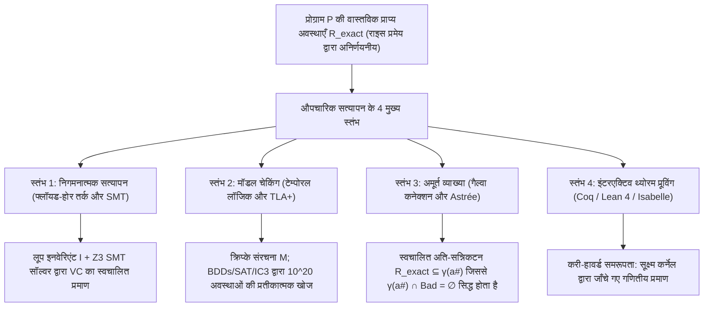
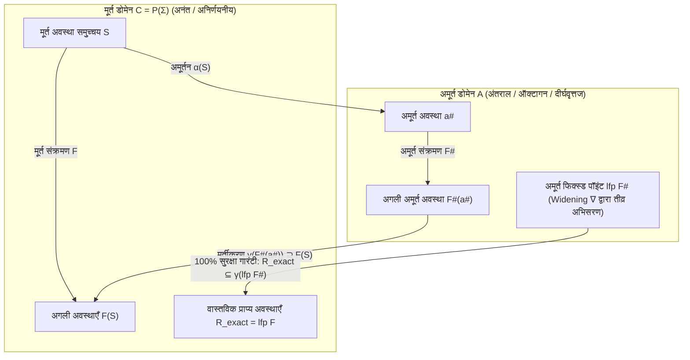

## 1. टेस्टिंग की सीमाएँ और अनिर्णयता (Undecidability) की दीवार: 10,00,000 टेस्ट पास होना भी पर्याप्त क्यों नहीं है?

### 1.1 डाइक्स्ट्रा का अमर सूत्र और इनपुट स्पेस का विस्फोट

1969 में नाटो (NATO) सॉफ्टवेयर इंजीनियरिंग सम्मेलन में ट्यूरिंग पुरस्कार विजेता <strong>एड्सगर डाइक्स्ट्रा (Edsger W. Dijkstra)</strong> ने कंप्यूटर विज्ञान के इतिहास का सबसे प्रसिद्ध सत्य कहा था:

> <strong>"Program testing can be used to show the presence of bugs, but never to show their absence!"</strong>
> (प्रोग्राम टेस्टिंग का उपयोग बग्स की <strong>उपस्थिति</strong> दिखाने के लिए तो किया जा सकता है, लेकिन उनकी <strong>अनुपस्थिति</strong> साबित करने के लिए कभी नहीं!)

एक अत्यंत सरल फ़ंक्शन `f(x, y)` की कल्पना करें जो दो 64-बिट पूर्णांक (`int64_t`) लेता है। इसके कुल संभावित इनपुट जोड़ों की संख्या है:

$$N_{\text{inputs}} = 2^{64} \times 2^{64} = 2^{128} \approx 3.4028 \times 10^{38}$$

यदि दुनिया का सबसे तेज़ सुपरकंप्यूटर <strong>प्रति सेकंड एक अरब ($10^9$) टेस्ट</strong> भी चलाए, तो सभी इनपुट जांचने में लगभग <strong>$1.08 \times 10^{22}$ वर्ष</strong> लगेंगे — जो ब्रह्मांड की आयु का लगभग 780 अरब गुना है! जब इसमें डायनेमिक मेमोरी, नेटवर्क पैकेट और मल्टीथ्रेडिंग का गैर-नियतात्मक इंटरलीविंग (Interleaving) जुड़ता है, तो निष्पादन पथों की संख्या <strong>अनंत ($\infty$)</strong> हो जाती है।

2006 में Google के <strong>जोशुआ ब्लॉख (Joshua Bloch)</strong> ने जावा की मानक लाइब्रेरी (`java.util.Arrays.binarySearch`) में <strong>9 वर्षों</strong> से छिपे <strong>बाइनरी सर्च इंटीजर ओवरफ्लो बग</strong> को उजागर किया:

```java
public static int binarySearch(int[] a, int key) {
    int low = 0;
    int high = a.length - 1;
    while (low <= high) {
        int mid = (low + high) / 2; // ★ घातक बग: जब low + high >= 2^31 होता है, तो यह ऋणात्मक हो जाता है!
        int midVal = a[mid];
        if (midVal < key) low = mid + 1;
        else if (midVal > key) high = mid - 1;
        else return mid;
    }
    return -(low + 1);
}
```

जब बड़े ऐरे में `low + high` का योग 32-बिट पूर्णांक की अधिकतम सीमा ($2^{31} - 1 = 2,147,483,647$) को पार करता है, तो वह ओवरफ्लो होकर ऋणात्मक हो जाता है और तुरंत `ArrayIndexOutOfBoundsException` से क्रैश हो जाता है।

### 1.2 ट्यूरिंग की हॉल्टिंग समस्या (1936) और राइस का प्रमेय (1953)

हम एक ऐसा स्वचालित प्रोग्राम क्यों नहीं बना सकते जो किसी भी प्रोग्राम $P$ के सोर्स कोड को पढ़कर 100% सटीकता से बता दे कि उसमें कोई बग है या नहीं? इसके सामने <strong>एलन ट्यूरिंग की हॉल्टिंग समस्या (1936)</strong> और <strong>राइस का प्रमेय (Rice's Theorem, 1953)</strong> खड़े हैं:

$$\text{प्रमेय (Rice, 1953): गणनीय फलनों का प्रत्येक गैर-तुच्छ (non-trivial) सेमैंटिक गुण } \mathcal{S} \text{ अनिर्णयनीय (undecidable) होता है।}$$

अर्थात कोई भी सत्यापन उपकरण एक साथ <strong>(1) पूर्ण स्वचालन</strong>, <strong>(2) साउंडनेस (Soundness: शून्य फॉल्स नेगेटिव / कोई बग न छूटना)</strong> और <strong>(3) पूर्णता (Completeness: शून्य फॉल्स पॉजिटिव / कोई झूठा अलार्म न होना)</strong> तीनों प्रदान नहीं कर सकता।

### 1.3 औपचारिक सत्यापन राइस के प्रमेय को कैसे पार करता है: Sound Over-Approximation

<strong>औपचारिक सत्यापन (Formal Verification)</strong> कभी भी <strong>साउंडनेस (Soundness)</strong> से समझौता नहीं करता: यदि सत्यापनकर्ता कहता है `"SAFE"`, तो प्रोग्राम सभी $\infty$ निष्पादनों में गणितीय रूप से 100% बग-मुक्त है। इसके लिए यह सभी संभावित अवस्थाओं $\mathcal{R}_{\text{exact}}$ का एक <strong>सुरक्षित अति-सन्निकटन (Sound Over-Approximation)</strong> $\mathcal{R}_{\text{approx}} \supseteq \mathcal{R}_{\text{exact}}$ निकालता है और सिद्ध करता है कि खतरनाक अवस्थाओं $\mathcal{B}$ के साथ उसका प्रतिच्छेदन रिक्त (empty) है:

$$\mathcal{R}_{\text{approx}} \cap \mathcal{B} = \emptyset \implies \mathcal{R}_{\text{exact}} \cap \mathcal{B} = \emptyset$$



---

## 2. स्तंभ 1: निगमनात्मक सत्यापन — फ्लॉयड-होर तर्क, सबसे कमजोर पूर्वशर्त और SMT सॉल्वर

### 2.1 होर ट्रिपल (Hoare Triple), लूप इनवेरिएंट और रैंकिंग फ़ंक्शन

1969 में <strong>सी. ए. आर. होर (C. A. R. Hoare)</strong> ने <strong>फ्लॉयड-होर तर्क (Floyd-Hoare Logic)</strong> की स्थापना की, जिसकी मूल इकाई <strong>होर ट्रिपल</strong> है:

$$\{P\}\; C \;\{Q\}$$

- <strong>आंशिक शुद्धता (Partial Correctness)</strong>: यदि कमांड $C$ से पहले पूर्वशर्त $P$ सत्य है और <strong>यदि $C$ समाप्त होता है</strong>, तो बाद में पश्चशर्त $Q$ सत्य होगी।
- <strong>पूर्ण शुद्धता (Total Correctness)</strong>: पूर्वशर्त $P$ के अंतर्गत <strong>$C$ निश्चित रूप से सीमित चरणों में समाप्त होगा</strong> और $Q$ को संतुष्ट करेगा।

इसके मुख्य नियमों में असाइनमेंट स्वयंसिद्ध $\{\,Q[E/x]\,\}\; x := E \;\{\,Q\,\}$ और `while` लूप नियम शामिल हैं, जिसमें <strong>लूप इनवेरिएंट (Loop Invariant)</strong> $I$ और प्रत्येक चक्र में строго घटने वाला <strong>रैंकिंग फ़ंक्शन (Loop Variant)</strong> $V \in \mathbb{N}$ होता है:

$$\frac{\{I \land B \land V = v_0\}\; S \;\{I \land V < v_0\} \qquad (I \land B) \implies V \ge 0}{[I]\; \text{while } B \text{ do } S \;[I \land \neg B]}$$

डाइक्स्ट्रा के <strong>सबसे कमजोर पूर्वशर्त कलन (Weakest Precondition, $\text{wp}(C, Q)$, 1975)</strong> द्वारा प्रोग्राम सत्यापन को शुद्ध गणितीय <strong>सत्यापन शर्तों (Verification Conditions, VCs)</strong> $P \implies \text{wp}(C, Q)$ में बदल दिया जाता है।

### 2.2 Dafny और Z3 SMT सॉल्वर में बाइनरी सर्च का पूर्ण सत्यापन

मध्य बिंदु की गणना को `mid := low + (high - low) / 2` में सुधारने और <strong>Dafny</strong> में लिखने पर, <strong>Z3 SMT सॉल्वर</strong> (<strong>DPLL(T)</strong> आर्किटेक्चर पर आधारित) कुछ मिलीसेकंड में सिद्ध कर देता है कि ओवरफ्लो कभी नहीं हो सकता:

```dafny
method BinarySearch(a: array<int>, key: int) returns (index: int)
  requires forall i, j :: 0 <= i < j < a.Length ==> a[i] <= a[j]
  ensures 0 <= index ==> index < a.Length && a[index] == key
  ensures index < 0 ==> forall k :: 0 <= k < a.Length ==> a[k] != key
{
  var low := 0;
  var high := a.Length;
  while low < high
    invariant 0 <= low <= high <= a.Length
    invariant forall i :: 0 <= i < a.Length && !(low <= i < high) ==> a[i] != key
    decreases high - low
  {
    var mid := low + (high - low) / 2; // Z3 सिद्ध करता है: कोई ओवरफ्लो नहीं और 0 <= mid < a.Length!
    if a[mid] < key { low := mid + 1; }
    else if key < a[mid] { high := mid; }
    else { return mid; }
  }
  return -1;
}
```

---

## 3. स्तंभ 2: मॉडल चेकिंग और टेम्पोरल लॉजिक — वितरित प्रणालियों की संपूर्ण अवस्था खोज

### 3.1 क्रिप्के संरचना (Kripke Structure) और LTL / CTL

1981 में <strong>क्लार्क</strong>, <strong>एमर्सन</strong> और <strong>सिफाकिस</strong> (2007 ट्यूरिंग पुरस्कार) ने <strong>मॉडल चेकिंग</strong> का आविष्कार किया, और <strong>लेस्ली लैम्पॉर्ट</strong> (2013 ट्यूरिंग पुरस्कार) ने <strong>TLA+</strong> विकसित किया। सिस्टम को <strong>क्रिप्के संरचना</strong> $M = (S, S_0, R, L)$ के रूप में मॉडल किया जाता है और इसके गुणों को <strong>LTL</strong> या <strong>CTL</strong> में लिखा जाता है:

1. <strong>सुरक्षा (Safety — "कुछ भी बुरा कभी नहीं होता")</strong>: म्यूचुअल एक्सक्लूजन:
   $$\text{LTL}: \quad \mathbf{G}\, \neg (\text{crit}_1 \land \text{crit}_2) \qquad \text{CTL}: \quad \mathbf{AG}\, \neg (\text{crit}_1 \land \text{crit}_2)$$
2. <strong>सजीवता (Liveness — "कुछ अच्छा अंततः अवश्य होता है")</strong>: स्टार्वेशन से मुक्ति:
   $$\text{LTL}: \quad \mathbf{G}\, (\text{req}_1 \implies \mathbf{F}\, \text{crit}_1) \qquad \text{CTL}: \quad \mathbf{AG}\, (\text{req}_1 \implies \mathbf{AF}\, \text{crit}_1)$$

### 3.2 बुची ऑटोमेटा, BDDs, IC3 और AWS में TLA+ की सफलता

मॉडल चेकर $\neg \varphi$ को <strong>बुची ऑटोमेटन (Büchi Automaton)</strong> $A_{\neg \varphi}$ में बदलता है और जांचता है कि $\mathcal{L}(M \times A_{\neg \varphi}) = \emptyset$ है या नहीं। <strong>स्टेट एक्सप्लोजन समस्या</strong> को हराने के लिए <strong>बाइनरी डिसीजन डायग्राम (BDDs, ब्रायंट 1986 / मैकमिलन 1990)</strong> ($10^{20}$ अवस्थाओं तक की जांच), <strong>बाउंडेड मॉडल चेकिंग (BMC)</strong> और <strong>IC3 / PDR</strong> का उपयोग किया जाता है।

<strong>Amazon Web Services (AWS)</strong> में <strong>S3</strong> और <strong>DynamoDB</strong> के डिजाइन में <strong>TLA+ (TLC)</strong> का उपयोग करके प्रोडक्शन कोड की एक भी लाइन लिखने से पहले <strong>35 चरणों वाला एक अत्यंत जटिल वितरित बग</strong> पकड़ लिया गया!

---

## 4. स्तंभ 3: अमूर्त व्याख्या (Abstract Interpretation) और एरियन 5 रॉकेट दुर्घटना का सबक

### 4.1 4 जून 1996: 37 करोड़ डॉलर का एरियन 5 रॉकेट लॉन्च के 37 सेकंड बाद क्यों फट गया?

4 जून 1996 को यूरोपीय अंतरिक्ष एजेंसी (ESA) का <strong>Ariane 5</strong> रॉकेट अपनी पहली उड़ान (<strong>Flight 501</strong>) में लॉन्च के मात्र <strong>37 सेकंड</strong> बाद हवा में नष्ट हो गया, जिससे <strong>370 मिलियन डॉलर</strong> का नुकसान हुआ। इसके इनर्शियल रेफरेंस सिस्टम (SRI) में <strong>Ariane 4</strong> का Ada कोड बिना बदले इस्तेमाल किया गया था, जो क्षैतिज वेग से जुड़े 64-बिट फ्लोटिंग-पॉइंट वेरिएबल `BH` को <strong>16-बिट चिह्नित पूर्णांक ($-32,768 \dots +32,767$)</strong> में बदलता था। Ariane 5 के तीव्र त्वरण के कारण `BH` का मान $32,767$ से अधिक हो गया और हार्डवेयर ओवरफ्लो ट्रैप (`Operand Error`) उत्पन्न हुआ। बैकअप और मुख्य दोनों कंप्यूटर बंद हो गए और उन्होंने बस पर डायग्नोस्टिक बिट पैटर्न भेजा, जिसे मुख्य ऑन-बोर्ड कंप्यूटर (OBC) ने वास्तविक झुकाव डेटा समझ लिया और इंजन नोजल को अधिकतम कोण पर मोड़ दिया, जिससे रॉकेट टुकड़े-टुकड़े हो गया।

### 4.2 कूसो दंपति की अमूर्त व्याख्या (1977), गैल्वा कनेक्शन और Airbus A380 पर Astrée की विजय

1977 में <strong>पैट्रिक कूसो (Patrick Cousot)</strong> और <strong>राधिया कूसो (Radhia Cousot)</strong> द्वारा रचित <strong>अमूर्त व्याख्या (Abstract Interpretation)</strong> मूर्त अवस्था जालक $(\mathcal{C}, \subseteq) = (\mathcal{P}(\Sigma), \subseteq)$ को अमूर्त डोमेन $(\mathcal{A}, \sqsubseteq^\#)$ (अंतराल $[a,b]$, ऑक्टागन $\pm x \pm y \le c$, बहुफलक) से <strong>गैल्वा कनेक्शन (Galois Connection)</strong> द्वारा जोड़ती है:

$$(\mathcal{C}, \subseteq) \underset{\alpha}{\overset{\gamma}{\leftrightarrows}} (\mathcal{A}, \sqsubseteq^\#) \quad \text{जहाँ} \quad \alpha(S) \sqsubseteq^\# a^\# \iff S \subseteq \gamma(a^\#)$$

स्थानीय साउंडनेस शर्त $\alpha(F(\gamma(a^\#))) \sqsubseteq^\# F^\#(a^\#)$ और <strong>वाइडनिंग ऑपरेटर (Widening $\nabla$)</strong> के साथ, अमूर्त फिक्स्ड पॉइंट सभी संभावित अवस्थाओं को 100% सुरक्षित रूप से घेर लेता है:

$$\mathcal{R}_{\text{exact}} = \text{lfp}\, F \subseteq \gamma(\text{lfp}\, F^\#)$$



स्टैटिक एनालाइजर <strong>Astrée</strong> ने <strong>Airbus A380 के लगभग 10,00,000 लाइनों के Fly-by-Wire C उड़ान नियंत्रण सॉफ्टवेयर</strong> को <strong>शून्य झूठे अलार्म (Zero False Alarms)</strong> के साथ सत्यापित कर दिखाया और साबित किया कि उसमें कोई भी रनटाइम त्रुटि कभी नहीं हो सकती!

---

## 5. स्तंभ 4: इंटरएक्टिव थ्योरम प्रूविंग (Coq / Lean 4 / Isabelle) और तुलनात्मक सारांश

<strong>करी-हावर्ड समरूपता (Curry-Howard Isomorphism)</strong> (*प्रस्ताव ही टाइप हैं, प्रमाण ही प्रोग्राम हैं*) पर आधारित <strong>Coq (Rocq)</strong>, <strong>Lean 4</strong> और <strong>Isabelle/HOL</strong> ने दो ऐतिहासिक कीर्तिमान स्थापित किए:
1. <strong>CompCert (Xavier Leroy, INRIA)</strong>: Coq में पूर्णतः सत्यापित C कंपाइलर। <strong>Csmith</strong> फ़ज़िंग परीक्षण (PLDI 2011) में GCC और LLVM में 325+ बग्स मिले, लेकिन <strong>CompCert के सत्यापित मिडिल-एंड में एक भी बग नहीं मिला</strong>!
2. <strong>seL4 (Gerwin Klein et al.)</strong>: Isabelle/HOL में C कोड से लेकर ARM/RISC-V बाइनरी तक पूर्णतः सत्यापित दुनिया का पहला OS माइक्रोकर्नेल।

| सत्यापन दृष्टिकोण | गणितीय आधार | प्रमुख उपकरण और भाषाएँ | स्वचालन स्तर | औद्योगिक अनुप्रयोग | मुख्य शक्ति और सीमा |
| :--- | :--- | :--- | :--- | :--- | :--- |
| <strong>1. निगमनात्मक सत्यापन</strong> | फ्लॉयड-होर तर्क, $\text{wp}$-कलन, SMT | <strong>Dafny</strong>, <strong>Frama-C</strong>, <strong>SPARK Ada</strong>, <strong>Verus</strong>, <strong>Z3</strong> | अर्ध-स्वचालित (इनवेरिएंट + SMT) | क्रिप्टोग्राफी, एयर ट्रैफिक कंट्रोल, AWS Cedar | सोर्स कोड पर गहरी कार्यात्मक शुद्धता सिद्ध करता है। |
| <strong>2. मॉडल चेकिंग</strong> | क्रिप्के संरचना, LTL/CTL, बुची, BDD | <strong>TLA+ (TLC)</strong>, <strong>SPIN</strong>, <strong>NuSMV</strong>, <strong>CBMC</strong> | पूर्ण स्वचालित (सीमित मॉडल पर) | <strong>AWS S3 व DynamoDB</strong>, Paxos/Raft, CPU डिजाइन | जटिल समवर्ती बग्स के लिए सटीक काउंटरएग्जांपल देता है। |
| <strong>3. अमूर्त व्याख्या</strong> | पूर्ण जालक, गैल्वा कनेक्शन $(\alpha,\gamma)$, $\nabla$ | <strong>Astrée</strong>, <strong>Polyspace</strong>, <strong>Infer</strong> (Meta) | पूर्ण स्वचालित | <strong>Airbus A380/A350 Fly-by-Wire</strong>, ऑटोमोटिव C कोड | बिना मानवीय एनोटेशन के 10,00,000+ लाइनों के C कोड का सत्यापन। |
| <strong>4. इंटरएक्टिव प्रूविंग</strong> | करी-हावर्ड समरूपता, डिपेंडेंट टाइप थ्योरी | <strong>Coq (Rocq)</strong>, <strong>Lean 4</strong>, <strong>Isabelle/HOL</strong> | इंटरएक्टिव (मानव + टैक्टिक्स + AI) | <strong>CompCert</strong> C कंपाइलर, <strong>seL4</strong> OS माइक्रोकर्नेल | असीमित अभिव्यक्ति क्षमता और सूक्ष्म कर्नेल द्वारा 100% गणितीय निश्चितता। |
