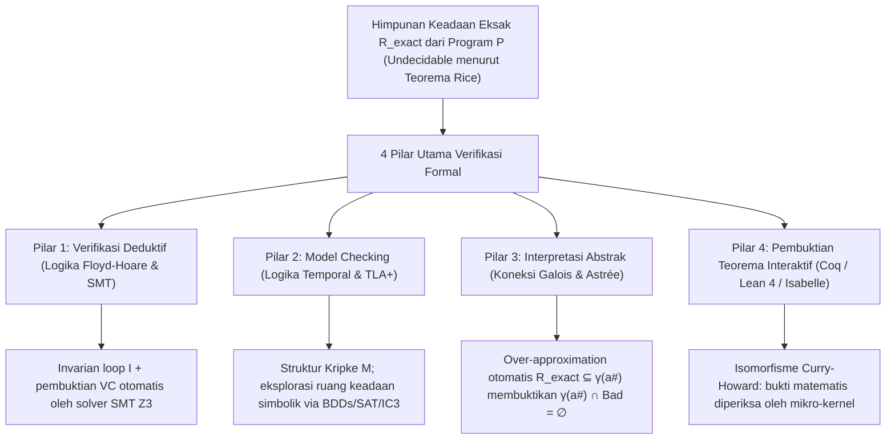
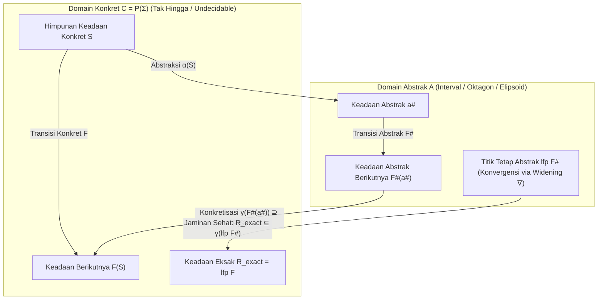

## 1. Batas Pengujian (Testing) dan Dinding Ketidakpastian: Mengapa Lulus 1.000.000 Tes Tidak Membuktikan Apa Pun

### 1.1 Maksim Abadi Dijkstra dan Ledakan Kombinatorial Ruang Input

Pada tahun 1969, dalam Konferensi Rekayasa Perangkat Lunak NATO, peraih Turing Award <strong>Edsger W. Dijkstra</strong> mengucapkan kalimat paling terkenal dalam sejarah ilmu komputer:

> <strong>"Program testing can be used to show the presence of bugs, but never to show their absence!"</strong>
> (Pengujian program dapat digunakan untuk menunjukkan <strong>keberadaan</strong> bug, tetapi tidak pernah bisa menunjukkan <strong>ketiadaannya</strong>!)

Bayangkan sebuah fungsi murni sederhana `f(x, y)` yang menerima dua bilangan bulat bertanda 64-bit (`int64_t`). Jumlah total pasangan input yang mungkin adalah:

$$N_{\text{inputs}} = 2^{64} \times 2^{64} = 2^{128} \approx 3,4028 \times 10^{38}$$

Bahkan jika superkomputer tercepat mengeksekusi <strong>satu miliar ($10^9$) kasus uji per detik</strong>, waktu yang dibutuhkan untuk menguji seluruh kombinasi input adalah sekitar <strong>$1,08 \times 10^{22}$ tahun</strong> — 780 miliar kali usia alam semesta! Ketika kita menambahkan memori heap dinamis, paket jaringan, dan penjadwalan multithread non-deterministik (interleaving), jumlah jalur eksekusi menyebar menuju <strong>tak hingga ($\infty$)</strong>.

Pada tahun 2006, <strong>Joshua Bloch</strong> (Google) mengungkap bug yang bersembunyi selama <strong>9 tahun</strong> di pustaka standar Java (`java.util.Arrays.binarySearch`), yaitu <strong>bug integer overflow pada pencarian biner (binary search)</strong>:

```java
public static int binarySearch(int[] a, int key) {
    int low = 0;
    int high = a.length - 1;
    while (low <= high) {
        int mid = (low + high) / 2; // ★ BUG FATAL: overflow menjadi negatif saat low + high >= 2^31!
        int midVal = a[mid];
        if (midVal < key) low = mid + 1;
        else if (midVal > key) high = mid - 1;
        else return mid;
    }
    return -(low + 1);
}
```

Ketika ukuran array sangat besar sehingga `low + high` melampaui batas maksimum integer 32-bit ($2^{31} - 1 = 2.147.483.647$), penjumlahan tersebut meluap (overflow) menjadi bilangan negatif dan langsung memicu `ArrayIndexOutOfBoundsException`.

### 1.2 Masalah Pemberhentian Turing (1936) dan Teorema Rice (1953)

Mengapa kita tidak membuat penganalisis statis otomatis yang membaca kode sumber program $P$ apa pun dan memutuskan dengan akurasi 100% apakah program tersebut bebas bug? <strong>Masalah Pemberhentian (Halting Problem) Alan Turing (1936)</strong> dan <strong>Teorema Rice (1953)</strong> membuktikan bahwa hal itu mustahil secara matematis:

$$\text{Teorema (Rice, 1953): Setiap properti semantik non-trivial } \mathcal{S} \text{ dari fungsi komputabel bersifat tidak dapat diputuskan (undecidable).}$$

Tidak ada alat verifikasi yang dapat secara bersamaan memenuhi <strong>(1) otomatisasi penuh</strong>, <strong>(2) kesehatan / Soundness (nol negatif palsu / tidak pernah melewatkan bug)</strong>, dan <strong>(3) kelengkapan / Completeness (nol positif palsu / tanpa alarm palsu)</strong>.

### 1.3 Bagaimana Verifikasi Formal Menembus Teorema Rice: Sound Over-Approximation

<strong>Verifikasi Formal</strong> menolak berkompromi pada <strong>Soundness</strong>: jika alat menyatakan `"SAFE"`, program tersebut dijamin 100% bebas bug secara matematis di seluruh $\infty$ jalur eksekusi. Caranya adalah menghitung <strong>pendekatan berlebih yang sehat (Sound Over-Approximation)</strong> $\mathcal{R}_{\text{approx}} \supseteq \mathcal{R}_{\text{exact}}$ dari semua keadaan yang dapat dicapai, lalu membuktikan bahwa irisannya dengan keadaan berbahaya $\mathcal{B}$ adalah himpunan kosong:

$$\mathcal{R}_{\text{approx}} \cap \mathcal{B} = \emptyset \implies \mathcal{R}_{\text{exact}} \cap \mathcal{B} = \emptyset$$



---

## 2. Pilar 1: Verifikasi Deduktif — Logika Floyd-Hoare, Prasyarat Terlemah, dan Solver SMT

### 2.1 Tripel Hoare, Invarian Loop, dan Fungsi Ranking

Pada tahun 1969, <strong>C. A. R. Hoare</strong> merumuskan <strong>Logika Floyd-Hoare</strong> dengan unit dasar <strong>Tripel Hoare</strong>:

$$\{P\}\; C \;\{Q\}$$

- <strong>Kebenaran Parsial (Partial Correctness)</strong>: Jika prasyarat $P$ berlaku sebelum perintah $C$ dan <strong>jika $C$ berhenti</strong>, maka pascasyarat $Q$ pasti berlaku setelahnya.
- <strong>Kebenaran Total (Total Correctness)</strong>: Di bawah prasyarat $P$, <strong>$C$ dijamin berhenti</strong> dalam langkah berhingga dan memenuhi $Q$.

Aturan inferensi utamanya mencakup aksioma penugasan $\{\,Q[E/x]\,\}\; x := E \;\{\,Q\,\}$ dan aturan perulangan `while` dengan <strong>invarian loop</strong> $I$ serta <strong>fungsi ranking (varian)</strong> $V \in \mathbb{N}$ yang строго menurun di setiap iterasi:

$$\frac{\{I \land B \land V = v_0\}\; S \;\{I \land V < v_0\} \qquad (I \land B) \implies V \ge 0}{[I]\; \text{while } B \text{ do } S \;[I \land \neg B]}$$

Melalui kalkulus <strong>Prasyarat Terlemah (Weakest Precondition, $\text{wp}(C, Q)$, Dijkstra 1975)</strong>, pembuktian program direduksi menjadi rumus matematika murni yang disebut <strong>Kondisi Verifikasi (VCs)</strong>: $P \implies \text{wp}(C, Q)$.

### 2.2 Pembuktian Formal Binary Search di Dafny dan Solver SMT Z3

Saat kita memperbaiki perhitungan nilai tengah menjadi `mid := low + (high - low) / 2` dalam bahasa <strong>Dafny</strong>, solver SMT <strong>Z3</strong> (berarsitektur <strong>DPLL(T)</strong> yang menggabungkan fungsi tak terinterpretasi EUF, aritmetika linier integer LIA, bit-vector $\mathcal{T}_{\text{BV}}$, dan teori array $\mathcal{T}_{\text{A}}$) membuktikan secara otomatis dalam milidetik bahwa kode tersebut 100% bebas overflow:

```dafny
method BinarySearch(a: array<int>, key: int) returns (index: int)
  requires forall i, j :: 0 <= i < j < a.Length ==> a[i] <= a[j]
  ensures 0 <= index ==> index < a.Length && a[index] == key
  ensures index < 0 ==> forall k :: 0 <= k < a.Length ==> a[k] != key
{
  var low := 0;
  var high := a.Length;
  while low < high
    invariant 0 <= low <= high <= a.Length
    invariant forall i :: 0 <= i < a.Length && !(low <= i < high) ==> a[i] != key
    decreases high - low
  {
    var mid := low + (high - low) / 2; // Z3 membuktikan: bebas overflow dan 0 <= mid < a.Length!
    if a[mid] < key { low := mid + 1; }
    else if key < a[mid] { high := mid; }
    else { return mid; }
  }
  return -1;
}
```

---

## 3. Pilar 2: Model Checking dan Logika Temporal — Eksplorasi Menyeluruh Sistem Terdistribusi

### 3.1 Struktur Kripke dan Logika Temporal LTL / CTL

Pada tahun 1981, <strong>Clarke</strong>, <strong>Emerson</strong>, dan <strong>Sifakis</strong> (Turing Award 2007) menciptakan <strong>Model Checking</strong>, sementara <strong>Leslie Lamport</strong> (Turing Award 2013) mengembangkan <strong>TLA+</strong>. Sistem konkuren dimodelkan sebagai <strong>Struktur Kripke</strong> $M = (S, S_0, R, L)$ dan dispesifikasikan menggunakan <strong>LTL</strong> atau <strong>CTL</strong>:

1. <strong>Keselamatan (Safety — "Hal buruk tidak pernah terjadi")</strong>: Mutual exclusion:
   $$\text{LTL}: \quad \mathbf{G}\, \neg (\text{crit}_1 \land \text{crit}_2) \qquad \text{CTL}: \quad \mathbf{AG}\, \neg (\text{crit}_1 \land \text{crit}_2)$$
2. <strong>Kehidupan (Liveness — "Hal baik pada akhirnya pasti terjadi")</strong>: Bebas kelaparan (Starvation Freedom):
   $$\text{LTL}: \quad \mathbf{G}\, (\text{req}_1 \implies \mathbf{F}\, \text{crit}_1) \qquad \text{CTL}: \quad \mathbf{AG}\, (\text{req}_1 \implies \mathbf{AF}\, \text{crit}_1)$$

### 3.2 Automata Büchi, BDD, IC3, dan Kesuksesan TLA+ di AWS

Model checker menerjemahkan negasi spesifikasi $\neg \varphi$ ke dalam <strong>Automata Büchi</strong> $A_{\neg \varphi}$ dan memeriksa apakah produk sinkronnya kosong ($\mathcal{L}(M \times A_{\neg \varphi}) = \emptyset$). Untuk mengatasi <strong>ledakan ruang keadaan (State Explosion Problem)</strong>, digunakan <strong>Binary Decision Diagrams (BDD, Bryant 1986 / McMillan 1990)</strong> yang sanggup memeriksa $10^{20}$ keadaan, <strong>Bounded Model Checking (BMC)</strong>, serta <strong>IC3 / PDR</strong>.

Di <strong>Amazon Web Services (AWS)</strong>, penggunaan <strong>TLA+ (TLC)</strong> pada <strong>S3</strong> dan <strong>DynamoDB</strong> berhasil menemukan bug kehilangan data kritis yang membutuhkan urutan tepat <strong>35 langkah konkuren</strong> (partisi jaringan, penundaan pesan, failover leader) sebelum satu baris pun kode produksi ditulis!

---

## 4. Pilar 3: Interpretasi Abstrak dan Pelajaran dari Bencana Roket Ariane 5

### 4.1 4 Juni 1996: Mengapa Roket Ariane 5 Senilai $370 Juta Meledak dalam 37 Detik

Pada 4 Juni 1996, penerbangan perdana (<strong>Flight 501</strong>) roket <strong>Ariane 5</strong> milik Badan Antariksa Eropa (ESA) hancur <strong>37 detik</strong> setelah peluncuran dengan kerugian <strong>$370 juta</strong>. Sistem referensi inersia (SRI) menggunakan kembali modul kode Ada dari <strong>Ariane 4</strong> yang mengonversi variabel floating-point 64-bit kecepatan horizontal (`BH`) menjadi <strong>integer bertanda 16-bit ($-32.768 \dots +32.767$)</strong>. Karena akselerasi Ariane 5 jauh lebih cepat, nilai `BH` melampaui $32.767$ dan memicu trap hardware overflow (`Operand Error`) yang tidak ditangani. Komputer cadangan dan utama SRI mati bersamaan lalu mengirimkan pola bit diagnostik ke komputer utama (OBC), yang salah mengartikannya sebagai data kemiringan ekstrem sehingga membelokkan nosel roket secara maksimal hingga hancur di udara.

### 4.2 Interpretasi Abstrak Cousot (1977), Koneksi Galois, dan Astrée pada Airbus A380

Diciptakan pada tahun 1977 oleh <strong>Patrick Cousot</strong> dan <strong>Radhia Cousot</strong>, <strong>Interpretasi Abstrak</strong> menghubungkan kekisi konkret $(\mathcal{C}, \subseteq) = (\mathcal{P}(\Sigma), \subseteq)$ dengan domain abstrak $(\mathcal{A}, \sqsubseteq^\#)$ (interval $[a,b]$, oktagon $\pm x \pm y \le c$, polihedra konveks) melalui <strong>Koneksi Galois (Galois Connection)</strong>:

$$(\mathcal{C}, \subseteq) \underset{\alpha}{\overset{\gamma}{\leftrightarrows}} (\mathcal{A}, \sqsubseteq^\#) \quad \text{di mana} \quad \alpha(S) \sqsubseteq^\# a^\# \iff S \subseteq \gamma(a^\#)$$

Dengan kondisi kesehatan lokal $\alpha(F(\gamma(a^\#))) \sqsubseteq^\# F^\#(a^\#)$ dan <strong>operator pelebaran (Widening $\nabla$)</strong>, titik tetap abstrak menjamin pembungkusan seluruh keadaan yang dapat dicapai secara 100% aman:

$$\mathcal{R}_{\text{exact}} = \text{lfp}\, F \subseteq \gamma(\text{lfp}\, F^\#)$$



Penganalisis statis <strong>Astrée</strong> berhasil memverifikasi <strong>perangkat lunak kendali terbang Fly-by-Wire Airbus A380 (hampir 1.000.000 baris kode C)</strong> dengan <strong>nol alarm palsu (Zero False Alarms)</strong>, membuktikan secara matematis ketiadaan total kesalahan runtime!

---

## 5. Pilar 4: Pembukti Teorema Interaktif (Coq / Lean 4 / Isabelle) dan Perbandingan Lengkap

Berdasarkan <strong>Isomorfisme Curry-Howard</strong> (*proposisi sebagai tipe, bukti sebagai program*), <strong>Coq (Rocq)</strong>, <strong>Lean 4</strong>, dan <strong>Isabelle/HOL</strong> melahirkan dua mahakarya sejarah:
1. <strong>CompCert (Xavier Leroy, INRIA)</strong>: Kompiler C pengoptimasi yang diverifikasi secara formal di Coq. Dalam pengujian fuzzing <strong>Csmith</strong> (PLDI 2011), ditemukan lebih dari 325 bug salah kompilasi pada GCC dan LLVM, namun <strong>nol bug pada bagian terverifikasi CompCert</strong>!
2. <strong>seL4 (Gerwin Klein et al.)</strong>: Mikrokernel sistem operasi pertama di dunia yang diverifikasi secara formal di Isabelle/HOL hingga ke level biner mesin ARM/RISC-V.

| Paradigma Verifikasi | Fondasi Matematika | Alat & Bahasa | Otomatisasi | Aplikasi Industri Utama | Kekuatan & Kompromi |
| :--- | :--- | :--- | :--- | :--- | :--- |
| <strong>1. Verifikasi Deduktif</strong> | Logika Hoare, kalkulus $\text{wp}$, SMT | <strong>Dafny</strong>, <strong>Frama-C</strong>, <strong>SPARK Ada</strong>, <strong>Verus</strong>, <strong>Z3</strong> | Semi-otomatis (Invarian + SMT) | Kriptografi, pemandu lalu lintas udara, AWS Cedar | Membuktikan kebenaran fungsional mendalam pada kode. |
| <strong>2. Model Checking</strong> | Struktur Kripke, LTL/CTL, Büchi, BDD | <strong>TLA+ (TLC)</strong>, <strong>SPIN</strong>, <strong>NuSMV</strong>, <strong>CBMC</strong> | Otomatis (pada model berhingga) | <strong>AWS S3 & DynamoDB</strong>, Paxos/Raft, desain CPU | Menghasilkan jejak contoh penyangkal eksak untuk bug konkuren. |
| <strong>3. Interpretasi Abstrak</strong> | Kekisi, koneksi Galois $(\alpha,\gamma)$, $\nabla$ | <strong>Astrée</strong>, <strong>Polyspace</strong>, <strong>Infer</strong> (Meta) | Sepenuhnya otomatis | <strong>Airbus A380/A350 Fly-by-Wire</strong>, kode C otomotif | Mampu memverifikasi 1.000.000+ baris kode C tanpa anotasi. |
| <strong>4. Pembuktian Interaktif</strong> | Isomorfisme Curry-Howard, teori tipe | <strong>Coq (Rocq)</strong>, <strong>Lean 4</strong>, <strong>Isabelle/HOL</strong> | Interaktif (Manusia + Taktik + AI) | Kompiler <strong>CompCert</strong>, mikrokernel OS <strong>seL4</strong> | Daya ekspresi tak terbatas dan kepastian mutlak via mikro-kernel. |
