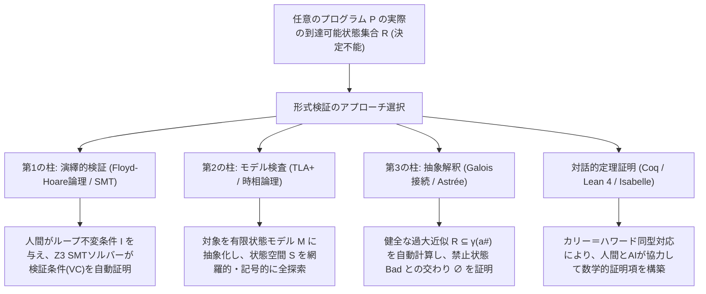
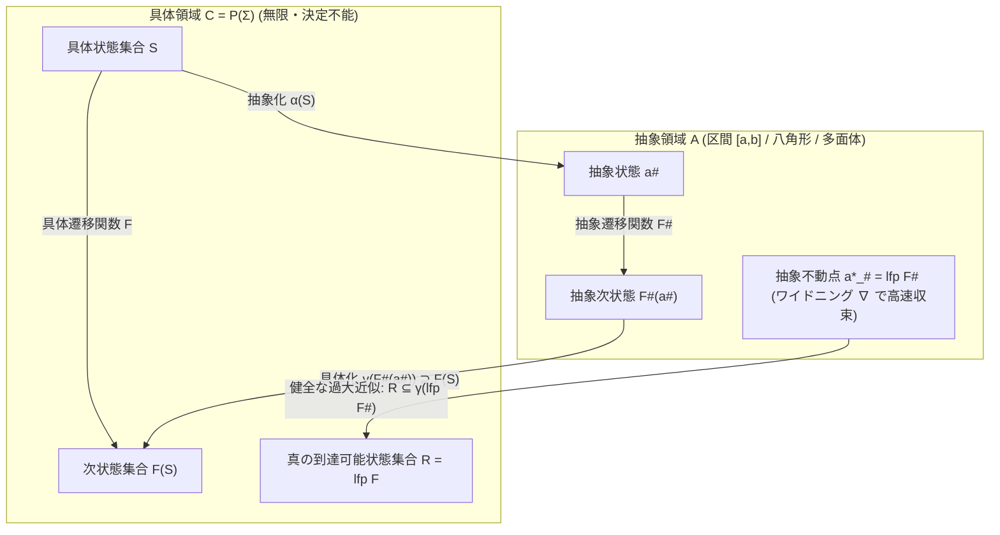

## 1. テストの限界と計算不可能性の壁：なぜ「100万回のテスト通過」は無力なのか

### 1.1 ダイクストラの不滅の格言と入力空間の天文学的爆発

1969年、構造化プログラミングの提唱者でありチューリング賞受賞者である<strong>エドガー・ダイクストラ（Edsger W. Dijkstra）</strong>は、NATOソフトウェア工学会議の報告書において、ソフトウェア工学の歴史上最も有名かつ冷徹な格言を残した。

> <strong>"Program testing can be used to show the presence of bugs, but never to show their absence!"</strong>
> （プログラムのテストはバグの<strong>存在</strong>を示すためには使えるが、バグの<strong>不在</strong>を示すためには決して使えない！）

現代のソフトウェア開発現場では、単体テスト（Unit Testing）、結合テスト（Integration Testing）、ファジング（Fuzzing）、プロパティベーステスト（QuickCheckなど）が日常的に行われている。CI/CDパイプラインで10万件のテストケースがすべてグリーン（成功）になったとき、開発者はしばしば「このコードは十分に安全だ」と錯覚する。しかし、数学的な観点から見れば、有限回のテスト実行によってプログラムの完全な正しさを保証することは<strong>原理的に不可能</strong>である。

極めて単純な例を考えよう。64ビット符号付き整数（`int64_t`）を2つ受け取り、何らかの算術演算を行って結果を返す純粋関数 `f(x, y)` があるとする。この関数への可能な入力の組 $(x, y)$ の総数は次の通りである。

$$N_{\text{inputs}} = 2^{64} \times 2^{64} = 2^{128} \approx 3.4028 \times 10^{38}$$

仮に、世界最速のスーパーコンピュータを用いて<strong>1秒間に10億回（$10^9$回）</strong>のテストケースを休みなく実行し続けたとしよう。すべての入力パターンを網羅するのに要する時間 $T$ は、

$$T = \frac{3.4028 \times 10^{38}}{10^9 \times 3.1536 \times 10^7 \text{ 秒/年}} \approx 1.079 \times 10^{22} \text{ 年}$$

これは宇宙誕生からの経過時間（約 $1.38 \times 10^{10}$ 年）の<strong>約7800億倍</strong>に相当する。わずか引数2個の純粋関数でさえこの有様であり、ここに内部状態（State）、ポインタ・ヒープメモリ、ネットワークパケットの到着順序、そしてマルチスレッドの非決定的なインターリービング（文脈切替のタイミング）が加われば、実行経路（Execution Paths）の数は文字通り<strong>無限大（$\infty$）</strong>へと発散する。

実際にこの「テストの盲点」が劇的な形で露呈したのが、Googleの<strong>ジョシュア・ブロック（Joshua Bloch）</strong>が2006年に公表した<strong>「二分探索（Binary Search）の整数オーバーフローバグ」</strong>である。ジョン・ベントリー（Jon Bentley）の名著『Programming Pearls（珠玉のプログラミング）』に掲載され、Java標準ライブラリ（`java.util.Arrays.binarySearch`）に実装されていた以下のコードは、世界中の何億台ものマシンで<strong>9年間</strong>にわたり毎日実行され、あらゆるテストを通過していた。

```java
// 9年間バグが潜伏していた Java 標準ライブラリの二分探索
public static int binarySearch(int[] a, int key) {
    int low = 0;
    int high = a.length - 1;
    while (low <= high) {
        int mid = (low + high) / 2; // ★ ここに致命的なバグ！
        int midVal = a[mid];
        if (midVal < key)
            low = mid + 1;
        else if (midVal > key)
            high = mid - 1;
        else
            return mid; // key found
    }
    return -(low + 1);  // key not found
}
```

配列のサイズが大きく、`low + high` の和が32ビット符号付き整数の最大値 $2^{31} - 1 = 2,147,483,647$ を超えた瞬間（たとえば配列長が $1.2 \times 10^9$ で探索区間が後半に移動したとき）、`low + high` は<strong>負の数へと算術オーバーフロー</strong>を起こし、`mid` が負の値となって `ArrayIndexOutOfBoundsException` でクラッシュする。数十億回のテスト実行でも、配列サイズと探索キーがその特定の境界領域に入らない限り、このバグは決して発火しなかったのである。

### 1.2 チューリングの停止問題（1936）とライスの定理（1953）

「テストで全パターンを試せないなら、プログラムのソースコード（構文）を解析して、バグがあるかどうかを自動判定するプログラム（静的解析器）を作ればいいのではないか？」

この自然な発想の前に立ちはだかるのが、計算機科学の根幹をなす2つの不可能性定理――アラン・チューリングの<strong>停止問題（Halting Problem, 1936）</strong>と、それを一般化したヘンリー・ゴードン・ライスの<strong>ライスの定理（Rice's Theorem, 1953）</strong>である。

任意のチューリング完全なプログラミング言語において、プログラム $P$ が計算する部分関数を $\llbracket P \rrbracket$ と書くことにする。プログラムの意味論的性質（Semantic Property、すなわちプログラムの書き方ではなく「入力に対して何を出力するか・どう振る舞うか」に関する性質）$\mathcal{S}$ が<strong>非自明（Non-trivial）</strong>であるとは、$\mathcal{S}$ を満たすプログラムが少なくとも1つ存在し、かつ $\mathcal{S}$ を満たさないプログラムも少なくとも1つ存在することを指す。

- 「プログラム $P$ はゼロ除算を起こさない」
- 「プログラム $P$ はNULLポインタ参照を起こさない」
- 「プログラム $P$ はすべての入力に対して停止する」
- 「プログラム $P$ は仕様関数 $f_{\text{spec}}$ と同じ値を返す」

これらはすべて非自明な意味論的性質である。ライスの定理は次を主張する。

$$\text{定理（Rice, 1953）: 計算可能関数の任意の非自明な意味論的性質 } \mathcal{S} \text{ は決定不能（Undecidable）である。}$$

その証明の核心は、停止問題からの帰着（対角線論法）にある。もし任意のプログラム $P$ と入力 $x$ に対して「$P(x)$ がゼロ除算を起こすか否か」を有限時間内に100%の精度で判定できる万能アルゴリズム $\text{CheckZeroDiv}(P, x)$ が存在したと仮定しよう。すると我々は、任意のプログラム $M$ と入力 $w$ に対して次のような新しいプログラム $P_{M, w}$ を構成できる。

```python
def P_M_w(dummy_input):
    M(w)          # もし M(w) が無限ループするなら、次の行には永遠に到達しない
    return 1 / 0  # M(w) が停止した瞬間に、必ずゼロ除算を起こす！
```

この $P_{M, w}$ を仮定した万能判定器 $\text{CheckZeroDiv}$ に食わせれば、「$P_{M, w}$ がゼロ除算を起こす $\iff M(w)$ が停止する」となるため、決定不能であるはずのチューリングの停止問題が解けてしまい矛盾する。

すなわち、以下の3つの条件を<strong>同時に</strong>満たす検証ツールは、宇宙の物理法則やコンピュータの性能に関わらず、<strong>論理的に存在し得ない</strong>。

1. <strong>完全自動化（Full Automation）</strong>: 人間の介入なしにボタンを押すだけで必ず有限時間で判定が終わる。
2. <strong>健全性（Soundness / 偽陰性ゼロ）</strong>: 「バグなし（SAFE）」と判定したプログラムには、本当に100%バグが存在しない（バグの見逃しが絶対にない）。
3. <strong>完全性（Completeness / 偽陽性ゼロ）</strong>: 本当にバグがないすべてのプログラムに対して、必ず「バグなし（SAFE）」と判定できる（誤警報が一切ない）。

### 1.3 ライスの定理をどう突破するか？ 形式検証の戦略的トレードオフ

では、なぜ航空機のフライトコントローラやロケットの制御ソフト、OSカーネル、暗号ライブラリにおいて「バグが絶対に起きない」と数学的に証明する<strong>形式検証（Formal Verification）</strong>が可能なのか？ 答えは明快である。形式検証の科学とは、<strong>「健全性（Soundness：『安全』と言ったら100%絶対に安全であること）」を死守しつつ、完全性（Completeness）または完全自動化（Full Automation）のいずれかを戦略的に緩和する技術体系</strong>だからである。



特に自動静的検証（抽象解釈や型システム、SMTベースの検証）が採用するのが<strong>「健全な過大近似（Sound Over-Approximation）」</strong>という概念である。

プログラム $P$ のあらゆる可能な実行において実際に到達し得る状態の集合を $\mathcal{R}_{\text{exact}}$ とし、クラッシュやオーバーフローなどの「危険な状態（Bad States）」の集合を $\mathcal{B}$ とする。我々が証明したいのは $\mathcal{R}_{\text{exact}} \cap \mathcal{B} = \emptyset$ である。ライスの定理により $\mathcal{R}_{\text{exact}}$ を正確に計算することはできないが、$\mathcal{R}_{\text{exact}}$ を外側から包み込む少し大きめの集合（過大近似集合）$\mathcal{R}_{\text{approx}}$ を計算することは<strong>有限時間で完全に自動化できる</strong>。

$$\mathcal{R}_{\text{exact}} \subseteq \mathcal{R}_{\text{approx}}$$

もし、この大きめにを見積もった集合 $\mathcal{R}_{\text{approx}}$ でさえも危険領域 $\mathcal{B}$ と一切交わらないこと、すなわち

$$\mathcal{R}_{\text{approx}} \cap \mathcal{B} = \emptyset \implies \mathcal{R}_{\text{exact}} \cap \mathcal{B} = \emptyset$$

が示せれば、元のプログラム $P$ は<strong>1回も実行することなく、すべての可能な入力に対して絶対にバグを起こさない</strong>ことが数学的に100%証明される！ 逆に $\mathcal{R}_{\text{approx}} \cap \mathcal{B} \neq \emptyset$ となった場合は、本当にバグがある場合と、近似が粗すぎたことによる誤警報（False Positive / 偽陽性）の場合があるが、<strong>「安全（SAFE）と判定されたのに実はバグがあった（False Negative / 偽陰性）」という事態だけは絶対に起きない</strong>。これが形式検証がテストと決定的に異なる点である。

本稿では、現代の形式検証を支える<strong>「3大支柱」</strong>――①演繹的検証（フロイド＝ホーア論理とSMTソルバー）、②モデル検査と時相論理、③抽象解釈――の数理的構造を基礎から徹底的に解き明かし、さらにCoqやLean 4による対話的定理証明の到達点までを一気に駆け抜ける。

---

## 2. 第1の柱：演繹的検証 —— フロイド＝ホーア論理と最弱事前条件・SMTソルバー

### 2.1 ホーアの三つ組（Hoare Triple）と部分正当性・全正当性

1967年のロバート・フロイド（Robert W. Floyd）によるフローチャートの意味論の研究を受け継ぎ、1969年、<strong>アントニー・ホーア（C. A. R. Hoare）</strong>は論文 *"An Axiomatic Basis for Computer Programming"* において、プログラムの振る舞いを状態空間上の述語論理（Predicate Logic）として推論する公理系――<strong>フロイド＝ホーア論理（Floyd-Hoare Logic）</strong>を確立した。

ホーア論理の基本単位は、次の<strong>ホーアの三つ組（Hoare Triple）</strong>である。

$$\{P\}\; C \;\{Q\}$$

ここで、
- $C$ はプログラムのコマンド（文、あるいは関数全体）
- $P$ は<strong>事前条件（Precondition）</strong>：コマンド $C$ の実行前にプログラムの状態（変数の値の組）が満たすべき論理式（述語）
- $Q$ は<strong>事後条件（Postcondition）</strong>：コマンド $C$ の実行後にプログラムの状態が満たしていることが保証される論理式（述語）

である。ホーアの三つ組には、停止性（Termination）を含めるかどうかによって2種類の厳密な意味論が存在する。

1. <strong>部分正当性（Partial Correctness）</strong>: $\models_{\text{partial}} \{P\}\; C \;\{Q\}$
   「事前条件 $P$ を満たす任意の状態 $\sigma$ からコマンド $C$ を実行したとき、<strong>もし $C$ が停止して</strong>状態 $\sigma'$ に到達したならば、$\sigma'$ は必ず事後条件 $Q$ を満たす。」
   （※もし $C$ が無限ループに陥って停止しない場合、部分正当性は空虚に真（Vacuously True）となる。）
2. <strong>全正当性（Total Correctness）</strong>: $\models_{\text{total}} [P]\; C \;[Q]$
   「事前条件 $P$ を満たす任意の状態 $\sigma$ からコマンド $C$ を実行したとき、<strong>$C$ は必ず有限ステップで停止し</strong>、かつ停止した後の状態 $\sigma'$ は必ず事後条件 $Q$ を満たす。」

$$\text{全正当性（Total Correctness）} = \text{部分正当性（Partial Correctness）} + \text{停止性（Termination）}$$

### 2.2 ホーア論理の推論規則（Inference Rules）と「なぜ代入規則は逆向きなのか」

ホーア論理の驚異的な点は、プログラミング言語のすべての構文要素（代入、順次結合、条件分岐、ループ）に対して、純粋に記号的な<strong>推論規則（Inference Rules）</strong>が定義されていることである。

#### ① 代入公理（Axiom of Assignment）

変数 $x$ に式 $E$ を代入する文 $x := E$ の規則は、一見すると直感に反する「逆向き」の形をしている。

$$\frac{}{\{Q[E/x]\}\; x := E \;\{Q\}} \quad (\text{Assignment})$$

ここで $Q[E/x]$ は、事後条件の論理式 $Q$ の中に現れるすべての自由変数 $x$ を式 $E$ に置き換えた論理式を表す。

なぜ $\{P\}\; x := E \;\{P[x/E]\}$ のような前向きの形にならないのか？ 具体例を見れば一目瞭然である。たとえば代入文 `x := x + 1` の実行後に、事後条件 $Q \equiv (x > 5)$ を成り立たせたいとしよう。実行後の新しい $x$（つまり実行前の $x + 1$）が $5$ より大きいためには、<strong>実行前の時点</strong>で何が成り立っていなければならないか？ 論理式 $x > 5$ の $x$ に $x + 1$ を代入した

$$Q[x+1 / x] \equiv (x + 1 > 5) \iff (x > 4)$$

である！ 実際、実行前に $x > 4$ が成り立っていれば、`x := x + 1` を実行した直後には確実に $x > 5$ が成り立つ。このように、事後条件 $Q$ から逆算して代入前の条件 $Q[E/x]$ を導くことで、一切の情報損失なく最も一般的な事前条件が得られるのである。

#### ② 順次結合規則（Rule of Composition）

2つのコマンド $C_1$ と $C_2$ を続けて実行する $C_1 ; C_2$ の規則は、中間状態を表す述語 $R$ を介して推移的に接続される。

$$\frac{\{P\}\; C_1 \;\{R\} \qquad \{R\}\; C_2 \;\{Q\}}{\{P\}\; C_1 ; C_2 \;\{Q\}} \quad (\text{Composition})$$

#### ③ 条件分岐規則（Conditional Rule）

`if B then C1 else C2` の規則は、条件式 $B$ が真である世界の枝と、偽（$\neg B$）である世界の枝の両方で事後条件 $Q$ が成り立つことを要求する。

$$\frac{\{P \land B\}\; C_1 \;\{Q\} \qquad \{P \land \neg B\}\; C_2 \;\{Q\}}{\{P\}\; \text{if } B \text{ then } C_1 \text{ else } C_2 \;\{Q\}} \quad (\text{Conditional})$$

#### ④ 帰結規則（Rule of Consequence）—— プログラム論理と純粋数学の架け橋

プログラムの推論規則と、通常の算術や数学の定理（$\implies$）を結びつけるのが帰結規則である。事前条件は<strong>より強い条件（$P' \implies P$）</strong>に置き換えてよく、事後条件は<strong>より弱い条件（$Q \implies Q'$）</strong>に置き換えてよい。

$$\frac{P' \implies P \qquad \{P\}\; C \;\{Q\} \qquad Q \implies Q'}{\{P'\}\; C \;\{Q'\}} \quad (\text{Consequence})$$

#### ⑤ ループ規則（While Rule）とループ不変条件・ランキング関数

プログラムの検証において最大の難所であり、かつ無限の実行ステップを有限の論理式へと折りたたむ魔法の鍵が、`while B do S` の規則である。ループが10回回るか100億回回るかは実行時の入力に依存するため、ループを展開して検証することはできない。そこで、<strong>「ループの実行前、各反復の直後、そしてループ終了時のすべてにおいて常に変わらず成り立ち続ける性質」</strong>である<strong>ループ不変条件（Loop Invariant）</strong> $I$ を導入する。

$$\frac{\{I \land B\}\; S \;\{I\}}{\{I\}\; \text{while } B \text{ do } S \;\{I \land \neg B\}} \quad (\text{While - Partial Correctness})$$

この規則の意味は極めて深い。
1. ループに入る前に不変条件 $I$ が成り立っている。
2. もしループ継続条件 $B$ が真であるとき（$I \land B$）、ループ本体 $S$ を1回実行すると、再び不変条件 $I$ が回復する（数学的帰納法のステップに相当！）。
3. したがって、ループが何回回ったとしても $I$ は決して壊れない。そしてついにループが終了した瞬間には、継続条件 $B$ が偽になったからこそ抜けたのであるから、必ず <strong>$I \land \neg B$</strong> が成り立っている！

さらに<strong>全正当性（停止性）</strong>まで含めて証明するためには、自然数（または整礎集合）に値をとる<strong>ループ変量（Loop Variant / Ranking Function）</strong> $V(\sigma) \in \mathbb{N}$ を導入する。各反復の開始時に $V \ge 0$ であり、かつループ本体 $S$ を1回実行するたびに $V$ の値が<strong>狭義単調減少（$V_{\text{after}} < V_{\text{before}}$）</strong>することを証明する。自然数の集合 $\mathbb{N} = \{0, 1, 2, \dots\}$ には「無限降下列が存在しない（Well-foundedness）」という公理があるため、毎回1以上減り続けながら0未満になれない量は、<strong>必ず有限回で底をつき、ループは100%確実に停止する</strong>ことが証明される。

$$\frac{\{I \land B \land V = v_0\}\; S \;\{I \land V < v_0\} \qquad (I \land B) \implies V \ge 0}{[I]\; \text{while } B \text{ do } S \;[I \land \neg B]} \quad (\text{While - Total Correctness})$$

### 2.3 ダイクストラの最弱事前条件計算（Weakest Precondition Calculus, 1975）

ホーア論理は「証明が存在すれば正しい」ことを示す体系だが、それを機械的なアルゴリズムへと昇華させたのが、1975年にダイクストラが提唱した<strong>最弱事前条件（Weakest Precondition, $\text{wp}$）</strong>の変換器（Predicate Transformer Semantics）である。

コマンド $C$ と達成したい事後条件 $Q$ が与えられたとき、$\text{wp}(C, Q)$ とは、<strong>「そこから $C$ を実行すれば必ず停止して事後条件 $Q$ を満たすような、最も制約の緩い（必要十分な）初期状態の条件」</strong>を返す関数である。

$$\begin{aligned}
\text{wp}(\text{skip}, Q) &= Q \\
\text{wp}(x := E, Q) &= Q[E/x] \\
\text{wp}(C_1 ; C_2, Q) &= \text{wp}(C_1, \text{wp}(C_2, Q)) \\
\text{wp}(\text{if } B \text{ then } C_1 \text{ else } C_2, Q) &= (B \implies \text{wp}(C_1, Q)) \land (\neg B \implies \text{wp}(C_2, Q))
\end{aligned}$$

この $\text{wp}$ 変換器を使えば、プログラムの正当性証明 $\{P\}\; C \;\{Q\}$ は、プログラムの末尾から先頭に向かって機械的に式変形を行い、最終的に<strong>純粋な数学の論理式（検証条件：Verification Condition, VC）</strong>

$$\text{VC} : \quad P \implies \text{wp}(C, Q)$$

が恒真（Valid）であるかどうかの判定問題へと完全に還元される！

### 2.4 実演：二分探索の整数オーバーフローバグの修正と形式証明

それでは実際に、第1節で紹介したジョシュア・ブロックの二分探索コードを題材に、演繹的検証ツール（Microsoft Researchの <strong>Dafny</strong>、C言語向けの <strong>Frama-C</strong>、高信頼システム向けの <strong>SPARK Ada</strong> など）と <strong>Z3 SMTソルバー</strong> がどのようにしてバグを摘出し、修正版の100%の正当性を証明するのかを追体験しよう。

まず、バグのある行 `mid := (low + high) / 2` に対して、32ビット符号付き整数（範囲 $[-2^{31}, 2^{31}-1]$、最大値 $\text{MAX\_INT} = 2^{31}-1$）における<strong>「実行時エラーが起きないための暗黙の安全性条件（Safety Precondition）」</strong>を $\text{wp}$ で書き下すと、加算演算 `+` がオーバーフローしないという検証条件（VC）が生成される。

$$\text{VC}_{\text{overflow}} : \quad (0 \le \text{low} \le \text{high} < \text{len} \le \text{MAX\_INT}) \implies (\text{low} + \text{high} \le \text{MAX\_INT})$$

SMTソルバー（Z3など）は、この検証条件 $\text{VC}_{\text{overflow}}$ が恒真であるかを調べるため、その<strong>否定（$\neg \text{VC}_{\text{overflow}}$）が充足可能（Satisfiable）かどうか</strong>を判定する。もし $\neg \text{VC}$ を満たす具体的な変数の値の組が見つかれば、それこそが<strong>バグを引き起こす反例（Counterexample）</strong>である！

Z3は数ミリ秒で次の反例（Model）を出力する。

$$\text{Counterexample}: \quad \text{len} = 1,600,000,000, \quad \text{low} = 1,200,000,000, \quad \text{high} = 1,200,000,000$$

このとき $\text{low} + \text{high} = 2,400,000,000 > 2,147,483,647 (\text{MAX\_INT})$ となり、32ビット符号付き整数でオーバーフローすることが一発で暴かれる。

これを修正した正しい実装は、`mid := low + (high - low) / 2` である。これを検証言語 <strong>Dafny</strong> で記述し、事前条件（`requires`）、事後条件（`ensures`）、ループ不変条件（`invariant`）、そして停止性を保証するランキング関数（`decreases`）を付与した完全な証明コードは以下のようになる。

```dafny
// Dafny による二分探索の完全な形式証明コード
method BinarySearch(a: array<int>, key: int) returns (index: int)
  // 事前条件 P: 配列 a は昇順にソートされている
  requires forall i, j :: 0 <= i < j < a.Length ==> a[i] <= a[j]
  // 事後条件 Q1: 0以上のインデックスが返ったなら、その位置に必ず key が存在する
  ensures 0 <= index ==> index < a.Length && a[index] == key
  // 事後条件 Q2: 負の値が返ったなら、配列全体のどこにも key は存在しない
  ensures index < 0 ==> forall k :: 0 <= k < a.Length ==> a[k] != key
{
  var low := 0;
  var high := a.Length;

  while low < high
    // ループ不変条件 I1: インデックスの範囲は常に配列境界内に収まる
    invariant 0 <= low <= high <= a.Length
    // ループ不変条件 I2: 探索区間 [low, high) の外側には絶対に key は存在しない
    invariant forall i :: 0 <= i < a.Length && !(low <= i < high) ==> a[i] != key
    // ランキング関数 V (停止性の証明): 毎回 high - low の幅が厳密に減少する
    decreases high - low
  {
    // オーバーフローしない中央値計算:
    // 0 <= low < high <= MAX_INT より、0 < high - low <= MAX_INT が保証され、
    // さらに low + (high - low) / 2 < high <= MAX_INT となるため絶対にオーバーフローしない！
    var mid := low + (high - low) / 2;

    if a[mid] < key {
      low := mid + 1;
    } else if key < a[mid] {
      high := mid;
    } else {
      return mid;
    }
  }
  return -1;
}
```

このDafnyプログラムが正しいことを、ホーア論理の推論規則に沿って数式で完全に検証してみよう。
ループ不変条件 $I$ は次の2つの連言（AND）である。

$$I(\text{low}, \text{high}) \equiv (0 \le \text{low} \le \text{high} \le N) \land \left(\forall k \in [0, N),\; k \notin [\text{low}, \text{high}) \implies a[k] \neq \text{key}\right)$$

1. <strong>初期化（Initialization）</strong>: ループ突入前は $\text{low} = 0, \text{high} = N$ である。$0 \le 0 \le N \le N$ は自明に真であり、また区間 $[0, N)$ の外側の要素 $k \in [0, N)$ は空集合であるため、後半の全称命題も空虚に真である。よって初期状態で $I(0, N)$ が成立する。
2. <strong>オーバーフロー不在と境界安全性の証明</strong>: ループ内部では $I \land (\text{low} < \text{high})$ が成り立っている。
   - $\text{low} \ge 0$ かつ $\text{high} \le N \le \text{MAX\_INT}$ より、減算 $\text{high} - \text{low}$ は $0 < \text{high} - \text{low} \le \text{MAX\_INT}$ となり、<strong>絶対にアンダーフローもオーバーフローもしない</strong>。
   - 整数除算の性質より $0 \le \lfloor(\text{high} - \text{low})/2\rfloor < \text{high} - \text{low}$ であるから、
     $$\text{low} \le \underbrace{\text{low} + \left\lfloor\frac{\text{high} - \text{low}}{2}\right\rfloor}_{\text{mid}} < \text{high} \le N \le \text{MAX\_INT}$$
     が成立する。これにより、加算もオーバーフローせず、かつ配列アクセス `a[mid]` も必ず $0 \le \text{mid} < N$ の範囲内に収まり、<strong>境界外アクセス（Out-of-Bounds）が絶対に起きない</strong>ことが証明された！
3. <strong>保存（Preservation）</strong>: たとえば `a[mid] < key` の分岐に入った場合、$\text{low}' = \text{mid} + 1$ に更新される。配列 $a$ は昇順ソートされている（事前条件 $P$）ため、すべての $k \le \text{mid}$ に対して $a[k] \le a[\text{mid}] < \text{key}$ すなわち $a[k] \neq \text{key}$ が成り立つ。したがって新しい区間 $[\text{mid}+1, \text{high})$ の外側にも $\text{key}$ は存在せず、不変条件 $I(\text{low}', \text{high})$ が完全に保存される。
4. <strong>停止性（Termination）</strong>: ランキング関数 $V = \text{high} - \text{low}$ について、$\text{low} < \text{high} \implies V > 0$。
   - `a[mid] < key` のとき：$\text{low}' = \text{mid} + 1 > \text{low}$ より、$V' = \text{high} - (\text{mid} + 1) < \text{high} - \text{low} = V$。
   - `key < a[mid]` のとき：$\text{high}' = \text{mid} < \text{high}$ より、$V' = \text{mid} - \text{low} < \text{high} - \text{low} = V$。
   いずれの分岐でも自然数 $V$ が最低でも1以上減少するため、無限ループは100%発生し得ない。
5. <strong>終了時（Completion）</strong>: ループを正常に抜けた時点では $I \land \neg(\text{low} < \text{high})$ が成り立つ。$0 \le \text{low} \le \text{high}$ と $\text{low} \ge \text{high}$ を合わせると $\text{low} = \text{high}$ となり、半開区間 $[\text{low}, \text{high}) = [\text{low}, \text{low}) = \emptyset$（空集合）となる！ すると不変条件 $I$ の後半は「$\forall k \in [0, N),\; k \notin \emptyset \implies a[k] \neq \text{key}$」すなわち「配列の全要素に $\text{key}$ は存在しない」という事後条件 $Q_2$ そのものになる！

### 2.5 SMTソルバー（Z3）と記号実行（Symbolic Execution）の内部エンジン

DafnyやFrama-Cの裏側でこれらの論理式を自動的に証明している頭脳が、Microsoft Researchのレオナルド・デ・モウラ（Leonardo de Moura）とニコライ・ビョルナー（Nikolaj Bjørner）らが開発した <strong>Z3</strong> に代表される <strong>SMTソルバー（Satisfiability Modulo Theories Solver）</strong> である。

古典的なSATソルバーが命題論理変数（True / False）のみを扱うのに対し、SMTソルバーは<strong>一階述語論理に様々な背景理論（Modulo Theories）を組み合わせて充足可能性を判定する</strong>。

- <strong>未解釈関数と等号の理論（EUF: Equality with Uninterpreted Functions）</strong>: $x = y \implies f(x) = f(y)$（Congruence Closure アルゴリズム）
- <strong>線形実数・整数算術の理論（LRA / LIA: Linear Real / Integer Arithmetic）</strong>: シンプレックス法やプレスブルガー算術（Omegaテスト、Branch and Bound）
- <strong>ビットベクトル理論（Bit-Vectors, $\mathcal{T}_{\text{BV}}$）</strong>: CPUの32ビット/64ビットレジスタと完全に同一のモジュロ算術（$2^{32}$ での折り返し、ビットシフト、XORなど）を1ビット単位で厳密にモデル化
- <strong>配列の理論（Theory of Arrays, $\mathcal{T}_{\text{A}}$）</strong>: マッカーシー（McCarthy）の Read-over-Write 公理：
  $$\begin{aligned}
  i = j &\implies \text{select}(\text{store}(a, i, v), j) = v \\
  i \neq j &\implies \text{select}(\text{store}(a, i, v), j) = \text{select}(a, j)
  \end{aligned}$$

SMTソルバーの標準アーキテクチャである <strong>DPLL(T)（CDCL(T)）</strong> は、命題論理レベルの骨格を高速に探索する <strong>CDCL（Conflict-Driven Clause Learning：矛盾駆動節学習）SATソルバー</strong> と、各背景理論の専用ソルバー（Theory Solver）を密結合させる。また、KLEEなどの<strong>記号実行（Symbolic Execution）</strong>エンジンでは、プログラムへの入力を具体的な数値（例：`x = 42`）ではなく記号（例：`x = \alpha`）として実行し、`if (2 * x + 10 == 50)` のような分岐に出会うたびに<strong>パス条件（Path Condition, PC）</strong> $\Phi$ を収集してZ3に問い合わせ、到達可能な全実行経路の網羅や脆弱性発火入力の自動生成を行っている。

---

## 3. 第2の柱：モデル検査と時相論理 —— 分散システムと並行プロトコルの全状態空間探索

### 3.1 並行・分散システムの悪夢とクリプキ構造（Kripke Structure）

第1の柱であるホーア論理は、入力を受け取って出力を返して終了する「逐次プログラム（Sequential Program）」には絶大な威力を発揮する。しかし、OSの排他制御（Mutex）、CPUのキャッシュコヒーレンシプロトコル、あるいはAmazon S3やDynamoDBのような<strong>並行・分散システム（Concurrent & Distributed Systems）</strong>では事情が一変する。

これらのシステムはそもそも「終了して事後条件を満たす」ことを目的としておらず、24時間365日動き続ける<strong>リアクティブシステム（Reactive System）</strong>である。さらに、複数のスレッドやサーバーが非決定的なタイミングでメッセージを送受信したりクラッシュしたりするため、「ある1つの時点の状態」ではなく、<strong>「時間の経過に伴う状態の無限の遷移列（Execution Trace）」</strong>そのものに対して正しさを記述しなければならない。

この問題を解決し、2007年にチューリング賞を受賞したのが、<strong>エドムンド・クラーク（Edmund M. Clarke）</strong>、<strong>アラン・エマーソン（E. Allen Emerson）</strong>、<strong>ジョセフ・シファキス（Joseph Sifakis）</strong>らが1981年に独立に創始した<strong>モデル検査（Model Checking）</strong>であり、また分散システムの形式仕様記述言語 <strong>TLA+（Temporal Logic of Actions）</strong> を築き上げた<strong>レスリー・ランポート（Leslie Lamport、2013年チューリング賞）</strong>である。

モデル検査では、まず検証対象のシステムを<strong>クリプキ構造（Kripke Structure）</strong>と呼ばれる状態遷移グラフ $M = (S, S_0, R, L)$ として数学的にモデル化する。

$$M = (S, S_0, R, L)$$

- $S$: システムが取り得る状態の集合（多くの場合、有限集合）
- $S_0 \subseteq S$: 初期状態の集合
- $R \subseteq S \times S$: <strong>全域的な遷移関係（Total Transition Relation）</strong>。すなわち任意の $s \in S$ に対して必ず $(s, s') \in R$ となる次の状態 $s'$ が少なくとも1つ存在する（停止状態も自分自身への自己ループ $(s, s) \in R$ として表現する）。
- $L : S \to 2^{AP}$: 各状態 $s \in S$ に対して、その状態で真となる<strong>原子命題（Atomic Propositions, $AP$）</strong>の集合を割り当てるラベル付け関数。

### 3.2 時相論理（Temporal Logic）：LTLとCTLによる安全性と活性の定式化

アーミル・プヌーエリ（Amir Pnueli、1996年チューリング賞）は1977年、プログラムの時間の流れに沿った振る舞いを記述するために<strong>時相論理（Temporal Logic）</strong>を導入した。時相論理には、時間の流れを「1本の直線的な無限の未来」として捉える <strong>LTL（Linear Temporal Logic：線形時相論理）</strong> と、「各状態から枝分かれする無限の木構造」として捉える <strong>CTL（Computation Tree Logic：計算木論理）</strong> の2大体系がある。

時相論理では、通常の論理演算子（$\land, \lor, \neg, \implies$）に加えて、次の<strong>時相演算子（Temporal Operators）</strong>を用いる。

- <strong>$\mathbf{X}\, \varphi$（Next / 次状態）</strong>: 次のステップの状態で $\varphi$ が成り立つ。
- <strong>$\mathbf{G}\, \varphi$ または $\square\, \varphi$（Globally / 常に）</strong>: 現在から未来永劫、すべてのステップで常に $\varphi$ が成り立ち続ける。
- <strong>$\mathbf{F}\, \varphi$ または $\lozenge\, \varphi$（Finally / いつか必ず）</strong>: 現在または未来のどこかのステップで、少なくとも1回は必ず $\varphi$ が成り立つ。（なお $\mathbf{F}\,\varphi \equiv \neg \mathbf{G}\,\neg \varphi$ の双対関係がある。）
- <strong>$\varphi \,\mathbf{U}\, \psi$（Until / ～まで）</strong>: 未来のどこかで必ず $\psi$ が成り立ち、かつそこに到達するまでのすべてのステップで $\varphi$ が成り立ち続ける。

CTLではさらに、これらの時相演算子の直前に<strong>経路量化子（Path Quantifiers）</strong>である <strong>$\mathbf{A}$（All paths：その状態から出るすべての可能な実行経路において）</strong> または <strong>$\mathbf{E}$（Exists a path：その状態から出る少なくとも1本の実行経路において）</strong> を組み合わせる（例：$\mathbf{AG}\,\varphi, \mathbf{EF}\,\varphi, \mathbf{AF}\,\varphi$）。

レスリー・ランポートが示した通り、あらゆる並行・分散システムが満たすべき性質は、次の2つの基本カテゴリ――<strong>安全性（Safety）</strong>と<strong>活性（Liveness）</strong>に分解できる。

#### ① 安全性（Safety Property）：「悪いことは決して起きない（Nothing bad ever happens）」

たとえば2つのプロセス $P_1, P_2$ が共有資源にアクセスする排他制御（Mutual Exclusion）において、「2つのプロセスが同時にクリティカルセクション（$\text{crit}_1, \text{crit}_2$）に入ることは絶対にない」という性質は、LTLおよびCTLで次のように書ける。

$$\text{LTL}: \quad \mathbf{G}\, \neg (\text{crit}_1 \land \text{crit}_2) \qquad \text{CTL}: \quad \mathbf{AG}\, \neg (\text{crit}_1 \land \text{crit}_2)$$

安全性に違反する反例は、常に<strong>有限の長さの実行履歴（Finite Prefix）</strong>として提示できる（「ステップ1でこうなり、ステップ2でこうなり……ステップ35で2つ同時にクリティカルセクションに入った！」）。

#### ② 活性（Liveness Property）：「良いことがいつか必ず起きる（Something good eventually happens）」

もし排他制御を守るためだけに「誰もクリティカルセクションに一切入れない（全員が永遠にロック待ちで停止する）」というシステムを作れば、安全性 $\mathbf{G}\,\neg(\text{crit}_1 \land \text{crit}_2)$ は100%満たされるが、システムとしては全く役に立たない（デッドロックや飢餓状態 Starvation）。そこで、「プロセス1がリソースを要求（$\text{req}_1$）したならば、<strong>いつか必ず</strong>承認されてクリティカルセクションに入れる（$\text{crit}_1$）」という活性（無飢餓性 Starvation Freedom）が不可欠となる。

$$\text{LTL}: \quad \mathbf{G}\, (\text{req}_1 \implies \mathbf{F}\, \text{crit}_1) \qquad \text{CTL}: \quad \mathbf{AG}\, (\text{req}_1 \implies \mathbf{AF}\, \text{crit}_1)$$

また、CTL特有の強力な表現として、<strong>「どの状態に陥ったとしても、そこから初期状態（リセット状態 $\text{reset}$）へと復帰できる経路が少なくとも1本は残されている（デッドエンドが存在しない）」</strong>という性質は、$\mathbf{AG}$ と $\mathbf{EF}$ を組み合わせて次のようにエレガントに記述できる（この性質はLTLでは記述できない）。

$$\text{CTL}: \quad \mathbf{AG}\,(\mathbf{EF}\,\text{reset})$$

### 3.3 オートマトン理論によるLTLモデル検査とビュヒ・オートマトン（Büchi Automata）

では、モデル検査器（SPINやTLA+のTLCなど）はどうやって $M \models \varphi$（クリプキ構造 $M$ のすべての初期状態からの無限実行経路がLTL論理式 $\varphi$ を満たすこと）を自動判定するのか？ ここでピエール・ウォルパー（Pierre Wolper）とモシェ・ヴァルディ（Moshe Y. Vardi）らが確立した<strong>オートマトン理論的アプローチ（Automata-Theoretic Model Checking）</strong>が登場する。

1. 無限語（$\omega$-word、無限に続く状態列）を受理する有限オートマトンである<strong>ビュヒ・オートマトン（Büchi Automaton）</strong>を用いる。ビュヒ・オートマトンは、「受理状態集合 $F$ に属する状態を<strong>無限回（Infinitely Often）</strong>通過する無限経路」を受理する。
2. 証明したい仕様 $\varphi$ の<strong>否定 $\neg \varphi$</strong>（すなわち「仕様に違反する振る舞い」）を受理するビュヒ・オートマトン $A_{\neg \varphi}$ を機械的に構築する。
3. システムのクリプキ構造 $M$ と、違反オートマトン $A_{\neg \varphi}$ の<strong>同期積オートマトン（Synchronous Product）</strong> $M \times A_{\neg \varphi}$ を構成する。
4. 判定問題は、<strong>「積オートマトン $M \times A_{\neg \varphi}$ が受理する無限語が空集合（Empty）であるか？」</strong>というグラフ理論の閉路探索問題に完全に帰着する！

$$\mathcal{L}(M) \subseteq \mathcal{L}(\varphi) \iff \mathcal{L}(M) \cap \mathcal{L}(\neg \varphi) = \emptyset \iff \mathcal{L}(M \times A_{\neg \varphi}) = \emptyset$$

もし $M \times A_{\neg \varphi}$ の中に、初期状態から到達可能でかつ受理状態を含む<strong>強連結成分（SCC: Strongly Connected Component / 投げ縄型サイクル Lasso）</strong>が見つかれば、そこに至る経路とサイクルを出力する。これが開発者にとって最高の宝物となる<strong>「バグを100%再現するステップバイステップの反例トレース（Counterexample Trace）」</strong>である（アルゴリズム的にはロバート・タージャンの強連結成分分解や、Nested Depth-First Search (NDFS) によって状態数に対して線形時間 $O(|M| \cdot 2^{|\varphi|})$ で解ける）。

### 3.4 状態爆発問題（State Explosion Problem）と記号モデル検査（BDD・BMC・IC3）

モデル検査の最大の敵は、並行プロセスの数や変数のビット数が増えるにつれて状態数 $|S|$ が指数関数的に膨れ上がる<strong>状態爆発問題（State Explosion Problem）</strong>である。たとえば $n$ 個のプロセスがそれぞれ $k$ 個の局所状態を持ち、さらに32ビットの変数が $m$ 個あるシステムの状態総数は、

$$|S| = k^n \times 2^{32m}$$

となり、わずかな規模の回路やプロトコルでも状態数は $10^{20}$ や $10^{100}$ を優に超え、宇宙の全原子数（約 $10^{80}$）を突破してしまう。1つずつ状態をメモリに格納する明示的状態探索（Explicit-State Model Checking）では到底太刀打ちできない。

この絶望的な壁を打ち破ったのが、1986年にランドール・ブライアント（Randall E. Bryant）が発明した<strong>ROBDD（Reduced Ordered Binary Decision Diagrams：既約順序付き二分決定図）</strong>と、それを用いてケネス・マクミラン（Kenneth L. McMillan）らが1990年に実現した<strong>記号モデル検査（Symbolic Model Checking）</strong>である。

記号モデル検査では、個々の状態を列挙する代わりに、<strong>状態の集合 $X \subseteq \{0, 1\}^n$ をブール特性関数 $f_X(v_1, \dots, v_n) \in \{0, 1\}$ として表現し、遷移関係 $R$ も2倍の変数を持つブール関数 $f_R(v_1, \dots, v_n, v'_1, \dots, v'_n)$ として1つの圧縮されたBDDグラフで表現する</strong>。すると、状態集合 $X$ から1ステップで到達可能な次状態集合 $\text{Img}(X, R)$ の計算や、CTLの不動点計算（たとえば到達可能状態全体の計算 $\mu Z.\, (S_0 \lor \text{EX}\, Z)$）が、個々の状態を1つもループすることなく、BDD上の集合演算として一括計算できる！ これにより、<strong>$10^{20}$ 個以上の状態を持つハードウェア回路やプロトコルの検証が数分で完了する</strong>という革命が起きた。

さらに2000年代以降は、BDDでもメモリが溢れる超大規模システムに対して、SAT/SMTソルバーの驚異的な性能を活用した3つの手法が標準となっている。

1. <strong>有界モデル検査（BMC: Bounded Model Checking, Biere et al. 1999）</strong>:
   遷移関係 $R$ を $k$ ステップ分だけ論理式として展開し、「初期状態から $k$ ステップ以内に悪い状態 $\text{Bad}$ に到達するか？」という1つの巨大なSAT論理式
   $$I(s_0) \land R(s_0, s_1) \land R(s_1, s_2) \land \dots \land R(s_{k-1}, s_k) \land \text{Bad}(s_k)$$
   を生成してSATソルバーに投げ込む。数十ステップの浅くて複雑なバグを見つける能力において無類の強さを誇る。
2. <strong>$k$-帰納法（$k$-Induction, Sheeran et al. 2000）</strong>:
   BMCは「$k$ ステップ以内にバグがない」ことしか言えないが、これに「任意の $k$ ステップ連続して安全な状態が続いたなら、$k+1$ ステップ目も必ず安全である」という数学的帰納法のステップをSATソルバーで証明させることで、無限ステップ（$\infty$）の安全性を証明する。
3. <strong>IC3 / PDR（Property Directed Reachability, Aaron Bradley 2011）</strong>:
   現代のハードウェア・プロトコル検証における最強のアルゴリズム。全体の遷移関係を展開することなく、1ステップの遷移関係だけを使って到達可能状態の段階的な過大近似フレーム $F_0, F_1, \dots, F_k$ を構築し、危険状態から逆向きに小さな帰納的補題（Inductive Clauses）を学習していくことで、巨大な帰納的不変条件を完全自動で発見する。

### 3.5 AWS（Amazon Web Services）における TLA+ の劇的な成功事例

モデル検査は象牙の塔の理論ではない。クラウドインフラの巨人 <strong>Amazon Web Services (AWS)</strong> のクリス・ニューカム（Chris Newcombe）らが2014年の論文 *"Use of Formal Methods at Amazon Web Services"*（Communications of the ACM 掲載）で明かした事実は、世界中のソフトウェアエンジニアに衝撃を与えた。

AWSのエンジニアたちは、世界最大のオブジェクトストレージ <strong>Amazon S3</strong>、NoSQLデータベース <strong>DynamoDB</strong>、ブロックストレージ <strong>EBS</strong>、そして社内分散ロックマネージャの設計において、レスリー・ランポートの形式仕様記述言語 <strong>TLA+（およびPlusCal）</strong> とモデル検査器 <strong>TLC</strong> を実戦投入した。

その結果、熟練の分散システム設計者たちによる厳しい設計レビューを通過し、あらゆる結合テストやカオスエンジニアリング（故障注入テスト）でも決して発見できなかった<strong>極めて巧妙な致命的バグを、本番コードを1行も書く前の設計段階で次々と発見した</strong>のである。

特に有名なのが、DynamoDBのレプリケーション（複製）とメンバーシップ変更プロトコルに潜んでいたバグである。このバグが発火するには、<strong>「ネットワーク分断、特定タイミングでのリーダー選出、メッセージの遅延、ノードの復旧」が特定の順序で合計35ステップ連続して発生する</strong>必要があった。人間が頭の中で35ステップの非決定的な並行イベントの絡み合いを追跡することは不可能であり、ランダムテストで偶然この35ステップの順序を引き当てる確率は実質ゼロであった。しかし、TLA+のモデル検査器TLCは状態空間を網羅的に探索し、わずか数分でこの35ステップの反例トレースをエンジニアの目の前に突きつけたのである。

---

## 4. 第3の柱：抽象解釈（Abstract Interpretation）とアリアン5ロケット爆発の教訓

### 4.1 1996年6月4日：アリアン5ロケット（Flight 501）はなぜ打ち上げ37秒後に自爆したのか

演繹的検証（第1の柱）は人間がループ不変条件を書く労力を要し、モデル検査（第2の柱）は状態爆発との戦いを強いられる。では、<strong>「100万行のC言語のフライトコントロール・ソフトウェアに対して、人間の手動証明なしに、実行時エラー（オーバーフローやゼロ除算など）が100%絶対に起きないことを全自動で証明する」</strong>ことはできないのだろうか？

この問いが人類にとって死活問題となった歴史的事件が、1996年6月4日、南米フランス領ギアナのクールー宇宙基地で発生した欧州宇宙機関（ESA）の最新鋭大型ロケット<strong>「アリアン5（Ariane 5）」初号機（Flight 501）の爆発事故</strong>である。

打ち上げから約37秒後、高度約3,700メートルに達したアリアン5は突如として激しく姿勢を崩し、空気力学的な負荷によって機体が分解、自爆指令が発動して空中で木っ端微塵に吹き飛んだ。搭載されていた4機の太陽風観測衛星（Cluster）とともに失われた被害総額は<strong>約3億7,000万ドル（当時のレートで約500億円以上）</strong>にのぼり、「歴史上最も高価なソフトウェアバグ」の一つとして刻まれた。

事故調査委員会の報告書が明らかにした原因は、戦慄すべきものだった。

1. アリアン5の慣性基準システム（SRI: Inertial Reference System）には、前世代機である<strong>「アリアン4」で実績のあったAda言語のソフトウェアモジュールがそのまま再利用</strong>されていた。
2. そのモジュールの中に、ロケットの<strong>水平方向速度（Horizontal Velocity）</strong>に関連する64ビット浮動小数点数（`float64`）の変数 `BH`（Horizontal Bias）を、<strong>16ビット符号付き整数（`int16`：表現可能範囲は $-32,768 \sim +32,767$）</strong>へと型変換（キャスト）する1行のコードがあった。
3. アリアン4では、打ち上げ初期の水平速度が比較的緩やかであったため、`BH` の値は常に $32,767$ 未満に収まることが物理的に確認されており、そのためパフォーマンス上の理由からこの変数変換に対する例外ハンドラ（Exception Handler）は意図的に外されていた。
4. しかし、推力が大幅に強化された<strong>アリアン5</strong>は、アリアン4よりもはるかに急激な軌道で上昇・加速した。打ち上げ37秒後、`BH` の値は <strong>$32,767$ を突破</strong>した！
5. その瞬間、64ビット浮動小数点数から16ビット符号付き整数への変換命令が<strong>ハードウェアの算術オーバーフロー例外（Operand Error Trap）</strong>を送出した。
6. さらに悲劇的なことに、主系コンピュータ（SRI 2）と完全に同じソフトウェアが動いていたバックアップ系コンピュータ（SRI 1）も、そのわずか72ミリ秒前に<strong>まったく同じ入力データで同じ16ビット整数オーバーフローを起こしてシャットダウンしていた</strong>！
7. 停止したSRIがバス上に吐き出した「診断用のビットパターン（エラーダンプ数値）」を、メインの飛行制御コンピュータ（OBC）は<strong>「本物の姿勢・角度データ（極端な機体傾き）」と誤認</strong>し、メインエンジンのノズルを最大角度まで急激に切った。これにより猛烈な空気抵抗を受けたロケットは空中分解に至ったのである。

皮肉なことに、オーバーフローを起こしたこのアライメント計算ルーチンは、実は打ち上げ前の待機中にしか必要のない処理であり、<strong>離昇（リフトオフ）後のアリアン5にとっては物理的にまったく不要なコード</strong>であった（アリアン4の仕様の名残で離昇後40秒間だけ動き続けていた）。

### 4.2 クーゾ夫妻の抽象解釈（Abstract Interpretation, 1977）とガロア接続

アリアン5の事故調査に関わったフランスの計算機科学者、<strong>パトリック・クーゾ（Patrick Cousot）</strong>と<strong>ラディア・クーゾ（Radhia Cousot）</strong>夫妻は、自らが1977年のPOPL論文 *"Abstract Interpretation: A Unified Lattice Model for Static Analysis of Programs by Construction or Approximation of Fixpoints"* で創始していた理論――<strong>抽象解釈（Abstract Interpretation）</strong>こそが、このような悲劇を根絶する鍵であることを世界に示した。

抽象解釈の根本思想は、プログラムを「具体的な数値（Concrete Values）」で実行する代わりに、<strong>「抽象的な領域（Abstract Domain：符号、区間、八角形、凸多面体など）」の上でプログラムを実行（抽象実行）し、すべての到達可能な具体状態の集合を健全に過大近似する不動点（Fixpoint）を計算する</strong>ことにある。

この「具体の世界」と「抽象の世界」の間の数学的に厳密な橋渡しを定式化するのが、順序集合（完備束 Complete Lattice）の間の<strong>ガロア接続（Galois Connection）</strong>である。

$$(\mathcal{C}, \sqsubseteq) \underset{\alpha}{\overset{\gamma}{\leftrightarrows}} (\mathcal{A}, \sqsubseteq^\#)$$

ここで、
- <strong>具体領域（Concrete Domain）</strong> $(\mathcal{C}, \sqsubseteq)$: プログラムが取り得る状態集合のべき集合 $\mathcal{C} = \mathcal{P}(\Sigma)$ であり、半順序 $\sqsubseteq$ は集合の包含関係 $\subseteq$ である。たとえば1つの整数変数 $x$ の具体領域は $\mathcal{P}(\mathbb{Z})$（整数の部分集合全体）である。
- <strong>抽象領域（Abstract Domain）</strong> $(\mathcal{A}, \sqsubseteq^\#)$: 計算機上で効率的に表現・操作できる抽象要素 $a^\# \in \mathcal{A}$ の完備束であり、半順序 $\sqsubseteq^\#$ は抽象的な包含関係（「より精密である ⊆ より粗い」）を表す。
- <strong>抽象化関数（Abstraction Function）</strong> $\alpha : \mathcal{C} \to \mathcal{A}$: 具体的な状態の集合 $S \in \mathcal{C}$ に対して、それを表現する最も精密な抽象要素 $\alpha(S) \in \mathcal{A}$ を対応させる単調関数。
- <strong>具体化関数（Concretization Function）</strong> $\gamma : \mathcal{A} \to \mathcal{C}$: 抽象要素 $a^\# \in \mathcal{A}$ が表す具体的な状態集合 $\gamma(a^\#) \in \mathcal{C}$ を返す単調関数。

この $\alpha$ と $\gamma$ が<strong>ガロア接続</strong>をなすとは、任意の具体集合 $S \in \mathcal{C}$ と任意の抽象要素 $a^\# \in \mathcal{A}$ に対して、次の同値関係が成り立つことをいう。

$$\forall S \in \mathcal{C},\; \forall a^\# \in \mathcal{A} : \qquad \alpha(S) \sqsubseteq^\# a^\# \iff S \subseteq \gamma(a^\#)$$

この定義から直ちに（$a^\# = \alpha(S)$ を代入することで）、あらゆる具体集合 $S$ に対して次の<strong>健全性（過大近似）の不等式</strong>が導かれる！

$$S \subseteq \gamma(\alpha(S))$$

すなわち、具体的な状態集合 $S$ を $\alpha$ で抽象化し、それを $\gamma$ で具体の世界に戻すと、元の集合 $S$ より少し大きくなる（情報が丸められる）ことはあっても、<strong>元の集合 $S$ に含まれていた要素がこぼれ落ちることは絶対にない</strong>。

さらに、プログラムの1ステップの具体的な状態遷移関数を $F : \mathcal{C} \to \mathcal{C}$ としたとき、抽象領域上の遷移関数 $F^\# : \mathcal{A} \to \mathcal{A}$ が次の<strong>局所健全性条件（Local Soundness Condition）</strong>

$$\forall a^\# \in \mathcal{A} : \quad \alpha(F(\gamma(a^\#))) \sqsubseteq^\# F^\#(a^\#) \quad \Big(\text{あるいは同値な } F(\gamma(a^\#)) \subseteq \gamma(F^\#(a^\#))\Big)$$

を満たすように設計すれば、タルスキの不動点定理（Knaster-Tarski Fixpoint Theorem）により、プログラムの到達可能状態全体（具体最小不動点 $\text{lfp}\, F$）は、抽象領域での反復計算によって得られる抽象不動点 $\text{lfp}\, F^\#$ の具体化によって<strong>100%確実に包囲される</strong>！

$$\mathcal{R}_{\text{exact}} = \text{lfp}\, F \subseteq \gamma(\text{lfp}\, F^\#)$$



### 4.3 代表的な数値抽象領域：区間（Intervals）・八角形（Octagons）・凸多面体（Polyhedra）

抽象解釈において「どの抽象領域 $\mathcal{A}$ を選ぶか」は、<strong>解析の精度（Precision：誤警報をどれだけ減らせるか）</strong>と<strong>計算量（Scalability：100万行のコードを何時間で解析できるか）</strong>の直接的なトレードオフを決定する。

#### ① 区間領域（Interval Domain, Cousot & Cousot 1976）

各変数 $x_i$ の取り得る値の範囲を、独立した閉区間 $[l_i, u_i]$（ただし $l_i, u_i \in \mathbb{Z} \cup \{-\infty, +\infty\}$）として追跡する。
たとえば具体的な集合 $S = \{1, 5, 6, 10\}$ を抽象化すると、途中の隙間を埋めた最小の区間

$$\alpha(\{1, 5, 6, 10\}) = [1, 10], \qquad \gamma([1, 10]) = \{1, 2, 3, 4, 5, 6, 7, 8, 9, 10\}$$

となる。区間同士の抽象算術演算（$+^\#, -^\#, \times^\#$）は次のように定義される。

$$\begin{aligned}
[a, b] +^\# [c, d] &= [a + c,\; b + d] \\
[a, b] -^\# [c, d] &= [a - d,\; b - c] \\
[a, b] \times^\# [c, d] &= [\min(ac, ad, bc, bd),\; \max(ac, ad, bc, bd)]
\end{aligned}$$

たとえばアリアン5のコードに対して区間解析を適用すれば、物理シミュレーションの入力範囲から変数 `BH` の抽象区間が $[0.0, 45000.0]$ と計算され、16ビット整数の安全区間 $[-32768, 32767]$ から完全に逸脱することが<strong>打ち上げ前に1秒で自動検出</strong>される！

#### ② ワイドニング演算子（Widening Operator $\nabla$）による無限ループの瞬時収束

区間領域には1つ問題がある。たとえば次のループを考えよう。

```c
int x = 0;
while (x < 1000000) {
    x = x + 1;
}
```

これを素直に反復計算すると、
- 0回目：$I_0 = [0, 0]$
- 1回目：$I_1 = [0, 0] \sqcup^\# [1, 1] = [0, 1]$
- 2回目：$I_2 = [0, 2]$
- ……

となり、不動点 $[0, 1000000]$ に到達するまでに100万回（もし上限がなければ無限回！）の反復が必要になってしまう。これを解決するためにクーゾ夫妻が発明したのが<strong>ワイドニング演算子（Widening Operator, $\nabla$）</strong>である。ワイドニングは、上限が増加し続けているのを検知した瞬間に一気に $+\infty$ へとジャンプさせ、ループ条件 `x < 1000000` との交差（<strong>ナローイング Narrowing $\Delta$</strong>）を取ることで、<strong>わずか2〜3ステップで厳密なループ不変区間 $[0, 1000000]$ へと収束させる</strong>！

$$[a, b] \nabla [c, d] = \Big[\text{if } c < a \text{ then } -\infty \text{ else } a, \quad \text{if } d > b \text{ then } +\infty \text{ else } b\Big]$$

#### ③ 関係的抽象領域：八角形（Octagons）と凸多面体（Polyhedra）

区間領域は「非関係的（Non-relational）」であり、変数同士の相関関係を記憶できないという弱点がある。たとえば $x \in [0, 10]$ のとき、`y := x` を実行すると、区間領域では $x \in [0, 10], y \in [0, 10]$ となるため、直後に `z := x - y` を計算すると

$$z \in [0, 10] -^\# [0, 10] = [-10, 10]$$

と計算され、「実は常に $x = y$ なので $z = 0$ である」という情報が失われてしまう。これを解決するため、変数間の線形制約を追跡する関係的領域が開発された。

| 抽象領域（Abstract Domain） | 表現される数理的制約の形 | 変数間の関係 | 時間計算量（変数数 $n$） | 主な用途・特徴 |
| :--- | :--- | :--- | :--- | :--- |
| <strong>符号領域（Sign）</strong> | $x > 0, x = 0, x < 0$ | 非関係的 | $O(n)$ | 最速だが精度は極めて低い |
| <strong>区間領域（Intervals）</strong> | $l_i \le x_i \le u_i$ | 非関係的 | $O(n)$ | 配列境界や単純な範囲検査に高速・有効 |
| <strong>ゾーン / DBM（Zones）</strong> | $x_i - x_j \le c$ | 2変数差制約 | $O(n^3)$ | リアルタイムシステム・時間オートマトン |
| <strong>八角形領域（Octagons, Miné 2001）</strong> | $\pm x_i \pm x_j \le c$ | 2変数加減制約 | $O(n^3)$ | <strong>精度と速度の黄金比</strong>（Astréeの中核） |
| <strong>凸多面体領域（Polyhedra, Cousot & Halbwachs 1978）</strong> | $\sum_{i=1}^n a_i x_i \le c$ | 任意線形結合 | $O(2^n)$（指数時間） | 最高精度だが大規模プログラムでは爆発 |

特にアントワーヌ・ミネ（Antoine Miné）が提案した<strong>八角形領域（Octagon Abstract Domain）</strong>は、$\pm x \pm y \le c$（2次元平面上で八角形の領域をなす）という制約を重み付き有向グラフの最短経路問題（Floyd-Warshall法、$O(n^3)$ 時間）として効率的に管理でき、上記の `z := x - y` に対しても $x - y \le 0 \land y - x \le 0 \implies z \in [0, 0]$ を完全に保持できる。

### 4.4 エアバス A380 と静的解析器 Astrée の金字塔：100万行のCコードで「誤警報ゼロ」の完全証明

抽象解釈の理論が産業界で達成した史上最大の金字塔が、クーゾ夫妻とその弟子たち（ブランシェ、ミネ、モニアら）が開発した静的解析器 <strong>Astrée（Analyseur Statique de Logiciels Temps-Réel Embarqués）</strong> による、世界最大の二階建て旅客機<strong>「エアバス A380（Airbus A380）」のフライ・バイ・ワイヤ（Fly-by-Wire）一次飛行制御ソフトウェアの完全検証</strong>である。

A380の飛行制御ソフトウェアは、数十万〜100万行規模のC言語で記述されており、浮動小数点演算、デジタルフィルタ（IIRフィルタ）、状態フィードバック制御ループ、ポインタ操作を大量に含んでいた。Astréeはこれに対して、区間領域、八角形領域に加えて、<strong>デジタルフィルタ専用の楕円体抽象領域（Ellipsoid Domain：$x^2 + a xy + b y^2 \le c$、減衰振動する2次フィルタが発散しないことを証明するため！）</strong>や、<strong>IEEE 754 浮動小数点丸め誤差追跡領域</strong>を組み合わせて解析を実行した。

その結果、AstréeはA380の飛行制御コード全体に対して、以下のすべての種類の実行時エラー（Runtime Errors）について<strong>誤警報（False Alarms）すらゼロ</strong>で、<strong>「いかなる飛行条件下でも絶対にバグ（未定義動作）が起きない」ことを数時間で100%数学的に証明してみせた</strong>のである。

- 整数および浮動小数点数の算術オーバーフロー / アンダーフロー（`NaN`, `Inf` の発生）
- ゼロ除算（Division by Zero）
- 配列の境界外アクセス（Out-of-Bounds Array Indexing）
- 無効なポインタのデリファレンス（NULLポインタ参照など）
- 未初期化変数の読み出し

アリアン5の悲劇からわずか数年後、人類は抽象解釈という数学の武器を手にしたことで、空を飛ぶ100万行のコードから実行時クラッシュの可能性を完全に消し去ることに成功したのだ。

---

## 5. 究極の保証へ：対話的定理証明支援系（Coq / Rocq, Lean 4, Isabelle/HOL）と産業界の奇跡

### 5.1 カリー＝ハワード同型対応（Propositions as Types, Proofs as Programs）

これまで見てきた3大支柱（SMTによる演繹的検証、モデル検査、抽象解釈）は、主に自動検証アルゴリズムを軸としていた。しかし、「コンパイラの最適化アルゴリズムそのものが元のプログラムの意味を1ミリも変えないこと」や「OSカーネル全体の機能が数学的仕様と完全に一致すること」のような、極めて高階かつ複雑な数学的性質を証明する場合には、人間（そして現代ではAI）が対話的に証明を構築し、それを<strong>小さな信頼された核（Trusted Computing Base: TCB）</strong>が100%厳密に型検査する<strong>定理証明支援系（Interactive Theorem Provers / Proof Assistants）</strong>が登場する。

その代表格が、フランスのINRIAが開発した <strong>Coq（現在は Rocq Prover に改称）</strong>、Microsoft Researchのレオナルド・デ・モウラ（Z3の開発者でもある！）が開発した <strong>Lean 4</strong>、そしてケンブリッジ大学とミュンヘン工科大学が開発した <strong>Isabelle/HOL</strong> である。

CoqやLean 4の理論的基盤は、依存型理論（Dependent Type Theory / Calculus of Inductive Constructions）における<strong>カリー＝ハワード同型対応（Curry-Howard Isomorphism）</strong>にある。

| 論理学（Logic）の概念 | プログラミング言語・型理論（Type Theory）の概念 |
| :--- | :--- |
| <strong>命題（Proposition）</strong> $P$ | <strong>型（Type）</strong> $T$ |
| <strong>命題 $P$ の証明（Proof）</strong> $p$ | <strong>型 $T$ を持つプログラム（項 / Term）</strong> $t : T$ |
| 含意 $P \implies Q$ | 関数型 $P \to Q$ |
| 連言 $P \land Q$ | 直積型（ペア型）$P \times Q$ |
| 全称量化 $\forall x : A,\; P(x)$ | 依存関数型（$\Pi$型）$\prod_{x:A} P(x)$ |
| 存在量化 $\exists x : A,\; P(x)$ | 依存直和型（$\Sigma$型）$\sum_{x:A} P(x)$ |
| <strong>「命題 $P$ が真であることを証明する」</strong> | <strong>「型 $P$ を持つ停止するプログラム $t$ を書き、型チェッカを通す」</strong> |

すなわち、定理証明支援系において「数学的な証明をチェックする」とは、<strong>コンパイラの型チェッカ（Type Checker）がプログラムの型検査を行うことと完全に同値</strong>なのである！ 証明を探索する過程では複雑なタクティク（Tactics）やSMTソルバー、あるいは大規模言語モデル（LLM）を使ってもよいが、最終的に生成された証明項（Proof Term）は、わずか数千行の完全に検証された<strong>カーネル（Type-Checking Kernel）</strong>によって機械的に検算される（<strong>ド・ブラウン基準 De Bruijn Criterion</strong>）。そのため、人間やAIがどんなに巧妙なハルシネーションや論理の飛躍を犯そうとしても、カーネルの型検査を騙して間違った定理を通すことは絶対にできない。

### 5.2 歴史を変えた2つの金字塔：CompCert Cコンパイラと seL4 マイクロカーネル

「そんな厳密な証明は、おもちゃのような小さなプログラムにしか適用できないのではないか？」という懐疑論を完全に粉砕したのが、2000年代後半に達成された2つの歴史的プロジェクトである。

#### ① CompCert：絶対にバグを埋め込まない形式検証済みCコンパイラ（Xavier Leroy, 2006–）

いくらソースコード（C言語）の正しさをFrama-CやAstréeで証明したとしても、それを機械語（アセンブリ）に翻訳する<strong>コンパイラ（GCCやClangなど）自体にバグ（Miscompilation）</strong>があれば、生成された実行バイナリにはバグが混入してしまう。

INRIAの<strong>グザヴィエ・ルロワ（Xavier Leroy）</strong>らは、定理証明支援系 <strong>Coq</strong> を用いて、C言語のサブセットからPowerPC / ARM / RISC-V / x86-64 アセンブリへの最適化コンパイラ全体と、その<strong>意味保存定理（Semantic Preservation Theorem）</strong>を約10万行のCoqコードで完全に形式証明した <strong>CompCert</strong> を完成させた。

$$\text{定理（CompCert）}: \quad \forall S, C.\; \text{Compile}(S) = \text{OK}(C) \implies \forall B \in \text{Behaviors}(C),\; B \in \text{Behaviors}(S)$$
*（「もしソースプログラム $S$ が未定義動作を含まず、CompCertが $S$ をコンパイルして機械語 $C$ を出力したならば、$C$ のあらゆる実行時の振る舞い $B$ は、元のソースコード $S$ の意味論が許容する振る舞いと100%完全に一致する。」）*

この証明がいかに驚異的であるかを証明したのが、2011年にユタ大学のジョン・レガー（John Regehr）らのチームが行った有名な実験（PLDI 2011 論文 *"Finding and Understanding Bugs in C Compilers"*）である。彼らはランダムなCプログラムを自動生成するファジングツール <strong>Csmith</strong> を開発し、世界中の商用・オープンソースのCコンパイラを徹底的にテストした。

- <strong>GCC</strong> から <strong>79個以上</strong>のコンパイラバグ（正しいCコードを間違った機械語に翻訳するバグ）を発見！
- <strong>LLVM / Clang</strong> から <strong>202個以上</strong>のコンパイラバグを発見！
- 総計で <strong>325個以上</strong>の未知のコンパイラバグを世界中のコンパイラから摘出した。
- しかし、<strong>CompCert の形式証明されたミドルエンド部分からは、何百万回のテストを実行しても、ただの1個たりともミスコンパイル・バグを発見できなかった</strong>のである！

レガーらは論文の中でこう結論づけた。
> *"The striking thing about our CompCert results is that the middle-end bugs we found in all other compilers are absent... CompCert is the only compiler we have tested for which Csmith cannot find wrong-code errors. This is not for lack of trying: we have devoted about six CPU-years to the task."*

#### ② seL4：世界初の形式検証済みOSマイクロカーネル（Gerwin Klein et al., NICTA / UNSW, 2009）

もう一つの奇跡が、オーストラリアのNICTA（現Data61）とニューサウスウェールズ大学のガーウィン・クライン（Gerwin Klein）らが2009年にSOSPで発表した <strong>seL4</strong> マイクロカーネルである。彼らは定理証明支援系 <strong>Isabelle/HOL</strong> を用い、約20人年の歳月と約20万行のIsabelle証明スクリプトを費やして、約8,700行のC言語と600行のアセンブリで書かれた高性能OSカーネルの実装が、高レベルの抽象仕様と1ビットの狂いもなく完全に一致すること（Functional Correctness）を証明した。

さらにその後の拡張で、Cコンパイラを通した後の<strong>ARM / RISC-V 機械語バイナリレベルでの同等性</strong>、そして悪意あるプロセスに情報が一切漏洩しないという<strong>機密性（Confidentiality）・完全性（Integrity）のセキュリティ定理</strong>までもが完全に証明されている。結果としてseL4は、バッファオーバーフロー、NULLポインタ参照、メモリリーク、デッドロック、算術オーバーフローが<strong>数学的に起こり得ない</strong>世界最強のOSカーネルとして、軍事用自律ヘリコプターや重要インフラ、車載システムの中核に採用されている。

---

## 6. 形式検証の4大アプローチの総合比較と現代ソフトウェア工学への展望

ここまで解説してきた形式検証の4大アプローチの特徴、対象領域、強みと限界を一覧表にまとめよう。

| 検証アプローチ | 数理的基盤 | 代表的ツール・言語 | 自動化レベル | 主な検証対象・産業応用事例 | 強みとトレードオフ |
| :--- | :--- | :--- | :--- | :--- | :--- |
| <strong>1. 演繹的検証</strong><br>(Deductive Verification) | フロイド＝ホーア論理<br>最弱事前条件 ($\text{wp}$)<br>SMTソルバー (DPLL(T)) | <strong>Dafny</strong>, <strong>Frama-C</strong>,<br><strong>SPARK Ada</strong>, <strong>Verus</strong> (Rust),<br><strong>Z3</strong>, <strong>CVC5</strong> | 半自動<br>（人間が不変条件を記述し、SMTがVCを自動証明） | 重要アルゴリズム、暗号実装、<br>航空管制（SPARK）、<br>クラウド認証エンジン（Cedar） | コードと仕様を一体で記述でき、関数単位の深い機能的正当性を証明可能。ループ不変条件の発見が鍵。 |
| <strong>2. モデル検査</strong><br>(Model Checking) | クリプキ構造 $M$<br>時相論理 (LTL / CTL)<br>ビュヒ・オートマトン / BDD | <strong>TLA+ (TLC)</strong>, <strong>SPIN</strong>,<br><strong>NuSMV / nuXmv</strong>,<br><strong>Alloy</strong>, <strong>CBMC</strong> | 完全自動<br>（有限状態モデルの探索） | 分散合意プロトコル（Paxos/Raft）、<br>AWS (S3, DynamoDB)、<br>CPU回路・キャッシュプロトコル | 並行・非決定的システムの浅く複雑なバグに対して<strong>具体的な反例トレース</strong>を自動生成。状態爆発との戦い。 |
| <strong>3. 抽象解釈</strong><br>(Abstract Interpretation) | 完備束とガロア接続 $(\alpha, \gamma)$<br>不動点近似とワイドニング $\nabla$<br>区間・八角形・多面体領域 | <strong>Astrée</strong>, <strong>Polyspace</strong>,<br><strong>Infer</strong> (Meta),<br><strong>ikos</strong> (NASA) | 完全自動<br>（ループ不変条件も自動推論） | エアバス A380/A350 飛行制御系、<br>車載組込みCコード、<br>スマホアプリのメモリ安全性（Infer） | 100万行規模の実コードにそのまま適用でき、実行時エラー不在を高速に自動証明。近似による誤警報の調整が鍵。 |
| <strong>4. 対話的定理証明</strong><br>(Interactive Theorem Proving) | カリー＝ハワード同型対応<br>依存型理論 / 高階論理 (HOL)<br>小規模検証カーネル | <strong>Coq (Rocq)</strong>, <strong>Lean 4</strong>,<br><strong>Isabelle/HOL</strong>,<br><strong>Agda</strong>, <strong>F\</strong>* | 対話的（手動＋AI・タクティク支援） | <strong>CompCert</strong>（検証済みCコンパイラ）、<br><strong>seL4</strong>（検証済みOSカーネル）、<br>TLS 1.3 暗号プロトコル (Project Everest) | 表現力に一切の限界がなく、任意の数学的定理やコンパイラ・OS全体の完全正当性を100%保証。証明コストが最大。 |

### 結び：AI（LLM）× 形式検証が切り拓く「幻覚ゼロのソフトウェア工学」

長らく形式検証には、「バグがゼロになることは分かったが、証明を書くコストが高すぎて航空宇宙や医療機器、クラウドの中核にしか使えない」という経済的な壁が存在した。たとえば seL4 カーネルでは、C言語のコード1行あたり約20行以上の証明コードを書く必要があり、高度な数理論理学の博士号を持つ専門家が何年も張り付かなければならなかった。

しかし2020年代後半の今、この状況は歴史的な転換点を迎えている。

大規模言語モデル（LLM）をはじめとするAIは、コードや数学の証明案（ループ不変条件の候補や、Lean 4 / Coq のタクティク列）を驚異的な速度で生成できる一方、確率的なモデルであるがゆえに<strong>「もっともらしい顔をして微妙に間違ったコードやバグ（ハルシネーション）を生成する」</strong>という致命的な弱点を抱えている。

一方で、形式検証器（DafnyのZ3ソルバーや、Lean 4 / Coqの型チェッカ）は、自分でゼロから証明を思いつくのは苦手だが、<strong>「与えられたコードや証明が100%正しいか、それとも論理的な穴があるかを寸分の狂いもなく判定し、間違いがあれば即座に反例やエラー箇所を突き返す」</strong>という絶対的な審判能力を持っている。

この2つが融合した<strong>「AIによる証明生成 × 形式検証器による厳密な検算（Vericoding / Neural Theorem Proving）」</strong>こそが、現代のコンピュータ科学における最も熱いフロンティアである。人間がやりたいこと（仕様）を記述し、AIがコードとともにDafnyのループ不変条件やLean 4の証明を自動合成し、形式検証器がそれを100%数学的に保証する――ダイクストラやホーア、クラーク、クーゾ夫妻が半世紀をかけて築き上げた形式検証の数理は今、AI時代のソフトウェアに「絶対の信頼」を与える究極の基盤として花開いているのである。

---

## 参考文献（References）

1. <strong>Dijkstra, E. W.</strong> (1970). *Notes on Structured Programming*. T.H. Report 70-WSK-03, Technological University Eindhoven.
2. <strong>Dijkstra, E. W.</strong> (1975). "Guarded commands, nondeterminacy and formal derivation of programs". *Communications of the ACM*, 18(8), 453–457.
3. <strong>Floyd, R. W.</strong> (1967). "Assigning meanings to programs". *Proceedings of Symposia in Applied Mathematics*, Vol. 19, 19–32.
4. <strong>Hoare, C. A. R.</strong> (1969). "An axiomatic basis for computer programming". *Communications of the ACM*, 12(10), 576–580.
5. <strong>Clarke, E. M., Emerson, E. A., & Sistla, A. P.</strong> (1986). "Automatic verification of finite-state concurrent systems using temporal logic specifications". *ACM Transactions on Programming Languages and Systems (TOPLAS)*, 8(2), 244–263.
6. <strong>Cousot, P., & Cousot, R.</strong> (1977). "Abstract interpretation: a unified lattice model for static analysis of programs by construction or approximation of fixpoints". *Proceedings of the 4th ACM SIGACT-SIGPLAN Symposium on Principles of Programming Languages (POPL)*, 238–252.
7. <strong>Newcombe, C., Rath, T., Zhang, F., Munteanu, B., Brooker, M., & Deardeuff, M.</strong> (2015). "How Amazon Web Services uses formal methods". *Communications of the ACM*, 58(4), 66–73.
8. <strong>Leroy, X.</strong> (2009). "Formal verification of a realistic compiler". *Communications of the ACM*, 52(7), 107–115.
9. <strong>Klein, G., Elphinstone, K., Heiser, G., Andronick, J., Cock, D., Derrin, P., ... & Winwood, S.</strong> (2009). "seL4: formal verification of an OS kernel". *Proceedings of the ACM SIGOPS 22nd Symposium on Operating Systems Principles (SOSP)*, 207–220.
10. <strong>De Moura, L., & Bjørner, N.</strong> (2008). "Z3: An efficient SMT solver". *International Conference on Tools and Algorithms for the Construction and Analysis of Systems (TACAS)*, 337–340.
